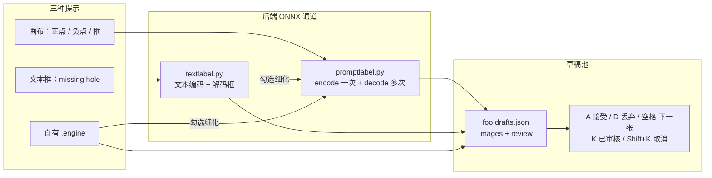

# 6-web —— TRTForge Web Studio

浏览器版工作站，用来替代 `4-qt-studio` 的 Qt 桌面程序。

给人看的操作步骤、界面截图和流程图在 [`docs/TRTForge_Web操作手册.md`](../docs/TRTForge_Web操作手册.md)（对照界面 v1.28.0）。本文件继续记录启动方式、实现细节和版本变更。

发给使用人员、不附带本仓库源码的安装包，用仓库里的 `packaging/package_web_user.ps1` 生成（CUDA 11.8，含训练环境安装脚本）。

## 为什么有这个目录

Qt 版本的问题是：**每台机器都要先装 Qt 6.8.3 + MSVC 才能编出界面**。本机长期没有 Qt，
`TRTForge.exe` 一直编不出来，界面等于不可用。

Web 版把界面换成浏览器，换来三件事：

| 事项 | Qt 版 | Web 版 |
| --- | --- | --- |
| 装环境 | Qt 6.8.3 + MSVC，编译几十分钟 | 装 Python 包，秒级启动 |
| 远程使用 | 只能坐那台机器前 | 局域网内任何浏览器 |
| 改界面 | 重新编译整个程序 | 改完刷新 |

**底层能力一行没重写**：训练仍走原来的 launcher，推理仍走原来编好的 DLL。

## 快速开始

### 1. 装依赖

```powershell
# 用装了 torch 的那个环境（训练需要）
D:\Anaconda3\envs\dpenv\python.exe -m pip install -r 6-web\backend\requirements.txt
```

关于 `numpy`：早期这里锁了 `numpy<2`，因为 torch 2.3.0 是按 numpy 1.x 编的。2026-10-30 实测
`torch 2.3.0 + numpy 2.5.4` 的 CUDA 前向与 numpy 桥接均正常，且 `onnxruntime 1.20.1` 已支持 numpy 2，
所以上限放宽到 `<3`。

为什么不干脆锁回 `<2`：Ultralytics 的 AutoUpdate 会在 `yolo export` 时把 numpy 自动升到 2.x，
锁 `<2` 只会让环境在每次导出后反复漂移。唯一残留告警是 `scipy 1.14.0` 声明要求 numpy<2.3，
导入时会打一行 `UserWarning`，实测不影响 anomalib 训练与推理。

### 2. 编推理 DLL（只需一次）

Web 版的推理依赖 `yolo_infer.dll` 与 `anomalib_infer.dll`。它们**不依赖 Qt**，但要 OpenCV。

```powershell
$env:OPENCV_DIR = "E:\thirdparty\opencv"
$env:NVCC_PREPEND_FLAGS = "-D_ALLOW_COMPILER_AND_STL_VERSION_MISMATCH --allow-unsupported-compiler"

powershell -File scripts\build_infer_dlls.ps1
```

第二个环境变量是给 **CUDA 11.8 + MSVC 14.44** 这组搭配用的，原因见「常见问题」。
产物落在 `4-qt-studio/bin/`。

编 `onnx_infer.dll` 前先准备 ONNX Runtime（不进 git）：

```powershell
powershell -NoProfile -ExecutionPolicy Bypass -File scripts\fetch_onnxruntime.ps1
```

OCR 模型同样不进 git。默认目录是 `9-python-paddleOCR/model/legacy_v4/`
（`ch_PP-OCRv4_det_infer`、`ch_PP-OCRv4_rec_infer`、`ch_ppocr_mobile_v2.0_cls_infer`），
下载地址、`inference.yml` 生成命令，以及另外几项不入库目录，写在仓库根 `readme.md` 的
「不入库、换机器要自己准备的文件」。也可以用环境变量 `TRTFORGE_OCR_MODEL_DIR` 指到别的目录。

### 3. 启动

**最省事的方式（推荐）**：双击仓库根目录的 `启动Web端.bat`。
它会自动找 Python、检查端口、等服务起来后再打开浏览器。

```bat
启动Web端.bat              :: 默认 127.0.0.1:8060
启动Web端.bat 8070         :: 换端口
启动Web端.bat 8070 nobrowser  :: 不自动开浏览器
启动Web端.bat 8060 reload     :: 改后端代码时热重载
```

也可以直接跑 PowerShell 脚本（参数更全）：

```powershell
powershell -NoProfile -ExecutionPolicy Bypass -File scripts\run_web_studio.ps1
```

打开 <http://127.0.0.1:8060>。顶部状态灯变绿写「环境就绪」就说明一切正常。

两个脚本都会做**端口预检**：端口被占用时会告诉你占用进程与启动时间，
交互式终端里还会问一句「结束它并继续启动？」（答 N 则中止，退出码 1）。
这条检查不是多余的——旧进程没关干净时 uvicorn 只报 10048，
用户却以为重启成功，实际连的还是旧代码。

> `scripts\start_web.bat` 内部刻意只用 ASCII：cmd.exe 解析含多字节字符的
> UTF-8 批处理时会截断/错行（码页老问题），中文提示因此全部放在
> `run_web_studio.ps1` 里。

常用参数：

```powershell
# 换端口
powershell -File scripts\run_web_studio.ps1 -Port 8070

# 指定训练解释器
powershell -File scripts\run_web_studio.ps1 -PythonExe D:\Anaconda3\envs\dpenv\python.exe

# 改前端代码时热重载
powershell -File scripts\run_web_studio.ps1 -Reload

# 让局域网别的机器也能访问
powershell -File scripts\run_web_studio.ps1 -HostName 0.0.0.0
```

## 页面说明

### 训练导出

1. 选「训练类型」：YOLO 或 Anomalib，表单会自动切字段。
2. 填 `dataset.yaml`（YOLO）或数据集 root（Anomalib），可用「浏览」按钮选。
3. 点「检测环境」先确认 Python / torch / CUDA 是否就绪（会列出缺哪个包和修复命令）。
4. 点「开始训练」，右侧实时出日志、进度条、指标。

日志是流式的，不是训练完才一次性吐出来。中间关掉浏览器训练**不会停**，重新进来点任务还能继续看。

#### 训练进度面板（v1.13）

进度条上方那排数字不是装饰，训练开始后每秒都在动：

| 位置 | 含义 | 数据来源 |
| --- | --- | --- |
| 阶段徽标 | 运行中 / 已完成 / 已停止 / 失败 | 任务事件 |
| `epoch 12/100` | 当前轮次 | 后端 `progress` / `epoch_summary` 的 `epoch`、`total`（真实值） |
| `12.0%` | 已完成轮次占比 | 同上（真实值） |
| `已用 3:20` | 从点开始训练到现在 | 前端计时 |
| `每轮 ≈ 18s` | 最近 3 轮耗时的**中位数** | 前端按 `epoch_summary` 到达时间算 |
| `预计剩余 22:10` | 剩余轮数 × 每轮耗时 − 本轮已过去的时间 | 前端推算 |

两处刻意的取舍：

- **用中位数、不用平均值**：第 1 轮要扫数据集、建缓存，耗时常常是后面几轮的几倍，
  平均值会让整段训练的剩余时间长期偏高。取最近 3 轮的中位数，第 2 轮之后基本就准了。
- **「预计剩余」是推算值**，launcher 不提供 ETA。它只影响观感，不影响训练本身。

另外三个折叠块（默认收起，不占地方）：

| 折叠块 | 内容 |
| --- | --- |
| 实际执行的参数 | 完整命令行。以前只在日志里打一行，现在可以复制出来核对「我填的到底传没传」 |
| 每轮指标（最近 20 轮） | 由 `epoch_summary` 的 `losses` / `metrics` / `lr` 动态生成列；列数上限 8，loss 在前、lr 在后 |
| 曲线 | 两张零依赖内联 SVG：左 loss、右验证指标（优先 mAP50-95 与 mAP50），不引任何图表库 |

> 训练结束后 launcher 还会补一次「最终验证」的 `epoch_summary`，其 `epoch = total + 1`。
> 面板会把轮次夹到 `total`（不会出现「epoch 4/3」），这一行在表格里标成 **final**。
>
> loss 曲线优先用 `losses`；实测 8.x 的 `trainer.tloss` 在 `on_fit_epoch_end` 常为 None，
> `losses` 是空字典，此时自动回退到验证损失之和，标题会写明「loss（总，验证）」，
> 不会出现一条永远空着的曲线。

#### 数据增强（v1.7）

表单里有「数据增强（留空则用默认值，共 15 项）」折叠区，包含
`hsv_h/s/v`、`degrees`、`translate`、`scale`、`shear`、`perspective`、
`flipud`、`fliplr`、`bgr`、`mosaic`、`mixup`、`copy_paste`、`close_mosaic`。

- **留空 = 不传 = 用 Ultralytics 默认**，行为与升级前完全一致，历史实验仍可对比。
- **填 `0` = 显式传 0**，不会被当成「没填」而忽略。
- 两个快捷按钮：
  - 「小缺陷预设」→ `mosaic=0.1, close_mosaic=20, scale=0.3, translate=0.05`
  - 「清空（用默认）」→ 所有增强字段恢复留空
- 概率类字段超出 `0~1` 或 `close_mosaic` 为负时，后端**启动前**直接返回 400，不会白等几十秒才报错。

#### 训练前体检：概览 / 增强预览 / 断点续训（v1.14）

这三块折叠区解决同一个问题：**别等训练跑了半小时才发现数据集配错、增强配错、或者白重跑了一遍。**
三块都是「手动触发」，点按钮才算，不点不影响训练。

**1）数据集概览**

点「扫描数据集」→ 后端只读 `dataset.yaml` 和标注文本的行首数字，不解码图像像素。

| 列 | 含义 |
| --- | --- |
| 各 split 图片数 / 标注数 | `train` / `val` / `test` 分别多少张图、多少个标注框 |
| 空标注 | 大小为 0 或没有有效行的 txt（YOLO 允许留作文本为负样本，但比例过高要先查） |
| 有图无标 / 有标无图 | 前者是漏标，后者是删图没删标（**孤儿标注**，训练时直接被忽略） |
| 类别分布 | 每个类别的框数条形图，一眼看出长尾 |
| 分辨率采样 | 抽样读图像头（不解码），给出宽高最常见的几个尺寸 |

扫描结果**按 `yaml 路径 + mtime + 大小` 缓存 60 秒**。大目录（上万张图）第一次要几秒，
之后再点秒回，避免以为卡死重复点。改过 `dataset.yaml` 缓存自动失效。

**2）增强预览**

点「生成预览」→ 后端用 OpenCV 复刻 Ultralytics 的增强流水线，出「原图 vs 增强后」对照图。

- 用当前表单里的增强参数（留空即默认值）**真实生效**：`mosaic → 仿射(degrees/translate/scale/shear/perspective) → hsv → flipud → fliplr → bgr → mixup`
- **seed 决定全部随机**：同参数同 seed 必出同一张图，便于对比「改了某个参数到底变了什么」
- 输出 `imgsz × imgsz` 正方形、灰边(114) letterbox，与训练时预处理一致
- 明确不预览的项会在结果里列出 `ignored`：`copy_paste`（需要分割掩码，检测任务没有）、
  `close_mosaic`（只在最后 N 轮关掉的调度，不影响单张图效果）

> 这是 **OpenCV 近似**，不是 Ultralytics 逐像素复刻：概率性/调度性的东西（每轮比例、缓存、
> 多图拼接时的采样顺序）无法一比一还原。用途是**肉眼确认方向和量级对不对**，
> 不是拿它当训练结果的依据。

**3）断点续训**

点「扫描历史」→ 列出 `--project` 目录下所有能续训的 run：

| 列 | 来源 |
| --- | --- |
| run 名 / 任务 / imgsz | run 目录下的 `args.yaml`（纯文本解析，**不加载 `.pt`**，所以后端不需要 torch 也能扫） |
| `12/100` | `results.csv` 行数 = 已完成轮次；`args.yaml` 的 `epochs` = 计划轮次 |
| 最佳 mAP | `results.csv` 里 `metrics/mAP50-95(B)` 的最大值 |
| `last.pt` 大小 | `weights/last.pt` 的文件大小（MB） |
| 能否续训 | `weights/last.pt` 存在、`data` 指向的 yaml 还在 → 可续训；否则给出 `blocked_reason` |

点某行的「继续训练」→ 自动填好 `model=…/weights/last.pt`、`project`、`name`，
并在按钮上写明「继续训练（从第 N 轮）」。**`--epochs` 照样按你表单里的值传，不会改动历史 run。**

后端多了一个参数：

```
--resume-from <last.pt 的绝对路径>
```

它和 Ultralytics 自带的 `--resume`（从 `get_latest_run()` **猜**一个 run）不同：
`--resume-from` 是你**显式指定**哪个检查点，launcher 用 `model.train(resume=该路径)` 恢复。
`--resume` 在多项目/多目录并存时经常猜到别的 run 上，所以 Web 端只用 `--resume-from`。

> 续训会**写回原 run 目录**（Ultralytics 的 `check_resume` 会用检查点里记录的
> `project/name`），所以历史目录里的 `results.csv` 会继续往后追加行，不会另开一个目录。
> 如果你想要「续训成新实验」，请用表单里正常训练的 `--name` 另起名字，不要用续训按钮。


#### 启动提速与预热进程池（v1.25）

打开训练页，标题右边会有一个小角标：

| 角标 | 含义 | 你要做什么 |
| --- | --- | --- |
| 预热中 | 后台正在起进程、导入 torch 等依赖（首次约 3~5 秒） | 等它变成「预热就绪」，这一段和填表单是并行的 |
| 预热就绪 | 下一次点「开始训练」直接交接任务 | 正常点开始训练 |
| 预热未启用 | `TRTFORGE_WARM=0`、或没找到训练解释器 | 不影响训练，只是每次都要冷启动 |

点「开始训练」之后，进度条上方会一行一行出现启动清单：

```
起进程 0.02s
载入依赖 0.07s     ← 命中预热时这里是几十毫秒
载入模型 0.03s
扫描数据 18.50s    ← 数据集越大概率越大，这一行最值得看
开始训练 · 启动合计 18.62s
```

- **只有真的发生了才出现**，没到的阶段不画灰色占位，免得看起来像卡住。
- 命中预热的那几行是绿色（`is-warm`），一眼能看出这次省掉了多少。
- 开训时清单折叠成一句「启动合计 x.xxs」，后面接正常的 epoch 进度。

**什么时候该关掉预热**：内存很紧（预热进程会占几百 MB）、或排查「是不是复用进程导致的结果异常」时，
设 `TRTFORGE_WARM=0` 重启服务即可。关掉后就是老行为，功能完全一致。

> 为什么「一个进程只跑一个任务」：复用进程能省 import 的开销，但 CUDA 上下文、
> 全局随机种子、Ultralytics 的全局配置都会跨任务残留。折中方案是**预热只预热「导入」，
> 任务一结束就退出**，池子立刻补新的——速度拿到了，任务之间还是干净的。

#### 用已有 best.pt 微调（v1.25）

适用场景：**同一个产品、同一批类别，只是又补了几十上百张图**，想让模型吸收新样本，
又不想从预训练权重重跑 100 轮。

步骤：

1. 「训练前体检 → 断点续训/历史训练」点「扫描历史」，找到目标 run（列表里能看到 `best.pt` 大小和类别数）。
2. 点这一行的 **「用它微调」**（不是「继续训练」）。
3. 表单会被自动填成一组保守值，日志里会写清改了哪几项：

| 参数 | 自动填 | 为什么 |
| --- | --- | --- |
| `model` | `<run>/weights/best.pt` | 起点是你已经训好的权重 |
| `lr0` | `0.001` | 新训默认 0.01，那会把原权重学到的特征冲掉 |
| `epochs` | `30` | 小步修正，不需要跑满 |
| `mosaic` | `0.3` | 小缺陷被拼图后再缩小容易消失 |
| `close_mosaic` | `15` | 最后 15 轮关掉 mosaic，让模型收尾时看原图 |
| `project / name` | 原 run 的目录 | **写回原实验**，不生成 `exp2` |

4. 点「开始训练」。提交前后端会先调 `finetune-check`：

| 检查项 | 结果 |
| --- | --- |
| 任务头不一致（`detect` 权重拿去 `segment`） | **拦住**，不让白跑 |
| 缺少旧类别 / 新增类别 | 提示（不拦），列出差集 |
| `imgsz` 与历史不同 | 提示（不拦），说明会按表单尺寸重训 |

5. 覆盖前会自动备份：`<run>/_prev/<时间戳>/` 下是旧的 `args.yaml`、`results.csv`、`weights/*.pt`。
   想回退，把里面的文件挪回上一层即可。

**不要用它来做这些事**：换产品/换类别体系（直接新训）、把训练中途断掉的 run 接着跑完
（那是「继续训练」，走 `resume_from=last.pt`，会恢复优化器和轮次）。

#### 训练后导出 ONNX（v1.15）


以前「训练导出」这个页签名不副实：训完拿到 `best.pt`，要变引擎必须跳出浏览器敲
`--mode export`，整条网页链路最后一步断在命令行。v1.15 把这一步搬回页面。

展开「导出 ONNX」折叠块：

| 控件 | 说明 | 默认 |
| --- | --- | --- |
| 权重 .pt | 训练产物的 `best.pt` / `last.pt`；「用当前实验 best.pt」按 `project/name` 自动拼路径 | 空 |
| 导出尺寸 imgsz | 必须是 **32 的倍数**，范围 32~2048；不是就**直接拒绝**，不静默取整 | 640 |
| opset | 留空用 Ultralytics 默认 | 空 |
| 生成 .transd.onnx | TensorRT 必须用它（输出转成 `[1, anchors, 4+nc]`） | **勾选** |
| simplify | `onnxslim` 化简；关掉时传 `--no-simplify` | 勾选 |
| dynamic | 动态 batch/尺寸 | 不勾 |
| half | 半精度导出（需要 GPU） | 不勾 |

产物命名与 Ultralytics 一致：**与权重同目录同名**，`best.pt` → `best.onnx` + `best.transd.onnx`。
结果表里 `.transd.onnx` 那一行有「去编译引擎」按钮：点了会自动切到引擎页、填好 ONNX 路径并
触发形状探测，看到「布局正确，可以编译」就能直接构建。

**四个任务头都验证过**（`detect` / `segment` / `pose` / `obb`）：

| 任务 | `.transd.onnx` 输出 | 说明 |
| --- | --- | --- |
| detect | `[1, anchors, 4+nc]` | 常规转置 |
| segment | **`[proto, 检测头]` 两路**，proto 为 `[1,32,H,W]`，检测头 `[1,anchors,4+nc+32]` | proto **必须排第一位**，见下 |
| pose | `[1, anchors, 56]` | 4 框 + 1 类 + 17×3 关键点 |
| obb | `[1, anchors, 4+nc+1]` | 最后一路是角度（弧度） |

> **为什么分割要重排输出**：C++ 侧 `yolo.cu` 对 V8Seg 直接读 `static_dims(1)` 当 proto、
> `static_dims(2)` 当检测头；而 Ultralytics 导出的顺序是「检测头在前、proto 在后」。
> 不重排的话 **trtexec 能编译成功**，推理时才抛
> `V8Seg channel layout invalid (det=32, proto_dim=116)` —— 属于最难查的那种错。

> 转置逻辑 v1.15 也换了判据：不再取「图里最后一个节点」（那是导出顺序的巧合，多一个
> Cast/Concat 就转错，且错误是静默的），改成**按形状识别预测头**（3 维输出；多个时用
> 「通道维 < anchors 维」裁决），并在转置前按任务校验通道数。任务类型以权重自带为准，
> 填错时会提示 `task_overridden`。转置失败只报 `TRANSD_FAILED`，**已导出的原始 ONNX 保留**。

#### 训练完成后一键跑完全流程（v1.17）

页面底部新增 **全流程串联** 卡片（宽度占满整行），把「训练 → 导出 → 校验 → 编译 →
补标签 → 精度验证」六步串起来：

```
train → export(.transd.onnx) → probe(形状校验) → build(.engine) → labels(labels_*.json) → val(精度报告)
```

参数**直接复用上面的「训练参数」表单**，不重复填；卡片只多出四项：

| 控件 | 作用 | 默认 | 什么时候改 |
| --- | --- | --- | --- |
| 引擎精度 | 编译用 `fp16` / `fp32` | fp16 | 精度验收不达标、要看上限时用 fp32 |
| 验证用 split | 精度报告用哪个子集 | val | 想只在没调过参的 test 上验收时改 test |
| 编译后用引擎做精度验证 | 关掉就停在「生成标签」 | 勾选 | 只想要引擎、不想等验证 |
| 跳过训练（用已有 .pt） | 勾上后从导出开始，必须给 `.pt` 绝对路径 | 不勾 | 复用老权重重新出引擎 |

**每一段都是独立任务**，所以：

- 每段有自己的日志。阶段行的「日志」按钮走两条路：**还在跑**的段切到右侧训练日志面板
  （实时流），**已结束 / 服务重启过**的段没有 run 可连，改读 `runtime/logs/{run_id}.log`
  的尾巴显示在卡片内。只做实时流的话，重启后点「日志」只会看到「未知任务」——
  而排障要看的恰恰是结束了的日志；
- 「停止」只停当前那一段。这一点在 Windows 上是必须的——杀父进程不会连带杀子进程，
  如果把整条链做成一个进程组，点了停止训练还在后台占着 GPU；
- 某段失败整条链 `failed`，后面全部 `skipped`，**已完成阶段的产物全部保留**
  （`best.pt` / `.transd.onnx` / `.engine` / `labels_*.json` 都还在磁盘上，可以手工接着往下跑）；
- **不自动重试**：OOM、数据配错这类问题重试一次只是再烧一遍时间。

跑完的产物表直接给下一步的入口：

| 产物行 | 按钮 | 效果 |
| --- | --- | --- |
| TensorRT 引擎 | 去推理引擎 | 填好引擎路径、切到「推理演示」页 |
| 标签文件 | 带到推理页 | 填好 `labels_*.json` |
| 任意一行 | 复制路径 | 复制绝对路径（局域网 http 下走 `execCommand` 兜底） |
| 阶段行 | 日志 | 还在跑 → 切训练日志面板实时看；已结束/重启过 → 读 `runtime/logs/{run_id}.log` 尾部显示在卡片内 |

精度汇总卡片来自 `val_engine.py`：用 `yolo_infer.dll` 在验证集上逐张推理，按 COCO 口径
（IoU 0.50:0.95、全点插值）算 AP，显示 mAP50 / mAP50-95 / P / R / 评估图片数 / GT 实例数。
报告落在 `<run_dir>/val/val_report.json` 与 `.csv`。**目前只支持 `detect`**：
分割 / 姿态 / OBB 的 GT 解码口径还没对齐，勾了也不会算。

**服务重启后**：编排线程没了，但记录还在 `runtime/pipelines/*.json`，历史列表照常显示。
启动时会把遗留的 `running` 记录标成 `cancelled`（原因「服务重启，任务已中断」）——
不这么做，页面会对着一条永远不动的记录轮询，点「停止」还只能拿到 409。

#### 异常检测一键全流程（v1.18）

串联卡片的「类型」下拉新增 **异常检测（Anomalib）**。四段一条链：

```
train_export（训练 + 导出 ONNX + 校准 metadata） → probe（校验 metadata 与 ONNX 形状）
  → build（trtexec 编译 .engine） → val（引擎级 AUROC / 漏检 / 误报）
```

| 参数 | 含义 | 默认 | 备注 |
| --- | --- | --- | --- |
| 模型 | `patchcore` / `padim` / `efficientad` | patchcore | 与训练页一致的三个子类 |
| 输入尺寸 | 训练与导出的 `input_size` | 256 | 必须与 ONNX 的 H/W 一致，否则 val 前就会拦下 |
| 数据集根目录 | Anomalib Folder 数据集（`train/good`、`test/abnormal`…） | — | 勾了「跳过训练」可留空 |
| 跳过训练 | 直接用已有产物目录 | 不勾 | 勾上必须填「产物目录」（含 `metadata.json` 与 `.onnx`） |
| 引擎精度 | `fp16` / `fp32` | fp16 | 与 YOLO 侧一致 |
| 精度验证 | 是否用引擎在测试集上算指标 | 勾选 | 关掉就停在编译 |
| 评估张数上限 | 每个目录最多多少张，0 = 全部 | 0 | 冒烟时填 20 即可 |

**为什么只有四段、而且训练和导出不拆开**：Anomalib 的 launcher 在 `train-export`
一个进程里就完成训练、ONNX 导出、`metadata.json` 阈值校准。为了阶段列表好看而拆成
三个进程，只会多两次模型加载，并把「导出拿到的不是刚训的模型」这类错埋进编排层。

**为什么产物路径要延迟派生**：产物落在 `results/<模型类名>/<name>/v<N>/weights/lightning/`，
`<模型类名>` 是 `Patchcore` 这种类名、`v<N>` 每次训练递增。编排器在训练前根本不知道
路径，所以 `StagePlan.resolve` 在这一段真正开始前才根据 `record["artifacts"]` 拼命令。
硬拼 `v0` 在第二次训练时会指向老模型——老模型同样能编译、同样能出分数，错得毫无提示。

**动态 batch（v1.18 的坑）**：Anomalib 的 `to_onnx` 固定
`dynamic_axes={"input": {0: "batch_size"}}`，导出的 ONNX 输入是 `[-1, 3, H, W]`。
最初版本的 probe 把 `-1` 当成「非法形状」直接失败，于是训练成功的模型卡在第二段。
现在的口径是：

- **batch 动态可以编**：自动补 `--minShapes=input:1x3xHxW --optShapes=input:1x3xHxW
  --maxShapes=input:<max_batch>x3xHxW`，`opt` 取 1 与 DLL 一致
  （`anomalib_infer_c.cpp` 固定 `setBindingDimensions(1x3xHxW)`），`max_batch` 可调（默认 8）；
- **H/W 动态仍然拒绝**：DLL 用 metadata 里的 `input_size` 设形状，与导出时的动态范围
  对不上会静默算错，所以要求带固定 `input_size` 重新导出。

实测（bottle 数据集，Patchcore / 256 / fp16，64 张）：

| 阶段 | 耗时 | 说明 |
| --- | --- | --- |
| train_export | ≈ 3 分 15 秒 | 44 张正常图训练 + 导出 + 校准阈值 |
| probe | < 1 秒 | 读 metadata + ONNX 头 |
| build | ≈ 17 分钟 | 动态 batch（1…8）让 trtexec 多搜一遍 tactic，比静态形状慢 |
| val | ≈ 4 秒 | 引擎推理 64 张，AUROC 1.0 / F1 1.0 |

**精度卡片**（`tools/val_anomaly.py` 产出的 `anomaly_val_report.json`）：

| 指标 | 含义 | 口径 |
| --- | --- | --- |
| image AUROC | 排序能力，与阈值无关 | Mann-Whitney U 秩统计，同分取平均秩 |
| TP/FP/TN/FN · Precision · Recall · F1 | `metadata.json` 的 `image_threshold` 下的混淆矩阵 | 与 DLL 的 `normalized_score >= 0.5` 等价 |
| FPR（误报率） | `FP / (FP + TN)` | 正常图被判成异常的比例 |
| FNR（漏检率） | `FN / (FN + TP)` | 异常图漏判的比例 |
| best F1 阈值 | 扫全部唯一分数找最优 F1 | 只作参考，不会回写 metadata |
| decision_mismatch | 报告判定与引擎判定不一致的张数 | 非 0 说明归一化口径有偏差，需排查 |

#### 像素级诊断（v1.22）

**老版本**只有图像级 AUROC，`pixel` 块是写死的 `{"available": false, "reason": "本版只做图像级"}`。
**新版本**用引擎本来就返回的归一化异常图算出三项诊断，不解掩码：

| 指标 | 字段 | 含义 | 好模型的期望 |
| --- | --- | --- | --- |
| 好图乱指像素 | `diagnostic.normal_false_pixel_rate` | 正常图上被判为缺陷的像素占比（所有正常图取平均） | 接近 0 |
| 异常图定位面积 | `diagnostic.abnormal_marked_rate` | 异常图上超阈值像素占比（异常图取平均） | 小而集中 |
| 指不出位置 | `diagnostic.abnormal_undirected` | 引擎判 NG、但异常图里没有任何像素达标的张数 | **0**（非 0 是硬伤） |

**判定线是 0.5，不是 `pixel_threshold`**

`anomalib_infer_c.cpp:479` 在返回异常图前已经归一化过一次：

    normalizedMap = ((rawMap - pixel_threshold) / (mapMax - mapMin)) + 0.5

所以恰好等于 `pixel_threshold` 的像素在返回图上就是 `0.5`，DLL 自己生成缺陷掩码时也是
`threshold(displayMap, mask, 0.5, ...)`（`:499`）。拿 `pixel_threshold`（例如 `0.172`）去比，
会把绝大多数像素判成异常——报告立刻变成"好板上到处是缺陷"。

**报告字段**

```json
"pixel": {
  "available": true,
  "mode": "diagnostic",
  "auroc": null,
  "auroc_reason": "像素级 AUROC / PRO / AUPRO 需要 ground_truth 掩码…",
  "reason": null,
  "diagnostic": {
    "cutoff": 0.5,
    "normal_false_pixel_rate": 0.0,
    "abnormal_marked_rate": 0.16195,
    "abnormal_undirected": 0,
    "pixel_skipped": 0,
    "map_size": [224, 224],
    "images": { "normal": 4, "abnormal": 4 }
  }
}
```

| 字段 | 应用场景 |
| --- | --- |
| `mode` | `diagnostic`（无掩码）/ `mask`（后续版本有掩码时） |
| `auroc` | 无掩码恒为 `null`，不要拿它当"精度 0" |
| `reason` | 跳过张数、尺寸不统一等提示；正常时为 `null` |
| `pixel_skipped` | 异常图缺失或尺寸为 0 的图数，不影响其余图 |
| `map_size` | 异常图分辨率，用于判断阈值该量级 |

CSV 同时多一列 `pixel_above_ratio`，可以直接定位到"哪一张图在乱指"。

**为什么不算像素级 AUROC / PRO / AUPRO**

三者都需要 ground_truth 掩码，当前数据集只有 `good` / `bad` 两个目录
（`Folder` 数据模块没配掩码）。用整图标签冒充像素标签能算出数字，但它在惩罚模型
"把好区域判正常"，比不给数字更有害。掩码目录的约定（显式 `--mask-dir` 优先、
其次 MVTec 风格 `ground_truth/<类别>/*_mask.png`）已定为下一版接口。

**跳过训练**适合反复调编译参数：填上次的 `weights/lightning` 目录，`probe → build → val`
照常跑，不必再等训练。


### 推理演示

> **v1.8 起为「推理控制台」，相对 v1.7 的变化见本节末尾的「v1.8 变更点」。**

1. 选 YOLO 或 Anomalib。
2. 从「模型」下拉选一个训练产物（也可手工填路径，下拉不会强制覆盖手填值）。
   下拉数据来自后端扫描 `runs/**/weights/*.engine` 与 `results/**/*.engine`，
   选中后会自动填好引擎、同名 ONNX、标签文件、`metadata.json` 与任务类型。
3. 调参数：YOLO 有 `conf` / `nms` 滑块；Anomalib 有图像阈值、像素阈值两组滑块
   （勾上「沿用 metadata 默认值」则不覆盖）。
4. 选图片，点「开始推理」。

**v1.8 变更点**

| 项 | v1.7 | v1.8 |
| --- | --- | --- |
| 类别名 | 只显示 `cls0`/`cls1` | 读 `labels_*.json` 显示真实缺陷名（缺失字段、BOM、`null` 均容忍） |
| 检出框 | 后端画死在 PNG 上 | 后端只出**干净原图** + 前端 SVG 叠加层；后端 PNG 仅供导出 |
| 缩放时的标签 | 跟着一起放大到看不清 | 标签用逆缩放补偿，任何倍率下都是恒定字号 |
| 参数输入 | 数字框，直接敲 | 滑块 + 数字框双向联动，非法值即时回退 |
| Anomalib 阈值 | 只能用 `metadata.json` 里的 | 可覆盖，响应同时给出「生效值 / 原值」并标明是否被覆盖 |
| 热能图 | 无 | `cv2.applyColorMap` 渲染，可选色带，阈值变化即时反映 |
| 引擎句柄 | 无上限，改参数会不断累积 VRAM | LRU，上限 4，淘汰时**立即** `yi_destroy` / `ai_destroy` |
| 结果明细 | 只有一段文字 | 可排序表格，点行高亮对应框；置信度直方图；计时分解条 |
| 导出 | 只能右键存图 | JSON / CSV 客户端导出，内容与屏幕完全一致 |

#### 推理页：metadata 推荐阈值回显（v1.21）

勾上「沿用 metadata 默认阈值」之后，两个阈值框是**只读**的，值来自 `metadata.json`。
v1.20 及以前这里只有一个 `disabled`，框里留着默认 `0.5`——推荐值藏在文件里，
必须跑一次推理、再去结果行看 `（metadata）` 才知道实际用了多少。v1.21 把它提前读出来：

| 项 | v1.20 | v1.21 | 意义 |
| --- | --- | --- | --- |
| 只读框显示 | 默认 `0.5` | 文件里的真实值（`0.172` / `0.1634`） | 不跑推理也知道会用多少 |
| 推荐值卡片 | 无 | 「图像阈值 / 像素阈值 / 模型 + 输入尺寸」三行 | 阈值与模型一起看，避免张冠李戴 |
| 精度 | — | 4 位小数（`0.1720` ≈ `0.17198532`） | 校准值不会被糊成 `0.17` |
| 来源标记 | 无 | 有 `calibration` → 「已校准 100%」；否则「文件原值」 | 分清现场标定值与训练集默认值 |
| 读取失败 | 框里留着旧数字（误导） | 框清空 + 卡片「读取失败」+ hint 给原因 | 不拿上一次的数字冒充本次推荐值 |
| 手动覆盖 | 看不出原值 | hint 变成「手动覆盖中：… metadata 原值 图像 … ／ 像素 …」 | 过几天回来也知道改没改 |
| 滑块步长 | `0.01` | `0.0001` | 想复现 `0.172` 这种阈值不用改源码 |

**数据怎么来**：`GET /api/infer/anomalib/metadata?path=<metadata.json>`，只读文件、
**不建引擎句柄**，所以改路径可以随时刷新，不会卡几秒去加载模型。

**刷新时机**（三条都会触发）：

1. 手改 `metadata.json` 路径并失焦（`change` 事件）；
2. 点「浏览」从原生对话框选文件（`writeValue()` 会补发 `change`）；
3. 从下拉选训练产物（自动填好路径后显式刷新一次），以及从别的页签切回「推理演示」。

**响应字段**

| 字段 | 类型 | 说明 | 应用场景 |
| --- | --- | --- | --- |
| `path` | str | 实际读取的绝对路径 | 核对读的是不是那个校准版文件 |
| `image_threshold` | float \| null | 图像级判定阈值（0~1） | 判定 OK / NG 的门槛 |
| `pixel_threshold` | float \| null | 像素级异常区域阈值 | 圈异常区域的门槛 |
| `model_type` | str | `Patchcore` / `Padim` / `EfficientAd` | 确认引擎与 metadata 是否配套 |
| `input_size` | [int, int] \| null | ONNX 的 H/W | 与引擎形状对不上时先看这里 |
| `normalization` | str | 归一化方式 | 排查分数尺度问题 |
| `pred_scores` / `anomaly_maps` | [float, float] \| null | 分数 / 异常图的 `min`、`max` | 判断 0~1 归一化是否成立 |
| `sample_accuracy` | float \| null | 校准样本判对率 | 低于 1.0 说明阈值可能偏松 |
| `error` | str | 解析失败原因 | 失败时接口返 400，`detail` 就是这句 |

**容错**：BOM、字段缺失、类型不对、坏 JSON、`0.0` 阈值都有明确语义——`0.0` 是**有效值**
（校准后的正常样本分数恒为 0 时会出现），不能当成"没读到"；坏 JSON 与越界路径分别是
400 / 403，前端会原样显示原因。

结果区是**独立窗口**，排在同一排，每个都能单独操作：

| 窗口 | 内容 | 默认 |
| --- | --- | --- |
| 原图 | 上传的原始图片（YOLO 的框叠在这上面） | 开 |
| 检出结果 / 异常叠加 | YOLO 为 SVG 框层；Anomalib 为热力叠加图（可调透明度） | 开 |
| 热能图 | 仅 Anomalib，纯热力图，无原图内容 | 关 |
| 异常区域 | 仅 Anomalib，原图 + 半透明红色异常区域（v1.30.4 起；之前是"异常轮廓"） | 关 |

窗口顶部的胶囊按钮可独立开关显隐，**开关状态会记住**（存在浏览器本地，
键名带页面标识，所以不会和以后标注页的同名窗口互相覆盖）。

每个窗口内部的图像交互：

| 操作 | 效果 |
| --- | --- |
| 滚轮 | 以**光标位置为锚点**缩放（0.1× ~ 20×），光标下的那个缺陷不会跑掉 |
| 左键拖动 | 平移；拖出窗口边界也不中断 |
| 双击 / `FIT` | 复位成完整可见 |
| `1:1` | 原始像素大小，用来判断缺陷的真实像素尺寸 |
| `+` / `−` | 以视口中心为锚点缩放 |

倍率实时显示在窗口右上角。窗口内滚动不会带动整页滚动。

YOLO 返回干净原图与每个目标的类别名/置信度，框由前端画在 SVG 上
（`js/overlay.js`，`viewBox` 取图像原始像素尺寸，线宽用 `non-scaling-stroke`
保证缩放时不变粗）；Anomalib 返回异常分数、OK/NG 判定、热力叠加图、纯热力图
和红色异常**区域**图，并附带生效阈值。

> 推理需要引擎文件。仓库里没有现成的 `.trt`，得先用训练页导出 ONNX，再转 TensorRT。
>
> ⚠️ **YOLO 引擎必须用 `.transd.onnx` 编译，不能用 `best.onnx`。**
> 两者输出布局不同：
>
> | 文件 | 输出 shape | DLL 能否解析 |
> | --- | --- | --- |
> | `best.onnx` | `[1, 4+类别数, 候选框数]` | ❌ |
> | `best.transd.onnx` | `[1, 候选框数, 4+类别数]` | ✅ |
>
> 用错时 DLL **不报错**，但会返回 `confidence=957`、`top=-725` 这类垃圾框。
> Web 接口已加校验：出现置信度不在 0~1 的情况直接返回 **HTTP 400**，
> 提示「请用 `.transd.onnx` 编译」。
>
> 完整实测链路见根目录 `readme.md` 的 v1.3 记录（PCB 6 类 / mAP50 0.945 / 引擎 8.41ms）。

#### 目录批量 · 视频 · 摄像头（v1.16）

单张推理只能看一张图，产线要的是"一批"和"一段"。这个卡片加了三种批量形态，
**引擎、标签、任务类型、`conf` / `nms` 全部复用上方「推理设置」**，不需要重复填：

| 模式 | 怎么跑 | 适合 | 产物 |
| --- | --- | --- | --- |
| 目录批量 | 子进程 `infer_batch.py` | 跑完一个文件夹、出报表 | `annotated/` + `results.json` + `results.csv` + `annotated.zip` |
| 视频 | 子进程 `infer_video.py` | 离线跑一段录像 | `*_annotated.mp4` + `detections.json` |
| 摄像头 | 在进程内逐帧 `POST /api/infer/frame` | 现场看实时画面 | 不落盘（帧不出本机） |

为什么前两者走子进程、摄像头走 HTTP 单帧：

- 批量与视频是**长任务**，需要随时停止、要看进度、要能关掉页面继续跑。
  子进程天然支持这三件事（`runners.py` 杀进程即取消），WebSocket 直接复用训练那套事件流。
- 摄像头是**闭环实时**。若也落个"视频任务"，每帧都要过一次任务队列，
  延迟会越堆越大；单帧接口请求-应答完就结束，前端拿框自己画，端到端就是一次推理的时间。

**目录批量**

| 参数 | 默认 | 说明 |
| --- | --- | --- |
| 图片目录 | 必填 | 服务端路径，可填单个图片文件；「浏览」用后端目录选择器 |
| 最多处理张数 | 0 | 0 = 全部；调试时填 3 能快速验证引擎对不对 |
| JPEG 质量 | 92 | 标注图重编码质量。原图 PNG 转 JPEG 体积能降一个数量级 |
| 包含子目录 | 开 | 关掉只扫当前层 |
| 打包 `annotated.zip` | 开 | 单文件下载，省得一张张右键另存 |
| `results.json` 含每个框 | 开 | 关掉只留统计，文件能小十倍（几百张图时很关键） |

产物目录 `runtime/infer/<时间戳>-batch-<随机>/`，结构固定：

```
annotated/00001_xxx.jpg      # 与输入顺序一致，文件名做了净化（中文/括号/空格都安全）
results.csv                  # utf-8-sig + \n 换行，Excel 双击不乱码、不空行
results.json                 # 全量框（可关）
annotated.zip                # 上面 annotated/ 的压缩包
job.json                     # 本次参数与耗时，便于复现
```

`results.csv` 的列：`index,file,width,height,count,status,error,classes`。
单张图解码失败或推理抛异常**不会中断整批**：那一行 `status=error`、`error` 写原因，
其余照常跑完——产线上一张坏图不该让 500 张白跑。

**视频**

| 参数 | 默认 | 说明 |
| --- | --- | --- |
| 视频文件 | 必填 | mp4 / avi / mov / mkv |
| 抽帧步长 | 1 | 每 N 帧处理一次，1 = 逐帧 |
| 最多处理帧数 | 0 | 0 = 全部 |
| 输出长边上限 | 0 | 0 = 原尺寸；填 960 可以显著加快编码 |
| 编码器 | auto | `auto` 依次试 `avc1` → `H264` → `mp4v` |
| 逐帧明细 | 开 | 额外产出 `detections.json`（每帧的框），体积较大 |

两个坑，代码里都做了处理：

1. **`cv2.VideoWriter.isOpened()` 会骗人。** 机器上没有 `libopenh264` 时，
   `avc1` 也会返回 `True`，但写出来的文件是 0 字节。所以选编码器时是
   **真写一帧黑帧再看文件大小**，能写出非空文件才算可用。
2. **抽帧不能改播放速度。** 步长 N > 1 时输出帧率写为 `原帧率 ÷ N`，
   而不是照抄原帧率——否则 30 帧的 3 秒片会变成 1 秒的"快进"。

**摄像头**

浏览器 `getUserMedia` 采集，逐帧压成 JPEG 发到 `/api/infer/frame`，后端只回
**纯 JSON 的框 / 多边形 / 关键点 / 类别色**，不回图片（回 base64 图会让带宽和
渲染一起爆掉），框由前端 canvas 画。

| 参数 | 默认 | 说明 |
| --- | --- | --- |
| 采集分辨率 | 1280×720 | 640×480 更快，1920×1080 更细 |
| 帧率上限 | 8 | 相机按这个间隔取帧；上一帧没回来就跳过，不排队 |
| 显示类别与置信度 | 开 | 只影响绘制，不影响后端 |

"上一帧没回来就跳过"是刻意的：用 `setInterval` + 在途标志位，而不是等上一帧回来再发下一帧。
网络或引擎一慢，表现是**掉帧**而不是**延迟累积**——实时画面最不能忍的是越跑越滞后。

没有摄像头 / 用户拒绝授权时，卡片回到「未启动」并给出原因
（实测：`无法打开摄像头：Requested device not found`），不会卡在「启动中」。

**v1.16 与 v1.15 的区别**

| 项 | v1.15 | v1.16 |
| --- | --- | --- |
| 推理输入 | 一张图 | 一张图 / 一个目录 / 一段视频 / 摄像头实时画面 |
| 批量产物 | 无 | 标注图目录 + CSV + JSON + ZIP，可单文件下载 |
| 取消 | 只能等单张跑完 | 子进程 `terminate`，已产出的文件保留 |
| 坏图 | 整个请求 500 | 单条 `status=error`，整批继续 |
| Anomalib | 单张 | 支持目录批量（视频/摄像头仍只支持 YOLO） |
| 下载安全 | — | `/api/infer/artifact` 限定在 `runtime/infer` 内，越界返回 404 |

### 引擎构建

把 ONNX 编译成 TensorRT 引擎，参数与 `trtexec` 一一对应。

1. 选 ONNX 文件。选完会自动探测并显示输入/输出形状与文件大小。
2. 输出引擎留空即可，会按 `<onnx名>_<fp16|fp32>.engine` 自动推导。
3. 选精度（fp16 省显存，推荐）、workspace，需要变分辨率时勾「动态 shape」并填 min/opt/max。
4. 点「开始构建」，日志实时滚动，状态徽标从「构建中」变为「已完成/失败」。

#### 「输出引擎」要的是完整文件路径，不是目录（v1.18.1）

浏览器没有系统文件对话框，「浏览」只能选到**目录**。早先选中目录后字段里只有
`D:\test\deeplearning\dp-tool` 这样的目录，提交时被后端以
「输出文件名需以 .engine / .trt / .plan 结尾」拒绝，用户卡在这一步。

现在的规则（`frontend/js/engine.js` 的 `normalizeEngineOut`，纯函数有单测）：

| 输入 | 结果 | 说明 |
| --- | --- | --- |
| 留空 | 自动推导 `<onnx名>_<精度>.engine` | 与后端推导完全一致，推荐 |
| 目录（浏览选中） | `目录\<onnx名>_<精度>.engine` | 选中目录后立刻补全，并提示补成了什么名字 |
| 已带 `.engine/.trt/.plan` | 原样保留 | 手工改的名字不会被覆盖 |
| `.onnx` 路径 | 换成 `<名>_<精度>.engine` | 贴错成 onnx 路径也能救回来 |
| 只有裸名字（无路径成分） | 原样保留 | 不擅自猜目录，交后端报明确错误 |

文件名也可以直接在输入框里改（例如 `dp-tool\pcb960_fp16.engine`）；
规范化在 `change` / `blur` 和「开始构建」提交前各做一次，改完不离开输入框直接点也能生效。

另外修掉了「浏览」弹窗的两个卡点：字段里已经是文件路径时再点「浏览」，现在会退到
父目录（以前 `/api/browse` 直接 404，弹窗只剩一句「无法读取」）；浏览选中后
会补发一次 `change`，让 ONNX 字段立刻重新探测形状。

选错文件不会白等：输出形状是 `[1, 4+类别数, 候选框数]` 的「未转置」YOLO 模型，
提示会变红，后端也会直接返回 400 拒绝构建。

构建完成后，引擎文件路径可直接填到「推理演示」页使用。

实测参考（PCB 6 类模型，960×960，FP16，RTX 3060 8G）：

| 项 | 数值 |
| --- | --- |
| 构建耗时 | 474.1 s |
| 引擎大小 | 10.14 MB |
| 吞吐 | 135.4 qps |

#### 构建进度与预计时间（v1.13）

> **百分比是估算值，不是 trtexec 报的真实进度。**
> trtexec 在整个 tactic 选择阶段**一行日志都不打**：真实日志
> `runtime/logs/f066553e4df2.log` 里 `Local timing cache in use.` 到
> `Engine built in 474.149 sec.` 之间是整整 **473 秒的空白**。没有进度可读，
> 只能按「历史耗时 + 阶段边界」推算，界面上的口径说明也如实写明了这一点。

界面元素：

| 元素 | 说明 |
| --- | --- |
| 阶段清单 | 8 个阶段：启动 / 解析 ONNX / 解析完成 / 构建与 tactic 搜索 / 序列化 / 校验 / 推理基准 / 完成。已过为绿、当前为青 |
| 百分比 | `已用 ÷ 估算耗时`，并夹在本阶段区间内（构建段封顶 **94%**，基准段封顶 **99%**） |
| 已用 / 预计剩余 | 前端每秒刷新，不依赖后端事件（心跳是 2 秒一条） |
| 估算依据 | 启动时显示「预计约 N 分 M 秒」并注明是估算 |

三条设计约束（改之前先想清楚为什么）：

1. **只有 `&&&& PASSED` 才到 100%。** 阶段上限刻意不衔接 100，因为估算必然有误差；
   进度条冲满却还在跑，比停在 94% 更让人怀疑是不是卡死了。
2. **失败/中断不补 100%。** 进度停在失败发生的位置，由 `finished` 事件说明结果。
3. **估算会越用越准。** 每次成功的构建都从 `Engine built in X sec.` 抓真实耗时，
   写进 `runtime/engine_stats.json`；下次相同（精度 / 动态 / 体积 ±67% / 分辨率 ±20%）
   的构建直接用历史**中位数**，不再用公式。

无历史时的外推公式（常量在 `backend/progress.py`）：

```
秒数 = 38.3 × ONNX_MB × (imgsz / 960) ^ 0.4     # FP16；FP32 再 × 0.7
```

`38.3` 与 `0.4` 都是实测反解出来的，两个数据点：

| 模型 | ONNX | 输入 | 实测 `Engine built in` | 公式给出 |
| --- | --- | --- | --- | --- |
| PCB 6 类 | 12.39 MB | 960×960 | 474.1 s | 474.5 s |
| PCB 6 类（3 轮微调后导出） | 12.07 MB | 320×320 | 313.6 s | 298 s |

> 表中的「实测」取自日志里的 `Engine built in X sec.`，也就是估算要预测的那一段；
> 浏览器上显示的「实际 5 分 17 秒」是进程总时长（含解析与推理基准），两者差几秒是正常的。

> 为什么指数是 `0.4` 而不是 `2`：第一版按「面积」推算（`(imgsz/640)^2`），
> 对 960 能对上但把 320 估成 **53 秒**，实测要 **5 分 17 秒**。
> 原因是耗时主要由「层数 × 每层候选 kernel 数」决定，输入尺寸只影响每次候选的试跑成本；
> 而且分辨率小 → 激活值小 → 显存里能塞下更多 tactic，搜索空间反而更大。
> 按两个实测点反解得到指数 ≈ 0.37，取 0.4。

> 若看到「预计剩余 0:00」但仍在构建，通常是实际比估算慢（GPU 被别人占用、
> 模型改动）。进度会停在 94% 等真实结果，这是预期行为，不是卡死。
> 想确认还在跑：看日志是否有新行，或 `nvidia-smi` 里 trtexec 是否占用 GPU。

### 数据集

把已有的标注重新划分、并导出成训练可直接用的格式。

1. 选数据源：YOLO 数据集目录（含 `images/`、`labels/`、`data.yaml`），或 Qt 的 `.tfanno` 工程文件。
2. 任务类型默认「自动识别」（按标签每行字段数猜 detect / segment / pose / obb），猜错可手动指定。
3. 填 train / val 比例，右侧会实时显示 `test = 100 - train - val`。
4. 点「扫描预览」：显示总图片、各集张数、空标注数、类别数，以及每张图的「现有划分 → 新划分」。
5. 选导出格式与输出目录，点「开始导出」。
6. 可选：点「体检」查重复图 / 同底板分组 / 标注问题（见下方 v1.34.3）；导出前把「划分口径」
   从 `none` 改成 `prefix` 或 `dir`，即可让同一块底板的图只落在一个划分里。

**划分规则（与 Qt 版对齐，务必注意）**

- 比例是**向下取整**：`train = 总数 × train% ÷ 100` 取整、`val` 同理；
- **剩下的全部归 test**，所以 80/20 时 test 是余数（692 张 → 553 / 138 / 1），
  填 70/20/10 才能得到 70 / 20 / 剩余 10；
- 排序用 **FNV-1a 64 位 + `_2026` 盐值**，保证同一份数据在任何机器、任何进程上
  结果逐项一致。Qt 用的是 `qHash`，哈希函数不同，因此与 Qt 历史划分**不逐张一致**，
  这是为了让划分可复现而做的取舍。

**导出格式**

| 格式 | 产物 | 限制 |
| --- | --- | --- |
| YOLO | `images/{train,val,test}` + `labels/{split}/*.txt` + `dataset.yaml` | 全任务支持；`dataset.yaml` 已实测能被 Ultralytics 直接识别 |
| COCO | `annotations.json`（images / annotations / categories） | 不复制图片，图片以 `file_name` 记录；不支持 OBB |
| VOC | `Annotations/*.xml` + `JPEGImages/` | **仅 detect**（水平矩形），其余任务直接拒绝 |

**误操作防护**

- 输出目录不能放在数据源内部（会自我复制）；
- 目标目录非空时必须勾「允许覆盖」；
- `train + val > 100` 直接拒绝；
- 比例向下取整导致某集为 0 张时，导出摘要会明确告警，不会静默产出空训练集。

实测参考（PCB 6 类 / 692 张 / 3034×1586）：扫描 692 张、2950 个对象、0 空标注；
70/20/10 → 484/138/70；YOLO 标签往返逐值无损；COCO 2950 条标注；VOC 692 个 XML。
验收脚本：`python 6-web/backend/tools/test_dataset_workbench.py`（20 项）。

#### 数据集指纹（v1.34.2）

导出时会算一个**内容指纹**并写进 `<输出目录>/manifest.json`，回答「这批图到底是哪一批」。

- **算法 `v1`**：每个 split 内取 `相对路径 + 文件字节数 + 标注文件原始字节哈希`，
  排序后 sha256 取前 16 位；三个 split 的摘要再合成整批指纹。
- **三个粒度**：`dataset_fingerprint`（整批，判断能不能横比）、
  `split_fingerprints`（只改了 val 吗）、`label_fingerprint`（只算标注、不含路径，
  判断「模型变了还是标注变了」）。
- **相对路径以 split 的 images 目录为基准**，所以同一批数据导出到 `D:\out_a` 与
  `E:\out_b`、或镜像到 `splits/`，指纹完全相同。
- **重命名算变化**：路径进哈希。重命名图片时必须同步改标签文件名，否则那条标注会丢。
- **不哈希图片内容**：只读 `stat` 与标注文本，650 张约 0.14 秒；因此
  「同名同大小但内容被换」发现不了，界面上会写明这个边界。

| 指纹字段 | 类型 | 含义 |
| --- | --- | --- |
| `algo` | string | 算法版本，当前 `v1` |
| `dataset_fingerprint` | string(16) | 整批指纹 |
| `short` | string(8) | 前 8 位，页面与台账展示 |
| `split_fingerprints` | object | `{train, val, test}` 各自指纹 |
| `label_fingerprint` | string(16) | 标注文本指纹（不含路径） |
| `counts` | object | `{train, val, test}` 图片数 |
| `error` | string | 计算失败原因；空表示正常 |

重复导出到同一目录时，内容未变会返回 `unchanged: true`。覆盖导出前会清理上次的
`images/`、`labels/`（或分类的 `train/val/test`、VOC 的 `JPEGImages/Annotations`），
避免同名图被 `_copy_image` 累积成 `xxx_2.jpg` —— 那会让「同一批数据再导一次」得到
不同指纹。

指纹还会写进：训练 `run.meta.dataset`、训练目录 `train_meta.json`、
`7-autoresearch-yolo` 的 `exp_NNNN.json` / `results.tsv` 的 `data_fp` 列 / `best.json`，
以及引擎旁的 `<engine>.meta.json`。

#### 数据集体检与按组划分（v1.34.3）

**要解决的问题**：`PCB data/PCB缺陷检测` 这类工业数据集合计 692 张，实际只有 **10 块底板**，
每块底板拍了几十张「同位置、不同缺陷」的图。按图片随机划分时，同一块底板必然同时出现在
train 和 val 里；模型记住的是底板外观，val 指标虚高、上线就掉。指纹（上一节）回答
「是不是同一批数据」，体检回答「这批数据本身干不干净」，两者都只读。

点「体检」后页面显示三块内容：指标行（图片数 / 底板组数 / 跨划分组数 / 错误·警告计数）、
可展开的底板组列表（跨划分的组带红色标记）、按规则折叠的标注问题列表。

**分组判定分两级，绝不自动删图**

| 级别 | 判定 | 用途 |
| --- | --- | --- |
| A 完全重复 | 文件 `sha256` 相同（改名/复制出来的那张） | 只报告，供人工清理 |
| B 同底板 | **256 位 dHash**（17×16 灰度图比较相邻像素）汉明距离 ≤ 8，**且** 32×32 灰度平均绝对差 ≤ 2.0 | 泄漏告警 + 按组划分，**永不自动删除** |

为什么要第二种校验：dHash 只看梯度符号，PCB 的大面积纯色板面在纯哈希下**可能**让不同底板撞位，
一旦漏判就会给出错误的泄漏结论；MAE 用真实像素再确认一次。另外 64 位 dHash（阈值 ≤6）在这份
数据上也能分出这 10 组，但常规「重复图去重」会顺手删掉组内 691 张、毁掉全部缺陷样本——
所以本版把「完全重复」和「同底板」分成两级，B 级只告警、永不自动删除。

**标注质检规则**（逐行检查，永不抛异常；级别只影响排序与着色，不阻断导出/训练）

| 级别 | 规则码 |
| --- | --- |
| error | `LBL_MISSING` 标注缺失、`LBL_FIELD` 字段数不符、`LBL_PARSE` 数值无法解析、`LBL_CLASS_RANGE` 类别越界、`LBL_COORD_RANGE` 坐标越界、`LBL_ZERO_AREA` 零面积 |
| warn | `LBL_TINY` 面积 <0.01%、`LBL_HUGE` >60%、`LBL_BORDER` 贴边、`LBL_DUP_BOX` 同图两框 IoU>0.9、`LBL_CLASS_ABSENT` 某类缺失 |
| info | `LBL_EMPTY` 空标注、`LBL_IMBALANCE` 某类占比 <2%、`GRP_LABEL_DIFF` 同底板同位置标了不同类别 |

**按组划分（`group_by`）**

- `none`（默认）：v1.6 起的逐图哈希划分，行为不变；
- `prefix`：按文件名前缀分组（`01_xxx.jpg` 的前缀是 `01`），适合 `01_` 这种底板编号命名；
- `dir`：按父目录名分组，适合「一块板一个文件夹」的组织方式。

同组必须整组进同一个划分。实现是「补最大缺口」的贪心：每次取下一个组，放进
（目标张数 − 当前张数）缺口最大的那一侧。组数少于 2 或单组过大时比例会明显偏离设定值，
报告与 `manifest.json` 都会写明，这是刻意取舍——宁可比例不准，也不要泄漏。
`manifest.json` 新增 `split_mode: {mode, groups, note}` 与 `group_signature`，事后可证。

**缓存**：签名缓存到 `runtime/dsqc_cache.json`，键为 `绝对路径｜字节数｜纳秒mtime`，
文件被覆盖即失效；`algo` 版本变化整体作废；上限 20000 条，超出按写入时间丢最旧一半。
692 张首次约 1~10 秒，第二次走缓存基本瞬时。体检不改任何图片或标注文件。


#### 良品图与操作点（v1.34.4）

**应用场景**

| 场景 | 用法 |
| --- | --- |
| 产线要评估「过杀」 | 把没有缺陷的 OK 图放进一个目录，填进「良品目录」→ 验证时统计良品误报率 |
| 决定上线阈值 | 在验证报告的漏检-过杀曲线上选目标漏检率，看要付出多少过杀，再把点存成引擎工作点 |
| 现场复现同一判定 | 推理页选中该引擎，conf 自动回填为验证时定下的值，不会再手抄错 |
| 自动实验不看错方向 | `mAP` 涨了但过杀明显恶化时，`judge_round` 判 `DISCARD` |

**参数说明**

| 参数 | 默认 | 说明 |
| --- | --- | --- |
| `ok_dirs` | 空 | 良品目录，相对数据源根，多个用**分号**分隔（`ok;test/good`）。目录里的图**必须没有非空标注**，否则直接报错 |
| `ok_split` | `val` | 良品图强制归入的划分：`val` / `test`（前端只给这两个选项，避免被填成 `train` 混进训练） |
| `--target-miss-rate` | `0.01` | `tools/val_engine.py`：推荐操作点的目标漏检率，决定 `recommended_operating_point` 选哪个点 |
| `--operating-confs` | 空 | 自定义扫描的 conf 列表（逗号或分号分隔）；留空用默认 19 点（0.05 → 0.95） |

**关键语义（容易理解错的三条）**

| 现象 | 真相 |
| --- | --- |
| 一张图没有 `.txt` | 是 **`missing`（漏标嫌疑）**，**不算良品**，不进过杀统计——否则过杀率会被假数据稀释 |
| 一张图 `.txt` 是空文件 | 是 **`ok`（良品）**，参与过杀统计。导出良品图时写的就是空文件，不是不写 |
| 没有良品图 | `ok_fp_rate` 返回 **`null`**。`null` = 没测过，`0.0` = 测过且一个没误报，两者必须能区分 |

**操作点保存位置**：`<引擎文件名>.meta.json` 的 `operating_point` 字段，与 v1.34.2 的
ONNX/引擎 sha256、来源训练 run 放在同一个旁挂文件里。**不修改引擎、不修改 `metadata.json`**，
所以删掉这个字段就回到「推理页用默认 conf」的老行为。

**验证**：`tools/test_operating_points.py` 48 项、`tools/test_dataset_workbench.py` 新增 23 项
（脚本内自造临时数据，不依赖本机数据集）。

### 标注（v1.9 新增）

在浏览器里把 `.tfanno` 工程打开、画框、存盘、导出训练集，**不再需要装 Qt**。
格式与 `4-qt-studio` 完全互通：Web 存的工程 Qt 能开，Qt 存的工程 Web 能开。

#### 应用场景

| 场景 | 用法 |
| --- | --- |
| 人工标注新数据集 | 打开 / 新建 `.tfanno`，逐个画框、分集合，导出 YOLO 后直接训练 |
| 在已有数据集上补标 | 直接打开 Qt 的历史工程，改完存回原文件，Qt 侧无缝继续 |
| 机器预标注 + 人工修正 | 用训练好的引擎一键生成草稿，只留对的，全部接受作为一次可撤销操作 |
| 多人/多标签页协作 | 修订号乐观锁：两人同时改同一个工程，后保存的人会看到冲突弹窗而不会静默覆盖 |

#### 上手步骤

1. 切到「标注」页签。顶部**五步引导条**会告诉你现在该做什么（`1 工程 → 2 加入图片 → 3 设置类别 → 4 画框标注 → 5 保存 / 导出`），右侧按钮就是这一步的动作，点它即可；嫌占地方点「隐藏流程」，选择记在 `localStorage`（键 `trtforge.anno.guide`）。
2. 左栏「1 工程」填工程路径（`.tfanno`），点「打开」。
   文件不存在时后端返回空白骨架，前端进入「新建」流程，点「新建工程」即按当前路径落盘。
   **路径要写到文件名**（浏览器没有系统文件对话框，「…」只能选目录）：
   如果只选了目录，「新建工程」会按目录名补成 `<目录名>.tfanno`，
   状态栏会写明补成了什么名字，想换名字直接改输入框或点「选路径…」。
3. 左栏「2 图片」在列表**上方**：填目录点「批量加入」，或点「选图片…」逐张挑。列表显示每张图的标注数与未保存标记。
4. 右栏「3 类别」先加缺陷名（如 `划痕`），再回中栏画布选工具（快捷键见下），左键画，`Esc` 取消，`Enter` 结束多边形 / 关键点。
5. 右栏「4 标注框」列出当前图的框；选中对象后「属性」面板可改标签、描述、分组、集合、置信度、难例、标记、属性。
6. `Ctrl+S` 手动保存；不按也会在停止编辑 3 秒后自动保存（保存不进撤销栈）。
7. 右栏「5 导出」选格式与目录。草稿与审核在右栏最下面的「进阶」折叠块里。

#### 五步引导与「移出图片」（v1.35.0）

**要解决的问题**：功能都在，但新人不看文档不知道从哪下手；加错的图片只能到磁盘上删文件再重开工程。

| 改动 | v1.34.4 及之前 | v1.35.0 |
| --- | --- | --- |
| 流程提示 | 只能读文档 / 猜按钮 | 顶部五步引导条，高亮当前步，主按钮直接执行该步动作 |
| 左栏顺序 | 图片列表在上、加图控件在下 | 加图控件移到列表上方；空列表给出"先做第 1 步"的提示 |
| 右栏顺序 | 类别 → 标注框 → 草稿 → 审核 → 属性 → 导出 | 类别 → 标注框 → 属性 → 导出；草稿与审核折叠为「进阶」 |
| 删图 | 不支持 | 行尾「×」移出工程，**不删磁盘文件**，`Ctrl+Z` 可撤销 |
| 工具栏 | 平铺 | 「绘制 / 编辑 / 显示 / 视图」四组带小标题 |

**五步判定口径**（`js/annotateflow.js` 的 `buildAnnoSteps`，纯函数、有单测）

| 步骤 | 完成的判定 | 主按钮动作 |
| --- | --- | --- |
| 1 工程 | `state.project && state.path` | 路径空 → 聚焦输入框；有路径 → 新建工程 |
| 2 加入图片 | `images.length > 0` | 打开「选图片」原生对话框 |
| 3 设置类别 | 检测类任务：存在改名后的类别（`hasCustomClass`）；分类任务：有类别即可 | 聚焦类别输入框 |
| 4 画框标注 | 检测类任务：**当前图片**的 `annotations.length > 0`；分类任务：至少一张已标 `class_id` | 切到矩形工具 |
| 5 保存 / 导出 | 前四步完成且 `state.dirty === false` | 保存工程 |

新建工程自带占位类别 `object`（分类是 `良品` / `不良`），**占位名不算第 3 步完成**：
放行会让用户在没定义缺陷种类的情况下开始画框，回头改类别要一个个点。

**「移出图片」的准确语义**

| 行为 | 是否发生 | 备注 |
| --- | --- | --- |
| 从 `.tfanno` 的 `images` 数组移除 | ✅ | 重开工程不再出现 |
| 清掉该图的草稿与审核状态 | ✅ | 调 `saveAnnotationDrafts({images:{id:[]}, review:{id:{state:'unchecked'}}})`；只清这一张 |
| 进撤销栈（整工程快照） | ✅ | `Ctrl+Z` 连标注一起恢复；**草稿与审核不随撤销恢复** |
| 删除磁盘上的图片文件 | ❌ | 移除后文件仍在原目录，可再次「批量加入」 |
| 影响其它图片 / 类别表 | ❌ | — |

下标修正规则（`removeImageAt` 纯函数）：删中间那张 → 停在原下标（下一张顶上来）；
删最后一张 → 退回前一张；删到空 → `currentIndex = -1`，画布回到空状态。

**实现文件**

| 文件 | 职责 |
| --- | --- |
| `frontend/js/annotateflow.js` | 新增。五步判定、移除下标夹取、草稿面板展开策略，全部纯函数，不碰 DOM |
| `frontend/js/annotate.js` | 渲染引导条（`renderGuide`）、动作分发（`runGuideAction`）、移除实现（`removeImage`） |
| `frontend/index.html` | 引导条结构、左栏加图控件上移、右栏顺序调整、草稿/审核折叠块 |
| `frontend/css/style.css` | `#panel-annotate.active` 改成 flex 列（引导条高度从画布让出来）、引导条/步骤号/移除按钮样式 |

**验收**

```powershell
python 6-web\backend\tools\test_annotate_wiring.py     # 58/58：id 接线、标签配对、结构顺序
node 6-web\frontend\tests\test_annotate_flow.mjs       # 57 项：步骤判定 / 下标夹取 / 展开策略
node 6-web\frontend\tests\test_splitpanes.mjs          # 18 项：分栏拖动未被 flex 高度改坏
python 6-web\backend\tools\run_all_tests.py            # 54 个脚本全绿
```

**已知边界（刻意不做）**

- 移除图片不退化为「删除文件」：页面上的删除动作一律不动用户磁盘，这是本项目的一贯取舍。
- 草稿与审核不随撤销恢复：撤销栈只存 `.tfanno` 快照，草稿在旁挂文件里，恢复会写回一份与正文不一致的候选框。
- 引导条不做「强制步骤门禁」：可以跳着做（例如先加类别再补工程），引导条只是提示，不拦截。

#### 类别显示名与「集合」入口（v1.35.1）

**要解决的问题**：两个"看起来改不动"的反馈，根因都不是数据层。

| 现象 | 真正的原因 | 修法 |
| --- | --- | --- |
| 改了「类别」，画布和列表还显示旧的类别名 | 导入 YOLO 时 `annotationimport` 把类别名同时写进了每个框的 `label`（如 `label: "missing_hole"`），而界面显示规则是 `label \|\| 类别名`，于是 `class_id` 改了、`label` 没改，显示就跟不上 | 改类别时按 `labelAfterClassChange` 规则同步 `label`（见下表） |
| 训练/验证/测试（集合）找不到入口 | 属性面板里「集合」下拉被 `if (!obj)` 挡住——**只有不选任何框时才显示** | 面板顶部固定一块「图片卡片」，选中框时也在 |

**`label`（显示名）的同步规则**（`annotateflow.js` 的 `labelAfterClassChange`）

| 原 `label` | 改类别后 | 为什么 |
| --- | --- | --- |
| 空 | 仍为空 | 空 = 跟随类别名，显示层用 `displayName` 回退 |
| 等于旧类别名 | 改成新类别名 | 这是导入时自动写的副本，不是用户起的名字 |
| 其它（用户手工改名） | 原样保留 | 自定义别名不能被系统覆盖 |

字段文案也从「标签」改成「显示名」，输入框 `placeholder` 显示当前类别名，并在下面写明
"留空 = 显示类别名；改「类别」时，与旧类别同名的显示名会自动跟着改"。
**训练用的类别始终只有 `class_id`**（导出 YOLO/COCO/VOC 都只读它），`label` 不参与训练。

**「集合」入口（图片级）**

| 位置 | 能力 |
| --- | --- |
| 右栏属性面板顶部「图片卡片」 | 显示 `id · 宽×高 · 标注数`，固定一个 `集合` 下拉；**选中框时也可见可改** |
| 左栏图片列表 + 批量条 | `Ctrl` 点加/减选、`Shift` 点从锚点连选；选中 ≥2 张时出现 `train / val / test / 取消`，一次改完 |
| 撤销 | 批量改集合进整工程快照（`pushHistory(true)`），`Ctrl+Z` 可整体撤销 |

批量改集合走 `planSplitChange(images, ids, split)` 纯函数：**只返回真正需要改的图片**。
全都已经在目标集合里时不进撤销栈、只提示"本来就都在 xx"，避免产生一条空撤销记录。

**新增/改动**

| 文件 | 变化 |
| --- | --- |
| `frontend/js/annotateflow.js` | 新增 `displayName` / `labelAfterClassChange` / `planSplitChange`（仍不碰 DOM） |
| `frontend/js/annotate.js` | 类别同步、图片卡片、多选与批量条、`applySplitToSelected`、`pruneImageSelection` |
| `frontend/index.html` | 左栏批量条 `#annoBatchBar`（`annoBatchTrain/Val/Test/Clear`）、提示补充 Ctrl/Shift 用法 |
| `frontend/css/style.css` | `.anno-imagelist li.picked` / `.anno-batchbar` / `.anno-imagecard` |

**验收（v1.35.1 实测）**

```powershell
node 6-web\frontend\tests\test_annotate_flow.mjs       # 78 项（新增显示名同步 / 批量集合 21 项）
python 6-web\backend\tools\test_annotate_wiring.py     # 81/81（新增 id 接线与 CSS 类检查）
python 6-web\backend\tools\run_all_tests.py            # 54 个脚本全绿
```

浏览器实测（4 张图、每个框 `label` 与类别名相同的工程）：选中框改类别 → 表格与画布立即变新名字、
状态栏提示"已把该标注改为 …"；把显示名改成自定义别名后再改类别 → 别名保留；
`Ctrl` 点两张图 → 批量条出现"已选 2 张" → 点 `val` → 只改了实际需要改的 1 张；
选中框的同时改「集合」→ 保存后 `.tfanno` 里 `split` 已落盘。

**已知边界**

- 显示名同步只处理"空 / 等于旧类别名"两种自动情形，无法判断用户是不是**故意**用类别名当别名——这类框会被一起改掉。
- 批量条不提供"按目录/前缀批量分配"，那是数据集页「划分口径」的职责，两处不做重复实现。

#### 安装包拆分：软件包 + 示例模型包（v1.35.2）

**要解决的问题**：原来 `package_web_user.ps1` 一个包 1.8 GB。换一次演示模型就要重跑
Nuitka 编译，而示例模型本身是"可替换的数据"，生命周期和程序完全不同。此外引擎绑显卡这一点
让"把 `.engine` 打进包"这条路从一开始就不成立。

| 包 | 脚本 | 产物 | 大小 |
| --- | --- | --- | --- |
| 软件包 | `packaging/package_web_user.ps1` | `dist/TRTForgeWeb_cuda118.zip` | 约 1.8 GB |
| 示例模型包 | `packaging/package_demo_models.ps1` | `dist/TRTForgeWeb_models_demo.zip` | 约 39 MB |

**后端一行没改**。模型包的布局是照着 `models.py` 的扫描契约反推出来的：

| 扫描契约（`models.py`） | 模型包怎么满足 |
| --- | --- |
| 只扫 `launchers/runs` 与 `launchers/results` | 包里 `payload/` 就按这两个根摆，安装脚本原样复制 |
| 引擎文件名带精度后缀，ONNX 不带 | 只发 ONNX；编出来的 `<名>_fp16.engine` 与 ONNX 同目录，`_strip_precision` 自动配对 |
| YOLO 标签优先按 run 目录名精确匹配 | 打包时把 `labels_detect_v1.json` 改名成 `labels_pcb_demo.json`，`name` 也同步 |
| anomalib 需要同目录 `metadata.json` 读阈值 | 原样带过去，但 `ckpt_path` 清空、`onnx_path` 改相对，安装时换绝对 |

**为什么不带 `.engine`**：TensorRT 引擎序列化时绑定显卡型号与 TRT 版本，本机（T1000 / TRT 8.5.2）
编好的引擎在别的显卡上报 serialization header 错误。目标机器上用「引擎构建」页编一次
（PCB 960×960 FP16 实测 474 秒），后端不需要任何改动。

**新增文件**

| 文件 | 作用 |
| --- | --- |
| `packaging/package_demo_models.ps1` | 读清单 → 复制 → 自检（无引擎/无源码/transd/标签名）→ 写 manifest 与 README → 压缩 |
| `packaging/models_manifest.json` | 示例模型清单：`source_dir`、`target_run`、`source_labels`/`source_metadata` |
| `packaging/templates/install_demo_models.ps1` | 用户侧安装：找 `app\TRTForgeWeb.exe` → 复制 → SHA256 校验 → 改写 `onnx_path` → 打印下一步 |
| `packaging/templates/install_demo_models.bat` | 双击入口，纯 ASCII（cmd 按系统代码页读 .bat） |
| `packaging/secret_scan.ps1` | 密钥关卡：文件名黑名单 + 环境变量逐字比对 + 内容模式，命中即 `throw` |
| `backend/tools/test_demo_models_package.py` | 70 项验收：真打包 + 真安装 + 假引擎占位 + `scan_models()` |
| `backend/tools/test_packaging_secrets.py` | 25 项验收：干净的包放行、8 类风险全拦、公开 CA 证书放行、本机真实 Key 必拦 |

**密钥进出包的边界（v1.35.2 起，v1.35.3 加密加强）**

自动实验的 LLM Key 存在 `6-web/runtime/autoexp_llm.json`（网页上填过就落盘），
**v1.35.3 起该文件里的 Key 是 Windows DPAPI 密文**（只有本机本账户能解开，见后文
「自动实验 API Key 的加密存储」）。两个打包脚本在压缩前仍调用 `Assert-NoPackagedSecrets`，命中就停止打包：

| 关卡 | 拦什么 |
| --- | --- |
| 文件名黑名单 | `autoexp_llm.json`、`*.local.json`、`.env`、`secrets.json`、`credentials.json` 等 |
| 私钥内容 | `.pfx` / `.p12` 按后缀否决；`.pem` / `.key` 读内容，含 `PRIVATE KEY` 才否决（`cacert.pem` 这类公开根证书必须放行，否则软件包打不出来） |
| 环境变量逐字比对 | `AUTOEXP_API_KEY` / `DEEPSEEK_API_KEY` / `OPENAI_API_KEY` 的真实值（覆盖无 `sk-` 前缀的网关 Key） |
| 内容模式 | `sk-` + 20 位、`"api_key": "…"`、`Bearer <令牌>`、`KEY=value`、`"api_key_dpapi": "…"` |

没有 `-SkipSecretScan` 这类开关：给一次例外，这道关就等于不存在。日志只印前 6 位，
避免报错信息本身成为第二次泄露。`models.py` / 推理链路**一行没改**，这是纯打包侧改动。

**验收（v1.35.2 实测）**

```powershell
powershell -NoProfile -ExecutionPolicy Bypass -File .\packaging\package_demo_models.ps1
python 6-web\backend\tools\test_demo_models_package.py    # 70 项全通过
python 6-web\backend\tools\test_packaging_secrets.py      # 25 项全通过
```

实测体积：解压 43.2 MB、zip 39.1 MB、打包 2.5 秒。测试里造的是假 engine（写几字节占位），
所以断言的是"装对位置后后端能认出来"，不是"引擎能跑"；引擎能否跑必须在有显卡的机器上验。

**已知边界**

- 模型包只覆盖 YOLO 与 anomalib 两类；SAM / GroundingDINO 这些提示式标注模型仍走 `models\` + 模型仓库页，不在这个包里。
- 安装脚本只写 `launchers\demo_models_installed.json` 作记录，软件目前不读它（避免为演示数据改启动流程）。
- 安装脚本不做"已经是别人的模型就跳过"的判断，重复执行会覆盖同名文件（幂等，但不是增量）。
- 密钥扫描只能抓文本文件；密钥被打进二进制（例如有人编译时把 Key 烧进 exe）它看不见。那种情况只能靠代码评审兜住。

#### 模型包契约：<名字>.tfbundle（v1.36.0）

训练产物一直是「五六个文件散在不同目录」，配对关系靠 `models.py` 的启发式规则猜
（该文件自己写着这些规则来自「实测的真实现象」）。猜错的后果不是报错，是**框位置乱掉
或什么都检测不到**。v1.36.0 把「一个模型」升级成一个自描述目录。

| 改前 | 改后 |
| --- | --- |
| 引擎 / ONNX / 标签 / metadata 靠文件名猜配对 | `manifest.json` 显式登记每个文件的角色与哈希 |
| 换机器加载失败只看到底层英文报错 | 清单记 TensorRT 版本、CUDA、显卡、compute capability，加载前就能判定 |
| 异常阈值与类别名要去别处找 | 阈值与类别表随包携带，选中即填 |
| 交付给客户靠口头说明 | 包内 `README.txt` + `manifest.json`，拷走整个目录即可 |

**目录**（默认落在 `6-web/runtime/bundles/`）

```
pcb_detect_v1.tfbundle/
  manifest.json     清单（唯一入口）
  model.engine      模型文件（ONNX 包为 model.onnx）
  labels.json       类别表
  metadata.json     异常阈值（仅异常检测）
  origin.meta.json  来源：原文件、run_id、构建时间
  README.txt        给现场人看的一页说明
```

**三档结论**

| 档位 | 触发 | 界面 |
| --- | --- | --- |
| `ok` | 全部通过 | 正常推理 |
| `warn` | 小版本不同、架构不同、运行时字段缺失 | 黄色提示，**仍可推理** |
| `block` | 哈希不符、schema 不认识、越界路径、种类/任务冲突、异常检测缺 metadata | **禁用推理**并给修复建议 |

关键取舍：**旧产物只给 `warn` 不给 `block`**。本版本之前没有记录 TensorRT 与显卡字段，
如果按缺失就拦，用户升级后手里的老模型会一次性全部不可用。

**接口**

| 接口 | 用途 |
| --- | --- |
| `GET /api/bundles` | 列出全部模型包（轻量校验，不算哈希） |
| `POST /api/bundles/build` | 从散装产物造包，模型文件优先硬链接 |
| `POST /api/bundles/verify` | 完整校验（含 sha256），返回逐项 `checks` |
| `GET /api/bundles/{id}/manifest` | 原文返回清单 |

`GET /api/models` 新增 `bundles` 段，原有 `entries` 字段与含义不变；
`POST /api/infer/yolo` 与 `/api/infer/anomalib` 新增 `bundle` 表单字段，
与 `engine` 二选一（`engine` 由必填改为可选，老调用不受影响）。

`app.py` 的引擎构建回调在写 `<engine>.meta.json` 后自动造包，失败只打日志——
引擎已经编译好了，为了一份清单把构建判成失败是本末倒置。

**验收（v1.36.0）**

```powershell
python 6-web\backend\tools\test_model_bundle.py    # 29 项全通过
```

**已知边界**

- 只覆盖 YOLO 与 anomalib 两类；`kind: "ocr"` 在 schema 里预留但本期不实现。
- 清单不记录验证精度（mAP / 漏检率），只记 `operating_point` 建议值——
  把报告内联进清单会让它随每次验证膨胀。
- 不做加密与授权保护（商业化范围外）。
- `block` 的判定依赖 `bin/nvinfer.dll` 能读到版本；读不到只给 `warn`。

#### 导入已有 YOLO 标签（v1.19 新增）

已经有 `data.yaml + images/ + labels/` 的数据集，不用先转格式：导入进来的框就是工程里
**普通的标注对象**，可以拖动、改类别、改集合、删框，`Ctrl+S` 存成 `.tfanno`，
再按需导出回 YOLO / COCO / VOC。原始 `labels/*.txt` **只读不改**。

| 场景 | 用法 |
| --- | --- |
| 在已有 YOLO 数据集上改标 | 填 `data.yaml` → 预览 → 「导入并保存」，生成同名 `.tfanno`，txt 保持原样 |
| 把 txt 数据集交给 Qt 继续标 | 导入后「另存为」`.tfanno`，用 `4-qt-studio` 打开，双向兼容 |
| 合并两批数据 | 导入方式选「合并到当前工程」：类别按**名字**复用 id，同名图片默认跳过 |
| 只要验证集 | 只勾 `val`，避免把训练集 692 张全塞进内存 |

步骤：

1. 左栏展开「导入 YOLO 数据集」，填 `data.yaml` 或数据集根目录；
2. 勾选要导入的 split（`train` / `val` / `test`，只列出真实存在的目录）；
3. 点「预览」：先核对任务类型、类别数、每 split 图片/框数、被跳过的脏数据，再决定导入；
4. 「导入并保存」= 生成工程并立刻写盘；「导入」= 只进内存，之后自己 `Ctrl+S`。
   任何参数改动都会作废上一次预览，防止拿旧报告导新数据源。

参数说明：

| 参数 | 默认 | 说明 |
| --- | --- | --- |
| `source` | 必填 | `data.yaml` / `.yml`，或数据集根目录（自动找 `data.yaml`，没有则按 `images/` 约定推断） |
| `splits` | 全部 | 只导指定 split；所选 split 没有图片会直接报错，而不是生成空工程 |
| `mode` | `new` | `new` 新建工程 / `merge` 合并到当前工程 |
| `duplicate` | `skip` | 同名图片：`skip` 跳过 / `replace` 用 txt 覆盖标注 / `append` 追加成另一张 |
| `task` | `auto` | 按标签每行字段数推断；手动指定时必须是 `detect` / `segment` / `pose` / `obb` |
| `limit` | 5000 | 单次导入图片上限，超出会截断并在报告里说明 |

YOLO → `.tfanno` 映射：

| YOLO 输入 | 导入结果 |
| --- | --- |
| `data.yaml` 第 N 个 `names` | `classes[N]`，颜色用与 Qt 逐位一致的 `default_color(N)`，反复导入颜色不变 |
| detect 行 `cls cx cy w h` | `rectangle`，2 个像素点（左上、右下） |
| segment 行（≥6 且偶数个值） | `polygon`，N 个像素点 |
| obb 行（8 个值） | `polygon`，4 个角点。**不存旋转框**：`.tfanno` 的旋转框只存 2 点 + 角度，而导出 OBB 只认前 4 个点，存旋转框会让再导出的标签丢角度 |
| pose 行 | `keypoints` 单对象 + `keypoint_visibility`；可见性是 `0/1/2` 枚举，**不参与坐标夹取** |
| 目录 `train`/`val`/`test` | `image.split`，保持原划分，导出时不会被重新洗牌 |
| 图片路径 | 同盘时存**相对工程目录**（工程可整体搬移）；跨盘回退绝对路径 |

脏数据处理（都计数并在报告里说明，不会中断整批）：

| 情况 | 处理 |
| --- | --- |
| 标签类别号 ≥ `names` 长度 | 该框跳过（猜成别的类会直接污染训练标签） |
| 归一化坐标轻微越界（≤5%） | 先夹回 `[0,1]` 换算，再把越界顶点夹到图像边界 |
| 归一化坐标明显越界（>5%） | 整条丢弃（基本是解码错了） |
| 字段数不足 / 非数字 | 跳过该行并计数 |
| 有 txt 没图（孤儿标签） | 只警告，不导入（没有图就没有坐标系） |
| 有图没 txt | 照常导入为 0 框 |
| 同名图片（不同 split 重名） | `image.id` 自动加 `_2` 后缀，避免草稿串图 |

#### 另存为（v1.19 新增）

顶部「另存为」把当前工程写到输入框里的新路径，**不动原文件**。目标已存在时会先确认。
换目录保存时，相对图片路径会自动改写成绝对路径——否则新工程按自己的目录解析相对路径，
图片会全部裂开；状态栏会写明改了多少张。

#### 快捷键

| 键 | 作用 | 键 | 作用 |
| --- | --- | --- | --- |
| `V` | 选择 / 拖动 | `Ctrl+Z` | 撤销 |
| `R` | 矩形 | `Ctrl+Shift+Z` / `Ctrl+Y` | 重做 |
| `O` | 旋转矩形（选中后拖上方黄点旋转） | `Ctrl+S` | 保存 |
| `P` | 多边形 | `Delete` / `Backspace` | 删除选中 |
| `L` | 线段 | `Enter` | 结束多边形 / 关键点 |
| `T` | 点 | `Esc` | 取消绘制 / 取消选中 / **清空提示**（v1.24，提示模式） |
| `G` | 关键点组（v1.24 从 `K` 移过来） | `F` | 适配窗口 |
| `Shift+拖动` | 正交约束（水平 / 垂直） | `Alt+拖动` | 临时关闭吸附 |
| `A` | **接受当前草稿**（v1.23） | `D` | **丢弃当前草稿**（v1.23） |
| `空格` | **下一张图片**（v1.23，不循环） | `Ctrl+点击顶点` | 删除该顶点（少于 3 点自动删对象） |
| `K` | **标为已审核并跳下一张未审核**（v1.24） | `Shift+K` | **取消审核状态**（v1.24） |
| `Enter` | 结束多边形 / 关键点；提示模式下 **执行点框提示**（v1.24） | `Shift+左键` | 提示模式下放**负点**（v1.24） |

训练、推理、引擎、数据集、标注这几页，左右并排的窗口中间有一条竖线。按住左右拖，一边变宽，另一边按同样的比例变窄；双击竖线恢复默认宽度。窗口被拖窄之后，里面的内容可以左右滑动。

矩形的四个角都能拖。拖动时按住的那个角会跟着鼠标走，不会再跳到对角。
旋转框选中后，上边外侧有一个黄点，拖它才旋转；只拖两个角只会改大小。

右栏「标注框」表列出当前图片的矩形、旋转框和多边形。点某一行，图上对应的框会用青色加粗高亮；框在画面外时会把视野移过去。

> **破坏性变更（v1.24）**：关键点组从 `K` 改到 `G`。`K` 让给了审核——审核是每个工程
> 都要按几十次的动作，关键点是低频工具，占着高频键会让审核每次都要先想一下。

拖动边中点手柄可以插入 / 移动顶点。

撤销栈深度 50，新编辑清空重做栈。拖动但没移动（只是点了一下手柄）**不会**污染撤销栈。

#### `.tfanno` 参数说明

根结构（新增键都被 Qt 静默忽略，因此双向兼容）：

```json
{
  "version": 1,
  "task": "detect",
  "classes": [{ "id": 0, "name": "missing_hole", "color": "#22d3ee" }],
  "images": [
    {
      "path": "images/01.jpg", "width": 3034, "height": 1586, "split": "train",
      "annotations": [
        {
          "id": "a1", "class_id": 0, "label": "missing_hole",
          "description": "", "group_id": 0, "shape_type": "rectangle",
          "points": [[100, 120], [180, 200]],
          "rotation": 0, "keypoint_visibility": [],
          "score": 0.87,
          "difficult": false, "flags": {}, "attributes": {}
        }
      ]
    }
  ],
  "rev": 7
}
```

| 字段 | 类型 | 说明 |
| --- | --- | --- |
| `task` | `detect`\|`segment`\|`pose`\|`obb` | 未知值回退 `detect` 并记警告 |
| `shape_type` | `rectangle` / `rotated_rect` / `polygon` / `line` / `point` / `keypoints` | 别名自动归一；未知值回退 `rectangle` |
| `points` | `[[x,y],...]` | 图像像素坐标。矩形 **只存 2 点**（左上、右下）；读入 4 点会自动折叠 |
| `keypoint_visibility` | `[0\|1\|2,...]` | 与 `points` 等长；关键点保持**单对象**，绝不拆成多个 `point` |
| `split` | `train` / `val` / `test` | 未知值回退 `train` |
| `rev` | int | 修订号，乐观锁用；每次成功保存 +1 |
| `difficult` / `flags` / `attributes` | — | 扩展字段，**默认值不落盘**，只有非默认才写出 |
| `score` | float | 仅草稿接受时写入，人工画的框不带 |

后端另返回 `meta.mtime_ns`（**字符串**）。为什么是字符串：`st_mtime_ns` 约 `1.79e18`，
超过 JS `Number.MAX_SAFE_INTEGER`（`9e15`），`JSON.parse` 会把低位四舍五入，
导致刚打开就报「文件被外部修改」。因此该值按字符串传输，服务端比对时留 `4096ns` 容差。

#### 自动标注

两条通道，结果统一成草稿列表（渲染成虚线，**不落盘、不进撤销栈**，直到被接受）：

| 通道 | 依赖 | 用途 |
| --- | --- | --- |
| 主通道 | 自有 `yolo_infer.dll`（或 onnxruntime 降级） | 用训练好的 `.engine` 出框；`obb` 任务保留 `rotation`，`pose` 任务聚合成单个关键点组 |
| 次通道 | 外部 HTTP 服务（可选） | 接 SAM / 文字提示这类重模型；**不走 import**，避免 GPL-3.0 传染 |

外部服务契约（最小集）：

```
POST {service}/predict    multipart/form-data
  file    : 图片二进制
  prompts : JSON 字符串，形如 {"text": "hole", "points": [[x,y]], "model": "sam2"}
-> 200 {"shapes": [{"label","shape_type","points","group_id","score","rotation"}]}
```

失败分类：`unreachable` / `timeout` / `http-error` / `bad-response` / `no-service`，
前端按类别给不同提示。**服务不可达时不会静默回退**，会明确写「外部服务未接入，已只用本地引擎」。

草稿接受时有两个保护：

- **脏数据清洗**：引擎输出维度与 `yolo_infer.dll` 期望不一致时（比如拿 `best.onnx` 编的引擎），
  DLL 不报错但会返回 `confidence=957` 这类垃圾框。`autolabel.sanitize_drafts()` 会把
  置信度不在 `[0,1]`、宽高非正、超出图像范围的草稿丢掉，并在响应 `warnings` 里写明原因。
- **类别自动补全**：草稿的 `label` 在工程里没有对应类别时，接受动作会按名字建类别
  （同名则复用），不会出现越界的 `class_id`。

#### 批量预标注：整个工程跑一遍，人只做审核（v1.23）

单张「预标注」只解决一张图，工程里 600 张就得点 600 次。v1.23 把这件事变成**一次点击**：
后台把工程里每张图都推一遍，结果全部进草稿池，人只需要按 `A` / `D` 过一遍。

| 入口 | 位置 | 说明 |
| --- | --- | --- |
| 「批量预标注」 | 预标注参数区（展开「预标注」后） | 用当前参数把**整个工程**跑一遍 |
| 「停止」 | 同一行 | 跑完**当前这张**才退出，已出的草稿不丢 |
| 「跳过已标注/已有草稿」 | 复选框，默认勾选 | 断点续跑：只补还没人看过的图 |
| 进度条 + 提示行 | 按钮下方 | `已完成 6/6 · 草稿 18`，运行中显示当前图片名 |

参数与单张预标注完全共用（同一套 `autoLabelOptions()`，避免两处各读一遍控件出错）：

| 参数 | 默认 | 说明 |
| --- | --- | --- |
| `engine` | 空 | `.engine` 路径。可以从「训练产物」下拉直接选（见下节），也可以手工填 |
| `labels` | 空 | `labels_*.json`；从下拉选引擎时**自动带上**同目录的标签文件 |
| `conf` | 0.25 | 低于它的框直接不出，批量场景建议 `0.3` 以上 |
| `nms` | 0.45 | 与推理页一致，进入引擎句柄缓存键 |
| `service` | 空 | 外部标注服务；空 = 只走本地引擎 |
| `timeout` | 20 | 单张外部服务超时（秒） |
| `scope` | `pending` | 勾选「跳过已标注」时为 `pending`，否则 `all` |

**为什么是线程不是子进程**

推理页那条「跑任务」链路是 **子进程 + stdout**（`RunManager`），适合"跑几分钟的训练"。
批量预标注的活是"同一进程里反复调同一个引擎"：每张图起一个 Python 进程要重挂 DLL、
反序列化引擎，光启动就几秒，600 张等于十几分钟纯等待。`infer.run_yolo()` 内部本来
就按引擎缓存句柄并用锁串行化，所以这里用**守护线程 + 内存任务表 + 轮询**。

代价写在明处：服务重启后**任务进度**会丢（在内存里），但**草稿不会**——
每张图处理完立刻原子写进旁挂文件，崩了最多丢当前这一张。

**单张失败不中断**：某张图推理抛错时记进 `failures[]`（含图片 id 与错误文本）继续下一张，
最终汇总 `failed`。整批失败只可能是参数错（引擎不存在、白名单越界），启动时就直接 400。

**和「全部接受」的区别**：批量预标注只负责**产出草稿**，一张正式标注都不会写，
所以跑错引擎不用慌——草稿全丢弃即可，工程文件一个字节没变。

#### 草稿旁挂落盘：`<工程名>.drafts.json`（v1.23）

老版本草稿只活在前端内存里：刷新页面 = 全部蒸发，批量预标注也就没法用
（跑完 600 张草稿，手一抖刷新就白跑）。

为什么**不**塞进 `.tfanno` 的独立字段：`.tfanno` 是 Qt 版也在读写的文件，
Qt 保存时按自己的结构整体重写，会把这些"不认识"的键丢掉。**旁挂文件**才是安全的位置。

```
D:\data\pcb.tfanno            ← 正式标注，Qt 与 Web 双向兼容，内容与老版本完全一致
D:\data\pcb.drafts.json       ← 草稿池，Web 独占；Qt 打开 pcb.tfanno 时根本看不到它
```

```json
{
  "version": 1,
  "project": "pcb.tfanno",
  "updated_ns": "1762083000000000000",
  "count": 18,
  "images": {
    "01_missing_hole_01": [
      {
        "id": "draft_high01", "class_id": 0, "label": "missing_hole",
        "description": "", "group_id": 0, "shape_type": "rectangle",
        "points": [[40.0, 60.0], [180.0, 200.0]],
        "rotation": 0.0, "keypoint_visibility": [],
        "score": 0.91, "_draft": true
      }
    ]
  }
}
```

| 设计点 | 做法 | 为什么 |
| --- | --- | --- |
| 按图片 id 分组 | `images[<image_id>] = [草稿...]` | 前端只改了一张图时就只提交这张，别的图不会被清空 |
| 原子写 | 写临时文件 → `os.replace()` | 写一半崩了不会留下半个 JSON，把草稿池读挂 |
| 路径级互斥 | 模块级 `threading.Lock`（按路径） | 批量任务的线程和 HTTP 保存请求会同时写同一个文件 |
| 脏数据 | `annotation.normalize_object` 逐条清洗，坏条目跳过并计数 | 一个坏框不该让整个草稿池打不开 |
| 文件损坏 | 非法 JSON → 返回空池 + `exists=true` + 警告，接口不报 500 | 用户还有正式标注，不能被一个草稿文件卡住 |

接口（全部走 `_ensure_allowed_path` 白名单，越界 403）：

| 方法 | 路径 | 说明 |
| --- | --- | --- |
| GET | `/api/annotation/drafts?path=` | 读旁挂草稿，返回 `images` / `count` / `exists` / `warnings` |
| POST | `/api/annotation/drafts` | `images` 增量合并（只覆盖给出的图）；`replace=true` 整份替换 |
| POST | `/api/annotation/drafts/review` | **v1.24**：只改审核状态（`{path, review}`），不碰草稿 |
| POST | `/api/annotation/autolabel/batch` | 启动批量任务，返回 `job_id` + 启动瞬间快照 |
| GET | `/api/annotation/autolabel/batch` | 最近任务列表（刷新页面后能找回进度） |
| GET | `/api/annotation/autolabel/batch/{job_id}` | 单个任务进度快照 |
| POST | `/api/annotation/autolabel/batch/{job_id}/stop` | 请求停止（当前图片跑完后退出） |

`POST /api/annotation/drafts` 请求体：

| 字段 | 类型 | 默认 | 说明 |
| --- | --- | --- | --- |
| `path` | str | 必填 | `.tfanno` 路径；旁挂文件路径由它推导（`foo.tfanno` → `foo.drafts.json`） |
| `images` | object | `{}` | `{图片id: [草稿...]}`，**只覆盖出现的图片** |
| `review` | object | 空 | **v1.24**：`{图片id: {"state":"checked"\|"unchecked", "at_ns":"..."}}`，同为增量；`unchecked` = 删除该条 |
| `replace` | bool | `false` | `true` = 整份替换（清掉未出现的图片），新建工程、清空草稿时用 |

`POST /api/annotation/autolabel/batch` 请求体：

| 字段 | 类型 | 默认 | 说明 |
| --- | --- | --- | --- |
| `path` | str | 必填 | `.tfanno` 路径 |
| `engine` | str | 必填 | `.engine` 路径 |
| `labels` | str | 空 | `labels_*.json` |
| `task` | str | 工程 `task` | `detect` / `segment` / `pose` / `obb` |
| `conf` / `nms` | float | 0.25 / 0.45 | 同单张预标注 |
| `service` | str | 空 | 外部服务地址 |
| `timeout` | float | 20.0 | 单张超时 |
| `scope` | str | `pending` | `pending` 跳过已有标注/草稿/**已审核**的图（v1.24）；`all` 全跑 |
| `images` | array | 空 | 只跑指定图片 id（白名单用法）；空 = 工程内全部 |

任务快照字段：`status`（`running`/`done`/`stopped`/`failed`）、`done`、`total`、
`pending`、`failed`、`drafts`、`empty`、`current`、`elapsed_ms`、`failures[]`、
`warnings[]`、`saved_images[]`。

**v1.24**：请求体多一个 `mode`（`engine` / `text`）与 `prompt` / `box_thr` / `text_thr` / `refine`；
`mode=text` 时 `engine` 可空、`prompt` 必填，且**启动前**先加载一次模型，缺文件直接 400。

`POST /api/annotation/prompt-label` 的请求体（**v1.24**）：

| 字段 | 类型 | 默认 | 说明 |
| --- | --- | --- | --- |
| `image` | str | 必填 | 当前图片绝对路径（白名单内、后缀必须是图片格式） |
| `points` | array | `[]` | 提示点 `[[x, y], ...]`，越界会被夹到图内 |
| `labels` | array | `[]` | 每点的标签：`1` 正点 / `0` 负点；缺省全按正点 |
| `box` | array | `[]` | 框提示 `[[x1,y1],[x2,y2]]` |
| `epsilon` | float | `0.001` | 多边形近似系数（相对周长），`0 ~ 0.1` |
| `label` / `class_id` | str / int | 空 / 0 | 草稿的类别名与 id |

响应：`{ok, channel:"sam", drafts[], count, warnings[]}`。**不落盘**——草稿交给前端草稿池，
再由防抖自动保存统一写盘（"用户反悔"不该变成一次磁盘删除操作）。

`POST /api/annotation/text-label` 的请求体（**v1.24**）：

| 字段 | 类型 | 默认 | 说明 |
| --- | --- | --- | --- |
| `image` | str | 必填 | 同上 |
| `prompt` | str | 必填 | 英文短语，如 `missing hole`；空串 400 |
| `box_thr` | float | `0.3` | 候选框分数门槛 |
| `text_thr` | float | `0.25` | 框与 token 的匹配门槛 |
| `refine` | bool | `false` | 再用 SAM 把框细化成多边形（一张图只 encode 一次） |
| `epsilon` | float | `0.001` | 细化时的多边形近似系数 |
| `label` / `class_id` | str / int | 空 / 0 | 留空时用模型解出的短语作为类别名 |

响应：`{ok, channel:"text", drafts[], count, warnings[], truncated}`。
`truncated=true` 表示提示词超过 256 个 token 被截断（会同时写进 `warnings`）；
`refine=true` 但分割模型没就绪 / 掩码退化时，会退回矩形并写明原因，**不报错**。

`POST /api/modelzoo/download` 只接一个 `{id}`；未知 id 返回 **400** 并列出可选 id，
正在下载返回 **409**，已就绪返回 `{status:"done", already:true}`。
`GET /api/modelzoo` 返回 `{dir, items[], total, missing, jobs[]}`，
`items[].files[]` 里每项带 `present` 与 `actual_size`（判断"文件在但只有 0 字节"）。

#### 审核效率：`A` / `D` / 空格 + 置信度分档（v1.23）

| 键 | 作用 | 细节 |
| --- | --- | --- |
| `A` | 接受当前草稿 | 没选中任何草稿时取**置信度最高**的一条；接受后自动选中下一条，`A` 可以一路按 |
| `D` | 丢弃当前草稿 | 同一套「当前」规则；其余草稿不受影响 |
| `空格` | 下一张图片 | 最后一张给提示，**不循环**——循环会让人以为"还没看完" |

按钮入口同步存在（「接受当前 A」/「丢弃当前 D」），快捷键不至于成为隐藏功能。
焦点在文本框 / 数字框 / 下拉框里时三个键**都不生效**，不会边填 `conf` 边把草稿吃掉。

草稿按置信度分三档着色（画布边框 + 标签底、右侧列表左色条 + 徽标同色）：

| 档位 | 条件 | 颜色 | 徽标 |
| --- | --- | --- | --- |
| 高 | `score >= 0.70` | 绿 `#34d399` | `高` |
| 中 | `0.40 <= score < 0.70` | 黄 `#fbbf24` | `中` |
| 低 | `0 < score < 0.40` | 红 `#f87171` | `低` |
| 未知 | `score < 0`（通道不给置信度） | 灰 `#8a9cb3` | `?` |

「未知」单独一档是关键：外部服务不返回 `score` 时若按 `0` 处理，会被染成红色，
用户以为"这条很差"，其实只是**没有分数**。

#### 训练产物下拉：闭环最后一段（v1.23）

训练完的 `.engine` 以前要自己去 `1-python-yolo/launcher/runs/...` 一层层翻，
现在预标注参数区直接给一个下拉，数据来自 `/api/models`：

- **懒加载**：展开「预标注」参数时才扫盘（`runs/` 树很深），另有 `↻` 手动重扫。
- **只列 YOLO**：`kind="yolo"` 才进列表（Anomalib 的异常检测引擎不吃框）。
- **带警示**：名称后跟 `· 8.5MB · detect`，**未转置**的引擎标 `⚠ 未转置`——
  拿没转置的 ONNX 编出来的引擎，DLL 不报错但会返回 `confidence=957` 这类垃圾框。
- **标签跟随**：选中引擎时，同 run 目录下的 `labels_*.json` 自动回填（用户已手填的不覆盖）。
- **不封死手工路径**：扫不到引擎、或用的是仓库外的引擎时，路径输入框照常可用。

#### 三条预标注通道：引擎 / 点框 / 文本（v1.24）

v1.23 只有一条通道：用自己训的 `.engine` 出框。问题是**新项目开工时还没有引擎**——
第一版标注只能纯手工画。v1.24 补了两条免训练通道，三条通道产出的都是**草稿**，
后面的 `A` / `D` / `空格` / `K` 完全共用一套。

| 通道 | 依赖 | 出什么形状 | 置信度 | 适用场景 |
| --- | --- | --- | --- | --- |
| 自有引擎 `.engine` | 自己训的 YOLO 引擎 | 矩形 / 旋转框 / 多边形 / 关键点 | 真实 conf | 已训练过同类缺陷，最快的批量通道 |
| 点 / 框提示 | MobileSAM（约 43 MB） | 多边形（点哪长哪） | **无（灰档）** | 目标不规则、边界要贴着轮廓；先标几张给训练用 |
| 文本提示 | GroundingDINO int8（171 MB）+ BERT 分词表 0.44 MB | 矩形，可再细化成多边形 | 真实 conf | 开放词表：`missing hole`、`scratch` 直接说出来 |



**为什么是"自己写代码 + 用官方权重"**

AnyLabeling 的推理内核是 `onnxruntime + cv2 + numpy`，与 Qt 的耦合只有三个函数调用，
剥离它比重写贵；而它的代码是 **GPL-3.0**，直接复制进本仓库会把整仓传染成 GPL。
权重本身是 **Apache-2.0**，与代码许可无关。所以这版**没有复制任何一行外部源码**，
只按 ONNX 模型的输入输出契约重新实现了预处理 / 提示展开 / 后处理三件事。

三条通道都不写 `.tfanno`，结果一律进旁挂草稿池——这一点与 v1.23 完全一致。

#### 点框提示：SAM 出多边形（v1.24）

在预标注参数区把「通道」切到 **点 / 框提示（SAM）**，画布进入提示模式：
这时候画布上的点与拖动**不再画标注**，而是收集提示。

| 操作 | 结果 |
| --- | --- |
| 左键点一下 | 加一个**正点**（绿实心点，标注序号），意思是"目标在这里" |
| `Shift` + 左键 | 加一个**负点**（红叉），意思是"这块不要" |
| 按住左键拖动 | 拉一个**框**（青色虚线），目标整个包在框里 |
| `Enter`（或「执行」按钮） | 跑一次 SAM，结果进草稿池 |
| `Esc`（或「清空提示」按钮） | 清掉全部提示点与框 |

提示点与框可以**同时使用**：先拉一个大框圈住大概区域，再点两个负点剔除旁边的干扰，
分割结果会明显干净。这也是"点不出东西"最常用的救法。

三个设计点，改之前先看：

1. **encoder 结果按图片缓存，不按次重算。** 缓存键是 `(图片路径, mtime, size)`——
   同一张图连续试 5 组点，只有第一次做 image encode（这一步在 CPU 上是秒级），
   后面 4 次只跑 decoder（毫秒级）。用 mtime + size 而不是只用路径，是因为同名图片
   被替换后必须重算，否则会拿旧图的 embedding 去 decode。
2. **草稿 `score = -1`，刻意不用 SAM 的 `iou_prediction`。** 那个分数常年 > 0.8，
   拿它当真置信度会让所有分割草稿染成绿色，用户以为"机器很确定"。分割本质是
   "你点哪儿它框哪儿"，没有"有多确定"这个概念，落到**灰档 `?`** 才是诚实的。
3. **坐标系必须往返无损。** 后端内部按契约把图等比缩到 1024（左上方补 padding），
   出掩码后先切掉 padding 再缩回原图尺寸，最终多边形用原图像素坐标返回。
   单测里 `<1px` 的往返误差就是守这一条——差几像素在多边形上会表现为"框整体偏了一点"，
   很难在标注时看出来。

> **v1.24.1 真机踩到的坑（改代码前必读）**：
> - **encoder 的输入布局不是 NCHW。** `mobile_sam.encoder.onnx` 的签名是
>   `['image_height', 'image_width', 3]`——rank 3、通道在最后。照 `(1,3,H,W)` 喂会直接被
>   onnxruntime 拒收。现在由 `encoder_layout()` 按签名判断，`_to_blob()` 分 HWC / NHWC / NCHW 三种。
> - **`build_prompt()` 里不能写 `points or []`。** 上游 `clamp_points()` 返回 numpy 数组，
>   ndarray 的 `__bool__` 在多元素时直接抛异常——任何一次点框提示都会 500。
> - **encoder 不做归一化**（`/255` 或减 mean/std 都会让掩码全 0），模型内部已含。
>
> 本机实测（CPU）：首次 0.76 s（含 encode），缓存命中 0.077 s，框提示 0.079 s。

参数：**掩码精细度 ε**（默认 `0.001`，范围 `0 ~ 0.05`）。它是 `approxPolyDP` 的
相对周长系数：越小越贴合原始掩码（点数多），越大越简洁。PCB 这类规则形状 `0.001`
够用；边缘毛糙的图可以调到 `0.003 ~ 0.005` 让多边形别那么抖。
多边形**点数上限 400**、面积小于掩码面积 0.1% 的碎片直接丢掉——一个掩码可能出几十个
连通域，全收下来会让工程里堆满看不见的小点。

提示模式与绘制工具**互斥**：切到提示通道时工具自动回到「选择」，其余绘制工具按钮置灰。
不这么做的话，"左键点一下"到底该放提示点还是该画矩形，就只能靠猜。

#### 文本提示：说一句话出框（v1.24）

把通道切到 **文本提示（GroundingDINO）**，填一句英文短语（`missing hole`、`solder bridge`、
`scratch`），点「执行」。这就是**开放词表检测**：不需要这个类别出现在训练集里，
模型按文本语义去找。

| 参数 | 默认 | 说明 |
| --- | --- | --- |
| `prompt` | 空 | 英文短语。用类别名本身效果最好（与训练时的 `names` 对齐） |
| 框阈值 `box_thr` | 0.3 | 单个候选框的分数门槛。调高 → 框少而准；调低 → 召回高但杂框多 |
| 文本阈值 `text_thr` | 0.25 | 框与**每个 token** 的匹配门槛，决定最后解出的短语 |
| 细化为多边形 | 关 | 勾上后把每个框送 SAM 出多边形；**一张图只做一次 image encode** |
| 掩码精细度 ε | 0.001 | 与点框通道共用 |

**两个阈值为什么要分开**：`box_thr` 管"这个位置像不像目标"，`text_thr` 管"它像不像
你说的那个词"。只卡前者会把 "hole" 的框也留下来，只卡后者会把位置很准但语义模糊的框丢掉。

**类别名怎么定**：`label` 留空时用模型从 token span 里解出的短语（比如 `missing hole`），
这通常就是你要的名字；如果解出的短语切在词中间（含 `##` 子词），会回退成**得分最高的那段短语**
并把子词标记去掉。想强制归到工程里已有的类别，就填一下 `label`——草稿接受时会按名字复用
同名类别，不会另建一个 `missing_hole_2`。

**置信度是真分数**，所以文本通道的草稿会正常进入**绿 / 黄 / 红**三档着色
（点框通道是灰档）。这和引擎通道的口径一致，都可以按 `A` 一路刷高分。

**首帧慢是正常的**：模型 171 MB，第一次加载要读盘并建 session（本机实测 **4.8 s**），
之后常驻内存。界面上执行中的提示会写明"首帧要加载模型，之后快很多"。
单次推理在 CPU 上约 **4.4 s**（1200×800 / int8）。

> **v1.24.1 实测口径补充**：
> - **宽高比会被拉伸**。模型输入固定 1200×800（1.5），原图比例差得多时（比如 PCB 板
>   3034×1586 = 1.91）框会偏大，极端情况出现"整板一个框"。试过 letterbox 等比补边：
>   PCB 上确实变好（大框 95.7% → 75.2%），但在 `bus.jpg` 上退化成**半辆车**——
>   这份导出权重是按拉伸验证的，**不能换 letterbox**。
> - 想确认"是不是管线坏了"，用 `bus.jpg` + `bus` 自检：应得到 0.9 分左右的紧致整框。
>   这是区分"模型能力不足"和"代码写错了"最快的一招。
> - 分数普遍偏低（int8，常见 0.3~0.7），默认阈值 0.3 是照参考配置定的，
>   别按 YOLO 的 0.5 直觉往上调。

#### 模型仓库：权重在标注页里下载（v1.24）

点框与文本通道要用的权重**不是训练产物**，用户没有理由知道它该从哪个 Release 下载、
放在哪个目录、文件名要不要改。所以标注页右栏有一个折叠块 **「模型仓库」**：

| 卡片 | 文件 | 体积（v1.24.1 实测） | 用途 |
| --- | --- | --- | --- |
| MobileSAM (ViT-T) | `mobile_sam.encoder.onnx` + `sam_vit_h_4b8939.decoder.onnx` | 26.85 MB + 15.74 MB | 点框通道；CPU 可用 |
| GroundingDINO (SwinT, int8) | `groundingdino_swint_ogc_quant.onnx` | **171.28 MB** | 文本通道 |
| BERT 分词表 | `bert_base_uncased_tokenizer.json` | 0.44 MB | 文本通道必需 |

> **合计 214.3 MiB（约 215 MB，按 1024 计）。** v1.24 表里写的"40.1 MB / ≈700 MB"是手估的，按那个数算进度条
> 最高只能到 24%。现在 `modelzoo.CATALOG` 里的 `size` 是逐个对着服务端 `Content-Length`
> 校准过的，**不要再手改**——它同时是进度条分母和"文件是否完整"的判据。

落地目录 `6-web/models/`（已加入 `.gitignore`），可用 **`TRTFORGE_MODEL_DIR`** 指到别的盘。
**手工放置也认**：把上表文件名原样放进该目录，刷新仓库卡片就会显示「已就绪」，
不需要走下载。反过来，把同名文件放在别处不会生效——那只会让"为什么还是提示缺模型"变难查。

下载行为：

| 行为 | 实现 |
| --- | --- |
| 流式写 | 64 KB 一块，边下边写 `.part`，界面每 1 秒轮询进度 |
| 断点续传 | `.part` 已存在时带 `Range: bytes=<已有字节>-`；服务端不认 Range（回 200）就从头下 |
| 多镜像 | 实测可用的两级回退：GitHub 直连 → `ghfast.top` 代理 → `gh-proxy.com` 代理（v1.24.1 改；原来的 `hf-mirror.com/CVHub520/...` 三条**全是 404**，是编的地址） |
| 仓库内兜底 | 分词表配了 `@local:` 回退，仓库里已有一份时直接拷，不联网 |
| 取消 | 立刻返回 `cancelled`，半成品 `.part` 被删掉——留着半个文件会让下次续传接在错位置 |
| 并发保护 | 同一模型第二次点下载返回 **409**，避免两个线程写同一个 `.part` |
| 已就绪 | 返回 `already: true`，不重复下载 |
| 失败 | 状态 `failed` 并在卡片上写原因；`.part` 保留，可以直接重试续传 |

接口见下节 `/api/modelzoo*`。三个接口全部返回任务快照，前端只轮询不推流——
下载是分钟级的长 IO，不值得为它开一条 WebSocket。

**模型没下载时不会静默失败**：点框/文本通道的按钮照常可点，后端会返回 400 并在状态栏
留下「模型「mobile_sam」缺少文件：…。请在标注页的模型仓库里下载，或设置
`TRTFORGE_MODEL_DIR` 指向已下载的目录。」——现场排查时这句话比"500 Internal Error"有用得多。

#### 审核状态：`K` 标已审核并跳下一张（v1.24）

v1.23 解决了"跑一遍"，但**跑完之后还剩一个问题：看到第几张了？**
600 张工程审到一半去吃饭，回来只能靠记忆翻。v1.24 加了一层与草稿同源的审核状态。

| 操作 | 结果 |
| --- | --- |
| `K`（或「已审核 K」按钮） | 当前图片标为已审核，**自动跳到下一张未审核**；后面没有未审核时提示"全部审完了" |
| `Shift+K`（或「取消审核」按钮） | 取消当前图片的审核状态 |
| 左侧文件列表 | 已审核项显示**绿色 ✓**，未审核显示**灰色 ○**，鼠标悬停有提示 |
| 右栏「审核」标题 | `已审核 12/64`，随操作实时更新 |

存储位置在**旁挂草稿文件**里，不碰 `.tfanno`：

```json
{
  "version": 2,
  "project": "pcb.tfanno",
  "count": 18,
  "images": { "01_missing_hole_01": [ ... ] },
  "review": { "01_missing_hole_01": { "state": "checked", "at_ns": "1762083000000000000" } }
}
```

几条语义，写代码前必须知道：

| 语义 | 行为 | 为什么 |
| --- | --- | --- |
| v1 文件兼容 | 没有 `review` 键 = 空审核，读出来照常用 | 老工程的草稿池不能因为升级就打不开 |
| `unchecked` 不落盘 | 取消审核 = 从 `review` 里**删掉**这个键，而不是写 `"state":"unchecked"` | 文件不会随着来回按 K 越长越大；`review` 的有无就是状态本身 |
| 增量合并 | 只覆盖请求里出现的图片 id，其它图的草稿与审核原样保留 | 前端自动保存只带改过的图，整份替换会抹掉批量任务刚写的别的图 |
| 清空草稿保留审核 | `clear()` 默认不动 `review`，要连审核一起清必须显式 `include_review=True` | "这批候选我不要了"不等于"把审核进度也忘掉" |
| 批量 `scope=pending` | 已审核的图片**也跳过** | 用户已经确认过结论，再跑一遍会把人工确认换成新候选，等于抹掉做过的工作 |

为什么单独开一个 `POST /api/annotation/drafts/review` 而不是复用 `POST drafts`：
审核是连续按 `K` 的高频动作，如果把草稿一起提交，就容易出现"防抖里还没发出去的草稿
被审核请求先写成空"的竞态。单独一个只带 `{path, review}` 的入口，两者互不覆盖。

#### v1.24 变更点（相对 v1.23）

| 项 | v1.23 | v1.24 | 影响 |
| --- | --- | --- | --- |
| 预标注通道 | 只有自训 `.engine` | 引擎 / 点框（SAM）/ 文本（GroundingDINO）三选一 | 新项目没引擎时也能出草稿，不用从空白开始画 |
| SAM 提示 | 只能通过外部 HTTP 服务（需自己起服务） | 内置 `promptlabel.py` + 页面内下载权重 | 少一个外部依赖，也不再需要"先装 AnyLabeling" |
| 文本提示 | 同上，且没有内置实现 | 内置 `textlabel.py`，支持 `box_thr` / `text_thr` / 细化 | 说一句话就出框，开放词表不用训 |
| 细化 | 无 | 文本 / 引擎通道的框可再送 SAM 出多边形 | 检测框变贴边多边形，分割任务省一道手工 |
| 模型获取 | 无（要自己找权重） | 标注页「模型仓库」：下载 / 续传 / 进度 / 取消 | 首次使用少一次"翻 GitHub Release 找文件" |
| 审核状态 | 只有 `A`/`D`/空格，不知道看到哪 | `K` 标已审核并跳下一张、`Shift+K` 取消、列表 ✓ / ○、`已审核 n/total` | 中断后能接着审，不用靠记忆 |
| 草稿文件 | v1：只有 `images` | v2：多一个 `review` 块，v1 自动兼容 | 审核进度和草稿同一次写盘，不会一个成功一个失败 |
| 批量任务 | `mode=engine` | `mode=engine` / `text`，text 模式启动前先验模型 | 不会建一个"跑 300 张全失败"的空任务 |
| 快捷键 | `K` = 关键点组 | `K` = 审核，关键点组改 `G` | **破坏性变更**：习惯按 K 画关键点的人要改一下 |

新增文件：`backend/modelzoo.py`、`backend/promptlabel.py`、`backend/textlabel.py`、
`backend/tools/test_prompt_label.py`（49 项）、`backend/tools/test_text_label.py`（62 项）、
`backend/tools/test_modelzoo.py`（53 项）。
改动文件：`backend/annotation_drafts.py`（v2 + `review`）、`backend/autolabeljobs.py`
（`mode=text`）、`backend/app.py`（6 个接口 + `APP_VERSION=1.24.1`）、
`frontend/index.html`（通道切换 / 提示参数 / 模型仓库 / 审核区）、
`frontend/js/api.js`（6 个封装）、`frontend/js/annotate.js`（提示模式 / 审核 / 仓库轮询）、
`frontend/css/style.css`，以及 `.gitignore`（忽略 `6-web/models/`）。

验收（本机实测）：

- 后端：`test_annotation_drafts.py` **87/87**（v2 往返 / v1 兼容 / 增量合并 / 坏 review 跳过 /
  `clear` 保留审核 / 接口层）、`test_prompt_label.py` **63/63**（v1.24.1 从 49 扩上来）、
  `test_text_label.py` **62/62**、`test_modelzoo.py` **53/53**、`test_onnxenv.py` **11/11**，
  全量 **30 个脚本全绿**（约 47 秒）。
- 前端：三个 `tests/*.mjs` 全通过（23 / 17 / 37 条断言），13 个 `js/*.js` 全部 `node --check` 通过。
- 模型缺失路径实测：`textlabel.get_session()` 抛 `ModelMissing` 并给出「去模型仓库下载」的指引；
  `promptlabel.annotate()` 抛 `ModelMissing` 并列出缺的两个文件名与 `TRTFORGE_MODEL_DIR` 提示。
- 模型到位路径实测（v1.24.1）：见下节「v1.24.1 变更点」里的真机耗时表。
- 端口/版本：`APP_VERSION = "1.24.1"`，顶栏徽标随之变化，用于确认没连到旧进程。

#### v1.25.2 变更点（相对 v1.25.1）——刷新页面不再丢任务，也不能双开训练

现象是「任务还在跑，页面却当它没跑」。用户在训练页按一下 F5（或切走再切回、浏览器闪断重连），
页面回到「训练日志 · 未开始」、停止按钮变灰、日志区空白；而后端进程照旧在跑。
此时「开始训练」是可点的，点一下就是**第二个训练进程**——两个进程抢同一块显卡，
常见结果是双双 OOM，还会写进同一个 `runs/<name>` 目录把产物盖掉。

根因有两层，缺一层都不会出问题：

1. **前端只把任务 id 放在内存变量里**（`state.runId` / `engine.js` 的 `active`），刷新即失忆。
   后端其实早就备好了：`Run.snapshot()` 的注释写着「刷新页面后前端可以直接接着显示」，
   `/ws/runs/{id}` 也会补发最近 2000 条事件，`api.js` 里甚至有个 `listRuns()`——**从没被调用过**。
2. **后端没有任何并发保护**：`/api/train/yolo`、`/api/train/anomalib`、`/api/engine/build`、
   `/api/infer/batch`、`/api/infer/video` 都是「来一个起一个」。实测连发两次，两个 run 同时
   `status=running`。

| 项目 | 老版本（v1.25.1） | 新版本（v1.25.2） | 影响 |
| --- | --- | --- | --- |
| 刷新后接管 | 无。页面显示「未开始」，停止按钮不可用 | 启动时拉 `/api/runs`，发现训练/构建在跑就自动接管 | 刷新不再丢任务，日志与进度自动补齐 |
| 并发保护 | 无，可以同时开两个训练 | 后端 409 + 明确中文文案（谁在跑、跑了多久、去哪停） | 从根上杜绝双开抢显存 |
| 全局可见性 | 只能在自己那一页看到任务 | 顶栏「运行中 N」条：任何页签都能看见、能停 | 任务不再「藏」在某个页签里 |
| 后端掉线 | 界面照旧显示正常，点按钮才收到英文 `Failed to fetch` | 顶栏条 3 秒一次心跳，失联立刻变红并自动重试 | 服务挂了当场可见，不用猜 |
| 构建页接管 | 刷新后进度条归零、无法停 | 恢复进度条、阶段、已用时间与日志 | 十几分钟的构建不会白等 |

**独占范围（哪些任务互斥）**

只拦「重任务」，不拦短任务——否则「训练时点一下检测环境」都会被打回，用户会以为界面卡了。

| kind | 是否独占 | 理由 |
| --- | --- | --- |
| `yolo-train` / `anomalib-train` | 是 | 抢显存 + 写同一 `runs/<name>` |
| `engine-build` | 是 | trtexec 写同一个 `.engine`，谁后写谁赢 |
| `infer-batch` / `infer-video` | 是 | 与训练抢同一块 GPU |
| `pipeline-*`（串联各段） | 是 | 每段本身就是重任务 |
| `*-check-env` | 否 | 2 秒的探测，允许并发 |
| `yolo-export` | 否 | 短，且与训练不写同一产物 |

**改动的文件**

- `backend/runners.py`：新增 `EXCLUSIVE_RUN_KINDS` / `is_exclusive_kind()` / `RunManager.active_exclusive()`。
- `backend/app.py`：新增 `_START_LOCK`（检查与创建同锁，防双击）、`_reject_if_busy()`（409）、
  `_describe_run()`/`RUN_KIND_LABELS`（中文文案）；6 个启动入口接上闸门；
  `GET /api/runs` 增加 `limit`；引擎构建的 `meta` 里补 `onnx`/`engine`/`estimate_seconds`
  （接管时要用，snapshot 里原来没有）。`APP_VERSION` → `1.25.2`。
- `frontend/js/runsbar.js`（新增）：顶栏运行中任务条 + 后端心跳；纯函数 `kindLabel()` /
  `isNoteworthyRun()` / `fmtElapsed()` 导出给单测。
- `frontend/index.html` / `css/style.css`：`.topbar-right` 容器与 `.runs` 胶囊样式。
- `frontend/js/main.js`：抽出 `activateTab()`；启动 `initRunsBar()`；接管事件负责切页签。
- `frontend/js/train.js`：`attachIfRunning()` / `attachRunningRun()`；启动失败遇 409 直接接管。
- `frontend/js/engine.js`：把事件流绑定抽成 `bindStream()`，供「刚点开始」与「刷新接管」共用。
- `frontend/js/api.js`：`listRuns()` 改为 `?limit=20`。

**验收**

- 后端全量：`run_all_tests.py` → **34 个脚本全绿**（新增 `test_concurrency.py`，7 组断言）。
- 前端单测：新增 `test_runsbar.mjs` **28 项**；`test_contrast` 23 / `test_engine_out` 17 /
  `test_viewer_math` 37 / `test_splitpanes` 18 全部通过；所有 `js/*.js` `node --check` 通过。
- 真机复现（v1.25.2，8060）：
  1. 起训练 → 同名请求立刻再发一次 → **HTTP 409**，文案「已有任务正在运行：YOLO 训练
     （run 9d0915268219，已运行 1 秒）…」；
  2. 训练进行中按 F5 → 训练日志显示「运行中」、停止按钮可用、启动清单与
     「启动用时 4.78 秒（命中热启动）」全部补回；顶栏出现「运行中 1 / YOLO 训练 0:05」；
  3. 点顶栏的「停止」→ 任务 `status=cancelled`，条子消失，训练页徽标变「已停止」；
  4. 停止后再点开始 → 200 正常启动（锁已释放，不会卡死）。

#### v1.30.1 变更点（相对 v1.30.0）——分类真机闭环：能训练、分数对得上

v1.30.0 的分类功能没在真机上跑过。用官方 `yolov8n-cls.pt` + `imagenette160` 跑通之后，修掉了下面这些问题。

**训练：把 dataset.yaml 变成目录**

- Ultralytics 的分类入口只接受**目录**，传 `.yaml` 直接抛 `Classification datasets must be a directory (...) not a file`。launcher 现在先把 yaml 里的 `path` 解析成目录再交给它。
- yaml 里没有 `path` 时用 yaml 所在目录；`train` 不是 `train`、或目录下没有 `train/`，会给出「分类要求 train/类别名/图片.jpg」这样的中文错误，而不是外层那句看不懂的 `Dataset error`。
- 分类验证不再把 `conf` / `iou` / `max_det` / `save_json` / `save_txt` 传下去（这些是检测后处理）。
- 训练结束时也会发 top-1 准确率。以前只有验证会发，训练页的准确率一栏一直是空的。
- 页面把 `accuracy_top1` 显示成「top1 准确率」。`imgsz` 大于 320 时提示分类常用 224。

**推理：预处理和官方逐像素一致**

- 以前是 `cv2.resize` 直接拉到 W×H，非正方形图会被压扁。现在和官方 `classify_transforms` 一样：短边等比缩放到 `imgsz`，再中心裁剪 `imgsz×imgsz`，RGB，÷255。
- 实测同一批图，我们的输入张量和官方 `classify_transforms` 的 `max|diff| = 0.0000`。
- 归一化仍然只做 ÷255：本机 Ultralytics 分类的 `DEFAULT_MEAN=(0,0,0)`、`DEFAULT_STD=(1,1,1)`，不减 ImageNet 均值。

**类别顺序：以模型自带 metadata 为准**

- Ultralytics 用 `sorted(文件夹名)` 生成 names。中文按 Unicode 排序，`不良`(U+4E0D) 排在 `良品`(U+826F) 前面，很可能和 `dataset.yaml` 里写的 0/1 相反。
- 现在优先读 ONNX metadata 里的 `names`。和传入的标签文件顺序不一致时，结果里带 `warning: 标签文件顺序与模型不一致，已按模型自带的类别顺序显示`，不静默改用户的标签文件。

**数据集概览与视频**

- 分类数据集概览补上了分辨率统计（抽样读图片头，不再一律 0）。
- 视频「逐帧明细」对分类写 `{"frame": n, "classify": {"label", "score", "uncertain"}}`，不再是空的 `boxes: []`。
- 视频开始事件里的后端名，分类显示 `onnxruntime`，不再写检测用的 DLL 名。

**真机验证（`6-web/backend/tools/smoke_classify_e2e.py`）**

这个脚本会下载官方权重和数据集，造两个测试集并走完整链路。它不是单测，不进 `run_all_tests.py`。

| 数据集 | 训练 | 逐张对比 Ultralytics | 批量 CSV | 视频 |
| --- | --- | --- | --- | --- |
| cn2（中文两类，故意与排序相反） | 10 轮，top1 0.95 | 20/20 一致 | 列与类别都正确 | 12 帧，直方图 不良 10 / 良品 2 |
| multi（10 类） | 3 轮，top1 0.84 | 20/20 一致 | — | — |

```yaml
version_diff:
  component: 6-web
  from: "1.30.0"
  to: "1.30.1"
  old:
    - 分类训练把 dataset.yaml 交给 Ultralytics，直接报 must be a directory not a file
    - 分类验证被塞了 conf / iou / max_det / save_json / save_txt
    - 训练结束不发 top-1，页面上看不到准确率
    - 推理用 cv2.resize 直接拉伸到 W×H，非正方形图变形
    - 类别名按 dataset.yaml 的顺序取，遇到中文排序和模型不一致就会张冠李戴
    - 分类概览的分辨率恒为 0；视频逐帧明细对分类是空的
  new:
    - launcher 把分类 yaml 解析成目录，路径不对时给中文报错
    - 分类验证只传 imgsz / batch / half / device / plots / split / workers
    - 训练结束发 accuracy_top1，页面显示「top1 准确率」；imgsz>320 给提示
    - 推理预处理改为短边等比缩放 + 中心裁剪，和官方 classify_transforms 逐像素一致
    - 优先用 ONNX metadata 的 names，顺序冲突时给出警告
    - 分类概览有分辨率统计；视频逐帧明细写类别和分数
  unchanged:
    - 检测 / 分割 / 姿态 / 旋转框的全部功能
    - 异常检测、OCR、INT8、检测验证报告
    - 分类仍然只支持 ONNX，不做 TensorRT 分类引擎
  note: 真机结果见 tools/smoke_classify_e2e.py 的运行记录，两套数据集逐张对比均为 20/20 一致。
```

#### v1.30.2 变更点（相对 v1.30.1）——OCR 句柄创建失败：`mklml.dll` 错误码 126

**症状**：推理页选 OCR，模型下拉正常（能扫到 `ch_PP-OCRv4_det_infer`），点「开始推理」立刻失败，CPU 和 GPU 都失败：

```text
创建 OCR 句柄失败：oi_create exception: ...
PreconditionNotMetError: The third-party dynamic library (mklml.dll) that Paddle depends on
is not configured correctly. (error code is 126)
```

**根因**：`AddDllDirectory` 只对 `LoadLibraryEx(... LOAD_LIBRARY_SEARCH_USER_DIRS)` 生效。
飞桨 2.6.2 的 `dynamic_loader` 内部用的是**普通 `LoadLibrary("mklml.dll")`**，只搜「exe 目录 + 系统目录 + PATH」，
所以 `os.add_dll_directory` 加了也没用。MKL 是 CPU 算子依赖，`device=gpu:0` 同样要先加载它，于是两个设备一起挂——这也解释了为什么错误信息看起来像「缺 CUDA」。

**改了什么**

| 文件 | 旧 | 新 |
| --- | --- | --- |
| `backend/ocr_infer.py` | 只对 `bin` 和 `mklml/lib` 调 `add_dll_directory` | 同时**前置到进程 `PATH`**；`bin` 里直接放了 `mklml.dll` 也认 |
| `ocr/ocr_infer/CMakeLists.txt` | POST_BUILD 依赖清单漏 `mklml.dll` | 和 `libiomp5md.dll` 一起复制到 `4-qt-studio/bin` |
| `4-qt-studio/CMakeLists.txt` | 只找 `bin/paddle_inference`（源码树里是空的） | 回退到 `ocr/ocr_infer/third_party/paddle_inference` |
| `tools/test_ocr_api.py` | 没覆盖 | 新增 3 项回归（能定位 mklml / 在 PATH / bin 在 PATH） |

**验证（2026-11-09，`00006737.jpg`，`legacy_v4` 的 PP-OCRv4 det+rec）**

| 入口 | 结果 |
| --- | --- |
| 页面 CPU + MKLDNN | 75 行，4529 ms，`后端 ocr_infer.dll / 设备 cpu / mkldnn` |
| `POST /api/infer/ocr` `device=cpu` | 75 行，5209 ms（首次含引擎创建） |
| `POST /api/infer/ocr` `device=gpu:0` | 75 行，9446 ms |
| `test_ocr_api.py` | 13 项全绿 |
| `test_ocr_infer_dll.py` | 10 项全绿 |

**运维提示**：`4-qt-studio/bin/mklml.dll` 约 88 MB，需要重新编译 `ocr_infer` 才会由 POST_BUILD 自动复制；
想立刻恢复可以手工从 `ocr/ocr_infer/third_party/paddle_inference/third_party/install/mklml/lib/` 拷过去，再重启 Web 服务。

```yaml
version_diff:
  component: 6-web
  from: "1.30.1"
  to: "1.30.2"
  old:
    - OCR 运行时只把 mklml 目录加进 os.add_dll_directory
    - 飞桨内部 LoadLibrary 不认这个目录，oi_create 报 error code 126
    - bin 里只有 libiomp5md.dll 和 mkldnn.dll，没有 mklml.dll
    - POST_BUILD 依赖清单漏了 mklml.dll
  new:
    - ocr_infer.py 把 bin 与 mklml 目录同时前置到进程 PATH
    - CMake POST_BUILD 自动复制 mklml.dll 到 TRTFORGE_BIN_DIR
    - 4-qt-studio 找 mklml 时兼容 bin/paddle_inference 与 ocr/ 下的飞桨包
    - test_ocr_api.py 新增 3 项回归
  unchanged:
    - ocr_infer.dll 与 ocr_infer_c.h 本体
    - 模型兼容策略（inference.json 仍需 Paddle 3.x，下拉置灰）
    - 视频与摄像头仍不支持 OCR
  not_fixed:
    - "6 个 PP-OCRv5/v6 模型仍不可用，需要 Paddle 3.x 重编 ocr_infer"
```

#### v1.30.3 变更点（相对 v1.30.2）——推理页「含往返」为什么比 DLL 计时慢一个数量级

**症状**：推理页目标检测 / 异常检测 / OCR 的 DLL 三段计时只有 5~74 ms，但页面上的「含往返」是
388 / 1077 / 2446 ms。看起来像推理慢，其实模型已经跑完了，时间花在**把结果图变成 JSON** 上。

**根因**：DLL 只上报 `preprocess_ms` / `inference_ms` / `postprocess_ms`，这些只覆盖 C++ 内核。
往返里还包含 `cv2.imdecode`、画框、PNG 编码、base64、JSON 序列化、传输、浏览器解析。本机实测单张
3034×1586 的图：PNG 编码 154 ms / 5.80 MB，JPEG q=90 只要 12 ms / 0.78 MB；base64 又让体积 ×1.33。

**改了什么**

| 文件 | 旧 | 新 |
| --- | --- | --- |
| `backend/app.py` `infer_yolo` | `annotated_png`（PNG，5.8 MB） | `annotated_jpg` + `annotated_mime`（JPEG q=90，0.78 MB） |
| `backend/app.py` 分类分支 | 调 `classifyinfer.overlay_png()` 编 PNG 再当结果图 | 直接 `draw_label()` 拿 BGR 数组再编 JPEG |
| `backend/infer.py` `run_anomalib` | `overlay_png` + `mask_png` + `source_png` + `heatmap_png` | `overlay_jpg` + 二值 `mask_png` + `heatmap_png`，**去掉 `source_png`** |
| `backend/infer.py` | 无 | 新增 `_encode_mask_png()`：红色轮廓转二值 PNG（7.1 MB → 0.01 MB） |
| `backend/onnx_fallback.py` | 字段与 DLL 路径不同 | 同步成同一套 `overlay_jpg` / `overlay_mime` / 二值 `mask_png` |
| `backend/app.py` | `_save_upload` 写临时文件再删 | `_read_upload` 只读字节，不落盘（保留后缀/大小校验） |
| `backend/app.py` | 响应 `timing` 只有 DLL 三段 | 增加 `server_ms`（端点内实测）与 `payload_bytes`（响应体字节数） |
| `backend/app.py` | 无 | `POST /api/ocr/warm`：后台用 32×32 空图建 OCR 句柄，幂等 |
| `backend/ocr_models.py` | 每次请求重解析 `inference.yml` | `inspect_dir` 按目录 + 关键文件 mtime + 飞桨主版本缓存 |
| `backend/inferproxy.py` | `run_ocr` 的 `finally` 多调一次 `refresh_status()` | 去掉（状态由 `/api/capabilities` 轮询刷新） |
| `frontend/js/infer.js` | 只显示「含往返 xx ms」 | 拆成 `上传/排队 + 服务端 + 下载/解析`，并显示响应体大小 |
| `frontend/js/api.js` | 只有 `postForm` | 新增 `postFormTimed`，返回 `waitMs` / `parseMs` |
| `frontend/js/ocr.js` | 无 | 模型列表加载完自动 `POST /api/ocr/warm` |

**为什么敢删 `source_png`**：前端切图时已经用 `URL.createObjectURL(file)` 显示本地原图
（`infer.js` 的 `onFileChange`），后端再编一张全尺寸 PNG 回来是纯重复。`image_width/height`
仍然从 `source_rgb` 取，叠加层坐标需要它。

**实测收益（本机，3034×1586 PCB 图）**

| 场景 | 改前 | 改后 |
| --- | ---: | ---: |
| YOLO 往返 / 响应体 | 388 ms / 9.92 MB | 约 210 ms / 约 1.6 MB |
| Anomalib 往返 / 响应体 | 1077 ms / 28.45 MB | 约 180 ms / 约 2.1 MB |
| OCR 首次 / 后续 | 2446 ms / 340 ms | 预热后首次约 1200 ms / 约 290 ms |

```yaml
version_diff:
  component: 6-web
  from: "1.30.2"
  to: "1.30.3"
  old:
    - YOLO 标注图为 annotated_png（PNG，3034x1586 约 155 ms / 5.8 MB）
    - Anomalib 返回 overlay_png / mask_png / source_png / heatmap_png 四张全尺寸 PNG（约 28 MB）
    - mask 是三通道 PNG，红色轮廓只占 0.6% 像素却要 7.1 MB
    - 上传先写一份临时文件，三个调用方都没读过它
    - timing 只有 DLL 三段，看不出服务端与传输各占多少
    - OCR 首次请求才 oi_create，加载飞桨 1.7 GB 约 1.3 s，不计入 timing
    - preflight 每次重解析 inference.yml（character_dict 6000+ 项，约 50 ms）
  new:
    - YOLO 改 annotated_jpg（JPEG q=90）+ annotated_mime
    - Anomalib 改 overlay_jpg + 二值 mask_png + heatmap_png，不再回传 source_png
    - 分类分支直接 draw_label 后编 JPEG，避免 PNG 编解码往返
    - _read_upload 只读字节，不落盘，保留后缀与大小校验
    - timing 增加 server_ms 与 payload_bytes，前端拆成 上传/服务端/下载 三段
    - 新增 POST /api/ocr/warm 预热，前端模型列表加载完自动触发
    - inspect_dir 结果按目录 + mtime + 飞桨主版本缓存
    - inferproxy.run_ocr 去掉多余的 refresh_status()
  unchanged:
    - DLL 本体与 C API、检测/异常/OCR 的数值结果
    - 导出 CSV / JSON 的结构（图片字段改名，MIME 同步给出）
    - 批量推理与视频仍产出 JPEG 标注图
  verify:
    yolo: "388 ms / 9.92 MB → 约 210 ms / 约 1.6 MB"
    anomalib: "1077 ms / 28.45 MB → 约 180 ms / 约 2.1 MB"
    ocr: "预热后首次不再等 1.3 s，后续约 290 ms"
    tests: "run_all_tests.py 全绿；test_ocr_api 增加缓存与预热回归"
```

#### v1.30.4 变更点（相对 v1.30.3）——OCR 文字改成琥珀色、异常检测面板回到「区域」

**症状一**：OCR 识别结果的文字标签是白色（`#f4f7fb`），叠在白底/浅底的文档、铭牌、
标签图上直接糊成一片，用户看不出识别到了什么。
**症状二**：v1.30.3 为了压体积，把 Anomalib 的 `mask_rgb`（原图 + 2px 红色描边）二值化成
单通道白线。体积是降下来了，但面板从"红色异常区域"变成了"黑底白线轮廓"，用户反馈
**区域比轮廓可靠**——判读时"这块区域异常"比"这条线异常"有用得多。

**根因**：`mask_rgb` 是 `anomalib_post.hpp` 用 `drawContours(..., 2)` 画的**描边**，
天然只有轮廓没有区域；而 v1.30.3 的红色判定是"偏红"（`R > G+30 && R > B+30`），
铜/黄铜这类本身就偏红的工件（比如管口环形截面）会被整圈误判，
于是黑底上出现一大圈白线——既不是区域，也不是真的异常位置。

**改了什么**

| 文件 | 旧 | 新 |
| --- | --- | --- |
| `backend/infer.py` | `_encode_mask_png()`：抠红色 → 二值白线 | `_region_from_map()` + `_encode_region_png()`：按 `normalized_map > 0.5` 出**填充区域** |
| `backend/infer.py` | — | `ANOMALIB_REGION_THRESHOLD=0.5`（与 DLL 内部 mask 同口径）、`ANOMALIB_REGION_MAX_COVERAGE=0.6` |
| `backend/onnx_fallback.py` | `norm >= pixel_threshold`（0~1 相对值和原始分数阈值混着比） | 先按 metadata 归一化到 0..1 再 `> 0.5`，与 DLL 口径一致；输出同为 RGBA |
| `frontend/js/infer.js` | 直接把 `mask_png` 挂到窗口 | 把"透明底红区"半透明（0.45）叠到**本地原图**上再挂（`composeRegionOverlay`） |
| `frontend/js/infer.js` / `viewer.js` | 窗口名「异常轮廓」 | 「异常区域」 |
| `frontend/js/ocr.js` | 文字 `fill=#f4f7fb`（白） | `fill=#ffd54a`（琥珀）+ 深色描边 `paint-order: stroke` |
| `backend/tools/test_onnx_fallback.py` | 只验 mask 是 PNG | 新增 4 项：RGBA 四通道 / 覆盖率 ≤ 上限 / 区域是填充色块 / 区域外全透明 |

**为什么区域由 `normalized_map` 算、而不是继续抠红色**：`normalized_map > 0.5` 等价于
「原始 anomaly map 超过 `pixel_threshold`」，这正是 `anomalib_post.hpp` 里 mask 的判定口径，
用户在前端覆盖像素阈值时它跟着变；而且**与工件颜色无关**，铜/黄铜不会再被整圈误判。

**阈值标定失效时怎么办**：跨数据集套模型时，模型可能把整张图都判成异常
（实测 `web_smoke2` 的覆盖率 0.958），这时"全图红"没有定位价值。
覆盖率超过 60% 时改为只标最热的一段（按 map 分位数取），保证面板里总能看出异常集中在哪。

**为什么用 RGBA 而不是后端合成 JPEG**：后端手里没有原图像素（v1.30.3 起不回传），
再编一张"原图 + 红区"的 JPEG 约 800 KB；而"透明底红区"的 RGBA PNG 只有 20~45 KB，
前端用已有的 `URL.createObjectURL` 原图合成，本地完成、零传输。

**验证（2026-11-09，本机）**

| 场景 | 结果 |
| --- | --- |
| bottle 异常图（EfficientAd / Padim / Patchcore） | 区域覆盖率 1.0% / 0.7% / 1.5%，填充色块、区域外全透明 |
| PCB 3034×1586（`web_smoke2`，跨数据集饱和度 95.8%） | 触发热区兜底后覆盖 60%，RGBA PNG 43.9 KB |
| `test_onnx_fallback.py` | 64 项全绿（原 52 项 + 新增 12 项区域断言） |
| `test_infer_worker.py` | 26 项全绿（含 Anomalib 隔离/直通一致性） |
| 前端 6 个 `tests/*.mjs` | 全部通过 |

```yaml
version_diff:
  component: 6-web
  from: "1.30.3"
  to: "1.30.4"
  old:
    - OCR 文字标签 fill=#f4f7fb（白），浅底图上不可读
    - mask_png 是"抠红色 + 二值化"的白线轮廓（黑底白线）
    - 红色判定是"偏红"，铜/黄铜工件会被整圈误判成异常
    - onnx 降级路径拿 0~1 相对值比 pixel_threshold（原始分数阈值）
    - 窗口名"异常轮廓"
  new:
    - OCR 文字改琥珀色 + 深色描边（paint-order=stroke），任何底色都可读
    - mask_png 改 RGBA 异常区域：异常处不透明纯红，其余透明
    - 区域判定走 normalized_map > 0.5（与 DLL 内部 mask 同口径），与工件颜色无关
    - 覆盖率超过 60% 时退回"只标最热一段"，避免阈值标定失效时全图通红
    - 前端把红区半透明叠到本地原图上显示（0.45 透明度）
    - onnx 降级路径改成先按 metadata 归一化再判 0.5，与 DLL 一致
    - 窗口名改"异常区域"
  unchanged:
    - 响应字段名（仍是 mask_png）、overlay_jpg / heatmap_png 的体积策略
    - DLL 本体与 C API、分数与判定
    - YOLO / OCR 的计算链路
  verify:
    region_coverage: "bottle 异常图 0.7%~1.5%；跨数据集饱和样本触发兜底 60%"
    payload: "RGBA PNG 20~45 KB（v1.30.2 的 mask 是 7.1 MB）"
    tests: "test_onnx_fallback 64 项、test_infer_worker 26 项、前端 6 套全绿"
```

#### v1.30.5 变更点（相对 v1.30.4）——把「服务端」再拆开，OCR 不再背"传输慢"的锅

**用户提问**：OCR 推理的往返还是很高（215 ms），为什么目标检测和异常检测都好了？

**测量结论**（本机，改之前）：

`00006737.jpg` 1792×528、75 行文本；Anomalib 用 3034×1586 的 PCB 图。

| 任务 | 响应体 | 服务端 | 解码 | 进程往返 | 模型 | 响应组装 |
| --- | ---: | ---: | ---: | ---: | ---: | ---: |
| YOLO（PCB 3034×1586） | 1484 KB | 53.6 ms | 21.3 | 1.3 | 13.7 | 17.3 |
| Anomalib（同一张 PCB） | 2504 KB | 246.0 ms | 21.7 | **154.7** | 64.4 | 5.2 |
| OCR（75 行） | 15.5 KB | 3083 ms | 6.7 | 3.2 | **3070.6** | 2.5 |

改之后（同样的图、同样的模型）：

| 任务 | 响应体 | 服务端 | 解码 | 进程往返 | 模型 | 响应组装 |
| --- | ---: | ---: | ---: | ---: | ---: | ---: |
| Anomalib | 2459 KB | **184.1 ms** | 22.6 | **87.2** | 68.6 | 5.7 |

- 用户机器上 OCR 是 `服务端 214.9 ms` / `DLL 182.1 ms`，差额只有 33 ms：
  OCR **没有可压缩的大图回传**（响应体 9.5 KB），v1.30.3 的「PNG→JPEG」对它一点收益都没有。
  它的时间就是「检测 + 逐行识别」本身。
- 顺着拆分还查出一段**假"传输"**：Anomalib 的 `进程往返 154.7 ms` 看着像管道，其实
  **全是工作进程里在编结果图**——区域 PNG 112.7 ms、热能图 PNG 31.7 ms、叠加 JPEG 9.8 ms，
  真正的 pipe + pickle 只有几毫秒。v1.30.5 把区域图按最长边 1024 回传（它本来就是
  224×224 的 map 上采样出来的），这一段 112.7 → 18.1 ms、体积 44 → 11 KB；顺带把
  大体量二进制改走共享内存回传（不再 pickle 过管道）。于是服务端 246 → 184 ms。

**改了什么**

| 文件 | 旧 | 新 |
| --- | --- | --- |
| `backend/app.py` | `timing` 只有 `server_ms` / `payload_bytes` | 新增 `decode_ms` / `ipc_ms` / `encode_ms`，四段与 `server_ms` 严格自洽 |
| `backend/app.py` `_finish_infer` | `payload_bytes` 是"不含自身"的近似值，为此**序列化两次** | 只序列化一次，用占位替换回填真实长度；2.5 MB 响应省约 30 ms |
| `backend/infer.py` | `_region_from_map` 放大到原图尺寸（3034×1586）再编 RGBA PNG | 新增 `ANOMALIB_REGION_MAX_SIDE=1024`，按最长边封顶；构图+编码 112.7 → 18.1 ms |
| `backend/onnx_fallback.py` | 同上（降级路径各写一遍） | 同步 `REGION_MAX_SIDE=1024` |
| `backend/infer_worker.py` / `inferproxy.py` | 结果图 bytes 随消息 pickle 过管道 | ≥64 KB 的二进制放共享内存（`_SharedOut` / `_unpack_blobs`），消息只带偏移 |
| `frontend/js/infer.js` | 合成画布尺寸取"区域图"尺寸 | 取**原图**尺寸（区域图变小后仍按原图拉伸，清晰度不变） |
| `frontend/js/infer.js` | 图例只有「服务端总计 / 含往返」 | 多一行「服务端拆解 ＝ 模型 ＋ 解码 ＋ 进程往返 ＋ 响应组装」 |
| `frontend/index.html` + `infer.js` | 识别 batch 固定默认 6 | 默认值跟着设备走：**CPU 24 / GPU 6**（手改过的值不动），并加提示 |
| `backend/tools/test_infer_timing.py` | — | 新增 15 项断言：`payload_bytes` 等于真实 body 长度、四段自洽、重复收尾不累加 |
| `backend/tools/test_onnx_fallback.py` | 64 项 | 76 项：新增 9 项服务端计时断言、3 项「区域图最长边 ≤ 1024」 |

**识别 batch 的实测（为什么 CPU 要放大、GPU 要缩小）**

同一张 75 行图，交错重复 3~4 次取中位数：

| 设备 | batch 6 | batch 16 | batch 24 | batch 32 | batch 48 |
| --- | ---: | ---: | ---: | ---: | ---: |
| CPU + MKLDNN | 3466 ms | 2998 ms | 2828 ms | 2947 ms | 3732 ms |
| GPU 0 | **576 ms** | 621 ms | 612 | — | — |

CPU 上 batch 24 比 6 快约 18%；GPU 上 6 已是最优，加大反而慢（padding 浪费算力）。
之前"GPU 上 16 更快"的结论来自单次测量，交错重复后被推翻，故不采用。

```yaml
version_diff:
  component: 6-web
  from: "1.30.4"
  to: "1.30.5"
  old:
    - timing 只有 server_ms / payload_bytes，服务端内部无法继续下钻
    - payload_bytes 是"不含自身"的近似值，靠再序列化一次换来的
    - 图例看不出 OCR 的 215 ms 里模型占多少
    - 识别 batch 默认 6（CPU 上偏小 18%，GPU 上恰好最优）
    - 异常区域图按原图尺寸编 RGBA PNG（3034x1586 上 112.7 ms / 44 KB）
    - 结果图二进制随消息 pickle 过管道
  new:
    - timing 新增 decode_ms / ipc_ms / encode_ms，与 server_ms 四段自洽
    - payload_bytes 等于真实 body 长度（含自身），只序列化一次
    - 图例新增"服务端拆解"一行
    - 识别 batch 默认按设备取 CPU 24 / GPU 6，切换设备自动跟随（用户手改值不覆盖）
    - 异常区域图按最长边 1024 回传，前端按原图尺寸拉伸合成（112.7 → 18.1 ms，44 → 11 KB）
    - ≥64 KB 的结果图二进制改走共享内存回传（_SharedOut / _unpack_blobs）
    - 新增 test_infer_timing.py（15 项），test_onnx_fallback 扩到 76 项
  unchanged:
    - 三种任务的响应字段名、DLL、模型精度与识别结果
    - OCR raw_json（openspec web-ocr-inference 规定必须回传）
    - 热能图仍是全尺寸 PNG（31.7 ms / 1020 KB，下一步可改 JPEG）
  verify:
    ocr_gpu: "75 行 1792×528：服务端 3083 ms = 解码 6.7 + 往返 3.2 + 模型 3070.6 + 组装 2.5"
    ocr_cpu_batch24: "同图 CPU batch 24 比 6 快约 18%"
    anomalib: "3034×1586：服务端 246.0 → 184.1 ms，进程往返 154.7 → 87.2 ms，区域图 44 → 11 KB"
    payload_bytes: "与 http 响应体字节数逐字节一致（新增断言）"
    first_request: "服务重启后第一次 OCR：往返段 881 ms（建 Paddle 句柄），第二次回落到 4 ms"
    tests: "后端 44 个脚本全绿（test_onnx_fallback 76 项、test_infer_timing 15 项）；前端 6 套全绿"
```

#### v1.33.0 变更点（相对 v1.32.1）——新增「自动实验」页签：LLM 提议、程序裁判

**问题**：`7-autoresearch-yolo` 的第 4 阶段（LLM 决策层）只有命令行。
开一夜 30 轮，用户既填不了 API Key，也看不到「模型想改什么、为什么改、判定是 keep 还是 discard」。

**做法**：加一个**外置页签**，一个字节都不动训练页的老流程。

| 隔离点 | 具体做法 | 为什么不能偷懒合并 |
| --- | --- | --- |
| 路由 | 新增 `backend/autoexp_api.py`（独立 `APIRouter`，`/api/autoexp/*`）；`app.py` 只 `include_router` | 改 `/api/train/yolo` 等于把两条生命周期完全不同的任务绑在一起 |
| 前端 | 新增 `frontend/js/autoexp.js`，不 import `train.js` 的任何状态 | 两个页面各有一份「当前 run」，共享状态必然互相顶掉 |
| 事件 | autoexp 发 `{"type": "agent"}`，训练发 `{"type": "event"}` | 训练页的事件 switch 里没有 `agent`，所以即便同时开着也不会渲染自动实验的内容 |
| 任务类型 | `runners` 新增独占 kind `autoexp-agent`，复用顶栏「运行中」条 | 从顶栏点回来要落到正确的页签，否则会显示一篇看不懂的训练日志 |
| 训练页接管 | `train.js` 的 `TRAIN_KINDS` 只含 `yolo-train` / `anomalib-train` 等 | 否则点「开始训练」遇 409 时会去 attach 自动实验的 run，把控制台顶掉 |
| GPU | 与训练页共用同一把 `gpulock`，按 **pid 委派** | 见下 |

**锁委派为什么要传 pid，而不是一个布尔开关**

后端替子进程拿锁（owner=`web`，pid=后端），子进程若照常检查就会看到「pid 不是我」
而直接退出码 5——一轮都跑不了。但如果传 `AUTOEXP_GPU_LOCK=parent` 这样的布尔开关，
子进程又会**连「命令行正另跑着一轮实验」也看不见**，两个训练一起抢显存，正是这把锁要防的事。
所以只传 `AUTOEXP_GPU_LOCK_PID=<后端 pid>`，子进程仅在「持有者 pid 恰好等于它」时跳过。

| 场景 | 行为 |
| --- | --- |
| 网页启动自动实验，锁被另一套 Web / 命令行持有 | **409**，文案带占用方与 PID；不再让 agent 起跑后无限等锁 |
| `autoexp.py run`，锁由自家后端持有 | 写入日志「显卡锁由网页后端持有」，正常训练 |
| `autoexp.py run`，锁由别的进程持有 | 退出码 5，不建实验目录、不写台账 |

**Key 的四条边界**

1. **磁盘上是密文**：只落盘到 `runtime/autoexp_llm.json`（`runtime/` 已 gitignore），
   v1.35.3 起 Key 用 Windows DPAPI 加密（字段 `api_key_dpapi` + `key_enc: "dpapi"`），
   换电脑或换 Windows 账户解不开，用户重新输入即可。
2. `GET /api/autoexp/llm-config` 永不返回原文，只给 `has_key` + `key_masked` + `key_locked`；
   保存时 `api_key` 留空 = 不修改，传 `__clear__` = 删除（密文一起删）。
3. 传子进程只走环境变量 `AUTOEXP_API_KEY`，不进 `argv`（argv 会出现在顶栏 tooltip、
   `runtime/logs/*.log` 与事件流里）。
4. 密文字段不会随 `AUTOEXP_LLM_CONFIG` 流进审计快照：`llm.load_config()` 主动剔除
   `api_key` / `api_key_dpapi` / `key_enc`。

**自动实验 API Key 的加密存储（v1.35.3）**

| 项目 | 说明 |
| --- | --- |
| 实现 | `backend/keyvault.py`，`ctypes` 调 `crypt32.dll` 的 `CryptProtectData` / `CryptUnprotectData`，不依赖 pywin32 |
| 加密作用域 | DPAPI **当前用户**（不是 `LOCAL_MACHINE`）：只有本机 + 本 Windows 账户能解开 |
| 附加熵 | 固定字符串 `trtforge.autoexp.llm.v1`，让别的程序产出的 blob 顶替不了 |
| 磁盘字段 | `api_key_dpapi`（base64 密文）+ `key_enc`（`dpapi` / `plain`）；**不再写** `api_key` 明文 |
| 读取 | `_read_store()` 解密后放进业务视图的 `api_key`，密文字段不外泄 |
| 写入 | `_write_store()` 加密后落盘；Windows 上加密失败直接报错，不写明文 |
| 旧文件 | 启动时 `migrate_key_store()` 就地迁移明文 → 密文；已迁移则跳过（幂等） |
| 换机行为 | 解密失败 → `has_key=false` + `key_locked=true`，界面显示「需重输」，开跑前给出明确原因 |
| 保留策略 | 解不开的机器上只改 `base_url` 时旧密文原样保留（拷回原机器仍可用）；`__clear__` 才删除 |
| 非 Windows | 没有 DPAPI，退回明文并标 `key_enc: "plain"`，仅用于开发环境 |

状态判定只有一处（`_llm_state()`），`/status`、`/llm-config`、保存响应共用同一套口径，
避免出现「状态卡说已配置、点开始说没配」这种自相矛盾的界面。

**改动文件**

| 文件 | 改动 |
| --- | --- |
| `backend/autoexp_api.py` | 新增。`/status` `/history` `/llm-config`(GET/POST) `/llm-test` `/start` `/stop` `/prompt-preview` `/ping` |
| `backend/app.py` | `include_router`、`set_busy_check(_reject_if_busy)`、`RUN_KIND_LABELS["autoexp-agent"]`、`APP_VERSION → 1.33.0` |
| `backend/runners.py` | `EXCLUSIVE_RUN_KINDS` 增加 `autoexp-agent` |
| `frontend/index.html` / `js/autoexp.js` / `js/main.js` / `js/runsbar.js` / `css/style.css` | 页签、配置卡片、日志与台账表、顶栏路由 |
| `backend/tools/test_autoexp_api.py` | 新增 13 项接口契约测试（含「Key 不进 argv」「按 pid 委派」「忙时 409」） |
| `frontend/tests/test_autoexp_fmt.mjs` | 新增 27 项格式化与时长估算测试 |

**默认值**：轮数 **30**（一轮约 11 分钟 ≈ 5.5 小时），时间上限 8 小时，连续 5 轮无 KEEP 自动停。
三个上限先到者生效——只限轮数会被等显卡拖到天亮，只限时间会在模型连续失败时白烧一晚 API 费。

**测试**：`python tools/test_autoexp_api.py` 13 / 13；`node tests/test_autoexp_fmt.mjs` 27 / 27；
`node tests/test_runsbar.mjs` 28 / 28；autoexp 侧 `run_all_tests.py` 42 / 42。

#### v1.33.1 变更点（相对 v1.33.0）——修自动实验首个实测事故：`max_tokens` 被思考吃光

**问题**：自动实验页签第一次真跑（30 轮计划），第 2 轮起连续报错、5 轮后停机：

```text
[autoexp] 返回内容不是合法 JSON：找不到 JSON 对象：'{"hypothesis": "分辨率收益在 640→800→960 上单调递增...
[autoexp] 返回内容不是合法 JSON：返回内容为空
[autoexp] 提议被拒：train.imgsz = 1024 不在允许取值 [640, 800, 960, 1152, 1280] 内
[autoexp] 连续 5 轮没有进展，停止（省下无意义的 API 花费）
```

**真凶**：`max_tokens=900` 对**推理型模型**（`deepseek-flash` / `deepseek-reasoner` / o 系列）
是不够的——它把「思考」和「正文」算进同一个预算。审计文件里一眼可见：
`completion_tokens=900` 且 `reasoning_tokens=900`，正文剩 0。
「返回内容为空」与「JSON 半截」是同一件事的两种表现。

| 修复点 | 老行为 | 新行为 |
| --- | --- | --- |
| 输出预算 | `max_tokens=900`，页面不可调 | **4096**，页面上可调；后端透传给子进程 |
| 截断 | 半截 JSON 直接丢给上层，报「不是合法 JSON」 | `llm.chat()` 认出 `finish_reason=length`，**自动翻倍重试**（上限 8192），仍不够才抛 `LLMTruncated` |
| 报错文案 | 所有失败都显示 `[调用失败] PROPOSAL_UNPARSABLE` | 新增 `OUTPUT_TRUNCATED` 事件，日志直接写「把 max_tokens 调到 4096 以上」 |
| 停止原因 | 「没进展」与「没提议」共用计数器，文案都是「连续 N 轮没有进展」 | 分开：`--max-stale`（搜索瓶颈）与 `--max-errors`（模型侧故障，默认 3），前端新增 `agent_stop` 事件按原因分色 |
| 参数取值 | 模型只知道能改哪些**键名**，不知道取值范围 | user 消息补 `search_space`（`enum` / `min` / `max`），不再提出 `imgsz=1024`、`batch=2` |
| 自检 | 推理型模型在 16 token 自检下被截断 → 可能显示「连接失败」 | `ping()` 捕获 `LLMTruncated` 仍报「连通正常」，并说明「只有思考、没有正文」 |

**改动文件**

| 文件 | 改动 |
| --- | --- |
| `backend/autoexp_api.py` | `LlmConfigRequest.max_tokens`（256~32768）、`AgentStartRequest.max_errors`（1~50）；`/llm-config` GET/POST 与 `/status` 带上 `max_tokens`；`/start` 透传 `--max-errors` |
| `frontend/index.html` | 「模型接口」新增 **max_tokens（输出预算）** 输入框与说明；「运行方式」新增「连续失败就停」 |
| `frontend/js/autoexp.js` | `aeMaxTokens` / `aeMaxErrors` 读写；`agent_start` 显示 `max_tokens`（<1500 标黄）；`OUTPUT_TRUNCATED` 专属日志；新增 `agent_stop` 分支；结束语显示失败轮数 |
| `backend/app.py` | `APP_VERSION → 1.33.1` |
| `backend/tools/test_autoexp_api.py` | 新增 2 项：`max_tokens` 往返与越界拒绝、`--max-errors` 透传（13 → **15**） |

**测试**：`python tools/test_autoexp_api.py` **15 / 15**；`node tests/test_autoexp_fmt.mjs` 27 / 27；
`node tests/test_runsbar.mjs` 28 / 28；autoexp 侧 `run_all_tests.py` **47 / 47**。

详细复盘见 [../7-autoresearch-yolo/README.md](../7-autoresearch-yolo/README.md) §14.9 / §14.10 / v0.2.1。

#### v1.34.0 变更点（相对 v1.33.3）——任务台账落盘、日志轮转、崩溃自动续训

服务一重启，页面上所有历史任务消失，日志文件还在磁盘上却找不回来；`runtime/logs`
只增不减；训练崩了只能人守着点续训。这一版补的就是这三件。

| 事项 | 变化 |
| --- | --- |
| 任务台账 | 新增 `runtime/runs.jsonl`（追加写）。任务创建写 `running`，结束写完整快照 |
| 重启恢复 | 启动时把仍为 `running` 的改判 `interrupted`（`orphan=true`），并追加一条记录 |
| 历史接口 | 新增 `GET /api/runs/history?limit=50`（上限 500）。`/api/runs` 语义不变 |
| 历史任务 | 只读：停止接口对历史 run 返回 404，日志接口照常可读 |
| 前端 | 顶栏新增「历史」按钮 + 浮层；状态区分「完成 / 失败 / 已停止 / 已中断」 |
| 日志轮转 | 单任务超过 20MB 滚动成 `.log.1`…，最多 3 份；读取接口跨分片拼接 |
| 日志清理 | 启动时整族删除 30 天未更新的任务日志；`0` 关闭 |
| 自动续训 | `yolo-train` 失败且有 `weights/last.pt` 时用 `--resume-from` 续跑一次 |

**新增文件**：`backend/runledger.py`（台账）、`backend/logstore.py`（滚动写入 / 跨分片读取 / 过期清理）、
`backend/tools/test_run_history.py`。

**改动文件**：`config.py`（4 个环境变量 + 台账路径）、`runners.py`（写台账、轮转日志、
`_maybe_resume`）、`app.py`（历史接口、日志接口走分片、启动恢复与清理、版本 1.34.0）、
`frontend/js/{api,runsbar}.js`、`frontend/index.html`、`frontend/css/style.css`、
`tools/{run_all_tests,test_runsbar}.mjs`。

**测试**：`tools/test_run_history.py` 48 项；回归 `test_run_log.py` 22 项、
`test_exit_codes.py` 6 项、`test_pipeline_log.py` 9 项、`test_pipeline_stages.py` 50 项、
`test_concurrency.py` 全绿；前端 `test_runsbar.mjs` 41 项。

**真机验证**（本机 T1000 / 8060）：启动打印「台账恢复：1 个上次未结束的任务已标记为中断」；
运行中强杀服务后重启，历史列表显示 `anomalib-check-env / interrupted / orphan=true / 8.0s`，
该任务日志仍可 `HTTP 200` 打开，停止接口返回 `404`。

#### v1.33.3 变更点（相对 v1.33.2）——自动实验开始时退出推理进程

960/batch4 训练约 5.5GB，推理进程懒加载后常驻约 1.7GB，叠在 8GB 卡上会在第一个 batch OOM。

| 时机 | 行为 |
| --- | --- |
| `POST /api/autoexp/start` | 先 `inferproxy.yield_gpu("自动实验")`，再拉起 agent；子进程带 `AUTOEXP_INFER_YIELDED=1` |
| 实验进行中 | `/api/infer/*` 返回 503；`/api/infer/worker/restart` 拒绝拉起 |
| 任务结束（成功、失败、停止） | `on_finished` 调 `release_gpu_hold()`，**不**立刻重载 |
| 下一次推理 | `call()` 发现没有让出标记，才按需拉起 `infer_worker`。进程停着但没有让出时，选后端不会把「还没问过 DLL」当成 DLL 坏了，否则这次请求到不了拉起那一步 |
| 命令行 `agent` / `run` / `noise` | 向 `http://127.0.0.1:8060`（或 `AUTOEXP_WEB_URL`）发 `POST /api/infer/gpu-yield`；整场只让出一次，每一轮不会提前归还 |

**改动文件**：`inferproxy.py`、`autoexp_api.py`、`runners.py`（`Run.on_finished`）、`app.py`（两个接口，版本 1.33.3）、`7-autoresearch-yolo/autoexp.py`。

**测试**：`tools/test_infer_yield.py` 6 项；`test_autoexp_api.py` 16 项（含 409 不让出、启动失败必解除）；autoexp `run_all_tests.py` 56 项（含嵌套不能提前归还、开场事件能读到时间上限）。真机记录见 [../docs/TEST_PLAN_AUTOEXP_ROBUSTNESS.md](../docs/TEST_PLAN_AUTOEXP_ROBUSTNESS.md)。

#### v1.33.2 变更点（相对 v1.33.1）——修「5 轮全 DISCARD」暴露的三个问题

**背景**：v1.33.1 修完截断后，模型侧**首次做到 5 轮 0 失败**（目标达成）。
但那 5 轮里混着三个与模型无关的问题，导致「KEEP 0 次」这件事既不可信、也白烧了一轮。

**现场**

| 轮 | 实验 | 实际跑的配置 | mAP50-95 | 判定 |
| --- | --- | --- | --- | --- |
| 1 | exp_0015 | 1152 / b4 | — | crash（30 秒 OOM） |
| 2 | exp_0016 | 960 / b4 + degrees10 | 0.42967 | DISCARD |
| 3 | exp_0017 | **640 / b8** + warmup1 | 0.39062 | DISCARD（整轮无效） |
| 4 | exp_0018 | 960 / b4 + cos_lr | — | crash（253 秒静默死） |
| 5 | exp_0019 | 960 / b4 + freeze10 | 0.39189 | DISCARD |

| 修复点 | 老行为 | 新行为 |
| --- | --- | --- |
| 继承基准 | `cur.json` 只写本轮改动，`run` 按 `base.json` 合并 → 模型以为在 960、实际跑 640 | `cur.json` 写「`best.json` 的 train + 本轮提议」，`_ask_proposal` 也按最优校验；审计新增 `inherited_from` |
| KEEP 阈值 | 全库一个 σ（640 实测 0.0032），960 的抖动被当成 16σ 的真实差异 | 按 `imgsz × batch` 分组：该组实测 → 台账里配置相同的重复实验 → 全局（标 `calibrated=false`） |
| 阈值来源可见 | 页面上只有一个数字 | `agent_verdict` 与审计新增 `threshold_source` / `threshold_calibrated` / `noise_group`；未校准时日志明写「这组参数没测过噪声底」 |
| batch 降级 | 事后比较 `batch_req`/`batch_eff`，只打一行警告，fitness 照写 | `_exec_tee` 命中 `Reducing to batch=N` 即终止子进程，状态记 `batch_downgraded`（新），`fitness` 留空，不计 crash |
| 搜索空间 | `imgsz` 含 1152 / 1280 | 去掉这两个：本机 T1000 8GB 实测必 OOM，留着只会白烧一轮并触发静默降 batch |

**改动文件**

| 文件 | 改动 |
| --- | --- |
| `7-autoresearch-yolo/autoexp.py` | `noise_threshold_for()` / `train_signature()` / `noise_group_key()`；`judge_round()` 新增 `calibrated` / `group`；`_ask_proposal(inherit_train=...)`；`_exec_tee` 新增降 batch 拦截与 `EXIT_BATCH_DOWNGRADED=78`；`cmd_noise` 写 `groups`；新状态 `batch_downgraded` |
| `7-autoresearch-yolo/configs/space.json` | `imgsz` 枚举 → `[640, 800, 960]` |
| `7-autoresearch-yolo/prompts/experimenter.md` | 继承口径改为「当前最优」；删掉 1152/1280；补 960 噪声未校准时的策略建议；补 2026-11-10 五轮结论 |
| `7-autoresearch-yolo/run_all_tests.py` | 新增 6 条（47 → **53**） |
| `backend/app.py` | `APP_VERSION → 1.33.2` |

**测试**：autoexp `run_all_tests.py` **53 / 53**；`python tools/test_autoexp_api.py` **15 / 15**。

**还需要人工做的一件事**：960 的真实噪声底已经补测完成（见上表）：
`groups["imgsz=960|batch=4"]` 的 sigma = 0.008070、2σ = 0.016139，
三次样本 `0.45984 / 0.45789 / 0.44183`。KEEP 判定从这一刻起才真正可信。

顺带一个必须知道的环境前提：`6-web` 的 `infer_worker` 会在训练期间懒加载模型、
抢走约 1.7 GB 显存。960/batch4 需要 5.5 GB，两者叠加会把 8 GB 撑爆。
跑长实验前先 `nvidia-smi` 确认 used 接近 800 MB。

详细复盘见 [../7-autoresearch-yolo/README.md](../7-autoresearch-yolo/README.md) v0.2.2。

#### v1.32.1 变更点（相对 v1.31.0）——跨进程 GPU 互斥：网页端与命令行不再抢显存

**问题**：`_reject_if_busy()` 只查本进程内存里的任务表。两种真实情况它看不见：

1. 命令行在跑 `7-autoresearch-yolo/autoexp.py run`（自动实验循环）；
2. 本机同时起着两个 Web 实例（8060 与 8094），各自的任务表互不可见。

后果不只是 OOM，autoexp 侧更糟：Ultralytics 遇 OOM 会把 batch 静默减半重试，
于是这次实验的等效学习率、正则强度都和它自己的台账里其它实验不一样，横比全失真。

**做法**：`runtime/gpu_lock.json` 一个锁文件，同一时刻最多一个持有者。

| 场景 | 行为 |
| --- | --- |
| 网页点「开始训练」，锁被 autoexp / 另一套 Web 实例持有 | **409**，文案带占用方、PID、该去哪停 |
| `autoexp.py run` / `holdout`，锁被网页端持有 | 退出码 5，不建实验目录、不写台账 |
| 持有者被强杀 | 锁残留但 PID 已死 → 视为空闲 |
| 锁文件损坏 | 视为空闲（宁可漏判一次，也不让所有人用不了） |

**改动文件**

| 文件 | 改动 |
| --- | --- |
| `backend/gpulock.py` | 新增。零第三方依赖（autoexp 会 import 它），放在 backend 内是因为打包脚本整目录冻结 |
| `backend/runners.py` | 独占任务在 `create()` 取锁（拿不到**不抛错**，拒绝职责在 app 层）、`_finalize()` 最先释放 |
| `backend/app.py` | `_reject_if_busy()` 增加外来持有者检查，返回 409 |
| `backend/tools/test_gpulock.py` | 新增 7 项用例，全部把锁指向临时文件，不碰真实的 `runtime/gpu_lock.json` |

**一个危险写法的修复**：存活探测原本打算用 `os.kill(pid, 0)`。POSIX 上没问题，
但 CPython 的 Windows 实现把非控制台信号的 sig 直接传给 `TerminateProcess(handle, sig)`
——**等于把那个进程以退出码 0 杀掉**。实测确认：本进程调 `os.kill(os.getpid(), 0)` 后无声退出。
现改为 Windows 走 `OpenProcess` + `GetExitCodeProcess`。

**兼容性**：既有语义不变。`create()` 拿不到锁不抛错，所以
`tools/test_concurrency.py` 里「两条重任务可并存」这条用例仍然通过（7 项全绿）。

#### v1.31.0 变更点（相对 v1.30.6）——上层并行：推理进程池

**用户提问**：接着做上层并行，你要怎么修改打算？

**改之前为什么是串行的（三层，缺一层都不行）**

| 层 | 位置 | 现状 | 后果 |
| --- | --- | --- | --- |
| Web 路由 | `app.py` `infer_yolo` 等 | 同步 `def`，由 FastAPI 线程池调度 | 这一层**本来就能并发**，不是瓶颈 |
| 代理 | `inferproxy._Worker.call` | 发消息→等回复全程持 `RLock` | 所有推理请求排队 |
| 子进程 | `infer_worker.main` | `accept()` 只接一个连接，单循环 | 天生单线程 |
| DLL 调用 | `infer.py` 的 `_yolo_lock` | 句柄创建 + 推理 + 深拷贝全在一把全局锁 | 单进程内不可能并行 |

关键前提：**一个 DLL 句柄只能被一个线程用**（同句柄并发会让显存写乱），
所以 `_yolo_lock` 不是多余的，它是在替「一句柄一线程」这条契约兜底。
要并行只有两条路：**多句柄**或**多进程**。

**为什么选多进程而不是子进程内线程池**

| | 进程池（选定） | 子进程内线程池 |
| --- | --- | --- |
| 协议改动 | 零（每进程一条原有管道） | 要给每条消息加 `req_id` 做回包配对 |
| 崩溃影响 | 只崩一个进程，其余继续服务 | 一张坏图崩掉全部在途请求 |
| GIL | 无（独立解释器），解码/编码也真并行 | 有 |
| 句柄安全 | 天然安全（进程隔离） | 靠「线程局部句柄」纪律，错一次无声出错 |
| 风险 | 低（`_Worker` 基本不动，外面套一层池） | 高（重写主循环 + 全套测试） |

**改了什么**

| 文件 | 旧 | 新 |
| --- | --- | --- |
| `backend/inferproxy.py` | 单个 `_Worker` 单例，`call` 全程持锁 | 新增 `_Pool`：空闲进程令牌队列，取一个用一次再放回；新增 `_Worker.index` / `on_crash` / 每进程独立日志 |
| `backend/inferproxy.py` | 熔断只看一个进程 | **两层熔断**：单进程 60 s 崩 3 次只停它自己（与原行为一致）；全池 60 s 累计崩 6 次才全池熔断 |
| `backend/inferproxy.py` | `run_yolo/anomalib/classify` 直连 `_worker` | 改为 `_pool.call`；`run_ocr` **固定走 0 号进程** |
| `backend/inferproxy.py` | 无队列超时 | 进程都忙时按 `TRTFORGE_INFER_QUEUE_TIMEOUT`（默认 30 s）报 503，不再无限挂住 |
| `backend/inferproxy.py` | `worker_state()` 只有单进程字段 | 顶层字段仍是 0 号进程（逐字段兼容），新增 `pool_size` / `workers[]` / `pool_tripped` / `pool_error` |
| `backend/tools/test_infer_pool.py` | — | 新增：进程数、并发分发、崩溃隔离、两层熔断、队列超时、OCR 钉 0 号、跨进程一致性、`--bench` 吞吐对比 |

**三个刻意的取舍**

1. **OCR 不进池**：`paddle_inference.dll` 加载后常驻约 1.7 GB，N 份就是 1.7 GB × N；
   OCR 自身已是 Paddle 内部多线程，堆进程收益很小。固定 0 号还有个附带好处：
   它首次加载要等最多 180 s，这期间其它进程照常做检测——**不会再出现「点了 OCR，检测也一起卡住」**。
2. **0 号进程是主进程**：状态查询、缓存统计、手动重启、OCR 全固定走它，
   所以单进程时代的接口字段、前端展示和 26 项既有测试一个字都不用改。
3. **默认值按显存自动定，不拍脑袋**：≥6 GB 开 2，查不到显卡开 1；
   显式设 `TRTFORGE_INFER_WORKERS` 则完全听环境变量。

**实测一：推理路径本身（`test_infer_pool.py --bench`，直接调 `run_yolo`，不含上传/编解码）**

| 进程数 | QPS | P95 | 相对单进程 |
| --- | --- | --- | --- |
| 1 | 88.65 | 139.8 ms | 1.00× |
| 2 | 113.31 | **19.3 ms** | **1.28×（尾部延迟快 7.2×）** |
| 4 | 115.61 | 48.7 ms | 1.30×（吞吐不再增长，P95 反而变差） |

**实测二：端到端 HTTP（4 客户端并发，真实网页路径）—— 这张才是用户能感觉到的**

| 场景 | 单发 | 1 进程 4 并发最慢 | 2 进程 4 并发最慢 | 结论 |
| --- | ---: | ---: | ---: | --- |
| YOLO 检测（3034×1586 PCB） | ~90 ms | ~200 ms | ~200 ms | **没有收益** |
| YOLO 检测（缩放 1280） | ~44 ms | ~67 ms | ~67 ms | **没有收益** |
| Anomalib PatchCore（同图） | ~209 ms | **~680 ms** | **~460 ms** | **约 1.45× 提升** |

**为什么 YOLO 小图看不出收益**（这条比上面的数字更重要）：

一次检测请求的 ~90 ms 里模型只占约 11 ms，其余是 Web 进程在做
「解码 3034×1586 JPEG → 渲染标注图 → 编 JPEG → base64」。进程池只并行**模型那一段**，
Web 进程的编解码完全没变，所以端到端看不出差别。Anomalib 相反：模型 + 后处理要 150~200 ms，
占绝对多数，池化就能直接兑现。

**结论**：吞吐收益与「推理在整条请求里占多大比例」成正比——YOLO 小图基本无感，
anomalib / 大模型 / 大分辨率有 1.4~1.5×。两个任务都吃到的收益是**稳定性**（下面的两层熔断 + OCR 不阻塞）。

另外一个代价要知道：**句柄缓存是每进程一份**，N 个进程 = 同一模型会被加载 N 次，
所以换到新进程的第一次请求要付一次引擎反序列化（秒级）。

**验证**

- `tools/test_infer_pool.py` → **20 项全绿**（含「未设环境变量时按显存自动定进程数」）。
- `tools/test_infer_worker.py` → **26 项全绿**，`WORKERS=1` 与 `WORKERS=2` 各跑一遍，用例一行未改。
- 一致性：同一批 5 张 PCB 图，`WORKERS=1` 与 `WORKERS=2` 的框、置信度、类别**逐位一致**（共 15 框）。
- 稳定性：杀进程池里任一个进程，其余进程继续服务，被杀进程自动拉起；
  0 号熔断后请求只落到 1 号（日志留痕 `[inferproxy] 已熔断，暂时退出进程池`）。

```yaml
version_diff:
  component: 6-web
  from: "1.30.6"
  to: "1.31.0"
  old:
    - 单个 infer_worker 进程，所有推理请求排一把 RLock，并发请求只能排队
    - 任何一张坏图把工作进程打崩，在途请求全部 503
    - OCR 首次加载最多 180 秒，这期间检测请求一起被堵住
    - 句柄缓存全局仅 4 个槽，切换模型容易把热引擎踢掉
    - yolo_infer 的私有 CUDA 流在串行调用下没有并发的对象可用
  new:
    - 新增 _Pool 进程池，请求分发到多个 infer_worker，各自独立句柄集与共享内存
    - 两层熔断：单进程 3 次只停它自己；全池 6 次才全池熔断（status 报不可用→降级 onnxruntime）
    - OCR 固定 0 号进程，不随池扩散；其加载期间其余进程照常服务
    - 队列超时 TRTFORGE_INFER_QUEUE_TIMEOUT（默认 30 秒）→ 503，不再无限挂住
    - TRTFORGE_INFER_WORKERS 默认按显存自动（≥6GB 开 2，否则 1），显式设置优先
    - worker_state 新增 pool_size / workers[] / pool_tripped / pool_error，顶层字段保持兼容
  unchanged:
    - 所有推理路由、请求/响应字段、参数与判定口径
    - 单进程时代的 26 项 infer_worker 测试与前端「重启推理进程」按钮
    - TRTFORGE_INFER_ISOLATION=0 直通模式的行为
  cost:
    - 显存/内存随进程数增长（每进程一份引擎 + TRT 上下文）
    - 每个进程各自加载模型，切到新进程的第一次请求要付一次引擎反序列化
    - 日志拆成 infer_worker.log / infer_worker-2.log / ...
  verify:
    pool_tests: "20/20 通过（含自动定进程数、并发分发、崩溃隔离、两层熔断、队列超时）"
    legacy_tests: "26/26 通过（WORKERS=1 与 WORKERS=2 各一遍）"
    consistency: "WORKERS=1 与 2 的框逐位一致（5 张图，15 框）"
    bench: "T1000 8GB、4 客户端：1→88.65 QPS/P95 139.8ms；2→113.31/19.3ms；4→115.61/48.7ms"
    end_to_end: "HTTP 4 并发：YOLO 3034×1586 约 200ms（1 与 2 进程相同，瓶颈在 Web 进程编解码）；anomalib 约 680→460ms（1.45×）"
```

#### v1.30.6 变更点（相对 v1.30.5）——补齐最后一块：分类也能走 DLL

**用户提问**：现在推理部分所有代码和算法是否都能通过 dll 调用？

**盘点结论（改之前）**：

| 任务 | 执行位置 | 是否走 DLL |
| --- | --- | --- |
| detect / segment / pose / obb（`.onnx`） | `onnx_infer.dll` | 是 |
| detect / segment / pose / obb（`.engine`） | `yolo_infer.dll` | 是 |
| anomalib 三模型（`.onnx`） | `onnx_infer.dll` | 是 |
| anomalib 三模型（`.engine`） | `anomalib_infer.dll` | 是 |
| OCR（检测 + 识别） | `ocr_infer.dll`（Paddle） | 是 |
| **classify（`.onnx`）** | **Python `onnxruntime` 进程内** | **否 ← 唯一缺口** |

分类是 v1.30.0 新加的任务，当时只接到了 Python `classifyinfer.run()`，
既没有 CUDA provider 自动探测，也不在 `infer_worker` 的隔离进程里。

**改了什么**

| 文件 | 旧 | 新 |
| --- | --- | --- |
| `3-cpp-tensorrt/onnx_infer/include/onnx_infer_c.h` | `oi_task` 只有 0~3 | 追加 `OI_CLASSIFY = 4`、`oi_classify_result`、`oi_create_classify`、`oi_infer_classify` |
| `onnx_infer/src/classify_onnx.{hpp,cpp}` | — | 新增：短边等比缩放 + 中心裁剪（`py_round` 偶数舍入）+ BGR→RGB + `/255` + NCHW |
| `onnx_infer/src/onnx_infer_c.cpp` | `HandleKind` 三态 | `Classify` 分派、`oi_get_info` 返回 `task=4` 与类别数 |
| `backend/infer.py` | 无分类绑定 | `OiClassifyResult` ctypes、`TASK_CLASSIFY=4`、`_onnx_classify_handles` 缓存、`classify_available()`、`run_classify()` |
| `backend/infer_worker.py` / `inferproxy.py` | 只有 yolo / anomalib / ocr | 新增 `op == "classify"`，共享内存传 BGR、结果走同一条 pipe |
| `backend/classifyinfer.py` | — | 新增 `parse_names()` / `result_from_raw()`，把 DLL 原始分数包装成和 `run()` 同构的结果 |
| `backend/app.py` | 分类固定调 `classifyinfer.run()` | `inferproxy.run_classify()` 优先，失败降级并记录原因 |
| `backend/tools/infer_batch.py` / `infer_video.py` | 分类固定走 Python | 同样 DLL 优先 |
| `backend/tools/test_onnx_infer_dll.py` / `test_classify.py` | 无分类用例 | 新增 C ABI 与包装层用例（45 项全绿） |

**一个刻意的取舍：DLL 不返回概率和结论**

DLL 只回 `scores` 原始分数与 `names` 元数据原文，`top1` 只是 argmax；
softmax、置信度门槛、类别名映射全部留在 `classifyinfer.interpret()`。

原因：`interpret()` 已经有一句「输出看起来像概率就不再做 softmax」的兼容逻辑
（Ultralytics 有些导出带 softmax 有些不带）。如果在 C++ 里再实现一份，
同一个模型走 DLL 和走 Python 兜底会得出不同结论，而页面上完全看不出是哪边错了。
分数是事实，解释只保留一份。

**验证**

- 预处理对齐：静态 batch / 动态 batch 探针模型共 16 例（含 1792×528 长图），
  DLL 原始分数与 Python `classifyinfer.run()` 的最大绝对差 **0.0**（逐位一致）。
- C ABI：`test_onnx_infer_dll.py` 分类用例通过，错误路径（空路径、非分类模型）返回码符合约定。
- 包装层：`test_classify.py` 45 项全绿，含 `names` 解析（中文名 / 单引号 dict / 非 dict 原文）。
- 后端全量：`run_all_tests.py` → **44 个脚本全绿**；`test_onnx_infer_dll.py` 46 项（含分类 11 项）。
- 真机：`POST /api/infer/yolo`（`task=classify`）在 8094 / 8060 两个服务上都返回
  `backend: "onnx_infer.dll"`，与 `classifyinfer.run()` 的 label 一致。

```yaml
version_diff:
  component: 6-web
  from: "1.30.5"
  to: "1.30.6"
  old:
    - classify 用 Python onnxruntime 在当前进程内跑，绕过了 infer_worker 隔离
    - 分类拿不到 CUDA execution provider，只能用 CPU
    - 页面 backend 字段对分类永远显示 python，和 detect 的 onnx_infer.dll 不一致
    - 批量/视频脚本的分类路径与网页端各写一份
  new:
    - onnx_infer.dll 新增 OI_CLASSIFY / oi_create_classify / oi_infer_classify / oi_classify_result
    - classify 进 infer_worker（op=classify），享受进程隔离与 EP 自动探测
    - DLL 只回原始分数 + names 元数据；softmax/门槛/中文名映射仍在 classifyinfer.interpret
    - 单图 / 批量 / 视频三条分类路径统一 DLL 优先、Python 兜底，backend 字段显示 onnx_infer.dll
    - onnx_infer 版本 1.0.0 → 1.1.0；abi 仅追加，旧调用方无需改动
  unchanged:
    - 分类的响应字段（label / confidence / scores / names）与判定口径
    - 检测/分割/姿态/OBB/anomalib/OCR 的所有路径与参数
    - 模型文件格式；分类仍只支持 .onnx（没有 TRT 分类引擎）
  verify:
    preprocessing: "16 例（静态 + 动态 batch，含 1792×528）原始分数最大绝对差 0.0"
    tests: "全量 44 个脚本全绿；test_onnx_infer_dll 46 项（分类 11 项）；test_classify 45/45"
    http: "POST /api/infer/yolo task=classify，8094/8060 均返回 backend=onnx_infer.dll"
    fallback: "删掉 onnx_infer.dll 后分类仍可用，backend 回落 python 并记录降级原因"
```

#### v1.30.0 变更点（相对 v1.29.0）——YOLO 整图分类

一张图只选一个类别（例如良品 / 不良），不画框。类别数量不限，良品和不良只是新建工程时的两个示例名字。

**标注页**

- 新建或打开工程时可以选择「分类」。工程文件里 `task` 是 `classify`。
- 画框工具和预标注会藏起来。点右边的类别（或按 1、2、3）就给整张图打上这个类别，并跳到下一张还没标的图。Delete 清空。没标的图不导出。
- 可以从类别文件夹导入（`良品/`，或 `train/良品/`）。检测用的 `labels/*.txt` 会被拒绝。
- 导出只有类别文件夹。COCO 和 VOC 不可用。
- 桌面版这一版不能打开分类工程，否则保存时会把任务改回检测。请用 Web 标注页。

**数据集页**

- 任务里多了分类。导出目录是 `train/类别名/图片.jpg`、`val/`、`test/`，并写出带 `task: classify` 的 `dataset.yaml`。
- 划分按每个类别分开抽，比例加起来要是 100%。某个类别张数不够填满某一份时，那一份可以为空，结果里会说明。
- 类别名里不能有 `\ / : * ? " < > |`，也不能叫 `.` 或 `..`。

**训练和全流程**

- 训练任务可选分类。切换模型简称时会改成 `yolov8n-cls.pt`，已经填好的真实路径不会被盖掉。
- 加载后如果权重不是分类头，训练会停，并提示改用分类权重。
- 数据集概览按类别数张数，不会把「没有 txt 标签」当成缺标注。
- 分类验证给出 top-1 准确率和类别对类别的混淆矩阵，不是检测的 mAP。
- 全流程会训练并导出 ONNX，然后停止。编译引擎和检测精度验证记为跳过，原因是「分类这一版不编译引擎，也不做检测精度验证」。页面在开始前有一句说明。

**推理**

- 任务选分类后，NMS 隐藏。置信度改成「低于这个分数就显示不确定」。
- 单张图不画框，显示最高类别、分数、其余类别分数；低于阈值时显示「不确定」。
- `.engine` / `.trt` / `.plan` 返回 400：「分类引擎还没做，请改用 ONNX。」
- 模型输出的类别数必须和标签数一致，否则给出可读错误，不会当成检测框去解析。
- 批量 CSV（UTF-8 BOM）列有：文件、类别名、分数、是否不确定。视频和摄像头每一帧只显示一个类别和分数。

检测、分割、姿态、旋转框的画框、txt 导出、训练和画框推理不变。异常检测和 OCR 不变。

```yaml
version_diff:
  component: 6-web
  from: "1.29.0"
  to: "1.30.0"
  old:
    - 没有整图分类。新建标注工程固定是检测，导出是 labels/*.txt
    - 训练任务只有 detect / segment / pose / obb
    - 推理只画框，分类权重和分类 ONNX 不能用
  new:
    - 标注页可新建分类工程，点类别给整张图打标，导出 train/类别名/图片
    - 训练可选 classify，权重须是分类头，验证是准确率和混淆矩阵
    - 全流程训练并导出 ONNX 后跳过引擎和检测验证
    - 推理用 ONNX 给出整图类别；TensorRT 分类引擎这一版不做
  unchanged:
    - 检测 / 分割 / 姿态 / 旋转框的标注、训练、画框推理
    - 异常检测、OCR、INT8、检测验证报告
  note: 桌面版只拒绝打开分类工程，没有分类标注界面。
```

#### v1.29.0 变更点（相对 v1.28.0）——检测验证报告，以及 YOLO 的 INT8

分类任务这次不做。

**验证报告（只做检测）**

全流程跑完精度验证后，结果卡片在 mAP、精确率、召回率下面多了三格：漏检、过检、判错。下面还有一张混淆矩阵和问题框清单。

- 行是标注类别，列是预测类别。斜线是判对，最后一列是漏检，最后一行是过检，其余格子是判错。
- 配对用的置信度和 IoU 0.5，与卡片上的精确率、召回率是同一批框：精确率 = 判对 / (判对 + 判错 + 过检)，召回率 = 判对 / (判对 + 判错 + 漏检)。
- 页面最多显示 100 条问题框。全量在同目录的 `val_images.csv`（文件、问题、真实类别、预测类别、置信度）。JSON 里最多留 500 条，避免流水线记录过大。
- 分割、姿态、旋转框仍然不能跑这步验证。

**YOLO INT8**

引擎页和 YOLO 全流程的精度里可以选 int8。要准备一个图片文件夹；全流程留空则用本次验证集。默认均匀抽 100 张，最多 500 张。预处理和推理一致：等比缩放、灰边 114、除以 255。

- 第一次编译调用 `4-qt-studio/bin/int8_calib.exe`，写出 `{引擎名}.cache` 和 `{引擎名}.engine`。算不了 INT8 的层用 FP16。
- 同一份模型和同一批图再次编译，改走 `trtexec --int8 --fp16 --calib=缓存`，不再读图。
- 异常检测不能选 INT8。
- 程序由 `scripts/build_infer_dlls.ps1` 在编译 `yolo_infer` 时一起生成。速度提升以实测为准，不保证 1.5～2 倍。

```yaml
version_diff:
  from: "1.28.0"
  to: "1.29.0"
  old:
    - 检测验证只有 mAP、精确率、召回率
    - 引擎精度只有 fp16 / fp32
  new:
    - 混淆矩阵 + 漏检 / 过检 / 判错清单（val_images.csv）
    - YOLO 可选 int8，用图片校准，缓存可复用
  note: 分类任务未做。异常检测不做 INT8。
```

#### v1.28.0 变更点（相对 v1.27.0）——推理进程隔离（infer_worker）

v1.27.0 及以前，YOLO / Anomalib / ONNX / OCR 推理 DLL 通过 ctypes **直接加载在 Web 服务进程里**；
DLL 崩溃（例如访问违例 `0xC0000005`）会把整个 Web 服务带走。从本版起，这些 DLL **只在独立子进程 `infer_worker` 里加载**（`backend/infer_worker.py`）；Web 侧由 `backend/inferproxy.py` 代理同名推理函数。服务启动时即拉起工作进程。

**通信**：Windows 命名管道（`multiprocessing.connection`，随机 `authkey`）传命令与结果；输入图像走 `multiprocessing.shared_memory` 共享内存，工作进程零拷贝读取。实测额外开销：1080p 约 **0.56 ms**，4K 约 **1.68 ms**。

**崩溃**：当前请求返回 **HTTP 503**，提示含退出码、模型名、图片名；后台自动重启，下一次请求由新进程完成。工作进程在空闲时被结束：下次请求自动拉起，`state` 里 `restarts+1`、`last_error` 留痕，**不计入熔断**。

**超时**：返回 **504** 并重启工作进程。环境变量 **`TRTFORGE_INFER_TIMEOUT`** 设秒数，默认 **60**；OCR 首次加载给 **180** 秒。

**熔断**：60 秒内崩溃 **3** 次进入 `tripped`，暂停自动重启；此时状态把 DLL 全标为不可用，YOLO / Anomalib 路由自动降级到 **onnxruntime**（找不到 ONNX 才 503）。**300** 秒冷却后自动解除，或 **`POST /api/infer/worker/restart`** 手动重启立刻解除。

**前端**：推理按钮旁新增 **「重启推理进程」**（平时隐藏，收到 503 / 504 时出现）；熔断时页面顶部问题列表出现「推理进程反复崩溃，已暂停」。

**排障开关**：`TRTFORGE_INFER_ISOLATION=0` 关闭隔离（直通模式，行为与 v1.27.0 一致）；`TRTFORGE_TEST_HOOKS=1` 仅测试用。工作进程日志：`runtime/logs/infer_worker.log`（**v1.31 起多进程时**另有 `infer_worker-2.log`、`infer_worker-3.log`，编号 = 进程序号 + 1；0 号进程日志名不变）。打包版通过 `TRTForgeWeb.exe --tool infer_worker` 启动工作进程。

```yaml
version_diff:
  component: 6-web
  old_version: "1.27.0"
  new_version: "1.28.0"
  old:
    infer_dll_host: "Web 服务进程（ctypes 同进程）"
    dll_crash_effect: "整个 Web 服务退出"
    infer_worker: false
  new:
    infer_dll_host: "独立子进程 infer_worker"
    web_proxy: inferproxy.py
    ipc: "Windows 命名管道 + shared_memory 传图"
    crash_http: 503
    timeout_http: 504
    circuit_breaker: "60s 内 3 次崩溃 → tripped，YOLO/Anomalib 降级 onnxruntime"
    endpoints:
      - "POST /api/infer/worker/restart"
    capabilities_field: infer_worker
    cache_field: worker
    env:
      - TRTFORGE_INFER_ISOLATION
      - TRTFORGE_INFER_TIMEOUT
      - TRTFORGE_TEST_HOOKS
    worker_log: runtime/logs/infer_worker.log
    packaged_worker: "TRTForgeWeb.exe --tool infer_worker"
```

| 项目 | 老版本（v1.27.0） | 新版本（v1.28.0） | 影响 |
| --- | --- | --- | --- |
| DLL 加载位置 | Web 进程内 ctypes | 仅 `infer_worker` 子进程 | DLL 崩了 Web 服务仍在 |
| 通信 | 无（同进程调用） | 命名管道 + 共享内存传图 | 1080p / 4K 额外约 0.56 / 1.68 ms |
| 崩溃响应 | 进程退出 | HTTP 503 + 自动重启 | 提示含退出码、模型、图片名 |
| 超时 | 无统一超时 | HTTP 504 + 重启；`TRTFORGE_INFER_TIMEOUT` 默认 60 s | OCR 首次加载 180 s |
| 反复崩溃 | 无熔断 | 60 s 内 3 次 → `tripped`，暂停自动重启 | YOLO / Anomalib 降级 onnxruntime |
| 手动恢复 | 无 | `POST /api/infer/worker/restart` | 返回 `enabled,state,pid,restarts,recent_crashes,last_error` |
| 能力 / 缓存 | 无 worker 字段 | `/api/capabilities` 与 `/api/infer/cache` 增 `infer_worker` / `worker` | `state`: running/stopped/tripped/disabled |
| 直通排查 | — | `TRTFORGE_INFER_ISOLATION=0` | 与 v1.27.0 同进程行为 |
| 版本号 | `APP_VERSION=1.27.0` | `1.28.0` | 顶栏对得上才是这版 |

**验收**

- 新增 `backend/tools/test_infer_worker.py`（**26** 项：生命周期、崩溃 503、自动重启、空闲被杀、超时 504、熔断、手动重启、直通模式，以及 YOLO FP16 引擎/ONNX、Anomalib PatchCore、OCR 在隔离与直通模式下结果逐字节一致；`--bench` 输出耗时对比）。
- `run_all_tests.py` → **41 个脚本全绿**（v1.27.0 是 40 个）。

#### v1.27.0 变更点（相对 v1.26.0）——推理页文字识别走 `ocr_infer.dll`

Web 以前不能识别图上的字。这一版在推理类型里加了 OCR，计算仍在 `ocr_infer.dll`（`oi_create` / `oi_infer_bgr` / `oi_destroy`）。Python 新文件 `ocr_infer.py` 只做 HTTP 到 C 的薄封装，和 YOLO 动态库是分开加载的，避免两边都叫 `oi_create` 时绑错函数。

```yaml
version_diff:
  component: 6-web
  old_version: "1.26.0"
  new_version: "1.27.0"
  old:
    infer_ocr: false
    paddle_on_web: false
  new:
    infer_ocr: true
    endpoints:
      - "GET /api/ocr/models"
      - "POST /api/infer/ocr"
    capabilities: [infer_ocr, infer_ocr_detail, paddle_version]
    model_root: "TRTFORGE_OCR_MODEL_DIR，未设则用 9-python-paddleOCR/model"
    phase1_models: "legacy_v4 下的 PP-OCRv4 检测、识别，以及 ch_ppocr_mobile_v2.0_cls"
    greyed_out: "inference.json 的 PP-OCRv6 / v5 / 文档方向 / UVDoc"
    batch: "kind=ocr 只跑目录；视频 kind=ocr 返回 400"
    dll_load: "首次 OCR 请求才加载；并 add_dll_directory 到 mklml/lib"
```

| 项目 | 老版本（v1.26.0） | 新版本（v1.27.0） | 影响 |
| --- | --- | --- | --- |
| 推理类型 | YOLO、Anomalib | 再加 OCR | 选 OCR 后隐藏引擎路径，改填三个模型目录 |
| 调用方式 | 无 | `ocr_infer.py` 懒加载 `ocr_infer.dll` | 缺飞桨运行库时 YOLO / 异常检测照常可用，OCR 返回 503 |
| 模型扫描 | 无 | `GET /api/ocr/models` | `inference.json` 标为不兼容并置灰 |
| 预检 | 无 | 进 `oi_create` 之前检查 yml 必需键和模型格式 | 避免缺字段时 C++ 直接把进程退出 |
| 句柄 | 无 | OCR 单独缓存，最多 2 个，推理中不淘汰 | 与 YOLO 句柄互不影响 |
| 批量 | `kind` 只有 yolo / anomalib | `kind=ocr` 写 `ocr/<文件名>.ocr.json` 与 `ocr_summary.csv` | 视频、摄像头对 OCR 禁用 |
| 打包 | 不带飞桨 | `-WithOcr` 拷贝 `paddle_inference.dll`、`mklml.dll`，并写 `bin/paddle_inference_version.txt` | 默认包不变 |
| 版本号 | `APP_VERSION=1.26.0` | `1.27.0` | 顶栏对得上才是这版 |

**本机实测（2026-11-05，登机牌 `00006737.jpg`，75 行，文字含「登机牌」）**

| 组合 | 设备 | 总耗时 | 结果 |
| --- | --- | ---: | --- |
| 检测 + 识别 | CPU + MKLDNN | 3765 ms | 退出码 0，`run_mode=mkldnn` |
| 检测 + 识别 | GPU 0 | 1147 ms | 退出码 0，`run_mode=paddle` |
| 检测 + 识别 + 方向 | CPU + MKLDNN | 3916 ms | 正图 `angle=0` |
| 同上，图片旋转 180° | CPU + MKLDNN | 3837 ms | `angle=1`，仍读出「登机牌」「张祺伟」 |

第一次没把 `mklml.dll` 放进搜索路径时，`oi_create` 报错误码 126。Web 侧已在加载前加入 `third_party/install/mklml/lib`。

**验收**

- 后端全量：`run_all_tests.py` → **40 个脚本全绿**（v1.26.0 是 38 个），新增 `test_ocr_api.py`（10 项）、`test_ocr_infer_dll.py`（10 项）。
- 前端 `infer.js`、`ocr.js`、`inferbatch.js` 已 `node --check`。

#### v1.26.0 变更点（相对 v1.25.3）——`.onnx` 走动态库，不再依赖 Python onnxruntime

以前推理页只有「引擎」这一条快路：`.onnx` 也能跑，但走的是 Python `import onnxruntime` 兜底，
预处理与后处理在 Python 里又写了一遍，与 `.engine` 链路天然对不齐。这版补上
`onnx_infer.dll`：`.onnx` 与 `.engine` 都变成动态库调用，`infer.py` 的调用点签名不变。

**一句话**：模型填 `.onnx` 就走 `onnx_infer.dll`，填 `.engine` 就走 TensorRT DLL，
两个都不可用才退回 Python；结果里的 `backend` 字段如实告诉你这次是谁跑的。

| 项目 | 老版本（v1.25.3） | 新版本（v1.26.0） | 影响 |
| --- | --- | --- | --- |
| `.onnx` 推理 | Python `onnxruntime` 兜底，另带 numpy/torch 版本约束 | 优先 `onnx_infer.dll`（ONNX Runtime C API） | 打包只多 2 个 DLL，不再依赖 Python 包 |
| 引擎 / ONNX 切换 | 两条完全不同的代码路径，参数语义各写一遍 | 三级分派集中在 `app.py` 的 `_select_*_backend()`；`conf`/`nms`/`metadata` 语义共用 | 换后端不改请求 |
| 结果可追溯 | 结果里没有后端信息 | 响应新增 `backend`（`onnx_infer.dll` / `yolo_infer.dll` / `anomalib_infer.dll` / `onnxruntime-fallback`） | 页面上能直接看到是谁跑的 |
| 权重格式 | 只能按引擎文件选，`.onnx` 要手敲路径 | 推理页新增「权重格式」下拉（`#inferWeight`）：引擎 / ONNX 自动填同一产物里的对应文件 | 少一次手抄路径 |
| 未转置警告 | 选 `.onnx` 也弹「未转置」警告 | 只在选引擎时提示；ONNX 侧两种布局都自适应 | 去掉误导性警告 |
| 能力自检 | 只有引擎 DLL 状态 | `/api/capabilities` 增加 `infer_onnx` / `infer_onnx_provider` / `infer_onnx_detail` | 现场先看接口就能判断 |
| 输出一致性 | 靠人眼比两张图 | 新增三件工具，超阈值直接非零退出（见下） | 回归可自动化 |

**三级分派（`app.py`）**

1. 模型后缀 `.onnx` 且 `infer.py` 中 `onnx_available()` 为真 → `onnx_infer.dll`；
2. 模型后缀 `.engine` / `.trt` 且对应 DLL 可用 → `yolo_infer.dll` / `anomalib_infer.dll`；
3. 其余 → `onnx_fallback.py`（Python onnxruntime），响应里 `backend` 标为兜底。

**一致性校验：结果级 + 张量级**

| 工具 | 看什么 | 用法 |
| --- | --- | --- |
| `tools/compare_backends.py` | 框匹配率、最小 IoU、置信度差、mask IoU、关键点距离、OBB 角度差；异常分数差、判定一致、mask 一致率、热能图差 | `--engine x.engine --onnx x.onnx --images <dir> --task detect` |
| `tools/compare_raw_tensors.py` | 逐张量余弦相似度、相对最大差、二值一致率（自动对齐转置，按**名字**配对） | 同上；内部给子进程设 `TRTFORGE_RAW_DUMP` |
| `tools/test_backend_consistency.py` | 匹配/判定/对齐/配对/CSV 编码的回归用例 + 实测分派（19 项，缺样例直接失败；无模型环境加 `--skip-live`） | 不带参数即可跑 |
| `tools/test_onnx_infer_dll.py` | C ABI 本身：错误路径、四任务、三模型、provider | 不带参数即可跑 |

退出码：`0` 通过、`2` 超阈值、`3` 无法比对（缺模型 / DLL 不可用），CI 可直接用。

**本机实测（2026-11-05，Windows 10 / CPU EP）**

| 用例 | 指标 | 结果 |
| --- | --- | --- |
| YOLO detect（PCB 8 张） | 匹配率 / 最小 IoU / 置信度差 | 100% / > 0.92 / < 0.02，8/8 通过 |
| YOLO detect 原始张量 | 输出余弦相似度 / 最大相对差 | 0.999998 / ≤ 1.3% |
| Anomalib 三模型（8 张） | 分数差 / 判定一致 | ≤ 0.055 / 100%，8/8 通过 |
| Anomalib 原始张量 | 余弦相似度 / 二值 mask 一致率 | 0.9917 / 100% |
| 四任务耗时（CPU） | detect 960×960 / seg 320 / pose 320 / obb 320 | 70.2 / 14.6 / 11.5 / 12.6 ms |

视频链路同样跑通：`infer_video.py --engine best.transd.onnx` 输出 10 帧、11 个框，
`backend` 为 `onnx_infer.dll`，JSON 摘要里带 `avg_fps`。

**改动文件**

- `3-cpp-tensorrt/onnx_infer/`（新增）：`CMakeLists.txt`、`include/onnx_infer_c.h`、
  `src/ort_session.*`、`src/yolo_onnx.*`、`src/anomalib_onnx.*`、`src/onnx_infer_c.cpp`、
  `src/raw_dump.hpp`、`README.md`。
- `3-cpp-tensorrt/{yolo_infer,anomalib_infer}`：include `raw_dump.hpp`，
  `TRTFORGE_RAW_DUMP` 设置时导出输入/输出张量（未设置时零开销）。
- `backend/infer.py`：`_onnx_lib` / `_bind_onnx()`、`run_yolo()` / `run_anomalib()` 按后缀分派、
  `BackendStatus.onnx_ok/onnx_detail`、句柄缓存键带后端类型。
- `backend/app.py`：`_select_yolo_backend()` / `_select_anomalib_backend()` 三级分派、
  `/api/capabilities` 新增 ONNX 字段、`APP_VERSION` → `1.26.0`。
- `backend/tools/`：新增 `compare_backends.py`、`compare_raw_tensors.py`、
  `test_backend_consistency.py`、`test_onnx_infer_dll.py`；`infer_batch.py` / `infer_video.py`
  同步三级分派与 `backend` 字段。
- `frontend/index.html` / `js/infer.js`：`#inferWeight` 权重格式下拉、后端徽标与提示文案。
- `scripts/fetch_onnxruntime.ps1`（新增）、`scripts/build_infer_dlls.ps1`（新增 `onnx_infer` 目标）、
  `packaging/package_web_user.ps1`（带 `onnx_infer.dll` + ORT 运行库，写 `bin_manifest.txt` 自检）。

**验收**

- 后端全量：`run_all_tests.py` → **38 个脚本全绿**（v1.25.3 是 35 个），新增
  `test_backend_consistency.py`（19 项，含实测分派）、`test_onnx_infer_dll.py`（36 项）。
- 前端：全部 js `node --check` 通过。
- 真机：`POST /api/infer/yolo`、`POST /api/infer/anomalib` 返回 `backend: "onnx_infer.dll"`；
  `infer_batch.py` 3 张、`infer_video.py` 10 帧均走新后端。

#### v1.25.3 变更点（相对 v1.25.2）——日志能拿走了，重连也不再补两遍

v1.25.2 解决了「任务看不见」，这一版解决「看见了但拿不走、看不全」。

**问题一：日志出不了页面。** 训练面板只留最近 3000 行、构建面板只留最近 800 行，
真正的报错往往在更早的位置；而用户想把它贴给同事或存进工单时，唯一的手段是用鼠标在
`<pre>` 里拉选、Ctrl+C——选中一千行会漏行、会把侧栏文字一起带上，滚动时选择区还会丢。
任务结束之后更糟：内存里的 run 已经没了，WebSocket 一断就只剩空面板，
而 `runtime/logs/{run_id}.log` 一直好好躺在磁盘上。

**问题二：网络闪断一次，日志就多一份。** `/ws/runs/{id}` 在连接建立时会把最近
`EVENT_BUFFER_SIZE`（2000）条历史整段补发，这是刷新不丢日志的前提；但前端 `ws.js`
拿到事件是无条件 `onEvent()` 的。网络抖一下触发自动重连，同一批历史就被追加第二遍：
日志区里每个文件事件出现两次，`epoch_summary` 还会让指标表重复记同一轮。
断线只发生在网络抖动时，用户基本不可能主动复现，属于典型的「偶发、但一看就是 bug」。

| 项目 | 老版本（v1.25.2） | 新版本（v1.25.3） | 影响 |
| --- | --- | --- | --- |
| 复制日志 | 只能鼠标拉选，长日志会漏行 | 「复制」按钮一键复制面板全部文本，成功就地变绿 | 贴工单、发群里都不用再手拖 |
| 完整日志 | 面板之外的早期日志拿不到 | 「日志文件」按钮 → `GET /api/runs/{id}/log` 打开全文（纯文本，可直接 Ctrl+S） | 面板只留尾巴，全文永远可查 |
| 任务结束后 | 面板与流都没了 | 按钮指向磁盘上那份日志；刷新页面后仍指向**最近一次**训练/构建 | 失败后复盘不用重跑一次 |
| 重连去重 | 历史整段再追加，日志与指标重复 | 后端每个事件带 `seq`（从 1 自增），前端只收 `seq > 游标` | 闪断后事件序列连续且不重复 |
| 旧后端兼容 | — | 没有 `seq` 的事件一律放行 | 去重不会变成「丢日志」 |
| 越界防护 | — | `run_id` 必须是 12 位十六进制，否则 400（带 `../` 的会在路由层就被拒成 404） | 路径不能被 `../` 跳出 `runtime/logs` |

**新增接口**

```
GET /api/runs/{run_id}/log?lines=0
```

- `lines=0`（默认）：返回全文，`Content-Type: text/plain; charset=utf-8`，
  带 `Content-Disposition: inline; filename="<run_id>.log"`（另存时文件名可直接用）。
- `lines=N`：只取最后 N 行（上限 5000），给面板「补一段」用。
- 与 WebSocket 的分工：**流只服务活着的 run，文件服务所有 run（包括服务重启前跑完的）**。
- 非十二位十六进制的 `run_id` 一律 400；带 `../` 的请求在路由层就被拒（404）。

**改动的文件**

- `backend/runners.py`：`Run.seq` 字段；`_publish()` 统一发号；`snapshot()` 增加 `log_file`。
- `backend/app.py`：新增 `get_run_log()`（含 `run_id` 白名单与目录校验）；
  `APP_VERSION` → `1.25.3`。
- `frontend/js/logs.js`（新增）：`runLogUrl()` / `copyText()`（`navigator.clipboard` +
  `textarea` 双兜底，`http://局域网IP` 打开时也能复制）/ `createLogActions()` 按钮状态机。
- `frontend/js/ws.js`：新增并导出纯函数 `isFreshEvent()`，`onmessage` 先过游标再分发；
  游标放在 `open()` 外面，跨重连保持。
- `frontend/js/train.js` / `engine.js`：标题栏两个按钮接线；接管与结束后都 `sync()`；
  没有在跑的任务时把按钮指向最近一次任务（`lastFinishedRunId` / `lastBuildRunId`）。
- `frontend/index.html` / `css/style.css`：`.log-actions` 工具条（`margin-left:auto` 顶到右端，
  显式还原 `h2` 的 `letter-spacing` / `text-transform`）。

**验收**

- 后端全量：`run_all_tests.py` → **35 个脚本全绿**（新增 `test_run_log.py`，22 项断言：
  seq 单调、缓冲裁剪后不回退、全文/尾巴/夹取、`../` 与大小写非十六进制一律 400、缺文件 404）。
- 前端单测：新增 `test_log_actions.mjs` **20 项**（含「模拟重连：1..3 再来 1..5 → 结果 1,2,3,4,5」）；
  其余 5 个套件（23 / 17 / 28 / 18 / 37）全部通过。
- 真机验证（8060，v1.25.3 进程）：
  1. 起一次 `yolo-check-env`（run `5d5f30cb68d4`）→ `GET /api/runs/{id}/log` 返回
     **702 字节 / `text/plain; charset=utf-8` / `inline; filename="5d5f30cb68d4.log"`**；
     `?lines=3` 只回最后 3 行；`..%2F..%2Fetc%2Fpasswd` → 404，`ABC123456789` → 400，不存在的 id → 404。
  2. `check_ws_seq.py 5d5f30cb68d4`：连两次都拿到 `seq=[1,2,3,4]`，严格递增且两次一致
     —— 重连补发的历史会被前端游标整段丢弃，不会再追加一遍。
  3. 页面（训练页）：无日志时「复制」禁用、「日志文件」可用且 `title` 显示
     「最近一次任务 5d5f30cb68d4 的完整日志（finished）」；点「复制」→ 按钮变绿显示「已复制」；
     点「日志文件」→ 新标签页打开 `/api/runs/5d5f30cb68d4/log`，正文含 `phase` / `env` 两条启动事件。
  4. 构建页：本次服务生命周期内没有构建任务，「复制」「日志文件」都正确保持禁用。
  5. 窄屏（900px）下标题与按钮不溢出（`h2.scrollWidth - clientWidth = 0`），按钮仍贴右端。

#### v1.25.1 变更点（相对 v1.25.0）——分栏被压成一条缝、表单冒出横向滚动条

现象是用户截图报上来的：引擎构建页左边的表单正常，右边的构建日志被压成一条 10px 的竖缝，
右边一大片空白，表单里还多了一条没必要的横向滚动条。四个「左表单 + 右日志」的页签全中招，
标注页的左右两栏也一样。

根因不是样式写错，而是**初始化调用漏了一行**：`frontend/js/main.js` 顶部 `import` 了
`initSplitPanes`，但启动流程里从来没调用它。拖动条（`.split-handle`）根本没插进 DOM，
网格 `380px 10px minmax(0,1fr)` 就按 DOM 顺序分配：表单占 380px，**日志卡片落进了那 10px
的拖动条列**，第三列（占满剩余宽度）空着。再叠上之前拖到底存下的 `panel-train-left=15.61%`，
表单也跟着缩到 240px，于是「两栏都挤」。

| 项目 | 老版本（v1.25.0） | 新版本（v1.25.1） | 影响 |
| --- | --- | --- | --- |
| 拖动条初始化 | `initSplitPanes` 只被 import、从未调用 | 启动流程里补上调用（紧跟 `initBrowse()`） | 右栏恢复占满剩余宽度，竖条重新可拖 |
| 列定位 | 全靠 DOM 顺序自动排，拖动条缺席就错位 | 三列用显式 `grid-column: 1 / 2 / 3` 固定 | 即使脚本没跑也不会挤成一条缝，只是不能拖 |
| 单列断点 | `@media` 里写 `.layout > *`，权重低于基础规则 `.layout > .card.grow` | 断点里逐个列名放开列号 | ≤1080px 真的变成单列，不会被隐式列撑成两栏 |
| 拖动下限 | `minPx = 240`（只够「还看得见」） | `minPx = 340`（够放 label + 输入框 + 浏览按钮） | 拖到底也填得进内容，不再产生横向滚动条 |
| 存档比例 | 只判 `12%~78%`，不管当前宽度 | 按**当前容器宽度**折成像素，低于下限就丢弃回默认 | 老用户手里那条 15.61% 一刷新自动复原成 380px |
| 比例上限 | 存档值不看 `maxRatio` | 读回时一并夹到拖动上限内 | 手改 localStorage 也挤不掉右栏 |
| 卡片描边 | `::before/::after` 铺到 `-1px` | 收到 `0` | 不再让 `overflow-x:auto` 误判出 1px 溢出，横向滚动条消失 |
| 左栏宽度 | `var(--split-left, 380px)` | `minmax(340px, var(--split-left, 380px))` | 百分比算出来过小时由 CSS 兜底（grid 会忽略小于下限的 max），与脚本双保险 |

**改动的文件**

- `frontend/js/main.js`：补 `initSplitPanes()` 调用（本次故障的唯一根因）。
- `frontend/js/splitpanes.js`：抽出纯函数 `clampRatio()` / `readStoredRatio()`；`minPx` 240→340、
  标注左栏 200→220、右栏 220→260、明细栏 160→180；通栏卡片前不插拖动条。
- `frontend/css/style.css`：显式列号 + `minmax` 下限 + 三处断点的列号重置 + 描边归零。
- `frontend/tests/test_splitpanes.mjs`：新增 **18 项**断言，复刻「拖到底存 15.61%、换宽度、
  手改 localStorage、容器宽度为 0」这几条真实路径。

**验收**

- 前端单测：`test_contrast.mjs` 23 项 / `test_engine_out.mjs` 17 项 / `test_viewer_math.mjs` 37 项 /
  `test_splitpanes.mjs` 18 项，全通过；4 个 `js/*.js` 均 `node --check` 通过。
- 后端全量：`run_all_tests.py` → **33 个脚本全绿**。
- 页面实测（1920 / 1600 / 1440 / 1181 / 1024 五档 × 6 个页签）：逐页量 `getBoundingClientRect`，
  **零重叠、零横向溢出**；1600 下左栏 380px、竖条 10px、右栏 1147px；
  1024 下全部单列（961px 满宽），标注页画布仍有 450px 高。
- 交互实测：拖竖条 380→500px 存下 `38.02%`，双击回到 380px 且记录被清掉；刷新后恢复正常宽度。

#### v1.25.0 变更点（相对 v1.24.2）——训练「点完就开始」，并能用自己的 best.pt 微调

两个需求一起做：**开训太慢、流程割裂**，以及**已经训好的模型不能当起点**。

| 项目 | 老版本（v1.24.2） | 新版本（v1.25.0） | 影响 |
| --- | --- | --- | --- |
| YOLO 开训开销 | 每次点「开始训练」都新起进程重新 `import torch / ultralytics`，本机实测 **1.56s** 才到第一个 epoch | 预热进程池提前把依赖导好，任务用 stdin 交接，实测 **0.19s** | 省 **1.37s** 固定开销 |
| Anomalib 开训开销 | 同一条链路，实测 **4.32s** | 命中预热 **≈0.00s** | 省 **4.32s** |
| 启动可见性 | 只有「运行中」，看不出卡在哪一步 | 启动清单：`spawned → boot → deps → model → data → train_start`，每步带耗时，开训时折叠成总耗时 | 慢的时候能直接定位是哪一段 |
| Ultralytics 联网检查 | 每次开训去 PyPI 查新版本，断网/网络慢时白等 | 子进程默认 `YOLO_OFFLINE=1`（`TRTFORGE_YOLO_ONLINE=1` 可恢复联网） | 少一次外网等待 |
| 解释器探测 | 每点一次训练跑一遍 `import torch` 验证解释器 | 结果按「路径 + mtime + 大小」缓存 30 秒 | 连续开训不再重复探测 |
| 训练起点 | 只有「新训」和「断点续训」 | 历史训练每行多一个「用它微调」：载入 `best.pt`、**重置优化器与轮次**、结果写回原目录 | 数据小幅变化不用从头重训 |
| 同目录覆盖 | 同 `project/name` 再训会静默生成 `exp2` | 微调显式带 `--exist-ok` 写回原目录，覆盖前自动备份到 `_prev/<时间戳>/` | 不会误删上次的 `args.yaml / results.csv / weights` |
| 学习率 | 表单没有这一项，一律用 Ultralytics 默认 0.01 | 表单新增 `lr0`（留空=默认）；微调自动填 **0.001** | 微调不会把原权重「练坏」 |

**预热进程池怎么工作**（`backend/warmpool.py`）

1. 服务启动后（以及前端切到训练页时）在后台起 `<python> <launcher> --mode warm`，导入重依赖后打印 `{"type":"warm_ready"}`。
2. 点「开始训练」时，后端把 `{"argv": [...]}` 从 **stdin** 交给已就绪的进程，并从它自己的启动时钟**重新开始**计阶段耗时（预热等待时间不算进这次的启动耗时）。
3. **一个进程只跑一个任务**，任务结束就退出，池子立刻异步补一个新的。这样 CUDA 上下文、全局随机种子、Ultralytics 的全局状态不会跨任务污染——这是「复用得到速度」和「结果不能串味」之间取的折中。
4. 预热进程不可用 / 没就绪 / 中途死掉，`take()` 返回 `None`，**自动回退到冷启动** `subprocess.Popen`。所以关掉预热也不会坏，只是慢一点。

参数与环境变量：

| 变量 | 默认 | 含义 |
| --- | --- | --- |
| `TRTFORGE_WARM` | `1` | 预热进程池总开关；`0` 完全回到冷启动（排障、内存吃紧时用） |
| `TRTFORGE_WARM_KINDS` | `yolo,anomalib` | 只预热其中一类，例如 `yolo` |
| `TRTFORGE_WARM_IDLE_SECONDS` | `1800` | 空闲多久回收预热进程（被任务接管的进程不回收） |
| `TRTFORGE_YOLO_ONLINE` | `0` | `1` = 让 Ultralytics 联网查更新；默认 `0` = 设 `YOLO_OFFLINE=1` |

新增接口：

| 接口 | 作用 | 返回 |
| --- | --- | --- |
| `GET /api/warm/status` | 训练页角标轮询 | `{"enabled": bool, "kinds": [{"kind","state":"idle/warming/ready","pid","age_seconds"}]}` |
| `POST /api/warm/prewarm?kind=yolo` | 手动/切页时触发预热 | `{"ok": true, ...status}` |
| `POST /api/train/yolo/finetune-check` | 提交微调前的兼容性检查 | `{"ok", "blockers":[], "warnings":[], "run_dir", "target_dir"}` |

**微调与续训的区别（最容易搞混的地方）**

| 场景 | 请求字段 | 起点 | 优化器 / 轮次 | 超参来源 |
| --- | --- | --- | --- | --- |
| 新训 | `init_mode="preset"` | 官方预训练权重 | 全新 | 表单 |
| **微调** | `init_mode="finetune"` | 历史 run 的 `best.pt` | **重置** | 表单（自动填 `lr0=0.001`、`epochs=30`、`mosaic=0.3`、`close_mosaic=15`） |
| 续训 | `resume_from=<last.pt>` | 历史 run 的 `last.pt` | **恢复**（Ultralytics 以检查点里的为准） | 检查点，表单参数失效 |

- 微调与续训**互斥**：同时给会被后端直接拦住（`ValueError`），否则 Ultralytics 静默走 resume，用户以为在微调其实在续训。
- 微调前置检查会拦「任务头不一致」（`detect` 的权重拿去跑 `segment`），提示类别增删，`imgsz` 变化只给提醒不拦。
- 覆盖备份目录：`<run_dir>/_prev/<YYYYmmdd-HHMMSS>/`，里面是旧的 `args.yaml`、`results.csv`、`weights/*.pt`。想回退直接把文件挪回上一层。
- 微调是「小步修正」：数据分布没变、只是补了几十张图时用它；类别大改或换域，还是新训更稳。

**验证**

- 全量回归：`python 6-web\backend\tools\run_all_tests.py` → **33 个脚本全绿**（v1.24.2 是 30 个）。
- 新增 `test_warmpool.py` **25 项**（生命周期 / 死进程回退 / `RunManager` 接管）、`test_phase_events.py` **15 项**（事件 schema / 预热时钟重置 / 真进程握手）、`test_finetune_request.py` **26 项**（命令行拼装 / 参数透传 / 兼容性检查 / `lr0` 兜底）。
- 基准：`python 6-web\backend\tools\bench_startup.py`（冷启动 vs 预热复用，跑完直接对比）。
- 页面实测：1 轮 YOLO 训练，清单显示 `deps 0.07s / model 0.03s / data 18.50s`，角标显示「预热就绪」；「用它微调」后确认表单被填成保守值、`_prev/` 里出现备份、启动参数含 `--init-mode finetune --exist-ok --lr0 0.001`。

#### v1.24.2 变更点（相对 v1.24.1）——验证里查出的三处界面问题


| 项目 | 老版本（v1.24.1） | 新版本（v1.24.2） | 影响 |
| --- | --- | --- | --- |
| 浏览按钮 | 点一次后变成「…」并禁用。系统窗口没出现时请求要等满 300 秒，按钮一直灰着，只能刷新 | 等待时按钮写成「取消」且可以再点。约 12 秒还看不到本进程的窗口就结束，并改用页面内选择。网页上点「取消」会关掉系统框 | 不会再卡死在灰色「…」 |
| 窄窗口点按钮 | 表单 `overflow-x: auto` 让收起的折叠区内容仍然排进布局，训练日志和「最近的串联记录」盖住下面的按钮 | 收起的 `details` 强制不占位；表单按内容撑高，下一张卡片排在表单下面 | 1014 宽和 1600 宽下，点「开始训练」「小缺陷预设」点到的是按钮本身 |
| 画布三项 | 代码已有，这次验证前没在画布上点过 | 在 1440 宽页面上点过：矩形角从 `10,10` 拖到 `120,140`，对角不动；旋转黄点拖完角度变成 `90°`；表格两行来回点，高亮跟着换 | 这三项按通过记 |

服务曾在第一轮连续请求时退出一次（报告里的 SRV-01）。`uvicorn.err.log` 没有 Python 异常，同一串请求重放没有再退出，所以这次没有改推理代码。

改动文件：`backend/nativedialog.py`、`backend/app.py`（`APP_VERSION = "1.24.2"`，新增 `POST /api/browse/cancel`）、`backend/tools/test_native_dialog.py`（44 项）、`frontend/js/main.js`、`frontend/js/api.js`、`frontend/css/style.css`。

#### v1.24.1 变更点（相对 v1.24）——权重到位后的真机修复

v1.24 交付时本机没有模型权重，SAM / GroundingDINO 只跑了"模型缺失"路径。v1.24.1 把权重真的
下到本地、跑真图，**抓出 3 个单测覆盖不到的阻断性缺陷**并修掉。

**权重实际体积：214.3 MiB（约 215 MB），不是 v1.24 文档里写的 760 MB。**

| 文件 | 旧文档估的 | 实测（服务端 `Content-Length`） |
| --- | --- | --- |
| `mobile_sam.encoder.onnx` | 40.1 MB | **28,157,093 B（26.85 MB）** |
| `sam_vit_h_4b8939.decoder.onnx` | 16.5 MB | **16,500,272 B（15.74 MB）** |
| `groundingdino_swint_ogc_quant.onnx` | 700 MB | **179,597,886 B（171.28 MB）** |
| `bert_base_uncased_tokenizer.json` | 466 KB | 466,062 B（0.44 MB） |
| 合计 | ~760 MB | **214.3 MiB（约 215 MB）** |

为什么这个数字必须改对：`modelzoo` 的 `size` 字段是进度条的**分母**。写 700 MB 而实际只有
171 MB，进度条最高只能走到 **24%** 就"完成"，用户会以为下载被截断。

| # | 缺陷 | 现象 | 根因 | 修法 | 回归测试 |
| --- | --- | --- | --- | --- | --- |
| 1 | 清单体积与真实文件不符 | 进度条永远走不到 100% | `size` 是手估的 | 按 `Content-Length` 逐项校准，见上表 | `test_modelzoo.py` |
| 2 | 镜像回退地址全是 404 | 主源失败时白白等一次超时 | 三条 `hf-mirror.com/CVHub520/...` 是编的，那些 repo 不存在 | 换成实测 200 的 GitHub 代理前缀 `ghfast.top` / `gh-proxy.com`，由 `_mirror()` 统一展开 | `test_modelzoo.py` |
| 3 | **点框提示必崩** | 任意一次点/框提示 → 500 | `build_prompt()` 写 `points or []`，而 `clamp_points()` 返回 **numpy 数组**，ndarray 的 `__bool__` 在多元素时抛 `ValueError: truth value of an array is ambiguous` | 新增 `_point_list()` / `_label_list()` 显式判 `None` 与 `.size` | `test_build_prompt_numpy()` |
| 4 | **SAM encoder 输入布局错** | `Invalid rank for input: input_image Got: 4 Expected: 3` | 代码写死 NCHW `(1,3,H,W)`，而本项目的导出是 **HWC rank-3 `[H,W,3]`**（H/W 还是动态维） | 新增 `encoder_layout()` 按模型签名判断，`_to_blob()` 分三种布局 | `test_encoder_layout()` |
| 5 | CUDA provider 日志噪音 | 每次建 session 打一大段 `LoadLibrary failed with error 126` 再退回 CPU | `get_available_providers()` 报的是**编译期**支持，不是**运行时能加载** | 新增 `onnxenv.py`：先 `LoadLibrary` 探 provider DLL，加载不了就不交给 onnxruntime | `test_onnxenv.py` |
| 6 | 文本通道送 BGR | 与参考实现分数对不齐 | 注释写"RGB 顺序无关"是从未实测的结论；参考实现 `qt_img_to_rgb_cv_img()` 明确做了 `BGR2RGB` | `preprocess_image()` 内做 `BGR→RGB` | `test_text_label.py` |

**新增文件**：`backend/onnxenv.py`、`backend/tools/test_onnxenv.py`（11 项）。
**改动文件**：`backend/modelzoo.py`（体积 / 镜像）、`backend/promptlabel.py`（缺陷 3·4·5）、
`backend/textlabel.py`（缺陷 5·6）、`backend/app.py`（`APP_VERSION = "1.24.1"`）、
`backend/tools/test_prompt_label.py`（49 → **63** 项）。

**真机实测数字**（Windows 10 / CPU / `onnxruntime` CPU EP，图 `01_missing_hole_01.jpg` 3034×1586）：

| 场景 | 首次 | 之后 | 说明 |
| --- | --- | --- | --- |
| SAM 点提示（含 encode） | **0.76 s** | — | 首次要跑 ViT-T encoder |
| SAM 点提示（encode 命中缓存） | — | **0.077 s** | 只跑 decoder，差 10 倍 |
| SAM 框提示 | — | **0.079 s** | 同一个 embedding，11 个多边形 |
| GroundingDINO 加载 | **4.80 s** | — | 171 MB int8，进程级常驻 |
| GroundingDINO 单次推理 | **4.42 s** | — | 1200×800，CPU |
| 文本 + SAM 细化 | **4.84 s** | — | 5 个框 → 8 个多边形 |

**权重下载实测**：4 个文件全部落地且字节数与 `Content-Length` **完全一致**，无残留 `.part`；
`modelzoo.list_models()` 报 `missing: 0`。

**管线正确性怎么证明的**（这条最容易被"PCB 上出了个整图大框"误判成 bug）：
用 GroundingDINO 官方 demo 图 `bus.jpg` 跑 `bus` → **0.91 分、框 `(4,229)-(805,748)`**，
与公开 demo 结果一致；`zidane.jpg` 跑 `person` → 2 个框。**管线是对的。**

**已知限制（不是 bug，别去改）**：

| 限制 | 实测依据 | 处理 |
| --- | --- | --- |
| 输入被硬拉伸到 1200×800，宽高比偏离 1.5 多的图，框会偏大 | PCB 图 3034×1586（1.91）跑 `missing hole` 最大框占图 **95.7%** | 试过 letterbox（等比+补边）：PCB 上大框降到 75.2%，但 `bus.jpg` 上退化成**半辆车**（`(0,229)-(402,740)`）。这份导出权重是按拉伸验证的，**不能换成 letterbox** |
| 同一个词在小图上框得准，在 PCB 全板上会退化 | `bus` 47% vs PCB `missing hole` 95.7% | 提示词写具体一点（`missing hole` 优于 `hole`），或先用框圈住区域 |
| 分数普遍偏低（0.3~0.7） | int8 量化模型 | 默认 `box_thr=0.3` 是按参考配置定的，别按 YOLO 的 0.5 直觉调 |

> v1.24 里那句"本机未下载权重、没有真图数字"的说明在 v1.24.1 已经失效，数字见上。

#### 导出

「导出」会把**内存中的当前工程**（含未保存修改）交给 `dataset.py` 的同一套
`export_yolo` / `export_coco` / `export_voc`，与「数据集」页共用实现，不会出现两套导出逻辑打架。

| 格式 | 摘要显示 | 限制 |
| --- | --- | --- |
| YOLO | `train/val/test` 张数 | 全任务 |
| COCO | `images` / `annotations` / `empty` 条数 | 不支持 OBB |
| VOC | `images` 张数 | 仅 `detect` |

#### v1.23 变更点（相对 v1.22）

| 项 | v1.22 | v1.23 | 影响 |
| --- | --- | --- | --- |
| 预标注粒度 | 只能一张一张点「预标注」 | 「批量预标注」把整个工程跑一遍 | 600 张的工程从 600 次点击变成 1 次 |
| 草稿生命周期 | 只在前端内存，刷新即蒸发 | 旁挂 `<工程名>.drafts.json`，按图增量原子落盘 | 刷新、重启浏览器、服务重启都不丢 |
| 草稿与工程文件 | —— | 草稿**永不**写进 `.tfanno` | Qt 版打开同一工程看不到任何草稿，双向兼容不变 |
| 引擎选择 | 手工翻 `runs/` 目录填路径 | 下拉直接列 `/api/models` 里的 YOLO 引擎，标「⚠ 未转置」 | 选错引擎（没转置）这个坑在选的时候就看得见 |
| 审核 | 鼠标点「接受 / 拒绝」 | `A` 接受、`D` 丢弃、`空格` 下一张（按钮仍在） | 一遍过完，手不用离开键盘 |
| 置信度可读性 | 草稿统一一种颜色 | 高绿 / 中黄 / 低红 / 未知灰，画布与列表同色 + 徽标 | 低分框一眼挑出来重点看 |
| 批量进度 | —— | 进度条 + `已完成 6/6 · 草稿 18` + 当前图片 + 停止 | 长工程知道跑到哪了，也能中断 |
| 断点续跑 | —— | 「跳过已标注/已有草稿」 | 补标新图不用重跑全工程 |

新增文件：`backend/annotation_drafts.py`、`backend/autolabeljobs.py`、
`backend/tools/test_annotation_drafts.py`（52 项）、`backend/tools/test_autolabel_batch.py`（42 项）。
改动文件：`backend/app.py`（6 个接口）、`frontend/js/api.js`、`frontend/js/annotate.js`
（分档着色 / 脏标记落盘 / 批量轮询 / 审核快捷键 / 引擎下拉）、`frontend/index.html`、
`frontend/css/style.css`。

验收（本机实测）：

- 后端：`test_annotation_drafts.py` **52/52**、`test_autolabel_batch.py` **42/42**，
  `run_all_tests.py` **26 个脚本全绿**。
  > 这两个数字是 **v1.23 当时**的结果。v1.24 给草稿文件加了 `review` 块，同一个脚本扩到
  > **87/87**；v1.24.1 全量回归是 **30 个脚本全绿**——现在按 87 / 30 验收，见「v1.24 变更点」
  > 与「v1.24.1 变更点」。
- 浏览器：真实 `pcb/detect_v1/weights/best.transd_fp16.engine` 跑 6 张图 →
  `6/6 张，共 18 个草稿`，`elapsed_ms≈525`（引擎已在内存里，省掉的就是进程启动）；
  草稿写入 `anno_keys.drafts.json`（18 条，每张 3 条，score 0.75~0.88）。
- `A`：草稿 4 → 3、正式标注 12 → 13、侧栏自动选中下一条；`D`：4 → 3 后变 2；
  `空格`：`01_missing_hole_01` → `01_missing_hole_02`。
- 分档着色用画布像素取样验证：高 `rgb(52,211,153)`、中 `rgb(251,191,36)`、
  低 `rgb(248,113,113)` 与设计令牌完全一致。
- 刷新页面后重开同一工程：13 条正式标注 + 2 条剩余草稿原样回来（`A`/`D` 的结果已落盘）。

#### v1.9 变更点（相对 v1.8）

| 项 | v1.8 | v1.9 |
| --- | --- | --- |
| 标注能力 | 无，只能去 Qt 版 | 浏览器内完成画框 / 改类别 / 分集合 / 存盘 / 导出 |
| 布局 | 单栏页面，长页面滚动 | 标注页是**单屏固定高度**（`calc(100vh - 154px)`），三栏各自滚动，画布不抖动 |
| 撤销 | 无 | 双栈各 50 步，拖动只在真正位移后才入栈 |
| 并发 | 无概念 | `rev` 乐观锁 + `mtime_ns` 字符串指纹，冲突弹「重新加载 / 强制覆盖」二选一 |
| 自动标注 | 无 | 本地引擎为主 + 可选外部服务，草稿层独立渲染，可单条 / 全部接受与拒绝 |
| 类别名 | 只在推理页 | 标注页的类别配色用与 Qt 逐位一致的公式（`annotation.default_color` / 前端 `defaultColor`），推理页用 `labels.py` 的调色板——**两套色卡不通用**，同一 class_id 在两侧颜色可能不同 |
| 导出 | 只能导出推理结果图 | 工程级导出 YOLO / COCO / VOC，与数据集页同实现 |

验收脚本：`python 6-web/backend/tools/test_annotation_project.py`（140 项）、
`python 6-web/backend/tools/test_annotation_import.py`（63 项），
外加浏览器实测六种形状、撤销重做、冲突弹窗、真实 `.engine` 自动标注与三种格式导出。

#### v1.20 变更点（相对 v1.19）

| 项 | v1.19 | v1.20 |
| --- | --- | --- |
| 选路径 | 只能页面内列目录（浏览器不能弹系统框） | 后端在本机桌面弹**Windows 原生对话框**：文件 / 多选文件 / 文件夹 / 另存为 |
| 文件过滤 | 前端写死一串正则，`.pth` 之类看不见 | 每个字段自带扩展名清单，由后端生成过滤器（含「所有文件」兜底） |
| 起始目录 | 每次从仓库根开始钻 | 按字段记住上次选的目录，存在 `runtime/dialog_state.json` |
| 远程访问 | 无差别 | 只有本机（127.0.0.1/::1）才弹框；远程自动回退页面内浏览 |
| 仓库外路径 | 选完就 403 | 选中的目录自动加入**运行期放行表**（不落盘、重启失效、不递归） |
| 并发 | — | 全局单例锁，已有框时返回 409 而不是弹出第二个 |
| 标注加图 | 只能扫整个目录 | 新增「选图片…」多选文件直接加入；另存为改走原生保存框 |
| 上次遗漏的入口 | `yoloModel` / `pythonPath` 没有浏览按钮 | 补齐；`dsSource` / `batchSource` / `annoImportSource` 拆成「文件」「目录」两个按钮 |

新增文件：`backend/nativedialog.py`、`backend/tools/test_native_dialog.py`。
改动文件：`backend/config.py`（运行期放行表）、`backend/app.py`（`/api/browse/dialog` +
capabilities 的 `native_dialog`）、`frontend/js/main.js`（统一入口 + 提示条）、
`frontend/js/api.js`、`frontend/js/annotate.js`（多选加图 / 另存为）、
`frontend/index.html`、`frontend/css/style.css`。

#### v1.19 变更点（相对 v1.18.1）

| 项 | v1.18.1 | v1.19 |
| --- | --- | --- |
| 已有 YOLO 标签 | 只能「批量加入图片」，框全丢 | 「导入 YOLO 数据集」：data.yaml + txt → 可编辑标注，预览后才落盘 |
| 相对图片路径 | Qt 工程里存相对路径，浏览器直接拼给图片接口 → 全裂 | 载入时补 `resolved` 绝对路径（不写盘），前端统一用它取图 |
| 保存到别处 | 只能靠「新建」时指定新路径 | 新增「另存为」，跨目录时自动把相对路径改成绝对路径 |
| 重复导入 | 无概念 | 合并模式按类别名复用 id、按真实路径去重，整次导入一个撤销步骤 |

新增文件：`backend/annotationimport.py`、`backend/tools/test_annotation_import.py`。
改动文件：`backend/annotation.py`（`with_resolved_paths`）、`backend/dataset.py`
（公开 `parse_yolo_label` / `guess_task`）、`backend/app.py`（`/api/annotation/import`）、
`frontend/index.html`、`frontend/js/annotate.js`、`frontend/js/api.js`、`frontend/css/style.css`。

#### v1.13 新增（训练与转换进度可视化）

| 项 | v1.12 | v1.13 |
| --- | --- | --- |
| 训练进度条 | 只有一条宽度，没有轮次/时间信息 | 阶段徽标 + `epoch n/N` + 百分比 + 已用 + **每轮耗时** + **预计剩余**，每秒刷新 |
| 训练指标 | 只有一排最新值的 chip | 追加「每轮指标」表（动态列，最近 20 轮）与两张内联 SVG 曲线（loss / mAP） |
| 参数可核对 | 命令行只出现在日志里一行 | 「实际执行的参数」折叠块，可复制核对 |
| 引擎构建进度 | 无法量化，只有「构建中/已完成」徽标；tactic 搜索期间 473 秒无任何反馈 | 8 阶段清单 + 估算百分比 + 已用/剩余；心跳线程每 2 秒推进，日志静默期进度仍在动 |
| 构建耗时 | 无记录 | 每次成功都落盘 `runtime/engine_stats.json`，下次同类构建取历史中位数 |
| 主动停止 | 可能被判成「失败」（读线程与 stop 抢状态，随机复现） | 先标记 `cancelled` 再 terminate，稳定显示「已停止」，进度停在中断处 |

新增文件：`backend/progress.py`、`backend/tools/test_engine_progress.py`。
改动文件：`backend/runners.py`（tracker/心跳/停止竞态）、`backend/app.py`（`estimate_seconds`）、
`frontend/index.html`、`frontend/js/train.js`、`frontend/js/engine.js`、`frontend/css/style.css`。

#### v1.12 修复（代码审查发现，按严重度从高到低）

| 严重度 | 问题 | 修复方式 |
| --- | --- | --- |
| 高 | 「批量加入图片」用 GET 调后端的 POST 扫描接口，直接 405 | 客户端改发 POST，参数仍走查询串 |
| 高 | 自动保存期间的新编辑会被丢弃（`saving` 时直接 return）且保存成功即无条件清除脏标记 | 增加编辑序号 `editSeq` 比对 + `saveQueued` 补存；`flushSave` 先等在飞请求落地 |
| 中 | 「描述」字段改完不标脏、不排期保存，关页面即丢 | 与其它属性一致地走 `afterEdit()` |
| 中 | 快速切图时旧图解码后到，画布出现「上一张的位图 + 这一张的标注」 | `imageLoadSeq` 序号比对，过期回调直接丢弃 |
| 中 | 旋转框拖边先转成 AABB 再写回，把斜放的框「摆正」 | 在框自身的局部坐标系（`R(-angle)`）里只改目标那条边 |
| 中 | 「新建」固定 `force: true` 静默覆盖磁盘上的已有工程 | 先探测是否存在并要求确认；先写盘成功再接管内存状态 |
| 中 | 撤销/重做只改数组不切视图，可能在别的图上「莫名少框」 | 快照带图片索引，索引变化时同步切图并重新解码 |
| 中 | 同进程并发保存共用 pid 临时文件，且「读 rev → 写回」无锁 | 临时名加 uuid；按绝对路径加写锁，`touch()` 共用同一把锁 |
| 低 | 校验器用同一个 `seen_ids` 混算图片 id 与标注 id，正常的 Qt 工程被误报重复 | 图片 id 全局去重、标注 id 逐图去重 |

### 选路径：原生对话框（v1.20）

页面上所有「浏览 / 目录 / 文件 / …」按钮，点下去弹的是 **Windows 系统对话框**。

| 操作 | 行为 |
| --- | --- |
| 单击 | 按字段类型弹文件框 / 文件夹框 / 另存为框，带该字段专属的扩展名过滤 |
| `Shift` + 单击 | 打开页面内目录浏览（远程访问、或想手动切盘符时用） |
| 「选图片…」（标注页） | 多选文件，一次挑几张图直接加入工程 |
| 取消 | 输入框保持原值，不当作错误 |
| 已有框打开时再点 | 提示「已经有一个选择框打开了」，不会叠出第二个 |

**浏览器永远无法自己弹系统框**（安全沙箱），所以对话框由后端在**跑服务的那台机器**的桌面上弹。
由此带来三条必须知道的边界：

| 情况 | 表现 |
| --- | --- |
| 从别的电脑访问这个页面 | 403，前端自动退回页面内浏览（框会弹在服务端屏幕上，等于没弹） |
| 服务跑在无桌面会话（计划任务 / NSSM 服务） | 子进程失败，前端自动退回页面内浏览并提示原因 |
| 选中的路径在仓库外 | 该目录自动加入**运行期放行表**，不递归、不落盘、重启失效 |

要用系统框的前提：Windows + 当前程序带 `tkinter`。

- 开发环境：子进程是 `pythonw.exe -c`，conda 官方包都带 tkinter。
- 安装包：没有 `python.exe`。子进程是 `TRTForgeWeb.exe --tool native_dialog`，跑的是同一段弹窗代码。以前误用 `-c`，exe 会把它当成再开一次网页，于是提示「系统选择窗口没有出现」并退回页面内浏览。

`/api/capabilities` 的 `native_dialog` 字段就是这项探测结果，前端据此决定按钮走哪条路。

### 环境说明

显示后端探测到的全部路径、Python 解释器、DLL 加载状态，以及可用的环境变量清单。
出问题时先看这一页。

顶栏标题下方的版本号徽标取自 `GET /api/health` 的 `version` 字段。
它不是装饰：端口被旧进程占着时徽标会停在旧值，是排查「改了代码没效果」最快的入口。

### 顶栏「运行中任务」条（v1.25.2）

顶栏右侧除了环境状态灯，还有一个平时隐藏的胶囊条：有重任务在跑（训练 / 构建 / 批量推理 /
串联）时出现，写着 `运行中 N` + 每条任务的类型与已运行时长，右侧带「停止」。

- **点胶囊** = 切到对应页签并接管那个任务（恢复日志、按钮、进度）。
- **点「停止」** = 直接终止，不用去找那个页签。
- **它兼任后端心跳**：每 3 秒拉一次 `/api/runs`，拉不到就整条变红写「后端未连接 · 正在重试」，
  服务恢复后自动消失。
- 实现见 `frontend/js/runsbar.js`；哪些任务算「重任务」由后端 `runners.EXCLUSIVE_RUN_KINDS` 决定，
  前端只负责显示，不参与判定。

### 日志出口：复制 / 日志文件（v1.25.3）

训练日志与构建日志的标题右侧有两个按钮。它们存在的原因是：面板为了不把浏览器拖慢，
只保留最近若干行（训练 3000 行、构建 800 行），而**真正的报错往往在更早的位置**。

| 按钮 | 做什么 | 什么时候可点 |
| --- | --- | --- |
| 复制 | 把面板当前全部文本写进剪贴板，成功时按钮变绿显示「已复制」 | 面板里出现第一行日志后 |
| 日志文件 | 新标签页打开 `GET /api/runs/{run_id}/log`，即磁盘上那份完整日志 | 有 `run_id` 时（含刷新后指向最近一次任务） |

- **复制**走 `navigator.clipboard`，不可用时（例如用 `http://<局域网IP>:8060` 打开）自动退回
  `textarea + execCommand`，所以远程访问也能复制。
- **日志文件**返回纯文本并带 `Content-Disposition: inline; filename="<run_id>.log"`，
  浏览器里可以直接 `Ctrl+S` 另存。任务结束后内存里的 run 已经不在了，但文件一直在，
  所以刷新页面后按钮会指向**最近一次**训练 / 构建——失败后复盘不用重跑一遍。
  （整个 Python 服务重启过的情况另说：页面不知道历史 run_id，按钮会变灰，
  此时直接用 `/api/runs/<run_id>/log` 或打开 `runtime/logs/` 下的文件。）
- 按钮状态机在 `frontend/js/logs.js` 的 `createLogActions()`；`test_log_actions.mjs` 覆盖
  「没 run 不能点」「没有日志不能复制」「切换任务要清空」三种情形。

### 历史任务与任务台账（v1.34）

`/api/runs` 只返回**本进程**创建的任务，服务一重启就空。所以 v1.34 加了一份落盘台账
`runtime/runs.jsonl`（追加写、一个任务两行），并在顶栏加了一个「历史」按钮：

| 项 | 行为 |
| --- | --- |
| 台账内容 | `run_id / kind / status / exit_code / started_at / finished_at / command / log_file / resumed_from` |
| 何时写 | 任务创建时写一行 `running`，结束（成功/失败/被停止）时写一行完整快照 |
| 重启恢复 | 启动时把仍是 `running` 的记录改判为 `interrupted`（`orphan=true`），启动日志会打印「台账恢复：N 个」 |
| 接口 | `GET /api/runs/history?limit=50`（上限 500）。`/api/runs` 语义不变 |
| 历史任务能做什么 | 看状态、看时长、打开日志。**不能停止**（`POST /api/runs/{id}/stop` 返回 404） |
| 前端 | 顶栏「历史」按钮点开浮层；只在点开时请求一次，不参与 3 秒轮询 |

为什么不存整个 `Run`：里面有 `Popen`、`asyncio.Queue`、`threading.Lock`，序列化既不可靠
也会随字段改动失效；重启后真正需要的只是「它怎么结束的、日志在哪」。

### 日志轮转与清理（v1.34）

单次任务日志超过 `TRTFORGE_LOG_MAX_MB`（默认 20MB）就滚动成 `{run_id}.log.1`、
`.log.2`…，最多留 `TRTFORGE_LOG_BACKUPS`（默认 3）份。读取接口会跨分片拼接，
所以「日志文件」按钮拿到的仍是完整内容，`lines=N` 从最新分片往前取。

任务日志还会按族清理：启动时删掉超过 `TRTFORGE_LOG_RETENTION_DAYS`（默认 30 天）
没更新过的任务日志（所有分片一起删），设 `0` 关闭。只认 `{12位十六进制}.log[N]`
这种文件名，同目录里 `infer_worker.log` 之类不会被误删。

### 训练崩溃自动续训（v1.34）

`yolo-train` 非零退出、且训练目录下存在 `weights/last.pt` 时，后端自动用
`--resume-from <last.pt>` 再跑一次（`exist_ok=True`，写回同一个 `project/name`）。
三条限制：**只续一次**（续训本身失败不再续）、**只对 YOLO**（Anomalib 没有等价的命令行
续训入口）、**没有 last.pt 不续**（参数错误时重跑只会把失败拖成一直重跑）。
关闭方式：`TRTFORGE_AUTO_RESUME=0`。续训出来的任务在台账里带 `resumed_from`。

### 显存预检：实测峰值表 + 安全余量 + 自校准（v1.34.1）

**为什么换掉公式**。旧公式 `2600 + 240 × batch × (imgsz/640)²` 是手工拟合的，与实测脱节：
台账里 `640/batch=8` 的峰值是 1769 MB，公式却估 4520 MB；到了 `960/batch=4`，公式估
4760 MB 就放行，实际仍然 OOM。显存占用与 `(batch, imgsz, 精度)` 不是一条固定系数能覆盖的，
所以改成「跑过就记下来，下次按实测判断」。

判定逻辑全部在 `6-web/backend/vram.py`，**网页端训练接口和 `7-autoresearch-yolo/autoexp.py`
共用同一份**——历史上两处各写一份，已经在 960/batch=4 上给出过互斥结论。

**实测峰值表**：`7-autoresearch-yolo/experiments/vram_samples.json`（`config.VRAM_SAMPLES`，
可用 `TRTFORGE_VRAM_SAMPLES` 覆盖）。键 `imgsz x batch x 精度`，如 `640x8xfp32`：

```json
"640x8xfp32": {
  "imgsz": 640, "batch": 8, "precision": "fp32",
  "peak_mb": 2132.0,          // max_memory_reserved，历次取最大
  "peak_allocated_mb": 1769.2, // 仅留档，不参与判定
  "count": 1, "first_at": "...", "last_at": "..."
}
```

**四档依据（按可信度从高到低）**

| 来源 | 触发条件 | 需求计算 | 为什么 |
| --- | --- | --- | --- |
| `measured` | 同 `(imgsz, batch, 精度)` 有样本 | `peak × 1.15 + 400` | 最可信，直接用 |
| `scaled` | 同 `imgsz`/精度，只有**更小** batch 的样本 | `peak × b/b₀ × 1.15 + 400` | 固定开销被重复计一遍，偏差方向**安全**；不做向下缩小，那正是「放行了会 OOM」的错 |
| `capped` | 同 `imgsz`/精度，只有**更大** batch 的样本 | 取它的实测值作上界 | 显存随 batch 不减；少了这条会出现「batch 调小反而更吃显存」的荒唐建议 |
| `formula` | 什么都没跑过 | `2600 + 300 × batch × (imgsz/640)²` | 刻意保守：它是闸门，不是预测器 |

**自校准**：launcher 在 `on_train_end` 把 `torch.cuda.max_memory_reserved()` 通过
`vram_peak` 事件带回，`runners._absorb_hardware()` 调 `vram.record_sample()` 写表。
用 `reserved` 而不是 `allocated`：OOM 发生在向驱动申请那一刻，`allocated` 低估 30% 以上。
样本键带精度（`fp32`/`fp16`）：同一张卡上两种精度的激活显存差近一倍，共用键会让
「别处 fp16 的样本」放行「本机 fp32 的组合」。

**本机实测**（T1000 8GB，fp32）：

| 配置 | 依据 | 需求 | 旧公式 |
| --- | --- | --- | --- |
| `640/batch=8` | `measured`（2132 MB） | 2852 MB | 4520 MB ❌ |
| `640/batch=16` | `scaled`（由 batch=8 外推） | 5304 MB | 7400 MB ❌ |
| `640/batch=4` | `capped`（batch=8 作上界） | 2852 MB | 3800 MB ❌ |
| `960/batch=8` | `formula`（没跑过 960） | 8000 MB | 8000 MB |

**拦不住时让人自己决定**：`POST /api/train/yolo` 预检不过返回 **HTTP 409**，`detail` 以
`VRAM_PREFLIGHT:` 开头并附可执行建议（降 batch 到多少、先停哪个进程）。页面弹出
「仍然开始（显存可能不够）」，确认后带 `allow_low_vram=true` 重发。**闸门是建议，不是禁令。**

**边界**：不做 batch 插值（插值等于回到「猜系数」）；样本只服务本机（不同卡/驱动不可比，
不做跨机器合并）；`batch=auto` / `8,16` 这类非单点值直接放行并在返回里说明，预检自己
绝不能抛异常——它是闸门，闸门出错会把「本来能跑的训练」拦成 500。

### AMP 实际状态：检测、可见、可覆盖（v1.34.1）

**问题**：页面上「混合精度 ✓」不等于真的用了 fp16。Ultralytics 8.4.192 有一份
`AmpBlacklist`，命中就静默关闭 AMP —— 用户看到的是「训练变慢了、显存变高了」，却没有任何解释。

`6-web/backend/ampcheck.py` 复刻了那份正则
`(nvidia|geforce|quadro|tesla).*?(1660|1650|1630|t400|t550|t600|t1000|t1200|t2000|k40m)`，
本机 T1000 命中 `t1000`，因此 `available=false`，提示词直接写明：

> NVIDIA T1000 8GB 命中 ultralytics 8.4.192 的 AMP 黑名单（t1000）：这批卡用 fp16 会出现
> NaN loss 或 zero-mAP，框架会在训练开始时关闭混合精度。
> 本次训练实际走 fp32：显存占用明显更高（同等 batch 约为 fp16 的 1.5~2 倍），速度约慢一倍。
> 即使传 `--amp` 也无法强制开启——关闭发生在框架内部。

**三态 `amp`**（`YoloTrainRequest.amp`）：

| 值 | 命令行 | 用途 |
| --- | --- | --- |
| 不传 / `null` | 不加参数（按本机自动） | 默认。黑名单机器自动走 fp32，白名单机器自动 fp16 |
| `false` | `--no-amp` | 强制单精度 |
| `true` | `--amp` | 显式请求（**黑名单机器上仍会被框架关掉**，页面会如实显示） |

**回显靠事件，不靠参数**：launcher 在 `on_train_start` 发
`{"event":"amp_state","amp_requested":true,"amp_effective":false,"precision":"fp32"}`，
`_absorb_hardware()` 记进 `run.meta`，页面「算力体检」区显示「请求 / 实际」两列。
真机 1 epoch 验证结果正是 `amp_requested=true / amp_effective=false`。

**体检接口**：`GET /api/train/preflight?imgsz=640&batch=16`，不需要真的开训就能看到
GPU 名称/总量/可用量与该组合的估算依据（`source` / `needed_mb` / `reason` / `hint`）。

## 前端视觉体系

前端是**零构建**的：不装 npm、不打包、不引第三方库，改完刷新即可。视觉改造也遵守这条约束，
所有效果都由原生 CSS 与原生 JS 实现。

### 设计令牌

`css/style.css` 的 `:root` 里定义了全部设计令牌，**页面中不允许再出现硬编码的颜色与间距**。
令牌分三组，改主题和改尺度互不干扰：

| 组 | 内容 | 例子 |
| --- | --- | --- |
| 语义色 | 四级背景、两级文字、线条、四个强调/状态色 | `--bg` `--surface-1..3` `--text` `--cyan` `--danger` |
| 尺度 | 间距阶、字号阶、圆角、字体族 | `--sp-1..6`（4/8/12/16/24/32）、`--fs-2xs..2xl` |
| 效果 | 发光、网格与扫描线不透明度、动效时长 | `--glow-sm` `--grid-opacity` `--duration-base` |

派生色（`--cyan-a12` 之类的半透明变体）也集中定义，这样改一次主色能一次改透。

### 可读性护栏

两条硬约束，都有自动化检查兜底：

1. **正文与面板底色对比度不低于 WCAG AA 的 4.5:1**。
   `tests/test_contrast.mjs` 直接从 `style.css` 读令牌按 WCAG 公式算，
   任何一处跌破门槛就失败。
2. **装饰不覆盖图像**。网格与扫描线画在 `body::before/::after` 上（`z-index:0`、`pointer-events:none`），
   所有内容容器抬到 `z-index:1`，查看器的图像视口再额外 `isolation:isolate`。

关闭动效有两条路，效果完全相同：

- 系统偏好「减少动效」→ `@media (prefers-reduced-motion: reduce)`；
- 手动验收 → 网址后加 `?reduced-motion=1`。

两条路都只是把**效果组令牌归零**，语义色与尺度不受影响。

### 显隐约定

前端统一用 `el.hidden = true/false` 切换显隐，样式表基础层有一条：

```css
[hidden] { display: none !important; }
```

原因是浏览器给 `[hidden]` 的默认样式只是 `display: none`，优先级低于任何类选择器——
`.viewer-empty { display: grid }` 会把它盖掉，元素"藏了却还在"。这条护栏让 `.hidden` 类
与 `hidden` 属性行为一致，两种写法混用也不出错。

### 图像查看器（`js/viewer.js`）

推理页的结果窗口与后续标注页的画布共用同一个组件，避免两处实现导致「手感不一致」。

坐标系约定（全局唯一）：`p_screen = p_image * scale + offset`。
以光标为锚点缩放时必须同时改倍率与平移：

```
p_image = (cursor - offset0) / scale0
offset1 = cursor - p_image * scale1
```

只改倍率不改平移，表现就是「越缩放，光标下的东西跑得越远」。
这个公式写成纯函数 `computeZoomTransform`，并由 `tests/test_viewer_math.mjs` 覆盖
（含连续缩放 8 次后锚点漂移 ≤ 0.5px 的断言），标注页直接复用。

| 导出 | 用途 |
| --- | --- |
| `createViewer({mount, id, title})` | 单个窗口：滚轮缩放、拖动平移、工具条、倍率读数 |
| `createViewerStrip({mount, id, windows})` | 多窗口容器：自适应网格 + 开关胶囊 + 空状态 + 状态持久化 |
| `computeZoomTransform` / `screenToImage` / `clampScale` | 纯函数，可在 node 里单测 |

布局用 `repeat(auto-fit, minmax(300px,1fr))` 而不是 flex：flex 在最后一行只剩一两个元素时会把它们
拉满，导致同行窗口宽度不一致。超过三个窗口时切为定列数并允许横向滚动，不压缩窗口。

## 安装包启动器 `launcher.py`（v1.37.0）

开发环境仍然直接跑 `uvicorn app:app`。**发给使用人员的那份**由 Nuitka 编译成
`app\TRTForgeWeb.exe`，无参数启动时进 `launcher.run()`：

```
install_root() → load_config() → apply_environment()
      → 单实例（Local\TRTForgeWebStudio）
      → 端口三态判定（空闲 / 本软件 / 别人占）
      → uvicorn.run + 后台线程等 /api/health → webbrowser.open
```

### 为什么从 PowerShell 搬到 Python

以前的链路是 `start_web.bat` → `powershell -ExecutionPolicy Bypass -File start_user.ps1`
→ 设 20 个环境变量 → 调 exe。三个问题：

| 问题 | 后果 |
| --- | --- |
| 要先找到并双击 `start_web.bat` | 看起来不像一个软件，现场人员会去点 `app\` 里的 exe，然后环境变量全缺 |
| 杀毒软件把 `ExecutionPolicy Bypass` 当可疑行为 | 直接拦掉，弹的是英文报错 |
| 报错在 PowerShell 窗口里 | 窗口一闪而过，用户拿不到任何可读信息 |

搬进 exe 之后：双击即用；失败弹 `MessageBoxW` 中文三段式（发生了什么 / 为什么 / 怎么办）；
全过程写 `runtime/logs/launcher.log`。

### 与旧脚本的关系

| 文件 | v1.37.0 之后的角色 |
| --- | --- |
| `launcher.py` | **唯一**的环境变量与启动流程实现 |
| `packaging/templates/start_web.bat` | 只设 `TRTFORGE_HOME` 后转调 exe，供快捷方式/被拦时使用 |
| `packaging/templates/start_web_cmd.bat` | 转调 `start_web.bat`，不再有自己的 `PORT` / `WEBHOST` |
| `packaging/templates/start_user.ps1` | 排障脚本：设 `TRTFORGE_LEGACY_START=1` 后直跑 uvicorn（不抢锁、不开浏览器） |

`tools/test_launcher.py` 会断言 `start_user.ps1` 里**没有** `$env:TRTFORGE_BIN_DIR` 这类行
（`TRTFORGE_HOME` / `PYTHONIOENCODING` / `PYTHONUNBUFFERED` 除外），防止有人把设置搬回脚本，
形成第二份会漂移的真相。

### 几个容易踩的点

| 点 | 处理 |
| --- | --- |
| 无控制台时 `sys.stdout is None` | `ensure_stdio()` 在 import `app` **之前**把 stdout/stderr 重定向到日志；否则任何 `print` 都是 `AttributeError` 闪退 |
| 端口占用 vs 已有实例 | 用 `/api/health` 的 `version` 区分：读得到 = 本软件的旧实例（开浏览器后退出），读不到 = 别人占着（弹框让改 `port`） |
| 单实例不用「探测端口」 | 探测有竞态；用 `CreateMutexW` + `Local\`（按会话隔离，远程桌面各开各的互不影响） |
| `0.0.0.0` 不能给浏览器 | 监听 `0.0.0.0` 时页面地址换 `127.0.0.1` |
| `uvicorn.run` 会阻塞 | 「等就绪再开浏览器」放后台线程 |
| 打包控制台模式 | `--windows-console-mode=attach`：双击无黑框，从 cmd/bat 启动仍能看日志 |

验收除了 `tools/test_launcher.py`（35 项），还应手工验证：双击 exe 无黑框并自动开浏览器、
重复双击只开一个实例、占用端口时弹中文框、`start_web.bat` 启动能看到日志。

## 环境变量

| 变量 | 作用 | 默认 |
| --- | --- | --- |
| `TRTFORGE_PYTHON` | 训练用解释器 | 自动探测（当前解释器 / dpenv / pytorch） |
| `TRTFORGE_TRTEXEC` | `trtexec.exe` 绝对路径 | 自动探测（`CUDA_PATH\bin` → CUDA 根 `v*/bin` → PATH） |
| `OPENCV_DIR` | OpenCV 根目录 | 未设则推理 DLL 加载失败 |
| `CUDA_PATH` | CUDA 根目录 | 未设则推理 DLL 加载失败 |
| `TRTFORGE_REPO_ROOT` | 仓库根 | 从 `config.py` 位置向上推导 |
| `TRTFORGE_BIN_DIR` | DLL 所在目录 | `<仓库>/4-qt-studio/bin` |
| `TRTFORGE_YOLO_LAUNCHER_DIR` | YOLO launcher 目录 | `<仓库>/1-python-yolo/launcher` |
| `TRTFORGE_ANOMALIB_LAUNCHER_DIR` | Anomalib launcher 目录 | `<仓库>/2-python-anomaly/launcher` |
| `TRTFORGE_ANOMALIB_DATASET_ROOT` | Anomalib 数据集根 | `<仓库>/2-python-anomaly/anomalib-main/datasets/bottle` |
| `TRTFORGE_BROWSE_ROOTS` | 额外允许浏览的目录，分号分隔 | 仅仓库根 |
| `TRTFORGE_DIALOG_TIMEOUT` | 原生对话框最长等待秒数，超时按取消处理 | 300 |
| `TRTFORGE_DIALOG_DISABLE` | 设为 `1` 关闭原生对话框，全部走页面内浏览 | 未设（启用） |
| `TRTFORGE_MODEL_DIR` | **v1.24**：内置模型仓库（SAM / GroundingDINO / 分词表）的落地目录 | `6-web/models` |
| `TRTFORGE_MAX_UPLOAD_MB` | 上传图片上限 | 32 |
| `TRTFORGE_ENGINE_STATS` | 引擎构建耗时统计文件（自学习估算用） | `6-web/runtime/engine_stats.json` |
| `TRTFORGE_WEB_PORT` / `TRTFORGE_WEB_HOST` | 监听端口 / 地址 | 8060 / 127.0.0.1 |
| `TRTFORGE_WARM` | **v1.25**：预热进程池开关，`0` = 完全冷启动 | `1`（启用） |
| `TRTFORGE_WARM_KINDS` | **v1.25**：预热哪几类训练器，逗号分隔（`yolo` / `anomalib`） | `yolo,anomalib` |
| `TRTFORGE_WARM_IDLE_SECONDS` | **v1.25**：预热进程空闲回收秒数（已被任务接管的进程不回收） | 1800 |
| `TRTFORGE_YOLO_ONLINE` | **v1.25**：`1` = 允许 Ultralytics 联网查更新；默认 `0` 时给子进程设 `YOLO_OFFLINE=1` | `0`（离线） |
| `TRTFORGE_OCR_MODEL_DIR` | **v1.27**：OCR 模型根目录。扫描两层子目录，含 `inference.yml` 的目录算一个模型 | `<仓库>/9-python-paddleOCR/model` |
| `TRTFORGE_INFER_ISOLATION` | **v1.28**：推理进程隔离总开关；`0` = 直通模式（DLL 仍在 Web 进程加载，行为同 v1.27.0，排障用） | `1`（启用） |
| `TRTFORGE_INFER_TIMEOUT` | **v1.28**：单次推理在工作进程内的最长等待秒数；超时返回 HTTP 504 并重启工作进程 | `60`（OCR 首次加载给 180 秒） |
| `TRTFORGE_INFER_WORKERS` | **v1.31**：推理进程数，1~8。不设时按显存自动判断（≥6 GB 开 2，查不到显卡开 1）；设了就以它为准 | 自动（2 或 1） |
| `TRTFORGE_INFER_QUEUE_TIMEOUT` | **v1.31**：所有推理进程都忙时，请求在队列里最多等几秒，超时返回 HTTP 503 | `30` |
| `TRTFORGE_TEST_HOOKS` | **v1.28**：设为 `1` 启用测试钩子（仅自动化测试，生产勿开） | 未设 |
| `TRTFORGE_RUNS_LEDGER` | **v1.34**：任务台账文件路径。测试/CI 指到临时文件，避免把假任务写进开发机的历史列表 | `6-web/runtime/runs.jsonl` |
| `TRTFORGE_LOG_MAX_MB` | **v1.34**：单个任务日志的上限（MB），超过就滚动成 `.log.1`… | `20` |
| `TRTFORGE_LOG_BACKUPS` | **v1.34**：每个任务保留几个滚动分片 | `3` |
| `TRTFORGE_LOG_RETENTION_DAYS` | **v1.34**：任务日志保留天数，启动时整族清理更老的日志；`0` = 不清理 | `30` |
| `TRTFORGE_AUTO_RESUME` | **v1.34**：YOLO 训练异常退出且有 `weights/last.pt` 时自动续训一次；`0` = 关闭 | `1`（启用） |
| `TRTFORGE_DSQC_CACHE` | **v1.34.3**：数据集体检的签名缓存路径。测试/CI 指到临时文件，避免污染运行目录 | `6-web/runtime/dsqc_cache.json` |
| `TRTFORGE_LEGACY_START` | **v1.37.0**：设为 `1` 时启动器跳过单实例与浏览器，直接按环境变量跑 uvicorn（排障用） | 未设 |
| `TRTFORGE_HOME` | **v1.37.0**：安装根。启动器据此找 `config.json`、`frontend`、`bin`、`models` | 编译时按 exe 位置推导 |

## 后端接口

| 方法 | 路径 | 用途 |
| --- | --- | --- |
| GET | `/api/health` | 存活探针，返回 `{"ok":true,"version":"1.16.0"}`；版本号用来识别「连到了旧进程」 |
| GET | `/api/capabilities` | 环境探测（前端状态灯用）；**v1.28** 起含 `infer_worker`（`enabled,state,pid,restarts,recent_crashes,last_error`，`state` 为 running/stopped/tripped/disabled） |
| POST | `/api/train/yolo` | 启动 YOLO 训练；**v1.34.2** 起 `run.meta.dataset` 与 `run.meta.data_fp` 记录本次数据集指纹，子进程环境变量带 `TRTFORGE_DATASET_FP` / `TRTFORGE_RUN_ID` |
| POST | `/api/train/anomalib` | 启动 Anomalib 训练 |
| POST | `/api/train/{yolo\|anomalib}/check-env` | 环境自检（开训前查缺依赖） |
| GET | `/api/warm/status` | **v1.25**：预热池状态（`enabled` + 每类 `state: idle/warming/ready`、`pid`、`age_seconds`） |
| POST | `/api/warm/prewarm?kind=yolo` | **v1.25**：手动触发预热（前端切到训练页时也会调） |
| POST | `/api/train/yolo/finetune-check` | **v1.25**：微调前置检查（任务头不一致直接拦 / 类别增删提示 / imgsz 变化提醒） |
| POST | `/api/train/dataset-overview` | **v1.14**：训练前数据集体检（split 计数 / 空标 / 孤儿标 / 类别分布 / 分辨率采样，60s 缓存） |
| POST | `/api/train/augment-preview` | **v1.14**：按当前增强参数用 cv2 生成「原图 vs 增强后」对照图（base64 JPEG） |
| GET | `/api/runs/checkpoints?project=` | **v1.14**：扫描可续训的 run（读 `args.yaml` + `results.csv`，不加载 `.pt`） |
| POST | `/api/export/yolo` | **v1.15**：把 `.pt` 导出为 ONNX，可选生成 `.transd.onnx`；返回 `run_id`，日志与产物走 `WS /ws/runs/{id}` |
| POST | `/api/pipeline/yolo` | **v1.17**：启动「训练→导出→校验→编译→补标签→精度验证」串联，返回整条链记录（每段各有 `run_id`） |
| POST | `/api/pipeline/anomalib` | **v1.18**：启动「训练+导出+校准 → 校验 metadata → 编译 → 引擎精度验证」串联 |
| GET | `/api/pipeline` | **v1.17**：最近的串联记录（内存 + 磁盘历史，历史项带 `live:false`） |
| GET | `/api/pipeline/{id}` | **v1.17**：单条串联详情（阶段状态、产物、精度报告） |
| POST | `/api/pipeline/{id}/stop` | **v1.17**：停止整条链（只停当前那一段） |
| GET | `/api/pipeline/{id}/log?stage=&lines=` | **v1.17**：读某一段的日志尾巴（plain text）。服务重启后 run 已不在内存，只能靠它看历史阶段日志 |
| GET | `/api/runs?limit=20` | 任务列表（**v1.25.2** 起支持 `limit` 取最近 N 条；`status=running` 表示还在跑） |
| GET | `/api/runs/history?limit=50` | **v1.34**：历史任务（读 `runtime/runs.jsonl` 台账，跨服务重启）。上限 500；`history=true` 表示只读 |
| GET | `/api/train/preflight?imgsz=640&batch=16` | **v1.34.1**：算力体检。返回 `{ok, vram:{...}, amp, amp_text, precision, sample_count, store, version}`；`vram.source` 为 `measured/scaled/capped/formula/skipped`。不开训也能看 |
| GET | `/api/runs/{run_id}` | 单任务状态（snapshot 带 `log_file`，**v1.25.3** 起） |
| GET | `/api/runs/{run_id}/log?lines=0` | **v1.25.3**：任务日志全文（`lines=N` 取尾巴）。纯文本 + `inline` 文件名，面板之外也能拿到完整日志。**v1.34** 起跨滚动分片拼接 |
| POST | `/api/runs/{run_id}/stop` | 停止任务 |
| WS | `/ws/runs/{run_id}` | 事件流（训练日志 / 进度）。连上即补发最近 2000 条，用于刷新后接续；**v1.25.3** 起每条带自增 `seq`，前端据此去重 |
| GET | `/api/browse?path=` | 目录浏览（页面内选择，远程访问时的兜底） |
| POST | `/api/browse/dialog` | **v1.20**：在服务端桌面弹原生对话框（`file` / `files` / `dir` / `save`），返回选中路径 |
| POST | `/api/infer/yolo` | YOLO 推理 |
| POST | `/api/infer/anomalib` | Anomalib 推理 |
| GET | `/api/ocr/models` | **v1.27**：扫描 OCR 模型目录，返回检测 / 识别 / 方向列表；不兼容项带原因 |
| POST | `/api/ocr/warm` | **v1.30.3**：后台预热 OCR 句柄（32×32 空图跑一次）。幂等；`det_dir`/`rec_dir` 可省略，自动挑第一套可用模型 |
| POST | `/api/infer/ocr` | **v1.27**：单张文字识别（multipart）。`backend` 为 `ocr_infer.dll` |
| GET | `/api/infer/anomalib/metadata?path=` | **v1.21**：只读 `metadata.json`，返回推荐阈值 / 模型类型 / 输入尺寸 / 校准精度（不建引擎句柄） |
| POST | `/api/infer/batch` | **v1.16**：目录批量推理（子进程），返回 `run_id`，进度与产物走 `WS /ws/runs/{id}` |
| POST | `/api/infer/video` | **v1.16**：视频推理（子进程），事件流同上，产出 `*_annotated.mp4` |
| POST | `/api/infer/frame` | **v1.16**：摄像头单帧推理，同步返回纯 JSON 框（不落盘、不建运行记录） |
| GET | `/api/infer/artifact?path=` | **v1.16**：下载 `runtime/infer` 内的产物；`download=1` 走附件下载，否则内联播放 |
| GET | `/api/models` | 扫描训练产物（引擎 + ONNX + 标签 + metadata） |
| GET | `/api/infer/cache` | 查看常驻引擎句柄（调试显存用）；**v1.28** 起含 `worker` 字段（结构同 `infer_worker`） |
| POST | `/api/infer/worker/restart` | **v1.28**：手动重启推理工作进程；返回 `{enabled,state,pid,restarts,recent_crashes,last_error}` |
| GET | `/api/engine/probe?onnx=` | 探测 ONNX 输入/输出形状，判断是否可用 |
| POST | `/api/engine/build` | 用 trtexec 把 ONNX 编译成引擎 |
| POST | `/api/dataset/scan` | 扫描数据集并按比例返回划分预览（不落盘） |
| POST | `/api/dataset/export` | 按比例导出 YOLO / COCO / VOC；写 `<输出目录>/manifest.json`，响应带 `data_fp` 与 `unchanged` |
| GET | `/api/dataset/fingerprint?source=` | **v1.34.2** 只读算数据集指纹（不落盘、不缓存）；失败返回 `error` 字段而不报 5xx |
| POST | `/api/dataset/qc` | **v1.34.3** 只读体检：`{source, task, threshold=8, limit=500}` → 分组 / 跨划分泄漏 / 标注问题 / `elapsed_ms`。不写任何数据文件，只更新签名缓存 |
| POST | `/api/dataset/scan` | **v1.34.3** 起支持 `group_by: none\|prefix\|dir`，预览按组划分结果 |
| POST | `/api/dataset/export` | **v1.34.3** 起支持 `group_by` 与 `with_qc`（把体检摘要写进 `manifest.json` 的 `qc`）；**v1.34.4** 起支持 `ok_dirs` 与 `ok_split` |
| POST | `/api/dataset/scan` | **v1.34.4** 起支持 `ok_dirs` / `ok_split`，返回 `ok: {dirs, images, split, note}` |
| POST | `/api/dataset/qc` | **v1.34.4** 起支持 `ok_dirs`：声明过的良品图不再报 `LBL_MISSING` / `LBL_EMPTY` |
| POST | `/api/engine/operating-point` | **v1.34.4**：把验证曲线上的点写进 `<engine>.meta.json` 的 `operating_point`；`{engine, conf, iou, source, target_miss_rate, metrics}`，只写旁挂文件 |
| GET | `/api/engine/operating-point?engine=` | **v1.34.4**：读回引擎工作点；没有则返回 `operating_point: null`（推理页据此决定要不要预填 conf） |
| GET | `/api/annotation/project?path=` | 读取 `.tfanno`，返回工程 + `rev` / `mtime_ns` / 统计；文件不存在返回空白骨架 |
| POST | `/api/annotation/project` | 保存工程，校验 `rev` 与 `stamp`，冲突返回 **409** 并附磁盘真实状态 |
| GET | `/api/annotation/image?path=` | 图片流（支持中文与空格路径），MIME 按扩展名推断 |
| GET | `/api/annotation/image-meta?path=` | 探测单张图片宽高，供「添加图片」填字段 |
| POST | `/api/annotation/scan-images` | 递归扫描目录里的图片，返回路径与尺寸 |
| POST | `/api/annotation/import` | **v1.19**：把 YOLO 数据集（`data.yaml` + `labels/*.txt`）导入工程；`dry_run` 只出报告 |
| POST | `/api/annotation/export` | 把**内存中**的工程导出 YOLO / COCO / VOC |
| POST | `/api/annotation/autolabel` | 本地引擎（必要时 + 外部服务）生成草稿，返回 `shapes` / `warnings` |
| GET | `/api/annotation/drafts?path=` | **v1.23**：读旁挂草稿 `foo.drafts.json` |
| POST | `/api/annotation/drafts` | **v1.23**：按图片增量写草稿；`replace=true` 整份替换 |
| POST | `/api/annotation/autolabel/batch` | **v1.23**：启动整工程批量预标注，返回 `job_id` |
| GET | `/api/annotation/autolabel/batch` | **v1.23**：最近批量任务列表（刷新后找回进度） |
| GET | `/api/annotation/autolabel/batch/{job_id}` | **v1.23**：批量任务进度快照 |
| POST | `/api/annotation/autolabel/batch/{job_id}/stop` | **v1.23**：请求停止批量任务 |
| POST | `/api/annotation/drafts/review` | **v1.24**：只改审核状态（`{path, review}`），不动草稿 |
| POST | `/api/annotation/prompt-label` | **v1.24**：点 / 框提示 → SAM → 多边形草稿（不落盘） |
| POST | `/api/annotation/text-label` | **v1.24**：文本提示 → 框（可选细化成多边形）草稿 |
| GET | `/api/modelzoo` | **v1.24**：内置模型清单 + 本地状态 + 最近下载任务 |
| POST | `/api/modelzoo/download` | **v1.24**：触发下载；已就绪返回 `already:true`，并发 409 |
| GET | `/api/modelzoo/download/{job_id}` | **v1.24**：下载进度（字节 / 百分比 / 当前文件） |
| POST | `/api/modelzoo/download/{job_id}/cancel` | **v1.24**：取消下载并清掉 `.part` |

`POST /api/annotation/project` 的请求体：

| 字段 | 类型 | 必填 | 说明 |
| --- | --- | --- | --- |
| `path` | str | 是 | `.tfanno` 绝对路径，必须在白名单根内 |
| `project` | object | 是 | 完整工程 JSON |
| `rev` | int | 是 | 客户端基于的修订号；新建传 `-1` |
| `stamp` | object | 否 | `{"mtime_ns":"...","size":123}`，识别「保存前文件被别人改过」 |
| `force` | bool | 否 | `true` = 强制覆盖，跳过两项校验（冲突弹窗的「强制覆盖」） |

`POST /api/browse/dialog` 的请求体：

| 字段 | 类型 | 默认 | 说明 |
| --- | --- | --- | --- |
| `kind` | str | `file` | `file` 单选文件 / `files` 多选文件 / `dir` 文件夹 / `save` 另存为 |
| `field` | str | 空 | 目标输入框 id，用来记住「这个字段上次从哪个目录开始选」 |
| `title` | str | 空 | 对话框标题 |
| `initial` | str | 空 | 起始路径；传文件时会自动取父目录 |
| `patterns` | array | 空 | 扩展名清单，如 `[".pt", ".pth"]`（`.pt` / `pt` / `*.pt` 都接受） |
| `label` | str | 空 | 扩展名组的可读描述，显示在过滤器里 |
| `defaultextension` | str | 空 | `save` 时自动补的后缀 |
| `must_exist` | bool | `true` | 文件夹是否必须存在 |

返回：`{ok, paths[], cancelled, elapsed_ms, allowed[]}`。`paths` 为空表示用户取消（不是错误）；
`allowed` 是本次被加入运行期放行表的目录。

失败语义：非本机来源 **403**、已有对话框打开 **409**、环境不支持 **400**。三种都由前端转成
「提示 + 回退页面内浏览」，不会让用户卡在一个点不动的按钮上。

`POST /api/annotation/import` 的请求体：

| 字段 | 类型 | 默认 | 说明 |
| --- | --- | --- | --- |
| `source` | str | 必填 | `data.yaml` 或数据集根目录，必须在白名单根内 |
| `project_path` | str | 空 | 目标 `.tfanno` 路径；决定图片存相对还是绝对、以及同名图片判定 |
| `project` | object | 空 | **合并模式必填**：内存中的当前工程（磁盘上的可能是旧版本） |
| `splits` | array | 全部 | 只导入指定 split |
| `mode` | str | `new` | `new` / `merge` |
| `duplicate` | str | `skip` | `skip` / `replace` / `append` |
| `task` | str | `auto` | `auto` 或 `detect` / `segment` / `pose` / `obb` |
| `limit` | int | 5000 | 单次导入图片上限（`1~20000`） |
| `dry_run` | bool | `false` | `true` 只返回 `report` + `issues`，不返回 `project` |

返回的 `report` 包含：`task` / `classes` / `images` / `objects` / `per_split` /
`added_images` / `skipped_existing` / `replaced_images` / `empty_images` /
`unknown_class_objects` / `orphan_labels` / `malformed_lines` / `out_of_range_objects` /
`clamped_lines` / `clamped_points` / `truncated` / `path_mode` / `warnings`。

`POST /api/annotation/autolabel` 的请求体：

| 字段 | 类型 | 默认 | 说明 |
| --- | --- | --- | --- |
| `image` | str | 必填 | 当前图片绝对路径（可在工程内，也可在工程外） |
| `task` | str | `detect` | `detect` / `segment` / `pose` / `obb` |
| `engine` | str | 必填 | `.engine` 路径；主通道必填 |
| `labels` | str | 空 | `labels_*.json`，决定草稿的 `label` |
| `conf` / `nms` | float | 0.25 / 0.45 | 与推理页一致，进入句柄缓存键 |
| `service` | str | 空 | 外部服务根地址（如 `http://127.0.0.1:8500`）；空 = 只走主通道 |
| `prompts` | object | 空 | 透传给外部服务的提示（`text` / `points` / `model`） |
| `timeout` | float | 20.0 | 外部服务超时（秒），范围 `1~300` |

`POST /api/train/yolo` 的增强字段（全部可选，留空即用 Ultralytics 默认）：
`hsv_h` `hsv_s` `hsv_v` `degrees` `translate` `scale` `shear` `perspective`
`flipud` `fliplr` `bgr` `mosaic` `mixup` `copy_paste` `close_mosaic`。

`POST /api/train/yolo` 的续训字段（**v1.14**）：

| 字段 | 类型 | 默认 | 说明 |
| --- | --- | --- | --- |
| `resume_from` | str | 空 | `weights/last.pt` 的绝对路径。非空时 launcher 执行 `model.train(resume=该路径)`，并把该权重作为初始模型加载；为空则行为与升级前一致 |

`POST /api/train/yolo` 的精度与显存字段（**v1.34.1**）：

| 字段 | 类型 | 默认 | 说明 |
| --- | --- | --- | --- |
| `amp` | bool \| null | `null` | 三态：`null` = 不给命令行参数（按本机自动，黑名单机器走 fp32）；`false` = `--no-amp`；`true` = `--amp`（黑名单机器上框架仍会关掉，页面按 `amp_state` 事件显示实际值） |
| `allow_low_vram` | bool | `false` | 预检不过时是否强行开训。`false` 且空间不足 → **HTTP 409**，`detail` 以 `VRAM_PREFLIGHT:` 开头；页面确认后带 `true` 重发 |

`GET /api/train/preflight?imgsz=640&batch=16&amp=auto` 的返回字段（**v1.34.1**，只读、不启动训练、不缓存）：

| 字段 | 说明 |
| --- | --- |
| `ok` | 是否放行（读不到显存时为 `true`，`vram.reason` 说明「已跳过预检」） |
| `vram` | 预检详情，见下表 |
| `amp` | `ampcheck.amp_status()` 原样结果：`available` / `matched` / `expected_precision` / `reason` / `note` / `upstream` |
| `amp_requested` / `precision` | 本次请求的意图（`amp` 查询参数为 `auto`/`on`/`off`）与据此决定的精度 |
| `amp_text` | 给页面直接显示的一句话结论 |
| `sample_count` / `store` | 实测表里已有几个样本、表在哪（排查「为什么还在用公式」） |
| `version` | `APP_VERSION`，用来识别「连到了旧进程」 |

`vram` 子对象：

| 字段 | 说明 |
| --- | --- |
| `ok` / `reason` / `hint` / `suggest_batch` | 是否放行、人话归因、被拦时「停哪个进程、batch 降到多少」的可执行建议 |
| `source` | `measured`（精确命中实测）/ `scaled`（由更小 batch 外推）/ `capped`（更大 batch 作上界）/ `formula`（无样本）/ `skipped`（batch 非单点） |
| `measured_mb` / `sample_batch` / `sample_count` | 依据的实测峰值与样本规模（`formula` 时 `measured_mb` 为 `null`） |
| `needed_mb` / `formula_mb` / `margin` / `reserve_mb` | 需求及其构成（`峰值 × 1.15 + 400`） |
| `free_mb` / `total_mb` / `gpu` | 即时探测结果（`nvidia-smi` 或 torch 任一可用即可） |
| `key` | 对应的实测表键，如 `640x16xfp32` |

`POST /api/train/dataset-overview` 的请求体：

| 字段 | 类型 | 默认 | 说明 |
| --- | --- | --- | --- |
| `source` | str | 必填 | `dataset.yaml` 绝对路径，必须在白名单根内 |
| `refresh` | bool | `false` | `true` = 跳过缓存强制重扫（默认命中 60 秒内的缓存） |

响应关键字段：`splits[]`（每个 split 的图片数 / 标注数 / 空标 / 有图无标 / 孤儿标 / 框数）、
`classes[]`（`{id, name, boxes}`）、`resolutions[]`、`warnings[]`、`elapsed_ms`、`cached`。

`POST /api/train/augment-preview` 的请求体：

| 字段 | 类型 | 默认 | 说明 |
| --- | --- | --- | --- |
| `data` | str | 必填 | `dataset.yaml`，从中取指定 split 的图片与标签 |
| `params` | object | `{}` | 把表单里 15 个增强值原样传上来，**空串 = 用默认值**（与训练一致） |
| `index` | int | 0 | 取第几张图；`seed` 为空时用它固定样本 |
| `seed` | int\|null | `null` | 非空则决定全部随机量，同 seed 同参数必出同图 |
| `imgsz` | int | 640 | 输出边长（`64~4096`），原图与增强图都 letterbox 到这个尺寸 |
| `split` | str | `train` | 从哪个 split 采样 |

`POST /api/engine/build` 的额外响应字段：

| 字段 | 类型 | 说明 |
| --- | --- | --- |
| `estimate_seconds` | float | 本次构建的估算耗时（秒）。有历史命中时是历史中位数，否则是公式外推 |
| `meta` | object | 估算依据：`{onnx_mb, precision, dynamic, imgsz}`，`imgsz` 从 ONNX 输入形状或动态 shape 的 opt 解出 |

引擎构建期间，`/ws/runs/{id}` 会多出一种事件（`kind="engine-build"` 才会发）：

```json
{"type":"progress","stage":"build","stage_label":"构建与 tactic 选择","stage_index":3,
 "pct":24.6,"elapsed":117.3,"eta":357.2,"estimate":474.5}
```

| 字段 | 说明 |
| --- | --- |
| `stage` / `stage_label` / `stage_index` | 当前阶段，取值见 `backend/progress.py` 的 `STAGE_ORDER` |
| `pct` | **估算**百分比，单调不减，只有 `PASSED` 才等于 100 |
| `elapsed` / `eta` | 已用 / 剩余秒数；`estimate` 为 null 时 `eta` 也是 null |
| `estimate` | 本次估算总耗时 |

发布策略：阶段变化立刻发；同一阶段内只在**整数百分比**变化时发（心跳线程每 2 秒检查一次），
一次 8 分钟的构建约 90 条，不会把 `EVENT_BUFFER_SIZE`（2000）的历史缓冲挤掉有用的日志。

`POST /api/infer/yolo` 的额外字段：

| 字段 | 类型 | 默认 | 说明 |
| --- | --- | --- | --- |
| `engine` | Form str | 必填 | `.engine` 路径，必须在白名单根内 |
| `onnx` | Form str | 可空 | 只在引擎加载失败时用来提示「请用 `.transd.onnx`」 |
| `labels` | Form str | 可空 | `labels_*.json` 路径，决定 `label_name` 与 `class_colors` |
| `conf` / `nms` | Form float | 0.25 / 0.45 | 进入句柄缓存键，改了就重建句柄 |
| `draw` | Form bool | true | 是否额外产出 `annotated_jpg`（仅用于导出；v1.30.3 起是 JPEG） |

`POST /api/infer/anomalib` 的额外字段：

| 字段 | 类型 | 默认 | 说明 |
| --- | --- | --- | --- |
| `engine` | Form str | 必填 | `.engine` 路径 |
| `metadata` | Form str | 必填 | `metadata.json` 路径 |
| `image_threshold` | Form float | `-1.0` | `< 0` = 沿用 metadata；`>= 0` = 覆盖 |
| `pixel_threshold` | Form float | `-1.0` | 同上 |
| `heatmap_colormap` | Form str | `turbo` | OpenCV 色带名，非法名回退默认 |

> `ai_create` 的阈值是**原地写入**内部 `meta_`，所以 `ai_get_metadata` 返回的是覆盖后的值。
> 想拿文件里的原值，必须自己读 `metadata.json`——`infer.read_metadata_thresholds()` 就是干这个的。
> 响应里的 `thresholds.{image,pixel}` 同时给出 `effective`、`metadata`、`overridden` 三个字段。

#### 推理响应的图片字段与耗时字段（**v1.30.3**）

`POST /api/infer/yolo`、`/api/infer/anomalib`、`/api/infer/ocr` 的响应约定：

| 字段 | 类型 | 说明 |
| --- | --- | --- |
| `annotated_jpg` | base64 str | YOLO 标注图，**JPEG**（v1.30.2 及以前叫 `annotated_png`，是 PNG） |
| `annotated_mime` | str | 固定 `image/jpeg`，前端据此挂图 |
| `overlay_jpg` | base64 str | Anomalib 叠加图，**JPEG q=90**（v1.30.2 及以前叫 `overlay_png`） |
| `overlay_mime` | str | 固定 `image/jpeg` |
| `mask_png` | base64 str | Anomalib 异常**区域**，**RGBA PNG**：异常处为不透明纯红 `(255,40,40)`，其余 alpha=0。前端半透明叠到本地原图上显示（v1.30.4 起；v1.30.3 是单通道白线轮廓） |
| `heatmap_png` | base64 str | Anomalib 热能图，仍是 PNG（本身不大） |
| `image_width` / `image_height` | int | 原图像素尺寸，前端画叠加层要用 |
| `timing.preprocess_ms` / `inference_ms` / `postprocess_ms` | float | DLL 内核计时，只覆盖 C++ 侧 |
| `timing.server_ms` | float | **v1.30.3 新增**：端点入口到响应就绪（含解码、画图、编图、base64、序列化） |
| `timing.payload_bytes` | int | **v1.30.3 新增**：响应体字节数，用来判断「慢在模型还是慢在传图」。**v1.30.5 起等于 body 的真实长度（含本字段自身）** |
| `timing.decode_ms` | float | **v1.30.5 新增**：读上传 + `cv2.imdecode` 的耗时（Web 进程内，任何任务都要付） |
| `timing.ipc_ms` | float | **v1.30.5 新增**：工作进程往返里**除 DLL 之外**的部分——共享内存拷贝、管道、回包反序列化，**以及工作进程里编结果图的时间**。Anomalib 那 154.7 ms 里 112.7 ms 是编区域 PNG，不是管道慢 |
| `timing.encode_ms` | float | **v1.30.5 新增**：响应组装 = `server_ms - decode_ms - ipc_ms - DLL`（base64 + JSON + 响应） |

> `server_ms` 从 v1.30.5 起可以继续拆成四段且严格自洽：
> `server_ms = decode_ms + ipc_ms + total_ms(DLL) + encode_ms`。
> 这四个字段的意义：OCR 的「往返 215 ms」一直被误读成传输慢，拆开才看得出
> 其中 182 ms 是模型本身（检测 + 逐行识别）、33 ms 才是 Python 侧。

> **不再返回 `source_png`**（v1.30.3）：前端切图时已经用 `URL.createObjectURL` 显示本地原图，
> 后端再编一张全尺寸 PNG 是纯重复。宽高仍然在 `image_width/height` 里返回。
>
> 「含往返」的拆法：前端用 `postFormTimed()` 量出 `waitMs`（上传 + 排队 + 服务端 + 首字节）
> 与 `parseMs`（下载 + JSON 解析），配合 `timing.server_ms` 得到
> `上传/排队 = waitMs - server_ms`、`服务端 = server_ms`、`下载/解析 = parseMs`，
> 三段同时显示在耗时图例里，避免再把编图时间误读成模型慢。

`POST /api/infer/batch` 的字段（**v1.16**，JSON body）：

| 字段 | 类型 | 默认 | 说明 |
| --- | --- | --- | --- |
| `kind` | str | 必填 | `yolo` / `anomalib` / `ocr`（**v1.27**） |
| `source` | str | 必填 | 目录或单张图片的绝对路径 |
| `engine` | str | YOLO / 异常检测必填 | `.engine` 路径。`kind=ocr` 时留空，改填下面的模型目录 |
| `labels` | str | 空 | `labels_*.json` |
| `onnx` | str | 空 | 引擎加载失败时用于提示「请用 `.transd.onnx`」 |
| `task` | str | `detect` | YOLO 的 `detect` / `segment` / `pose` / `obb` |
| `conf` / `nms` | float | 0.25 / 0.45 | 与单张推理共用句柄缓存键 |
| `metadata` | str | 空 | Anomalib 必填 |
| `image_threshold` / `pixel_threshold` | float | -1 | `< 0` = 沿用 metadata |
| `limit` | int | 0 | 0 = 全部 |
| `recursive` | bool | true | 是否递归子目录 |
| `jpeg_quality` | int | 92 | 1~100 |
| `make_zip` | bool | true | 是否产出 `annotated.zip` |
| `include_boxes` | bool | true | `results.json` 是否写每个框 |
| `det_dir` / `rec_dir` | str | 空 | **v1.27**，`kind=ocr` 必填，模型目录 |
| `textline_ori_dir` | str | 空 | **v1.27**，文本行方向目录，空则关闭 |
| `device` | str | `cpu` | **v1.27**，`cpu` 或 `gpu:0` |
| `enable_mkldnn` | bool | true | **v1.27**，仅 CPU |
| `cpu_threads` / `rec_batch_size` | int | 8 / 6 | **v1.27**；`rec_batch_size` 页面默认 v1.30.5 起按设备取 24（CPU）/ 6（GPU），见 §v1.30.5 |
| `det_thresh` / `det_box_thresh` / `det_unclip_ratio` | float | 0.3 / 0.6 / 1.5 | **v1.27** |
| `rec_score_thresh` | float | 0 | **v1.27**，低于此分数的行不返回 |

`POST /api/infer/ocr` 的字段（**v1.27**，multipart，与上表 OCR 字段同名，另加图片文件 `image`）。
成功时 `lines[]` 每行含 `text`、`score`、`angle`、`polygon`。0 行也是成功。缺运行库返回 503，模型不兼容或参数非法返回 400。

`POST /api/infer/video` 的字段（**v1.16**）：

| 字段 | 类型 | 默认 | 说明 |
| --- | --- | --- | --- |
| `source` | str | 必填 | 视频绝对路径 |
| `engine` / `labels` / `onnx` | str | 同上 | 仅 YOLO |
| `task` / `conf` / `nms` | — | 同上 | 进入句柄缓存键 |
| `stride` | int | 1 | 每 N 帧处理一次；输出帧率按 `源帧率 ÷ N` 写入 |
| `max_frames` | int | 0 | 0 = 全部 |
| `long_side` | int | 0 | 输出长边上限，0 = 原尺寸 |
| `codec` | str | `auto` | `auto` / `avc1` / `mp4v`，`auto` 会实写一帧验证可用性 |
| `save_detections` | bool | true | 额外产出 `detections.json` |

`POST /api/infer/frame` 的字段（**v1.16**，multipart）：

| 字段 | 类型 | 默认 | 说明 |
| --- | --- | --- | --- |
| `frame` | Form file | 必填 | 浏览器画布的 JPEG/PNG 单帧 |
| `engine` / `labels` | Form str | 必填 / 空 | 同单张推理 |
| `task` / `conf` / `nms` | Form | 同上 | 同上 |
| `draw` | Form bool | false | 固定回 `false`：不回标注图，避免带宽与渲染双重开销 |

响应含 `{kind, task, width, height, boxes[], class_colors{}, elapsed_ms}`。
`boxes[]` 与单张推理的 `detections` 同构（OBB 有 `angle`，pose 有 `kpts`，segment 有 `polygon`），
前端据此在 canvas 上画框，不需要图片回流。

`POST /api/pipeline/anomalib` 的字段（**v1.18**，JSON body，未列出的走默认值）：

| 字段 | 类型 | 默认 | 说明 |
| --- | --- | --- | --- |
| `model` | str | `patchcore` | `patchcore` / `padim` / `efficientad`，其他值返回 400 |
| `root` | str | — | Folder 数据集根目录；`skip_train=true` 时可留空 |
| `normal_dir` / `abnormal_dir` / `normal_test_dir` | str | `train/good` / `test/abnormal` / `test/good` | 相对 `root` 的子目录 |
| `project` | str | `results` | 相对路径按 launcher 目录解析 |
| `name` | str | 空 → `pipe_<时间戳>` | 决定 `results/<类名>/<name>/vN` |
| `input_size` | int | 256 | 导出 ONNX 的 H/W，probe 阶段会校验 |
| `precision` / `workspace_mb` | str / int | `fp16` / 4096 | 编译参数 |
| `max_batch` | int | 8 | 动态 batch 的 `--maxShapes` 上限（ONNX 的 batch 恒为动态轴） |
| `skip_train` / `artifacts_dir` | bool / str | false / 空 | 跳过训练时 `artifacts_dir` 必须是含 `metadata.json` 与 `.onnx` 的目录 |
| `run_val` / `val_limit` | bool / int | true / 0 | `val_limit=0` 表示全部图片 |
| `val_normal_dir` / `val_abnormal_dir` | str | 空 | 留空按 `root` + 子目录推 |
| `calibrate_metadata` / `calib_limit` | bool / int | true / 64 | 训练时用 ONNX 推理校准阈值 |
| `max_epochs` / `train_batch_size` / `eval_batch_size` / `num_workers` | 混合 | `auto` / 4 / 4 / 0 | 透传给 launcher |
| `val_split_ratio` | float | 0.2 | 只对需要 normal-only 训练集的模型生效 |

**产物键**：`run_dir` / `metadata` / `onnx` / `ckpt`（probe 段记录）、`build`（引擎）、
`val`（`anomaly_val_report.json`）；`metrics` 直接是报告内容，前端据此渲染精度卡片。


## 代码结构

```
6-web/
├── backend/
│   ├── app.py            FastAPI 路由
│   ├── config.py         路径推导、环境变量与白名单（allowed_roots / is_path_allowed / 运行期放行）
│   ├── nativedialog.py   **v1.20**：服务端原生对话框（子进程弹框 / 单例锁 / 超时 / 按字段记目录）
│   ├── progress.py       引擎构建阶段识别 + 耗时自学习估算（trtexec 不给真实进度）
│   ├── runners.py        子进程管理 + TRTFORGE_JSON 事件解析 + 广播 + 进度心跳（**v1.25**：warm 接管 / 冷启动回退 / 离线默认环境；**v1.34**：写台账 / 自动续训）
│   ├── runledger.py      **v1.34**：任务台账（追加式 JSONL / 按 run_id 折叠 / 坏行跳过 / 启动恢复中断 / 体积折叠）
│   ├── logstore.py       **v1.34**：任务日志（按体积滚动写入 / 跨分片读尾部与全文 / 过期日志族清理）
│   ├── warmpool.py       **v1.25**：预热进程池（`--mode warm` 子进程 / stdin 交接任务 / 单任务后退出并异步补位 / 死进程回退 / 空闲回收 / `status()`）
│   ├── infer.py          ctypes 调 DLL（结构体定义、LRU 句柄缓存、热能图渲染）；隔离关闭时由 inferproxy 直通调用
│   ├── infer_worker.py   **v1.28**：推理工作进程（命名管道 + 共享内存，在此进程内加载各推理 DLL）
│   ├── inferproxy.py     **v1.28**：Web 侧推理代理（请求锁、超时、熔断、懒启动/看门狗；对外与 infer 同名）
│   ├── inferjobs.py      **v1.16**：批量产物的公共逻辑（文件名净化 / CSV(utf-8-sig) / 原子 zip / 产物路径沙箱）
│   ├── onnx_fallback.py  **v1.16**：统一解析「引擎加载失败时该提示哪个 ONNX」
│   ├── labels.py         标签文件解析 + 统一定义类别配色（后端绘制与前端共用）
│   ├── models.py         训练产物扫描（引擎配对 ONNX / 标签 / metadata / 任务类型）
│   ├── dataset.py        数据集扫描 / 固定哈希划分 / YOLO·COCO·VOC 导出 / 写 manifest.json；**v1.34.3** 起支持按组划分（`group_key` / `assign_splits_grouped`）
│   ├── datasetqc.py      **v1.34.3**：数据集体检（256 位 dHash + 灰度 MAE 分组、A 级重复、跨划分泄漏、逐行标注质检；只读 + 签名缓存）
│   ├── fingerprint.py    **v1.34.2**：数据集指纹（整批 / 分片 / 标注三个粒度，Web 与 autoexp 共用）
│   ├── enginemeta.py     **v1.34.2**：引擎旁挂元数据（ONNX/引擎 sha256、来源训练 run、数据集指纹）
│   ├── annotation.py     `.tfanno` 读写与规范化（2 点矩形 / 关键点单对象 / rev 乐观锁 / 相对路径解析）
│   ├── annotationimport.py **v1.19**：YOLO 数据集导入（data.yaml 解析 / 坐标清洗 / 类别合并 / 去重 / 导入报告）
│   ├── autolabel.py      自动标注双通道编排（本地引擎 + 可选外部 HTTP 服务）+ 草稿清洗
│   ├── annotation_drafts.py **v1.23/v1.24**：草稿旁挂落盘（`foo.drafts.json` / 按图增量合并 / 原子写 / 路径级锁 / **v2** 审核块 `review` 与 v1 兼容）
│   ├── autolabeljobs.py  **v1.23/v1.24**：整工程批量预标注后台任务（守护线程 / 内存任务表 / 逐图落盘 / 停止 / 快照 / `mode=engine|text`）
│   ├── modelzoo.py       **v1.24/1.24.1**：内置模型仓库（清单 / 多镜像候选 / `@local:` 兜底 / `.part` 续传 / 取消 / 并发保护 / **体积按 Content-Length 校准**）
│   ├── promptlabel.py    **v1.24/1.24.1**：SAM 点框提示通道（encode 缓存 / 提示展开 / mask 取最大分 / 轮廓近似 / 坐标往返 / **按签名判断 HWC·NCHW 布局**）
│   ├── textlabel.py      **v1.24/1.24.1**：GroundingDINO 文本提示通道（800×1200 归一化 / **BGR→RGB** / BERT 编码 / 双阈值 / 短语还原 / 可选 SAM 细化）
│   ├── onnxenv.py        **v1.24.1**：provider 可用性探测（先 LoadLibrary 探 DLL / 剔除加载失败的 CUDA / 恒定排除 TensorRT / 缺 cuDNN 时不再刷错误日志）
│   ├── pipeline.py       **v1.17**：串联编排（阶段状态机 / 停止 / 重启遗留清理 / 磁盘持久化 / `resolve` 延迟派生命令）
│   ├── anomalymetrics.py **v1.18**：异常检测指标（AUROC 秩统计 / 阈值混淆矩阵 / F1 最优阈值 / 直方图 AUROC）
│   ├── valmetrics.py     **v1.17**：COCO 口径 mAP 计算（IoU 0.50:0.95 全点插值，带边界容差）
│   ├── launcher.py       **v1.37.0**：安装包启动器（安装根 / config.json / 20 个环境变量 / 单实例互斥量 / 端口三态 / 中文错误框 / launcher.log）
│   ├── frozen_entry.py   **v1.37.0**：Nuitka 编译入口（无参数 → launcher；`--tool xxx` → 工具分支）
│   └── tools/
│       ├── abi_probe.cpp       打印 C 侧结构体布局，用于和 Python 对齐比对
│       ├── infer_batch.py      **v1.16**：目录批量推理 CLI（YOLO / Anomalib，事件走 TRTFORGE_JSON）
│       ├── infer_video.py      **v1.16**：视频推理 CLI（编码器探测 / 抽帧步长 / 逐帧明细）
│       ├── val_anomaly.py      **v1.18**：异常检测引擎级评估 CLI（AUROC / 漏检 / 误报，出 JSON + CSV）
│       ├── smoke_test.py       端到端冒烟测试（HTTP + WebSocket + 真实子进程）
│       ├── check_ws_seq.py     **v1.25.3**：对运行中的服务验事件 seq（连两次，历史必须一致）
│       ├── test_dataset_workbench.py  数据集工作台验收（划分 / 导出 / 错误路径）
│       ├── test_infer_params.py       推理控制台验收（阈值 / 标签 / 配色 / LRU / 扫描 / 热能图）
│       ├── test_annotation_project.py 标注工程验收（往返 / 冲突 / 回退 / 导出回读）
│       ├── test_annotation_import.py  **v1.19**：YOLO 导入验收（四任务几何 / 脏数据 / 合并 / 去重 / PCB 冒烟）
│       ├── test_engine_progress.py    构建进度与耗时估算验收（真实日志回放 + 自学习）
│       ├── test_launcher.py           **v1.37.0**：启动器验收（配置容错 / 环境变量清单 / 互斥量 / 端口三态 / 无控制台 / 入口分派）
│       ├── test_transd_onnx.py        .transd.onnx 转置验收（四任务头 / 输出重排 / 通道校验）
│       ├── test_export_request.py     导出命令拼装验收（开关透传 / 非法参数提前拒绝）
│       ├── test_infer_jobs.py         **v1.16**：批量产物验收（文件收集 / 命名净化 / CSV BOM / zip / 路径穿越）
│       ├── test_infer_batch.py        **v1.16**：目录批量验收（命令拼装 / 坏图容错 / Anomalib / 下载接口）
│       ├── test_infer_video.py        **v1.16**：视频验收（编码器探测 / 步长时长不变 / 帧数上限 / 失败路径）
│       ├── test_pipeline_stages.py    **v1.17**：串联状态机验收（全成功 / 中途失败 / 停止 / 重启遗留 / 产物去重）
│       ├── test_pipeline_log.py       **v1.17**：阶段日志接口验收（尾部截断 / 长行 / 路径穿越 / 404）
│       ├── test_run_history.py        **v1.34**：台账 / 日志轮转清理 / 历史接口 / 自动续训闸门验收
│       ├── test_run_log.py            **v1.25.3**：任务日志出口与事件 seq（全文/尾巴/越界 + 重连去重）
│       ├── test_val_metrics.py        **v1.17**：mAP 验收（IoU 边界 / 多类 AP / P-R 曲线 / 无 GT 容错）
│       ├── test_pipeline_resolve.py   **v1.18**：串联 resolve 验收（延迟派生 / 产物定位 / metadata 校验 / 动态 batch）
│       ├── test_anomaly_metrics.py    **v1.18**：异常指标验收（归一化 / AUROC 同分 / 混淆矩阵边界 / 最优阈值）
│       ├── test_native_dialog.py      **v1.20**：原生对话框验收（扩展名归一化 / 起始目录 / 四种类型 / 单例锁 / 超时 / 放行表 / 远程 403）
│       ├── test_metadata_readout.py   **v1.21**：metadata 推荐值回显验收（字段解析 / BOM / 坏 JSON / 0.0 阈值 / 403 / 400 / 不建引擎句柄）
│       ├── test_annotation_drafts.py  **v1.23/v1.24**：草稿旁挂验收（往返 / 增量合并 / 坏数据跳过 / 原子写 / 并发写不互相清空 / v2 审核块 / v1 兼容 / `clear` 保留审核）
│       ├── test_autolabel_batch.py    **v1.23**：批量任务验收（生命周期 / pending 跳过 / 单张失败不中断 / 停止 / 空清单）
│       ├── test_prompt_label.py       **v1.24/1.24.1**：SAM 通道验收（轮廓近似 / 点数上限 / 退化掩码 / encode 缓存命中 / 坐标往返 ≤1px / **numpy 提示不崩** / **encoder 布局三种**）
│       ├── test_text_label.py         **v1.24**：文本通道验收（tokenizer 编号 / 短语还原 / 双阈值 / 越界夹取 / 模型缺失报错）
│       ├── test_modelzoo.py           **v1.24**：模型仓库验收（清单推导 / `.part` 续传 / 取消清理 / 并发保护 / 目录覆盖 / 接口层 400·404·409）
│       ├── test_onnxenv.py            **v1.24.1**：provider 探测验收（剔除 TensorRT / CUDA DLL 缺失即剔除 / 真环境自检）
│       ├── compare_backends.py        **v1.26**：ONNX 与引擎结果级比对（框匹配 / IoU / 置信度 / 掩码 / 分数 / 判定，超阈值退出码 2）
│       ├── compare_raw_tensors.py     **v1.26**：原始张量级比对（自动对齐转置 / 按名字配对 / 余弦相似度 / 二值一致率）
│       ├── test_backend_consistency.py **v1.26**：一致性工具自身验收（匹配 / 判定 / 对齐 / 配对 / CSV 编码 + 可选实测分派）
│       ├── test_onnx_infer_dll.py     **v1.26 / v1.30.6**：`onnx_infer.dll` C ABI 验收（错误路径 / 四任务 / 三模型 / provider / 耗时字段 / **分类 DLL 与降级**）
│       ├── test_infer_pool.py         **v1.31**：推理进程池验收（自动定进程数 / 并发分发 / 崩溃隔离 / 两层熔断 / 队列超时 / OCR 钉 0 号 / 跨进程一致性）
│       ├── test_warmpool.py           **v1.25**：预热池验收（生命周期 / 单任务后退出 / 死进程回退冷启动 / 空闲回收 / `RunManager` 接管）
│       ├── test_phase_events.py       **v1.25**：启动阶段事件验收（schema 字段 / 预热时钟重置 / 真进程 `warm_ready` 握手）
│       ├── test_finetune_request.py   **v1.25**：微调验收（命令行拼装 / `--init-mode`·`--exist-ok` 透传 / 与续训互斥 / 兼容性检查 / `lr0` 兜底）
│       ├── bench_startup.py           **v1.25**：启动基准（冷启动 vs 预热复用，YOLO / Anomalib 各跑一遍出耗时对比）
│       ├── run_all_tests.py           总入口：扫描并串行跑完所有 test_*.py（CI 共用）
│       └── test_exit_codes.py  退出码语义化测试（exit 2/130 的补事件逻辑）
├── frontend/
│   ├── index.html        单页，六个页签
│   ├── css/style.css     设计令牌 + 组件样式（令牌之外无硬编码颜色）
│   ├── js/
│   │   ├── api.js        HTTP 封装
│   │   ├── ws.js         WebSocket（含断线重连）
│   │   ├── viewer.js     图像查看器：光标锚点缩放 / 拖动平移 / 多窗口容器 / 透明度
│   │   ├── overlay.js    检出框 SVG 叠加层：逆缩放标签、低分淡出、行高亮联动
│   │   ├── train.js      训练页（进度面板 + ETA + 每轮指标表 + 内联 SVG 曲线 + 参数回显）
│   │   ├── export.js     导出 ONNX 面板（权重选择 / 任务参数 / 产物表 / 一键送去编译）
│   │   ├── engine.js     引擎构建页（阶段清单 + 估算进度 + 日志流 + 探测预警 + **v1.18.1** 输出路径规范化）
│   │   ├── dataset.js    数据集页（扫描预览 + 导出）
│   │   ├── annotate.js   标注工作台（Canvas 2D 六形状 / 缩放平移 / 吸附 / 撤销重做 / 自动保存 / 草稿层 / 导出 / **v1.19** 导入 YOLO 与另存为 / **v1.23** 批量预标注 + 草稿落盘 + `A`/`D`/空格审核 + 置信度分档 / **v1.24** 点框提示模式 + 文本提示 + `K` 审核跳转 + 模型仓库轮询）
│   │   ├── infer.js      推理控制台（模型扫描 / 参数联动 / 表格 / 直方图 / 导出）
│   │   ├── inferbatch.js **v1.16**：目录批量 / 视频 / 摄像头（事件流、进度、结果表、canvas 叠框）
│   │   ├── pipeline.js   **v1.17/v1.18**：全流程串联卡片（YOLO / Anomalib 双模式、阶段清单、产物表、精度卡片、历史记录）
│   │   ├── main.js       页签 / 环境状态 / 路径选择（**v1.20**：原生对话框优先，Shift 或失败时回退页面内浏览）
│   │   ├── runsbar.js    **v1.25.2**：顶栏「运行中任务」条（全局可见 + 随时停止 + 后端心跳）
│   │   └── logs.js       **v1.25.3**：日志出口（复制 + 打开完整日志文件；剪贴板双兜底）
│   └── tests/            零依赖前端单测（node 直跑）
│       ├── test_viewer_math.mjs  缩放锚点、坐标互逆、滚轮归一化
│       ├── test_engine_out.mjs   **v1.18.1**：输出引擎路径规范化（目录补文件名 / 后缀识别 / 不误改）
│       ├── test_splitpanes.mjs   **v1.25.1**：分栏比例夹取 / 存档值按当前宽度折算（15.61% 那类脏值）
│       ├── test_runsbar.mjs      **v1.25.2**：运行中条的时长格式 / kind 中文名 / 哪些任务该出现
│       ├── test_log_actions.mjs  **v1.25.3**：事件去重（模拟重连）/ 日志文件地址 / 按钮状态机
│       └── test_contrast.mjs     设计令牌对比度核算（WCAG AA）
└── runtime/              上传临时文件与任务日志（已 gitignore）
```

## 验证

**一条命令跑完全部后端测试**（v1.15 起，CI 与本地共用同一个入口）：

```powershell
D:\Anaconda3\envs\dpenv\python.exe 6-web\backend\tools\run_all_tests.py      # 54 个脚本（v1.35.0）
D:\Anaconda3\envs\dpenv\python.exe 6-web\backend\tools\run_all_tests.py transd  # 只跑名字含 transd 的
```

它会扫描目录自动收录 `test_*.py`（以后新增脚本不用改 CI），逐条打印耗时与通过数，
任一脚本退出码非 0 即整体失败。**不需要 GPU / DLL / torch**，约 3 分钟。

2026-11-11 数据集体检实测（v1.34.3）：

| 脚本 | 结果 |
| --- | --- |
| `test_dataset_hygiene.py` | **43 / 43 通过**（只读不变式 / 分组 / 泄漏 / 完全重复 / 缓存 / `group_key` / `assign_splits_grouped` / 导出清单写 `qc` 与 `split_mode` / 逐条标注规则） |

真实数据（`PCB data/PCB缺陷检测`，692 张）：256 位 dHash + MAE 复核得到 **10 组**，
**10 组全部跨 train/tune/holdout**，涉及 **689 张**（组大小 120/118/60×6/59/32，另 3 张自成一类）；
`labelqc.py` 无 error、无 warn，只有 10 条 info（每组一条「同位置异类标注」提示）。
对照实验：同一批数据用 64 位 dHash（阈值 ≤6）也能分成这 10 组——但按「重复图去重」的
常规做法会直接把组内 691 张判成重复并删掉，等于毁掉全部缺陷样本。这才是本版把
「完全重复」与「同底板」分成两级、且 B 级永不自动删除的原因。

CI 在 `.github/workflows/tests.yml`：Windows + Python 3.11 跑上面这条，另起一个
Node 20 job 跑六个前端单测 + 所有 `js/*.js` 的 `node --check`。

单个脚本也可以独立跑：

```powershell
# 服务已启动后
D:\Anaconda3\envs\dpenv\python.exe 6-web\backend\tools\smoke_test.py

# 事件序号（服务已启动 + 手上有一个 run_id）：连两次同一个 run，两次拿到的事件序号必须一致
D:\Anaconda3\envs\dpenv\python.exe 6-web\backend\tools\check_ws_seq.py <run_id>

# 退出码处理（不需要服务，独立运行）
D:\Anaconda3\envs\dpenv\python.exe 6-web\backend\tools\test_exit_codes.py

# 推理控制台（不需要服务、不需要 DLL，全部用假引擎桩）
D:\Anaconda3\envs\dpenv\python.exe 6-web\backend\tools\test_infer_params.py

# 推理进程池（会起真进程并加载 DLL；--bench 额外跑 1/2/4 进程的并发吞吐对比）
D:\Anaconda3\envs\dpenv\python.exe 6-web\backend\tools\test_infer_pool.py --bench

# 标注工程数据层（不需要服务、不需要 DLL）
D:\Anaconda3\envs\dpenv\python.exe 6-web\backend\tools\test_annotation_project.py

# YOLO 数据集导入（不需要服务；真实 PCB 数据在时自动加一次冒烟）
D:\Anaconda3\envs\dpenv\python.exe 6-web\backend\tools\test_annotation_import.py

# 前端单测（不需要服务，有 node 就行）
node 6-web\frontend\tests\test_viewer_math.mjs
node 6-web\frontend\tests\test_engine_out.mjs
node 6-web\frontend\tests\test_splitpanes.mjs
node 6-web\frontend\tests\test_contrast.mjs
node 6-web\frontend\tests\test_annotate_flow.mjs    # v1.35.0：五步判定 / 移除下标 / 草稿展开

# 标注页静态接线（不需要服务：id 引用、标签配对、结构顺序、样式类）
D:\Anaconda3\envs\dpenv\python.exe 6-web\backend\tools\test_annotate_wiring.py

# 引擎构建进度与耗时估算（不需要服务、不需要 trtexec；有真实日志时自动回放全量）
D:\Anaconda3\envs\dpenv\python.exe 6-web\backend\tools\test_engine_progress.py

# 全流程串联状态机（不需要服务、不需要 GPU，用假 run 管理器）
D:\Anaconda3\envs\dpenv\python.exe 6-web\backend\tools\test_pipeline_stages.py

# 阶段日志接口（不需要服务；临时文件写在 runtime/ 下，跑完自动删）
D:\Anaconda3\envs\dpenv\python.exe 6-web\backend\tools\test_pipeline_log.py

# 任务日志出口与事件序号（不需要服务：全文/尾巴/越界，seq 单调与重连去重）
D:\Anaconda3\envs\dpenv\python.exe 6-web\backend\tools\test_run_log.py

# 引擎精度指标（COCO 口径 mAP，纯计算）
D:\Anaconda3\envs\dpenv\python.exe 6-web\backend\tools\test_val_metrics.py

# 原生对话框（不需要真弹窗：子进程换成假实现，用临时目录跑）
D:\Anaconda3\envs\dpenv\python.exe 6-web\backend\tools\test_native_dialog.py

# metadata 推荐值回显（不需要 GPU：真读临时 metadata.json + TestClient 打接口）
D:\Anaconda3\envs\dpenv\python.exe 6-web\backend\tools\test_metadata_readout.py

# 像素级诊断（纯 numpy：合成异常图，不需要 GPU / DLL / 掩码）
D:\Anaconda3\envs\dpenv\python.exe 6-web\backend\tools\test_anomaly_pixel.py

# 草稿旁挂落盘（不需要服务：临时目录里跑往返 / 增量 / 坏数据）
D:\Anaconda3\envs\dpenv\python.exe 6-web\backend\tools\test_annotation_drafts.py

# 批量预标注任务（不需要 DLL：推理换成假实现，验证生命周期与落盘）
D:\Anaconda3\envs\dpenv\python.exe 6-web\backend\tools\test_autolabel_batch.py

# SAM 点框通道（纯 numpy / cv2：合成掩码，不需要 GPU 与权重）
D:\Anaconda3\envs\dpenv\python.exe 6-web\backend\tools\test_prompt_label.py

# 文本提示通道（主要用假 tokenizer；仓库内已有 BERT 分词表时再补一段真编号校验，不需要 GroundingDINO 权重）
D:\Anaconda3\envs\dpenv\python.exe 6-web\backend\tools\test_text_label.py

# 模型仓库（不需要联网：本地起假 HTTP 服务验 Range 续传 / 取消 / 并发）
D:\Anaconda3\envs\dpenv\python.exe 6-web\backend\tools\test_modelzoo.py

# 预热进程池（不需要服务；用假 launcher 验生命周期与回退）
D:\Anaconda3\envs\dpenv\python.exe 6-web\backend\tools\test_warmpool.py

# 启动阶段事件（不需要服务；会真起一次 --mode warm 进程验握手）
D:\Anaconda3\envs\dpenv\python.exe 6-web\backend\tools\test_phase_events.py

# 微调请求（不需要服务、不需要训练：只拼命令行 + 读 args.yaml 做兼容性检查）
D:\Anaconda3\envs\dpenv\python.exe 6-web\backend\tools\test_finetune_request.py
```

**启动基准**（跑一次就知道预热省了多少，需要真实训练解释器）：

```powershell
D:\Anaconda3\envs\dpenv\python.exe 6-web\backend\tools\bench_startup.py            # 两类都测
D:\Anaconda3\envs\dpenv\python.exe 6-web\backend\tools\bench_startup.py yolo       # 只测 YOLO
```

2026-11-03 本机（Windows 10 / dpenv）实测输出：

```
解释器：D:\anaconda3\envs\dpenv\python.exe
任务               冷启动        预热耗时         命中后启动        节省
----------------------------------------------------------
yolo           1.56s       1.15s         0.19s     1.37s
anomalib       4.32s       5.37s         0.00s     4.32s
```

- 「预热耗时」是后台第一次把依赖导进来的一次性成本，和用户填表单是并行的；点训练时等的是「命中后启动」。
- Anomalib 命中后 0.00s：权重与 `Folder` 数据集对象都在预热阶段建好了，交接后直接进训练循环。
- 只量「到第一个阶段事件」的固定开销，不含数据集扫描与真正训练。

2026-10-29 实测结果：`smoke_test` **13 项全通过**（能力探测、参数校验、越权拦截、
真实子进程自检、WebSocket 事件流）；`test_exit_codes` **6 项全通过**。

2026-10-31 前端实测结果：`test_viewer_math` **37 条断言全通过**；
`test_contrast` **23 项全通过**（含把占位符从 3.07:1 调到 4.84:1 的一次修正）。
浏览器端另外实测了：滚轮缩放不带动页面、拖出边界不中断、双击复位、开关跨会话保留、
三窗口在 1920 下同排等宽、四窗口转横向滚动、760 窄屏单列无溢出。

2026-10-31 推理控制台实测结果：

| 脚本 | 结果 |
| --- | --- |
| `test_infer_params.py` | **71 / 71 通过** |
| `test_annotation_project.py` | **140 / 140 通过** |
| `test_augment_params.py` | 26 / 26 通过 |
| `test_dataset_workbench.py` | 20 / 20 通过 |
| `test_exit_codes.py` | 6 / 6 通过 |
| `test_onnx_fallback.py` | **76 / 76 通过**（v1.30.4 加入 12 项异常区域断言；v1.30.5 加 9 项服务端计时 + 区域封顶断言） |
| `test_infer_timing.py` | **15 / 15 通过**（v1.30.5 新增：payload_bytes 真实长度、四段自洽、重复收尾不累加） |
| `test_classify.py` | **45 / 45 通过**（v1.30.6：DLL 结果包装、`names` 解析、分类任务分派与降级） |
| `test_infer_pool.py` | **20 / 20 通过**（v1.31.0：自动定进程数、并发分发、崩溃隔离、两层熔断、队列超时、OCR 钉 0 号、跨进程一致性） |
| `test_annotation_drafts.py` | **87 / 87 通过**（v1.23 建、v1.24 扩到 v2 审核块） |
| `test_autolabel_batch.py` | **42 / 42 通过**（v1.23） |

真实产物联调（浏览器 Playwright 驱动）：

- YOLO：PCB `01_missing_hole_01.jpg` + `best.transd_fp16.engine`，类别名显示为
  `missing_hole`（不再是 `cls0`），框线在 18%~409% 倍率下均为 1px，
  点表格行能高亮对应框，JSON/CSV 导出与屏幕数值逐项一致。
- Anomalib：`bottle.png` + `PatchCore` / `Padim` 引擎，四个窗口正常；
  把图像阈值从 metadata 的 `0.5` 覆盖成 `0.8` 后判定由 NG 翻为 OK，
  且页面同时显示「设定 0.8 / 原值 0.5 / 已覆盖」。
- LRU：连续 8 组不同 `conf` 推理，`GET /api/infer/cache` 显示常驻句柄恒为 4；
  回头用旧参数命中缓存，`rebuilt=false`，无引擎重建。

2026-11-01 进度可视化实测结果（v1.13）：

| 脚本 | 结果 |
| --- | --- |
| `test_engine_progress.py` | **26 / 26 通过** |

`test_engine_progress.py` 做的事：把真实日志按原始时间戳回放（假时钟），断言阶段顺序、
百分比单调不减、**473 秒静默期内心跳产出 86 条进度**、只有 `PASSED` 才到 100%、
失败/中断不补 100%；再验证估算公式对 960（474 s）与 320（313 s）两个数据点的偏差、
历史中位数优先、体积/精度/分辨率不匹配时回退、统计文件损坏时降级。

浏览器实测（Playwright 驱动，全部真实进程）：

| 场景 | 结果 |
| --- | --- |
| 960×960 引擎构建（T1000） | 启动 2 秒内显示「预计约 8 分 8 秒」，进度 8%→11%→25%，已用/剩余每秒刷新；**日志 473 秒无新行期间进度仍在前移** |
| 中断构建 | 徽标「已停止」，进度停在 13%，终端 `status=cancelled`；这次中断发生在 tactic 阶段（还没打出 `Engine built in`），所以不写统计、不产引擎；若中断发生在引擎已落盘之后，那段真实耗时照样入账 |
| 320×320 引擎构建 | 估算 53 s（当时的错误公式）→ 实际 5 分 17 秒，收尾提示「实际 5 分 17 秒，估算 53 秒」；`engine_stats.json` 记下 313.55 s，**该次实测直接推翻了「按面积平方」的假设并改成了幂律模型** |
| 训练进度面板（3 轮 / 320px / PCB 553 张） | `epoch 3/3`、100%、已用 0:59、每轮 ≈ 0:06、剩余 0:00；最终验证那行标成 `final`（不再出现 `epoch 4/3`）；loss 与 mAP 两条曲线各 1 / 2 条折线，`stroke` 解析为 `rgb(34,211,238)`，页面无横向溢出 |
| 参数回显 | 折叠块里的命令行与后端 `run.command` 逐字一致 |

2026-11-02 原生对话框实测结果（v1.20）：

| 脚本 | 结果 |
| --- | --- |
| `test_native_dialog.py` | **40 / 40 通过** |

脚本把「弹框那一步」换成假子进程（模态框没法自动点），验证的是我们自己写的逻辑：
扩展名归一化、起始目录取父目录、四种类型映射、单例锁、超时、子进程异常、取消不写记忆、
临时目录清理、白名单放行/清空、接口层远程 403 与本机放行。

浏览器实测（Playwright 驱动 + 真实 Windows 对话框）：

| 场景 | 结果 |
| --- | --- |
| 点「dataset.yaml 浏览」 | 按钮变 `…` 并禁用，桌面弹出系统文件框 |
| 在框里输入完整路径回车 | 字段被写成 `D:\test\deeplearning\dp-tool\PCB data\PCB缺陷检测\data.yaml`，提示条显示「已选择：…」 |
| 按 Esc 取消 | 字段保持原值、按钮恢复、**不会**误开页面内浏览 |
| `Shift` + 点「浏览」 | 页面内目录浏览正常打开（显示仓库根 15 项） |
| 标注页「新建…」 | 弹的是**保存**框（带 `.tfanno` 默认后缀），取消后字段不动 |

2026-11-02 metadata 推荐值回显实测结果（v1.21）：

| 脚本 | 结果 |
| --- | --- |
| `test_metadata_readout.py` | **37 / 37 通过** |

脚本不需要 GPU：解析部分直接写临时 `metadata.json`（含 BOM / 坏 JSON / 类型错乱 / `0.0` 阈值），
接口部分用 `TestClient` 打真请求（正常 200、空路径与文件不存在 400、坏 JSON 400、白名单外 403），
并用一个「一被调用就抛异常」的假 DLL 证明回显接口**不会建立引擎句柄**。

浏览器实测（真实 metadata：`results/Patchcore/cmp_patchcore/v0/weights/lightning/metadata.json`）：

| 场景 | 结果 |
| --- | --- |
| 填入 metadata 路径并失焦 | 卡片显示 `图像 0.1720 ／ 像素 0.1634`、`已校准 100%`、`Patchcore / 256×256` |
| 勾着「沿用 metadata 默认阈值」 | 两个只读框同步变成 `0.172` / `0.1634`（原来是 `0.5` / `0.5`） |
| 勾掉勾选框 | 提示变「手动覆盖中：当前用界面上的阈值，metadata 原值 图像 0.1720 ／ 像素 0.1634。」，框可编辑且保留推荐值作为起点 |
| 路径改成不存在的文件 | 卡片标「读取失败」、两个数值变 `—`、输入框被清空、提示写明「metadata.json 不存在：…」 |
| 从下拉选训练产物 | 自动填好引擎 + metadata 后卡片立即刷新，不会停在上一个模型 |

2026-11-02 批量 · 视频 · 摄像头实测结果（v1.16）：

| 脚本 | 结果 |
| --- | --- |
| `test_infer_jobs.py` | **34 / 34 通过** |
| `test_infer_batch.py` | **75 / 75 通过** |
| `test_infer_video.py` | **43 / 43 通过** |

三个脚本都**不需要 GPU / DLL / 真实视频**：批量与视频的关键逻辑（命令拼装、坏图容错、
编码器可用性探测、抽帧后的时长不变、帧数上限、路径穿越拦截）都能用假引擎桩与
一把可用编码器的探测结果跑完，所以能进 CI。

真实产物联调（后端 1.16.0，PCB `best.transd_fp16.engine`）：

| 场景 | 结果 |
| --- | --- |
| 目录批量（3 张：bus / plane2 / zidane） | 0.7 s，`results.csv` 三行齐全，标注图 3 张，`annotated.zip` 713 KB 可下载解压 |
| 视频（30 帧测试片） | 编码器 `avc1`，写 30 帧，46.2 fps，产出 `clip_annotated.mp4` + `detections.json` |
| Anomalib 目录批量（4 张 bottle） | 1.1 s，CSV 带 OK / NG 判定，`results.json` 含 `image_score` |
| 摄像头单帧接口 | 单帧 327 ms 返回 8 个框，**响应里没有 base64 图**，前端 canvas 叠框正常 |
| 浏览器播放 | `readyState=4`、`duration=3`、`640×480`、无 `MediaError`——H.264 编码产物可直接内联播放 |
| 无摄像头机器 | 点「开启摄像头」后徽标回到「未启动」，提示 `无法打开摄像头：Requested device not found`，按钮状态正确复位 |
| 越权下载 | `path` 指向 `runtime/infer` 之外时返回 404，不泄露文件是否存在 |

### ctypes 结构体对齐

跨语言传结构体如果对齐不一致会静默读错内存。`tools/abi_probe.cpp` 用 MSVC 打印
C 侧 `sizeof` 与 `offsetof`，与 Python `ctypes.sizeof` / `.offset` 比对，当前**逐项完全一致**：

| 结构体 | 大小 | 关键偏移 |
| --- | --- | --- |
| `yi_box` | 96 | `mask_data=48`、`kpts=64`、`is_obb=72`、`angle=92` |
| `yi_frame_stat` | 48 | — |
| `ai_metadata` | 192 | `image_threshold=160`、`input_h=184` |
| `ai_result` | 104 | `overlay_rgb=24`、`mask_rgb=48`、`raw_score=88` |
| `ai_frame_stat` | 40 | — |

## 常见问题

**顶部写「N 项待处理」**

看「环境说明」页的 JSON。常见原因：没装 `python-multipart`、launcher 路径不对、
DLL 没编、`OPENCV_DIR` 没设。

**OCR 提示需要飞桨 3.x，或错误码 126**

`inference.json` 的 PP-OCRv6 / v5 在本版不能用，请改选 `legacy_v4` 里带 `inference.pdmodel` 的目录。
错误码 126 且提到 `mklml.dll`：开发机不用把文件拷进仓库根的 `bin`，确认
`ocr/ocr_infer/third_party/paddle_inference/third_party/install/mklml/lib/mklml.dll` 还在；
安装包要加 `-WithOcr`，它会把 `mklml.dll` 放到安装目录的 `bin`。

**推理接口返回 503**

DLL 没加载成功。两个必查点：

1. `OPENCV_DIR` 与 `CUDA_PATH` 是否指向真实目录；
2. Python 3.8+ **不用 PATH 找依赖 DLL**。本项目在 `infer.py` 里用
   `os.add_dll_directory` 显式加目录，如果你绕过后端直接写脚本，也要自己加。

**编译 yolo_infer 报 `STL1002: Unexpected compiler version, expected CUDA 12.4 or newer`**

MSVC 14.44 的 STL 头文件硬性拒绝 CUDA < 12.4。仓库里的 CMakeLists 虽然写了绕过宏，
但 CMake 在**探测 CUDA 编译器**那一步不会传 `CMAKE_CUDA_FLAGS`，所以宏没生效。

有效解法是环境变量（能覆盖所有 nvcc 调用，包括探测阶段）：

```powershell
$env:NVCC_PREPEND_FLAGS = "-D_ALLOW_COMPILER_AND_STL_VERSION_MISMATCH --allow-unsupported-compiler"
```

根治方案是升级到 CUDA 12.4+ 或换 VS2019 工具集。

**训练日志不出来**

事件只在 launcher 打印 `TRTFORGE_JSON {...}` 前缀的行时被识别，其他行走普通日志。
若完全没输出，检查 launcher 是否以无缓冲方式运行（后端已设 `PYTHONUNBUFFERED=1`）。

**只看到「退出码 2」，没有具体原因**

这是 argparse 的行为：参数不合法时直接打 usage 并 `exit(2)`，**不会**发 `error` 事件。
后端已补一层转换（`runners.py` 的 `_synthetic_error`），会额外推送一条
`ARGUMENT_ERROR` 事件并从日志尾部附上 usage 片段。若仍看不出，去
`6-web/runtime/logs/<run_id>.log` 看完整输出。
退出码 130 同理会被翻译成 `CANCELLED`。

**指标区不显示损失 / GPU 利用率**

已修正。原因是字段名与 launcher 实际结构不一致：`epoch_summary` 的
`losses`/`metrics`/`lr` 都是**字典**而非标量，GPU 利用率字段是
`utilization_gpu_pct` 而非 `utilization`。若你自己加事件渲染，请以
`1-python-yolo/launcher/tf_yolo_launcher.py` 里的 `emit` 调用为准。

**关闭浏览器后训练还在跑？**

这是设计行为。任务是后端子进程，与浏览器无关。要停就点页面「停止」，或调
`POST /api/runs/{run_id}/stop`。

**点了「浏览」没有弹窗，或者弹在别的屏幕上**

对话框是**后端**在跑服务的那台机器的桌面上弹的（浏览器不能自己调系统框）。
按顺序查：

1. 页面「环境说明」里 `native_dialog` 是不是 `true`。`false` = 当前解释器没有 `tkinter`，
   或者设了 `TRTFORGE_DIALOG_DISABLE=1`。conda 官方包都自带 `tkinter`。
2. 是不是从别的电脑访问的页面。非本机（非 `127.0.0.1`）一律拒绝并自动退回页面内浏览。
3. 服务是不是用计划任务 / NSSM 跑在无桌面会话里。那种模式下弹不出窗口，
   同样自动退回页面内浏览——看页面顶部提示条的原因说明。
4. 窗口是不是被浏览器盖住了。对话框已置顶，但如果切到了别的虚拟桌面就看不到。

不想等它：按住 `Shift` 点按钮，直接用页面内目录浏览。

**提示「已经有一个选择框打开了」**

同一时间只允许一个系统对话框（否则分不清哪个对应哪个字段）。先到桌面把那个框
关掉（确定或取消），再点新的；300 秒没操作会自动放弃。

**改了代码但页面行为没变**

**先确认 8060 上跑的是哪个进程。** 起服务时没关掉旧进程，新进程会因端口占用
直接退出，而浏览器连的还是几个小时前的旧代码——现象是"改了像没改"，甚至
日志里能看到已经修掉的旧异常。

```powershell
# 1) 看谁占着端口
Get-NetTCPConnection -LocalPort 8060 -State Listen | Select-Object LocalPort,OwningProcess

# 2) 用 PID 查它的启动时间与完整命令行；启动时间早于本次修改 = 旧进程
Get-CimInstance Win32_Process -Filter "ProcessId=<上一步的PID>" |
  Select-Object ProcessId,CreationDate,CommandLine

# 3) 杀掉旧进程（多个端口一起清）
Stop-Process -Id <PID> -Force

# 4) 用当前代码重启；开发期建议带 --reload，改完自动生效
D:\Anaconda3\envs\dpenv\python.exe -m uvicorn app:app --app-dir 6-web\backend `
  --host 127.0.0.1 --port 8060 --reload
```

判断标准只有一条：**`CreationDate` 必须晚于你最后一次改后端代码的时间。**
`--reload` 只监听 `.py`，改了前端 HTML/CSS/JS 仍需浏览器 `Ctrl+F5`。

更快的判断办法：**看顶栏标题下方的版本号徽标**（`v1.16.0` 这种，来自 `/api/health`）。
后端代码一改，`app.py` 里的 `APP_VERSION` 就要跟着加，页面上的徽标才会变。
徽标数字没变 = 页面连的还是旧进程，这时候改什么都不会生效。

```powershell
# 一条命令确认后端版本
Invoke-WebRequest http://127.0.0.1:8060/api/health -UseBasicParsing | Select-Object -ExpandProperty Content
# 期望输出类似 {"ok":true,"version":"1.16.0"}
```

## 与 Qt 版的关系

`4-qt-studio` 目前仍保留，作为**迁移参考实现**（参数拼装规则、数据集划分算法、
事件解析逻辑都在里面）。确认 Web 版功能覆盖后再归档到 `5-reference`。

详见提案：`openspec/changes/add-web-studio/`。
