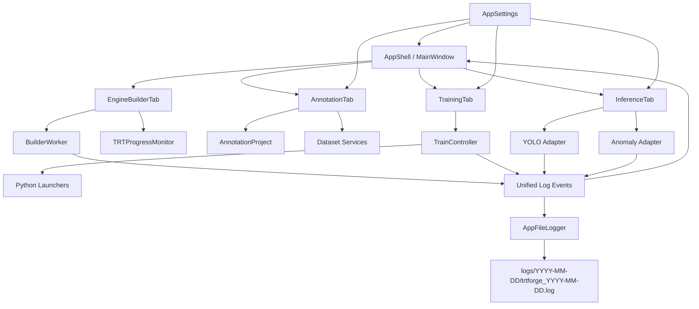

# DefectVision AI Studio 软件结构优化计划

> 阶段定位：第二阶段结构优化设计文档。本文只描述整理方案，不要求立即修改业务代码。

## 1. 当前现状

DefectVision AI Studio 当前由 `trtexec/gui` 工程承载，编译产物仍保持 `TRTForge.exe`。现有能力已经覆盖：

- TensorRT 引擎构建：ONNX 解析、精度配置、动态 shape、自检、构建日志和进度估算。
- 标注与数据集：图片导入、标签管理、标注画布、train/val/test 划分、YOLO/COCO/VOC 导出。
- 训练导出：YOLO 训练/验证/ONNX 导出，Anomalib 训练/导出/metadata 生成。
- 推理验证：YOLO 与 Anomalib TensorRT 推理演示。
- 推理 SDK：`yolo_infer.dll` 与 `anomalib_infer.dll` 的 C API。

主要结构问题：

- `MainWindow.cpp` 同时承担主框架、引擎构建页 UI、日志、进度、GPU 状态等职责，后续维护成本会继续升高。
- 各页面分别直接使用 `QSettings`，配置键分散，后续容易冲突或遗漏。
- 构建、训练、推理都有日志和状态事件，但协议和 UI 展示方式尚未统一。
- 工程已从单一工具发展为平台，但目录还没有完全按功能域收敛。

## 2. 目标与边界

目标：

- 降低单文件复杂度，让每个功能页职责更清楚。
- 保持现有功能入口和用户操作习惯不变。
- 保持 CMake/MSVC 编译链路稳定。
- 为后续安装包、绿色 Python runtime、更多模型任务预留结构。

本阶段不做：

- 不改 `TRTForge.exe` 输出名。
- 不改 `project(TRTForge)` 和 `add_executable(TRTForge)`。
- 不改 `yolo_infer.dll` / `anomalib_infer.dll` 名称。
- 不一次性大搬家，避免引入大量路径错误。

## 3. 目标结构

建议逐步演进为以下目录结构：

```text
trtexec/gui/
  include/
    app/
    engine/
    annotation/
    dataset/
    training/
    inference/
    common/
  src/
    app/
    engine/
    annotation/
    dataset/
    training/
    inference/
    common/
  training/
    scripts/
  inference/
    yolo_infer/
    anomalib_infer/
  resources/
  docs/
```

建议模块职责：

| 模块 | 责任 |
| --- | --- |
| `app` | 主窗口壳、顶部栏、主 Tab、全局菜单、主题加载 |
| `engine` | TensorRT 引擎构建页、`BuildOptions`、`BuilderWorker`、`TRTProgressMonitor` |
| `annotation` | 标注项目、画布、确认对话框、标注页 |
| `dataset` | 数据集导入导出、划分策略、dataset.yaml 生成 |
| `training` | 训练页、`YoloTrainController`、Python 进程和 JSON 事件解析 |
| `inference` | 推理演示页、采集线程、YOLO/Anomalib worker |
| `common` | `AppSettings`、日志模型、路径工具、通用 UI 小控件 |

## 4. 推荐重构顺序

### 4.1 拆出 EngineBuilderTab

当前 `MainWindow.cpp` 中的引擎构建页代码应优先拆出：

- 新增 `EngineBuilderTab`，承载原 `builderPage`、输入输出卡片、精度卡片、构建参数卡片、动态 shape、额外参数、自检、操作按钮、控制台、进度卡。
- `MainWindow` 只负责创建：
  - `EngineBuilderTab`
  - `AnnotationTab`
  - `TrainingTab`
  - `InferenceTab`
- `BuilderWorker` 和 `TRTProgressMonitor` 可以先继续由 `EngineBuilderTab` 管理，避免主窗口承担引擎构建细节。

收益：

- `MainWindow.cpp` 变成真正的应用外壳。
- 后续可以单独维护引擎构建功能，不影响标注、训练和推理。

风险：

- 信号槽迁移时容易漏连 `BuilderWorker`、进度计时器、日志回调。
- 需要保持原 UI 文案和布局不变，降低用户学习成本。

验证：

- 构建 ONNX 到 TRT 的基础流程能启动。
- 日志、进度、耗时、显存、自检结果仍能刷新。
- 其他三个页签不受影响。

### 4.2 新增 AppSettings

新增 `common/AppSettings`，统一封装 `QSettings` 键名。

建议管理：

- 标注页：数据集划分比例、最近导入目录、最近导出目录。
- 训练页：Python 路径、各任务头 Python 路径、训练模式、停靠布局。
- 推理页：最近 engine、metadata、图像/视频路径、阈值滑条。
- 全局：窗口大小、最近工作目录、主题参数。

示例接口：

```cpp
class AppSettings {
public:
    static SplitRatio annotationSplitRatio();
    static void setAnnotationSplitRatio(const SplitRatio& ratio);
    static QString pythonPath(const QString& task);
    static void setPythonPath(const QString& task, const QString& path);
};
```

收益：

- 避免多个页面手写相同 group/key。
- 后续迁移配置或清理坏缓存更容易。

风险：

- 需要保留旧键读取兼容，避免用户已有配置丢失。

验证：

- 现有 Python 路径、数据集划分比例、训练布局设置能继续恢复。

### 4.3 统一日志与结构化事件

建议定义通用事件模型：

```text
AppLogEvent
  level: info/warn/error/success/stage/debug
  source: engine/training/inference/annotation
  message: text
  timestamp: datetime

AppProgressEvent
  source: engine/training/inference
  stage: text
  percent: number
  detail: json
```

应用方式：

- TensorRT 构建日志由 `TRTLogger` 转成 `AppLogEvent`。
- Python 训练 `TRTFORGE_JSON` 转成 `AppProgressEvent` / artifact event。
- 推理 worker 的错误、耗时、阈值结果统一进入状态栏或日志区。
- 日志事件除继续进入界面 `QTextBrowser` 外，还应进入统一文件日志器，按日期保存到工程目录，方便现场问题追溯。

按日期日志落盘建议：

```text
trtexec/gui/logs/
  2026-05-14/
    trtforge_2026-05-14.log
```

日志行格式建议：

```text
2026-05-14 09:31:22.105 [ENGINE] [INFO] DefectVision AI Studio 已就绪
2026-05-14 09:32:01.227 [ENGINE] [STAGE] 开始识别 ONNX 输入：D:/models/a.onnx
2026-05-14 09:33:10.442 [TRAINING] [ERROR] 缺少 onnx，请执行 pip install onnx
```

落盘接入顺序：

1. `EngineBuilderTab`：构建开始、ONNX 输入识别、TensorRT 构建日志、自检、构建成功/失败。
2. `TrainingTab`：Python stdout/stderr、环境检测、训练/验证/导出进度、进程启动/结束、错误。
3. `InferenceTab`：模型加载、采集错误、推理错误、停止状态。
4. `AnnotationTab`：项目打开/保存、导入导出、自动划分、异常提示。

收益：

- 统一错误提示和排查信息。
- 后续可以增加全局“运行日志”面板。
- 用户关闭软件后仍可在工程目录中找到当天日志，便于远程排查和复现现场问题。

风险：

- 不要一次性重写全部日志，建议先新增适配层，再逐页迁移。
- 日志文件必须使用 UTF-8，避免中文路径、中文错误信息在跨平台查看时乱码。
- 日志目录不应放到仓库根目录的 `bin/include/lib`；建议放在 `trtexec/gui/logs`，并在打包时可选择保留或清理。

### 4.4 Dataset 模块独立

当前 `DatasetExporter` 已经在 `src/dataset`，后续建议补充：

- `DatasetSplitPolicy`：封装 train/val/test 比例划分。
- `DatasetYamlWriter`：专门写 Ultralytics dataset.yaml。
- `DatasetImportService`：统一 YOLO/COCO/VOC 导入入口。

收益：

- 标注页不直接承担数据集业务细节。
- 训练页可以复用数据集校验能力。

### 4.5 Training 模块分层

建议把训练页拆为：

- `TrainingTab`：只负责 UI。
- `TrainConfig`：训练参数 DTO。
- `YoloTrainController`：保留 QProcess 管理。
- `TrainEventParser`：解析 `TRTFORGE_JSON`。
- `TrainingArtifactModel`：统一记录 `best.pt`、`last.pt`、ONNX、metadata、labels JSON。

收益：

- 训练页 UI 不再直接处理大量事件细节。
- YOLO 与 Anomalib 的公共事件逻辑可以共享。

### 4.6 Inference 模块收敛

建议保持 `yolo_infer` / `anomalib_infer` DLL 不变，但 GUI 层整理为：

- `InferenceTab`：UI。
- `YoloInferenceAdapter`：GUI 到 `yolo_infer.dll` 的适配。
- `AnomalyInferenceAdapter`：GUI 到 `anomalib_infer.dll` 的适配。
- `InferenceResultPresenter`：统一显示原图、叠加图、mask、状态、耗时。

## 5. 开发周期与执行批次

本次结构优化建议按“小步可回滚”的方式推进。每个批次都应能独立编译、独立验证、独立提交，不建议一次性完成所有目录迁移。

### 5.1 总体周期建议

推荐周期按 **4~6 周** 规划。如果只有 1 名开发者兼职推进，建议按 6 周；如果有 1 名主开发 + 1 名测试/验证协助，可以压缩到 4 周。

| 阶段 | 建议周期 | 主要目标 | 是否改业务逻辑 |
| --- | --- | --- | --- |
| 第 0 周 | 0.5~1 天 | 建立重构分支、确认编译环境、固定回归用例 | 否 |
| 第 1 周 | 3~5 天 | 新增 `AppSettings`，先迁移低风险配置 | 否 |
| 第 2 周 | 4~6 天 | 拆出 `EngineBuilderTab`，减轻 `MainWindow.cpp` | 否 |
| 第 3 周 | 3~5 天 | 独立 `DatasetSplitPolicy`、`DatasetYamlWriter` | 轻微 |
| 第 4 周 | 4~6 天 | 抽训练事件解析和训练产物模型 | 轻微 |
| 第 5 周 | 4~6 天 | 建立统一日志/事件模型，并补充按日期日志落盘，先适配构建与训练 | 轻微 |
| 第 6 周 | 3~5 天 | 收敛推理 GUI 适配层，补文档和最终回归 | 轻微 |

### 5.2 批次明细

| 批次 | 周期 | 内容 | 交付物 | 风险 | 验收标准 |
| --- | --- | --- | --- | --- | --- |
| A | 3~5 天 | 新增 `common/AppSettings`，迁移标注页比例设置、最近目录等低风险配置 | `AppSettings.h/.cpp`、配置键说明 | 低 | 旧配置可读取，新配置可保存，标注页比例不丢失 |
| B | 4~6 天 | 拆出 `EngineBuilderTab`，保持 UI 和操作路径不变 | `EngineBuilderTab.h/.cpp`，`MainWindow.cpp` 明显变薄 | 中 | ONNX 构建、日志、进度、自检全部可用 |
| C | 3~5 天 | 抽 `DatasetSplitPolicy`、`DatasetYamlWriter`、数据集路径校验 | `DatasetSplitPolicy`、`DatasetYamlWriter` | 低 | YOLO 导出目录结构和 `dataset.yaml` 与旧版本一致 |
| D | 4~6 天 | 抽 `TrainEventParser`、`TrainConfig`、`TrainingArtifactModel` | 训练 DTO、事件解析器、产物模型 | 中 | YOLO/Anomalib 环境检测、训练、导出日志和产物显示正常 |
| E | 4~6 天 | 新增统一日志和进度事件模型，补充按日期日志落盘，先接构建与训练 | `AppLogEvent`、`AppProgressEvent`、`AppFileLogger`、日志适配层 | 中 | 构建和训练日志颜色、错误弹窗、进度刷新不退化；`trtexec/gui/logs` 生成当天日志 |
| F | 3~5 天 | 整理推理 GUI 适配层，区分 UI、worker、结果展示 | YOLO/Anomalib adapter、结果 presenter | 中 | 图片/视频推理、异常热力图、阈值调整正常 |

### 5.3 详细里程碑

#### M0：准备与基线冻结

周期：0.5~1 天。

任务：

- 确认当前 `trtexec/gui` 能在目标机器用 MSVC/CMake 编译。
- 固定一组回归用例：
  - 一个可构建的 ONNX 模型。
  - 一个可导出的 YOLO 标注项目。
  - 一个 YOLO 推理 engine。
  - 一个 Anomalib 推理 engine + metadata。
- 记录当前主界面截图和关键操作路径，作为重构后对比基线。

交付物：

- `docs/DefectVision_AI_Studio_重构回归清单.md`（建议新增）。
- 当前可运行版本压缩包或构建产物备份。

验收：

- 可以明确回答“重构前哪些功能是正常的”。

#### M1：AppSettings 配置集中化

周期：3~5 天。

任务：

- 新增 `include/common/AppSettings.h`、`src/common/AppSettings.cpp`。
- 先迁移标注页数据集划分比例，保留旧键读取兼容。
- 逐步迁移最近路径类配置，不迁移复杂布局状态。
- 给每个配置键写清楚 group/key、默认值、使用页面。

交付物：

- `AppSettings` 类。
- 配置键表格文档。

验收：

- 关闭并重启软件后，标注页比例仍能恢复。
- 未破坏训练页 Python 路径保存。
- 未引入新的注册表/配置污染。

#### M2：拆分 EngineBuilderTab

周期：4~6 天。

任务：

- 新增 `include/engine/EngineBuilderTab.h`、`src/engine/EngineBuilderTab.cpp`。
- 将 `MainWindow.cpp` 中引擎构建页相关 UI 构建函数迁移到 `EngineBuilderTab`。
- 将 `BuilderWorker`、`QThread`、`TRTProgressMonitor`、构建计时器归属迁移到 `EngineBuilderTab`。
- `MainWindow` 只负责创建页面和全局顶部栏。

交付物：

- `EngineBuilderTab` 类。
- 明显缩短后的 `MainWindow.cpp`。

验收：

- 引擎构建按钮能启动。
- 构建日志、进度条、阶段、耗时、显存、自检报告正常。
- `AnnotationTab`、`TrainingTab`、`InferenceTab` 不受影响。

#### M3：Dataset 服务独立

周期：3~5 天。

任务：

- 新增 `DatasetSplitPolicy`，封装 train/val/test 比例划分。
- 新增 `DatasetYamlWriter`，专门生成 Ultralytics `dataset.yaml`。
- `AnnotationTab` 只调用服务，不直接承担划分细节。
- 保持导出目录和文件格式与旧版本一致。

交付物：

- `DatasetSplitPolicy`。
- `DatasetYamlWriter`。

验收：

- 自动划分比例结果与旧逻辑一致或符合新比例规则。
- YOLO 导出后仍可被训练页读取。
- COCO/VOC 导出不受影响。

#### M4：Training 模块分层

周期：4~6 天。

任务：

- 新增 `TrainConfig`，集中表达训练参数。
- 新增 `TrainEventParser`，只负责解析 `TRTFORGE_JSON`。
- 新增 `TrainingArtifactModel`，集中管理 `best.pt`、`last.pt`、ONNX、metadata、labels JSON。
- `TrainingTab` 只负责 UI 展示和用户输入。

交付物：

- 训练配置 DTO。
- 事件解析器。
- 训练产物模型。

验收：

- YOLO 检测环境、训练、验证、导出均可运行。
- Anomalib 检测环境、训练导出、metadata 显示均可运行。
- 训练日志不丢行，错误弹窗不退化。

#### M5：统一日志与进度事件

周期：4~6 天。

任务：

- 新增 `AppLogEvent`、`AppProgressEvent`。
- 先接入 TensorRT 构建和 Python 训练，不急于改完所有页面。
- 统一日志级别：`info/warn/error/success/stage/debug`。
- 保留旧 UI 日志显示，避免用户体验变化过大。
- 新增 `AppFileLogger`，将 `AppLogEvent` 以 UTF-8 追加写入 `trtexec/gui/logs/YYYY-MM-DD/trtforge_YYYY-MM-DD.log`。
- 每行日志带完整时间、来源、级别和原始消息；Python stdout/stderr 原样保存。
- 第一阶段至少覆盖 ENGINE、TRAINING；第二阶段补 INFERENCE、ANNOTATION 关键状态。

交付物：

- 通用日志事件模型。
- 构建页和训练页适配层。
- 按日期生成的工程日志文件。
- 日志目录与排查说明文档。

验收：

- 旧日志内容仍能显示。
- 错误信息仍能弹窗。
- 进度条刷新不变慢、不跳变。
- 启动软件后自动生成当天日志目录和日志文件。
- 执行一次 ONNX 识别或引擎构建后，日志文件能看到对应 ENGINE 记录。
- 执行一次训练环境检测或训练后，日志文件能看到 Python stdout/stderr。
- 中文路径和中文错误信息按 UTF-8 保存，不乱码。

#### M6：推理 GUI 适配层整理

周期：3~5 天。

任务：

- 新增 `YoloInferenceAdapter`，封装 GUI 对 `yolo_infer.dll` 的调用。
- 新增 `AnomalyInferenceAdapter`，封装 GUI 对 `anomalib_infer.dll` 的调用。
- 新增 `InferenceResultPresenter`，统一显示检测框、mask、热力图、OK/NG、耗时。
- 不修改 DLL C API。

交付物：

- 推理 adapter。
- 结果展示 presenter。

验收：

- YOLO 图片/视频推理正常。
- Anomalib 图片推理、热力图、轮廓图、阈值滑条正常。
- DLL 对外接口不变，外部 SDK 示例不受影响。

### 5.4 人员与节奏建议

最低配置：

- 1 名 C++/Qt 主开发：负责代码迁移、编译、核心流程验证。
- 1 名使用者/测试协助：负责按固定用例点 UI、记录截图和异常。

建议节奏：

- 每个批次开始前先列出“本批次不改什么”。
- 每天结束前至少保证工程能回到可编译状态。
- 每个批次完成后做一次小版本备份。
- 如果某批次超过计划 50% 仍未跑通，应暂停继续拆分，先回到上一个可用状态。

### 5.5 优先级建议

优先级从高到低：

1. `AppSettings`：风险低，能立刻减少配置分散问题。
2. `EngineBuilderTab`：收益最大，能显著降低 `MainWindow.cpp` 复杂度。
3. `DatasetSplitPolicy`：逻辑独立，适合在 UI 稳定后抽离。
4. `TrainEventParser`：训练功能复杂，建议在前面几步稳定后再做。
5. 统一日志事件与按日期落盘：影响面较广，适合后半程逐步适配；其中落盘可作为 E2 小批次优先补齐，便于现场排查。
6. 推理适配层：依赖 DLL 稳定，最后整理最稳。

### 5.6 每批次交付模板

每个批次完成后建议在提交说明或阶段报告里写清楚：

```text
批次：
目标：
修改文件：
未修改范围：
验证结果：
已知风险：
回滚方式：
下一批次入口：
```

推荐先做 A 和 B，因为它们能最快降低维护成本，同时对训练、推理等高风险模块影响最小。

## 6. 架构流向



## 7. 验证原则

每个批次都必须至少验证：

- CMake/MSVC 能生成原 `TRTForge.exe`。
- 四个主功能页能正常打开。
- 本批次涉及的主流程可以执行到关键输出。
- 不修改根目录 `bin`、`include`、`lib`。
- 不修改 `yolo_infer.dll`、`anomalib_infer.dll` 对外 C API 契约。

## 8. 回滚策略

- 每个批次单独提交，避免大重构混在一起。
- 先新增类并接入，再删除旧逻辑。
- 对 `QSettings` 迁移使用“先读新键，读不到再读旧键”的方式。
- 保持 UI 文案和入口稳定，降低用户感知变化。

## 9. 实施记录

### 9.1 批次 A：AppSettings 配置集中化

状态：批次 A 当前阶段已完成。

已完成：

- 新增 `include/common/AppSettings.h` 和 `src/common/AppSettings.cpp`。
- 将标注页数据集划分比例的 `QSettings` 读写收敛到 `AppSettings::annotationSplitRatio()` 与 `AppSettings::setAnnotationSplitRatio()`。
- 保持旧配置键 `AnnotationDataset/splitTrainPct`、`splitValPct`、`splitTestPct` 不变，避免用户已有默认比例丢失。
- 将标注页项目文件、图片导入、类别导入、COCO/VOC/YOLO 标注导入、YOLO/COCO/VOC 导出的最近目录收敛到 `AppSettings`。
- 保持最近目录配置仍位于 `AnnotationDataset` 分组下，便于后续继续集中管理标注工作台配置。
- 更新 `trtexec/gui/CMakeLists.txt`，只加入新增 `AppSettings` 源文件和头文件，不修改 `project(TRTForge)`、`add_executable(TRTForge)`、DLL 名称或输出目录。

未修改范围：

- 未修改 `yolo_infer.dll`、`anomalib_infer.dll` 源码和 C API。
- 未修改 `TRTForge.exe` 输出名称。
- 未迁移训练页复杂布局配置和 Python 解释器路径配置，避免本批次影响范围扩大。

后续：

- 批次 A 已完成标注页低风险配置集中化，后续如继续扩展，应优先选择训练页路径类配置，不触碰复杂布局状态。
- 批次 B 再开始拆分 `EngineBuilderTab`。

### 9.2 批次 B：EngineBuilderTab 拆分

状态：批次 B 当前阶段已完成。

已完成：

- 新增 `include/engine/EngineBuilderTab.h` 和 `src/engine/EngineBuilderTab.cpp`。
- 将 TensorRT 引擎构建页的 UI 卡片、按钮槽函数、`BuildOptions` 收集、实时日志、构建进度、耗时/显存刷新、自检报告从 `MainWindow` 迁移到 `EngineBuilderTab`。
- 将 `BuilderWorker`、构建线程、`TRTProgressMonitor`、构建计时器归属迁移到 `EngineBuilderTab`。
- `MainWindow` 仅保留顶部栏、GPU 状态和四个主功能页签创建，应用外壳职责更清楚。
- 更新 `trtexec/gui/CMakeLists.txt`，加入 `EngineBuilderTab` 源文件和头文件，不修改 `project(TRTForge)`、`add_executable(TRTForge)`、DLL 名称或输出目录。

验证结果：

- 已使用 `C:\Program Files\CMake\bin\cmake.exe --preset vs2022-x64` 完成 CMake 配置。
- 已使用 `C:\Program Files\CMake\bin\cmake.exe --build --preset vs2022-x64` 完成 Release 编译，生成 `trtexec/gui/bin/TRTForge.exe`。
- 编译过程中 `yolo_infer.dll` 与 `anomalib_infer.dll` 均正常生成；本批次未修改两个推理 DLL 的源码和 C API。

未修改范围：

- 未修改根目录 `bin`、`include`、`lib`。
- 未修改 `yolo_infer.dll`、`anomalib_infer.dll` 对外 C API。
- 未改动标注、训练、推理三个页面的业务逻辑。

后续：

- 批次 C 可以开始抽 `DatasetSplitPolicy` 与 `DatasetYamlWriter`，但应继续保持导出目录结构和 `dataset.yaml` 格式与当前版本一致。

### 9.3 批次 C：Dataset 服务独立

状态：批次 C 当前阶段已完成。

已完成：

- 新增 `include/dataset/DatasetSplitPolicy.h` 和 `src/dataset/DatasetSplitPolicy.cpp`。
- 将标注页 `train/val/test` 自动划分算法从 `AnnotationTab` 抽到 `DatasetSplitPolicy`，保持原固定种子排序和百分比分配规则不变。
- 新增 `include/dataset/DatasetYamlWriter.h` 和 `src/dataset/DatasetYamlWriter.cpp`。
- 将 YOLO 导出中的 `dataset.yaml` 写入逻辑从 `DatasetExporter::exportYolo()` 抽到 `DatasetYamlWriter`，保持 `path/train/val/test/names` 和 pose 的 `kpt_shape/flip_idx` 输出格式不变。

验证结果：

- 已通过 `C:\Program Files\CMake\bin\cmake.exe --build --preset vs2022-x64 --target TRTForge` 编译验证。
- COCO/VOC 导出代码未改动。

### 9.4 批次 D：Training 模块分层

状态：批次 D 当前阶段已完成。

已完成：

- 新增 `include/training/TrainEventParser.h` 和 `src/training/TrainEventParser.cpp`。
- 将 `TRTFORGE_JSON` 行解析从 `YoloTrainController` 抽到 `TrainEventParser`，`YoloTrainController` 继续只负责 Python 子进程生命周期、stdout/stderr 分流和信号转发。
- 新增 `include/training/TrainingArtifactModel.h` 和 `src/training/TrainingArtifactModel.cpp`。
- 将训练产物列表、`labels_*.json` 路径累计和 labels JSON 状态文案集中到 `TrainingArtifactModel`，训练页仍按原位置显示产物和弹窗汇总。

验证结果：

- 已通过 `C:\Program Files\CMake\bin\cmake.exe --build --preset vs2022-x64 --target TRTForge` 编译验证。
- 未修改 YOLO/Anomalib Python launcher 的参数和 JSON 事件契约。

### 9.5 批次 E：统一日志与进度事件

状态：批次 E 基础事件模型已完成；E2 按日期日志落盘当前阶段已完成 ENGINE、TRAINING、INFERENCE 关键日志接入。

已完成：

- 新增 `include/common/AppEvents.h`，定义 `AppLogEvent`、`AppProgressEvent`、统一日志级别和事件来源。
- 新增 `include/common/AppEventFormatter.h` 和 `src/common/AppEventFormatter.cpp`，集中处理通用日志颜色、前缀、TensorRT 日志级别转换。
- 构建页将 `TRTLogger` 日志先映射为 `AppLogEvent`，再复用原彩色日志 UI 和 `TRTProgressMonitor`。
- 训练页将普通日志、进程启动/结束、Python `progress` 事件映射为 `AppLogEvent` / `AppProgressEvent`，再复用原 QTextBrowser 显示。
- 保留旧 UI 展示方式，不改变用户看到的日志内容、错误弹窗和进度刷新路径。
- 新增 `include/common/AppFileLogger.h` 和 `src/common/AppFileLogger.cpp`，将日志以 UTF-8 追加写入 `trtexec/gui/logs/YYYY-MM-DD/trtforge_YYYY-MM-DD.log`。
- 构建页 `EngineBuilderTab` 通过 `appendColored()` 同步写入 ENGINE 日志，覆盖 ONNX 识别、TensorRT 构建、自检和构建结果。
- 训练页 `TrainingTab` 通过 `appendLog()` 同步写入 TRAINING 日志，覆盖 Python stdout/stderr、结构化进度、进程启动/结束和错误。
- 推理页 `InferenceTab` 写入 INFERENCE 关键状态，覆盖模型加载、加载失败、采集错误、推理错误和停止。

当前缺口：

- `AnnotationTab` 的项目打开/保存、导入导出和自动划分状态尚未统一进入文件日志。
- 当前落盘以关键日志为主，后续可继续扩展为全局“运行日志”面板或日志查看器。

E2 已完成范围：

- 默认写入 `trtexec/gui/logs/YYYY-MM-DD/trtforge_YYYY-MM-DD.log`，使用 UTF-8 文本。
- 日志格式统一为 `时间 [来源] [级别] 消息`。
- 已接入 `EngineBuilderTab`、`TrainingTab` 和 `InferenceTab`。
- `trtexec/gui/CMakeLists.txt` 已加入新增日志文件类。

验证结果：

- 已通过 `C:\Program Files\CMake\bin\cmake.exe --build --preset vs2022-x64 --target TRTForge` 编译验证，生成 `trtexec/gui/bin/TRTForge.exe`。
- 编译过程中 `yolo_infer.dll` 与 `anomalib_infer.dll` 正常生成；本批次未修改两个推理 DLL 的源码和 C API。

未修改范围：

- 未修改根目录 `bin`、`include`、`lib`。
- 未修改 `project(TRTForge)`、`add_executable(TRTForge)`、`TRTForge.exe` 输出名。
- 未修改 `yolo_infer.dll`、`anomalib_infer.dll` 对外 C API。

后续：

- 后续可补 `AnnotationTab` 文件日志，并增加界面内日志文件打开入口。
- 批次 F 已完成最小可编译整理；后续如继续深化，可把更多画布绘制和列表更新逻辑迁入 presenter。

### 9.6 引擎构建输入识别与 H/W 同步

状态：已完成。

已完成：

- 新增 `include/engine/OnnxInputInspector.h` 和 `src/engine/OnnxInputInspector.cpp`，用于读取 ONNX 第一个输入 tensor 的名称和维度。
- ENGINE BUILDER 选择 ONNX 后自动填入输入名称，避免用户手动猜测 `images`、`input` 等输入名。
- 动态形状卡片新增“统一 H / 统一 W”和同步开关，修改一次 H/W 即可同步覆盖 `min / opt / max` 三组 shape 的最后两个维度。
- 保留原始 `min / opt / max` 文本框，支持高级用户继续手动编辑特殊 shape。

未修改范围：

- 未修改 `yolo_infer.dll`、`anomalib_infer.dll` 源码和 C API。
- 未修改 `TRTForge.exe` 输出名称。

### 9.7 批次 F：推理 GUI 适配层整理

状态：批次 F 当前阶段已完成。

已完成：

- 新增 `include/inference/YoloInferenceAdapter.h` 和 `src/inference/YoloInferenceAdapter.cpp`，封装 GUI 对 `InferWorker::loadEngine()` 的 queued connection 调用。
- 新增 `include/inference/AnomalyInferenceAdapter.h` 和 `src/inference/AnomalyInferenceAdapter.cpp`，封装 GUI 对 `AnomalyInferWorker::loadEngine()` 的 queued connection 调用。
- 新增 `include/inference/InferenceResultPresenter.h` 和 `src/inference/InferenceResultPresenter.cpp`，集中处理推理耗时文本、检测数量文本和异常 OK/NG 状态颜色。
- `InferenceTab` 继续负责 UI 布局、线程生命周期和信号连接；模型加载调用与部分结果展示格式已从页面代码中抽离。
- 更新 `trtexec/gui/CMakeLists.txt`，加入新增 inference 适配层和 presenter 文件。

验证结果：

- 已通过 `C:\Program Files\CMake\bin\cmake.exe --build "d:\test1\deeplearning\trtexec\gui\build" --config Release --target TRTForge` 编译验证，生成 `trtexec/gui/bin/TRTForge.exe`。
- 编译过程中 `yolo_infer.dll` 与 `anomalib_infer.dll` 正常生成；本批次未修改两个推理 DLL 的源码和 C API。

未修改范围：

- 未修改 `yolo_infer.dll`、`anomalib_infer.dll` 源码和 C API。
- 未修改推理 worker 的 C API 调用参数和返回结果结构。
- 未修改 `TRTForge.exe` 输出名称。

后续：

- 若继续优化，可把检测框绘制、异常三画布更新、检测列表/异常状态列表进一步迁入 `InferenceResultPresenter`。
- 若需要更彻底隔离 DLL 调用，可让 adapter 持有 worker 创建、线程连接和错误映射，但应单独作为下一批次推进。
