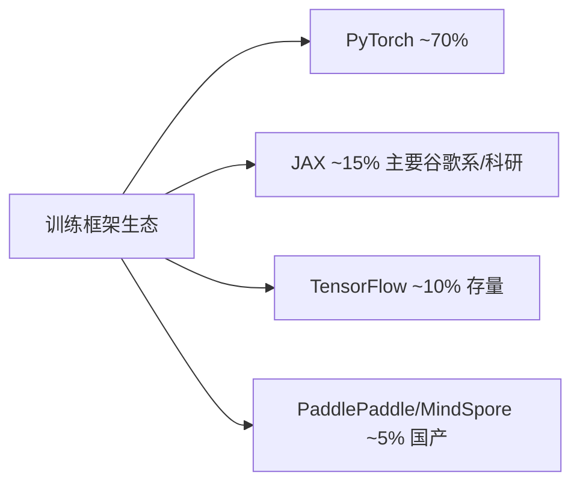
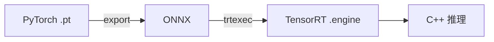
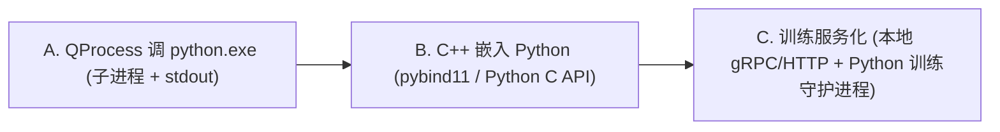
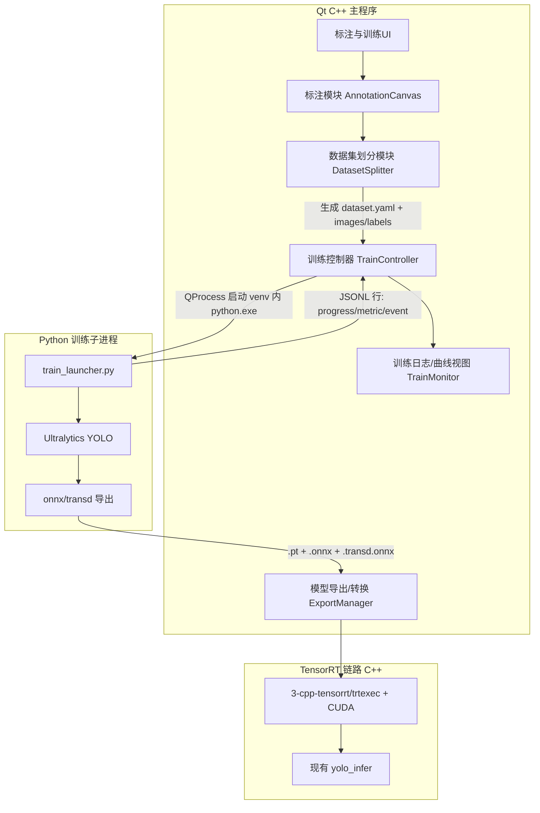

# Qt(C++) + Python 训练 + 内置标注 视觉平台架构设计方案

> 文档版本：v1.0  ·  日期：2026-04-23  ·  编码：UTF-8
>
> 适用范围：在现有 [4-qt-studio](../4-qt-studio) C++/Qt 工程基础上，扩展「数据标注 → 数据集划分 → Python 训练 → 实时回读 → PT/ONNX/TRT 产出」完整闭环。

---

## 〇、行业背景：主流工业视觉平台深度学习训练与部署方案分析

> 本节锚定本方案的技术选型背景，证明「Python 训练 + C++ 部署 + ONNX/TRT」是行业最佳实践。本方案完全沿用并强化该路线。

### 0.1 训练代码语言选型

| 语言       | 使用场景                       | 行业占比 |
| ---------- | ------------------------------ | -------- |
| Python     | 模型训练、实验、数据处理、调参 | 95%+     |
| C++        | 训练框架底层算子、极少数性能敏感训练 | <3%  |
| Julia/Rust | 学术探索                       | <1%      |

Python 一统天下的原因：

- 生态成熟（PyTorch / JAX / HuggingFace / Ultralytics）
- 科学计算栈完整（NumPy / Pandas / OpenCV / Albumentations）
- 调试可视化友好（Jupyter / TensorBoard / W&B / MLflow）
- 训练为离线一次性任务，开发效率 >> 运行效率

### 0.2 主流工业视觉平台的实际做法

| 平台软件                               | 训练侧                         | 部署/推理侧        |
| -------------------------------------- | ------------------------------ | ------------------ |
| 康耐视 VisionPro Deep Learning (ViDi)  | Python (PyTorch) 内部训练 + GUI | C++ runtime       |
| 基恩士 XG-X / CV-X AI                  | Python 训练，封装 GUI          | C++ SDK            |
| MVTec HALCON / MERLIC                  | Python (PyTorch) 训练          | C++ HALCON runtime |
| NI Vision (VBAI)                       | Python + TF/PyTorch            | C++/LabVIEW        |
| 海康 VM / 大恒 DahengVision            | Python 训练                    | C++ SDK            |
| OPT SciVision / 创科 CKVision          | Python + PyTorch               | C++ SDK            |
| 阿丘 AIDI / 深视 SmartMore             | Python (PyTorch)               | C++ + TensorRT     |
| 百度 EasyDL / 华为 ModelArts           | Python (Paddle / MindSpore)    | 多端部署           |

**结论**：工业视觉平台普遍采用「Python 训练 + C++ 部署」双语言架构，本方案与主流路线完全一致。

### 0.3 当前主流训练技术栈（2025–2026）



工业视觉常用栈：

| 层级       | 主流方案                                              |
| ---------- | ----------------------------------------------------- |
| 框架       | PyTorch 2.x + Lightning / Accelerate                  |
| 模型库     | Ultralytics (YOLO11/12)、MMDetection、Detectron2、timm |
| 数据增强   | Albumentations、torchvision.transforms.v2             |
| 实验管理   | Weights & Biases、MLflow、TensorBoard                 |
| 超参搜索   | Optuna、Ray Tune                                      |
| 分布式训练 | DDP、DeepSpeed、FSDP                                  |
| 混合精度   | AMP (fp16 / bf16)                                     |
| 数据标注   | Label Studio、CVAT、X-AnyLabeling（半自动 SAM）       |
| 数据版本   | DVC、LakeFS                                           |

工业训练范式演进：

1. 传统：从零训练 ResNet / YOLO
2. 当前主流：预训练大模型 + 微调
3. 前沿趋势：基础视觉模型微调（SAM2 / DINOv2 / CLIP）+ 少样本异常检测（PatchCore / PaDiM / EfficientAD）+ 合成数据（Stable Diffusion / NVIDIA Omniverse）

### 0.4 部署方案对比



主流部署方案对比：

| 方案                          | 适用硬件           | 性能 | 工业成熟度 | 推荐场景             |
| ----------------------------- | ------------------ | ---- | ---------- | -------------------- |
| TensorRT                      | NVIDIA GPU/Jetson  | 极高 | 高         | 当前方案，GPU 工业首选 |
| OpenVINO                      | Intel CPU/iGPU/NPU | 高   | 高         | x86 工控机无独显     |
| ONNX Runtime                  | 全平台             | 中   | 中高       | 跨平台兼容兜底       |
| TensorRT-LLM                  | NVIDIA GPU         | 极高 | 中高       | 大模型 / VLM 部署    |
| Triton Inference Server       | 多硬件             | 高   | 高         | 多模型多卡服务化     |
| TVM / MLC                     | 全平台             | 高   | 中         | 边缘异构             |
| RKNN / Ascend CANN            | 瑞芯微 / 华为昇腾  | 高   | 中高       | 国产化边缘           |
| torch.compile + AOTInductor   | 全平台             | 高   | 中         | PyTorch 原生新方案   |

### 0.5 对本工程的结论

- 训练侧：保持 Python + Ultralytics（PyTorch），即 [1-python-yolo/ultralytics-main/yolo_obb.py](../1-python-yolo/ultralytics-main/yolo_obb.py) 路线。
- 部署侧：保持 PT → ONNX → TRT → C++ SDK，即 [3-cpp-tensorrt/yolo_infer/src/yolo.hpp](../3-cpp-tensorrt/yolo_infer/src/yolo.hpp) 路线，业界金标准。
- 增强方向（融入本方案后续章节）：INT8 量化、CUDA 预处理、动态 shape、可选引入 Triton、可选引入 EfficientAD 异常检测、用 W&B / MLflow 管理实验。

---

## 一、需要回答的核心问题（先给结论）

### 1. C++ 启动 venv → Qt 调命令行跑训练 py → 回读 stdout 这种方案合适吗？

**结论：合适，且是世界级工业平台普遍采用的方案之一。**

但「启动 venv」这一步不应是真的 `activate` 一个 shell session，而是**直接用 venv 里的 `python.exe` 绝对路径作为子进程**——这是更稳、更跨平台的工程做法。

康耐视 ViDi、MVTec MLPC、阿丘 AIDI、深视 SmartMore 内部基本都是这种「C++ 主壳 + Python 子进程训练」的拆分。

### 2. 还有比「子进程 + stdout」更高效 / 世界级的方案吗？

按集成度由低到高有三档可选：



| 方案          | 隔离性 | 崩溃影响主程序 | 实现难度 | 调试体验           | 推荐场景                 |
| ------------- | ------ | -------------- | -------- | ------------------ | ------------------------ |
| A 子进程      | 强     | 不影响         | 低       | 好（py 可独立跑）  | **工业平台首推（您当前思路）** |
| B 嵌入 Python | 弱     | 会拖崩 Qt      | 中高     | 难（GIL/线程坑多） | 只做轻推理 / 小工具      |
| C 本地服务化  | 强     | 不影响         | 中       | 极好（可远程）     | 多机训练 / 集群          |

**最终推荐：方案 A 为主体，预留方案 C 的演进路径。** 原因：

- 训练任务时间长（小时级），崩溃隔离至关重要；嵌入式 Python 一旦 OOM 或段错误，Qt 主界面同归于尽。
- Python 环境 / 依赖与 C++ 解耦，升级 PyTorch、CUDA、Ultralytics 不会牵连 Qt 工程的 ABI。
- stdout/stderr 行级解析 + 结构化进度协议（JSONL）已被 Ultralytics、HuggingFace Trainer 验证为可靠模式。

---

## 二、整体架构



---

## 三、Python 环境分发方案对比与推荐

| 维度            | A. venv + 在线安装         | B. Python embeddable + 预装 wheel（绿色包） | C. Docker / WSL2      |
| --------------- | -------------------------- | ------------------------------------------- | --------------------- |
| 客户机环境要求  | 需装 Python                | 无需任何 Python                             | 需 Docker Desktop / WSL2 |
| 首次部署体积    | 小（~50MB）+ 在线下载几 GB | 大（4–8GB 一次性带走）                      | 镜像 5–15GB           |
| 部署稳定性      | 受网络 / PyPI / 源镜像影响 | 极稳，离线即可用                            | 稳，但门槛高          |
| 用户感知        | 需「安装环境」步骤         | 解压即用，零感知                            | 需懂容器              |
| CUDA / 驱动适配 | 复杂                       | 复杂但可锁版本                              | 最干净（镜像内自带）  |
| 适合工业现场    | 一般                       | **最佳**                                    | 仅适合 IT 强的客户    |

**推荐：方案 B「嵌入式 Python 绿色包」**。

具体做法：

- 在工程内维护 `runtime/python/` 目录，内含：
  - `python-3.11.x-embed-amd64/`（官方 embeddable）
  - `Lib/site-packages/`（预装 torch+cu121、ultralytics、onnx、albumentations 等）
  - `python311._pth` 解开 import 限制
- C++ 侧用相对路径定位 `runtime/python/python.exe` 启动训练子进程，**完全不依赖客户机 PATH / 系统 Python**。
- 升级训练栈：单独发布 `runtime-python-vX.Y.zip` 增量包替换。
- 体积优化：`torch` CUDA 版仅保留必需算子集；可剔除 `*.pdb`、`tests/`、不用的 cudnn dll。

---

## 四、目录结构规划

```
4-qt-studio/
  ├─ runtime/
  │   └─ python/                          # 绿色 Python 环境（方案 B）
  │       ├─ python.exe
  │       └─ Lib/site-packages/...
  ├─ training/                            # 新增训练子系统
  │   ├─ scripts/
  │   │   ├─ train_launcher.py            # 统一训练入口（被 C++ 调起）
  │   │   ├─ export_onnx.py               # 复用 1-python-yolo/ultralytics-main/yolo_obb.py 思路
  │   │   ├─ split_dataset.py             # 训/验/测集划分（也可由 C++ 直接做）
  │   │   └─ protocol.py                  # 与 C++ 通信的 JSONL 协议常量
  │   └─ tasks/                           # 任务模板：detect/obb/pose/segment
  │       ├─ detect.yaml
  │       ├─ obb.yaml
  │       └─ pose.yaml
  ├─ src/
  │   ├─ annotation/                      # 标注模块（C++/Qt）
  │   │   ├─ AnnotationCanvas.{h,cpp}     # 画布：缩放/平移/绘制
  │   │   ├─ shapes/                      # Bbox/OBB/Polygon/Keypoint
  │   │   ├─ LabelStore.{h,cpp}           # 内存模型 + 持久化
  │   │   └─ exporters/
  │   │       ├─ YoloDetectExporter.cpp   # YOLO txt 格式
  │   │       ├─ YoloObbExporter.cpp      # YOLO-OBB (8 坐标)
  │   │       └─ CocoExporter.cpp         # 备用
  │   ├─ dataset/
  │   │   ├─ DatasetSplitter.{h,cpp}      # 7:2:1 等比例划分 + 哈希分桶
  │   │   └─ DatasetYamlWriter.cpp        # 生成 ultralytics dataset.yaml
  │   ├─ training/
  │   │   ├─ TrainController.{h,cpp}      # QProcess 管理 + 协议解析
  │   │   ├─ TrainConfig.{h,cpp}          # 任务/超参 DTO
  │   │   └─ TrainProtocol.{h,cpp}        # JSONL 行解析
  │   └─ ui/
  │       ├─ AnnotationView.{h,cpp,ui}
  │       ├─ TrainView.{h,cpp,ui}         # 含 epoch 进度 / loss 曲线 / mAP 表
  │       └─ ExportView.{h,cpp,ui}
  └─ bin/configs/
      └─ training/                        # 任务预设
```

---

## 五、关键模块接口骨架

### 5.1 C++ 训练控制器 `TrainController`

职责：组装命令行 → 起 `QProcess` → 行级解析 JSONL → 转 Qt 信号。

```cpp
// 仅接口示意，实现留待方案确认后
class TrainController : public QObject {
    Q_OBJECT
public:
    explicit TrainController(QObject* parent = nullptr);

    // 启动一次训练；TrainConfig 包含任务类型、数据集路径、超参、设备
    bool start(const TrainConfig& cfg);
    void stop();                    // 优雅终止：发送 SIGTERM/CTRL_BREAK
    void kill();                    // 强杀
    bool isRunning() const;

signals:
    void started();
    void progress(int epoch, int totalEpochs, double pct);
    void metric(const QString& name, double value, int step);     // loss/mAP50/mAP50-95
    void logLine(const QString& level, const QString& text);      // info/warn/error
    void artifactReady(const QString& kind, const QString& path); // pt/onnx/transd
    void finished(int exitCode, const QString& reason);

private:
    QProcess proc_;
    void onStdoutReady();           // 按行切 → JSON 解析 → 发信号
    QString resolvePython() const;  // = runtime/python/python.exe（绝对路径）
};
```

启动命令形如：

```bat
runtime\python\python.exe training\scripts\train_launcher.py ^
    --task obb --data <abs>\dataset.yaml --weights yolov8n-obb.pt ^
    --epochs 100 --imgsz 1024 --batch 8 --device 0 ^
    --project runs/obb --name exp_2026_04_23 --protocol jsonl
```

### 5.2 Python 端 `train_launcher.py`（统一契约入口）

- 接收上面的 CLI 参数
- 用 `ultralytics.YOLO(...).train(...)` 跑训练
- 通过 **Ultralytics 回调**（`on_train_epoch_end`、`on_fit_epoch_end`）把数据按 JSONL 一行一条写到 stdout，例如：

```json
{"type":"event","name":"start","ts":1761234567}
{"type":"progress","epoch":3,"total":100,"pct":3.0}
{"type":"metric","name":"box_loss","value":1.234,"step":3}
{"type":"metric","name":"metrics/mAP50","value":0.812,"step":3}
{"type":"artifact","kind":"pt","path":"runs/obb/exp.../weights/best.pt"}
{"type":"event","name":"finished","exit":0}
```

- 训练结束自动调用 `export_onnx.py`，复用现有 [1-python-yolo/ultralytics-main/yolo_obb.py](../1-python-yolo/ultralytics-main/yolo_obb.py) 中 `apply_onnx_last_output_transpose` 的逻辑产出 `.transd.onnx`。
- `protocol.py` 仅维护字段常量，避免 C++ / Python 两侧字符串漂移。

### 5.3 标注模块 `AnnotationCanvas`（C++/Qt）

最小可用功能集合（MVP）：

- 工具栏：选择 / 矩形框 / OBB（5 参数：cx, cy, w, h, θ）/ 多边形 / 关键点
- 画布：`QGraphicsView` + 自定义 `QGraphicsItem`，支持缩放、平移、控制点拖拽
- 标签管理：标签集（颜色 / 快捷键），与 [4-qt-studio/bin/configs/labels_obb_dota_v1.json](../4-qt-studio/bin/configs/labels_obb_dota_v1.json) 同款 JSON 复用
- 导出格式：YOLO Detect / YOLO-OBB / COCO（OBB 用 8 点格式适配 Ultralytics）
- 持久化：每张图一份 sidecar JSON（含原始坐标 + 修订历史）+ 导出时再转 YOLO txt
- 半自动加速（可选 v2）：调 Python `predict_launcher.py` 拿现有模型预标注，复用 TrainController 的子进程模式

```cpp
class AnnotationCanvas : public QGraphicsView {
    Q_OBJECT
public:
    void loadImage(const QString& imgPath);
    void setLabelSet(const LabelSet& set);
    void setTool(ToolKind kind);             // Bbox/Obb/Polygon/Keypoint
    QVector<Annotation> annotations() const;
signals:
    void annotationChanged();
};
```

### 5.4 数据集划分 `DatasetSplitter`

- 输入：标注好的目录 + 比例（默认 7:2:1）+ 划分策略（随机 / 按文件名哈希 / 按类别均衡）
- 输出：
  - `images/{train,val,test}/`、`labels/{train,val,test}/`（拷贝或软链接）
  - `dataset.yaml`（Ultralytics 标准格式：`path/train/val/test/names`）
- 实现要点：
  - 用 `SHA1(filename)` 取模分桶，**保证多次划分结果可复现**
  - 类别均衡时按「图片所含类别多重集」做分层抽样
  - 大数据集默认软链接（Windows 需管理员或开发者模式 → 否则降级为复制）

---

## 六、进程间通信协议（JSONL）规范

- **通道**：子进程 stdout 行流；stderr 仅作为非结构化错误兜底显示
- **编码**：UTF-8（与工作区规则一致）；必设环境变量：
  - `PYTHONIOENCODING=utf-8`
  - `PYTHONUNBUFFERED=1`
- **行格式**：每行一个 JSON 对象，字段集见 5.2
- **心跳**：训练长时间无 epoch 输出时（如数据加载阶段），每 5s 输出 `{"type":"heartbeat"}` 防止 UI 误判卡死
- **取消**：C++ 侧先发 `CTRL_BREAK_EVENT`（Windows）/ `SIGINT`，5s 未退则 `kill()`；Python 侧捕获 `KeyboardInterrupt` 走优雅保存 `last.pt`

协议字段汇总表：

| type     | 关键字段                              | 说明                       |
| -------- | ------------------------------------- | -------------------------- |
| event    | name, ts                              | start / finished / error   |
| progress | epoch, total, pct                     | 训练总进度                 |
| metric   | name, value, step                     | loss / mAP / lr 等数值序列 |
| artifact | kind, path                            | pt / onnx / transd / engine |
| log      | level, text                           | info / warn / error 文本   |
| heartbeat| ts                                    | 心跳保活                   |

---

## 七、与现有工程的衔接点

- 训练产出的 `.pt → .onnx → .transd.onnx` 直接喂给现有 [4-qt-studio](../4-qt-studio) 的 trtexec 转换链路与 [3-cpp-tensorrt/yolo_infer/src/yolo.hpp](../3-cpp-tensorrt/yolo_infer/src/yolo.hpp) 推理 SDK，**无需改动推理侧**。
- Python 转 transd 的逻辑已在 [1-python-yolo/ultralytics-main/yolo_obb.py](../1-python-yolo/ultralytics-main/yolo_obb.py)、[1-python-yolo/ultralytics-main/yolo_pose_export_transd.py](../1-python-yolo/ultralytics-main/yolo_pose_export_transd.py) 中验证，本方案直接抽取为 `training/scripts/export_onnx.py` 复用。
- 标注模块导出的 `labels_*.json` 与现有 [4-qt-studio/bin/configs/labels_obb_dota_v1.json](../4-qt-studio/bin/configs/labels_obb_dota_v1.json) 同 schema，推理与训练共用一份标签。

---

## 八、风险与对策

| 风险                                | 对策                                                                        |
| ----------------------------------- | --------------------------------------------------------------------------- |
| 子进程 stdout 在 Windows 缓冲导致 UI 卡顿延迟 | `PYTHONUNBUFFERED=1` + Python 侧 `print(..., flush=True)`            |
| 中文路径 / GBK 乱码                 | Python 子进程全链路 UTF-8；推理 `.trt` 路径按 UTF-8 转 Windows 宽路径读取；图片用 Qt 读字节后 `cv::imdecode`；视频 / ONNX Parser 对中文路径使用临时 ASCII 路径兜底 |
| 绿色 Python 体积过大                | 分发拆为「主程序包 + Python runtime 包」，按需下载                         |
| 训练崩溃后 Qt 不知情                | 监听 `QProcess::finished / errorOccurred`；exit code 非 0 弹错并保留日志   |
| 多任务并发训练抢 GPU                | 训练任务队列（QThreadPool / 自研单工 GPU 调度），UI 显示排队状态           |
| Ultralytics 版本升级破坏回调 API    | `train_launcher.py` 中对回调名做 try/except 兼容并写单元测试                |

---

## 九、里程碑（建议落地顺序）

1. **M1 协议先行**：定义 JSONL 协议 + `train_launcher.py` 骨架 + 一个最小 C++ 控制器，跑通 hello-world 训练（5 epoch tiny 数据）
2. **M2 训练 UI**：`TrainView` + 进度条 + loss 曲线（QtCharts）+ 取消 / 恢复
3. **M3 标注模块 MVP**：Bbox + OBB + 标签集 + YOLO 导出
4. **M4 数据集划分** + dataset.yaml 自动生成 → 串通到 M1
5. **M5 模型导出 / 转换** 串通 trtexec
6. **M6 半自动标注**（用现有 .pt 预标） + 多任务队列 + 国际化

---

## 十、待最终确认事项（不阻塞，进入实现前再确认）

- 任务类型范围：仅 OBB / Detect / Pose 三种，还是含 Segment / Classify？
- 训练机硬件假设：固定单张 NVIDIA GPU 还是要支持多卡 DDP？
- 标注模块是否需要支持视频 / 序列帧标注，还是仅静态图片？
- 是否需要项目级（Workspace）概念来管理多个数据集 + 多次训练实验？

---

## 十一、YOLO Training Lab 实施补充（2026-05-06）

本轮在 TRTForge 中按方案 A 落地 YOLO 训练入口，目标是先形成 C++/Qt 可调用的 Python 子进程边界，再逐步完善训练体验。

### 11.1 已确定的调用边界

Qt 侧新增 `YOLO TRAINING LAB · 训练导出` 页签，通过 `YoloTrainController` 使用 `QProcess` 启动：

```bat
python 1-python-yolo\launcher\tf_yolo_launcher.py --mode check-env
python 1-python-yolo\launcher\tf_yolo_launcher.py --mode train --task detect --data dataset.yaml --model yolov8n.pt
python 1-python-yolo\launcher\tf_yolo_launcher.py --mode val --task obb --weights runs\...\best.pt --data dataset.yaml
python 1-python-yolo\launcher\tf_yolo_launcher.py --mode export --task obb --weights runs\...\best.pt --format onnx --make-transd true
```

第一版支持四种任务头：

| 任务头 | 用途 | 默认权重示例 |
| --- | --- | --- |
| `detect` | 水平框检测 | `yolov8n.pt` |
| `segment` | 实例分割 | `yolov8n-seg.pt` |
| `pose` | 姿态估计 | `yolov8n-pose.pt` |
| `obb` | 旋转框检测 | `yolov8n-obb.pt` |

### 11.2 训练初始化方式

界面必须把 `model`、`pretrained`、`resume` 分清楚：

| 初始化方式 | 参数策略 | 说明 |
| --- | --- | --- |
| 预训练权重微调 | `model=.pt` 或 `model=.yaml + pretrained=.pt/true` | 默认推荐，适合多数工业现场 |
| 从零训练 | `model=.yaml + pretrained=false` | 需要更多数据和更长时间 |
| 断点恢复 | `model=last.pt + resume=true` | 用于训练中断后继续 |

为降低误操作，微调模式下如果用户把本地 `.pt` 填入 `pretrained`，且 `model` 仍是 `yolov8n.pt` 等默认别名，界面在启动训练前会把该 `.pt` 自动同步到 `model`，避免 Ultralytics 先加载默认模型并触发下载。

### 11.2.1 解释器路径自动保存

YOLO Training Lab 使用 Qt `QSettings` 保存当前 Python 解释器路径，避免用户每次启动都重新选择虚拟环境。

- 保存最近一次使用的全局解释器路径。
- 按任务头额外保存 `detect`、`segment`、`pose`、`obb` 的解释器路径。
- 切换任务头时，优先恢复该任务头上次使用的解释器；没有任务专属记录时使用全局解释器。
- 用户点击“检测环境 / 开始训练 / 验证模型 / 导出 ONNX”前，会自动保存当前解释器路径。
- 检测环境会显示当前 `python.exe`、虚拟环境名、缺失库和对应 `pip install` 命令。
- 环境检查包含 `polars`，因为当前 Ultralytics 保存 checkpoint 时会读取 `results.csv`；缺失该依赖可能在第 1 个 epoch 验证结束后 `exit=1`。

### 11.3 日志协议

普通 Python 输出全部进入日志面板；结构化事件使用 `TRTFORGE_JSON ` 前缀：

```text
TRTFORGE_JSON {"type":"progress","epoch":3,"total":100,"pct":3.0}
TRTFORGE_JSON {"type":"metric","name":"metrics/mAP50","value":0.812,"step":3}
TRTFORGE_JSON {"type":"epoch_summary","epoch":3,"total":100,"metrics":{"metrics/mAP50(B)":0.812}}
TRTFORGE_JSON {"type":"plot","name":"results","path":"runs/.../results.png"}
TRTFORGE_JSON {"type":"gpu_status","name":"NVIDIA GeForce RTX 4070 Laptop GPU","memory_used_mb":4096}
TRTFORGE_JSON {"type":"artifact","kind":"labels_json","name":"labels_exp_1.json","path":"runs/.../labels_exp_1.json"}
TRTFORGE_JSON {"type":"artifact","kind":"transd_onnx","path":"runs/.../best.transd.onnx"}
```

训练完成后，Python 侧会继续通过 `artifact` 事件返回本次 `run_dir`、`best.pt`、`last.pt`、`args.yaml`、`results.csv`、`results.png`、混淆矩阵和常见曲线图。Qt 侧收集这些事件，在训练成功退出后弹窗汇总当前训练模型及附属文件路径。

### 11.3.1 训练监控与标签 JSON

YOLO Training Lab 新增训练监控页签：

- `epoch_summary`：每个 epoch 结束后追加深色指标表行，包含 loss、precision、recall、mAP、学习率和 GPU 信息，并驱动 F1、P、R、mAP、GPU 显存等带坐标轴、刻度数字和网格线的曲线控件实时更新。
- `plot`：记录最新 `BoxF1_curve`、`BoxPR_curve`、`BoxP_curve`、`BoxR_curve`、`confusion_matrix`、`confusion_matrix_normalized`、`labels.jpg`、`results.png` 的 PNG 产物路径；`confusion_matrix` 和 `confusion_matrix_normalized` 使用最新 PNG 缩略图控件显示，其它 PNG 曲线图作为产物路径记录。
- `gpu_status`：训练中节流输出 GPU 名称、显存占用和利用率，Qt 侧用实时进度条显示显存占用和 GPU 利用率，帮助用户优化 batch size。
- `artifact(kind=labels_json)`：训练结束生成 TRT 推理标签 JSON，命名为 `labels_<实验名称>.json`，同时保存到训练目录和 `bin/configs`，且不覆盖 `labels_coco.json`；若未读取到类别 `names` 或写入失败，Qt 侧显示未生成/失败原因。

每个曲线小图支持双击在「最新训练图表」区域内放大，再次双击恢复多图显示。每次开始训练前，Qt 必须清空上一轮指标表、曲线控件、GPU 状态和标签 JSON 路径，避免用户误判当前实验结果。

该协议后续可平滑迁移到方案 C 的本地 HTTP/gRPC 训练服务。

---

## 附录 A：术语表

| 术语    | 含义                                                         |
| ------- | ------------------------------------------------------------ |
| OBB     | Oriented Bounding Box，旋转矩形框，用于航拍 / 工业旋转目标   |
| JSONL   | JSON Lines，每行一个 JSON 对象的流式协议                     |
| DDP     | Distributed Data Parallel，PyTorch 多卡数据并行              |
| AMP     | Automatic Mixed Precision，自动混合精度（fp16/bf16）         |
| transd  | 本工程对 ONNX 末端追加 `Transpose(0,2,1)` 后产物的命名约定   |
| PTQ     | Post-Training Quantization，训练后量化                       |

## 附录 B：参考文件

- 训练侧参考：[1-python-yolo/ultralytics-main/yolo_obb.py](../1-python-yolo/ultralytics-main/yolo_obb.py)、[1-python-yolo/ultralytics-main/yolo_pose.py](../1-python-yolo/ultralytics-main/yolo_pose.py)、[1-python-yolo/ultralytics-main/yolo_pose_export_transd.py](../1-python-yolo/ultralytics-main/yolo_pose_export_transd.py)
- 推理侧参考：[3-cpp-tensorrt/yolo_infer/src/yolo.hpp](../3-cpp-tensorrt/yolo_infer/src/yolo.hpp)、[5-reference/YOLOv8_obb/normal/include/yolov8-obb.hpp](../5-reference/YOLOv8_obb/normal/include/yolov8-obb.hpp)
- 标签配置参考：[4-qt-studio/bin/configs/labels_obb_dota_v1.json](../4-qt-studio/bin/configs/labels_obb_dota_v1.json)
- 既有部署文档：[docs/YOLOv8_TensorRT_部署工程总结.md](./YOLOv8_TensorRT_部署工程总结.md)、[4-qt-studio/docs/TRT_Forge_参数说明.md](../4-qt-studio/docs/TRT_Forge_参数说明.md)
