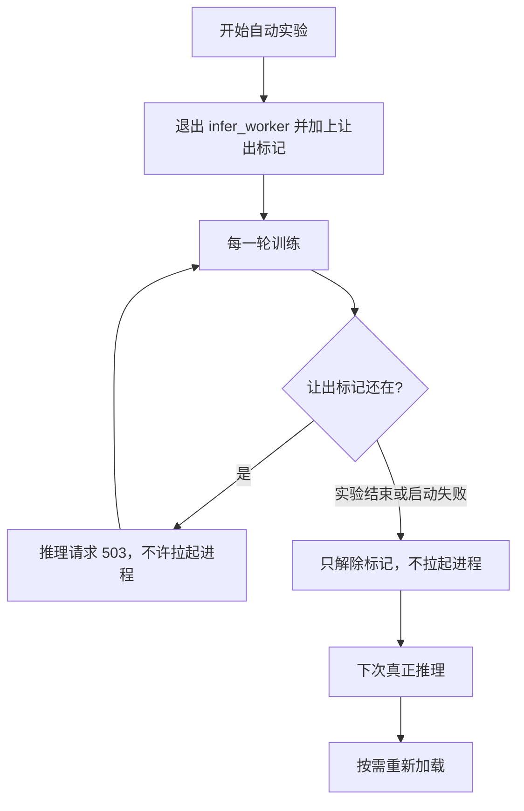

# 自动实验鲁棒性测试说明

版本：v1.33.3  
日期：2026-11-10  
对象：`7-autoresearch-yolo` 自动实验，以及它和网页推理进程（`infer_worker`）抢显存的处理。

## 1. 目的

确认一件事：自动实验开始时会把推理进程退出、腾出显存；实验没结束前推理进程不会自己再起来；实验结束（包括启动失败、中途停止）后只解除限制，下次真正推理才重新加载。中途失败不能把推理一直停死，也不能在不该让出的时候误伤。

## 2. 范围

测这些：

- 网页 `POST /api/autoexp/start` 与 `POST /api/autoexp/stop`
- 命令行 `agent` / `run` / `noise` 通知网页让出显存
- `POST /api/infer/gpu-yield`、`POST /api/infer/gpu-release`、让出期间的推理与「重启推理进程」

不测这些：

- 完整 30 轮搜索，以及 600 秒正式训练
- holdout 验收
- 训练页重新训一个模型
- 换显卡后再测 1152 分辨率

## 3. 通过标准

- 自动化：`run_all_tests.py`、`test_autoexp_api.py`、`test_infer_yield.py`、`test_run_log.py` 全部通过。
- 真机：让出后推理进程消失且推理返回 503；立刻停止后没有残留的 `autoexp.py`；停止后推理进程不会自动起来；下一次推理才会出现新的 `infer_worker.py`。
- 测完网页不停留在「已让出」状态。

## 4. 流程

## 5. 自动化用例

已有基线，加上本轮失败路径后整包重跑，2026-11-10 结果：

- `7-autoresearch-yolo/run_all_tests.py`：56 / 56。含继承、分组噪声、降 batch 识别、让出所有权不能嵌套、网页没开时不假装已让出，以及开场事件能读到时间上限
- `6-web/backend/tools/test_autoexp_api.py`：16 / 16。含 Key 不进命令行、启动时带 `AUTOEXP_INFER_YIELDED=1`、409 不让出、启动失败必解除
- `6-web/backend/tools/test_infer_yield.py`：6 / 6。含让出期间不拉起、解除后下一次才拉起、重复让出/解除、隔离模式 503、选后端在让出时拒绝、结束回调抛异常不打断收尾
- `6-web/backend/tools/test_run_log.py`：22 / 22。训练页日志流程没有被带坏

本轮补上的失败路径：

| 编号 | 用例 | 期望 | 结果 |
| --- | --- | --- | --- |
| A1 | 已有任务时 `/start` 返回 409 | 不调用让出 | 通过 |
| A2 | `manager.create` 抛 `OSError` | 立刻解除让出，标记为空 | 通过 |
| A3 | 连续让出两次、连续解除两次 | 不报错，第二次解除后标记仍为空 | 通过 |
| A4 | 进程结束回调自己抛异常 | 回调被调用，任务状态仍是 finished | 通过 |
| A5 | 让出期间走隔离模式的 `run_yolo` | 503，且没有拉起进程 | 通过 |
| A6 | 网页选后端时进程停着但没有让出 | 仍选择推理进程，选后端本身不拉起 | 通过。这是真机第一次失败后补上的 |

训练页只重跑 `test_run_log.py`，确认老日志流程没被带坏。

## 6. 真机步骤

前提：`GET http://127.0.0.1:8060/api/health` 的 `version` 必须是 `1.33.3`。不是的话，停掉占用 8060 的旧进程，用 `启动Web端.bat` 再拉起。

| 步骤 | 操作 | 期望 |
| --- | --- | --- |
| L1 | 记下显存和 `infer_worker.py` 进程。没有进程就先发一次推理让它起来 | 让出前能看到推理进程或显存占用 |
| L2 | `POST /api/infer/gpu-yield?reason=鲁棒性测试` | 进程消失，worker 状态 `yielded`，可用显存上升 |
| L3 | 再发一次推理 | 503，且没有新的 `infer_worker.py` |
| L4 | `POST /api/infer/worker/restart` | 拒绝，进程不起 |
| L5 | 启动 1 轮自动实验，几秒内停止 | 停止后没有残留 `autoexp.py`；让出标记已解除；推理进程仍未自动起来 |
| L6 | 再发一次推理 | 这时才出现新的 `infer_worker.py` |
| L7 | 若标记还在，再 `POST /api/infer/gpu-release` | 测完不把网页留在让出状态 |

命令行补一条：网页开着时调用 `acquire_infer_yield`，确认打到 8060，不启动真实训练。

真机任何一步不符合期望就停，把显存数字、进程和接口返回记在下面，不继续加长训练。

## 7. 真机结果

时间：2026-11-10。机器：本机 NVIDIA T1000 8GB。网页先从旧进程（版本 1.33.1，PID 28396）停掉，再用 `启动Web端.bat 8060 nobrowser` 拉起。`GET /api/health` 为 `1.33.3`。

测的时候发现两处会让这条链走不完的错误，都已修好并重测：

- 网页一点开始，子进程立刻 `NameError: hours`。时间上限和 `max_tokens` 在拆函数时没有传进循环。修好后，1 轮实验能进入第 1 轮。
- 进程停着时，网页把「还没问过 DLL」当成 DLL 坏了，请求在选后端时就 503，到不了「按需拉起」。修好后，让出期间的 503 文案是「把显存让给训练」，解除后的下一次推理才会出现新进程。

| 步骤 | 实际 | 结论 |
| --- | --- | --- |
| 让出前 | 推理进程 PID 68992、87600。显存已用 923 MiB，空闲 7093 MiB。这两个进程还没加载模型 | 对照成立 |
| 让出 | `stopped=2`，两个进程消失，`state=yielded`，`gpu_hold=鲁棒性测试`。显存变为已用 922 MiB、空闲 7094 MiB | 进程退出了。显存几乎没变，因为进程本来就没占模型显存 |
| 让出期间再推理 | HTTP 503，正文：「推理进程已退出，把显存让给训练（鲁棒性测试）。训练结束后，下次推理会自动重新加载。」没有新进程 | 通过 |
| 重启推理进程 | `refused=true`，`state=yielded`，没有新进程 | 通过 |
| 启动 1 轮后立刻停止 | 运行号 `7ea3692e50fd`。两秒时能看到 `autoexp.py agent --rounds 1`。停止返回 `ok=true`、`killed_tree=true`。之后没有残留的 `autoexp.py`。`gpu_hold` 为空，推理进程没有自动起来 | 通过。没有进入正式训练 |
| 解除后再推理 | 解除返回 `reloaded=false`，此时进程仍是空的。下一次推理 HTTP 400（测试用的引擎文件不存在），同时出现新进程 81760、98732，`state=running` | 通过。400 说明请求已经进了推理进程，不是被让出拦住 |
| 命令行 | `acquire_infer_yield` 返回拿到所有权。网页日志：「已让推理进程退出（2 个）」。随后解除，`state=stopped`，标记为空 | 通过。没有启动训练 |
| 收尾 | 再发一次推理，`state=running`，`gpu_hold` 为空，进程 PID 74288 | 网页没有留在让出状态 |

显存数字没有出现「空出 1.7GB」。这次拉起的推理进程没有加载模型，nvidia-smi 里也没有它们的显存占用，所以退出前后只差约 1 MiB。进程消失、拦住重载、结束后不自动占回来，这三件已经在上面的进程号里对上。
