# TRTForge Web Studio 使用说明手册

> **这本手册写给谁**：质检、工艺、现场工程师。不需要会写代码。  
> **软件是什么**：浏览器里的缺陷检测工作站。用它完成「标缺陷 → 训练模型 → 变成可上线的引擎 → 拿新图片看检得准不准」。  
> **截图版本**：界面说明对照 **v1.28.0**（2026-11-06）。按钮以你屏幕上的字为准。旧截图仍是 v1.26 的检测页；推理进程隔离相关说明以 v1.28.0 为准。  
> **怎么看图**：文中的流程图是 Mermaid。用支持 Mermaid 的 Markdown 预览打开（Cursor / VS Code 安装 Markdown Preview Mermaid Support）。

相关文档，不要和本手册混用：

| 文档 | 给谁看 | 和本手册的关系 |
| --- | --- | --- |
| 本手册 | 日常点按钮的人 | 只讲 Web 版 |
| [Qt 桌面版操作手册](TRTForge_操作手册.md) | 仍在用 `TRTForge.exe` 的人 | 页签和按钮都不同 |
| [算法小白版](TRTForge_算法与应用场景说明_小白版.md) | 还在选「该用哪种算法」的人 | 讲原理，不讲网页上点哪里 |
| [WebStudio架构与功能介绍.md](WebStudio架构与功能介绍.md) | 想知道页面背后用了什么 | 架构框图、六个页面截图、技术栈 |
| [商业化差距分析与优化建议.md](商业化差距分析与优化建议.md) | 想知道还缺什么、先改什么 | 安全漏洞、稳定性问题、算法缺口、P0/P1/P2 路线图 |
| [6-web/README.md](../6-web/README.md) | 改软件的人 | 版本记录和实现细节 |
| [WORKFLOW_GUIDE.md](WORKFLOW_GUIDE.md) | 要验收产物的人 | 命令、文件和通过标准 |

---

## 1. 软件能做的事

打开浏览器就能用。训练和推理仍走原来的程序，界面换成了网页，所以不用再编译 Qt。

同一台电脑上双击启动后，浏览器地址是：

`http://127.0.0.1:8060`

顶栏从左到右是六个页面：

| 页面 | 你在这里干什么 | 做完会得到什么 |
| --- | --- | --- |
| 训练导出 | 教模型认缺陷，或把训好的权重转成 ONNX | `best.pt`、`best.transd.onnx` |
| 引擎构建 | 把 ONNX 编译成这台显卡能跑的引擎 | `.engine` 文件 |
| 数据集 | 把图片分成训练 / 验证 / 测试，并导出 | `dataset.yaml` 或 COCO / VOC 目录 |
| 标注 | 在图上画缺陷框，或审核自动画好的框 | `.tfanno` 工程 |
| 推理演示 | 拿一张图、一个目录、一段视频或摄像头看检测结果 | 画面上的框、分数、热力图 |
| 环境说明 | 看这台电脑缺不缺运行条件 | 一份当前环境清单 |

顶栏右侧有一盏状态灯。**绿灯写着「环境就绪」**，才可以放心训练和推理。

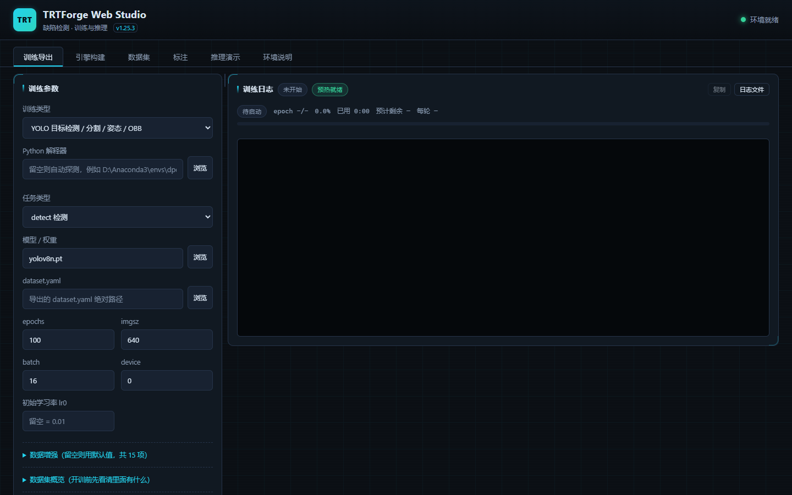

---

## 2. 整条工作怎么走

大多数产线按下面的顺序做。效果不好时，回到标注补图，再训一轮。

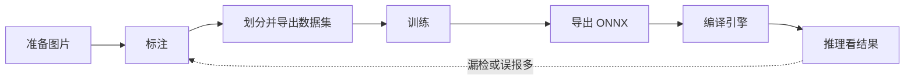

已经有 YOLO 格式的图片和标签时，可以跳过标注，直接从「数据集」或「训练导出」开始。

已经有训好的 `best.pt` 时，可以勾选「跳过训练」，只做导出、编译和验证。

### 2.1 第一次打开

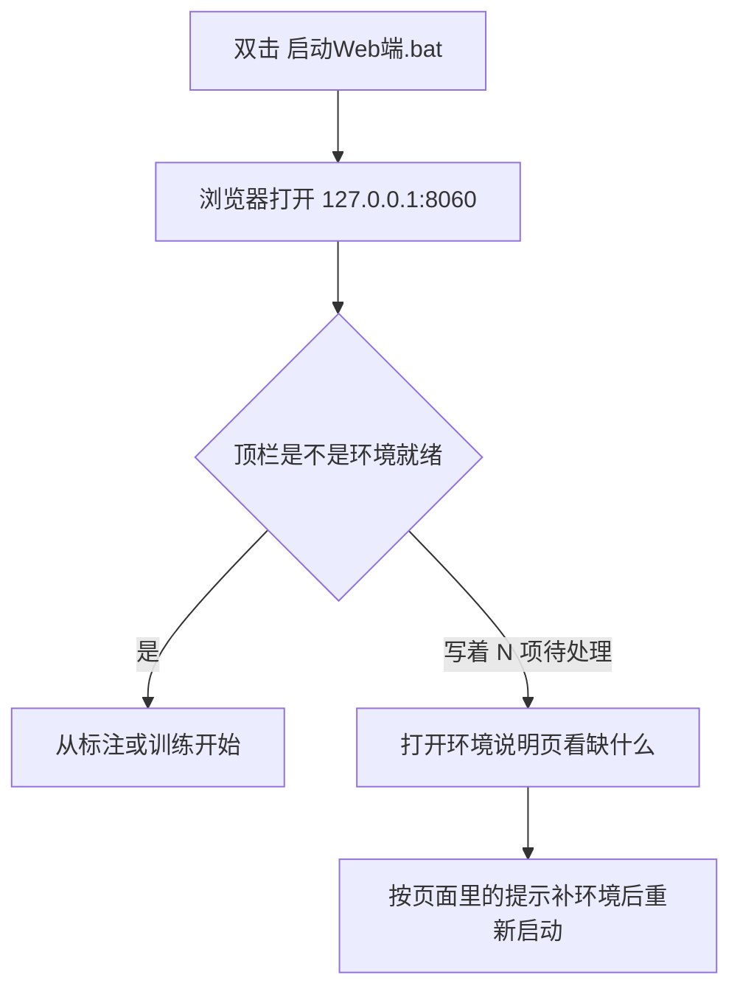

1. 进入 `dp-tool` 目录，双击 **`启动Web端.bat`**。
2. 等浏览器自己打开。没开的话，手动输入 `http://127.0.0.1:8060`。
3. 看右上角。绿灯「环境就绪」就可以用。
4. 版本号在标题下面，例如 `v1.27.0`。改过程序却觉得界面没变时，先对一下这个版本号：端口上可能还是旧进程。

常用启动方式：

| 你想做的事 | 怎么启动 |
| --- | --- |
| 平时使用 | 双击 `启动Web端.bat` |
| 换一个端口 | `启动Web端.bat 8070` |
| 不自动开浏览器 | `启动Web端.bat 8070 nobrowser` |
| 让车间里别的电脑也能打开 | 用 PowerShell 运行 `scripts\run_web_studio.ps1 -HostName 0.0.0.0`，别的电脑访问 `http://这台电脑的IP:8060` |

关掉浏览器**不会**停下正在跑的训练或编译。重新打开网页，顶栏会出现「运行中 N」，点进去就能接着看，也可以在那里点 **停止**。

### 2.2 选路径时的「浏览」

每个路径框旁边都有 **浏览**。

- 人就坐在跑软件的那台电脑前：直接点 **浏览**，会弹出 Windows 的选择窗口。
- 你是用另一台电脑的浏览器连过来的：系统窗口弹不出来。按住 **Shift** 再点 **浏览**，改用网页里的「选择路径」。
- 同时只能开一个系统选择窗口。提示「已经有一个选择框打开了」时，先关掉桌面上那个窗口。

---

## 3. 先决定用哪种检测

两种做法解决的问题不一样。选错了，后面标再多图也补不回来。

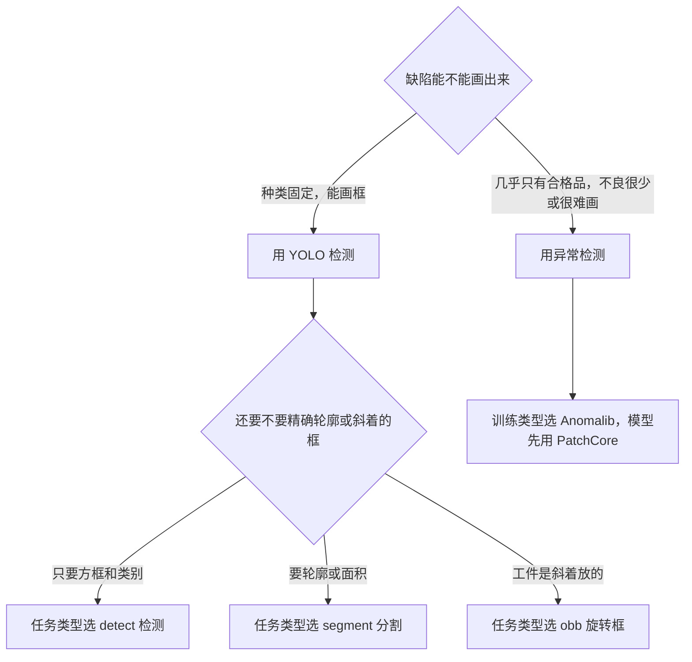

| 现场情况 | 选这个 | 你要准备的数据 |
| --- | --- | --- |
| 缺陷种类固定，能框出来 | YOLO，任务类型 **detect 检测** | 每张图上的框和类别 |
| 要算缺陷面积或要贴着边缘的轮廓 | YOLO，**segment 分割** | 多边形，比画框费时间 |
| 工件斜放，正框会框进一大块背景 | YOLO，**obb 旋转框** | 旋转框 |
| 合格图很多，不良样本很少 | **Anomalib 异常检测**，先用 PatchCore | 大量合格图，放在 `train/good` |
| 先判断有没有问题，再区分是哪种缺陷 | 先异常检测，再用 YOLO | 两套数据都要 |
| 要核对的是字、批号，不是外观伤 | 推理页选 **OCR 文字识别** | 用老版检测和识别模型目录，见 11.1 |

异常检测三个模型怎么选：

| 模型 | 什么时候用 |
| --- | --- |
| PatchCore | 默认。慢一些，工业场景通常先试它 |
| PaDiM | 想尽快出结果时 |
| EfficientAd | 合格品外观变化比较大时再考虑。它还需要额外的 imagenette 图片，没准备好会训失败 |

换了显卡，或 TensorRT 大版本变了，旧的 `.engine` 不能直接拿去用，要重新编译。

---

## 4. 标注

标注页用来告诉模型「缺陷在哪里、叫什么名字」。工程文件的后缀是 **`.tfanno`**，和 Qt 桌面版可以互相打开。

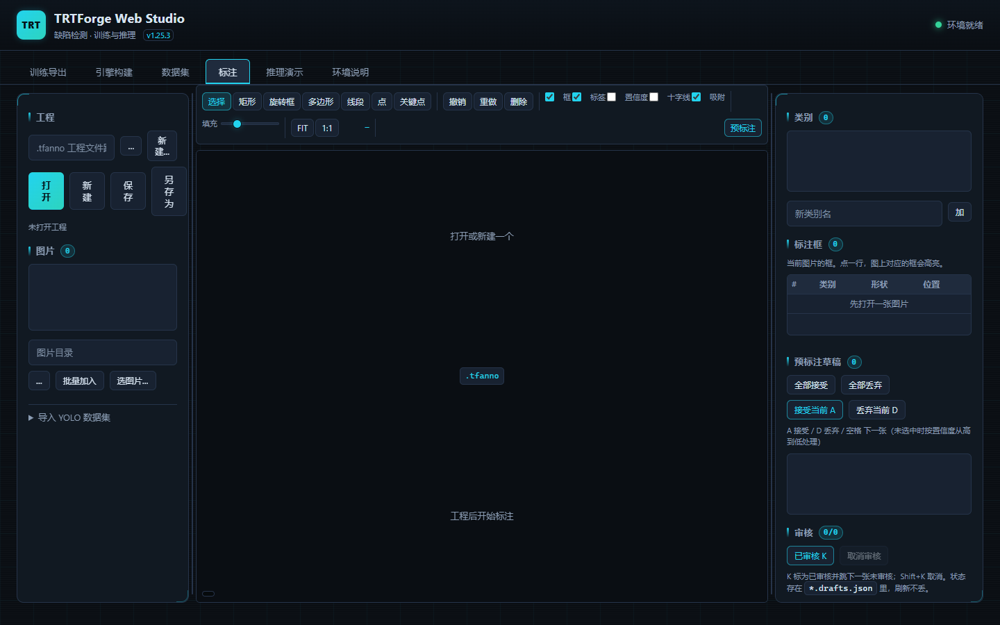

### 4.1 新建并开始画

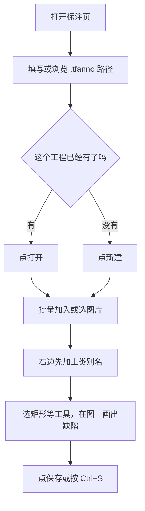

1. 点顶栏 **标注**。
2. 在「工程」里填写路径。路径里要带 `.tfanno` 文件名。如果 **浏览** 只选中了文件夹，软件会自动补成「文件夹名.tfanno」。
3. 已有工程点 **打开**，新工程点 **新建**。
4. 在「图片」里点 **批量加入** 或 **选图片…**，把要标的图加进来。
5. 右侧「类别」里输入名字（例如 `划痕`、`脏污`），点 **加**。
6. 中间工具栏选 **矩形**（最常用），在图上拖出一个框。
7. 点 **保存**。软件也会大约每 3 秒自动保存一次。

画布空白时会提示：「打开或新建一个 `.tfanno` 工程后开始标注」。

### 4.2 画布工具

| 工具 | 快捷键 | 用来画什么 |
| --- | --- | --- |
| 选择 | V | 点选、移动已有的框 |
| 矩形 | R | 水平的缺陷框，检测任务最常用 |
| 旋转框 | O | 斜着的工件 |
| 多边形 | P | 贴着轮廓画，分割任务用。至少 3 个点，**Enter** 结束 |
| 线段 | L | 线状缺陷 |
| 点 | T | 一个点 |
| 关键点 | G | 一组关键点，**Enter** 结束 |

其他按键（光标不要停在输入框里）：

| 按键 | 作用 |
| --- | --- |
| Ctrl+S | 保存 |
| Ctrl+Z / Ctrl+Y | 撤销 / 重做 |
| Delete | 删除选中的框 |
| Esc | 取消当前绘制，回到选择工具 |
| F | 图片缩放到适合窗口 |
| 滚轮 | 放大缩小 |

工具栏上的 **FIT**、**1:1** 用来把图片适应窗口或恢复原始大小。框、标签、置信度、十字线、吸附都可以单独开关。

### 4.3 已经有 YOLO 标签时

不必重画。展开左下角 **导入 YOLO 数据集**：

1. 填原来的数据目录。
2. 勾上要导入的 train / val / test。
3. 先点 **预览**，确认张数和框数对得上。
4. 再点 **导入** 或 **导入并保存**。

同名图片默认 **跳过**。只有确定要用新标签替换时，才改成覆盖。

### 4.4 让模型先画，人再改

右侧 **预标注** 可以先让已有引擎出一版框，人只做接受或丢弃。

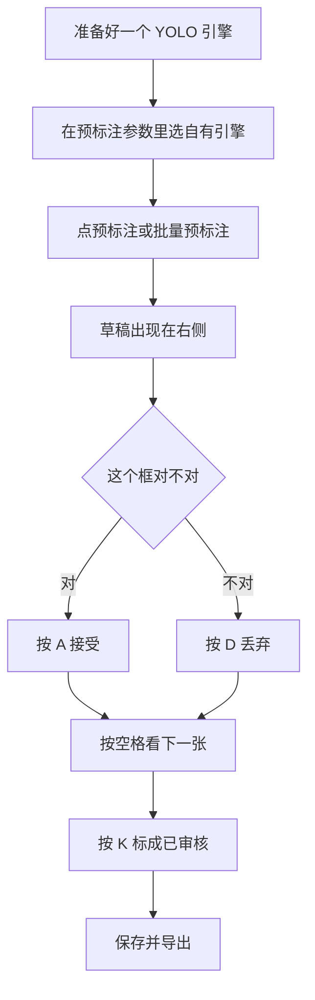

三种通道：

| 通道 | 什么时候用 | 你需要有什么 |
| --- | --- | --- |
| 自有引擎（.engine） | 已经有一版 YOLO 模型，想用它标下一批图 | 编译好的 YOLO 引擎。下拉里如果写着「未转置」，先别用 |
| 点 / 框提示（SAM） | 想点一下或拉一个粗框，让它抠出轮廓 | 模型仓库里下载对应模型 |
| 文本提示（GroundingDINO） | 想用文字描述要找的东西 | 模型仓库里下载对应模型 |

审核时：

- **A**：接受当前草稿
- **D**：丢弃当前草稿
- **空格**：下一张
- **K**：这张标成已审核，并跳到下一张还没审核的
- **Shift+K**：取消已审核

审核状态写在工程旁边的 `.drafts.json` 里，刷新网页不会丢。正式训练用的仍是你接受后写进工程的框。

点提示时：左键是「要这里」，**Shift+左键** 是「不要这里」，按住拖动是一个框。**Enter** 执行，**Esc** 清空。

### 4.5 从标注页导出

右侧最下方可以导出 YOLO、COCO 或 VOC。导出时会带上还没手动保存、但已经在内存里的修改。

导出格式限制：

| 格式 | 适合 | 不适合 |
| --- | --- | --- |
| YOLO | 本软件训练 | — |
| COCO | 交给别的工具 | 旋转框 |
| VOC | 老项目对接 | 只能用于检测，不能用于分割、姿态、旋转框 |

两个人同时改同一个工程时，保存可能提示 **工程已被修改**。选 **重新加载** 会丢掉你这次没保存的修改；选 **强制覆盖** 会用你这份盖住对方的修改。先确认谁的才是对的。

---

## 5. 数据集：分成训练、验证、测试

模型不能拿同一批图又训练又当考试。这一页负责切分，并导出训练能直接用的目录。

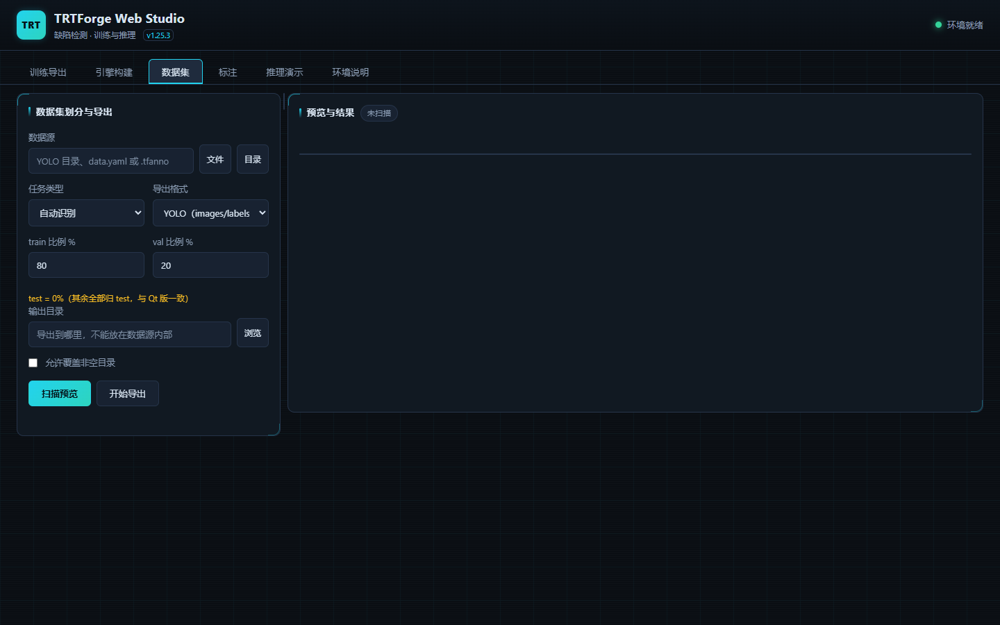

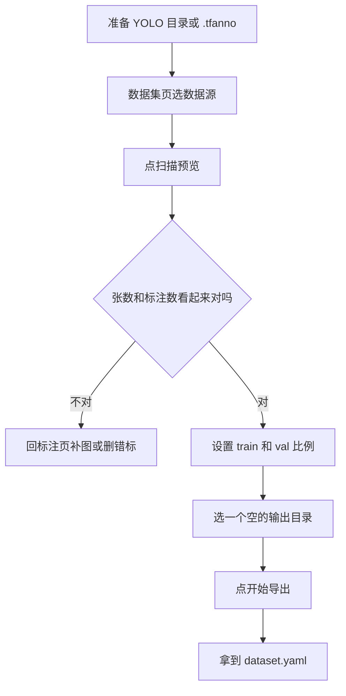

1. 点 **数据集**。
2. **数据源** 可以是 YOLO 目录、`data.yaml`，或 `.tfanno`。用 **文件** 或 **目录** 选。
3. **任务类型** 一般留「自动识别」。
4. **导出格式** 给本软件训练时选 **YOLO**。
5. 比例默认 train 80%、val 20%。剩下的全部算 test。两项加起来超过 100 会被拒绝。
6. **输出目录** 必须在数据源外面，不能套在源目录里面。
7. 先点 **扫描预览**。右边表格会列出每张图原来的划分、新的划分、标注数和尺寸。
8. 确认无误后点 **开始导出**。

默认不会覆盖已经有文件的目录。只有确定这个目录可以重做时，才勾上 **允许覆盖非空目录**。

切分方式和 Qt 桌面版不是逐张相同的。两边要对比同一次实验时，请用同一份已经导出的目录，不要各切一次再比分数。

---

## 6. 训练：YOLO

训练页左侧填参数，右侧看进度和日志。下面还有一块「全流程串联」，第 10 节单独讲。

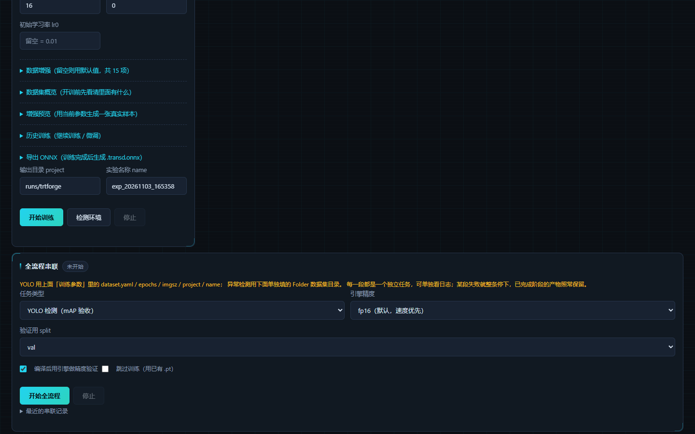

### 6.1 开始一次检测训练

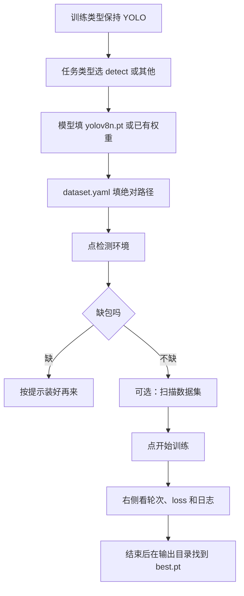

1. 打开 **训练导出**。训练类型保持 **YOLO 目标检测 / 分割 / 姿态 / OBB**。
2. **Python 解释器** 留空即可，软件会自己找。只有找错环境时才点 **浏览** 指定，例如装了训练库的那个 `python.exe`。
3. **任务类型** 和标注时一致：检测、分割、姿态或旋转框。
4. **模型 / 权重**：第一次训练可以留 `yolov8n.pt`。接着上次的结果训，就填那次的 `best.pt` 或 `last.pt`。
5. **dataset.yaml**：填第 5 节导出的文件，要写绝对路径。
6. 其余参数第一次可以不改：

| 参数 | 默认 | 表示什么 |
| --- | --- | --- |
| epochs | 100 | 全部图要看多少轮。图很少时可以先用 30 看能不能学会 |
| imgsz | 640 | 训练时图片缩成多大。必须是 32 的倍数。小缺陷可以试 960 或 1280，显存会更紧 |
| batch | 16 | 一次塞进显卡多少张。显存不够就改小，例如 8 或 4 |
| device | 0 | 用哪张显卡。只有一张卡就填 0 |
| 初始学习率 lr0 | 留空 | 留空等于 0.01。微调时软件会帮你填一个更小的数 |
| project | runs/trtforge | 结果放在哪个目录 |
| name | 自动生成的实验名 | 这一次实验的文件夹名。想对得上产线时，改成 `pcb_scratch_v1` 这种能看懂的名字 |

7. 点 **检测环境**。它会告诉你 Python、显卡库缺哪一个，以及修复命令。
8. 点 **开始训练**。右侧徽标从「未开始」变成运行中，进度里会出现 `epoch 12/100`、已用时间、每轮大概多久、预计还要多久。
9. 要中途停下，点 **停止**，或点顶栏里那条运行中的任务再停止。

训练日志可以点 **复制**，也可以点 **日志文件** 打开完整记录。关掉网页再进来，任务还在，不要再点一次 **开始训练**，否则会提示已经有一个在跑。

标题旁边的 **预热就绪** 表示训练程序已经提前准备好，第一次点开始会快一些。写成「预热未启用」也不影响结果，只是启动稍慢。

### 6.2 开训前三个检查

这三个都是折叠项，不点就不会算，也不影响直接训练。建议第一次用新数据集时都点一次。

| 折叠项 | 按钮 | 它帮你发现什么 |
| --- | --- | --- |
| 数据集概览 | **扫描数据集** | 训练 / 验证 / 测试各有多少张、多少框；有没有空标签、有图没标、有标没图；哪一类特别少 |
| 增强预览 | **生成预览** | 按你现在填的增强参数，给一张「原图 vs 增强后」的对照。**换个种子**、**换一张** 用来多看几张 |
| 历史训练 | **扫描历史训练** | 这个输出目录里以前训到第几轮、最好的分数、能不能接着训 |

增强预览是近似效果，用来确认「旋转是不是太大、缺陷是不是被缩没了」。它不是训练结果本身。

### 6.3 数据增强

展开 **数据增强（留空则用默认值，共 15 项）**。

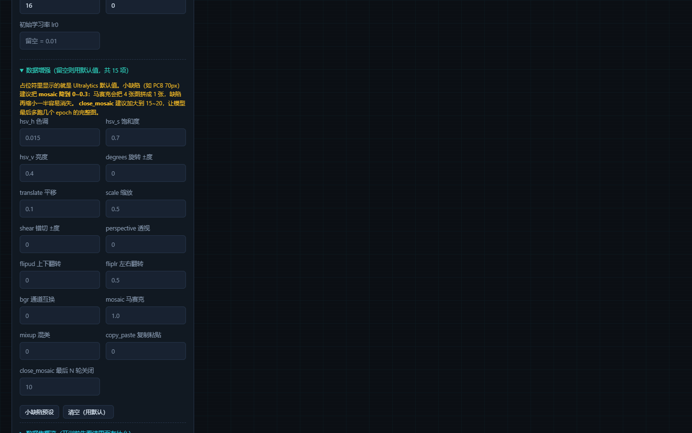

规则只有两条：

- **留空** = 不改，用软件默认值。
- **写成 0** = 明确关掉这一项。0 和留空不是一回事。

缺陷很小（例如焊点、微小划痕）时，默认的马赛克会把 4 张图拼成 1 张，缺陷再缩小一半，模型容易看不见。可以点 **小缺陷预设**。它会把马赛克降下来，并让最后若干轮改看完整图。想恢复默认，点 **清空（用默认）**。

概率类的数要在 0 到 1 之间。填错了，训练还没开始就会被拒绝，不用干等。

### 6.4 训练到一半停了，或想在旧模型上改一改

展开 **历史训练（继续训练 / 微调）**，点 **扫描历史训练**。

| 按钮 | 效果 |
| --- | --- |
| **继续训练** | 从 `last.pt` 接着跑，优化器和轮次都接上。主按钮会变成「继续训练（从第 N 轮）」 |
| **用它微调** | 从效果最好的 `best.pt` 用更小的学习率再学一点。适合补了一批新图之后 |
| **取消续训/微调** | 恢复成一次全新的训练 |

继续训练和微调不能同时开。

### 6.5 右侧那些数字

| 你看到的 | 含义 |
| --- | --- |
| epoch 12/100 | 当前第 12 轮，计划 100 轮 |
| 12.0% | 轮次走完了多少 |
| 已用 3:20 | 从点开始到现在 |
| 每轮 ≈ 18s | 最近几轮的典型耗时。第一轮常因为读图特别慢，所以不用平均值 |
| 预计剩余 | 按最近几轮估的，只供参考 |
| 实际执行的参数 | 真正发出去的命令，用来核对「我填的有没有传进去」 |
| 每轮指标 | 最近 20 轮的损失和分数 |
| 曲线 | 左边损失，右边验证分数 |

训练正常结束时，还会多一次最终验证。表格里这一行标成 **final**，轮次不会显示成「101/100」这种超出计划的数字。

---

## 7. 训练：异常检测

合格图很多、不良图很少时用这一页，而不是 YOLO。

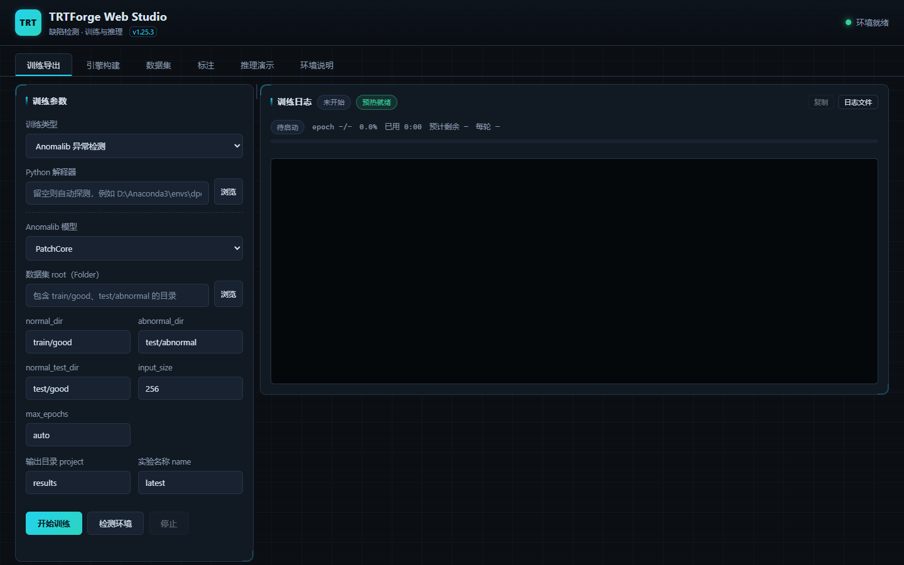

目录要长这样：

```text
数据集根目录/
  train/good/        用来学习的合格图
  test/good/         考试用的合格图
  test/abnormal/     考试用的不良图
```

1. **训练类型** 改成 **Anomalib 异常检测**。
2. **Anomalib 模型** 先留 **PatchCore**。
3. **数据集 root** 选上面那个根目录。三个子目录名和文件夹对不上时再改。
4. **input_size** 默认 256。改大更细，也更慢。宽和高要固定，不要做成「每张图尺寸都不一样」的动态尺寸。
5. **max_epochs** 留 `auto` 即可，PatchCore 不靠很多轮迭代。
6. 点 **检测环境**，再点 **开始训练**。

训完后，结果目录里会有 `metadata.json` 和 ONNX。推理时这两个都要。`metadata.json` 里记着「多高的分数算不良」。

---

## 8. 导出 ONNX

训练得到的是 `.pt` 权重。上线前要先变成 ONNX，再编译成引擎。

在训练页展开 **导出 ONNX（训练完成后生成 .transd.onnx）**。

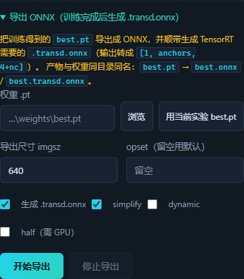

1. 权重框填 `...\weights\best.pt`，或点 **用当前实验 best.pt**。
2. 导出尺寸和训练时的 imgsz 保持一致，例如 640。
3. **生成 .transd.onnx** 保持勾选。YOLO 引擎必须用这个转置后的文件。直接拿 `best.onnx` 去编译，推理时框会乱飞、分数会大得不正常。
4. simplify 保持勾选。dynamic、half 第一次先不要勾。
5. 点 **开始导出**。

导出成功后，同一目录会出现 `best.transd.onnx`。结果表里可以点 **去编译引擎**，软件会带着这个文件跳到引擎构建页。

---

## 9. 引擎构建

引擎是给这台显卡用的运行文件。换电脑、换显卡后要重新做。

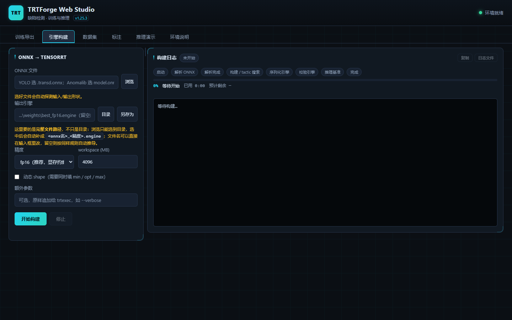

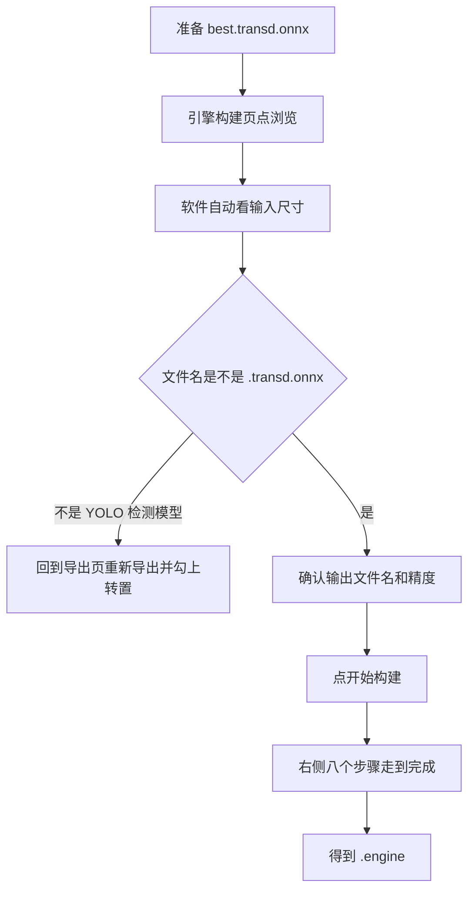

1. 点 **引擎构建**。
2. **ONNX 文件** 选 `best.transd.onnx`。异常检测则选训练目录里的模型 ONNX。选中后会自动看输入、输出形状。
3. **输出引擎** 要的是完整文件路径，不只是文件夹。点 **目录** 或 **另存为** 之后，软件会补成「原名_精度.engine」，你也可以改文件名。
4. **精度** 用 **fp16**。显存大约省一半，速度也更快。只有分数明显变差时才改 fp32。
5. workspace 默认 4096 MB，一般不用动。
6. 动态 shape 第一次不要勾。
7. 点 **开始构建**。

右侧步骤依次是：启动、解析 ONNX、解析完成、构建 / tactic 搜索、序列化引擎、校验引擎、推理基准、完成。进度百分比是估算的。长时间停在后面几步，先看日志里显卡是否还在工作，不要立刻当成死机。

构建可以点 **停止**。日志同样可以 **复制** 或打开 **日志文件**。

---

## 10. 全流程串联：训练到验证一次做完

训练页最下方的 **全流程串联**，适合数据集已经确认无误、想一次跑完的时候。


它复用上面「训练参数」里已经填好的 YOLO 数据。异常检测则用这一块自己的目录。

某一段失败，后面会停，已经成功的文件会留下。

### 10.1 YOLO 的六段

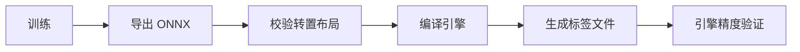

1. 上面的训练参数先填好，尤其是 `dataset.yaml`。
2. **任务类型** 选 **YOLO 检测（mAP 验收）**。
3. **引擎精度** 用 fp16。
4. **验证用 split** 用 val。
5. 保持勾选 **编译后用引擎做精度验证**。
6. 已经有 `best.pt`、只想重新导出和编译时，勾上 **跳过训练（用已有 .pt）**，并填那个权重。
7. 点 **开始全流程**。

精度验证目前主要针对 **detect 检测**。分割、姿态、旋转框可以训、可以导出、可以编译，但不要把这一段的 mAP 当成它们的验收结果。

### 10.2 异常检测的四段

把任务类型改成 **异常检测（AUROC / 漏检 / 误报）**，填写数据集根目录。

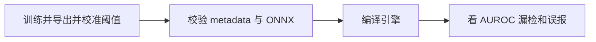

已有产物目录时，勾上 **跳过训练（用已有产物目录）**。

### 10.3 跑完之后看哪里

产物表里会给出引擎路径。可以点 **去推理引擎** 或 **带到推理页**。每一段可以单独打开 **日志**。

**最近的串联记录** 里能回看以前跑过的链路。软件重启后，当时还在跑的记录会变成已取消，已写出的文件还在。

---

## 11. 推理演示

这一页用来回答：「这个引擎在新图片上检得怎么样？」

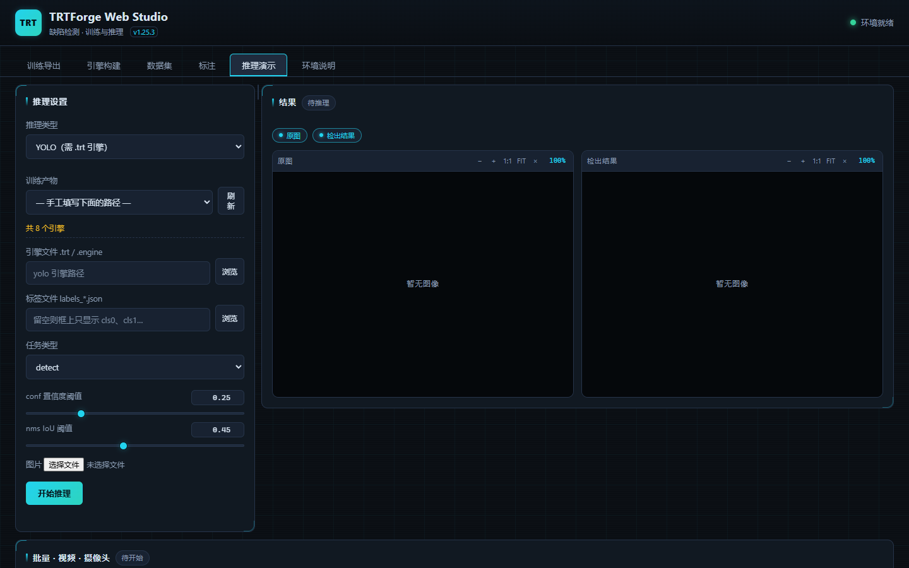

### 11.1 看一张图

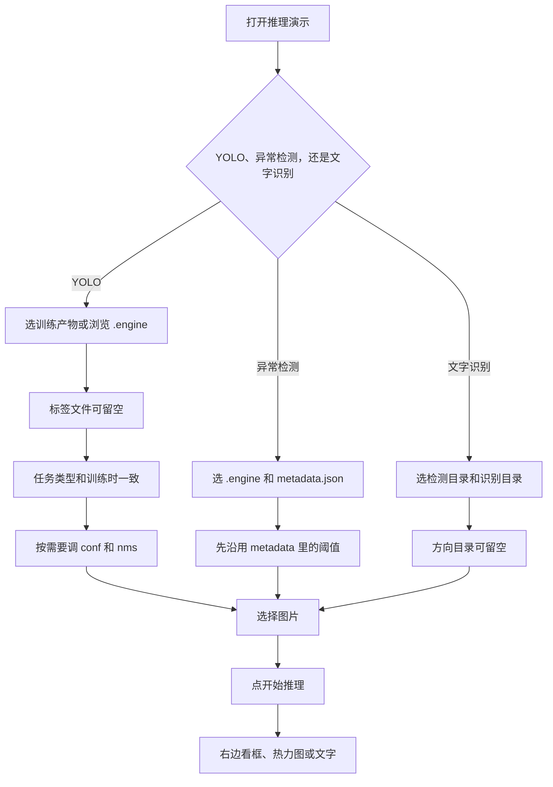

YOLO：

1. **推理类型** 选 **YOLO（需 .trt 引擎）**。
2. **训练产物** 里如果已经扫到引擎，直接选。选之前看一眼有没有「未转置」。有的话换 `.transd` 重新编译的那个。
3. 没有出现在下拉里时，用 **浏览** 选 `.engine`。
4. **权重格式**（v1.26 新增）：默认 **TensorRT 引擎（.engine / .trt）**；想直接用训练产出的 `.onnx`，
   改成 **ONNX（onnx_infer.dll）**，路径会换成同一产物里的 `.onnx`，其余参数、标签都不用重填。
   两种格式的后端不一样，结果区会显示这次到底是谁跑的（`yolo_infer.dll` 或 `onnx_infer.dll`）。
5. **标签文件** 留空时，类别只显示编号。想看到 `划痕` 这种名字，就选训练时生成的 `labels_*.json`。
6. **任务类型** 必须和训练时一样。
7. **conf** 是置信度门槛，默认 0.25。漏检多就降低，误报多就提高。
8. **nms** 是重叠框合并的松紧，默认 0.45。同一个缺陷出一串框时，把它调低。
9. **图片** 点 **选择文件**，再点 **开始推理**。

> 什么时候用 ONNX 而不是引擎：还没编译引擎、想确认是模型问题还是编译问题、
> 或者现场机器没有 TensorRT。**要最低延迟仍然用引擎**（本机实测 CPU 上 960×960 的检测，
> ONNX 约 70 ms/张，引擎快数倍）。

右边有 **原图** 和 **检出结果**。可以缩放、FIT、1:1。勾选可以控制是否显示框、标签，以及把低分框变淡。点下面表格的一行，图上对应的框会高亮。

结果可以 **导出 JSON** 或 **导出 CSV**。

异常检测：

1. 推理类型改成 Anomalib。
2. 同时选择 `.engine` 和 **metadata.json**；v1.26 起模型也可以直接选 `.onnx`
   （权重格式切到 ONNX），metadata 仍然要选，阈值与输入尺寸都从它读。
3. 先勾着 **沿用 metadata 默认阈值**。现场误报太多或漏检太多时，再取消勾选，单独改图像阈值和像素阈值。
4. 色带用 TURBO 即可。结果区会多出热力图和异常轮廓。

单张图片不要超过大约 32MB。更大的图先缩小再传。

#### 识别图上的文字

推理类型选 **OCR 文字识别（ocr_infer.dll）**。这一项不使用 YOLO 引擎。

1. **检测模型**、**识别模型** 各选一个目录。下拉里灰色的项当前飞桨版本加载不了，不要选。本机可用的在 `9-python-paddleOCR\model\legacy_v4`：检测用 `ch_PP-OCRv4_det_infer`，识别用 `ch_PP-OCRv4_rec_infer`。
2. **文本行方向** 可以留空。图里有倒着的字时，再选 `ch_ppocr_mobile_v2.0_cls_infer`。正着的字角度是 0，倒着的字角度是 1。
3. **设备** 默认 CPU。有显卡时可选 GPU 0，同一张登机牌样例从大约 3.8 秒降到大约 1.1 秒。
4. 保持 **CPU 下启用 MKLDNN** 勾选。关掉后一张图可能要一分钟以上。
5. 选图片，点 **开始推理**。页面会提示 CPU 单张大约要十几秒，请等它跑完，不要连点。
6. 右边画出文字多边形。点表格里的一行，图上对应的框会高亮。
7. 可以 **复制全部文字**，或导出 JSON、CSV、TXT。

灰色模型（名字里带 PP-OCRv6、PP-OCRv5，或文档方向、弯曲矫正）要等下一版飞桨，这一版选了也会被拒绝。

### 11.2 一个目录、一段视频、一个摄像头

设置仍用上面的引擎和阈值。往下找到 **批量 · 视频 · 摄像头**。

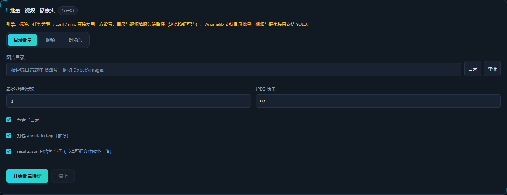

| 模式 | 按钮 | 谁能用 | 你要填什么 |
| --- | --- | --- | --- |
| 目录批量 | **开始批量推理** | YOLO、异常检测、文字识别 | 跑软件那台电脑上的图片目录，不是你自己电脑里随便一个盘 |
| 视频 | **开始视频推理** | 只支持 YOLO | 视频文件路径。可以设每隔几帧看一次。文字识别时这个页签不可用 |
| 摄像头 | **开启摄像头** | 只支持 YOLO | 分辨率和帧率。画面在浏览器里采集，检测框叠在画面上。文字识别时这个页签不可用 |

目录批量默认会：

- 包含子目录
- 打包 `annotated.zip`（画了框的图）
- 写出带每个框的 `results.json`

张数很多、只想要统计时，可以关掉「results.json 包含每个框」，文件会小很多。**最多处理张数** 填 0 表示不限制。

视频和摄像头掉帧时，软件会丢弃来不及处理的帧，不会越积越慢。摄像头打不开时，卡片上会写出原因，例如没有设备或没有允许使用摄像头。

### 11.1 推理进程崩溃怎么办（v1.28）

从 **v1.28.0** 起，YOLO / Anomalib / ONNX / OCR 的推理计算在单独的 **推理工作进程**里跑，不再和网页服务挤在同一个进程。这样某张图或某个模型把推理程序弄崩了，**训练、建引擎和网页本身通常还能继续用**。

| 你在页面上看到的 | 含义 | 建议你怎么做 |
| --- | --- | --- |
| 提示 **503**，并写出退出码、模型名、图片名 | 推理工作进程这次崩了 | 一般会自动重启；再点一次 **开始推理**。推理按钮旁会出现 **重启推理进程**，也可以点它立刻拉起新进程 |
| 提示 **504** | 这次推理等太久（默认最多 60 秒；文字识别第一次加载模型最多 180 秒） | 换小一点的图或等模型加载完再试；仍超时请联系维护人员加大 `TRTFORGE_INFER_TIMEOUT` |
| 顶栏问题列表写 **推理进程反复崩溃，已暂停** | 短时间内崩了太多次，软件暂时不再自动重启 | 检测/异常检测可能会改用较慢的 ONNX 兜底；点 **重启推理进程**，或等约 5 分钟后自动恢复 |
| 怀疑是「隔离」本身有问题 | 需要和旧版一样在同进程里跑推理做对比 | 维护人员可设 `TRTFORGE_INFER_ISOLATION=0` 后重启 Web 服务（行为与 v1.27.0 一致） |

**日志在哪**：在软件目录下的 `6-web\runtime\logs\infer_worker.log`（打包安装版路径类似，找 `runtime\logs` 即可）。把这份日志和当时用的模型、图片名一并发给维护人员，排查最快。

**维护人员还可**：调用 `POST /api/infer/worker/restart` 手动重启；在 **环境说明** 或 `GET /api/capabilities` 里看 `infer_worker` 的 `state`（running / stopped / tripped / disabled）。

---

## 12. 环境说明

灯不是绿色时，先打开这一页，不要反复点训练。

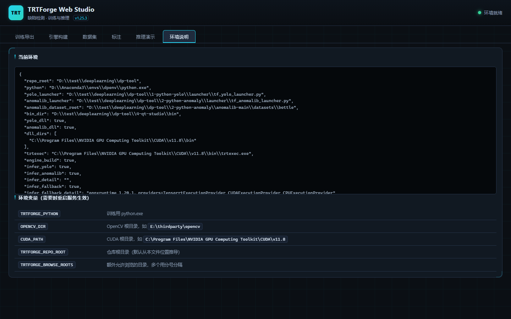

上半部分是当前检测到的 Python、训练脚本、推理库和 TensorRT。`true` 表示这项可用。

下半部分是环境变量。改了它们之后要**重新启动** Web 服务才生效。

| 变量 | 什么时候要设 |
| --- | --- |
| TRTFORGE_PYTHON | 自动找到的 Python 不是装了训练库的那个 |
| OPENCV_DIR | 推理库报缺 OpenCV |
| CUDA_PATH | 找不到显卡编译或推理工具 |
| TRTFORGE_REPO_ROOT | 软件不在默认目录，找不到训练脚本 |
| TRTFORGE_BROWSE_ROOTS | 浏览文件时还要允许额外的磁盘目录，多个用分号隔开 |
| TRTFORGE_OCR_MODEL_DIR | 文字识别模型不在默认的 `9-python-paddleOCR\model` 里 |
| TRTFORGE_INFER_ISOLATION | 设为 `0` 关闭推理进程隔离（与 v1.27.0 同进程行为，仅排障） |
| TRTFORGE_INFER_TIMEOUT | 单次推理最长等待秒数（默认 60；OCR 首次加载 180） |

这一页的路径是每台电脑自己的，截图只是本机示例。

---

## 13. 两条可以照着做的最短路径

### 13.1 缺陷种类固定，要框和类别

1. **标注**：新建 `.tfanno`，加上类别，把缺陷画成矩形，保存。
2. **数据集**：扫描预览，80/20 导出 YOLO，得到 `dataset.yaml`。
3. **训练导出**：任务类型 detect，填 `dataset.yaml`，检测环境，开始训练。
4. 展开 **导出 ONNX**，用 `best.pt`，勾着 **生成 .transd.onnx**，开始导出。
5. **引擎构建**：选 `best.transd.onnx`，fp16，开始构建。
6. **推理演示**：选新的 `.engine` 和标签文件，拿几张没参与训练的图看框对不对。
7. 漏了就补标注，误报多就先把 conf 调高；仍然不行再加图重训。

数据集已经确认过时，第 3 到第 6 步可以改成在全流程串联里点一次 **开始全流程**。

### 13.2 只有合格图，想找出不像合格品的地方

1. 把合格图放进 `train/good` 和 `test/good`，不良图放进 `test/abnormal`。
2. **训练导出** 里训练类型选 Anomalib，模型选 PatchCore，填数据集根目录，开始训练。
3. 到 **引擎构建** 编译训练得到的 ONNX。宽高必须是训练时那个固定尺寸。
4. **推理演示** 选引擎和 `metadata.json`，先用文件里的阈值。
5. 看热力图：真缺陷没亮，就降低阈值或补充更多合格图；好图也被标红，就提高阈值，并检查合格图里是不是混进了不良或光照差太多的图。

---

## 14. 出了问题先看这里

| 你看到的现象 | 先做这件事 |
| --- | --- |
| 顶栏是「N 项待处理」 | 打开 **环境说明**，看哪一项不是 true |
| 点了浏览没有窗口 | 确认人在服务器那台电脑前；远程时按住 Shift 再点浏览 |
| 提示已经有一个选择框 | 关掉桌面上已经打开的那个选择窗口 |
| 训练点了没日志 | 看 **日志文件**。若版本号没变，说明 8060 端口上还是旧程序，关掉旧进程再启动 |
| 日志里只有退出码 2 | 参数不合法。打开「实际执行的参数」，对照日志里的用法说明 |
| 关了浏览器以为训练停了 | 训练还在。重新打开，用顶栏「运行中」继续看或停止 |
| 又点了一次开始训练被拒绝 | 上一个还在跑。不要开第二个 |
| 框的位置乱、分数特别大 | 引擎不是用 `.transd.onnx` 编译的。重新导出并勾上转置，再编译 |
| 构建进度长时间停在后面 | 先看构建日志和显卡是否还在忙。这个百分比是估算 |
| 异常检测编译失败 | 输入的高和宽是不是固定的。回到训练，用固定 input_size 重新导出 |
| 类别只显示 0、1、2 | 推理页补上 `labels_*.json` |
| 选了 ONNX 但结果区写着 `onnxruntime-fallback` | 这台机器的 `bin` 里缺 `onnxruntime.dll` 或 `onnxruntime_providers_shared.dll`。（v1.26 起）三个文件必须在同一目录 |
| ONNX 推理比引擎慢很多 | 正常。没有显卡加速时 ONNX 走 CPU；要低延迟就切回引擎 |
| 选 ONNX 后提示「该选项不可用」 | 这个训练产物没有同名 `.onnx`。先到 **导出 ONNX** 页导出，或手工浏览选一个 |
| 摄像头一直起不来 | 看卡片上的错误：通常是没有摄像头，或浏览器没有允许使用它 |
| 文字识别模型是灰色的 | 那是飞桨 3.x 的模型。改选 `legacy_v4` 里带 `inference.pdmodel` 的目录 |
| 文字识别提示找不到 `mklml.dll` | 安装包要带文字识别运行库（打包参数 `-WithOcr`）。开发机确认飞桨包里的 `mklml\lib` 还在 |
| 文字识别很慢 | CPU 下一张图大约数秒到十几秒。勾上 MKLDNN，或改成 GPU 0。不要用它看视频 |
| 推理提示 **503** 或 **504** | 推理工作进程崩溃或超时（v1.28 起） | 见 **§11.1**；点 **重启推理进程**；查 `runtime\logs\infer_worker.log` |
| 顶栏 **推理进程反复崩溃，已暂停** | 进入熔断，暂停自动重启 | 点 **重启推理进程** 或等待约 5 分钟；YOLO/异常检测可能走 ONNX 兜底 |
| 预览里的增强和训练图不完全一样 | 预览用来看方向和幅度，不是逐像素复刻训练 |

服务重启之后：

- 已经写到磁盘上的权重、引擎、标注工程都还在。
- 正在跑的全流程会变成取消。
- 当时还没写完的批量预标注进度可能丢失，已接受进工程的框还在。

---

## 15. 和桌面版怎么选

| | Web 版（本手册） | Qt 桌面版 |
| --- | --- | --- |
| 怎么打开 | 双击 `启动Web端.bat`，用浏览器 | 运行 `TRTForge.exe` |
| 别人能不能远程看 | 可以，同一局域网打开网址 | 只能坐在那台电脑前 |
| 标注文件 | `.tfanno`，两边都能开 | `.tfanno` |
| 训练、导出、编译、推理 | 有 | 有 |
| 文字识别 OCR | 推理页里有（老版 pdmodel 模型；视频和摄像头不做） | 推理页里有 |
| 数据集怎么切分 | 和桌面版不是逐张相同 | 用它自己的切法 |

日常使用优先 Web 版。识别印刷文字时，在 Web 推理页选 OCR；倒着的字再打开文本行方向。文档整页转向和弯曲拉直这一版还没有。

---

## 16. 名词对照

| 词 | 在本软件里指什么 |
| --- | --- |
| `.tfanno` | 标注工程 |
| `dataset.yaml` | YOLO 训练用的数据清单 |
| `best.pt` | 这一轮训练里验证分数最好的权重 |
| `last.pt` | 最后一轮的权重，继续训练用它 |
| `.transd.onnx` | 给 YOLO 编译引擎必须使用的 ONNX |
| `.engine` | 这台显卡上的推理文件 |
| `metadata.json` | 异常检测的阈值和模型说明 |
| `labels_*.json` | 类别编号到中文名的对照 |
| conf | 置信度门槛，低于它的框不显示 |
| nms | 重叠框怎么合并 |
| epoch | 全部训练图看过一轮 |
| mAP | YOLO 检测准不准的分，越高越好 |
| AUROC | 异常检测分得开合格和不良的程度，越高越好 |
| 漏检 | 不良被当成合格 |
| 误报 | 合格被当成不良 |

## 17. 把软件发给别人

对方电脑和你一样是 CUDA 11.8，并且需要训练时，不要把这个仓库拷贝出去。在开发机执行：

```powershell
powershell -NoProfile -ExecutionPolicy Bypass -File .\packaging\package_web_user.ps1
```

得到 `dist\TRTForgeWeb`。把整个文件夹给对方。对方安装显卡驱动和 VC++ 运行库后：

1. 双击 `install_train_env.bat`（要联网。不必事先安装 Anaconda，脚本会自己准备 Python，并装上训练库）。
2. 用记事本打开 `config.json`，在 `data_roots` 里填图片所在的文件夹。
3. 双击 `start_web.bat`。

网页界面仍然能在浏览器里看到。C++ 推理源码和网页后端源码不会出现在这个文件夹里。训练用的 Ultralytics 是 AGPL-3.0，由对方机器在线安装，发放前请确认许可。
