# TRTForge（DefectVision AI Studio）详细操作手册

> **产品定位**：工业视觉场景的 AI 缺陷检测桌面工作站，覆盖**数据标注 → 数据集导出 → YOLO/Anomalib 训练与导出 → ONNX 转 TensorRT → C++ 推理验证**闭环。  
> **可执行程序名**：`TRTForge.exe`（源代码与工程目录仍常用名称「TRTForge」）。  
> **配套文档**：[引擎构建参数详解](../trtexec/gui/docs/TRT_Forge_参数说明.md) · [GUI 模块说明](../trtexec/gui/README.md)

**阅读提示**：下文含多张 **Mermaid 流程图与结构图**，请使用支持 Mermaid 的 Markdown 预览（如 VS Code + Markdown Preview Mermaid、Typora 等）查看。文中「界面截图」可在本地软件截取后，按 `docs/images/trtforge_manual/截图说明.txt` 命名放入同目录，即可与占位说明一一对应。

---

## 1. 总览配图与闭环流程

### 1.1 配图：端到端工作流（示意图）

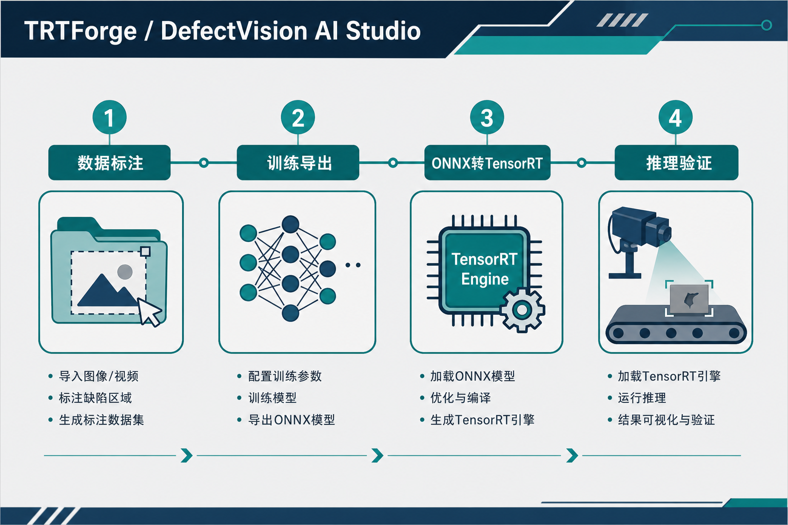

*说明：上图为产品流程概念图，具体菜单与按钮以软件实际界面为准。*

### 1.2 图文：四大页签在闭环中的位置

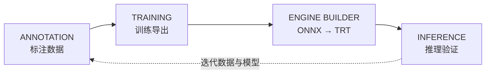

| 页签 | 英文名 | 主要产出 |
| --- | --- | --- |
| 标注数据 | Annotation Dataset | `.tfanno` 项目；YOLO/COCO/VOC 导出目录 |
| 训练导出 | Training Lab | `best.pt`、ONNX、`metadata.json`、`labels_*.json` 等 |
| 引擎构建 | Engine Builder | `.trt` / `.engine` |
| 推理验证 | Inference | 可视化检测/分割/姿态/OBB、异常热力图或 OCR 文本行结果 |

### 1.3 建议拍摄的界面截图（图文并茂）

将以下截图保存到 `docs/images/trtforge_manual/` 后，可在此处用 Markdown 插入：  
`` 等，具体文件名见 `截图说明.txt`。

| 序号 | 建议内容 |
| --- | --- |
| 01 | 主窗口：GPU 就绪状态 + 四个页签 |
| 02 | ENGINE BUILDER 全界面 |
| 03 | 标注页：画布与对象列表 |
| 04 | 训练页：YOLO 模式 |
| 05 | 训练页：Anomalib 模式 |
| 06 | 推理页：YOLO 相关控件 |
| 07 | 推理页：异常检测三画布 |
| 08 | 推理页：PaddleOCR OCR 多边形框、文本与分数列表 |

---

## PaddleOCR OCR 推理补充

`INFERENCE` 页新增 `OCR 文本识别 OCR` 模式。使用时先选择检测模型目录，例如 `trtexec/gui/bin/paddle_inference/ch_PP-OCRv4_det_infer`，再选择识别模型目录，例如 `trtexec/gui/bin/paddle_inference/ch_PP-OCRv4_rec_infer`。文本行方向分类为可选能力，当前测试建议先留空；只有拿到与当前 Paddle Inference 兼容、且带 `inference.yml` 的新版文本行方向模型时再启用。随后选择图片、视频或相机输入并点击「开始推理」。

OCR 结果包含两部分：画布上显示文本行多边形框和序号，右侧列表逐行显示文本、置信度、方向角和多边形坐标。画布与右侧结果列表之间的分隔条可拖动调整比例；点击某一条 OCR 结果时，画布中对应文本框会高亮显示。底层 `ocr_infer.dll` 会保证每一行的 `polygon`、`text`、`score`、`angle` 一一对应，便于外部调用者保存原始结果或与 PaddleOCR 输出做对齐验证。

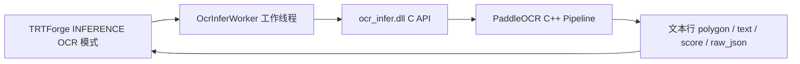

---

## 2. 运行环境与安装

### 2.1 推荐环境（开发与源码编译）

| 组件 | 说明 |
| --- | --- |
| 操作系统 | 64 位 Windows 10 或更高 |
| NVIDIA | 支持 CUDA 的显卡驱动；**Quadro / GeForce / RTX 均可**，需与本机 CUDA/TensorRT 版本匹配 |
| CUDA + TensorRT | 工程默认按 **CUDA 11.8 + TensorRT 8.x** 系列配置；以本机 `NvInferVersion.h` 与界面顶部显示为准 |
| 运行库 | **Visual C++ 2015–2022 x64** 可再发行组件（安装包场景常见依赖） |
| Python（训练页） | 由用户本机或虚拟环境提供，`python.exe` 在训练页中指定 |

### 2.2 安装包方式（Inno Setup）

1. 运行生成的 `TRTForge_Setup_*_x64.exe`，按向导安装（默认常至 `Program Files\TRTForge`）。  
2. 安装目录内需包含：`TRTForge.exe`、Qt/TRT/CUDA/OpenCV 等 DLL、`yolo_infer.dll`、`anomalib_infer.dll`、`ocr_infer.dll`、`bin/paddle_inference`、`configs`、`training/scripts` 下两个 `tf_*_launcher.py` 等。  
3. 详细制包说明见 `trtexec/gui/README.md` 中「制作 Windows 安装包」。

### 2.3 首次启动检查清单

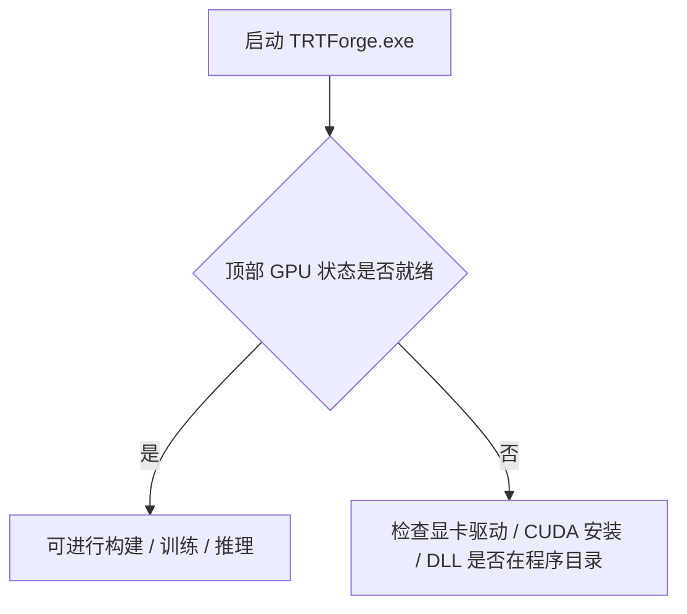

- 若 **ENGINE BUILDER** 无法构建：检查 TensorRT/CUDA 相关 DLL 是否与当前可执行文件同目录或在路径中。  
- 若 **训练页** 提示找不到 Python：在训练页浏览选择本机 `python.exe`，或先执行「检测环境」。  
- 若 **训练页** 提示找不到 `tf_yolo_launcher.py` / `tf_anomalib_launcher.py`：确认安装目录下存在 `training\scripts\`（Release 构建与安装包应自动带上）。

---

## 3. 主界面结构（文字 + 示意图）

### 3.1 布局逻辑

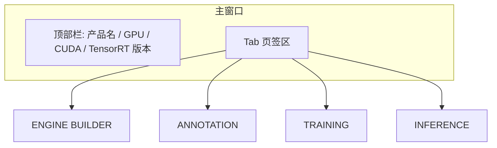

- **顶部栏**：显示当前 GPU 名称、CUDA 与 TensorRT 主版本等，便于现场确认环境。  
- **页签**：四个功能模块互不阻塞；长时间任务（构建、训练、推理加载）在后台线程执行，并可有进度提示。

### 3.2 日志与落盘

关键操作日志除界面显示外，会按日期写入 UTF-8 日志文件（默认相对程序工程：`trtexec/gui/logs/YYYY-MM-DD/trtforge_YYYY-MM-DD.log`）。现场排障时可附带该文件。

---

## 4. ENGINE BUILDER — ONNX 转 TensorRT

**逐项参数含义与点击方式**已并入 **§10.2**；本节保留流程与要点速览。

本节侧重**操作步骤**；与 `TRT_Forge_参数说明.md` 对照时，注意 **§10** 中关于 **INT8/额外参数** 与当前界面已对齐的说明。

### 4.1 操作流程（图文逻辑）

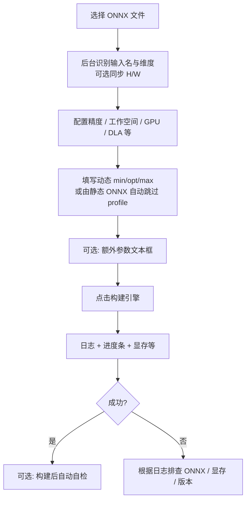

### 4.2 操作步骤（手把手）

1. **ONNX 路径**：点击浏览，选择待转换的 `.onnx`。  
2. **输出路径**：选择保存 `.trt`（或 `.engine`）的位置；若留空，部分版本会在选 ONNX 后给出默认同目录路径。  
3. **等待 ONNX 识别**：会弹出「加载/识别」类进度提示；完成后自动填入**输入名称**，并可使用**统一 H / 统一 W** 一次性修改 `min/opt/max` 三组形状中的高宽。  
4. **精度**：一般工业场景可优先 **FP16**；INT8/BEST 需理解标定与精度风险，见参数说明文档 §6。  
5. **工作空间**：默认约 4096 MiB，可按显存与模型规模增大；亦可于「额外参数」写 `--workspace=8192` 覆盖界面值。  
6. **GPU 设备号**：多卡环境选择目标卡索引（通常 0 为第一块）。  
7. **DLA**：桌面 GPU 一般**不要**误开 DLA；Jetson 等需按硬件说明配置。  
8. 点击 **构建引擎**，观察左侧分级日志与右侧构建进度。  
9. 构建成功后若开启**引擎自检**：会对新引擎做随机输入冒烟测试（**非**精度对齐），输出耗时与张量信息摘要。

### 4.3 静态 ONNX 与动态 batch（重要）

- 若 ONNX 输入**全部为固定正整数维**，程序会**自动不添加** Optimization Profile，此时界面 min/opt/max **不参与构建**（避免 TensorRT 报静态维与 profile 冲突）。  
- 若需要**动态 batch**，导出 ONNX 时需带**动态轴**（如 Ultralytics `dynamic=True`），再在本工具中填写一致的 **min/opt/max** 或使用 `--minShapes/--optShapes/--maxShapes`。

### 4.4 常见现象速查

| 现象 | 处理方向 |
| --- | --- |
| 构建阶段长时间停在某一百分比 | 常见于 Tactic 搜索；可尝试增大 workspace、换 FP16、换更小测试模型确认环境 |
| INT8 效果差或无标定 | 准备 `--calib=` 标定缓存或改用 FP16 |
| 中文路径 ONNX | 程序内部会复制到临时 ASCII 路径再解析，一般可保留中文输出路径 |

---

## 5. ANNOTATION — 标注与数据集

**全部按钮与区域的操作说明**见 **§10.3**。

### 5.1 任务类型

| 任务 | 图形 |
| --- | --- |
| detect | 水平矩形 |
| segment | 多边形 |
| pose | COCO 17 关键点 |
| obb | 旋转框四角点 |

### 5.2 基本操作顺序

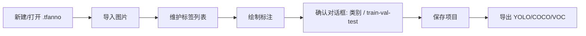

- **自动划分**：底部设置 `train/val/test` 比例（默认 80/10/10），点「自动划分」。  
- **手动划分**：选中图片后点 `train` / `val` / `test`。  
- **导出 YOLO**：生成 `images/`、`labels/`、`dataset.yaml` 等，供训练页使用。

---

## 6. TRAINING — 训练 / 验证 / 导出

**每个输入框、按钮的含义与点击顺序**见 **§10.4**。

### 6.1 与 Python 的关系

训练页通过 **QProcess** 调用解释器执行脚本，**不内嵌 Python**：

- YOLO：`training/scripts/tf_yolo_launcher.py`  
- Anomalib：`training/scripts/tf_anomalib_launcher.py`

可执行文件旁应存在 `training\scripts\` 目录（与 `launcherPath()` 查找顺序一致）。

### 6.2 YOLO 模式典型流程

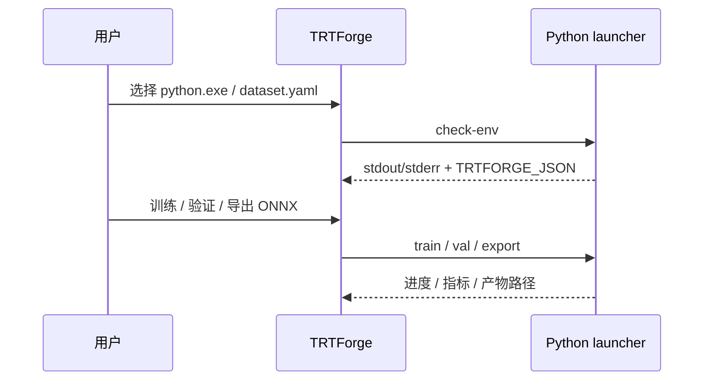

1. 在训练页选择 **Python 路径**（可针对不同任务头分别记忆）。  
2. 点击 **检测环境**，确认 torch、ultralytics、onnx 等齐全。  
3. 选择 **dataset.yaml**（由标注导出）或按界面要求填写工程字段。  
4. 选择训练初始化方式：预训练微调 / 从零 / 断点恢复（见 GUI 说明）。  
5. 训练过程在日志与监控子页查看曲线、GPU 占用、混淆矩阵缩略图等。  
6. **导出 ONNX** 成功后，将得到的 `.onnx` 交到 **ENGINE BUILDER** 转 TRT。

### 6.3 Anomalib 模式要点

- 按钮通常为 **检测环境**、**开始训练并导出**、**停止**。  
- 产出：`model.onnx`、`metadata.json` 等；转 TRT 后配合 **推理页 — 异常检测** 使用。  
- 日志区需保留完整 stdout/stderr，便于排查 anomalib/lightning 版本问题。

---

## 7. INFERENCE — 推理验证

**引擎、任务、输入源、标签/metadata、开始/停止**的逐项说明见 **§10.5**。

### 7.1 启动推理前的行为

点击「开始推理」后，会先检查当前模型参数是否和上一次一致。第一次启动，或更换 `.trt/.engine`、任务类型、阈值、`metadata.json` 等会影响模型的参数时，会**异步加载**引擎（YOLO 或 Anomalib），界面显示加载进度；成功后才启动图片 / 视频 / 相机源。

如果模型参数没有变化，只是更换了输入图片 / 视频 / 相机，软件会复用已经加载好的推理 worker，不再重复加载模型，直接重新启动采集与推理。

### 7.2 YOLO 类任务

- 选择任务类型（检测/分割/姿态/OBB 等与引擎一致）。  
- 选择 `.trt` / `.engine` 与 `labels_*.json`（若需要显示类别名）。  
- 支持滚轮缩放、拖拽平移、双击复原视图（见 README「推理演示画布交互」）。

### 7.3 异常检测 ANOMALY

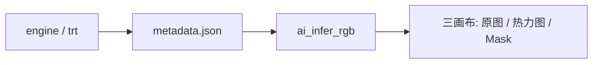

1. 任务选 **异常检测 ANOMALY**，模型类型与 metadata 中 `model_type` 等保持一致。  
2. 选择引擎与 **metadata.json**。  
3. 可按滑条微调 `image_threshold` / `pixel_threshold`（默认值来自 metadata）。  
4. 右侧列表显示分数与 OK/NG；三子窗口支持双击全屏查看。
5. 三画布左上角显示窗口名称（如 `Image`、`Image + Anomaly Map`），右下角显示滚轮缩放提示，二者不会互相遮挡。

### 7.4 中文路径（简要）

- 图片：Qt 读入字节再解码。  
- 视频：含中文路径时可能复制到临时 ASCII 路径再捕获。  
- 标签 JSON：UTF-8 读取。

---

## 8. Windows 安装包与文件布局（示意）

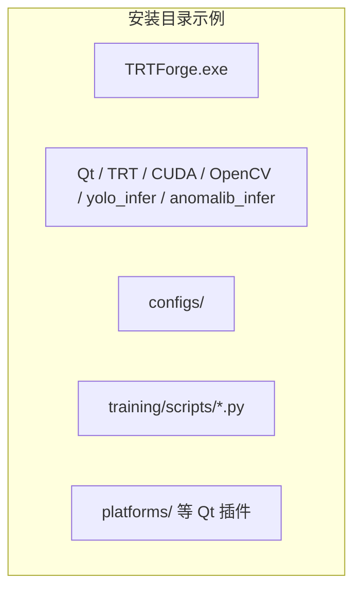

---

## 9. 常见问题（FAQ）

| 问题 | 建议 |
| --- | --- |
| 安装后双击无反应或缺 DLL | 安装 VC++ 2015–2022 x64；确认安装目录 DLL 完整 |
| 训练找不到脚本 | 确认 `training\scripts` 两个 py 与 exe 同根目录 |
| Quadro 能否转 TRT | 可以，与其它 NVIDIA CUDA GPU 类似；保证驱动与 CUDA/TRT 版本匹配 |
| 构建取消慢 | TensorRT 在部分阶段无法立即中断，需等待当前 tactic 阶段结束 |
| 界面与文档版本不一 | 以本仓库 `trtexec/gui` 当前版本为准，并参阅参数说明文档 |

---

## 10. 全界面参数与操作详解（逐项：是什么 / 怎么点）

本章按**真实界面控件名称**编写，便于边看软件边查。与 [`trtexec/gui/docs/TRT_Forge_参数说明.md`](../trtexec/gui/docs/TRT_Forge_参数说明.md) 中 **INT8/BEST 下拉、运行时模式实际生效** 等描述如有出入，**以当前可执行文件界面为准**（当前引擎页已移除 INT8/BEST 精度项，并提示 INT8 需用 `trtexec` 做标定；额外参数里的 `--int8` / `--best` 会被忽略并告警）。

### 10.1 主窗口与公共操作

| 界面区域 | 如何操作 | 含义 |
| --- | --- | --- |
| 顶部状态 | 启动后直接查看 | 显示 GPU 名称、CUDA、TensorRT 主版本等，用于确认当前机器环境是否与构建/推理匹配 |
| 页签 ENGINE / ANNOTATION / TRAINING / INFERENCE | 鼠标单击切换 | 四大功能模块；长时间任务在后台运行，切换页签一般不中断已在运行的构建/训练进程（以该页「停止」按钮说明为准） |

建议配图：`images/trtforge_manual/01_main_window.png`（见 §1.3）。

---

### 10.2 ENGINE BUILDER（引擎构建）— 自上而下操作顺序

#### 卡片「01 / 模型输入输出」

| 控件 | 如何点击 / 填写 | 含义与注意 |
| --- | --- | --- |
| **ONNX 模型路径** | 在输入框粘贴路径，或点 **「浏览」** 选 `.onnx` | 待转换模型；选后若**输出引擎路径**为空，会自动填默认 `.trt` 路径（同目录同名改后缀） |
| **输出引擎文件 (.trt)** | 手动输入或点 **「另存为…」** | 生成的 TensorRT 引擎保存位置，扩展名可为 `.trt` 或 `.engine` |

选 ONNX 后会出现**加载/识别进度**：后台解析第一个输入；完成后自动填「输入名称」等。**识别进行中可点「停止」取消**（若界面提供），大模型请耐心等待。

#### 卡片「02 / 精度与运行时」

| 控件 | 如何操作 | 含义 |
| --- | --- | --- |
| **精度模式**（下拉） | 单击展开选择 | **FP32**：全精度；**FP16**：半精度（一般推荐）；**TF32**：仅改内部枚举，**真正启用 TensorRT TF32 计算需配合下方「TF32」复选框**（见 03 卡片） |
| **运行时模式**（`full` / `lean` / `dispatch`） | 下拉选择 | **当前版本构建流程仍走标准 `IBuilder`，此项为预留**，改它不会改变本轮构建调用的 Runtime API |
| 灰色提示行 | 只读 | 说明本工具**未集成 INT8 在线标定**；需 INT8 时请用 NVIDIA `trtexec` 等完成标定后再部署引擎 |

#### 卡片「03 / 构建参数」

| 控件 | 如何操作 | 含义 |
| --- | --- | --- |
| **工作空间 (MiB)** | 单击框内输入数字（无上下箭头，直接键盘输入） | TensorRT Builder workspace 上限，默认约 4096；越大往往利于找到更快 tactic，但占显存更多；合法范围大致 64～65536（以界面为准） |
| **最大 Batch** | 同上 | 写入配置；**当前构建逻辑未使用该字段**，动态 batch 请以 **04 动态形状** 或 `min/opt/max` 为准 |
| **DLA 核心** | 整数，`-1`～`3` | **`-1`**：不用 DLA；**≥0**：尝试 DLA（多用于 **Jetson**；桌面 Quadro/GeForce 一般保持 **-1**） |
| **目标设备** | 非负整数 | `cudaSetDevice` 的 GPU 编号，多卡时 **0** 为第一块 GPU |
| **稀疏化** | 勾选 / 取消 | `kSPARSE_WEIGHTS`，需硬件/权重支持稀疏 |
| **可重拟合** | 勾选 / 取消 | `kREFIT`，允许后续重拟合权重（一般用进阶场景） |
| **版本兼容** | 勾选 / 取消 | `kVERSION_COMPATIBLE`，跨小版本 TRT 兼容性相关 |
| **允许GPU回退** | 勾选 / 取消 | `kGPU_FALLBACK`，默认建议勾选 |
| **TF32** | 勾选 / 取消 | **真正打开** `BuilderFlag::kTF32`；与「精度模式」里「TF32」条目配合理解：需要 TF32 时请**勾选本框** |

#### 卡片「04 / 动态形状」

| 控件 | 如何操作 | 含义 |
| --- | --- | --- |
| **输入名称** | 文本 | 须与 ONNX 里该输入张量名一致（常见 `images`）；ONNX 识别成功后会自动填入 |
| **统一 H / 统一 W** | 整数 | 快捷改分辨率：在勾选「同步 H/W…」时，会按规则刷新「最小/最优/最大形状」中的 **H、W**（保留各档 **batch 与 channel**） |
| **同步 H/W 到 min / opt / max（保留各自 batch 和 channel）** | 勾选 | 打开：改 H/W 自动同步三行形状；关闭：可完全手改三行 |
| **最小形状 / 最优形状 / 最大形状** | 文本，如 `1x3x640x640` | 动态维 ONNX 的 profile；分隔符支持 `x` / `X` / `,`。**若 ONNX 输入全是静态固定维，构建时会自动不建 profile，这三行不参与** |

#### 卡片「额外参数」

| 控件 | 如何操作 | 含义 |
| --- | --- | --- |
| 多行文本框 | 每行或空格分隔多个 token，风格同 `trtexec` | 构建**开始前**解析；**会覆盖**界面上同名含义（如 `--workspace=8192` 覆盖工作空间）。**`--int8` / `--best` 当前会被忽略并警告**。仍支持的示例：`--device=0`、`--minShapes=...`、`--onnx=...`、`--saveEngine=...`、`--calib=...`（calib 路径会保留字段，但 UI 已不选 INT8 时实际构建一般不按 INT8 走；详见参数说明文档与源码）。未识别 token **只警告不中止** |

#### 卡片「05 / 引擎自检」

| 控件 | 如何操作 | 含义 |
| --- | --- | --- |
| **构建后自动自检** | 勾选 | 构建成功后自动用**随机张量**跑一轮推理测时（**不比对外部真值精度**） |
| **Warmup** | 整数 | 正式计时前的预热次数 |
| **Iterations** | 整数 | 计入统计的推理次数 |
| **对已有 .trt 自检** | 按钮 | 不重新构建，只对已选 `.trt` 做反序列化 + 随机输入 + 报告 |

#### 底部操作行

| 控件 | 操作 | 含义 |
| --- | --- | --- |
| **重置** | 单击 | 将表单恢复默认/预设（以软件实现为准） |
| **▶ 构建引擎** | 单击 | 开始 ONNX→TRT；进行中按钮会变为「构建中...」且部分浏览按钮禁用 |

#### 右侧：实时日志 / 构建进度 / 自检报告

| 区域 | 操作 | 含义 |
| --- | --- | --- |
| **实时日志 / trtexec 输出** | 只读滚动；**清空** 按钮清除显示 | TensorRT 与程序日志（分级着色）；内容同时会写入按日落盘日志（见 §3.2） |
| **构建进度** | 观察 | 百分比为**估算**；五阶段点：解析→优化→调优→序列化→保存；**已用时 / 预计剩余 / 层 / 显存** 为参考 |
| **自检报告** | 构建或「对已有 .trt 自检」后查看 | 张量列表、耗时、显存、输出数值预览等 |

建议配图：`02_engine_builder.png`。

---

### 10.3 ANNOTATION（标注数据）

#### 顶栏

| 控件 | 操作 | 含义 |
| --- | --- | --- |
| 任务类型下拉 | **Detect / Segment / Pose / OBB** 等 | 决定导出格式与画布工具；**有图时切换会弹窗确认**（可能不兼容） |
| **新建** | 单击 | 清空当前项目（未保存请先保存） |
| **打开 .tfanno** | 单击 | 打开已有项目 |
| **保存** | 单击 | 保存到当前路径；若无路径会另存为 |
| **导入图片** | 单击 | 向工程添加图片 |
| **导入标注** | 单击 | 导入外部标注（格式以对话框为准） |
| **导入类别** | 单击 | 导入 `labels_*.json` 等类别表 |
| **自动划分** | 单击 | 按底部 train/val/test **百分比**一键划分当前图片 |
| **导出 YOLO** | 单击（主按钮样式） | 导出 YOLO 目录 + `dataset.yaml` |
| **COCO** / **VOC** | 单击 | 导出对应格式 |

#### 左侧工具条（竖条）

| 按钮 | 操作 | 含义 |
| --- | --- | --- |
| 选择 | 点选为当前工具 | 选中、编辑对象前的默认工具 |
| 移动 | 拖画布 | 平移视图 |
| 矩形 / 旋转 / 多边形 / 线段 / 点 / 姿态 | 点选后在画布绘制 | 与当前任务类型组合使用；多边形：**左键加点，右键闭合** |
| **撤销** | 单击 | 撤销最近标注/编辑操作 |

#### 正矩形的确认式操作方式

| 步骤 | 鼠标操作 | 结果 |
| --- | --- | --- |
| 1 | 左侧工具选择 **□ 矩形** | 进入普通矩形标注模式 |
| 2 | 在画布上 **按住左键拖动**，拖出一个正矩形，松开左键 | 不会立即弹确认框；画布保留一个紫色矩形草稿 |
| 3 | 拖动矩形 **中心绿色点** | 整个矩形自由平移，可反复调整位置 |
| 4 | 调整满意后，在画布上 **右键** | 结束矩形草稿并弹出标注确认对话框 |
| 5 | 在确认对话框点 **确定** | 写入当前图片对象列表；点 **取消** 则丢弃本次草稿 |

注意：普通矩形没有旋转手柄，只能通过中心绿色点平移；需要倾斜角度时请使用 **◇ 旋转** OBB 工具。

#### 旋转矩形 OBB 的新操作方式

| 步骤 | 鼠标操作 | 结果 |
| --- | --- | --- |
| 1 | 顶栏任务选择 **OBB 旋转框**，左侧工具选择 **◇ 旋转** | 进入 OBB 标注模式 |
| 2 | 在画布上 **按住左键拖动**，先拖出一个正矩形，松开左键 | 不会立即弹确认框；画布保留一个紫色旋转框草稿 |
| 3 | 拖动矩形 **中心绿色点** | 整个旋转框自由平移，可反复调整 |
| 4 | 拖动矩形右侧外伸轴末端的 **黄色旋转点** | 围绕中心旋转矩形，可反复调整 |
| 5 | 调整满意后，在画布上 **右键** | 结束 OBB 草稿并弹出原来的标注确认对话框 |
| 6 | 在确认对话框点 **确定** | 写入当前图片对象列表；点 **取消** 则丢弃本次草稿 |

注意：切换工具或切换图片会清空尚未右键确认的 OBB 草稿。当前保存和导出仍使用四个角点，不改变 `.tfanno` 与 YOLO OBB 导出格式。

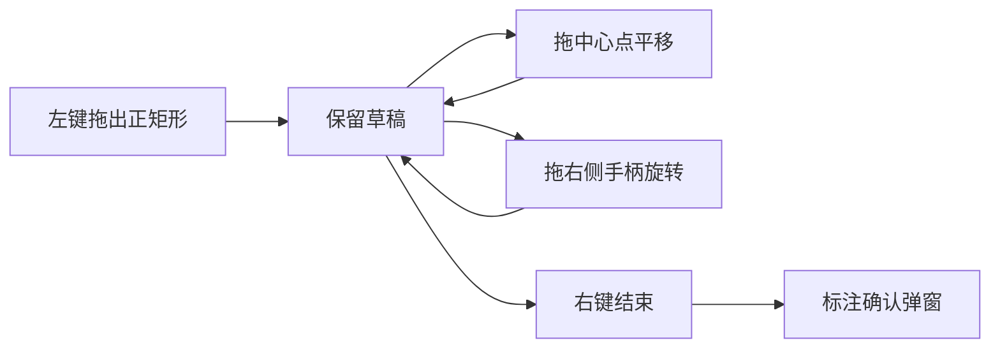

#### 右侧

| 区域 | 操作 | 含义 |
| --- | --- | --- |
| **标签** | **+ 新增标签** / **删除标签** | 维护类别；**删除前若已被对象使用会被拒绝** |
| **对象** | 点列表行 | 与画布双向高亮；**编辑**/**删除** 当前对象 |
| **属性与描述** | 只读/展示 | 当前对象附加信息 |

#### 底部

| 控件 | 操作 | 含义 |
| --- | --- | --- |
| train / val / test **百分比** | 三个 **%** 旋钮 | 三者和宜为 **100%** 后再点「自动划分」 |
| **train / val / test** 按钮 | 先选中一张图再点 | 把**当前图**划入对应子集 |
| 图片列表 | 单击换图 | 切换当前编辑图片 |

建议配图：`03_annotation.png`。

---

### 10.4 TRAINING（训练导出）

训练页有子页签：**「训练配置 / 日志」** 与 **「训练监控」**；下方按钮对所有模式通用（Anomalib 时部分按钮文案与显隐会变化）。

#### 子页签「训练配置 / 日志」— 卡片「01 / 任务与数据」

| 控件 | 操作 | 含义 |
| --- | --- | --- |
| **Python 环境** | **选择 Python** 或手输路径 | 指定 `python.exe`；会按任务类型记忆 |
| **训练类型** | **YOLO** / **Anomalib** | 切换后下方 YOLO 专用区与 Anomalib 专用区显隐不同 |
| **任务头 task**（YOLO） | detect / segment / pose / obb | 交给 Ultralytics 的任务类型 |
| **训练初始化方式**（YOLO） | 微调 / 从零 / 断点 | 对应 `finetune` / `scratch` / `resume`；详见界面黄字说明 |
| **模型入口 model / weights**（YOLO） | **浏览** 或手输 | 如 `yolov8n.pt` 或本地 `.pt` |
| **预训练 pretrained**（YOLO） | 手输 `true` / `false` 或路径 | 与 Ultralytics 行为一致 |
| **Anomalib 模型** | PatchCore / PaDiM / EfficientAd | 异常检测算法 |
| **normal_dir / abnormal_dir / normal_test_dir** | **目录** 选路径 | Folder 数据布局下的相对子目录（相对 **数据 root**） |
| **YOLO: dataset.yaml / Anomalib: Folder root** | **浏览** | YOLO：标定导出的 yaml；Anomalib：数据集根目录 |
| **输出目录 project** | **目录** | 训练输出根，如 `runs/trtforge` |
| **实验名称 name** | 文本 | 每次运行子目录名；用于 `labels_<name>.json` 等 |

#### 卡片「02 / 训练、验证与导出参数」

**YOLO 区域**

| 控件 | 含义 |
| --- | --- |
| **epochs / imgsz / patience / workers** | 训练轮数、输入边长、早停耐心、DataLoader 线程数 |
| **batch** | batch 大小字符串 |
| **device** | GPU 编号，如 `0` |
| **验证/导出 FP16 half** | 验证或导出时使用半精度 |
| **导出 dynamic** | ONNX 导出动态轴 |
| **生成 .transd.onnx** | 是否额外生成 transd onnx（默认常开） |

**Anomalib 区域**

| 控件 | 含义 |
| --- | --- |
| **input_size** | 输入边长 |
| **max_epochs** | `auto` 或具体数字 |
| **train_batch_size / eval_batch_size** | 训练/评估 batch |
| **num_workers** | 数据加载线程 |
| **calib_normal_dir / calib_abnormal_dir / calib_limit** | metadata 校准用样本 |
| **启用 metadata 校准** | 是否做阈值/分布校准 |
| **EfficientAd imagenet_dir** | EfficientAd 所需辅助数据；**选择 EfficientAd 辅助数据** |

#### 底部按钮（根据模式）

| 按钮 | 何时可点 | 作用 |
| --- | --- | --- |
| **检测环境** | 一般随时 | 调用 launcher `check-env`，检查 Python 依赖 |
| **开始训练**（YOLO）/ **开始训练并导出**（Anomalib） | 填好必填项后 | 启动 `train` 或 `train-export` |
| **验证模型** | YOLO 模式 | 对已有权重做 `val` |
| **导出 ONNX** | YOLO 模式 | 仅导出 ONNX |
| **停止** | 任务运行中 | 终止 Python 子进程 |

日志在 **「训练配置 / 日志」** 中大文本框实时显示；**「训练监控」** 中看曲线、GPU 占用、混淆矩阵缩略图等。

建议配图：`04_training_yolo.png`、`05_training_anomalib.png`。

---

### 10.5 INFERENCE（推理验证）

#### 卡片「引擎与任务」

| 控件 | 操作 | 含义 |
| --- | --- | --- |
| **.trt 引擎路径** | **浏览** | 选择 TensorRT 引擎 |
| **任务类型** | 下拉 | **DET / SEG / POSE / OBB** 对应 YOLO DLL；**异常检测 ANOMALY** 走 `anomalib_infer.dll` |
| **异常检测模型** | 下拉（仅 ANOMALY 时显示） | EfficientAd / PaDiM / PatchCore；**最终以 metadata 为准** |
| **置信度阈值** 滑条 | 拖动 | YOLO：检测置信度；**ANOMALY：实际映射为 image 级阈值**（见界面数值标签） |
| **NMS IoU 阈值** 滑条 | 拖动 | YOLO：NMS；**ANOMALY：映射为 pixel 级阈值** |

#### 卡片「输入源」

| 操作 | 含义 |
| --- | --- |
| 点 **图像** / **视频** / **USB 相机**（单选） | 切换输入模式 |
| 图像/视频：**文件路径** + **浏览** | 选图片或视频文件 |
| 相机：**扫描** 刷新列表，**连接相机** 打开设备；状态行显示是否连接 |

#### 卡片「标签 / metadata 配置」

| 控件 | 含义 |
| --- | --- |
| **labels.json 路径** | YOLO 等显示类名；**浏览** / **重载** |
| **metadata.json 路径** | **仅 ANOMALY 必用**；**浏览** / **读取** |

#### 底部

| 按钮 | 含义 |
| --- | --- |
| **▶ 开始推理** | 第一次或模型参数变化时异步加载引擎（有进度），模型参数未变化时复用已加载 worker，直接开始采集/送帧 |
| **■ 停止** | 停止当前图片/视频/相机采集；模型仍会保留在推理 worker 中，便于下一次相同模型快速启动 |

画布：**滚轮缩放**、**左键拖拽平移**、**双击复原**；异常模式三窗口可**双击全屏**切换。异常三画布的标题在左上角，缩放提示在右下角，便于同时查看窗口含义与缩放比例。

会触发重新加载模型的参数：YOLO 模式包括任务类型、`.trt/.engine` 路径、置信度阈值、NMS 阈值；异常检测模式包括 `.trt/.engine` 路径、`metadata.json` 路径、异常检测模型类型、image 阈值、pixel 阈值。

建议配图：`06_inference_yolo.png`、`07_inference_anomaly.png`。

---

### 10.6 建议的「第一次上手」点击顺序（小结）

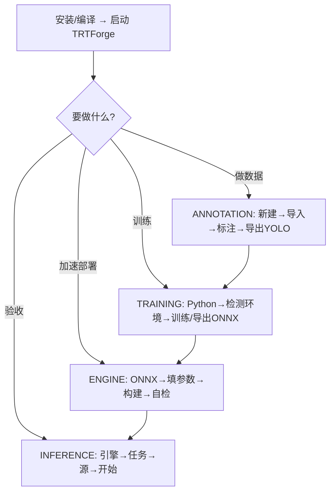

---

## 11. 附录：相关路径索引

| 内容 | 路径 |
| --- | --- |
| 引擎参数完整说明 | `trtexec/gui/docs/TRT_Forge_参数说明.md` |
| GUI 技术 README | `trtexec/gui/README.md` |
| YOLO TRT 推理流程说明 | `docs/trtexec_gui_YOLO_TRT推理流程说明.md` |
| 推理 DLL 与打包说明 | `docs/TRTForge_yolo_infer与anomalib_infer_DLL调用与源码打包说明.md` |
| 软件结构优化计划 | `docs/DefectVision_AI_Studio_软件结构优化计划.md` |
| 安装包构建脚本 | `trtexec/gui/installer/build_installer.ps1` |

---

*文档版本：与仓库 `trtexec/gui` 主分支功能同步撰写；含全界面控件级说明（§10）。若界面迭代，请同步更新截图占位与表格。*
