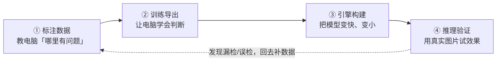
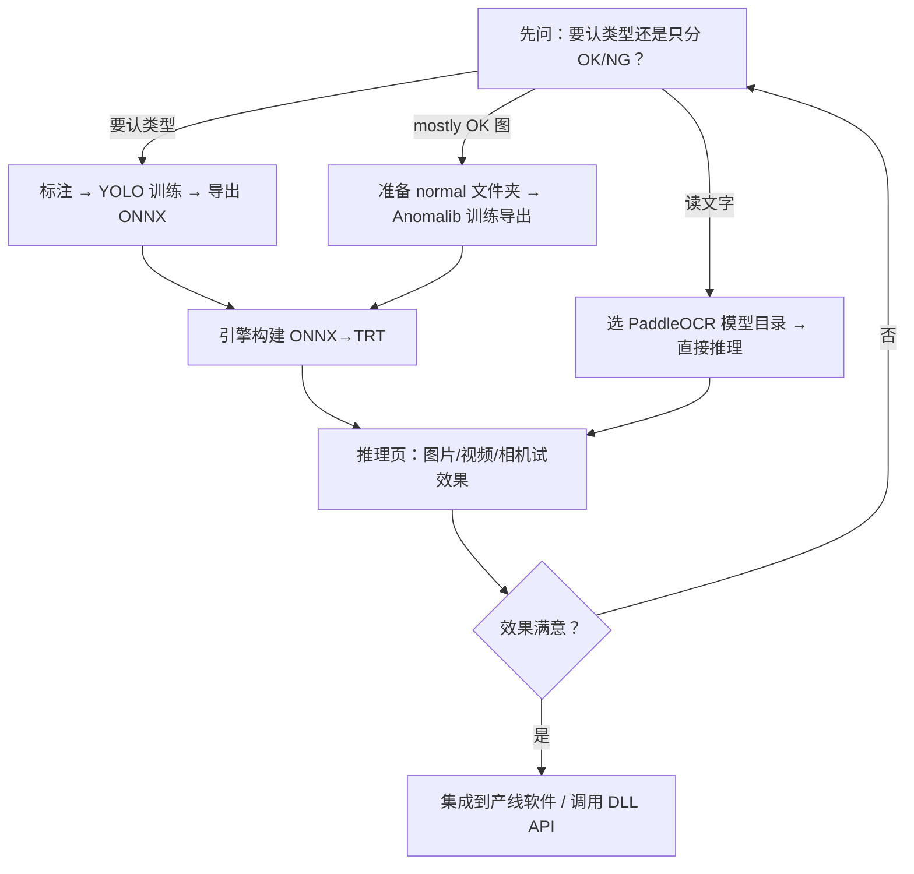

# TRTForge 软件报告：有哪些算法？适合干什么？

> **写给谁看**：不懂机器视觉、没写过代码的同事也能看懂。  
> **软件是谁**：TRTForge（界面显示名也叫 **DefectVision AI Studio / AI 缺陷检测视觉工作站**），是一台 Windows 桌面软件，帮工厂把「拍照 → 标注 → 训练 → 加速 → 上线检测」串成一条线。  
> **一句话总结**：它像一条「AI 质检流水线」，从教电脑认图，到把模型跑快，再到现场试效果，都在一个软件里完成。

---

## 1. 先搞懂：这台软件到底在干什么？

你可以把 TRTForge 想成 **四个工作台**，从左到右依次用：

| 工作台 | 大白话 | 你会得到什么 |
| --- | --- | --- |
| **标注数据** | 在照片上画框、画区域，告诉电脑「这是划痕」「这是缺件」 | 训练用的数据集 |
| **训练导出** | 用这些数据「上课」，让 AI 学会识别 | 模型文件（`.pt`、`.onnx` 等） |
| **引擎构建** | 把模型转成 NVIDIA 显卡能高速运行的格式 | `.trt` / `.engine` 引擎 |
| **推理验证** | 用图片、视频或相机实时看 AI 判得对不对 | 可视化结果、OK/NG 结论 |

**需要知道的硬件**：训练和加速推理，最好有 **NVIDIA 显卡**（普通 GeForce、专业 Quadro、RTX 都可以）。OCR 文字识别默认走 CPU 也能用，只是会慢一些。

---

## 2. TRTForge 里一共有几类「算法」？

软件里不是只有一个「万能 AI」，而是 **三大类算法**，解决三类不同问题：

| 大类 | 里面具体算法 | 通俗理解 |
| --- | --- | --- |
| **A. YOLO 目标识别** | 检测、分割、姿态、旋转框 | 「找到东西在哪、是什么、形状怎样」 |
| **B. 异常检测 Anomalib** | PatchCore、PaDiM、EfficientAd | 「我只给你看正常品，你帮我找不正常」 |
| **C. OCR 文字识别** | PaddleOCR（检测 + 识别） | 「图里写了什么字，读出来」 |

下面逐个用生活化的例子说明。

---

## 3. A 类：YOLO —— 「指着告诉你：这里有个 XX」

YOLO 是 TRTForge 里最常用的一类算法，适合 **你已经知道缺陷长什么样，也愿意花时间标注** 的场景。

软件里支持 **四种任务**，可以简单记成四种「画法」：

| 任务 | 软件里叫什么 | 你在标注页怎么画 | 电脑输出什么 |
| --- | --- | --- | --- |
| **目标检测** | detect / DET | 画普通矩形框 | 「这里有个划痕，置信度 92%」 |
| **实例分割** | segment / SEG | 画多边形，沿缺陷边缘描 | 「这块区域的精确轮廓」 |
| **姿态识别** | pose / POSE | 标 17 个关键点（人形骨架） | 「手肘、膝盖等关节位置」 |
| **旋转框检测** | obb / OBB | 画可旋转的矩形 | 「倾斜的元件、斜着的标签在哪」 |

### 3.1 目标检测（最常用）

**干什么**：在整张图里找出「某个东西」，用方框圈出来，并说出类别。

**适合场景（举例）**：

- **PCB 板**：找焊点虚焊、少锡、元件偏移、异物
- **钢材 / 金属表面**：找划痕、锈斑、轧入物
- **木器 / 涂装**：找气泡、孔洞、色差块
- **光伏电池片**：找裂纹、断栅、脏点
- **产线零件**：找缺件、错件、多装

**什么时候选它**：缺陷种类比较固定（比如就 5～10 种），你能收集到带框标注的图片，希望结果直观（框 + 类别名）。

### 3.2 实例分割

**干什么**：不仅知道「这里有缺陷」，还要知道 **缺陷边界精确到哪条像素**。

**适合场景（举例）**：

- 缺陷形状不规则，方框会把很多正常区域包进去
- 需要算 **缺陷面积占比**（比如「划痕面积超过 2 mm² 判 NG」）
- 后续要做 **按轮廓抠图**、精细测量

**什么时候选它**：比检测更费标注时间（要沿边描），但定位更准。

### 3.3 姿态识别

**干什么**：找 **人体或类似骨架结构** 的关键点位置（不是找缺陷本身）。

**适合场景（举例）**：

- 工人动作是否规范（安全帽、工装姿势）
- 人体工位、行为分析
- 与「工业缺陷」关系较弱，更偏 **行为 / 姿态监控**

**什么时候选它**：你的问题本质是「关节点在哪」，而不是「表面有没有划痕」。

### 3.4 旋转框检测（OBB）

**干什么**：目标不是横平竖直的，可能是 **斜着放** 的，用旋转矩形更贴边。

**适合场景（举例）**：

- 传送带上 **斜放的元件、标签、条码区域**
- 航拍或俯视视角下 **有角度的目标**
- 圆形件上的 **弧形缺陷区域** 用斜框近似

**什么时候选它**：普通水平框要么太大、要么漏掉斜向目标时。

---

## 4. B 类：异常检测 —— 「只学正常，异常自己冒出来」

这类算法来自 **Anomalib**，在 TRTForge 里叫 **异常检测 ANOMALY** 模式。

**核心思路**：训练时 **只给电脑看合格品（OK 图）**，不要求你标注「哪里是缺陷」。上线后，电脑对比「和正常品像不像」，不像的地方就标红，给出 **OK / NG**。

软件里可选三种算法：

| 算法 | 特点（白话） | 更常见用法 |
| --- | --- | --- |
| **PatchCore** | 经典、稳定，工业里用得很多 | 纹理表面、小样本、先快速试一版 |
| **PaDiM** | 相对轻量，训练较快 | 数据不多、想较快出结果 |
| **EfficientAd** | 对复杂场景有时更准，配置稍多 | 正常品外观变化大、PatchCore 效果不够时 |

**推理时你会看到**：

- 原图
- **热力图**（越红越「可疑」）
- **红色轮廓**（具体异常区域）
- 右侧 **分数 + OK/NG**

### 4.1 适合什么场景？

| 场景 | 为什么适合异常检测 |
| --- | --- |
| **新产品试产，缺陷样本很少** | 可能只有几十张 OK 图，几乎没有 NG 标注 |
| **缺陷种类多、难穷举** | 今天划痕、明天污点、后天缺角，没法每种都标够 |
| **表面纹理复杂**（织物、金属拉丝、注塑纹） | 正常品本身就有纹理，用「找固定类别」的 YOLO 反而难标 |
| **密封件、透明件、背光件** | 经典 MVTec 类 benchmark 里常见，异常检测论文也常用 |
| **先上「有没有问题」，再细分类型** | 第一道闸：OK/NG；第二道闸再用 YOLO 分是什么缺陷 |

### 4.2 不太适合什么场景？

- 你必须 **精确说出「是第 3 类缺陷还是第 7 类」** → 更适合 YOLO 检测
- 正常品外观 **变化极大**（换料、换工艺、换光照没重新训练）→ 任何 AI 都会不稳，异常检测也一样
- 缺陷和正常差异 **极其细微**，且 OK 图不够多 → 需要更多正常样本和现场调阈值

### 4.3 和 YOLO 怎么选？（决策简表）

| 你的情况 | 更建议 |
| --- | --- |
| 能标框，缺陷类型固定 | **YOLO 检测** |
| 几乎只有 OK 图，很少 NG | **异常检测** |
| 要精确轮廓、算面积 | **YOLO 分割** |
| 要先筛 NG，再分类 | **异常检测 → 再 YOLO**（两阶段） |
| 斜着的目标 | **YOLO OBB** |

---

## 5. C 类：OCR 文字识别 —— 「把图里的字读出来」

TRTForge 的 **OCR 文本识别 OCR** 模式用的是 **PaddleOCR**（百度开源的中文 OCR），不是 YOLO，也 **不走 TensorRT 引擎构建页**。

**干什么**：

1. 先在图里 **找到文字在哪**（一行一行框出来）
2. 再把框里的字 **认出来**，给出文字内容和置信度

**适合场景（举例）**：

| 行业 | 用途 |
| --- | --- |
| **电子 / 包装** | 读标签、批次号、SN 码是否印对 |
| **物流** | 读运单、面单文字 |
| **文档 / 票据** | 读表格、段落（演示、抽检） |
| **产线** | 读激光打码、喷码是否清晰、是否错字 |

**和缺陷检测的关系**：OCR 解决的是 **「字对不对」**，YOLO/异常检测解决的是 **「外观有没有坏」**。产线上可以组合用：OCR 验字 + YOLO 验外观。

**使用注意（白话）**：

- 默认推荐 **CPU + MKLDNN**，稳定；GPU 加速需要 GPU 版 Paddle，环境没配好会提示用不了 GPU
- 文字太小、太糊、反光严重，识别率会下降——和肉眼看不清是一个道理

---

## 6. 按行业举几个「怎么搭配」的例子

下面不是唯一答案，是帮助非技术人员 **对号入座** 的参考。

### 6.1 PCB / 电子装联

| 需求 | 建议算法 |
| --- | --- |
| 找焊桥、少锡、元件错装 | YOLO **检测** |
| 精确量缺陷面积 | YOLO **分割** |
| 新板型、NG 样本少，先筛不良 | **PatchCore 异常检测** |
| 读丝印、标签、二维码旁文字 | **OCR** |

### 6.2 金属 / 钢材 / 铸造表面

| 需求 | 建议算法 |
| --- | --- |
| 划痕、锈斑、夹杂等有明确类型 | YOLO **检测**（如 NEU 类数据集常见用法） |
| 缺陷类型杂、标注成本高 | **PaDiM / PatchCore** |
| 带钢等纹理背景 | 异常检测往往比硬标每一类更省事 |

### 6.3 木器、涂装、家具

| 需求 | 建议算法 |
| --- | --- |
| 气泡、孔洞、色差块 | YOLO **检测** 或 **分割** |
| 花纹木材、正常纹理变化大 | **异常检测** |

### 6.4 纺织、薄膜、透明件

| 需求 | 建议算法 |
| --- | --- |
| 破洞、污渍、断纱 | 有样本可标 → YOLO；样本少 → **异常检测** |
| 透明、背光、反光 | **PatchCore / EfficientAd** 在工业 benchmark 里较常见 |

### 6.5 光伏、新能源

| 需求 | 建议算法 |
| --- | --- |
| 电池片裂纹、断栅 | YOLO **检测/分割**（有标注时） |
| EL 图异常、早期试产 | **异常检测** |

### 6.6 包装、物流、读码验字

| 需求 | 建议算法 |
| --- | --- |
| 标签是否贴歪、破损 | YOLO **检测** 或 **OBB**（斜标签） |
| 日期、批号、地址是否正确 | **OCR** |

---

## 7. 从「想法」到「产线能用」通常怎么走？

**给业务同事的提示**：

1. **别跳过标注质量**：YOLO 学的是你的标注；标错了，AI 一定错。
2. **异常检测也要足够多的 OK 图**：不是一张两张就行，正常品的光照、角度要尽量覆盖产线实况。
3. **推理页的阈值要现场调**：置信度、OK/NG 阈值在软件里都能滑条微调，别指望训练完一次就永远不用改。
4. **`.trt` 引擎是给显卡跑的**：换显卡、换 TensorRT 大版本，有时要重新构建引擎。

---

## 8. 算法能力一览表（速查）

| 算法/模式 | 需要缺陷标注吗 | 主要输出 | 典型工业场景 |
| --- | --- | --- | --- |
| YOLO 检测 | 要（画框） | 框 + 类别 + 分数 | PCB、金属、包装、通用缺陷 |
| YOLO 分割 | 要（画多边形） | 精确 mask/轮廓 | 面积统计、不规则缺陷 |
| YOLO 姿态 | 要（标关键点） | 人体/骨架点 | 工位姿态、行为（非典型缺陷） |
| YOLO OBB | 要（旋转框） | 斜向目标框 | 斜放元件、标签、俯视目标 |
| PatchCore | 不要（只要 OK 图） | 热力图 + OK/NG | 小样本、纹理面、试产 |
| PaDiM | 不要 | 同上 | 快速试异常检测 |
| EfficientAd | 不要（配置稍多） | 同上 | 较难场景、需校准阈值 |
| PaddleOCR | 不要（用预训练模型） | 文字框 + 文本 + 分数 | 标签、喷码、单据 |

---

## 9. 和外部系统怎么对接？（知道有这能力即可）

TRTForge 不只是界面点点看，还把核心能力做成了 **动态库（DLL）**，方便集成到 C++ 产线软件或 Python 脚本：

| 动态库 | 用途 |
| --- | --- |
| `yolo_infer.dll` | YOLO 的 TensorRT 检测/分割/姿态/OBB 推理 |
| `anomalib_infer.dll` | 异常检测 TensorRT 推理 |
| `ocr_infer.dll` | PaddleOCR 文字识别 |

产线常见做法：在 TRTForge 里 **训练好、试好效果** → 导出 `.trt` 引擎和配置文件 → 产线程序调用上述 DLL **只做推理**，不再打开 TRTForge 界面。

---

## 10. 常见问题（小白版 FAQ）

**Q：我完全不会 AI，能用吗？**  
A：可以。按四个页签顺序走：标数据 → 训练 → 转引擎 → 试推理。操作细节见 [`TRTForge_操作手册.md`](TRTForge_操作手册.md)。

**Q：YOLO 和异常检测必须二选一吗？**  
A：不是。很多产线 **先用异常检测筛 NG**，再对 NG 图用 YOLO **分缺陷类型**。

**Q：OCR 要不要走「引擎构建」？**  
A：不要。OCR 在推理页选好模型目录就能跑。

**Q：没有 NVIDIA 显卡能用吗？**  
A：标注、部分训练可以；**TensorRT 加速和 YOLO/异常检测 TRT 推理** 强烈依赖 NVIDIA GPU。OCR 可 CPU 跑。

**Q：软件名字 TRTForge 和 DefectVision 是什么关系？**  
A：同一个产品。界面显示 **AI 缺陷检测视觉工作站**，程序文件名仍是 **TRTForge.exe**。

---

## 11. 相关文档

| 文档 | 内容 |
| --- | --- |
| [`TRTForge_操作手册.md`](TRTForge_操作手册.md) | 逐步点击操作、界面截图说明 |
| [`trtexec_gui_YOLO_TRT推理流程说明.md`](trtexec_gui_YOLO_TRT推理流程说明.md) | YOLO 推理技术细节 |
| [`TRTForge_yolo_infer与anomalib_infer_DLL调用与源码打包说明.md`](TRTForge_yolo_infer与anomalib_infer_DLL调用与源码打包说明.md) | 对外集成 API |
| [`工业缺陷检测公开数据集_推荐清单.md`](工业缺陷检测公开数据集_推荐清单.md) | 练手、演示用公开数据集 |
| [`trtexec/gui/README.md`](../trtexec/gui/README.md) | 开发编译与模块说明 |

---

*文档版本：与仓库 `trtexec/gui` 当前功能同步；涵盖 YOLO（detect/segment/pose/obb）、Anomalib（PatchCore/PaDiM/EfficientAd）、PaddleOCR 三类算法及典型应用场景。*
