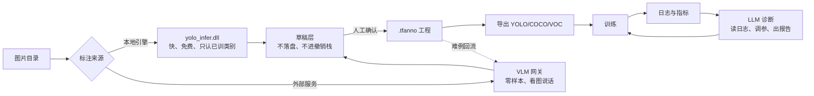
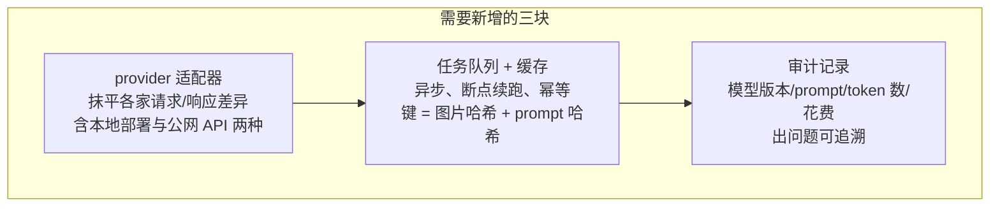

# VLM / LLM 接入方案与 Token 成本评估

> 本文只讨论**方案与可行性**，不涉及任何实现改动。
> 场景：给 `6-web` 的「标注」页自动标注接入视觉大模型（VLM），给「训练导出」页接入语言大模型（LLM）做日志诊断。
> 数据来源：项目实测口径（PCB 数据集 3034×1586、平均 12 个标注框），价格按常见档位换算。

---

## 0. 一句话结论

| 链路 | 单次 token 量级 | 1 万次的大致花费 | 结论 |
| --- | --- | --- | --- |
| 自动标注（VLM 看图） | 每张 1k~12k input token | 35 元 ~ 2850 元 | 成本**可控但不宜全量反复跑**，真正的杠杆是分辨率与切片策略 |
| 自动训练（LLM 读日志） | 每次训练 75k~200k token | 0.05 元 ~ 3.5 元（视模型档位） | 成本**小到可忽略**，建议优先做 |

一句话补充：**VLM 的钱花在像素上，LLM 的钱几乎不用花**。上线前真正要回答的不是成本，而是「工业缺陷图能不能出内网」——这一条决定走公网 API 还是本地部署，优先级高于省钱。

---

## 1. Token 消耗怎么算

### 1.1 视觉接口的计费口径

主流 VLM 接口的计费规则基本一致，三条：

1. **图片先归一化**：缩放到长边 1024~2048，再按 512 像素的固定块切分计费。
2. **token 数与分辨率近似平方相关**：面积翻倍，token 大致翻倍。
3. **输出侧与目标数线性相关**：一个边界框约 30~60 token。

近似公式：

\[
\text{input tokens} \approx \lceil w/512 \rceil \times \lceil h/512 \rceil \times 170 + 85
\]

\[
\text{output tokens} \approx \text{目标数} \times (30 \sim 60)
\]

按项目实测图片（3034×1586，平均 12 个框）代入三种策略：

| 策略 | 单张 input | 单张 output | 1 万张总 token | 旗舰档（≈$2.5/$10 每 M） | 经济档（≈$0.15/$0.6 每 M） |
| --- | --- | --- | --- | --- | --- |
| 整图缩到 1024 长边 | 1.1k | 0.4k | 15M | $68 ≈ 500 元 | $5 ≈ 35 元 |
| 整图高保真 2048 | 1.5k | 0.4k | 19M | $78 ≈ 560 元 | $5 ≈ 36 元 |
| 3×3 切片（小缺陷必要） | 11k | 1.2k | 122M | $395 ≈ 2850 元 | $24 ≈ 170 元 |

> 表中金额为**估算**，按 $1 ≈ 7.2 元换算，实际以所选模型的实时计价为准。
> 「总 token」= 单张合计 × 10000，未计入重试与 prompt 调试的额外开销（通常再乘 1.2~1.5）。

### 1.2 和人工的对比

PCB 一图 12 个框，人工约 1~3 分钟，按 30 元/小时折算 **0.5~1.5 元/张**，1 万张 = **5000~15000 元**。

| 方案 | 1 万张成本 | 精度 | 备注 |
| --- | --- | --- | --- |
| 纯人工 | 5000~15000 元 | 最高 | 慢，是当前瓶颈 |
| VLM 整图 + 经济档 | ≈ 35 元 | PCB 小缺陷基本漏 | 便宜但没用 |
| VLM 整图 + 旗舰档 | ≈ 500 元 | 中等，粗框 | 只适合大目标 |
| VLM 切片 + 旗舰档 | ≈ 2850 元 | 较好，仍需人工复核 | 比人工便宜 2~5 倍 |
| 本地 YOLO 引擎 | 0 元（电费与显存） | 取决于模型，已训练类别很准 | 训出第一版后的主力 |

**关键判断**：VLM 的定位不是替代本地引擎，而是**在还没有模型时先跑通第一版**。一旦本地模型可用，就该让它承担 90% 的量。

### 1.3 文本接口（LLM）的计费口径

读日志这条链路全是文本，量级完全不同：

| 项 | 估算 |
| --- | --- |
| `args.yaml` + 环境信息 | 2k~4k token |
| 100 epoch 指标行 | 10k~25k token |
| 失败栈 + 上下文 | 3k~10k token |
| 单次「全上下文」 | 15k~40k token |
| 一次训练调用 3~8 次 | 75k~200k token |
| 折算成本（旗舰档） | 1.5~3.5 元 / 次训练 |
| 折算成本（经济档） | < 0.05 元 / 次训练 |

一天训 10 次、一个月 300 次：旗舰档约 **450~1050 元/月**，经济档约 **15 元/月**。

---

## 2. 两条链路的真实用法

### 2.1 自动标注：只有三种用法划算

VLM **不做增量学习**，每次调用都是独立推理。同一个数据集重标一遍、改一个类别，就要再烧一遍钱。因此合理用法只有：

| 用法 | 触发条件 | 批量规模 | 可接受成本上限 |
| --- | --- | --- | --- |
| **冷启动粗标** | 新产线、零标注 | 200~500 张 | 几十到几百元，一次性 |
| **难例补齐** | 本地模型低置信 / 人工标记"不确定" | 全量的 5%~10% | 每轮几十元 |
| **质检复核** | 已标注数据抽检，找漏标 | 全量的 10% | 每轮几十元 |

不划算的用法：**全量重跑**。一旦"改个类别就全量跑一遍"，费用会随迭代次数线性上涨，很快超过人工。

### 2.2 自动训练：便宜且收益明确

| 能力 | 现在 | 接 LLM 后 |
| --- | --- | --- |
| 训练失败排查 | 人看日志、搜报错 | 自动定位到「显存不足 / 标签越界 / 数据集路径错 / CUDA 版本不匹配」并给出修改建议 |
| 超参选择 | 靠经验、靠试 | 按数据集规模与类别分布给初始建议，并解释理由（可对照现有的「小缺陷预设」） |
| 结果解读 | 看 mAP 曲线自己判 | 指出「val 掉但 train 在涨 = 过拟合，建议加增强」 |
| 实验报告 | 手写 | 自动出中文报告，可直接交付 |

这条链路**没有成本障碍**，建议作为 P2 优先落地。

---

## 3. 与现有代码的契合度

好消息：现有架构已经把接口预留好了，接 VLM 是**加适配器**，不是重构。

| 现有实现 | 复用方式 |
| --- | --- |
| `autolabel.external_predict()` 的 HTTP 契约 `{shapes:[...]}` | 天然就是 VLM 网关的适配层，网关侧把模型输出转成这个结构即可（协议见 `6-web/README.md` 的「自动标注」节） |
| `autolabel.sanitize_drafts()` | 已能过滤「置信度不在 0~1 / 框完全出图」的结果，正好挡住 VLM 的幻觉框 |
| 草稿层（不落盘、不进撤销栈） | VLM 结果先当草稿，人工确认后才进工程，误标不会污染数据 |
| `.tfanno` + `dataset.py` 导出 | 标完直接导 YOLO 训练，链路已通 |
| `runners.py` 的 `TRTFORGE_JSON` 事件流 | LLM 诊断可以旁挂在事件流上，完全不碰训练主进程 |

需要新增的只有三块：

其中**缓存**最容易被忽略：调试 prompt 时不缓存，同一张图会被反复计费几十次。

---

## 4. 比 token 费用更疼的两个成本

这两项实操里往往先于费用成为瓶颈：

| 成本项 | 量级 | 说明 |
| --- | --- | --- |
| **上行带宽** | 单张 JPEG 约 1~2 MB，1 万张 = 10~20 GB | 公网 API 上传 20 GB 常常是第一个卡点，比钱更早暴露 |
| **限流与排队** | 主流接口有 RPM / TPM 限制 | 1 万张按 10 并发要跑几小时，**必须是异步队列 + 断点续跑**，不能"点一下等它跑完" |

---

## 5. 风险清单

| 风险 | 说明 | 缓解方式 |
| --- | --- | --- |
| **数据外传合规** | 工业缺陷图可能涉密 | **优先本地部署或私有网关**；公网 API 需先过合规，这一点优先于省钱 |
| 幻觉框 | VLM 会"编"出不存在的缺陷 | 只用草稿层，必须人工确认；`sanitize_drafts` 兜底 |
| 坐标不准 | 给的是粗略框，边界差几十像素 | 用 SAM 类分割模型在粗框内细化，别指望 VLM 给像素级 |
| 类别不一致 | 自由文本标签与工程类别表对不上 | 接受草稿时按名字映射或补建类别（`ensureDraftClass` 已有） |
| 成本失控 | 误点"全量重跑" | 单项目预算上限 + 调用前预估 token 与花费 + 二次确认 |
| 供应商变更 | 模型下线、价格调整、接口改名 | provider 适配器隔离，配置化切换 |

---

## 6. 建议推进顺序

| 阶段 | 做什么 | 目标 | 预算量级 |
| --- | --- | --- | --- |
| P0 | 离线脚本：小批量（200 张）跑 VLM，人工比对精度与真实花费 | 拿到真实单价，判断值不值 | 几十元 |
| P1 | 接到现有外部服务通道，加缓存与队列，前端显示「预计花费 / 已花费」 | 可用且不失控 | 按需 |
| P2 | 训练侧挂 LLM 诊断旁路（日志 → 建议 → 人工确认） | 把最便宜的收益先拿到 | < 100 元/月 |
| P3 | 主动学习闭环：本地模型筛难例 → VLM 只标难例 → 增量训练 | 成本随时间**下降**而不是上升 | 每轮几十元 |

P3 是分水岭：**能不能让成本随迭代下降**，是这套方案长期是否可持续的唯一判据。

---

## 7. 结论汇总

1. **VLM 标图的 token 消耗不小但可控**，成本杠杆是分辨率和切片策略，差 5~10 倍。
2. **LLM 读日志的 token 消耗小到可以忽略**，经济性上没有障碍，建议优先做。
3. **真正决定方案形态的不是成本，是数据能否出内网**。
4. **VLM 只在「冷启动 / 难例 / 抽检」三个位置划算**，全量重跑会快速失去经济性。
5. 现有代码已为其预留接口，落地是加适配器与队列，不是重构。

---

## 附：本文涉及的现有文件

| 文件 | 作用 |
| --- | --- |
| `6-web/backend/autolabel.py` | 双通道预标注编排，`external_predict` 是 VLM 的接入点 |
| `6-web/backend/annotation.py` | `.tfanno` 读写与规范化 |
| `6-web/backend/runners.py` | 训练子进程与 `TRTFORGE_JSON` 事件流，LLM 诊断的挂载点 |
| `6-web/backend/dataset.py` | YOLO / COCO / VOC 导出 |
| `6-web/README.md` | 「自动标注」节有外部服务的完整协议约定 |
