# WORKFLOW_GUIDE — TRTForge / DefectVision AI Studio 全流程作业指南

> 本文回答一个核心问题：**从原始图片到产线推理，每一步该做什么、用什么命令、产出什么文件、怎么验证。**
> 面向对象：需要独立跑通全流程的工程师（不需要深入算法细节）。
> 最后更新：2026-11-11（v1.34.1：显存预检改实测峰值表 + AMP 状态可见可覆盖，见 §7.18；v1.34.0：任务台账落盘 / 日志轮转 / 训练崩溃自动续训，见 §7.1、§7.16；v1.33.0：LLM 决策层，见 §7.17；v1.32.0：YOLO 自主实验循环，见 §7.16；v1.31.0：网页端推理改成进程池，见 §7.15；v1.30.6：分类走 `onnx_infer.dll`，见 §7.13；v1.30.5：OCR 往返拆解 + 识别 batch 按设备取值，见 §7.12；v1.30.4：OCR 文字醒目化 + 异常检测改回「区域」，见 §7.11；v1.30.3：推理往返耗时优化，见 §7.10；v1.30.2：OCR `mklml.dll` 加载修复，见 §7.7.1；v1.30.1：分类真机闭环，见 §7.9；v1.30.0：YOLO 整图分类；v1.28.0：推理进程隔离 infer_worker，见 §7.8；v1.27.0 OCR 见 §7.7）


---

## 0. 全流程图

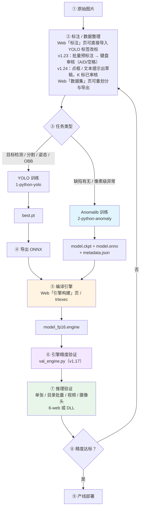

> ③~⑥ 可以一键串起来跑：见 [5.5 一键全流程串联](#55-一键全流程串联v117)。

---

## 1. 环境准备（只做一次）

### 1.1 必需组件

| 组件 | 版本要求 | 本机实测 |
| --- | --- | --- |
| NVIDIA 驱动 | 支持 CUDA 11.8+ | 596.71 |
| CUDA Toolkit | 11.8 | 11.8.89 |
| TensorRT | 8.5.x（与 CUDA 匹配） | 8.5.2 |
| cuDNN | 8.x | 8.7 |
| Visual Studio | 2022（v143） | 19.44 |
| Python | 3.10 ~ 3.12 | 3.12.4（`dpenv`） |
| OpenCV（C++ SDK） | 4.x | 4.12.0（vc17 / x64，路径由 `OPENCV_DIR` 指定） |

### 1.2 Python 依赖

```powershell
# YOLO 链路
python -m pip install torch torchvision ultralytics polars "numpy<3" onnx onnxruntime

# Anomalib 链路
python -m pip install anomalib lightning "numpy<3" onnx onnxruntime Pillow

# Web 工作站
python -m pip install fastapi uvicorn python-multipart
# v1.24 文本提示通道需要 tokenizers（只做 BERT 分词，不引入 torch / transformers）
python -m pip install tokenizers
```

> **numpy 上限说明（2026-10-30 修订）**：早期要求 `numpy<2`，理由是 torch 2.3 按 numpy 1.x 编译。
> 实测 `torch 2.3.0 + numpy 2.5.4` 的 CUDA 前向、numpy↔torch 桥接均正常，`onnxruntime 1.20.1` 也支持
> numpy 2，故放宽到 `<3`。锁 `<2` 会被 Ultralytics AutoUpdate 在每次 `export` 时升回去，造成环境反复漂移。
> 唯一残留是 `scipy 1.14.0` 的 `UserWarning`（声明要求 numpy<2.3），不影响训练与推理。

### 1.3 环境自检（关键步骤，别跳过）

```powershell
cd 2-python-anomaly\launcher
python tf_anomalib_launcher.py --mode check-env

cd ..\..\1-python-yolo\launcher
python tf_yolo_launcher.py --mode check-env
```

**验收标准**：输出 JSON 中 `"missing":[]`。

补充验证 GPU：

```powershell
python -c "import torch; print(torch.__version__, torch.cuda.is_available(), torch.backends.cudnn.version())"
# 期望：2.3.0+cu118 True 8700
```

### 1.4 已知环境坑

| 坑 | 现象 | 解决 |
| --- | --- | --- |
| CUDA 11.8 + MSVC 14.44 | `STL1002: Unexpected compiler version, expected CUDA 12.4 or newer` | 设置 `$env:NVCC_PREPEND_FLAGS = "-D_ALLOW_COMPILER_AND_STL_VERSION_MISMATCH --allow-unsupported-compiler"` |
| Python 3.8+ DLL 搜索 | `WinDLL` 报「找不到模块或它的依赖项」 | 必须 `os.add_dll_directory()`，`6-web/backend/infer.py` 已处理 |
| numpy 2.x | 早期认为与 torch 2.3 有 ABI 冲突 | 2026-10-30 实测 `torch 2.3.0 + numpy 2.5.4` 正常，约束已放宽到 `numpy<3`；若确实遇到 torch 导入异常，再降到 `numpy<2`（实测 1.26.4） |

---

## 2. 标注与数据集准备

### 2.1 两种数据形态

| 任务 | 需要的数据 | 目录形态 |
| --- | --- | --- |
| YOLO（检测/分割/姿态/OBB） | 图片 + 标注文件 | `dataset.yaml` + `images/` + `labels/` |
| Anomalib（异常检测） | **只要正常图**（+ 少量异常图用于验证） | `root/train/good`、`root/test/good`、`root/test/abnormal` |

### 2.2 Anomalib 标准目录

```text
2-python-anomaly/anomalib-main/datasets/bottle
├── train/good        225 张   训练用正常图（唯一的训练输入）
├── test/good          20 张   测试用正常图（算误报）
├── test/abnormal      44 张   测试用异常图（算漏检）
└── ground_truth/              像素级标注（可选）
```

**要点**：

- `train/good` 决定模型能学到什么，**必须干净**（不能混入缺陷图）
- `test/abnormal` 也参与阈值校准，**至少要 10 张以上**，否则阈值偏保守
- 目录名 `good` / `abnormal` 是 anomalib Folder 数据集的约定，不要随意改

### 2.4 EfficientAd 专用：imagenette 辅助数据

只有 EfficientAd 需要这份额外数据（用于计算教师网络通道归一化统计）。**必须注意先后顺序**：launcher 会在模型创建前检查目录是否存在，**目录不存在时直接报错，不会自动下载**。

```powershell
# 第一步：先建出空目录（关键，否则训练直接 FileNotFoundError）
New-Item -ItemType Directory -Force -Path 2-python-anomaly\anomalib-main\datasets\imagenette

# 第二步：正常跑 EfficientAd 训练，此时会自动下载 imagenette2.tgz（约 1485MB / 6~10 分钟）
```

| 情况 | 结果 |
| --- | --- |
| `datasets/imagenette` 目录不存在 | **报 `DATA_NOT_FOUND` / `exit=1`**，不下载 |
| 目录存在但缺 `imagenette2/train` | 自动下载 + 解压，解压后 9469 张 / 10 类 |
| 已就绪 | 直接使用，不会重复下载 |

### 2.3 数据集划分

YOLO 训练页支持自动划分 `train / val / test`，默认 `80 / 10 / 10`。
修改比例后点「自动划分」，会按比例分配图片归属。

### 2.5 用 Web 数据集工作台重划分与导出（推荐）

当数据已经有标注、只是需要重新划分或转格式时，用 Web 的「数据集」页，不必开 Qt：

```powershell
powershell -NoProfile -ExecutionPolicy Bypass -File scripts\run_web_studio.ps1
# 浏览器打开 http://127.0.0.1:8060 → 点顶部「数据集」
```

| 步骤 | 操作 | 说明 |
| --- | --- | --- |
| 1 | 填数据源 | YOLO 目录（含 `images/` `labels/` `data.yaml`）或 `.tfanno` |
| 2 | 任务类型 | 默认「自动识别」，按标签字段数判断 detect / segment / pose / obb |
| 3 | 填比例 | train、val 两个数，test 是余数，页面会实时显示 |
| 4 | 扫描预览 | 看各集张数、空标注数、每张图的「现有 → 新划分」 |
| 5 | 选格式与输出目录 | YOLO / COCO / VOC，输出不能放在数据源内部 |
| 6 | 开始导出 | 摘要里会列出统计、跳过项和警告 |

**划分口径（与 Qt 版一致，容易误解，务必看清）**

- `train = 总数 × train% ÷ 100` **向下取整**，`val` 同理；
- **剩余全部归 test**：692 张配 80/20 会得到 553 / 138 / **1**，不是 553 / 139 / 0；
- 想要真正的 80/10/10，请填 `80 / 10`，或 `70 / 20` 得到约 70 / 20 / 10；
- 哈希为 **FNV-1a 64 位 + `_2026` 盐值**，同一份数据在任何机器上结果逐项一致。
  Qt 用的是 `qHash`，两者哈希函数不同，所以**不能与 Qt 历史划分逐张对照**。

**导出格式限制**

| 格式 | 产物 | 限制 |
| --- | --- | --- |
| YOLO | `images/{train,val,test}` + `labels/{split}` + `dataset.yaml` | 全任务支持，`dataset.yaml` 可直接被 Ultralytics 识别 |
| COCO | `annotations.json` | 不复制图片；不支持 OBB |
| VOC | `Annotations/*.xml` + `JPEGImages/` | **仅 detect** |

验收脚本（不启动服务也能跑）：

```powershell
python 6-web\backend\tools\test_dataset_workbench.py
# 期望：通过 20 项，失败 0 项
```

### 2.6 前端单测（零依赖，只需 node）

前端是零构建的，所以单测也不装任何框架，直接 `node` 跑。这六项不需要启动服务：

```powershell
node 6-web\frontend\tests\test_viewer_math.mjs
# 期望：✓ 全部通过：37 条断言

node 6-web\frontend\tests\test_engine_out.mjs
# 期望：通过：17 项断言

node 6-web\frontend\tests\test_splitpanes.mjs
# 期望：✓ 全部通过：18 项

node 6-web\frontend\tests\test_runsbar.mjs
# 期望：✓ 全部通过：28 项

node 6-web\frontend\tests\test_log_actions.mjs
# 期望：✓ 全部通过：20 项

node 6-web\frontend\tests\test_contrast.mjs
# 期望：✓ 全部通过：23 项
```

| 脚本 | 守住什么 |
| --- | --- |
| `test_viewer_math.mjs` | 滚轮缩放必须锚定光标（连续缩放 8 次后漂移 ≤ 0.5px）、屏幕与图像坐标互逆、滚轮增量按 `deltaMode` 归一化 |
| `test_engine_out.mjs` | 「输出引擎」路径规范化：只给目录时补成 `目录\<onnx名>_<精度>.engine`、已带 `.engine/.trt/.plan` 不许改、留空保持自动推导、贴错成 `.onnx` 能救回来 |
| `test_splitpanes.mjs` | 分栏拖动比例夹取，以及 localStorage 里的存档值必须按**当前容器宽度**折成像素校验：拖到底存下的 `15.61%` 在 1537px 宽下只剩 240px，要判为不可用并回默认 380px |
| `test_runsbar.mjs` | 顶栏「运行中任务」条：时长格式（`1:02:05`）、kind 中文名（`pipeline-*` 统一叫「全流程串联」）、哪些任务该出现（已结束的不出现、2 秒的自检不闪现、训练不能误伤） |
| `test_log_actions.mjs` | 事件去重（模拟重连：先收 1..3，再收 1..5，结果必须正好是 1,2,3,4,5）、没有 `seq` 的旧格式不能丢、日志文件 URL 编码、复制/日志文件两个按钮的启用条件（没 run 不能点、没内容不能复制、切任务要清空） |
| `test_contrast.mjs` | 从 `style.css` 读设计令牌按 WCAG 公式核算，正文与面板底色不低于 4.5:1，网格/扫描线不透明度 ≤ 0.05 |

改配色的正确流程：改令牌 → 跑 `test_contrast` → 不达标就再调，别靠眼睛判断。
改分栏的正确流程：改 `minPx / maxRatio` → 跑 `test_splitpanes` → 再在 1024/1181/1600/1920
四档窗口下量一遍 `getBoundingClientRect`（见 2.8）。

### 2.8 改完布局怎么验（v1.25.1，别再靠肉眼）

v1.25.1 修的是「拖动条没插进 DOM → 右栏落进 10px 的拖动条列 → 挤成一条缝」。
这类错误肉眼只能看出「有点挤」，所以按下面的步骤量，每档窗口都要过一遍：

1. 窗口宽度取 **1920 / 1600 / 1440 / 1181 / 1024** 五档（1181 是标注页断点上方，1024 是单列断点下方）。
2. 六个页签（训练导出 / 引擎构建 / 数据集 / 标注 / 推理演示 / 环境说明）逐个切。
3. 浏览器控制台里跑：

```js
// 每个 .layout / .anno-layout / .detail-grid 都要满足：子元素不越界、两两不重叠
[...document.querySelectorAll('.layout, .anno-layout, .detail-grid')].map((g) => {
  const gr = g.getBoundingClientRect();
  const kids = [...g.children].filter((k) => getComputedStyle(k).display !== 'none');
  return {
    cols: getComputedStyle(g).gridTemplateColumns,
    overflow: kids.some((k) => k.getBoundingClientRect().right > gr.right + 0.5),
    children: kids.length,
  };
});
```

4. 期望：`overflow` 全为 `false`、`document.documentElement.scrollWidth === clientWidth`、
   1600 宽下左栏 `380px` / 竖条 `10px` / 右栏占满剩余；1024 宽下整页单列（约 961px 满宽）。
5. 交互：拖竖条 → 松手后看 `localStorage['trtforge.split.<面板 id>-left']` 有值；
   双击竖条 → 记录被删、宽度回默认。

### 2.7 把已有 YOLO 标签导入标注页直接改（v1.19）

不需要先转格式。标注页「导入 YOLO 数据集」把 `data.yaml + images/ + labels/` 读成
`.tfanno` 工程，导入后的框就是工程里**普通的标注对象**，可拖动、改类别、改集合、删框，
再存盘并导出回 YOLO / COCO / VOC。**原始 `labels/*.txt` 只读不改**。

```powershell
powershell -NoProfile -ExecutionPolicy Bypass -File scripts\run_web_studio.ps1
# 浏览器打开 http://127.0.0.1:8060 → 顶部「标注」→ 左栏展开「导入 YOLO 数据集」
```

| 步骤 | 操作 | 说明 |
| --- | --- | --- |
| 1 | 填数据源 | `...\PCB data\PCB缺陷检测\data.yaml`，或数据集根目录 |
| 2 | 勾 split | `train` / `val` / `test`，只列出真实存在的目录；单跑验证集只勾 `val` |
| 3 | 预览 | 核对任务类型、类别数、每 split 图/框数、脏数据计数，再决定导不导 |
| 4 | 导入并保存 / 导入 | 前者立刻写 `.tfanno`；后者只进内存，之后自己 `Ctrl+S` |
| 5 | 改标 | 画布上拖框、改标签、`Delete` 删框，`Ctrl+S` 存盘 |
| 6 | 另存为 | 换目录另存，同盘相对路径会自动改成绝对路径，避免另存后图全丢 |

**关键映射与限制**

| 项 | 行为 |
| --- | --- |
| detect 行 | `rectangle`（2 个像素点） |
| segment 行 | `polygon` |
| obb 行（8 值） | `polygon` 4 角点。`.tfanno` 的旋转框只存 2 点 + 角度，存旋转框会让**再导出丢角度** |
| pose 行 | 单对象 `keypoints` + 可见性 `0/1/2`；可见性不参与坐标夹取 |
| 类别 id | 按 `data.yaml` 的 `names` 顺序；合并时按**名字**复用已有 id |
| 图片路径 | 同盘存相对工程目录，跨盘回退绝对路径 |
| 脏数据 | 轻微越界（≤5%）夹回 `[0,1]` 并计 `clamped_lines`；明显越界/字段错整条丢弃并计数；孤儿 txt 只警告 |
| 同名图片 | 默认 `skip`；也可 `replace` 覆盖标注或 `append` 追加 |

验收脚本（不启动服务也能跑，真实 PCB 数据在时会自动加一次冒烟）：

```powershell
python 6-web\backend\tools\test_annotation_import.py
# 期望：通过 63 项，失败 0 项
```

**导入后改类别：显示名会自动跟着走（v1.35.1）**

导入时每个框的 `label` 会被写成当时的类别名。界面上显示的是 `label`，而训练只用 `class_id`，
所以"改类别"时必须同时同步 `label`，否则会出现"点了下拉但框上还是旧名字"的假故障。
规则：`label` 为空或等于旧类别名 → 同步；用户手工改过的别名 → 保留。
右栏属性面板里这个字段叫「显示名」，留空即显示类别名。

**改「集合」（train / val / test）**

| 场景 | 操作 |
| --- | --- |
| 单张 | 右栏属性面板顶部「图片卡片」里的 `集合` 下拉，**选中框时也能改** |
| 多张 | 左栏 `Ctrl` 点加选 / `Shift` 点连选 → 出现 `train / val / test` 按钮，一次改完 |
| 撤销 | 批量改集合进整工程快照，`Ctrl+Z` 可整体撤回 |

### 2.8 批量预标注：整工程跑一遍，人只做审核（v1.23）

标注的真实成本不在画框，而在**一张一张点"预标注"再一张一张点"接受"**。
v1.23 之后标注页的流程变成三步：**跑一批 → 键盘过一遍 → 存盘导出**。

```powershell
powershell -NoProfile -ExecutionPolicy Bypass -File scripts\run_web_studio.ps1
# 浏览器 http://127.0.0.1:8060 → 顶部「标注」→ 打开 .tfanno → 左栏展开「预标注」
```

| 步骤 | 操作 | 说明 |
| --- | --- | --- |
| 1 | 打开工程 | 草稿池会自动从 `<工程名>.drafts.json` 读回来（上次没审完的继续审） |
| 2 | 选引擎 | 「训练产物」下拉直接列 `/api/models` 里的 YOLO 引擎；**别选带 `⚠ 未转置` 的** |
| 3 | 定阈值 | `conf` 建议 `0.3` 起（批量场景太低会灌一堆低分框，审核反而慢） |
| 4 | 勾「跳过已标注/已审核」 | 首次跑可不勾；补标新图时勾上，只跑没看过的（v1.24 起**已审核**的也算"看过"） |
| 5 | 点「批量预标注」 | 进度条走起来：`已完成 x/y · 草稿 n`；要停就点「停止」（当前这张跑完才停） |
| 6 | 键盘审核 | `A` 接受 / `D` 丢弃 / `空格` 下一张；`A` 后自动选下一条，可以一路按 |
| 7 | 收尾 | `Ctrl+S` 存工程（草稿已实时落盘，不用管），「导出」出 YOLO / COCO / VOC |

**审核时的颜色约定**

| 颜色 | 置信度 | 处理建议 |
| --- | --- | --- |
| 绿 | `>= 0.70` | 基本可以直接 `A` |
| 黄 | `0.40 ~ 0.70` | 重点看一眼，位置对就 `A`，错就 `D` |
| 红 | `< 0.40` | 默认怀疑，多数情况直接 `D` |
| 灰（`?`） | 无置信度 | 通道没给分数，只能看位置判断 |

**参数（批量与单张共用一套）**

| 参数 | 默认 | 说明 |
| --- | --- | --- |
| `engine` | 空 | `.engine` 路径，可下拉选训练产物，也可手工填 |
| `labels` | 空 | `labels_*.json`；从下拉选引擎时自动带上同目录标签 |
| `conf` / `nms` | 0.25 / 0.45 | 与推理页一致，进引擎句柄缓存键 |
| `service` | 空 | 外部标注服务；空 = 只走本地引擎 |
| `scope` | `pending` | 勾「跳过已标注」= `pending`，否则 `all` |

**文件落点（出问题先看这两个）**

| 文件 | 谁写 | 说明 |
| --- | --- | --- |
| `<工程名>.tfanno` | Web / Qt 都能写 | 只存**正式标注**；草稿永不写进来，Qt 打开看不到草稿 |
| `<工程名>.drafts.json` | 只有 Web 写 | 草稿池；删掉它等于"清空所有未审草稿"，正式标注不受影响 |

**验收**

```powershell
python 6-web\backend\tools\test_annotation_drafts.py   # 期望 87/87（v1.24 含 v2 审核块）
python 6-web\backend\tools\test_autolabel_batch.py     # 期望 42/42
python 6-web\backend\tools\run_all_tests.py            # 期望 41 个脚本全绿（v1.28.0 起含 test_infer_worker；v1.27.0 起含 test_ocr_*）
```

真跑参考（PCB 6 张、`best.transd_fp16.engine`、`conf=0.3`）：
`6/6 张，共 18 个草稿`，`elapsed_ms≈525`，草稿 `score` 0.75~0.88 全落「高」档。

**常见故障**

| 现象 | 原因 | 处理 |
| --- | --- | --- |
| 草稿框全堆在左上角 / `confidence=957` 这类鬼数 | 引擎是用**未转置**的 ONNX 编的 | 下拉里选带 `transd` 的引擎，或按 §4.1 重新导出 `.transd.onnx` 再编引擎 |
| 批量一点就报「没有需要处理的图片」 | 勾了「跳过已标注」且全工程都有标注/草稿 | 取消勾选，或确认确实已经跑完 |
| 跑到一半服务重启，进度归零 | 任务进度在内存里 | 重新点「批量预标注」，勾上「跳过已标注」就会从没草稿的图接着跑（已落盘的不丢） |
| 草稿刷新后没了 | `.drafts.json` 被删 / 工程被另存成新文件名（旁挂文件跟着换名） | 确认旁挂文件与 `.tfanno` **同目录同前缀** |
| `A` / `D` / 空格没反应 | 焦点在输入框里 | 点一下画布再按；也可以直接用「接受当前 A」按钮 |

---

### 2.9 提示式预标注（点 / 框 / 文本）与审核状态（v1.24）

§2.8 的批量预标注有个前提：**已经训好一个 YOLO 引擎**。新项目开工时没有引擎，
第一版标注只能纯手工。§2.9 补的两条通道**不需要训练**，第三条（审核状态）解决
"审到第 300 张去吃饭，回来不记得审到哪"。

**先选通道**

| 通道 | 依赖 | 出什么 | 什么时候用 |
| --- | --- | --- | --- |
| 自有引擎 | 自己训的 `.engine` | 矩形 / 旋转框 / 多边形 / 关键点 | 已有同类缺陷模型，批量最快，置信度可信 |
| 点 / 框提示（SAM） | MobileSAM ≈43 MB | 多边形 | 目标不规则、边界要贴轮廓；标前几十张喂训练 |
| 文本提示（GroundingDINO） | int8 171 MB + 分词表 0.44 MB | 矩形（可细化成多边形） | 新缺陷类型、开放词表；先看召回再决定要不要训 |

三条通道产出的**都是草稿**，后面的 `A` / `D` / `空格` / `K` 完全共用；
结果一律写进旁挂 `<工程名>.drafts.json`，`.tfanno` 不改一个字节。

#### 2.9.1 第一步：把权重拿到位（只做一次）

```powershell
powershell -NoProfile -ExecutionPolicy Bypass -File scripts\run_web_studio.ps1
# 浏览器 http://127.0.0.1:8060 → 顶部「标注」→ 右栏展开「模型仓库」
```

| 情况 | 做法 |
| --- | --- |
| 能上网 | 点对应卡片的「下载」，看进度条；下错了点「取消」，半成品会被清掉 |
| 下了一半断了 | 再点「下载」会从 `.part` 断点续传，不从头来 |
| 内网 / 被墙 | 把下表文件名**原样**放进模型目录，刷新卡片即显示「已就绪」 |
| 权重在别的盘 | 设 `TRTFORGE_MODEL_DIR` 指向那个目录，重启服务 |

| 模型 | 文件名（必须一致） | 体积（v1.24.1 实测） |
| --- | --- | --- |
| MobileSAM | `mobile_sam.encoder.onnx`、`sam_vit_h_4b8939.decoder.onnx` | 26.85 MB + 15.74 MB |
| GroundingDINO | `groundingdino_swint_ogc_quant.onnx` | **171.28 MB** |
| BERT 分词表 | `bert_base_uncased_tokenizer.json` | 0.44 MB（仓库内已有兜底副本） |

> **合计 214.3 MiB（约 215 MB，按 1024 计）**，不是早期文档写的 760 MB。v1.24 初版那几个数是手估的，按 700 MB 算
> 进度条最高只能到 24%，会让人误以为下载被截断。现在清单里的 `size` 是对着服务端
> `Content-Length` 校准的，**别再手改**。

默认目录 `6-web/models/`，已加入 `.gitignore`。命令行核对状态：

```powershell
cd 6-web\backend
D:\Anaconda3\envs\dpenv\python.exe -c "import modelzoo,json;print(json.dumps(modelzoo.list_models()['items'][0]['present']))"
# 期望：True（False 表示还有文件没到位，缺哪个看 list_models()['items'][i]['missing']）
```

#### 2.9.2 第二步：点 / 框提示出多边形

右栏「预标注参数」→ 通道选 **点 / 框提示（SAM）**，画布进入提示模式
（这时候左键**不再画标注**，而是放提示点）。

| 操作 | 含义 |
| --- | --- |
| 左键点一下 | **正点**：目标在这里（画布上绿实心点 + 序号） |
| `Shift` + 左键 | **负点**：这块不要（红叉），用来剔除旁边的干扰 |
| 按住左键拖动 | **框**：把目标整个包进去（青色虚线） |
| `Enter` / 「执行」 | 跑 SAM，结果进草稿池 |
| `Esc` / 「清空提示」 | 清掉全部提示 |

推荐手法：**先拉一个大框圈住大概区域，再补两个负点**。只点一个正点常常切到相邻的同类目标，
框 + 负点是"切不干净"最常用的救法。

| 参数 | 默认 | 说明 |
| --- | --- | --- |
| 掩码精细度 ε | `0.001` | `approxPolyDP` 的相对周长系数。越小越贴合原始掩码（点多），越大越简洁；边缘毛糙时调到 `0.003~0.005` |

约束：多边形**点数上限 400**，面积小于掩码面积 0.1% 的碎片丢弃。提示模式的草稿
`score = -1`，所以画布上是**灰档 `?`**——不是"分数很低"，是"这条通道没有置信度"。
单图第一次跑有秒级的 image encode，之后同图换点只跑毫秒级 decode。

#### 2.9.3 第三步：文本提示出框

通道选 **文本提示（GroundingDINO）**，填英文短语（用类别名，如 `missing hole`），点「执行」。

| 参数 | 默认 | 说明 |
| --- | --- | --- |
| `prompt` | 空 | 英文短语；超过 256 token 会被截断并警告 |
| 框阈值 `box_thr` | 0.3 | 位置像不像目标。调高 → 少而准；调低 → 召回高、杂框多 |
| 文本阈值 `text_thr` | 0.25 | 框与该词的匹配度，决定解出的短语 |
| 细化为多边形 | 关 | 每个框再送 SAM 出多边形；同图只做一次 image encode |
| 掩码精细度 ε | 0.001 | 细化时用 |

- **类别名**：`label` 留空时用模型解出的短语（如 `missing hole`）；想归到已有类别就填 `label`，
  接受草稿时会按名字复用同名类别。
- **置信度是真分数**，所以文本通道的草稿正常进**绿 / 黄 / 红**三档，可以按 `A` 一路刷高分。
- 细化失败（分割模型没就绪 / 掩码退化）会**退回矩形并写警告**，不会报错。
- 首次加载模型 **4.8 s**（171 MB 读盘 + 建 session），加载完常驻；之后单图 **4.4 s**（CPU）。
  v1.24.1 实测，Windows 10 / CPU EP。

批量用法：通道切到文本提示后点「批量预标注」，任务以 `mode=text` 跑整个工程。
**启动前会先加载一次模型**——缺权重时直接 400，不会建一个"跑 300 张全失败"的空任务。

#### 2.9.4 第四步：审核状态

| 操作 | 结果 |
| --- | --- |
| `K` / 「已审核 K」 | 当前图标为已审核，**自动跳到下一张未审核**；没有未审核时提示"全部审完了" |
| `Shift+K` / 「取消审核」 | 取消当前图的审核状态 |
| 左栏文件列表 | 已审核 **绿 ✓**，未审核 **灰 ○**（悬停有说明） |
| 右栏「审核」标题 | `已审核 12/64`，实时更新 |

状态存在旁挂文件里，与草稿同一次原子写盘：

```json
{
  "version": 2,
  "images": { "01_missing_hole_01": [ ... ] },
  "review": { "01_missing_hole_01": { "state": "checked", "at_ns": "1762083000000000000" } }
}
```

| 语义 | 说明 |
| --- | --- |
| v1 兼容 | 没有 `review` 键 = 空审核；老工程的草稿池照常打开 |
| 取消 = 删键 | 不写 `"state":"unchecked"`，文件不会随来回按 `K` 变长 |
| 增量合并 | 只覆盖请求里出现的图片 id，批量任务刚写的别的图不会被抹掉 |
| 清草稿保留审核 | 点"清空草稿"不动审核；要一起清必须显式 `include_review=True` |
| 批量 `scope=pending` | **已审核的图也跳过**——人工确认过的结论不该被新候选换掉 |

#### 2.9.5 验收

```powershell
python 6-web\backend\tools\test_prompt_label.py    # 期望 63/63（v1.24.1：+14 项）
python 6-web\backend\tools\test_text_label.py      # 期望 62/62
python 6-web\backend\tools\test_modelzoo.py        # 期望 53/53
python 6-web\backend\tools\test_onnxenv.py         # 期望 11/11（v1.24.1 新增）
python 6-web\backend\tools\test_annotation_drafts.py  # 期望 87/87（含 v2 审核块）
python 6-web\backend\tools\run_all_tests.py        # 期望 33 个脚本全绿，约 52 秒
```

三个新脚本都不需要 GPU、不需要真实权重：SAM 通道用合成掩码验几何（坐标往返 ≤1px、
点数上限、退化掩码），文本通道主要用假 tokenizer 验 tokenize 与短语还原（仓库内已有
BERT 分词表时再补一段真编号校验），模型仓库用本地假 HTTP 服务验 `Range` 续传 / 取消 / 并发。

**权重到位后必做的真机自检**（v1.24.1 加，比单测更能发现问题）：

```powershell
cd 6-web\backend
D:\Anaconda3\envs\dpenv\python.exe -c "import modelzoo; d=modelzoo.list_models(); print('missing=', d['missing'])"
# 期望 missing= 0

# 管线自检：用一张比例接近 1.5 的常见图，提示词写图里真实存在的目标
D:\Anaconda3\envs\dpenv\python.exe -c "import cv2, promptlabel, textlabel; s=textlabel.get_session(); img=promptlabel.read_image(r'6-web\runtime\smoke_batch\in\bus.jpg'); r=s.predict(img,'bus'); print(r['count'], [d['score'] for d in r['drafts']])"
# 期望：1 个框、分数约 0.9、框紧致包住公交车。若出"整张图一个大框"，先查是不是真的代码回归了
```

为什么加这条：v1.24 的两个阻断性缺陷（`build_prompt` 吃 numpy 就崩、encoder 布局写死 NCHW）
**单测全绿但真机 100% 失败**——因为单测都喂 list 和假 session，绕过了真实集成路径。

真图验收（拿到权重后按此顺序做，本机尚未执行）：

1. PCB 一张图点 2 个正点 → 出多边形草稿 → `A` 接受 → `Ctrl+S` 存盘 → 重开工程几何不变形；
2. 文本 `missing hole` → 出框（颜色按真实 conf 分档）→ 勾「细化为多边形」→ 变多边形；
3. `K` 标已审核并自动跳下一张 → 刷新页面 → `✓` 与 `已审核 n/total` 都还在；
4. 与 v1.23 的 `A` / `D` / `空格` 连用，互不打架。

#### 2.9.6 常见故障

| 现象 | 原因 | 处理 |
| --- | --- | --- |
| 点框/文本一点就报「模型「mobile_sam」缺少文件…」 | 权重没下载，或放错目录/改了文件名 | 看 §2.9.1；文件名必须与清单一致，改 `TRTFORGE_MODEL_DIR` 后要**重启服务** |
| 下载卡在 0% 不动 | 镜像都连不上（内网/被墙） | 手工放文件（§2.9.1 表格），或配代理后重试；`.part` 会保留，重试是续传 |
| 下载到一半报 failed | 网络中断 / 服务端断流 | 再点一次「下载」从断点继续，不用删 `.part` |
| 进度条最高只到 24% 就"完成" | 清单里 `size` 写大了（v1.24 的病） | v1.24.1 已按 `Content-Length` 校准，见 §2.9.1 表；别手改 `CATALOG` 的 `size` |
| 文本通道一个框都不出 | 阈值太高 / 词太泛 | 先把 `box_thr` 降到 `0.15`、`text_thr` 降到 `0.2` 看有没有；再用类别名代替描述句 |
| **文本通道出一个占满整张图的大框** | 原图宽高比与模型输入 1200×800（1.5）差太多，被硬拉伸；或提示词太泛 | 提示词写具体（`missing hole` 优于 `hole`），或先拉个框圈住区域再跑。**别去改 letterbox**——试过，`bus.jpg` 上会退化成半辆车（v1.24.1 实测） |
| 点框通道框出来一大片 / 边框跑到图外 | 负点不够，或只点了单个正点 | 换成"框 + 负点"；ε 调大一点让边缘别那么抖 |
| 勾了「细化为多边形」但结果还是矩形 | SAM 权重没下载 / 掩码退化 | 看状态栏警告；先按 §2.9.1 把 MobileSAM 下齐 |
| `K` 按了没反应 | 焦点在输入框里 | 点一下画布再按，或用「已审核 K」按钮 |
| `K` 变成画关键点了 | 记的是 v1.23 的键位 | v1.24 起 `K` = 审核，关键点组改到 `G` |
| 首图特别慢 | 首次加载模型（171 MB 读盘，实测 4.8 s） | 正常；加载完常驻，后面每图约 4.4 s |
| 日志里反复出现 `LoadLibrary failed with error 126` / `Failed to create CUDAExecutionProvider` | v1.24 直接信任 `get_available_providers()`，而机器缺 cuDNN 9 | v1.24.1 起 `onnxenv.py` 先探 provider DLL，加载不了就不交给 onnxruntime；若仍出现，说明 CUDA DLL 能加载但初始化失败，`pip install onnxruntime`（CPU 版）可彻底消除 |
| 点框提示报 `Invalid rank for input: input_image Got: 4 Expected: 3` | 换了别的 SAM 导出权重，它的输入布局不是 HWC | v1.24.1 已按模型签名自动判断（`encoder_layout()`）；若报这个错说明签名识别被绕过，检查 `SamSession.encoder_shape` |
| 文本通道分数总比参考实现低一点点 | v1.24 直接喂 BGR | v1.24.1 已改 RGB（与 `qt_img_to_rgb_cv_img()` 一致） |

---

### 2.10 标注页五步流程与「移出图片」（v1.35.0）

**要解决的问题**：功能都在，但新人不看文档不知道从哪下手；图片加错了也删不掉。

| 改动 | 之前（≤ v1.34.4） | 现在（v1.35.0） |
| --- | --- | --- |
| 流程提示 | 只能靠读文档/猜按钮 | 顶部**五步引导条**，高亮"现在这一步"，右侧按钮直接做那件事 |
| 左栏顺序 | 图片列表在上、加图控件在下 | 加图控件挪到列表**上方**；空列表给出下一步提示 |
| 右栏顺序 | 类别 → 标注框 → 草稿 → 审核 → 属性 → 导出 | 类别 → 标注框 → 属性 → 导出；草稿与审核折叠成「进阶」 |
| 删图 | **不支持**（只能在磁盘上删文件后重开工程） | 每行行尾「×」：移出工程、**不删磁盘文件**，`Ctrl+Z` 可撤销 |
| 工具栏 | 11 个按钮平铺 | 按「绘制 / 编辑 / 显示 / 视图」分组，带小标题 |

**五步的判定口径（引导条据此上色）**

| 步骤 | 什么时候算完成 | 主按钮做什么 |
| --- | --- | --- |
| 1 工程 | 已打开/新建 `.tfanno` | 没填路径先聚焦输入框，填了就新建 |
| 2 加入图片 | 工程里至少有 1 张图 | 打开"选图片"原生对话框 |
| 3 设置类别 | 存在**改过名**的类别（分类任务用默认「良品/不良」即算） | 聚焦右栏类别输入框 |
| 4 画框标注 | **当前图片**至少有 1 个框（分类任务：至少 1 张已标） | 切到矩形工具 |
| 5 保存 / 导出 | 前四步完成且没有未保存改动 | 保存工程 |

占位的 `object` 类别**故意不算完成**——新建工程自带的这个名是"还没想好叫什么"，直接放行会让用户在没定义缺陷种类的情况下开始画框。

**移出图片的语义（很容易误伤，务必看清）**

| 会不会发生 | 说明 |
| --- | --- |
| ✅ 从 `.tfanno` 的 `images` 数组移除 | 重开工程不再出现 |
| ✅ 同时清掉这张图的草稿与审核状态 | 写在 `<工程名>.drafts.json`；只清这一张，其它图不动 |
| ✅ 进撤销栈 | `Ctrl+Z` 连标注一起恢复（草稿与审核记录**不**随撤销恢复，需要重新预标注） |
| ❌ 不删磁盘上的图片文件 | 移除后 `a.png` 仍在原目录，可以再"批量加入"回来 |
| ❌ 不动其它图片、不改类别表 | — |

**验收**

```powershell
python 6-web\backend\tools\test_annotate_wiring.py     # 期望 58/58：id 接线、标签配对、结构顺序
node 6-web\frontend\tests\test_annotate_flow.mjs       # 期望 57 项：步骤判定 / 移除下标 / 草稿展开
node 6-web\frontend\tests\test_splitpanes.mjs          # 期望 18 项：分栏拖动没被 flex 高度改坏
python 6-web\backend\tools\run_all_tests.py            # 期望 54 个脚本全绿
```

真机自检顺序（已在本机跑过）：新建工程 → 批量加入 3 张 → 行尾「×」删中间那张 → 磁盘文件仍在、
列表变 2 张 → `Ctrl+Z` 恢复 3 张 → 加类别看引导条跳到第 4 步 → 点引导条按钮自动切到矩形工具。

---


## 3. 训练

### 3.1 入口一览

| 链路 | 入口 | 模式 |
| --- | --- | --- |
| YOLO | `1-python-yolo/launcher/tf_yolo_launcher.py` | `check-env` / `probe-model` / `train` / `val` / `export` |
| Anomalib | `2-python-anomaly/launcher/tf_anomalib_launcher.py` | `check-env` / `train-export` |

### 3.2 YOLO 训练

```powershell
cd 1-python-yolo\launcher
python tf_yolo_launcher.py --mode train `
  --model yolov8n.pt --data <dataset.yaml> `
  --epochs 100 --imgsz 640 --batch 16 --workers 8 `
  --project runs\trtforge --name my_yolo
```

产物：`runs/trtforge/my_yolo/weights/{best.pt, last.pt}` + `results.csv` + 各类曲线图。

#### 3.2.1 数据增强参数（v1.7 起可调）

launcher 支持 15 项增强参数，**默认值与 Ultralytics `DEFAULT_CFG` 逐项一致，不填即行为不变**。

```powershell
# 小缺陷场景（PCB 70px 划痕）：降 mosaic、延长 close_mosaic、减弱几何抖动
python tf_yolo_launcher.py --mode train `
  --model yolov8n.pt --data configs\pcb_detect.yaml `
  --epochs 100 --imgsz 640 --batch 16 `
  --mosaic 0.1 --close-mosaic 20 --scale 0.3
```

| 参数 | 默认 | 建议场景 |
| --- | --- | --- |
| `--mosaic` | 1.0 | **小缺陷降到 0~0.3**：四图拼接会把缺陷再缩小一半 |
| `--close-mosaic` | 10 | 小缺陷加大到 15~20，让最后几轮看完整图 |
| `--scale` | 0.5 | 缺陷很小可降到 0.2~0.3，避免缩到看不见 |
| `--fliplr` | 0.5 | 有丝印/文字/方向性图案时设 0 |
| `--degrees` | 0 | 拍摄位姿固定就保持 0 |
| `--hsv_v` / `--hsv_s` | 0.4 / 0.7 | 打光不稳、多工位时适度加大 |

> 完整 15 项清单见 `readme.md` 的 v1.7 版本记录，或直接在 Web「模型训练」页展开「数据增强」。
> 回归测试：`python 6-web/backend/tools/test_augment_params.py`（26 项）。

#### 3.2.2 训练前体检与断点续训（v1.14）

**目的**：把三类「跑到一半才发现」的返工提前到 10 秒内发现——数据集配错、增强配错、白重跑。

| 能力 | Web 位置 | 命令行等价物 |
| --- | --- | --- |
| 数据集概览 | 训练页「数据集概览」→ 扫描数据集 | 无（只读统计，不训练） |
| 增强预览 | 训练页「增强预览」→ 生成预览 | 无（cv2 近似，不写盘） |
| 断点续训 | 训练页「断点续训」→ 扫描历史 → 继续训练 | `--resume-from <weights\last.pt>` |

断点续训的唯一新增参数：

```powershell
python tf_yolo_launcher.py --mode train `
  --model  runs\trtforge\my_yolo\weights\last.pt `
  --data   configs\pcb_detect.yaml `
  --resume-from runs\trtforge\my_yolo\weights\last.pt `
  --project runs\trtforge --name my_yolo
```

- **`--resume-from` 和 `--resume` 不同**：后者靠 `get_latest_run()` 猜「最近一次 run」，机器上并存多个项目时经常猜错；
  前者是你显式指定的检查点，launcher 用 `model.train(resume=该路径)` 恢复，同时把该权重当初始模型加载。
- 续训会**写回原 run 目录**（Ultralytics `check_resume` 用检查点里记录的 `project/name`），
  `results.csv` 继续追加行。想开新实验就别用续训，直接改 `--name`。
- `weights/last.pt` 或 `dataset.yaml` 丢失时不可续训，Web 端会直接显示 `blocked_reason`，不用点进去才发现。

**体检能看到什么**

- 三个 split 各自：图片数、标注文件数、空标注数、有图无标（漏标）、有标无图（孤儿标）、框总数
- 每类框数（一眼看长尾）、抽样分辨率分布（不解码像素，只读图像头）
- 常见告警：某类 0 个框、train/val 类别集合不一致、空标比例过高、孤儿标注

**预览能看到什么**

- 「原图 vs 增强后」对照：`mosaic → 仿射 → hsv → flip → bgr → mixup` 按当前表单参数真实生效
- 同 `seed` 同参数必出同图，便于逐个参数对比
- 不预览 `copy_paste`（需分割掩码）与 `close_mosaic`（只在最后 N 轮生效的调度），结果里会列在 `ignored`

> 预览是 **OpenCV 近似**，不是 Ultralytics 逐像素复刻（概率采样顺序、缓存等无法一比一）。
> 它的定位是「确认方向和量级」，不是验收依据。

#### 3.2.3 启动提速与预热进程池（v1.25）

**问题**：Web 上点「开始训练」之后，Python 侧要先起进程、`import torch / ultralytics(anomalib)`、
再建模型、扫数据集，这段固定开销每次都要付一遍。本机实测 **YOLO 1.56 秒 / Anomalib 4.32 秒**，
期间页面只有「运行中」，看不出是在加载还是卡死。

**做法**：常驻「预热进程池」+ 启动阶段事件。

```powershell
# 1) 服务启动后自动在后台预热（也可手动触发）
Invoke-WebRequest "http://127.0.0.1:8060/api/warm/prewarm?kind=yolo" -Method POST -UseBasicParsing |
  Select-Object -ExpandProperty Content

# 2) 看当前是否就绪
Invoke-WebRequest http://127.0.0.1:8060/api/warm/status -UseBasicParsing | Select-Object -ExpandProperty Content
# 期望：{"enabled":true,"kinds":[{"kind":"anomalib","state":"ready",...},{"kind":"yolo","state":"ready",...}]}

# 3) 量一遍收益
D:\Anaconda3\envs\dpenv\python.exe 6-web\backend\tools\bench_startup.py
```

实测（2026-11-03，Windows 10 / dpenv）：

| 链路 | 冷启动 | 预热进程首次导入 | 命中预热后启动 | 节省 |
| --- | --- | --- | --- | --- |
| YOLO | 1.56s | 1.15s | **0.19s** | 1.37s |
| Anomalib | 4.32s | 5.37s | **0.00s** | 4.32s |

机制要点（改代码前必读）：

| 要点 | 说明 |
| --- | --- |
| 子进程 | `<python> <launcher> --mode warm`，导入重依赖后打印 `TRTFORGE_JSON {"type":"warm_ready"}` |
| 交接 | 后端把 `{"argv": [...]}` 写进该进程的 **stdin**，只按行读 JSON 命令 |
| **一进程一任务** | 任务结束就退出，池子异步补位。**不要改成常驻复用**：CUDA 上下文、全局随机种子、Ultralytics 全局配置会跨任务残留 |
| 阶段事件 | launcher 打印 `{"type":"phase","phase":"spawned\|boot\|deps\|model\|data\|train_start","elapsed_ms","step_ms"}`；命中预热时启动时钟重置，预热等待不算进本次耗时 |
| 回退 | 进程没就绪 / 已死 / 关闭预热 → `take()` 返回 `None` → 走原 `subprocess.Popen` 冷启动，功能完全一致 |
| 回收 | 空闲 `TRTFORGE_WARM_IDLE_SECONDS`（默认 1800s）回收；已被任务接管的进程不回收 |

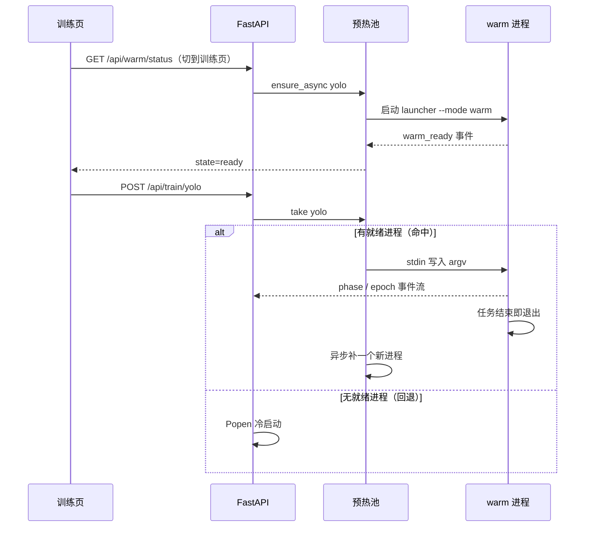

环境变量：

| 变量 | 默认 | 作用 |
| --- | --- | --- |
| `TRTFORGE_WARM` | `1` | `0` = 完全冷启动（排障 / 内存紧） |
| `TRTFORGE_WARM_KINDS` | `yolo,anomalib` | 只预热指定链路 |
| `TRTFORGE_WARM_IDLE_SECONDS` | `1800` | 空闲回收秒数 |
| `TRTFORGE_YOLO_ONLINE` | `0` | 默认给子进程设 `YOLO_OFFLINE=1`，跳过 PyPI 版本检查 |

验收：

```powershell
D:\Anaconda3\envs\dpenv\python.exe 6-web\backend\tools\test_warmpool.py      # 期望 25 项全过
D:\Anaconda3\envs\dpenv\python.exe 6-web\backend\tools\test_phase_events.py  # 期望 15 项全过
```

页面上：训练页角标显示「预热中 / 预热就绪 / 预热未启用」；开训后清单逐行出现
`起进程 / 载入依赖 / 载入模型 / 扫描数据`，命中预热的行是绿色，`train_start` 时折叠成「启动合计 x.xxs」。

#### 3.2.4 用已有 best.pt 微调（v1.25）

**适用**：同一产品、同一套类别，只是又补了几十上百张图，想让模型吸收新样本，
不想从预训练权重重跑。**不适用**：换产品、换类别体系（新训更稳）。

Web 操作：训练页 →「断点续训/历史训练」→ 扫描历史 → 目标 run 行点 **「用它微调」**。

命令行等价物：

```powershell
cd 1-python-yolo\launcher
python tf_yolo_launcher.py --mode train `
  --model  runs\trtforge\pcb\weights\best.pt `
  --data   configs\pcb_detect.yaml `
  --init-mode finetune --exist-ok `
  --lr0 0.001 --epochs 30 --mosaic 0.3 --close-mosaic 15 `
  --project runs\trtforge --name pcb
```

| 参数 | 微调建议值 | 原因 |
| --- | --- | --- |
| `--init-mode finetune` | 必填 | 只载入权重；优化器与轮次重置 |
| `--exist-ok` | 必填 | 写回原实验目录；不加会静默生成 `exp2` |
| `--lr0` | 0.001 | 新训默认 0.01 会把原权重学到的特征冲掉 |
| `--epochs` | 30 左右 | 小步修正，不用跑满 |
| `--mosaic` | 0.3 | 拼图会让小缺陷再缩小一半 |
| `--close-mosaic` | 15 | 收尾阶段看完整图 |

**微调 vs 续训**

| 场景 | 起点 | 优化器 / 轮次 | 超参来源 | 落地命令 |
| --- | --- | --- | --- | --- |
| 新训 | 官方预训练权重 | 全新 | 表单 / 命令行 | `--init-mode preset` |
| **微调** | 历史 run 的 `best.pt` | **重置** | 表单 / 命令行 | `--init-mode finetune --exist-ok` |
| 续训 | 历史 run 的 `last.pt` | **恢复**（以检查点为准） | 检查点，表单参数失效 | `--resume-from <last.pt>` |

- 微调与续训**互斥**：同时给会被后端拦住（否则 Ultralytics 静默走 resume）。
- 覆盖前自动备份到 `<run_dir>/_prev/<YYYYmmdd-HHMMSS>/`（旧 `args.yaml`、`results.csv`、`weights/*.pt`）。
  回退时把里面的文件挪回上一层即可。
- 提交前后端会做兼容性检查（`POST /api/train/yolo/finetune-check`）：

| 检查项 | 行为 |
| --- | --- |
| 任务头不一致（`detect` 权重跑 `segment`） | **拦住** |
| 缺少旧类别 / 新增类别 | 提示，列差集 |
| `imgsz` 与历史不同 | 提示，按表单尺寸重训 |

验收：

```powershell
D:\Anaconda3\envs\dpenv\python.exe 6-web\backend\tools\test_finetune_request.py   # 期望 26 项全过
```

### 3.3 Anomalib 训练（三选一）

```powershell
cd 2-python-anomaly\launcher

# PatchCore —— 3分42秒，准确率高，但正常图分数饱和
python tf_anomalib_launcher.py --mode train-export --model patchcore `
  --root ..\anomalib-main\datasets\bottle `
  --project results --name my_patchcore --input-size 256

# PaDiM —— 28秒，推理最快（3.6ms），偶有漏检
python tf_anomalib_launcher.py --mode train-export --model padim `
  --root ..\anomalib-main\datasets\bottle `
  --project results --name my_padim --input-size 256

# EfficientAd —— 约1小时，准确率最高，分数有区分度
python tf_anomalib_launcher.py --mode train-export --model efficientad `
  --root ..\anomalib-main\datasets\bottle `
  --imagenet-dir ..\anomalib-main\datasets\imagenette `
  --project results --name my_efficientad --input-size 256 --max-epochs 20
```

**模型怎么选**：见 `docs/异常检测模型对比与选型_PatchCore_PaDiM_EfficientAd.md`。`anomalib-main` 源码还有 18 个模型没有接到这里，也没有本机实测，对照见 `docs/异常检测模型对照_AnomalyCLIP与Anomalib.md`。

### 3.4 训练产物

```text
results/<ModelName>/<run_name>/v0/weights/lightning/
├── model.ckpt            Lightning 权重（可继续训练）
├── model.onnx            含后处理的 ONNX 图
└── metadata.json         阈值、归一化、输入尺寸、输出契约
```

**`metadata.json` 是推理的必要输入**，不是可选项。

### 3.5 事件协议（给界面集成用）

launcher 通过 stdout 打印结构化事件：

```text
TRTFORGE_JSON {"type":"progress","stage":"train","epoch":3,"total":20,"pct":20.0}
TRTFORGE_JSON {"type":"metric","name":"image_F1Score","value":0.94,"step":3}
TRTFORGE_JSON {"type":"artifact","kind":"onnx","path":"..."}
TRTFORGE_JSON {"type":"error","code":"DATA_NOT_FOUND","message":"..."}
```

事件类型：`env` / `progress` / `metric` / `epoch_summary` / `gpu_status` / `artifact` / `plot` / `error` / `anomaly_model` / `anomaly_export_summary` / `event`。

**退出码约定**：

| 退出码 | 含义 | 处理 |
| --- | --- | --- |
| 0 | 成功 | — |
| 1 | 一般错误 | 看 `error` 事件 |
| 2 | argparse 语法错误 | 检查参数名 |
| 130 | 用户取消 | 正常中断 |

### 3.6 任务活在后端，页面只是窗口（v1.25.2）

这是用这套 Web 界面最需要建立的一个认知：**训练进程跑在 Python 服务里，不在浏览器里**。
关掉标签页、刷新、换台机器访问，都不会让训练停下。

v1.25.2 之前这件事是个陷阱：刷新后页面退回「训练日志 · 未开始」、停止按钮变灰，
任务却还在跑；此时点「开始训练」会起第二个进程，两个抢同一块显卡，常见结果是双双 OOM。

现在的行为：

| 你的操作 | 结果 |
| --- | --- |
| 训练中按 F5 | 页面自动接续：日志从后端补发、启动清单与进度继续、停止按钮可用 |
| 切到别的页签再回来 | 同页签内不会丢（DOM 一直在），不会重复接 |
| 开着两个浏览器标签页 | 两页都显示「运行中」，任一页都能停 |
| 页面关掉后再打开 | 新页面同样自动接续 |
| 再点一次「开始训练」 | 后端返回 409，提示「已有任务正在运行：…」；页面自动接管那个任务 |
| 训练中点「检测环境」 | 允许（自检是 2 秒的轻任务，不参与互斥） |

**顶栏「运行中 N」条**：只要有重任务在跑就出现，显示任务类型 + 已运行时长，带一个「停止」。
点胶囊本身 = 跳到对应页签并接管；点右侧「停止」= 直接终止。**这条不依赖任何页签**，
所以在标注页也能停掉训练。

**后端掉线**：同一条每 3 秒拉一次 `/api/runs`。拉不到就整条变红写「后端未连接 · 正在重试」，
服务恢复后自动消失——不用点按钮才知道。

**独占范围**（哪些任务不允许同时跑）：

| kind | 独占 | 理由 |
| --- | --- | --- |
| `yolo-train` / `anomalib-train` | 是 | 抢显存 + 写同一 `runs/<name>` |
| `engine-build` | 是 | trtexec 写同一个 `.engine` |
| `infer-batch` / `infer-video` | 是 | 与训练抢同一块 GPU |
| `pipeline-*` | 是 | 串联每段本身就是重任务 |
| `*-check-env` / `yolo-export` | 否 | 短任务，允许并发 |

**怎么验这条链**（不跑真训练也能验）：

```powershell
# 1. 起一个任务
curl -X POST "http://127.0.0.1:8060/api/train/yolo?python=<urlencoded python>" `
  -H "Content-Type: application/json" `
  --data-binary "@6-web\runtime\probe.json"      # 里面放 {"data":"...data.yaml","epochs":1,"imgsz":320}

# 2. 立刻再发一次 → 期望 HTTP 409，detail 里写明 run_id 与已运行时长

# 3. 浏览器按 F5 → 训练日志显示「运行中」，顶栏出现「运行中 1 / YOLO 训练 0:05」

# 4. 点顶栏的「停止」→ 任务 status=cancelled，条子消失，徽标变「已停止」
```

### 3.7 日志怎么拿走、怎么看全（v1.25.3）

训练日志和构建日志的标题右侧有两个按钮，它们解决的是「面板看不全、日志拿不走」：

| 按钮 | 用途 | 什么时候可点 |
| --- | --- | --- |
| 复制 | 把面板里的全部文本一次写进剪贴板，成功时变绿显示「已复制」 | 出现第一行日志后 |
| 日志文件 | 新标签页打开磁盘上那份**完整**日志（`runtime/logs/{run_id}.log`），可直接 Ctrl+S | 有任务号时 |

为什么需要「日志文件」：面板只保留最近若干行（训练 3000 行、构建 800 行），
而报错往往出现在更早的位置。更关键的是，**任务结束后内存里的 run 就没了**，
WebSocket 也随之中断，但日志文件一直在磁盘上。

几条实用规则：

- **刷新页面之后**：按钮会自动指向**最近一次**训练 / 构建（鼠标悬停能看到 run_id 与状态），
  不用重跑一遍就能复盘上次为什么失败。
- **服务重启过**：内存里的 run 全部消失，页面也就不知道该指向哪个任务号（按钮变灰）。
  这时直接打开 `runtime/logs/<run_id>.log`，或用 `GET /api/runs/<run_id>/log` 访问，
  文件仍然在——接口按路径取文件，不依赖任务是否还在内存里。
  **v1.34 起**顶栏「历史」按钮能列出重启前的任务（含 run_id），从那里直接点「日志」即可，
  不用自己去翻目录。
- **远程访问（`http://<同事机器>:8060`）**：`navigator.clipboard` 在非安全上下文不可用，
  「复制」会自动退回 `textarea` 方案，所以照样能复制，不会点了没反应。
- **贴给别人时**：优先给「日志文件」的 URL（`/api/runs/<run_id>/log`），
  它不会被面板行数截断。

**顺手修掉的重复日志**：后端每次发事件都带一个自增 `seq`，前端重连后只接
`seq` 比游标大的事件。所以网络闪断一次，日志区不会出现两份同样的内容
（v1.25.2 及以前是会的，闪断时还会让指标表重复记同一轮）。

**怎么验**（不需要真训练）：

```powershell
# 找一个跑过任务的 run_id（顶栏条、日志面板标题、/api/runs 都能看到）
curl -s "http://127.0.0.1:8060/api/runs?limit=5"

# 取全文
curl -s "http://127.0.0.1:8060/api/runs/<run_id>/log" -o run.log

# 只取最后 50 行
curl -s "http://127.0.0.1:8060/api/runs/<run_id>/log?lines=50"

# 越界必须被拒（期望 400）
curl -s -o NUL -w "%{http_code}`n" "http://127.0.0.1:8060/api/runs/..%2F..%2Fetc/log"
```

页面上则直接点「复制」（随便找段文本粘贴验证）和「日志文件」（新标签页标题应是 `<run_id>.log`）。

### 3.8 任务台账、历史任务与崩溃自动续训（v1.34）

这一节解决三件「只有出事那天才会发现」的事：重启后查不到历史、日志把磁盘写满、
训练半夜崩了没人续。

#### 3.8.1 台账在哪、记什么

任务记录写在 `6-web/runtime/runs.jsonl`（追加式，一个任务两行：开始一行、结束一行）。
每行是一条**完整快照**：`run_id / kind / status / exit_code / started_at / finished_at /
command / log_file / meta / resumed_from / error`。

| 时机 | 写入的状态 |
| --- | --- |
| 任务创建 | `running` |
| 正常结束 | `finished`（退出码 0 且产物存在） |
| 失败 | `failed`（非零退出码 / 产物没落盘） |
| 用户点停止 | `cancelled` |
| 服务被强杀后重启 | `interrupted` + `orphan=true` |

读的时候按 `run_id` 取最后一条为准。最后一行如果只写了半截（进程被强杀），
该行被跳过，前面的记录不受影响。

#### 3.8.2 怎么查历史

```powershell
# 最近 10 条历史（新的在前）
curl -s "http://127.0.0.1:8060/api/runs/history?limit=10"

# 某次的完整日志（历史任务同样能打开）
curl -s "http://127.0.0.1:8060/api/runs/<run_id>/log?lines=100"
```

| 接口 | 区别 |
| --- | --- |
| `GET /api/runs` | 只返回**本进程**在跑/跑完的任务，重启即空（顶栏每 3 秒轮询的就是它） |
| `GET /api/runs/history` | 读台账，跨重启；`limit` 默认 50、上限 500；返回项带 `history=true` |
| `POST /api/runs/{id}/stop` | 对历史任务返回 **404**（只读，避免误以为能停掉已结束的任务） |

页面上点顶栏的「历史」按钮即可，状态分四种颜色：完成（绿）、失败（红）、
已停止（黄）、已中断（黄，文案不同——一个是用户停的，一个是服务没交代就没了）。

#### 3.8.3 日志轮转与清理

| 变量 | 默认 | 作用 |
| --- | --- | --- |
| `TRTFORGE_LOG_MAX_MB` | 20 | 单任务日志上限，超过滚动成 `.log.1` / `.log.2`… |
| `TRTFORGE_LOG_BACKUPS` | 3 | 每个任务保留几个滚动分片 |
| `TRTFORGE_LOG_RETENTION_DAYS` | 30 | 启动时整族删除更老的任务日志；`0` = 不清理 |
| `TRTFORGE_RUNS_LEDGER` | `runtime/runs.jsonl` | 台账路径（测试用它指到临时文件） |

`GET /api/runs/{id}/log` 会跨分片拼接，所以「日志文件」按钮拿到的仍是完整内容。
清理只认 `{12位十六进制}.log[N]` 这种文件名，`infer_worker.log` 之类不会被误删。

#### 3.8.4 训练崩溃自动续训

`yolo-train` 以非零退出码结束、且训练目录下存在 `weights/last.pt` 时，后端自动用
`--resume-from <last.pt>`（`exist_ok=True`，写回同一个 `project/name`）再跑一次：

| 条件 | 结果 |
| --- | --- |
| 有 `last.pt`，`TRTFORGE_AUTO_RESUME=1`（默认） | 自动续跑一次，台账里新任务带 `resumed_from` |
| 续训那次又失败 | **不再续**，停在 `failed`（防止无人值守地重跑一夜） |
| 没有 `last.pt`（参数错、数据集路径错） | 不续，直接 `failed` |
| `TRTFORGE_AUTO_RESUME=0` | 完全不续 |
| Anomalib 训练 | 不续：没有等价的命令行续训入口，重跑不等于续训 |

#### 3.8.5 怎么验（不需要训练）

```powershell
# 1) 台账与日志轮转、修复闸门（48 项）
python 6-web\backend\tools\test_run_history.py

# 2) 真机造一次「中断」：起一个自检任务，运行中把服务进程杀掉，再启动
curl -s -X POST "http://127.0.0.1:8060/api/train/anomalib/check-env"
#    ...杀掉 uvicorn 后重新启动...
curl -s "http://127.0.0.1:8060/api/runs/history?limit=3"
#    期望看到 status=interrupted、orphan=true，且该 run_id 的日志仍能取到（HTTP 200）
# 3) 历史任务不能停：期望 404
curl -s -o NUL -w "%{http_code}`n" -X POST "http://127.0.0.1:8060/api/runs/<run_id>/stop"
```

本机实测（v1.34.0，T1000 / 8060）：启动日志打印
`[app] 台账恢复：1 个上次未结束的任务已标记为中断`，历史接口返回
`anomalib-check-env / interrupted / orphan=true / 8.0s`，日志 `HTTP 200`，停止 `404`。

---

## 4. 导出 ONNX

### 4.1 YOLO

```powershell
python tf_yolo_launcher.py --mode export --model runs\trtforge\my_yolo\weights\best.pt `
  --imgsz 640 --opset 12
```

> **不想敲命令行**：Web Studio 训练页的「导出 ONNX」折叠块（v1.15）做的是同一件事，
> 还能一键把 `.transd.onnx` 送到引擎构建页。详见 `6-web/README.md`。
>
> 任务类型以**权重自带**的为准：拿 `yolov8n-seg.pt` 配 `--task detect` 时，launcher 会自动
> 按 `segment` 导出并打印 `task_overridden`，避免生成一个通道数不对的「检测头」。

> `.transd.onnx` 仅用于 TRTForge 自定义推理链路，**不要用 `YOLO()` 直接加载**
> （Ultralytics 认的是原始输出布局，转置后会解析失败）。
>
> 但反过来：**编译 TensorRT 引擎时必须用它**，见 §5.1。导出后目录里应有
> `best.onnx` 和 `best.transd.onnx` 两个文件；如果只有前者，加 `--make-transd` 重跑。

#### 4.1.1 四种任务头的 `.transd.onnx` 布局（v1.15 起）

| 任务 | 图输出 | 布局 |
| --- | --- | --- |
| `detect` | `output0` | `[1, anchors, 4+nc]` |
| `segment` | **`output1`(proto) 在前，`output0`(检测头) 在后** | proto `[1,32,H,W]`；检测头 `[1,anchors,4+nc+32]` |
| `pose` | `output0` | `[1, anchors, 56]`（4+1+17×3） |
| `obb` | `output0` | `[1, anchors, 4+nc+1]`（最后一路是角度） |

> ⚠️ **分割的输出顺序是硬约定，不是风格问题。**
> C++ 侧 `yolo.cu` 对 `V8Seg` 直接读 `static_dims(1)` 当 proto、`static_dims(2)` 当检测头；
> 而 Ultralytics 导出的顺序正好相反。v1.15 在生成 `.transd.onnx` 时会把 proto 提到第一位。
> 不重排的后果是 **trtexec 编译成功、推理时才报**
> `V8Seg channel layout invalid (det=32, proto_dim=116)`。

> v1.15 同时换了转置的定位方式：不再取「图里最后一个节点」（导出顺序的巧合，多一个
> Cast/Concat 就转错，且静默），改成按形状识别预测头，并在转置前校验通道数。


### 4.2 Anomalib

`train-export` 模式已自动完成 ONNX 导出，无需单独执行。

**注意**：导出的 ONNX **已内置 anomalib 后处理**（输出 `pred_score` / `pred_label` / `anomaly_map` / `pred_mask`，值域 0~1）。因此 metadata 里的 `normalization` 是 `none`，DLL 不会再做第二遍 ImageNet 归一化。

**batch 是动态轴（v1.18 起必须知道）**：Anomalib 的 `to_onnx` 固定
`dynamic_axes={"input": {0: "batch_size"}}`，所以用 `onnxruntime` 读到的输入形状是
`[-1, 3, 256, 256]`，**这是正常的**。编译时必须给 `--minShapes/--optShapes/--maxShapes`
（见 5.1 的 Anomalib 命令），Web 串联会自动补。只有 H/W 动态才需要重新导出。

---

## 5. 编译 TensorRT 引擎

### 5.1 trtexec 命令

> **也可以完全不敲命令行**：Web Studio 的「引擎构建」页已支持同一套能力
> （选 ONNX → 自动探测形状 → 选精度/dynamic shape → 实时日志）。
> 命令行的价值在于批量脚本和排查；日常单个模型建议直接用网页。
> 详见本章 5.4。

```powershell
$trt = "C:\Program Files\NVIDIA GPU Computing Toolkit\CUDA\v11.8\bin\trtexec.exe"

# YOLO —— 必须用 .transd.onnx 编译，不能用 model.onnx
& $trt --onnx="model.transd.onnx" --saveEngine="model_fp16.engine" --fp16 `
  --minShapes=images:1x3x640x640 --optShapes=images:1x3x640x640 `
  --maxShapes=images:8x3x640x640 --workspace=4096

# Anomalib（输入名固定为 input）
& $trt --onnx="model.onnx" --saveEngine="model_fp16.engine" --fp16 `
  --minShapes=input:1x3x256x256 --optShapes=input:1x3x256x256 `
  --maxShapes=input:8x3x256x256 --workspace=4096
```

> ⚠️ **YOLO 引擎只能用 `.transd.onnx` 编译，这是最容易踩的坑。**
>
> | | 输出 shape | `yolo_infer.dll` 能否正确解析 |
> | --- | --- | --- |
> | `best.onnx` | `[1, 4+类别数, 候选框数]` | ❌ 不能 |
> | `best.transd.onnx` | `[1, 候选框数, 4+类别数]` | ✅ 能 |
>
> DLL 里按 `bbox_head_dims_[2] - 4` 推算类别数。用 `best.onnx` 时这个值会变成
> `18900 - 4 = 18896`，解码 kernel 越界读显存，**不报任何错误**，却吐出
> `confidence = 957.26`、坐标 `top = -725` 这类垃圾框。
>
> 实测（PCB 6 类模型 @960）：
>
> - 错误引擎：5 个框，置信度 `[957.258, 956.779, 304.125, ...]` → Web 接口返回 **HTTP 400**
> - 正确引擎：3 个框，置信度 `[0.948, 0.761, 0.822]` → 正常
>
> `--mode export` 默认就会顺带生成 `.transd.onnx`（`--make-transd` 默认开启）。
> 如果没生成，加 `--make-transd` 重跑导出即可。

### 5.2 预期耗时（T1000 实测）

| 模型 | 编译耗时 |
| --- | --- |
| EfficientAd | 约 8 分钟 |
| PatchCore | 约 15 分钟 |
| PaDiM | 约 17 分钟 |
| YOLOv8n（320） | 约 5 分钟（313 秒，`Engine built in` 值） |
| YOLOv8n（640） | 约 2~3 分钟 |
| YOLOv8n（960） | 约 8 分钟（474 秒，首次无 timing cache） |

> **必须串行编译**。并行会互相抢 GPU，实测明显变慢。
> 编译期间 GPU 利用率掉到 4% 是正常的（builder 在 CPU 侧搜索 tactic）。
> 反过来，若长时间没有日志输出但 GPU 占用接近 100%，说明仍在 tactic 搜索，
> 不是在卡死，不要中断。

**为什么 320 也要 5 分钟（重要，别按面积去推算）**

第一版 Web 估算假设「耗时 ∝ 输入面积」，于是 960 的 474 秒推到 320 只剩 53 秒。
实测 320 需要 **313.6 秒**，假设直接被推翻。真实规律是：

- 耗时主要来自「层数 × 每层候选 kernel 数」，ONNX 体积是层数的代理，
  输入尺寸只影响**每次候选试跑**的成本；
- 分辨率小 → 激活值小 → 显存里能塞下更多 tactic，搜索空间反而更大，
  两者部分抵消，所以远没有「平方」那么快。

用 960（474 s）与 320（313 s）两点反解，指数 ≈ 0.37，Web 端取 0.4：

```
秒数 ≈ 38.3 × ONNX_MB × (imgsz / 960) ^ 0.4      # fp16；fp32 × 0.7
```

> 跨显卡要重算：`38.3` 是 T1000（Turing，8 GB）上的值，换 Ampere/Ada 会明显变小。
> 不需要手调 —— Web 端每次成功构建都会把真实耗时写进
> `runtime/engine_stats.json`，同类构建下次直接取历史中位数。

**tactic 搜索期间日志是静默的，这不是卡死**

真实日志里 `Local timing cache in use.` 到 `Engine built in 474.149 sec.` 之间
是 **473 秒空白**，trtexec 一行都不打。所以：

- 命令行里只能靠「等」，别以为卡住了就 Ctrl+C；
- Web 界面会用心跳线程每 2 秒推进估算进度，即使日志不动，百分比和已用时间也在动；
- 判断是否真的在跑：`nvidia-smi` 里 trtexec 是否占着 GPU，或看日志是否终于出现新行。

### 5.3 验收

输出末尾应出现：

```text
&&&& PASSED TensorRT.trtexec [TensorRT v8502]
```

并生成 `*.engine` 文件。出现 `FAILED` 通常是算子不支持或 opset 过低。

### 5.4 用 Web 界面构建（推荐）

启动工作站后打开「引擎构建」页：

```powershell
powershell -NoProfile -ExecutionPolicy Bypass -File scripts\run_web_studio.ps1
# 浏览器打开 http://127.0.0.1:8060 → 点顶部「引擎构建」
```

| 操作 | 说明 |
| --- | --- |
| 选 ONNX | 选完自动调 `/api/engine/probe` 显示输入/输出形状与体积；未转置的 YOLO 会标红 |
| 输出引擎 | 留空自动推导为 `<onnx名>_fp16.engine`；「浏览」只能选到目录，选中后自动补成 `目录\<onnx名>_<精度>.engine` |
| 精度 | `fp16` 省显存（推荐）/ `fp32` / `int8`（YOLO，需选校准图片文件夹，默认抽 100 张）。同一批图再次编译沿用 `.cache` |
| 动态 shape | 勾选后填 min/opt/max，如 `1x3x960x960` |
| workspace | 默认 4096 MB |

> **「输出引擎」要写文件名，不是目录。**
> 浏览器没有系统文件对话框，「浏览」只能选目录。只填目录会被后端以
> 「输出文件名需以 .engine / .trt / .plan 结尾」拒绝（v1.18.1 之前的常见卡点）。
> 现在的规则：留空 → 自动推导；选中目录 → 自动补全文件名；已带 `.engine/.trt/.plan`
> → 原样保留；填成 `.onnx` 路径 → 换成 `<名>_<精度>.engine`。
> 文件名随时可以在输入框里手工改。逻辑见 `6-web/frontend/js/engine.js`
> 的 `normalizeEngineOut`，有单测 `tests/test_engine_out.mjs`（17 项）。
>
> 「标注」页新建 `.tfanno` 工程同理：选中目录后点「新建」会按目录名补成
> `<目录名>.tfanno`，状态栏会写明改成了什么名字。

点「开始构建」后：

- 日志通过 `/ws/runs/{run_id}` 实时滚动（与训练页同一通道）；
- 提交未转置 ONNX 会被后端 **HTTP 400** 拒绝，日志面板写明原因，不会白等十几分钟；
- 退出码为 0 但没有生成引擎文件时，任务判为 **failed** 并发 `ARTIFACT_MISSING`，
  不会出现「显示成功、去推理却找不到文件」。

**进度面板（v1.13）**

| 元素 | 说明 |
| --- | --- |
| 阶段清单 | 启动 / 解析 ONNX / 解析完成 / 构建与 tactic 搜索 / 序列化 / 校验 / 推理基准 / 完成 |
| 百分比 | `已用 ÷ 估算`，夹在本阶段区间内（构建段封顶 94%，基准段封顶 99%），只有 `PASSED` 才 100% |
| 已用 / 预计剩余 | 前端每秒刷新；后端心跳每 2 秒推一次整数百分比 |
| 估算来源 | 有历史 → 同精度/同 dynamic/体积 ±67%/分辨率 ±20% 的中位数；无历史 → 公式外推 |

三条必须守住的行为：

1. **失败或中断的构建不补 100%**，进度停在出事的位置，避免「进度满格但失败」；
2. **统计在 `Engine built in` 出现的那一刻就落盘**：那一段是真实的构建耗时，
   即使之后的推理基准被中断，它对下次估算依然有参考价值；而根本没跑到这一步的失败
   （参数错误、早期 OOM、ONNX 解析失败）不会产生任何条目；
3. **落盘的值只认 `Engine built in X sec.`**，不拿进程总时长充数（后者含解析与基准）。

验证：`python 6-web\backend\tools\test_engine_progress.py`（26 项，含真实日志按时间戳回放）。

构建产物路径可直接填进「推理演示」页的引擎文件栏。

### 5.5 一键全流程串联（v1.17）

「训练导出」页底部的 **全流程串联** 卡片把第 3~5 节再加上精度验证串成一条链：

```
训练 → 导出 .transd.onnx → 校验转置布局 → 编译引擎 → 生成 labels_*.json → 引擎精度验证
```

参数直接复用上面的「训练参数」表单（dataset.yaml / epochs / imgsz / project / name），
卡片里只多出四项串联独有的设置：

| 控件 | 说明 | 默认 |
| --- | --- | --- |
| 引擎精度 | `fp16` / `fp32` / `int8`（只给 YOLO。留空校准文件夹就用验证集） | fp16 |
| 验证用 split | `val` / `test` / `train` | val |
| 编译后用引擎做精度验证 | 关掉就只到「生成标签」为止。勾选后，检测任务会多一张混淆矩阵和漏检/过检/判错清单（`val_images.csv`） | 勾选 |
| 跳过训练（用已有 .pt） | 勾选后必须给出 `.pt` 绝对路径，从导出开始跑 | 不勾 |

**每一段都是独立任务**：串联本身不 spawn 子进程，只负责决定"下一段跑什么"。
每段仍是一个普通 run，好处是停止只停当前那一个（Windows 上杀父进程不会连带杀子进程，
否则点"停止"后训练还会在后台占着 GPU）、每段都有独立日志与 `WS /ws/runs/{id}`、
某段失败时前面已完成的产物照常保留。

**看某一段的日志**：阶段行的「日志」按钮分两条路——该段还在跑就切到右侧训练日志面板
（实时流）；已结束或服务重启过则读 `runtime/logs/{run_id}.log` 的尾部，显示在卡片内。
只做实时流是不够的：那个面板只认内存里的 run，重启后点开只会看到「未知任务」，
而排障需要的恰恰是已经结束的那一段。

**状态语义**

| 阶段状态 | 含义 |
| --- | --- |
| `pending` / `running` / `success` | 等待 / 进行中 / 完成 |
| `failed` | 该段失败，整链 `failed`，后面全部 `skipped` |
| `cancelled` | 该段被「停止」打断 |
| `skipped` | 前面某段失败或已停止，这一段没跑 |

失败**不自动重试**：训练 OOM、数据配错这类问题重试一次只是再烧一遍时间。
停止后已完成的产物（`best.pt` / `.transd.onnx` / `.engine` / `labels_*.json`）全部保留。

**精度报告**来自 `val_engine.py`：用 `yolo_infer.dll` 在验证集上逐张推理，
按 COCO 口径（IoU 0.50:0.95、全点插值）算 AP，页面直接显示 mAP50 / mAP50-95 / P / R。
产物落在 `<run_dir>/val/val_report.json` 与 `val_report.csv`（UTF-8 BOM，Excel 直接双击）。
> 精度评估目前只支持 `detect`：分割 / 姿态 / OBB 的 GT 解码口径不同，还没对齐。

**服务重启后的行为**：内存里的编排线程没了，但记录还在 `runtime/pipelines/*.json`。
启动时会把上次遗留的 `running` 记录标成 `cancelled`（原因写「服务重启，任务已中断」），
历史列表里仍可查看——不这样处理的话，页面会对着一条永远不动的记录一直轮询。

接口：

```powershell
# 启动（示例：跳过训练，从已有权重跑到精度报告）
curl -X POST http://127.0.0.1:8060/api/pipeline/yolo -H "Content-Type: application/json" -d '{
  "data": "D:/data/dataset.yaml", "task": "detect", "precision": "fp16",
  "skip_train": true, "weights": "D:/runs/exp/weights/best.pt",
  "run_val": true, "val_split": "val"
}'

GET  /api/pipeline                 # 最近记录（含磁盘上的历史，带 live 标记）
GET  /api/pipeline/{id}            # 单条详情；live=false 表示只能从磁盘读到
GET  /api/pipeline/{id}/log?stage=export&lines=400   # 某一段的日志尾巴（纯文本）
POST /api/pipeline/{id}/stop       # 停止整条链
```

验证：`python 6-web\backend\tools\test_pipeline_stages.py`（50 项，用假 run 管理器跑完
整条状态机：全成功 / 中途失败 / 可执行段 / 停止 / 报告收集 / 重启遗留 / 产物去重），
`python 6-web\backend\tools\test_pipeline_log.py`（9 项，日志尾部截断与路径穿越）。

### 5.6 Anomalib 一键全流程串联（v1.18）

串联卡片的「类型」下拉选 **异常检测（Anomalib）**，走的是另一条四段链：

```
train_export（训练 + 导出 ONNX + 校准 metadata）
  → probe（校验 metadata 字段 + ONNX 形状）
  → build（trtexec 编译 model_<precision>.engine）
  → val（引擎逐张推理，出 anomaly_val_report.json / .csv）
```

**为什么训练和导出不拆开**：Anomalib 的 launcher 在 `train-export` 一个进程里就把
训练、ONNX 导出、`metadata.json` 阈值校准做完了。为了阶段列表好看拆成三个进程，
只会多两次模型加载，并把「导出拿到的不是刚训的模型」这类错埋进编排层。

**产物路径延迟派生（v1.18 编排层的新机制）**：异常检测的产物落在
`results/<模型类名>/<name>/v<N>/weights/lightning/`，其中 `<模型类名>` 是 `Patchcore`
这种类名、`v<N>` 每训一次递增——**训练开始前根本不知道路径**。所以 `StagePlan.resolve`
在这一段真正开始前才根据 `record["artifacts"]` 拼命令与产物路径。
硬拼 `v0` 的后果是第二次训练会拿上一次的旧模型去编译：旧模型同样能编译、同样能出分数，
错得毫无提示。

**动态 batch（本版踩过的坑）**：Anomalib 的 `to_onnx` 固定
`dynamic_axes={"input": {0: "batch_size"}}`，导出的输入是 `[-1, 3, H, W]`。
第一版 probe 把 `-1` 当成非法形状直接失败，于是训练 200 秒后在第二段报
`ONNX 输入形状 [-1, 3, 256, 256] 不是静态 4 维 NCHW`。现在的处理：

| 情况 | 处理 |
| --- | --- |
| batch 动态（`[-1, 3, H, W]`） | 自动补 `--minShapes=input:1x3xHxW --optShapes=input:1x3xHxW --maxShapes=input:<max_batch>x3xHxW`；opt 取 1 与 DLL 的 `setBindingDimensions(1x3xHxW)` 一致 |
| H/W 动态 | **拒绝编译**：DLL 用 metadata 的 `input_size` 设形状，与导出范围对不上会静默算错，要求带固定 `input_size` 重新导出 |
| 全静态 | 不传 shape 参数 |

**参数**（与页面控件一一对应，接口字段见 `6-web/README.md`）：

| 控件 | 说明 | 默认 |
| --- | --- | --- |
| 模型 | `patchcore` / `padim` / `efficientad` | patchcore |
| 输入尺寸 | 训练与导出的 H/W，必须与 ONNX 一致 | 256 |
| 数据集根目录 | Folder 数据集（`train/good`、`test/abnormal`、`test/good`） | — |
| 跳过训练 | 勾上后必须给「产物目录」（含 `metadata.json` 与 `.onnx`） | 不勾 |
| 引擎精度 | `fp16` / `fp32` | fp16 |
| 精度验证 | 关掉就停在编译 | 勾选 |
| 评估张数上限 | 每个目录最多多少张，0 = 全部 | 0 |

**精度卡片口径**（`6-web/backend/anomalymetrics.py` + `tools/val_anomaly.py`）：

| 指标 | 算法 | 备注 |
| --- | --- | --- |
| image AUROC | Mann-Whitney U 秩统计，同分取平均秩 | 与阈值无关 |
| TP/FP/TN/FN、P/R/F1 | `metadata.json` 的 `image_threshold` | 与 DLL 的 `normalized_score >= 0.5` **数学等价**（`clamp01((raw-min)/(max-min))`） |
| FPR / FNR | `FP/(FP+TN)` / `FN/(FN+TP)` | 产线最关心的误报率与漏检率 |
| best F1 阈值 | 扫全部唯一分数 | 只作参考，**不回写 metadata**（会过拟合测试集） |
| decision_mismatch | 报告判定 vs 引擎 `is_anomaly` | 非 0 说明归一化口径有偏差，必须排查 |

像素级（PRO/AUPRO）暂不提供：需要 ground_truth 掩码，成本远高于图像级；
报告里 `pixel.available=false` 并写明原因。

**实测（bottle，Patchcore / 256 / fp16 / 20 正常 + 44 异常）**

| 阶段 | 耗时 |
| --- | --- |
| train_export | 199.7 秒 |
| probe | 0.7 秒 |
| build | 1016 秒（动态 batch 1…8，比静态形状慢） |
| val | 4.0 秒 |

结果：image AUROC **1.000**、F1 **1.000**、FPR **0.000**、FNR **0.000**、`decision_mismatch=0`。

接口：

```powershell
# 跳过训练，直接用已有的 weights/lightning 目录重跑 probe → build → val
curl -X POST http://127.0.0.1:8060/api/pipeline/anomalib -H "Content-Type: application/json" -d '{
  "model": "patchcore", "root": "D:/datasets/bottle",
  "project": "results", "name": "pipe_anomaly",
  "input_size": 256, "precision": "fp16", "max_batch": 8,
  "skip_train": true,
  "artifacts_dir": "D:/dp-tool/2-python-anomaly/launcher/results/Patchcore/pipe_anomaly/v0/weights/lightning",
  "run_val": true, "val_limit": 0
}'
```

`GET /api/pipeline/{id}` 的 `metrics` 直接就是 `anomaly_val_report.json` 的内容；
阶段清单、日志、停止接口与 YOLO 侧完全共用，不另做一套。

验证：`python 6-web\backend\tools\test_pipeline_resolve.py`（26 项：延迟派生、派生失败短路、
多产物去重、`vN` 定位、metadata 缺阈值拦截、动态 batch 形状参数、H/W 动态拒绝）、
`python 6-web\backend\tools\test_anomaly_metrics.py`（31 项：归一化边界、AUROC 同分、
空输入、混淆矩阵阈值边界、直方图 AUROC）。


---

## 6. 编译 C++ 推理 DLL（仅在改了 C++ 源码时需要）

```powershell
powershell -NoProfile -ExecutionPolicy Bypass -File .\scripts\build_infer_dlls.ps1
```

- 产物：`4-qt-studio/bin/{yolo_infer.dll, anomalib_infer.dll, onnx_infer.dll}`
- 不依赖 Qt，只需 OpenCV + CUDA（`onnx_infer` 只需 OpenCV + ONNX Runtime 头文件）
- **编译前必须先停掉 Web 服务**，否则 DLL 被占用会报 `LNK1104`

#### 6.0 编译 `onnx_infer`（v1.26 新增，`.onnx` 直推用）

```powershell
# 第 1 步：拉 ONNX Runtime（只需一次；-CpuOnly 给安装包用，体积小 10 倍）
powershell -NoProfile -ExecutionPolicy Bypass -File .\scripts\fetch_onnxruntime.ps1 -CpuOnly

# 第 2 步：只编这一个库（三个库一起编就去掉 -Targets）
powershell -NoProfile -ExecutionPolicy Bypass -File .\scripts\build_infer_dlls.ps1 -Targets onnx_infer
```

- 落点：`3-cpp-tensorrt/onnx_infer/third_party/onnxruntime/`（`VERSION.txt` 记录版本，不入库）
- 产物：`4-qt-studio/bin/onnx_infer.dll` + `onnxruntime.dll` + `onnxruntime_providers_shared.dll`
  （POST_BUILD 自动复制；有 `onnxruntime_providers_cuda.dll` 时一并带上）
- 缺头文件时 CMake **只 warning 并跳过该目标**，不会让另外两个 DLL 编不过
- 桌面 Qt 工程默认不含它（`TRTFORGE_BUILD_ONNX_INFER=OFF`），需要时加 `-DTRTFORGE_BUILD_ONNX_INFER=ON`
- 部署时三个文件必须同目录；要放到别处就设 `TRTFORGE_ORT_DIR` 指向 ORT 目录


#### OpenCV 路径怎么找（v1.8 起不再写死）

所有 `CMakeLists.txt` 和 `CMakePresets.json` 里的 `D:/thirdparty/opencv` 已全部移除，
统一按下面顺序查找：

1. 命令行 `-DOPENCV_DIR=<路径>`
2. 环境变量 `OPENCV_DIR`
3. CMake 常规搜索（系统安装目录、`CMAKE_PREFIX_PATH` 等），找不到就报标准 `Could NOT find OpenCV`

```powershell
# 只做一次；之后所有 CMake 工程（含 ocr_infer）都读这个
$env:OPENCV_DIR = "E:\thirdparty\opencv"
```

> 注意 preset 曾经自己带了 `"OPENCV_DIR": "D:/thirdparty/opencv"`，它会**盖掉**环境变量。
> 已删掉，所以如果你本地 `.vs` 或 build 目录里还缓存着旧值，删掉 `build/` 重新 configure 一次。

### 6.1 编译 Qt 桌面版 `TRTForge.exe`（2026-10-31 起可用）

主工程的 `TRTForge.vcxproj` 要链接 `ocr_infer.lib`，所以**必须先编译 OCR 子工程**。
顺序不能反。

```powershell
$env:OPENCV_DIR = "E:\thirdparty\opencv"

# 第 1 步：OCR 子工程
cd ocr\ocr_infer
cmake --preset vs2022-x64 "-DCMAKE_POLICY_VERSION_MINIMUM=3.5" `
      "-DPADDLE_LIB=<仓库根>/ocr/ocr_infer/third_party/paddle_inference"
cmake --build --preset vs2022-x64
# 产出：4-qt-studio/bin/{ocr_infer.dll, ocr_infer.lib, ocr_basic.exe}

# 第 2 步：主工程
cd ..\..\4-qt-studio
cmake --preset vs2022-x64
cmake --build --preset vs2022-x64
# 产出：4-qt-studio/bin/{TRTForge.exe, yolo_infer.dll, anomalib_infer.dll}
```

**两个参数为什么要这么写**

| 参数 | 作用 | 不写会怎样 |
| --- | --- | --- |
| `"-DCMAKE_POLICY_VERSION_MINIMUM=3.5"` | 让 CMake 4.x 接受 clipper 的老式 `cmake_minimum_required(VERSION 2.6.0)` | 报 `Compatibility with CMake < 3.5 has been removed` |
| `"-DPADDLE_LIB=<...>"` | 指向 Paddle Inference 包根目录 | 默认路径是 `4-qt-studio/bin/paddle_inference`，那里的布局通常不对 |

> PowerShell 里这两个参数**必须用双引号包住**。不加引号时 `=3.5` 会被当成独立参数，
> CMake 会把它误读成 preset 名，报 `Could not read presets from ...\.5`。

**Paddle 包布局要求**

`PADDLE_LIB` 指向的目录需要：

```
paddle/include/paddle_inference_api.h
paddle/lib/paddle_inference.lib
paddle/lib/paddle_inference.dll
third_party/install/{protobuf,glog,gflags,xxhash,mkldnn,mklml}/...
```

本机验证过的版本：**Paddle 2.6.2 / GPU / CUDA 11.8 / cuDNN 8.6 / TensorRT 8.5.1.7**。

> 注意是 `mkldnn` 不是 `onednn`。`ocr_infer/CMakeLists.txt` 原先只配了 `onednn/lib`，
> 导致链接期报 `LNK1181: 无法打开输入文件 mkldnn.lib`。现已两条都保留。

**运行时依赖自动复制**

`ocr_infer` 的 POST_BUILD 会把下面 6 个 DLL 自动拷到 `4-qt-studio/bin`：

```
paddle_inference.dll   common.dll   mkldnn.dll
libiomp5md.dll         yaml-cpp.dll polyclipping.dll
```

少任何一个，`TRTForge.exe` 启动即报 `0xC0000135`（找不到依赖）。
所以**不要手工复制**，清空 `build/` 重编即可。

---

## 7. 推理验证

### 7.1 启动 Web 工作站

**最快的方式**：双击仓库根目录的 `启动Web端.bat`（自动找 Python、查端口、就绪后开浏览器）。

```bat
启动Web端.bat                :: 默认 http://127.0.0.1:8060
启动Web端.bat 8070           :: 换端口
启动Web端.bat 8070 nobrowser :: 不自动开浏览器
启动Web端.bat 8060 reload    :: 改后端代码时热重载
```

等价的 PowerShell 方式（参数更全）：

```powershell
powershell -NoProfile -ExecutionPolicy Bypass -File .\scripts\run_web_studio.ps1
# 浏览器打开 http://127.0.0.1:8060

# 换端口
powershell -NoProfile -ExecutionPolicy Bypass -File .\scripts\run_web_studio.ps1 -Port 8070
```

**端口被占用怎么办**：两个脚本都会在启动前检查端口，打印「占用进程名 + PID + 启动时间」。
交互式终端里会直接问「结束它并继续启动？(Y/N)」，答 Y 自动清掉旧进程；
输入被重定向（脚本/CI 调用）时不猜，直接中止并给出清理命令：

```powershell
Stop-Process -Id <提示里的 PID> -Force
```

> 为什么会有残留进程：脚本是前台拉起 uvicorn，父进程被关掉后子进程在 Windows 上不会自动退出，
> 会一直占着端口。**更隐蔽的风险**是「以为重启了，其实还在跑旧后端」——
> 页面（静态文件每次读盘）已经是新版，后端（进程内代码）还是旧版，
> 于是新加的接口参数会被静默忽略。改动后端后务必确认 PID 变了。

### 7.1.3 打给使用人员的安装包（推理 + 训练，CUDA 11.8）

对方电脑与开发机一样使用 **CUDA 11.8** 时，用这个脚本打安装包。包里是编译后的程序和运行库，不含 C++ 源码、网页后端源码和训练工程源码。

```powershell
powershell -NoProfile -ExecutionPolicy Bypass -File .\packaging\package_web_user.ps1
```

产物在 `dist\TRTForgeWeb`（以及同目录的 zip）。交给对方整个文件夹。对方：

1. 安装显卡驱动和 VC++ 2015–2022 x64 运行库。不必再装 CUDA 工具包。
2. 双击 `install_train_env.bat`（需联网。没有 Anaconda 也会自己下载 micromamba 或 Miniconda，生成 `train-env`，并写入 `config.json`。同时安装 `polars-runtime-compat`、`onnx`、`onnxruntime`，避免无 AVX2 的机器导入 Polars 时崩溃）。
3. 在 `config.json` 的 `data_roots` 里填图片所在文件夹。车间其他电脑要访问时，把 `host` 改成 `0.0.0.0`。
4. 双击 `start_web.bat`。对方电脑没有 PowerShell 时，改双击 `start_web_cmd.bat`，说明见 `docs/无PowerShell启动说明.md`。

训练库里的 Ultralytics 是 AGPL-3.0，由对方机器在线安装，不放进安装包。对外发放前确认许可。

要让对方也能做文字识别，打包时加上 `-WithOcr`。这一项默认关闭，因为 `paddle_inference.dll` 约 1.7GB。可选 `-OcrModelDir` 把模型目录拷进安装包的 `models\ocr`，启动脚本会把它写成 `TRTFORGE_OCR_MODEL_DIR`。

```powershell
powershell -NoProfile -ExecutionPolicy Bypass -File .\packaging\package_web_user.ps1 -WithOcr
```

#### 示例模型为什么单独一个包（v1.35.2）

软件包**默认不含任何模型**，示例模型打成第二个包：

```powershell
powershell -NoProfile -ExecutionPolicy Bypass -File .\packaging\package_demo_models.ps1
```

产物 `dist\TRTForgeWeb_models_demo`（约 43 MB）与 zip（约 39 MB）。拆开的三个理由：

| 理由 | 具体影响 |
| --- | --- |
| 模型换得比软件勤 | 换演示模型只重打 40 MB，不用再等 Nuitka 编 1.8 GB |
| 引擎绑显卡 | `.engine` 只能在目标机器上编，软件包带引擎是无效体积 |
| 有人只要软件 | 下载时间少一截，装完就能训练和标注 |

包内布局**直接对应安装目录**，所以安装脚本只是纯复制 + SHA256 校验：

```
TRTForgeWeb_models_demo/
├─ install_demo_models.bat        # 双击安装；自动找 ../TRTForgeWeb
├─ install_demo_models.ps1        #   （找不到就问路径），逐个校验 SHA256
├─ manifest.json                  # 每个文件：目标相对路径 + 字节数 + SHA256
├─ README_示例模型.md              # 按清单现场生成，不会和清单脱节
└─ payload/
   ├─ launchers/runs/pcb_demo/                         # YOLO 检测
   │  ├─ args.yaml                                     #   只写 task/imgsz/model
   │  ├─ labels_pcb_demo.json                          #   文件名必须与 run 目录同名
   │  └─ weights/best.transd.onnx
   └─ launchers/results/EfficientAd/pcb_demo/v0/weights/lightning/
      ├─ model.onnx
      └─ metadata.json                                 #   ckpt_path 清空，onnx_path 改为相对
```

几条硬约束（`package_demo_models.ps1` 会直接报错拒绝打包）：

| 约束 | 违反后的现象 |
| --- | --- |
| 只能放 `.onnx`，不能放 `.engine` | 换台机器报 serialization header 错误，且看起来「模型有了」 |
| YOLO 必须是 `*.transd.onnx` | 编出的引擎解码越界，框位置全错 |
| 标签必须叫 `labels_<run>.json` | `models.py` 退化成「取第一份」，一个 run 多份标签会选错 |
| anomalib 必须带 `metadata.json` | DLL 缺阈值与输入尺寸，加载直接失败 |
| `args.yaml` 由脚本生成，不拷训练目录那份 | 训练目录那份含开发机绝对路径（`data: D:\...`），既没用又泄露内部目录 |

装好之后 `models.py` 不会立刻列出模型——它只认 `.engine`。所以流程是「装模型 → 引擎构建页选 ONNX → 输出引擎留空（自动落到同一个 weights 目录）→ 推理页出现」。`install_demo_models.ps1` 会把要填的 ONNX 绝对路径直接打印出来。

换示例模型只改 `packaging/models_manifest.json`（`source_dir` 指向训练产物目录），脚本与文档自动跟着变。验收命令：

```powershell
python 6-web\backend\tools\test_demo_models_package.py
```

它会真的打一次包、装进临时目录、再造一个假引擎占位，最后调后端 `models.scan_models()` 断言两个模型都能被认出来（70 项断言）。本机没有训练产物时打印 `[SKIP]` 并返回 0，不阻塞 CI。

#### 打包不能把自动实验的 API Key 带走（v1.35.2，v1.35.3 起文件本身也加密）

自动实验（LLM 决策层）的 Key 在开发机上存在两处：环境变量
`AUTOEXP_API_KEY` / `DEEPSEEK_API_KEY` / `OPENAI_API_KEY`，以及
**`6-web/runtime/autoexp_llm.json`**（在网页「自动实验」页填过一次就落盘）。

第二处是真正的风险：它在仓库目录里、文件名像普通配置。
**v1.35.3 起该文件里的 Key 已是 Windows DPAPI 密文**（见后文「API Key 的加密存储」），
但打包仍然必须排除它——密文在原机器原账户上**可以解开**，发出去等于把钥匙寄给客户。
两个打包脚本在压缩前都必须过 `packaging/secret_scan.ps1` 这一关：

| 关卡 | 拦什么 |
| --- | --- |
| 文件名黑名单 | `autoexp_llm.json`、`llm.local.json`、`*.local.json`、`secrets.json`、`credentials.json`、`.env` |
| 私钥内容 | `.pfx` / `.p12` 按后缀否决；`.pem` / `.key` 读内容，含 `PRIVATE KEY` 才否决 |
| 环境变量逐字比对 | 当前进程里 `AUTOEXP_API_KEY` 等变量的**真实值**（覆盖不带 `sk-` 前缀的自建网关 Key） |
| 内容模式 | `sk-` + 20 位以上、`"api_key": "…"` 有值、`Bearer <令牌>`、`KEY=value`、`"api_key_dpapi": "…"` |

> `.pem` **不能**一律拒绝：软件包里的 `app\certifi\cacert.pem` 是公开的 CA 根证书，
> 第一次跑这道关就被误拦了（实测）。所以改成读内容判断——只有含 `PRIVATE KEY` 才否决，
> 公开证书放行。这条误报也写进了测试，避免以后又把规则改回去。

命中直接 `throw`，zip 不会生成。刻意**不提供 `-SkipSecretScan`**：给一次例外，这道关就等于不存在。
日志只打印前 6 位（如 `sk-336***`），不让报错信息变成第二次泄露。

修法对应到具体原因：

| 命中位置 | 怎么修 |
| --- | --- |
| `6-web\runtime\autoexp_llm.json` | 把 `runtime` 从打包范围里去掉（本来也不该拷，它是开发机本地数据） |
| `*\configs\llm.local.json` | 同上，这是本机私有配置，`.gitignore` 里已经排除 |
| 文档/示例里的字符串 | 换成占位符 `sk-xxxxxxxx` |
| 已经真的发出去 | 立刻去厂商后台吊销并重发，删文件没用 |

验收：

```powershell
python 6-web\backend\tools\test_packaging_secrets.py
```

25 项：干净的包必须放行（防止有人因为误伤而加跳过开关），8 类真实风险必须拦下，
公开 CA 证书（`cacert.pem`）必须放行，二进制文件不得误判，
另外两项用**本机真实的** `autoexp_llm.json` 验证——包括把它改名成
`ordinary-settings.json` 之后，内容扫描仍然能抓到（v1.35.3 起抓的是
`"api_key_dpapi"` 这个密文字段，明文正则已抓不到，因为文件里本来就没有明文了）。

> 补充：这一版实测跑软件包打包时，`app\certifi\cacert.pem` 被最初的「`*.pem` 一律拒绝」规则
> 误拦，导致包打不出来。规则已改成读内容判断（只有 `PRIVATE KEY` 才否决），
> 并把这条误报做成测试用例。这说明这道关本身也要有测试，否则它要么漏、要么挡死正常打包。

顺带确认过：`6-web/runtime/` 在 `.gitignore` 里，`git ls-files` 与历史提交
都没有这份 Key 文件，所以不需要吊销。

#### API Key 的加密存储：Windows DPAPI（v1.35.3）

**要解决的问题**：Key 明文躺在 `6-web/runtime/autoexp_llm.json` 里。打包那一道关只是防
「打包发出去了」，防不住「整个目录被拷走 / 网盘同步 / 别人借这台机器看一眼文件」。

**用的方案**：Windows 自带的 DPAPI（`CryptProtectData` / `CryptUnprotectData`），
通过 `ctypes` 直接调 `crypt32.dll`，零第三方依赖（不装 pywin32）。

| 方案 | 为什么不用 / 为什么用 |
| --- | --- |
| 自己写 AES + 固定密钥 | 密钥还得存在某处，等于把锁和钥匙放同一个抽屉 |
| 密码派生（PBKDF2） | 每次启动要人输密码，网页服务没法无人值守启动 |
| 机器绑定的简单加密 | 换机拷走密文反而能解开，正好是我们要防的场景 |
| **DPAPI（默认用户作用域）** | 密钥由 Windows 用「当前用户登录凭据」派生并托管；密文离开这台机器或换个账户就解不开 |

**状态只有四种，判定只在一处**（`autoexp_api._llm_state()`，`/status`、`/llm-config`、
保存响应共用，避免「状态卡说已配置、点开始说没配」）：

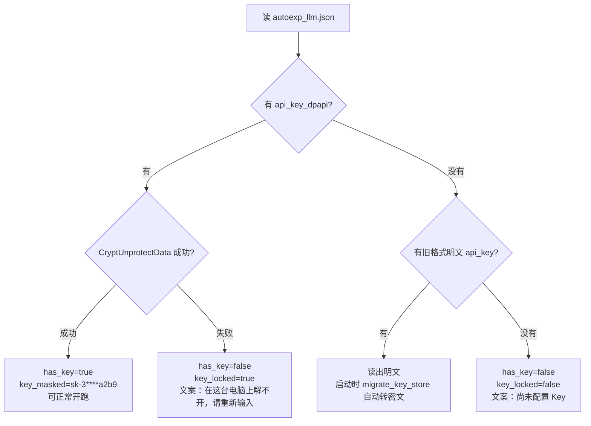

**磁盘格式**

| 字段 | 含义 |
| --- | --- |
| `api_key_dpapi` | base64 的 DPAPI 密文（附加熵 `trtforge.autoexp.llm.v1`） |
| `key_enc` | `dpapi`（Windows）或 `plain`（非 Windows 降级） |
| `api_key` | **只在旧文件里出现**，仅用于读取兼容；Windows 上不再写入 |

**行为约定（每条都有测试）**

| 场景 | 行为 |
| --- | --- |
| 保存 Key | 加密后落盘；Windows 上加密失败直接 HTTP 500，**绝不静默写明文** |
| 升级后第一次启动 | `migrate_key_store()` 就地迁移明文 → 密文；已是密文则跳过（幂等） |
| 换电脑 / 换 Windows 账户 | 解密失败 → `key_locked`，开跑/连通性测试给出「请重新输入」 |
| 解不开的机器上只改 `base_url` | 旧密文**原样保留**（拷回原机器仍可用），不会被这次保存删掉 |
| 点「清空 Key」 | 明文与密文字段一起删除 |
| 非 Windows 开发环境 | 没有 DPAPI，退回明文并标 `key_enc: "plain"` |
| 子进程 / 审计快照 | `llm.load_config()` 剔除 `api_key`、`api_key_dpapi`、`key_enc`，密文不进台账 |

**验收**

```powershell
python 6-web\backend\tools\test_dpapi_keystore.py     # 20 项：往返、磁盘无明文、换机模拟、迁移、降级
python 6-web\backend\tools\test_autoexp_api.py        # 16 项：接口契约不受影响
python 7-autoresearch-yolo\run_all_tests.py           # 71 项：load_config 剔除字段
```

> 踩坑记录：`LocalFree` 必须传 `pbData` 的**值**（`cast(pbData, c_void_p)`），
> 不能传 `byref(pbData)`——后者给出去的是「指针变量所在地址」，系统会去释放一块不属于堆的内存，
> 进程直接以 `0xC0000374`（堆损坏）崩在 `crypt32` 内部。第一次实现就是这么崩的，
> 靠 `faulthandler` 才定位到 `_local_free`。

日常操作仍看 `docs/TRTForge_Web操作手册.md`。开发机自己用继续双击 `启动Web端.bat`，不要用这份安装包代替源码目录。

### 7.1.1 路径怎么选：直接弹系统对话框（v1.20）

页面上所有需要填文件/文件夹的地方，点旁边按钮会弹出 **Windows 原生对话框**，
可以选任意盘符、按该字段的扩展名过滤，不用再一层层点目录。

| 操作 | 结果 |
| --- | --- |
| 单击「浏览 / 目录 / 文件 / …」 | 弹系统对话框（文件 / 文件夹 / 另存为，按字段决定） |
| `Shift` + 单击 | 打开页面内目录浏览（远程访问时用，或想直接切盘符） |
| 某个字段有「文件」「目录」两个按钮 | 两个都能点，分别给文件框和文件夹框 |
| 用户点「取消」 | 输入框保持原值，不报错 |
| 对话框已开着一个又点别的 | 提示「已经有一个选择框打开了」，不会叠出第二个 |

**为什么必须由后端弹**：浏览器有安全沙箱，网页永远无法直接调系统文件框。
对话框实际弹在**跑服务的这台机器**的桌面上，因此：

- 只有本机访问（`127.0.0.1` / `::1`）才启用，远程用户点了会 403 并自动退回页面内浏览；
- 服务用计划任务/服务方式跑在无桌面会话里时，弹框会失败，同样自动退回页面内浏览。

原生框选中的路径若在仓库外，会自动加入**本次运行的临时放行表**（只放行那一级目录、
不递归、不落盘、重启失效），不需要再改 `TRTFORGE_BROWSE_ROOTS`。

| 变量 | 作用 |
| --- | --- |
| `TRTFORGE_DIALOG_TIMEOUT` | 对话框最长等待秒数，默认 300；超时按取消处理 |
| `TRTFORGE_DIALOG_DISABLE` | 设成 `1` 彻底关闭原生框，全部走页面内浏览 |


### 7.1.2 metadata 里的推荐阈值怎么看（v1.21）

Anomalib 的判定阈值写在 `metadata.json` 里。页面勾上「沿用 metadata 默认阈值」后，
两个阈值框是只读的；v1.20 及以前只把它们置灰，框里留默认 `0.5`，
**文件里到底写了多少要靠先跑一次推理才知道**。v1.21 加了 `GET /api/infer/anomalib/metadata`
把文件内容直接摆到界面上。

```
选 metadata.json  ──►  GET /api/infer/anomalib/metadata?path=…
                          │  只读文件，不建引擎句柄（毫秒级）
                          ▼
                    推荐值卡片：图像阈值 / 像素阈值 / 模型 + 输入尺寸
                          │
                          ├─ 勾着「沿用」 → 把值写进只读框（0.172 / 0.1634）
                          └─ 勾掉        → 保留推荐值作为起点，提示「metadata 原值 …」
```

| 界面元素 | 含义 | 应用场景 |
| --- | --- | --- |
| 图像阈值（判定 OK / NG） | `image_threshold`，归一化分数 `>=` 它判 NG | 决定漏检与误报的取舍 |
| 像素阈值（圈出异常区域） | `pixel_threshold`，异常图上 `>=` 它涂红 | 决定红色区域是大片还是小点 |
| 模型 + 输入尺寸 | `model_type` / `input_size` | 确认引擎与 metadata 是不是同一套 |
| 标签「已校准 N%」 | 存在 `calibration` 区块时的样本判对率 | 低于 100% 说明阈值可能偏松，建议复查 |
| 标签「文件原值」 | 没有 `calibration`，是训练集默认值 | 换现场数据后建议重训或重标定 |

**刷新时机**：改路径并失焦、点「浏览」从系统框选文件、从下拉选训练产物（自动填好后刷新）、
从别的页签切回「推理演示」。三者都只发一次只读请求，不会触发模型加载。

**常见现象**

| 现象 | 原因 | 处理 |
| --- | --- | --- |
| 卡片显示「读取失败」且框被清空 | 路径不存在 / JSON 坏了 / 不在放行目录 | 提示条里带后端原文；按原文修路径或 JSON |
| 数值是 `—`，但文件确实存在 | 文件里没有 `image_threshold` / `pixel_threshold` 字段 | 重新导出或重新校准 metadata |
| 阈值是 `0.0` | 校准后正常样本分数恒为 0，阈值被压到 0 | `0.0` 是有效值，不是"没读到" |
| 卡片数值与推理结果行不一致 | 结果行显示的是**生效值**（可能被手动覆盖） | 看结果行括注的「原值」或卡片上的 metadata 原值 |

> 验收：`python 6-web\backend\tools\test_metadata_readout.py`（37 项）。


### 7.2 推理页操作

1. 选后端：`YOLO`、`Anomalib` 或 `OCR`（文字识别见 §7.7，不选引擎）
2. 选引擎：`*.engine`（OCR 改为选模型目录）
3. **Anomalib 必须再选 `metadata.json`**
4. 上传图片 → 查看分数、判定、叠加图、热力图

> **看耗时先看拆解（v1.30.3）**：结果下方的耗时图例分两行。第一行是 DLL 的
> 预处理 / 推理 / 后处理；第二行是 `含往返 = 上传/排队 + 服务端 + 下载/解析`。
> 如果「推理」只有 5 ms 但「含往返」几百毫秒，差额在编图、base64 和传输上，
> 不是模型慢。服务端与响应体大小见 `timing.server_ms` / `timing.payload_bytes`，
> 机制见 §7.10。

#### DLL 不可用时会自动降级（v1.8）

如果 `yolo_infer.dll` / `anomalib_infer.dll` 加载失败（没编译、缺 OpenCV/CUDA 运行库），
后端**不再直接返回 503**，而是自动切到 `onnxruntime` 跑同一份 ONNX，页面照常出结果。

怎么判断这次走的是哪条路：

| 观察点 | DLL 路径 | 降级路径 |
| --- | --- | --- |
| 结果里的 `backend` | `yolo_infer.dll` / `anomalib_infer.dll` | `onnxruntime-fallback` |
| 结果里的 `warning` | 无 | 有，说明 DLL 为什么不可用 |
| 页面「后端」指标 | 显示 DLL 名 | 显示 `onnxruntime-fallback`，并多一行「降级提示」 |
| `timing` | 四阶段齐全 | 只有 `inference_ms` 有意义，前/后处理记 0 |

降级的边界（别指望它替代 DLL）：

- YOLO 只支持 `detect` / `obb`；`segment` / `pose` 会明确报错，提示改用 DLL。
- Anomalib 只吃 `.onnx`；`.engine` 必须由 DLL 加载。选的是 `.engine` 时，会按
  「同目录同名 `.onnx` → `metadata.json` 的 `onnx_path`」自动找替代模型。
- 性能不作数：降级用 onnxruntime（CUDA provider 需 CUDA 12 + cuDNN 9，本机 CUDA 11.8 会退到 CPU）。

### 7.3 接口自检

```powershell
# 健康检查
Invoke-WebRequest http://127.0.0.1:8060/api/health
# 期望：{"ok":true}

# 能力检查（infer_fallback 为 true 表示 DLL 挂了也能降级跑）
Invoke-WebRequest http://127.0.0.1:8060/api/capabilities
```

### 7.4 精度验收方法

**不要只看单张图**，至少跑完整个 `test/`：

```python
# 用 test/good 算误报率，用 test/abnormal 算漏检率
# 判定口径：normalized_score >= 0.5 为 NG
# 验收线建议：漏检 = 0，误报率 < 5%
```

#### 7.4.1 怎么看像素级诊断（v1.22）

图像级 AUROC 只回答「这张图有没有缺陷」。**判对了却说不出缺陷在哪**是另一类失败，
v1.22 起报告里多了一个 `pixel` 块专门暴露它，不需要掩码。

| 指标 | 字段 | 含义 | 期望 | 看到不对劲先查什么 |
| --- | --- | --- | --- | --- |
| 好图乱指像素 | `pixel.diagnostic.normal_false_pixel_rate` | 正常图被判缺陷的像素占比均值 | 接近 0 | `pixel_threshold` 是否偏低；`anomaly_maps` 的 min/max 与导出时是否一致 |
| 异常图定位面积 | `pixel.diagnostic.abnormal_marked_rate` | 异常图超阈值像素占比均值 | 小而集中 | 面积 > 50% 说明热力图糊了，只能报 NG 指不出位置 |
| 指不出位置 | `pixel.diagnostic.abnormal_undirected` | 判 NG 但异常图无一个像素达标 | **0** | 非 0 是硬伤：分数与位置自相矛盾，先怀疑 fp16 溢出或阈值被手工改过 |

**判定线为什么是 0.5**：DLL 返回的 `normalized_map` 已经以 `pixel_threshold` 为中心归一化过
（`normalizedMap = ((rawMap - pixel_threshold) / (mapMax - mapMin)) + 0.5`），
所以恰好等于阈值的像素在返回图上就是 `0.5`。拿 `pixel_threshold` 去比会把整幅图判成异常。

**`pixel.auroc` 为什么是 `null`**：像素级 AUROC / PRO / AUPRO 都需要 ground_truth 掩码，
当前数据集只有 `good` / `bad` 两个目录。用整图标签冒充像素标签算出来的数在惩罚模型
「把好区域判正常」，比不给数字更有害。报告里的 `pixel.auroc_reason` 会写明这一点。

想定位到具体哪张图在乱指，看 CSV 的 `pixel_above_ratio` 列（越大越可疑）。

### 7.5 目录批量 · 视频 · 摄像头（v1.16）

推理页底部的「批量 · 视频 · 摄像头」卡片。**引擎、标签、任务类型、`conf` / `nms` 全部沿用上方
「推理设置」**，所以顺序是：先在上面选好引擎并确认单张能出框，再切到这张卡片。

#### 7.5.1 三种模式的执行位置（先搞清楚这个，排查才有方向）

| 模式 | 跑在哪 | 有 `run_id` | 能停止 | 产物 |
| --- | --- | --- | --- | --- |
| 目录批量 | 子进程 `backend/tools/infer_batch.py` | 有 | 能（杀进程，已写文件保留） | `annotated/`、`results.csv`、`results.json`、`annotated.zip`、`job.json` |
| 视频 | 子进程 `backend/tools/infer_video.py` | 有 | 能 | `*_annotated.mp4`、`detections.json` |
| 摄像头 | 后端进程内 `POST /api/infer/frame` | **无** | 点「关闭」 | 不落盘 |

判断"到底跑没跑"看产物目录：`runtime/infer/<时间戳>-<batch|video>-<随机>/`。

#### 7.5.2 目录批量

1. 在「图片目录」填服务端路径（可点「浏览」，支持中文与空格）。
2. 调试时把「最多处理张数」填 3：先确认引擎与标签对不对，再跑全量。
3. 点「开始批量推理」，进度条与逐文件表格实时刷新。
4. 完成后点「下载标注包」，或直接去产物目录拿 `results.csv`。

`results.csv` 是 `utf-8-sig` + `\n` 换行，**故意带 BOM**：不带的话 Excel 打开中文类别名是乱码；
换行必须是 `\n`，`\r\n` 会在部分工具里多出空行。

单张坏图（截断的 JPEG、0 字节文件）不会中断整批：

```
index,file,width,height,count,status,error,classes
7,mask_07.jpg,0,0,0,error,decode failed,
```

遇到 `status=error` 先看 `error` 列，再单独用单张推理复现那一张。

#### 7.5.3 视频

1. 填视频绝对路径（「浏览」已放开 mp4/avi/mov/mkv）。
2. 先设「最多处理帧数 = 30」验证编码器与画面，再放开跑全片。
3. 编码器保持 `auto` 即可：依次试 `avc1` → `H264` → `mp4v`，**实写一帧验证文件非空**才算可用。
4. 完成后视频直接在卡片里内联播放，可下载 mp4 与 `detections.json`。

抽帧（步长 N > 1）时输出帧率写为 `源帧率 ÷ N`，**播放时长与原片一致**。
如果看到"快进"，说明这一步被改坏了——它不是可选的显示细节，而是让产物可用的前提。

#### 7.5.4 摄像头

1. 选分辨率（640×480 / 1280×720 / 1920×1080）与帧率上限（默认 8）。
2. 点「开启摄像头」，浏览器首次会请求授权。
3. 画面上直接叠框；右上角显示当前帧率与单帧耗时。
4. 点「关闭」停止；关页面也会自动释放摄像头。

这条链路**不落盘、不上传图片**：每帧压成 JPEG 发一次请求，后端只回 JSON 坐标与类别色。
如果画面卡但延迟不累积，是"掉帧"（设计如此：上一帧没回来就跳过，不排队）；
如果延迟越来越长，说明在途判断失效了，属于 bug。

没有摄像头或拒绝授权时，卡片回到「未启动」并显示原因，
例如 `无法打开摄像头：Requested device not found`——不会卡在「启动中」。

#### 7.5.5 命令行等价用法（不经过页面）

```powershell
# 目录批量（自己跑，便于写进其他流水线）
D:\Anaconda3\envs\dpenv\python.exe 6-web\backend\tools\infer_batch.py `
  --source D:\pcb\images --engine <engine路径> --labels <labels_*.json> `
  --task detect --conf 0.25 --nms 0.45 --jpeg-quality 92

# 视频（--stride 3 表示每 3 帧处理一次，输出帧率自动除以 3）
D:\Anaconda3\envs\dpenv\python.exe 6-web\backend\tools\infer_video.py `
  --source D:\pcb\line.mp4 --engine <engine路径> --stride 3 --max-frames 300
```

两者都会把事件以 `TRTFORGE_JSON {...}` 单行 JSON 打到 stdout（与训练任务同一套协议），
`runners.py` 就是靠这个把进度转成 WebSocket 事件的。

#### 7.5.6 验收与回归

```powershell
D:\Anaconda3\envs\dpenv\python.exe 6-web\backend\tools\test_infer_jobs.py    # 34 项
D:\Anaconda3\envs\dpenv\python.exe 6-web\backend\tools\test_infer_batch.py   # 75 项
D:\Anaconda3\envs\dpenv\python.exe 6-web\backend\tools\test_infer_video.py   # 43 项
```

三个脚本都不需要 GPU / DLL / 真实视频，能进 CI。**实测验收线**：

| 检查项 | 期望 |
| --- | --- |
| 批量 3 张小图 | < 2 s，CSV 行数 = 3，`annotated/` 张数 = 3，zip 可解压 |
| 视频 30 帧 | < 3 s，产 mp4 能在浏览器播放（`readyState=4`），时长 = 30 / 帧率 |
| 摄像头单帧 | < 500 ms，响应无 base64 图 |
| 越权下载 | `path` 指向 `runtime/infer` 之外返回 404 |

---

### 7.6 ONNX 与引擎一致性校验（v1.26）

**为什么需要**：同一个模型，`.engine`（TensorRT）与 `.onnx`（ONNX Runtime）是两条完全不同的
执行路径。转引擎时的 FP16、层融合、驱动版本都可能让结果偏移；偏移多大、还能不能用，
靠人眼看两张标注图是看不出来的。这一节的两条命令就是用退出码回答这个问题。

**三级分派先说清楚**（决定你这次到底跑的是谁）：

1. 模型后缀 `.onnx` 且 `onnx_infer.dll` 可用 → `onnx_infer.dll`；
2. 模型后缀 `.engine` / `.trt` 且对应 DLL 可用 → `yolo_infer.dll` / `anomalib_infer.dll`；
3. 都不可用 → Python `onnxruntime` 兜底，结果里 `backend` 会写 `onnxruntime-fallback`。

#### 7.6.1 结果级比对（先跑这个）

```powershell
D:\Anaconda3\envs\dpenv\python.exe 6-web\backend\tools\compare_backends.py `
  --engine "runs\pcb\detect_v1\weights\best.transd_fp16.engine" `
  --onnx   "runs\pcb\detect_v1\weights\best.transd.onnx" `
  --images "D:\test\deeplearning\dp-tool\PCB data\PCB缺陷检测" `
  --task detect
```

产出 `runtime/compare/<时间戳>/compare_report.json` 与 `.csv`（CSV 是 `utf-8-sig`，Excel 打开中文不乱码）。

| 指标 | 含义 | 默认阈值 | 调紧的代价 |
| --- | --- | --- | --- |
| `match_rate` | 两侧互相匹配上的框 / 较大一侧框数 | ≥ 0.95 | 边缘图会遇到「差一个框」的抖动 |
| `min_iou` | 匹配对里最差的 IoU | ≥ 0.90 | FP16 引擎常见的轻微收缩会卡在这 |
| `max_conf_diff` | 匹配对里最大的置信度差 | ≤ 0.02 | 低分框的置信度本身噪声大 |
| `min_mask_iou`（segment） | 掩码 IoU 最小值 | ≥ 0.90 | 细长缺陷边缘差 1 像素就掉 |
| `max_kpt_dist_px`（pose） | 关键点最大像素距离 | ≤ 3.0 | — |
| `max_angle_diff_deg`（obb） | 旋转角最大差（度） | ≤ 5.0 | — |
| Anomalib | `score_diff` / `verdict_equal` / `map_diff` / `mask_agree` | 0.10 / 必须一致 / 0.05 / 0.95 | 分数差与模型对数值尺度强相关 |

退出码：`0` 通过、`2` 超阈值、`3` 无法比对（缺模型 / DLL 不可用）。**别把它当报告看，要当门禁用。**

#### 7.6.2 张量级比对（结果不一致时用它定位）

```powershell
D:\Anaconda3\envs\dpenv\python.exe 6-web\backend\tools\compare_raw_tensors.py `
  --engine "runs\pcb\detect_v1\weights\best.transd_fp16.engine" `
  --onnx   "runs\pcb\detect_v1\weights\best.transd.onnx" `
  --images "D:\test\deeplearning\dp-tool\PCB data\PCB缺陷检测" `
  --task detect
```

它给子进程设 `TRTFORGE_RAW_DUMP=<临时目录>`，三条推理链（`onnx_infer` / `yolo_infer` / `anomalib_infer`）
各自把预处理后的输入与后处理前的输出落盘为 `.f32` + `manifest.jsonl`，然后逐张量比较。

- **没有设置这个环境变量时，DLL 里连目录都不检查**，正常推理零开销、零文件；
- 自动对齐最后两维转置，`[1,4+nc,n]` 与 `[1,n,4+nc]` 能直接比；
- **按张量名字配对，不按序号**：实测 PatchCore 的 TRT binding 顺序是 `score/map/label/mask`，
  ONNX 图输出是 `score/label/map/mask`，按序号会把 map 和 label 相减，得出巨大且无意义的差异；
- 只看两个数：余弦相似度（形状对齐后方向一致性）与按张量量级缩放的相对最大差。
  二值输出（如 mask）额外给「像素一致率」。

判断逻辑：**张量一致但结果不一致 → 问题在 Python 侧后处理/渲染；张量就不一致 → 问题在模型或精度。**

#### 7.6.3 本机实测基线（2026-11-05，CPU EP）

| 用例 | 指标 | 结果 |
| --- | --- | --- |
| YOLO detect（PCB 8 张） | 匹配率 / 最小 IoU / 置信度差 | 100% / > 0.92 / < 0.02，8/8 通过 |
| YOLO detect 原始张量 | 余弦相似度 / 最大相对差 | 0.999998 / ≤ 1.3% |
| Anomalib 三模型（8 张） | 分数差 / 判定一致 | ≤ 0.055 / 100%，8/8 通过 |
| Anomalib 原始张量 | 余弦相似度 / 二值 mask 一致率 | 0.9917 / 100% |

工具自身也有验收用例，改代码后先跑这两个（不需要 GPU）：

```powershell
D:\Anaconda3\envs\dpenv\python.exe 6-web\backend\tools\test_backend_consistency.py   # 19 项（含实测分派）
D:\Anaconda3\envs\dpenv\python.exe 6-web\backend\tools\test_onnx_infer_dll.py        # 36 项
```

### 7.7 文字识别（v1.27）

推理页第三种类型。检测、识别、文本行方向都在 `ocr_infer.dll` 里，网页只负责传图和画字。
飞桨版本是 **2.6.2**。能加载的是带 `inference.pdmodel` 的老模型；带 `inference.json` 的 3.x 模型会在下拉里变灰。

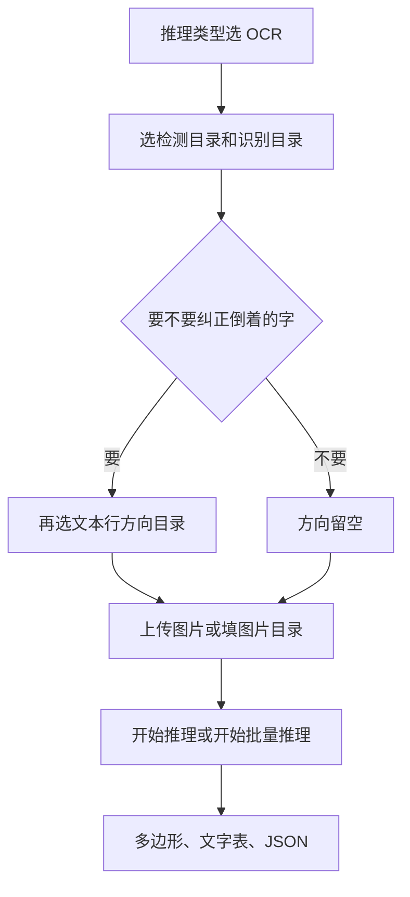

**模型放哪**：环境变量 `TRTFORGE_OCR_MODEL_DIR`，没设就用 `9-python-paddleOCR/model`。
本机可用目录在 `model/legacy_v4/`：

| 目录 | 用途 |
| --- | --- |
| `ch_PP-OCRv4_det_infer` | 检测 |
| `ch_PP-OCRv4_rec_infer` | 识别 |
| `ch_ppocr_mobile_v2.0_cls_infer` | 文本行方向，可留空 |

官方压缩包里没有 `inference.yml`。缺文件时用下面的命令补一份，已有 yml 不会被覆盖：

```powershell
D:\Anaconda3\envs\dpenv\python.exe 6-web\backend\tools\gen_legacy_ocr_yml.py
D:\Anaconda3\envs\dpenv\python.exe -m ocr_models --check <模型目录>
```

第二条在 `6-web/backend` 下执行。退出码 0 表示当前飞桨能加载。

**单张接口**：`POST /api/infer/ocr`，表单字段 `image`、`det_dir`、`rec_dir`，方向目录 `textline_ori_dir` 可空。
设备默认 `cpu`，也可 `gpu:0`。CPU 请保持 MKLDNN 打开。

**预热（v1.30.3）**：`POST /api/ocr/warm`。第一次 `oi_create` 要加载约 1.7 GB 的
`paddle_inference.dll` 并解析模型，约 1.3 s，且**不计入**响应里的 `timing`。
页面在模型列表加载完会自动发一次预热，把这段时间提前吃掉；接口幂等，
重复调用只返回当前状态。命令行也能手动预热：

```powershell
curl -X POST http://127.0.0.1:8060/api/ocr/warm ^
  -H "Content-Type: application/json" ^
  -d "{\"det_dir\":\"...legacy_v4/ch_PP-OCRv4_det_infer\",\"rec_dir\":\"...legacy_v4/ch_PP-OCRv4_rec_infer\"}"
```

`det_dir` / `rec_dir` 可以省略，服务端会从扫描结果里自动挑第一套可用模型。

**配置缓存（v1.30.3）**：`ocr_models.inspect_dir` 的结果按「目录 + `inference.pdmodel/json/yml/pdiparams` 的
mtime + 飞桨主版本」缓存，换了模型文件会自动失效。识别的 `inference.yml` 带 6000+ 条
`character_dict`，每次重新解析约 50 ms。

**目录批量**：`kind` 填 `ocr`，不要填引擎文件。每张图写 `ocr/<文件名>.ocr.json`，汇总写 `ocr_summary.csv`（UTF-8 带 BOM）。
视频和摄像头对 OCR 会返回 400，页面上这两个页签也会被禁用。

**本机实测（2026-11-05，`00006737.jpg`）**：CPU + MKLDNN 75 行、3765 ms；GPU 0 同样 75 行、1147 ms。
图片旋转 180° 并打开方向模型后，行角度为 1，文字仍包含「登机牌」。

**验收**

```powershell
D:\Anaconda3\envs\dpenv\python.exe 6-web\backend\tools\test_ocr_api.py
D:\Anaconda3\envs\dpenv\python.exe 6-web\backend\tools\test_ocr_infer_dll.py
```

#### 7.7.1 v1.30.2 修了什么：`mklml.dll` 错误码 126

**现象**：推理类型选 OCR、模型下拉正常（说明 `ocr_infer.dll` 已经加载成功），点开始推理就失败，
CPU 和 GPU 都失败：

```text
创建 OCR 句柄失败：oi_create exception: ...
PreconditionNotMetError: The third-party dynamic library (mklml.dll) that Paddle depends on
is not configured correctly. (error code is 126)
  - Windows: set PATH by `set PATH=XXX; (at ..\paddle\phi\backends\dynload\dynamic_loader.cc:312)
```

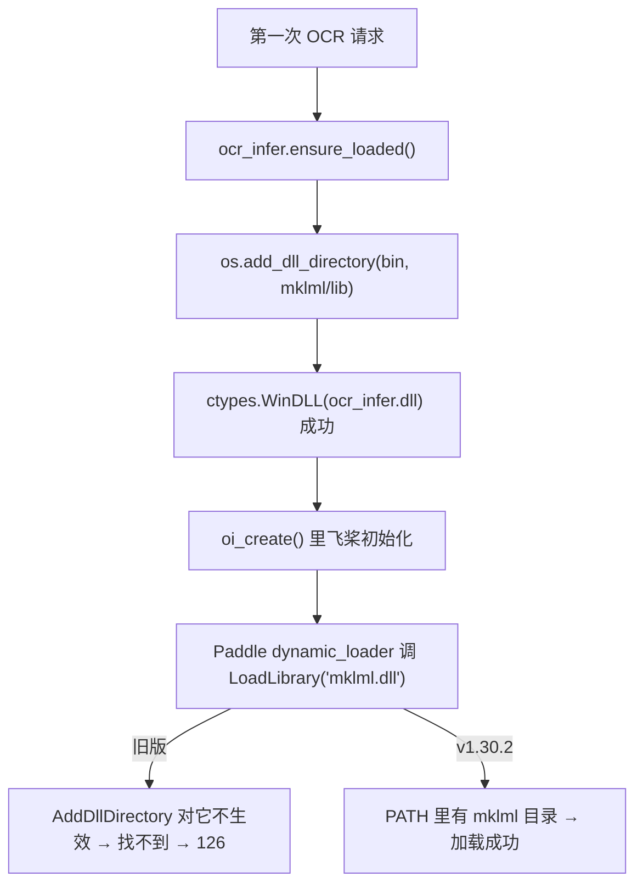

**根因**：`AddDllDirectory` 只影响 `LoadLibraryEx(... LOAD_LIBRARY_SEARCH_USER_DIRS)`。
飞桨 2.6.2 内部用的是**普通 `LoadLibrary`**，搜的是「exe 目录 + 系统目录 + PATH」，看不到 Python 加的目录。
MKL 是 CPU 算子的依赖，`device=gpu:0` 也要先过这一关，所以两个设备一起挂。

| 位置 | 旧版 | v1.30.2 |
| --- | --- | --- |
| `6-web/backend/ocr_infer.py` | 只对 `bin` 和 `mklml/lib` 调 `add_dll_directory` | 同时前置到进程 `PATH`；`bin` 里放了 `mklml.dll` 也能认出来 |
| `ocr/ocr_infer/CMakeLists.txt` POST_BUILD | 依赖清单漏了 `mklml.dll` | 和 `libiomp5md.dll` 一起复制到 `4-qt-studio/bin` |
| `4-qt-studio/CMakeLists.txt` | 只找 `bin/paddle_inference`，源码树里这个目录不存在 | 回退到 `ocr/ocr_infer/third_party/paddle_inference` |
| `tools/test_ocr_api.py` | 没有覆盖 | 新增 3 项回归：能定位 `mklml.dll`、它已在 `PATH`、`bin` 已在 `PATH` |

**自己怎么验证**：不启动网页，直接跑 DLL 验收，它会真的创建预测器并识别一张登机牌：

```powershell
D:\Anaconda3\envs\dpenv\python.exe 6-web\backend\tools\test_ocr_infer_dll.py
# 期望：通过 10 项，失败 0 项
```

**实测（2026-11-09，`00006737.jpg`，`legacy_v4` 的 PP-OCRv4 det+rec）**：
页面 CPU + MKLDNN 75 行、4529 ms；接口 `gpu:0` 75 行、9446 ms（首次含引擎创建）。

**注意**：`4-qt-studio/bin/mklml.dll` 有 88 MB，改完 CMake 后要重新编译 `ocr_infer` 才会自动复制；
只想立刻恢复，可手工把
`ocr/ocr_infer/third_party/paddle_inference/third_party/install/mklml/lib/mklml.dll`
拷到 `4-qt-studio/bin` 再重启 Web 服务。

### 7.8 推理进程隔离（v1.28）

从 v1.28.0 起，YOLO / Anomalib / ONNX / OCR 推理 DLL **不再加载在 Web 服务进程里**，而是只在独立子进程 **`infer_worker`**（`6-web/backend/infer_worker.py`）中通过 ctypes 加载。Web 侧由 **`inferproxy.py`** 代理；服务启动时即拉起工作进程。

| 机制 | 说明 |
| --- | --- |
| 命令与结果 | Windows **命名管道**（`multiprocessing.connection`，随机 `authkey`） |
| 输入图像 | **`multiprocessing.shared_memory`**，工作进程零拷贝读取 |
| 额外耗时（实测） | 1080p 约 **0.56 ms**；4K 约 **1.68 ms** |
| DLL 崩溃 | 当前请求 **HTTP 503**（含退出码、模型名、图片名）→ 后台自动重启 → 下次请求由新进程完成 |
| 空闲被杀 | 下次请求自动拉起；`restarts+1`、`last_error` 留痕，**不计入熔断** |
| 超时 | **HTTP 504** 并重启工作进程；`TRTFORGE_INFER_TIMEOUT` 默认 **60** 秒，OCR 首次加载 **180** 秒 |
| 熔断 | 60 秒内崩溃 **3** 次 → `tripped`，暂停自动重启；YOLO / Anomalib **降级 onnxruntime**（无 ONNX 才 503）；**300** 秒冷却或手动重启解除 |
| 手动重启 | `POST /api/infer/worker/restart`；`GET /api/capabilities` 的 **`infer_worker`**、`GET /api/infer/cache` 的 **`worker`** 看状态 |
| 关闭隔离 | `TRTFORGE_INFER_ISOLATION=0` → 直通模式，行为与 v1.27.0 一致（排障用） |
| 工作进程日志 | `6-web/runtime/logs/infer_worker.log` |
| 打包版启动 worker | `TRTForgeWeb.exe --tool infer_worker` |

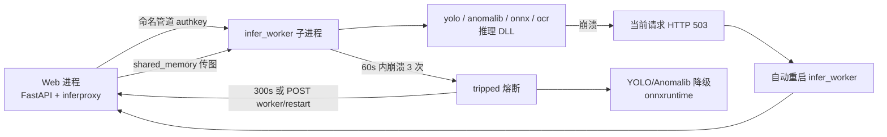

**验收**

```powershell
D:\Anaconda3\envs\dpenv\python.exe 6-web\backend\tools\test_infer_worker.py
D:\Anaconda3\envs\dpenv\python.exe 6-web\backend\tools\test_infer_worker.py --bench
D:\Anaconda3\envs\dpenv\python.exe 6-web\backend\tools\run_all_tests.py   # 41 个脚本全绿
```

### 7.9 YOLO 整图分类（v1.30）

从 v1.30.0 起，Web 标注、数据集、训练和推理可以做整图分类：一张图一个类别，不画框。
v1.30.1 用官方权重和数据集把它跑通了，修掉了训练和推理上几处「能点但不对」的问题。

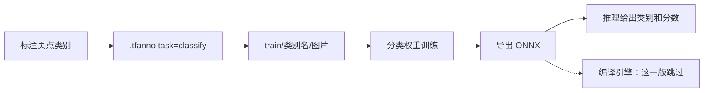

| 步骤 | 怎么做 |
| --- | --- |
| 标注 | 标注页任务选「分类」，新建工程。点类别或按 1、2、3。没标的图不导出 |
| 导入 | 选类别文件夹，例如 `良品/` 或 `train/良品/`。不要选检测的 `labels/` |
| 数据集 | 任务选分类再导出。每个类别单独按比例划分 |
| 训练 | 任务选分类，权重用 `yolov8n-cls.pt` 这类分类头。检测权重会被拒绝 |
| 全流程 | 会训练并导出 ONNX，然后跳过编译引擎和检测精度验证 |
| 推理 | 用 ONNX。`.engine` 会提示「分类引擎还没做，请改用 ONNX。」 |
| 桌面版 | 不能打开分类工程，请用 Web 标注页 |

#### 7.9.1 v1.30.1 修了什么

| 问题 | 原因 | 现在的做法 |
| --- | --- | --- |
| 训练一开始就报 `Classification datasets must be a directory (...) not a file` | Ultralytics 分类入口只接目录，我们把 `dataset.yaml` 直接传了进去 | launcher 先把 yaml 的 `path` 解析成目录；缺少 `train/` 时给中文报错 |
| 分类验证报参数不合法 | 把检测用的 `conf` / `iou` / `max_det` / `save_json` / `save_txt` 一起传了 | 分类只传 `imgsz` / `batch` / `half` / `device` / `plots` / `split` / `workers` |
| 训练页看不到准确率 | 训练结束只发了 loss，没发 top-1 | 训练结束发 `accuracy_top1`，页面显示「top1 准确率」 |
| 非正方形图分数偏低 | 推理用 `cv2.resize` 直接拉伸到 W×H，物体比例和训练时不同 | 短边等比缩放到 `imgsz`，再中心裁剪；实测和官方 `classify_transforms` 的 `max\|diff\| = 0.0000` |
| 中文类别名对不上 | Ultralytics 用 `sorted(文件夹名)` 生成 names，`不良` 排在 `良品` 前，常和 yaml 里的 0/1 相反 | 优先用 ONNX metadata 的 `names`；和标签文件顺序冲突时结果里带 `warning` |
| 分类概览分辨率一直是 0 | 分类分支没做抽样 | 抽样读图片头，填 `resolutions` |
| 视频逐帧明细对分类是空的 | 明细只写 `boxes` | 写 `{"frame": n, "classify": {"label", "score", "uncertain"}}` |

**注意**：分类仍然只支持 ONNX 推理。TensorRT 分类引擎、C++ 分类推理都没做。

```yaml
version_diff:
  component: web-yolo-classify
  old_version: "1.30.0"
  new_version: "1.30.1"
  old:
    train_data: "dataset.yaml 直接交给 Ultralytics"
    val_args: "混入检测后处理参数"
    train_metric: "只有 loss"
    preprocess: "cv2.resize 拉伸"
    class_order: "按 dataset.yaml 顺序"
  new:
    train_data: "yaml 解析成目录"
    val_args: "只传分类相关参数"
    train_metric: "accuracy_top1"
    preprocess: "短边缩放 + 中心裁剪，与官方一致"
    class_order: "以 ONNX metadata 为准"
    engine: "仍然跳过，TensorRT 分类未做"
```

**验收**

```powershell
# 单测（不联网、不训练）
D:\Anaconda3\envs\dpenv\python.exe 6-web\backend\tools\test_classify.py

# 真机闭环（下载官方权重和数据集，训练 + 导出 + 逐张对比 + 批量 + 视频，约 1~2 分钟）
D:\Anaconda3\envs\dpenv\python.exe 6-web\backend\tools\smoke_classify_e2e.py --run --multi
```

真机结果（2026-11-09，`dpenv`，PyTorch 2.3.0 + CUDA，Ultralytics 8.4.192）：

| 数据集 | 训练 | 逐张对比 Ultralytics | 批量 CSV | 视频 |
| --- | --- | --- | --- | --- |
| cn2（良品/不良，故意与排序相反） | 10 轮，top1 0.95 | 20/20 一致 | 列正确，类别正确 | 12 帧，不良 10 / 良品 2 |
| multi（10 类） | 3 轮，top1 0.84 | 20/20 一致 | — | — |

---

### 7.10 推理往返耗时为什么长（v1.30.3）

**现象**：推理页的 `DLL 计时` 只有几毫秒到几十毫秒，但「含往返」是几百毫秒甚至一秒多。
看起来像 bug，其实是两个口径：

| 口径 | 覆盖范围 |
| --- | --- |
| `timing.preprocess_ms` / `inference_ms` / `postprocess_ms` | **只有 DLL 里的 C++ 内核**（TensorRT / Paddle） |
| 页面「含往返」 | 上传 → 解码 → 推理 → 画图 → 编图 → base64 → JSON → 传输 → 浏览器解析渲染 |

差额主要来自「把结果图变成可以放进 JSON 的字符串」这一步。本机实测（3034×1586 PCB 图）：

| 场景 | DLL 计时 | 往返 | 响应体 |
| --- | ---: | ---: | ---: |
| YOLO（PNG 标注图） | 5.2 ms | 388 ms | 9.92 MB |
| Anomalib（4 张全尺寸 PNG） | 73.6 ms | 1077 ms | 28.45 MB |
| OCR（小图，首次含句柄创建） | 189 ms | 2446 ms | 15.7 KB |

单张 3 MP 图的实测代价：

- PNG 编码 154 ms / 5.80 MB；JPEG(q=90) **12 ms / 0.78 MB**
- base64 再让体积 ×1.33；28 MB 的 JSON 序列化约 50 ms
- Anomalib 的红色轮廓只占 0.6% 像素，做成二值 PNG 只要 **5 ms / 0.01 MB**

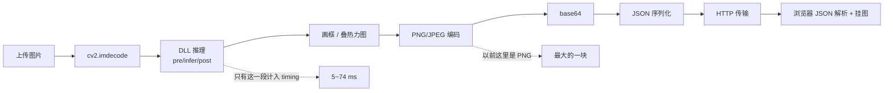

**v1.30.3 改了什么**

| 位置 | 旧 | 新 |
| --- | --- | --- |
| `POST /api/infer/yolo` | `annotated_png`（PNG，5.8 MB） | `annotated_jpg` + `annotated_mime`（JPEG q=90，0.78 MB） |
| 分类分支 | `classifyinfer.overlay_png()` 先编 PNG，再被当作结果图 | 直接 `draw_label()` 拿 BGR，再编 JPEG |
| `POST /api/infer/anomalib` | `overlay_png` + `mask_png` + `source_png` + `heatmap_png` | `overlay_jpg` + 二值 `mask_png` + `heatmap_png`；**去掉 `source_png`** |
| `POST /api/infer/ocr` | 首次才创建句柄（约 1.3 s） | `POST /api/ocr/warm` 预热 + `inspect_dir` 缓存 |
| 上传 | 先写临时文件，三个调用方都没读过 | `_read_upload` 只读字节，不落盘 |
| `timing` | 只有 DLL 三段 | 增加 `server_ms`、`payload_bytes` |

`source_png` 之所以能删：前端切图时已经用 `URL.createObjectURL(file)` 把本地原图挂在查看器上，
后端再编一张全尺寸 PNG 回来是纯重复。`image_width/height` 仍然返回，叠加层坐标要靠它。

二值轮廓的处理在 `infer._encode_mask_png()`：按 `R > 100 且 R > G+30 且 R > B+30` 取红色，
`cv2.IMWRITE_PNG_BILEVEL` 编码；红色占比超过 30% 时判定「不是稀疏轮廓」，退回灰度，避免输出全白。

> **v1.30.4 已推翻上面这段**：用户反馈"区域比轮廓可靠"，而且铜/黄铜工件整圈被误判成异常。
> `_encode_mask_png()` 已被 `_region_from_map()` + `_encode_region_png()` 取代，见 §7.11。

**实测收益（本机）**

| 场景 | 现在 | 优化后 |
| --- | ---: | ---: |
| YOLO 往返 / 响应体 | 388 ms / 9.92 MB | 约 210 ms / 约 1.6 MB |
| Anomalib 往返 / 响应体 | 1077 ms / 28.45 MB | 约 180 ms / 约 2.1 MB |
| OCR 首次 / 后续 | 2446 ms / 340 ms | 预热后首次约 1200 ms / 约 290 ms |

网络越慢收益越大（体积降到 1/6 ~ 1/13）。

**怎么自己量**

```powershell
# 响应体大小与首字节时间（-H "Expect:" 避免 100-continue 干扰计时）
curl -H "Expect:" -o out.bin -w "starttransfer=%{time_starttransfer} total=%{time_total} bytes=%{size_download}\n" ^
  -F "image=@board.jpg" -F "engine=...best.engine" -F "task=detect" ^
  http://127.0.0.1:8060/api/infer/yolo
```

页面上直接看耗时图例第二行：`含往返 = 上传/排队 + 服务端 + 下载/解析`，
其中「服务端」就是响应里的 `timing.server_ms`，响应体大小是 `timing.payload_bytes`。

**验收**

```powershell
D:\Anaconda3\envs\dpenv\python.exe 6-web\backend\tools\run_all_tests.py
D:\Anaconda3\envs\dpenv\python.exe 6-web\backend\tools\test_ocr_api.py
D:\Anaconda3\envs\dpenv\python.exe 6-web\backend\tools\test_onnx_fallback.py
```

真机还要肉眼确认三件事：结果图与原图对齐、Anomalib 区域图仍能看出异常位置（见 §7.11）、导出的 JSON 里
`annotated_jpg` / `overlay_jpg` 能正常打开。

---

### 7.11 OCR 文字看不清、异常检测只有轮廓（v1.30.4）

这两个问题都属于"数值对了但判读不了"，和 §7.10 的体积优化是同一批改动的后续。

**问题一：OCR 识别结果的字是白的**

`js/ocr.js` 的 `buildOcrOverlay()` 给 `<text>` 只设了 `fill=#f4f7fb`（近白）。
OCR 处理的图大多是白底/浅底（文档、铭牌、标签），白字直接糊在背景里。

改法：颜色换成琥珀 `#ffd54a`，并加 `stroke=#0b1016` + `stroke-width=3` +
`paint-order="stroke"`——`paint-order` 让描边画在文字**下面**当"光晕"，
所以任何底色都能读出字，而字本身不会变成一坨黑边。

**问题二：异常面板从"区域"变成"黑底白线"**

`anomalib_infer.dll` 返回的 `mask_rgb` 是 `anomalib_post.hpp` 里
`drawContours(..., thickness=2)` 画的**描边图**（原图 + 2px 红线），本身就带原图底色。

- v1.30.2：直接透传这张三通道图 → 7.1 MB，但看得出"原图 + 红标"。
- v1.30.3：为了体积，按"偏红"阈值抠出红线再二值化 → 0.01 MB，**但只剩轮廓**；
  而且铜/黄铜这类工件天然偏红（`R > G+30` 成立），会被整圈误判，
  管口环形截面上就出现一整圈白线。

v1.30.4 改成从 `normalized_map` 生成**填充区域**：

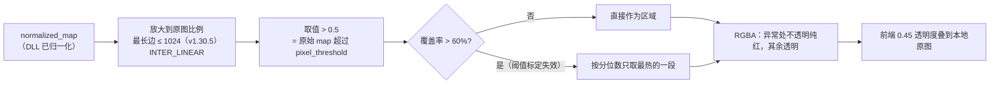

几个关键取舍：

| 取舍 | 原因 |
| --- | --- |
| 用 `normalized_map > 0.5` 判定，而不是抠颜色 | 0.5 是 `anomalib_post.hpp` 里 mask 的固定边界，等价于"原始 map 超过 `pixel_threshold`"；与工件颜色无关，铜件不会再被整圈误判 |
| 先放大再判定 | 224×224 先二值再放大，边界是马赛克方块；先插值再取阈值，边界才是平滑的（与 DLL 内部顺序一致） |
| 覆盖率 > 60% 就换算法 | 跨数据集套模型时模型会把整张图判成异常（实测 PCB 图 95.8%），"全图红"没有定位价值，此时只标最热的一段 |
| 传 RGBA（3~11 KB）而不是后端合成 JPEG（约 800 KB） | 后端手里没有原图像素（v1.30.3 起不回传），前端已有 `URL.createObjectURL` 原图，本地合成零传输 |
| 区域图最长边封顶 1024（v1.30.5） | 区域来自 224×224 的 map，存 3034×1586 只是把插值结果再存一遍：构图+编码 112.7 → 18.1 ms、44 → 11 KB。前端合成画布改取原图尺寸，清晰度不变 |
| 叠图透明度 0.45 | 全不透明会把缺陷纹理盖死；再低就看不出边界 |

ONNX 降级路径同步改了口径：旧写法拿 0~1 的相对值直接比 `pixel_threshold`（原始分数阈值），
两个量纲混着比，判定区域会和 DLL 差一大截；现在先按 metadata
`(map - pixel_threshold) / (map_max - map_min) + 0.5` 归一化，再取 `> 0.5`。

**验收**

```powershell
D:\Anaconda3\envs\dpenv\python.exe 6-web\backend\tools\test_onnx_fallback.py   # 76 项
D:\Anaconda3\envs\dpenv\python.exe 6-web\backend\tools\test_infer_worker.py    # 26 项
cd 6-web\frontend; node tests\test_viewer_math.mjs                             # 6 套前端测试
```

肉眼验收要点：区域是**填充色块**（不是细线）、区域外完全是原图（没有灰底）、
浅底 OCR 图上文字是琥珀色带黑边、换图后区域窗口不会残留上一张的结果。

---

### 7.12 OCR 的往返为什么降不下来（v1.30.5）

**现象**：v1.30.3 把 YOLO / Anomalib 的往返压下来之后，OCR 仍然「含往返 215 ms」，
用户以为 OCR 的传输也有问题。

**结论：OCR 的 215 ms 里 182 ms 是模型，33 ms 才是 Python 侧**，而且 OCR 从一开始
就没有可压缩的大图回传（响应体 9.5 KB）。v1.30.3 的"PNG→JPEG"对 YOLO/Anomalib 有效，
对 OCR 一点收益都没有——它本来就没图要传。

本机实测（`00006737.jpg`，1792×528，75 行文本；Anomalib 用 3034×1586 的 PCB 图）：

| 任务 | 响应体 | 服务端 | 解码 | 进程往返 | 模型 | 响应组装 |
| --- | ---: | ---: | ---: | ---: | ---: | ---: |
| YOLO | 1484 KB | 53.6 ms | 21.3 | 1.3 | 13.7 | 17.3 |
| Anomalib（改前） | 2504 KB | 246.0 ms | 21.7 | 154.7 | 64.4 | 5.2 |
| Anomalib（v1.30.5） | 2459 KB | 184.1 ms | 22.6 | 87.2 | 68.6 | 5.7 |
| OCR（75 行） | 15.5 KB | 3083 ms | 6.7 | 3.2 | 3070.6 | 2.5 |

**`进程往返` 这个 154.7 ms 是个陷阱**：它看着像管道慢，其实全是工作进程里在编结果图——
区域 PNG 112.7 ms、热能图 PNG 31.7 ms、叠加 JPEG 9.8 ms，真正的 pipe + pickle 只有几毫秒。
排查这类"假传输"，先看 `payload_bytes`（2504 KB 里 2.1 MB 是图），再看是哪一张图最贵。

v1.30.5 的处理：异常区域图按最长边 1024 回传（它是 224×224 的 map 上采样出来的，
存 3034×1586 只是把插值结果再存一遍），前端合成画布改取**原图**尺寸，
于是 112.7 → 18.1 ms、44 → 11 KB，预览清晰度不变；另外 ≥64 KB 的结果图二进制
改走共享内存回传，不再 pickle 过管道。

**怎么自己判断**：v1.30.5 起 `timing` 多了三个字段，四段与 `server_ms` 严格自洽：

```
server_ms = decode_ms + ipc_ms + total_ms(DLL) + encode_ms
```

- `decode_ms`：读上传 + `cv2.imdecode`（Web 进程内，三种任务都要付）
- `ipc_ms`：工作进程往返里**除 DLL 之外**的部分——共享内存拷贝、管道、pickle，
  以及**工作进程里编结果图的时间**（这一点最容易误判，见下面的陷阱）
- `encode_ms`：base64 + JSON + 响应组装

页面上直接多一行「服务端拆解 ＝ 模型 ＋ 解码 ＋ 进程往返 ＋ 响应组装」。
看到「模型」占大头就是模型本身慢，别再去查网络。

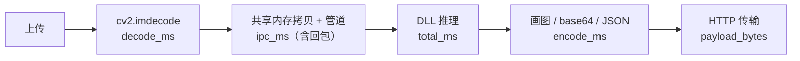

> **`ipc_ms` 还能用来抓「句柄没命中」**：服务刚重启后第一次 OCR，页面会显示
> `进程往返 881 ms`——那是 `oi_create` 在加载 Paddle 模型，第二次就回落到 4 ms。
> 以前这段被算进 `server_ms`，和模型时间混在一起，只能靠猜。

**下一步（未做）**：Anomalib 的热能图仍是全尺寸 PNG（31.7 ms / 1020 KB），
它是 `normalized_map` 上色放大出来的平滑色块，改成 JPEG q=90 只要 6.8 ms / 248 KB；
之所以暂时不动，是因为 `heatmap_png` 还被批量工具（`infer_batch.py` 落盘）
和 `compare_backends.py`（按 PNG 解码）引用，改字段要一起改。

**要真降 OCR 的 182 ms 只能动模型侧**（三种可选，按代价排序）：

| 手段 | 收益 | 代价 |
| --- | --- | --- |
| 设备换 GPU（`device=gpu:0`） | 75 行从 2950 ms → 546 ms | 需要 CUDA 版 Paddle + 显存 |
| `rec_batch_size` 按设备调（v1.30.5 页面已自动） | CPU 24 比 6 快约 18% | 无 |
| 提高 `det_box_thresh` / 缩小输入 | 行数少就快 | 会掉字，实测 1280 边长丢字严重，不建议 |

**rec_batch_size 的交错重复实测**（同一张 75 行图，中位数）：

| 设备 | 6 | 16 | 24 | 32 | 48 |
| --- | ---: | ---: | ---: | ---: | ---: |
| CPU + MKLDNN | 3466 ms | 2998 | 2828 | 2947 | 3732 |
| GPU 0 | **576 ms** | 621 | 612 | — | — |

CPU 上大 batch 能填满 MKLDNN 的并行度，24 是拐点，48 反而因为内存带宽掉头；
GPU 上 6 已经打满，加大只是多算 padding。**"GPU 上 batch 更大更快"是单次测量的错觉**，
交错重复后被推翻，所以页面默认值按设备分开取。

**顺带修掉的浪费**：`_finish_infer` 以前为了报 `payload_bytes` 会把结果**序列化两次**
（先填 0 量长度、再填真值编一遍）。2.5 MB 的异常检测响应等于白花约 30 ms。
现在只序列化一次，用 `"payload_bytes":0` 占位原地替换，字段值等于真实 body 长度。

**共享内存回传（v1.30.5）**：结果图这类 ≥64 KB 的二进制不再随消息 pickle 过管道，
由工作进程写进自己创建的共享内存（`infer_worker._SharedOut`），消息只带
`{"blobs": {"shm": 名字, "items": {字段: [offset, length]}}}`，Web 侧
`inferproxy._unpack_blobs` 附着后按偏移拷出来，读完立刻 close（**不 unlink**，
那块内存归工作进程所有、下一次请求继续复用）。
这一步省的是管道上的拷贝，量级只有几毫秒——真正的大头是上面说的**编图时间**，
别指望它能省 100 ms。

---

### 7.13 分类推理走哪个 DLL（v1.30.6）

**背景**：v1.30.0 加整图分类时，分类只在 Python 里 `import onnxruntime` 跑，
和检测/分割/姿态/OBB/anomalib 走 DLL 的方式不一致；v1.30.6 把 `classify` 补进了
`onnx_infer.dll`。

现在推理侧的执行位置：

| 任务 | `.onnx` | `.engine` / `.trt` |
| --- | --- | --- |
| detect / segment / pose / obb | `onnx_infer.dll` | `yolo_infer.dll` |
| anomaly（PatchCore / PaDiM / EfficientAd） | `onnx_infer.dll` | `anomalib_infer.dll` |
| OCR（检测 + 识别） | `ocr_infer.dll` | — |
| **classify** | **`onnx_infer.dll`（v1.30.6 起）** | 不支持（没有分类引擎 DLL） |

**怎么确认走的是 DLL**：推理结果里的 `backend` 字段。分类显示
`onnx_infer.dll` 就是 C++ 路径；显示 `python` 说明降级了，日志里会有一行
`分类 DLL 不可用：<原因>`。

**分类参数**（页面与脚本相同）：

| 参数 | 默认 | 说明 |
| --- | --- | --- |
| `model` | — | Ultralytics 分类 `.onnx`（`best.onnx`） |
| `conf` | 0.25 | **只在 Python 侧做门槛**：最大概率低于它就判为无法识别 |
| 输入尺寸 | 模型自带 | 动态宽高时固定 224×224；静态导出优先用模型尺寸 |
| 类别名 | 模型 metadata 的 `names` | 中文名直接透传，缺失时退回 `class_0…` |

**一个容易误解的点**：DLL 只回**原始分数**（logits 或概率，取决于导出），
`softmax`、置信度门槛、中文名映射都在 `classifyinfer.interpret()`。
所以同一张图，DLL 的 `top1_score` 可能不在 0~1 之间，这是正常的；
页面显示的 `confidence` 是 Python 判断过"这不是概率"之后再做 softmax 的结果。

**降级与排错**：

| 现象 | 原因 | 处理 |
| --- | --- | --- |
| `backend` 是 `python` | `onnx_infer.dll` 缺失 / ORT 加载失败 / 模型是 `.engine` | 看 `/api/capabilities` 的 `infer_onnx_detail`；`.engine` 分类请重新导出 `.onnx` |
| 分类 `backend=onnx_infer.dll` 但结果和以前不同 | 以前是动态 batch 模型按 1 张跑，现在是同一份预处理；先比 `scores` | 用 `test_classify.py` 的包装层用例核对；差异应 ≤1e-6 |
| 创建句柄失败，提示输入尺寸动态 | 模型是 dynamic 导出 | 按 224×224 固定；与训练分辨率不一致时先重新导出静态尺寸 |

**自测**：

```powershell
python dp-tool\6-web\backend\tools\test_onnx_infer_dll.py      # C ABI（含分类）
python dp-tool\6-web\backend\tools\test_classify.py            # 包装层与降级
python dp-tool\6-web\backend\tools\infer_batch.py --model best.onnx --images <dir> --task classify
```

`infer_batch.py` / `infer_video.py` 与网页端一样是 DLL 优先，输出 JSON 里同样带 `backend`。

---

### 7.14 推理 DLL 的并发契约（同步 / 一句柄一线程）

**背景**：三个推理 DLL（`yolo_infer` / `anomalib_infer` / `onnx_infer`）都是 C ABI 同步接口，
没有异步、没有批量入口；但"能不能多线程"经常被问错方向——**不是 DLL 不支持多线程，
而是一个句柄不能给两个线程用**。2026-11-10 逐库读源码 + 实测后固定成下面的契约，
细节与数据在三个库各自的 README：

| 库 | README 位置 | 一句话 |
| --- | --- | --- |
| `yolo_infer` | `3-cpp-tensorrt/yolo_infer/README.md` 第 4 节 | v1.1.0 起每句柄私有流；detect 1.10×、segment 1.25×——检测类 GPU 已吃满，收益受算力限制 |
| `anomalib_infer` | `3-cpp-tensorrt/anomalib_infer/README.md` 第 6 节 | 每句柄私有流，多线程真并发（1.80×）；同句柄并发**会崩** |
| `onnx_infer` | `3-cpp-tensorrt/onnx_infer/README.md` 第 14 节 | 多句柄安全，但要先设 `TRTFORGE_ORT_THREADS`，否则线程超订更慢 |

**三条契约**：

| 问题 | 结论 |
| --- | --- |
| 同步 / 异步 | **只有同步**。函数返回时结果已算完（TRT 侧返回前 `cudaStreamSynchronize`） |
| 一次几张图 | **一张**。批量由调用方循环，或上层脚本循环 |
| 多模型 | **支持**。每模型一个句柄，句柄间无全局状态；成本是每句柄一份引擎/会话 |
| 多线程 | **支持，一线程一句柄**。同一句柄并发是内存安全问题，不是性能问题 |

**为什么同一句柄并发会出事**：三个库都把结果缓冲放在句柄里（为了不要求调用方管理内存），
每次推理先 `clear()` 再填。两个线程打同一个句柄时，A 刚拿到的 `yi_box*` / `ai_result*` /
`oi_box*` 指向的容器正在被 B 重置。实测：

| 库 | 同一句柄 + 4 线程 |
| --- | --- |
| `yolo_infer.dll` | 20/20 次结果与基准不一致；另一次直接 `0xC0000409` |
| `anomalib_infer.dll` | 稳定崩溃 `0xC0000409` |
| `onnx_infer.dll` | 20 次未复现，但结构相同，属未定义行为 |

**改之前上层是串行的**（这也是为什么网页端从没踩到这个坑）：

| 层 | 机制 |
| --- | --- |
| `infer.py` | `_yolo_lock` 串行化全部 `yi_*` / `oi_infer_yolo` / `oi_infer_classify`；`_anom_lock` 串行化 anomalib |
| `infer_worker.py` | 单连接、单循环，一次只处理一条消息 |
| `inferproxy.py` | 一把 `RLock` 包住整条管道 |

所以**网页端、`infer_batch.py`、`infer_video.py` 的推理是严格排队的**。要提吞吐有两条路，
都得改上层，不是改一行参数：

1. **多 worker 进程**：每个 `infer_worker` 自带一套 DLL 与句柄，进程级并行 —— **v1.31.0 已实施，见 §7.15**；
2. **进程内多句柄线程池**：仅对 `anomalib_infer`（私有流）与限线程后的 `onnx_infer` 有收益，
   `yolo_infer` 需要先改成私有流（v1.1.0 已改成私有流，线程池这条仍未实施）。
   `infer_batch.py` / `infer_video.py` 仍是单进程串行，未接进程池。

**并发前先算好的两个数**：

```text
ONNX（CPU EP）：TRTFORGE_ORT_THREADS = 逻辑核数 ÷ 并发句柄数
TRT（每句柄显存）：引擎权重 + workspace + 一份预处理/输出缓冲
```

不设 `TRTFORGE_ORT_THREADS` 时 ORT 每会话都会开满线程池，4 路并发实测耗时是串行的 1.8 倍（吞吐只有串行的 0.56×）。

**v1.1.0 私有流改造（2026-11-10）**：`yolo_infer` 之前所有句柄共用 CUDA 传统默认流，多线程测出来只有 1.02×。
本次给每个句柄建 `cudaStreamNonBlocking`（只改 `yolo_infer_c.cpp`，`yolo.cu` 未动，ABI 不变），本机 A/B：

| 任务 | 独占单次 | 旧库 4 线程 | 新库 4 线程 |
| --- | ---: | ---: | ---: |
| detect（PCB 960 引擎） | 7.5 ms | 1.01–1.03× | 1.05–1.13× |
| segment（yolov8n-seg） | 2.6–3.8 ms | 1.02× | 1.25× |

**为什么不是 1.8×**：4 路并发时每次调用自己的流内耗时从 7.7 ms 涨到约 27 ms，说明 kernel 确实在交错，
但 GPU 总算是被 4 份工作分掉——960 输入这个引擎在 T1000 上本来就把 GPU 吃满，加速比的上限是算力，不是流的数量。
分割/anomalib 能拿到更多，是因为它们有 CPU 侧后处理可以重叠。

**判断瓶颈的方法**：并发时看 `stat.total_ms ÷ 独占单次 total_ms`。≈并发数说明在交错中分算力（GPU 瓶颈）；
≈1 说明还有别的序列化点。回归验证方式：新旧 DLL 交替 A/B，独占单次耗时与逐框结果都必须完全一致。

---

### 7.15 网页端推理并行：进程池（v1.31.0）

**为什么必须改上层而不是改 DLL**：DLL 层的契约是「一句柄一线程」（§7.14），
所以并行只有两种实现：多句柄，或多进程。网页端选多进程。

**结构**

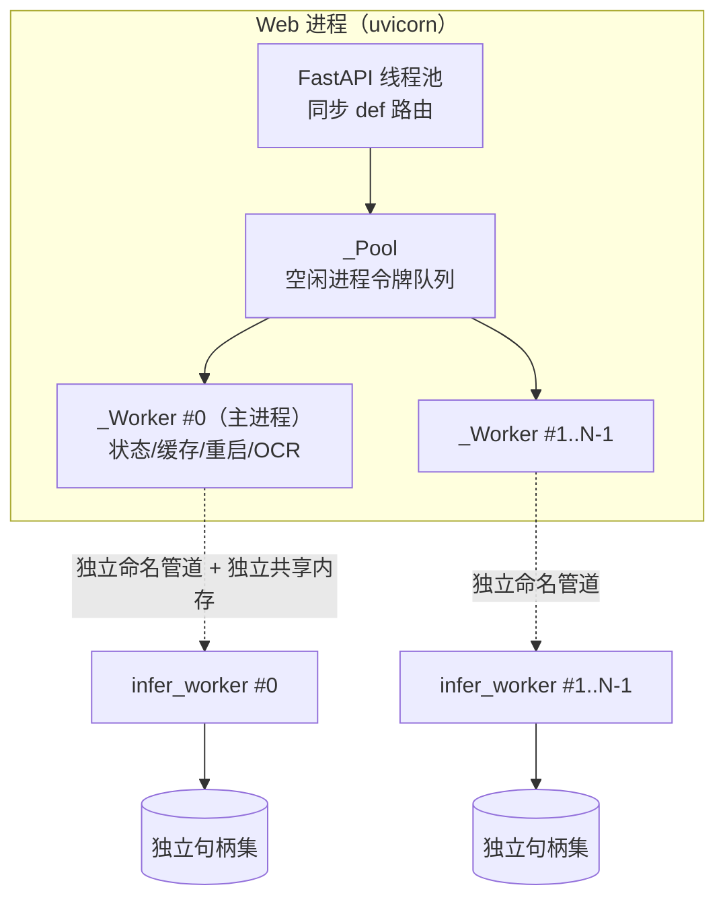

**四个设计决定**

| 决定 | 理由 |
| --- | --- |
| 选多进程，不选子进程内线程池 | 协议零改动（每进程一条原有管道）；崩溃只影响一个进程；无 GIL；句柄安全靠进程隔离而不是纪律 |
| OCR 固定 0 号进程 | `paddle_inference.dll` 常驻约 1.7 GB，N 份就是 1.7 GB × N；OCR 已是 Paddle 内部多线程。附带好处：它首次加载最长 180 s，期间其余进程照常检测 |
| 0 号进程保持「主进程」 | 状态/缓存/重启/OCR 全走它，单进程时代的字段与 26 项既有测试零改动 |
| 默认值按显存自动定 | 实测证明拍脑袋定 4 会变差，见下表 |

**两层熔断**（这是与单进程时代最大的行为差异）

| 层级 | 触发 | 效果 |
| --- | --- | --- |
| 单进程 | 该进程 60 s 内崩 3 次 | 只停它自己，并从分发队列移除；其余进程继续服务。0 号进程的这条规则与 v1.28 完全一致 |
| 全池 | 全池 60 s 内**累计**崩 6 次 | 全池熔断，`status()` 把所有后端报不可用 → 路由降级 onnxruntime；`POST /api/infer/worker/restart` 或 300 s 冷却解除 |

**实测一：推理路径本身（`test_infer_pool.py --bench`，T1000 8 GB，4 客户端并发、每客户端 10 次）**

| 进程数 | QPS | P95 | 相对单进程 |
| --- | ---: | ---: | ---: |
| 1 | 88.65 | 139.8 ms | 1.00× |
| 2 | 113.31 | **19.3 ms** | **1.28×（P95 快 7.2×）** |
| 4 | 115.61 | 48.7 ms | 1.30×（吞吐不再涨，P95 反而变差） |

为什么 4 个反而更差：每份并发都有独立的 TRT 执行上下文与 kernel 队列，
T1000 只有 896 个 CUDA 核心，4 份工作分同一份算力时单次耗时被拉长（与 §7.14 的
「加速比上限是算力不是流的数量」是同一件事）。

**实测二：端到端 HTTP 4 并发（真实网页路径，这张才是用户能感觉到的）**

| 场景 | 单发 | 1 进程最慢 | 2 进程最慢 | 结论 |
| --- | ---: | ---: | ---: | --- |
| YOLO 检测 3034×1586 | ~90 ms | ~200 ms | ~200 ms | 没有收益 |
| YOLO 检测 缩放 1280 | ~44 ms | ~67 ms | ~67 ms | 没有收益 |
| Anomalib PatchCore | ~209 ms | ~680 ms | ~460 ms | **1.45×** |

**为什么 YOLO 无收益**：一次请求 ~90 ms 里模型只占 ~11 ms，其余是 Web 进程
「解码大图 → 渲染标注图 → 编 JPEG → base64」。池化只并行模型段，编解码没变。
Anomalib 的模型 + 后处理占 150~200 ms，池化就能兑现。
所以：**吞吐收益 = 推理占整条请求的比例**；稳定性收益（熔断、OCR 不阻塞）两个任务都吃得到。

**另一个代价**：句柄缓存是每进程一份，同一模型被 N 个进程各加载一次，
换到新进程的第一次请求要付一次引擎反序列化（秒级）。

**环境变量**

| 变量 | 作用 | 默认 |
| --- | --- | --- |
| `TRTFORGE_INFER_WORKERS` | 进程数 1~8 | 自动：显存 ≥6 GB 开 2，查不到显卡开 1 |
| `TRTFORGE_INFER_QUEUE_TIMEOUT` | 进程都忙时请求最多排队几秒，超时报 503 | 30 |

**排障入口**

- `GET /api/capabilities` 的 `infer_worker` 与 `GET /api/infer/cache` 的 `worker` 新增
  `pool_size` / `workers[]`（每个进程的 `index,state,pid,restarts,recent_crashes,last_error`）/
  `pool_tripped` / `pool_error`；顶层 `state/pid/restarts/last_error` 仍是 0 号进程。
- 日志：0 号 `infer_worker.log`，其余 `infer_worker-2.log`、`infer_worker-3.log`……
- 验证脚本：`backend/tools/test_infer_pool.py`（20 项，`--bench` 出上面这张表）。

**还没做的**：`infer_batch.py` / `infer_video.py` 仍是单进程串行。批量脚本没有 HTTP 与管道开销，
收益比网页端更大，但要另设计分片与保序写盘，留作第二期。

### 7.16 YOLO 自主实验循环（v1.32.0）

**要解决什么**：手动调 YOLO 有三个实际痛点——单次 100 epoch @640 约 35~40 分钟，一次试错半小时没了；
改了 epoch 数和改了增强的实验混在一起看，分不清是哪个起的作用；跑完十几个 `exp` / `exp-2` / `exp-3`
目录后记不清哪个对应哪套参数。
**在哪儿**：`7-autoresearch-yolo/`，与 `7-autoresearch-master/` 并列。后者是 Karpathy 的
LLM 预训练方法论来源，**不参与本工程构建**；本模块只借用它的问题形式，不复用任何代码。

**循环**

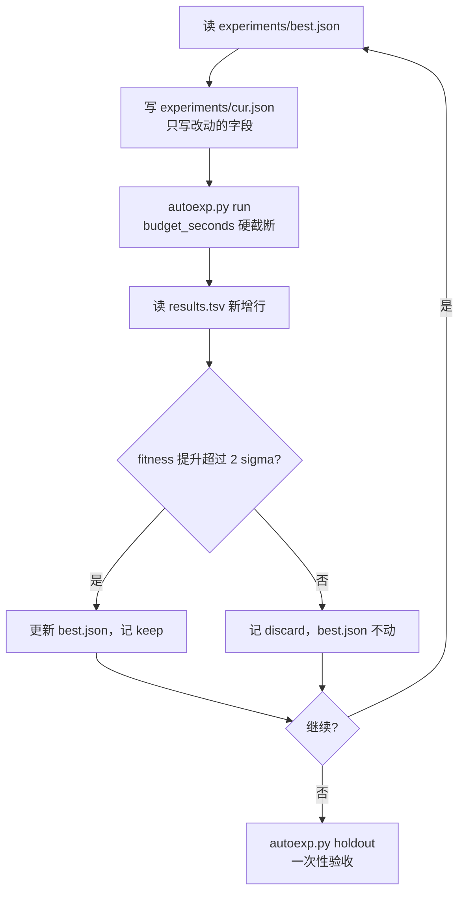

**四个设计决定**

| 决定 | 理由 |
| --- | --- |
| 预算用 Ultralytics 的 `time`（小时），不用 epoch 数 | epoch 数一变，不同配置就不可比了。`time` 到点即停，并按首轮实测耗时反推 epoch 数，于是"跑 600 秒"对所有配置含义相同 |
| 适应度取 `results.csv` **最后一行**，不取 max | 取历史最佳会让"早慧型"配置虚高；固定预算下比的就是到点那一刻的水平 |
| val 集再切成 tune(97) / holdout(42) | `best.pt` 本来就是按这 139 张选的。若搜索也盯它，跑二十次就把它拟合掉了。holdout 搜索期一次不许看，只在最后验收跑一次 |
| 显存预检，拒绝静默降 batch | 见下 |

**为什么必须挡住「自动降 batch」**：Ultralytics 首轮 OOM 会自动把 batch 减半重来
（`16→8→4→2`，每次从第 1 个 epoch 重头再来，日志里只有一行黄字）。batch 一变，
`nbs` 归一化后的等效学习率、正则强度全跟着变，那次实验就与台账里其它实验**不是同一件事**，
横比全是假的。两层拦截：

| 层 | 时机 | 行为 |
| --- | --- | --- |
| 预检 | 开训前 | `preflight_vram()` 比对可用显存与保守需求，不够直接拒绝，记 `preflight_blocked`（不污染 `crash`），零训练时间消耗 |
| 硬拦截 | 训练中 | `_exec_tee` 逐行匹配 `Reducing to batch=N`，命中即**终止子进程**，记 `batch_downgraded`，`fitness` 留空，不计 crash、不污染 `current_best`，并在 run 目录写 `batch_downgraded.json` 留证 |

预检是**估算**，会估错（2026-11-10 就放行了 `imgsz=1152 / batch=4`，30 秒后 OOM）；
硬拦截是**确定**的，只要真降了就一定拦下。两者缺一不可。台账另设
`batch_req` / `batch_eff` 两列作为第三道兜底。

**噪声底必须按配置分组**：实测 640/batch8 的 σ = 0.003184，960/batch4 的 σ = **0.008070**
（2.5 倍）。640 能跑 24 个 epoch、960 只能跑 12 个，末行 mAP 的抖动就是不一样。
拿 640 的阈值判 960，两个方向都会错：会把一次 +0.01 的日常起伏误判成 KEEP，
也会把 −0.008 的正常波动读成「明显退步」。现在的取值顺序：

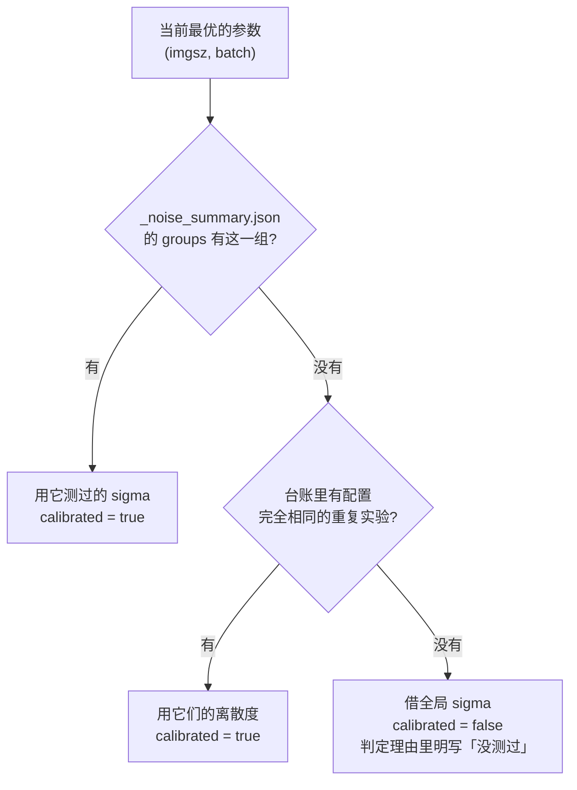

**与生产代码的关系：零文件改动**

`autoexp.py` 只 `import` `1-python-yolo/launcher/tf_yolo_launcher.py` 的三个纯函数
（`build_parser()` / `build_train_kwargs()` / `load_yolo()`），不修改它。这样超参映射与界面训练
100% 一致，而生产 launcher 一行没动。

两道锁：

```powershell
git tag -l "yolo-stable*"                                        # yolo-stable-before-autoexp
git diff yolo-stable-before-autoexp -- 1-python-yolo/launcher    # 应为空
```

`7-autoresearch-yolo/_backup/launcher_<日期>/` 另有 launcher 的 `.py` 与 `configs/` 实体副本
（不含 `runs/`，约 6 MB），不依赖 git 状态。

**写入守卫**：`assert_sandbox()` 拒绝任何落在 `7-autoresearch-yolo/` 之外的写入，并显式列出黑名单
`1-python-yolo/launcher/runs`、`2-python-anomaly/launcher/results`、`6-web/runtime`、`4-qt-studio`、
`3-cpp-tensorrt`。数据集用硬链接镜像，原始 `PCB data/` 只读，标注缓存走内存（`cache: "ram"`），
不往原始 `labels/` 写 `.cache`。

**本机实测（T1000 8GB）**

| 配置 | 结果 |
| --- | --- |
| `batch=16 @640`，可用显存 5302 MB | **OOM**。自动降 16→8→4→2 后仍失败 |
| `batch=4 @1152` | **OOM**，30 秒内崩（`exp_0015`）。主机内存随后也被吃光，报 `cv::OutOfMemoryError` |
| `batch=8 @640` | 正常，峰值 1769.5 MB，约 24~26 秒/epoch，600 秒约 23~24 个 epoch |
| `batch=4 @960` | 正常，峰值约 1958 MB，600 秒约 10~12 个 epoch |
| 同配置 600 秒跑三次（640/b8） | mAP50-95 = `0.40496` / `0.41109` / `0.40385`，**sigma 0.003184**，keep 阈值 2σ = **0.006368** |
| 同配置 120 秒跑两次 | mAP50-95 分别 `0.19745` / `0.19586`，差 0.0016（但整体只在 0.197，仍在爬坡期） |

注意：**960 的噪声底已经补测**（2026-11-10 18:32，三次重复）：

| 配置 | sigma | 2σ 阈值 | 样本 |
| --- | --- | --- | --- |
| `640 / batch8` | 0.003184 | 0.006368 | 0.40496 / 0.41109 / 0.40385 |
| `960 / batch4` | **0.008070** | **0.016139** | 0.45984 / 0.45789 / 0.44183 |

960 的抖动是 640 的 2.5 倍，所以判 KEEP 必须按配置分组（程序已实现，见上节）。
`exp_0006` 的 0.45862 落在 960 三次的分布内（+0.005 < 1σ），说明它是可信的、
不是幸运高点；后续实验追不上它，是因为提的方向确实有害。

**跑长实验前必查显存**：`960/batch4` 训练时整卡占用约 5.5 GB，而 `6-web` 的
`infer_worker` 是懒加载的——浏览网页、点一次推理就会把模型加载进显存并常驻。
两者叠加会把 8 GB 撑爆，表现为「预检通过 → 第一个 batch OOM → 降 batch →
崩在主机内存」。2026-11-10 的 `exp_0020~0022` 连续三次就是这样。

跑长实验前，自动实验会自己让推理进程退出（v1.33.3）。若是没经过网页、也连不上 8060 的命令行，仍建议先看一眼：

```powershell
nvidia-smi --query-gpu=memory.used,memory.free --format=csv
# 推理进程已退出时，空闲应约 800 MB used / 7.2 GB free
```

**首轮 5 个假设（600 秒基准）**

| 改动 | tune mAP50-95 | 判定 |
| --- | --- | --- |
| `imgsz 640→960, batch 8→4` | **0.45862** | **KEEP** |
| `close_mosaic 10→3` | 0.41078 | discard（噪声内） |
| `lr0 0.01→0.02` | 0.40715 | discard（噪声内） |
| `optimizer→AdamW, lr0=0.002` | 0.40407 | discard（噪声内） |
| `mosaic 1.0→0.5, scale 0.5→0.7` | 0.3892 | discard（真退步） |

holdout 复核：640 基线 `0.438055` → 960 `0.473726`，提升同向成立。结论记录在
`experiments/best.json`。960 在 600 秒内只跑得完 12 个 epoch，却胜过 640 的 24 个 epoch——
PCB 缺陷尺寸小，分辨率的收益大于重复遍历的收益。

**验收必须用同一把尺子**：第一次验 `exp_0006` 时 `holdout` 默认从 `configs/base.json` 读了
`imgsz=640`，等于拿 640 去量 960 训出来的模型，得 0.328896，看着像灾难性过拟合，
实际是量错了。现已改为自动从该次训练的 `args.yaml` 读回 `imgsz` 与 `batch`。

OOM 根因：`6-web` 的两套常驻服务（端口 8060 / 8094）各挂一个 `infer_worker.py`，长期占约 2.7 GB；
且这张卡在 Ultralytics 的 AMP 黑名单里，训练强制 fp32，激活显存比常规高一截。跑实验前若不需要
Web 端，建议停掉一套。

**为什么不覆盖 Anomalib**：现有 `anomaly_val_report.json` 是 `auroc 1.0 / f1 1.0 / tp44 fp0 tn20 fn0`，
奖励信号已饱和，任何配置都得满分，循环没有梯度可爬，只会退化成"寻找跑得最快的退化配置"。
EfficientAd 也不适合：20 epoch 要 3525 秒，压进 5 分钟预算会把 LR 日程一起改掉，实验之间比的
就不再是"同一套方法跑多久"，而是"不同的训练配方"。

**命令**

```powershell
cd 7-autoresearch-yolo
python autoexp.py split --data "..\PCB data\PCB缺陷检测\data.yaml"   # 只需一次
python autoexp.py run --config experiments/cur.json
python autoexp.py report
python autoexp.py noise --repeat 3
python autoexp.py holdout --weights runs/autoexp/exp_0007/weights/best.pt
# 让大模型提议下一组参数并连跑多轮（见 §7.17）
python autoexp.py agent --rounds 30 --events
```

完整参数说明、台账字段与应用场景见 `7-autoresearch-yolo/README.md`。

**与网页端共用显卡：跨进程互斥（v1.32.1）**

两者产物目录完全隔离（网页写 `1-python-yolo/launcher/runs`，autoexp 写
`7-autoresearch-yolo/runs/autoexp`），互不覆盖。但**共用同一块显卡**，所以同一时刻只允许一方占 GPU。

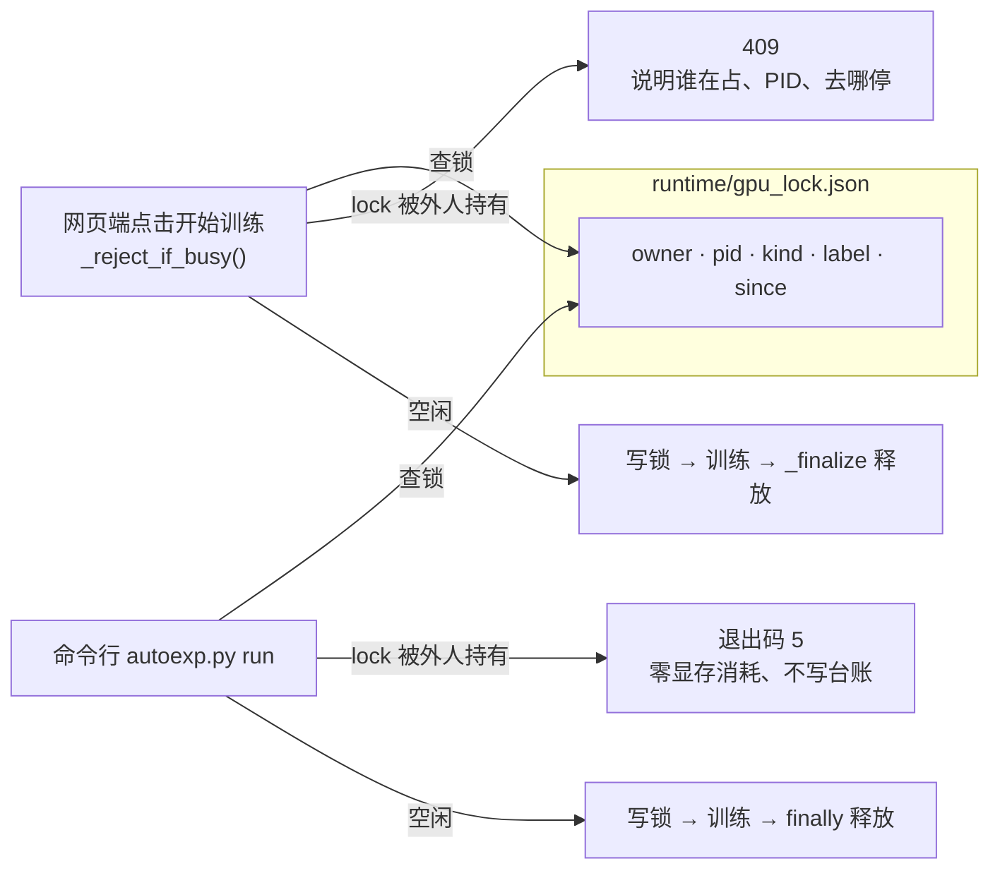

| 场景 | 行为 |
| --- | --- |
| 网页点「开始训练」，锁被 autoexp 或另一套 Web 实例持有 | **409**，文案带占用方、PID、去处 |
| `autoexp.py run` / `holdout`，锁被网页端持有 | **退出码 5**，不建实验目录、不写台账 |
| 持有者被强杀 | 锁文件残留但 PID 已死 → 视为空闲，不会锁死机器 |
| 锁文件损坏 | 视为空闲（宁可漏判一次，也不让所有人用不了） |

**为什么必须拦**：8 GB 卡上两个训练同时跑通常双双 OOM；而 autoexp 侧更糟——
Ultralytics 遇 OOM 会把 batch 静默减半重试，于是这次实验的等效学习率、正则强度
和台账里其它实验都不一样，横比全失真，且台账上看不出来。

**实现位置**：`6-web/backend/gpulock.py`（零第三方依赖）。autoexp 通过
`load_gpulock()` **复用同一份**，不自己再写一遍——锁文件格式是两边共用的契约，
两份实现迟早漂移，而漂移的表现正好是「两个训练都以为自己是唯一持有者」。

排查用：

```powershell
python 6-web\backend\gpulock.py status
# 锁文件：D:\test\deeplearning\dp-tool\runtime\gpu_lock.json
# 状态：空闲
```

真被卡住时直接删 `runtime/gpu_lock.json` 即可，下次 acquire 会重建。

**一个必须记住的坑**：存活探测**不能**用 `os.kill(pid, 0)`。POSIX 上它是只读检查，
但 CPython 的 Windows 实现会把非控制台信号的 sig 直接交给
`TerminateProcess(handle, sig)`——也就是**真的把那个进程杀掉**。现已改为
Windows 走 `OpenProcess` + `GetExitCodeProcess`，POSIX 仍用 `os.kill(pid, 0)`。

### 7.17 LLM 决策层：谁来决定下一次改什么参数（v1.33.0）

**要解决什么**：§7.16 的循环能自动跑，但「下一组参数改什么」仍由人写在
`experiments/cur.json` 里。一晚上几十轮，人不可能守着。这一版让**大模型来提议**，
但**判定权仍留在代码里**。

**职责切分（整个设计的前提，改代码前先读这段）**

| 角色 | 由谁做 | 为什么 |
| --- | --- | --- |
| 提出下一组参数 | 大模型 | 这是它的强项：读台账、找模式、提假设 |
| 判定 keep / discard | **代码，按该配置的 2σ 噪声阈值** | 这是它的弱项且危害最大。把数字交给模型，它几乎必然把噪声讲成趋势，然后沿错误方向持续加码。**阈值还必须按 `imgsz × batch` 分组**：实测 σ 在 640/batch8 是 0.0032、960/batch4 是 0.0081，差 2.5 倍；用同一个阈值判，等于拿一把尺子量两种东西 |
| 能不能改某个字段 | **代码，冻结白名单** | 见下表 |
| 写台账 / 更新 best.json | 代码 | 保证留痕格式与人手工跑实验时完全一致 |

**冻结字段**（即使 `space.json` 声明了也不许改）

| 字段 | 冻结原因 |
| --- | --- |
| `data` | **硬红线**。`space.json` 根本不校验它。一旦允许改，理论上可以把 `splits/pcb_tune.yaml` 换成 `pcb_holdout.yaml`——holdout 纪律当场作废，而台账上一切正常，看不出任何异常。代码里另有一道独立断言：`data` 必须落在 `splits/` 内且文件名含 `tune` |
| `budget_seconds` / `epochs` / `task` / `name` | 改了就不再是「同一套方法跑同样的时间」，横比全部作废 |
| `model` | 第一版刻意冻结：`n→s→m` 会显著改变 600 秒内跑得完的 epoch 数（m 可能只跑 3~4 轮），很容易整晚都在试大模型而没有进展。想放开只需把它从 `FROZEN_TOP` 删掉 |
| `device` / `seed` / `deterministic` / `cache` / `workers` / `amp` / `patience` / `plots` | 影响可复现性或进程稳定性，不属于「研究变量」 |

**流程**

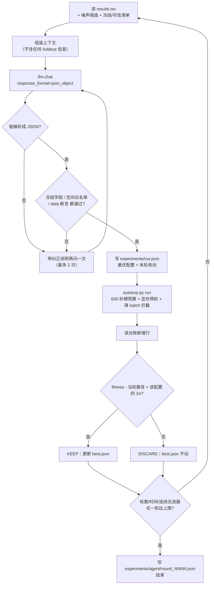

**网页端「自动实验」页（推荐）**

页签在顶栏最后一个之前。这一页是**外置模块**，与训练页完全隔离：

| 隔离点 | 做法 |
| --- | --- |
| 接口 | 独立 `APIRouter`（`/api/autoexp/*`），不碰 `/api/train/yolo` |
| 前端 | 独立 `js/autoexp.js`，不 import `train.js` 的任何状态 |
| 事件类型 | 自定义事件用 `type: "agent"`。训练页只认 `type: "event"`，所以**即使同时打开训练页，它也不会渲染自动实验的内容** |
| 任务类型 | 在 `runners` 里登记新 kind `autoexp-agent`（独占），复用顶栏「运行中」条与日志文件 |
| GPU | 与训练页共用同一把 `gpulock`：一方在跑，另一方 409 / 退出码 5。锁**按 pid 委派**：后端把自己 pid 通过 `AUTOEXP_GPU_LOCK_PID` 传下去，子进程只在「持有者恰好是自家后端」时跳过检查，别的进程持锁照样退出码 5 |

页面上三块内容：

1. **模型接口**：`base_url` / `model` / `temperature` / `API Key`，带「测试连通性」与「预览提示词」。
   Key 保存后只显示遮罩（`sk-****1a2b`），再次保存留空表示不修改。
2. **运行方式**：轮数、时间上限、连续无进展就停、等显卡最长时间。
3. **日志 + 台账**：日志里按「轮」分块，每轮依次出现
   `[模型提议]`（假设 / 改动 / 参数 / 理由）→ 训练进度 → `[判定] KEEP 或 DISCARD`（带差值、阈值、连续无进展轮数）。
   台账表把「模型提议」和「判定」分成两列，一眼能看出「提议合理但没超过噪声」。

**轮数默认值 30（≈5.5 小时）**

一轮 = 600 秒训练 + 约 60~90 秒启动与验证开销 ≈ 11 分钟。所以：

| 轮数 | 墙钟时间 |
| --- | --- |
| 10 | ≈ 1.8 小时 |
| **30（默认）** | **≈ 5.5 小时** |
| 50 | ≈ 9 小时（会先撞 8 小时时间上限） |

`--hours` 默认 8，与 `--rounds` **先到者生效**。两个上限都要有：只限制轮数的话，
某几轮卡在等显卡上会拖到天亮；只限时间的话，模型调用连续失败可能浪费掉整晚的 API 费用。

另外 `--max-stale 5`：连续 5 轮没有 KEEP 就停。一整晚几十轮、每轮都在噪声里打转，
说明当前搜索空间已到瓶颈，继续问只会烧钱。

**命令**

```powershell
cd 7-autoresearch-yolo

# 1) 先看提示词（不调 API、不跑训练，不花一分钱）
python autoexp.py agent --dry-run

# 2) 测连通性（Key 只从环境变量读，不提供 --api-key 参数）
$env:AUTOEXP_API_KEY = "sk-..."
python autoexp.py llm-test

# 3) 开跑
python autoexp.py agent --rounds 30 --hours 8 --events

# 4) 联网失败时换厂商：改 configs/llm.local.json（已 gitignore），不动入库文件
#    {"base_url": "http://localhost:11434/v1", "model": "qwen2.5"}
```

| 参数 | 默认 | 说明 |
| --- | --- | --- |
| `--rounds` | 30 | 最多跑几轮 |
| `--hours` | 8 | 时间上限（小时），0 表示不限 |
| `--max-stale` | 5 | 连续多少轮没有 KEEP 就停（**搜索到瓶颈**） |
| `--max-errors` | 3 | 连续多少轮拿不到有效提议就停（**模型侧故障**，v0.2.1 新增） |
| `--lock-wait` | 3600 | 显卡被网页端占用时最多等多少秒，0 表示不等 |
| `--dry-run` | — | 只打印第一轮完整提示词 |
| `--events` | — | 向 stdout 输出 `TRTFORGE_JSON` 事件（网页端需要） |

**`max_tokens` 必须给推理型模型留足预算（v0.2.1 血的教训）**

`max_tokens` 是「思考 + 正文」的**共用预算**。`deepseek-flash` / `deepseek-reasoner` /
o 系列会先思考再作答，思考 token 不出现在正文里，但照样计入。

实测（`experiments/agent/round_0004.json`）：`completion_tokens=900`、
`reasoning_tokens=900`，正文 **0 token**。表现就是两种看着毫不相关的错：
「返回内容为空」和「JSON 半截」。旧版把它们都报成「返回内容不是合法 JSON」，
于是人会去改提示词、换模型——方向完全错。

现在：默认 4096，`llm.chat()` 认出 `finish_reason=length` 会自动把预算翻倍重试
（上限 8192），仍不够才抛 `LLMTruncated` 并直说「被 max_tokens=N 截断：推理占 X、正文 Y，
请调到 4096 以上」。网页端「模型接口」卡片上能直接改这个数字。

自查一行：打开 `experiments/agent/round_NNNN.json`，看 `usages` 里
`completion_tokens` 是否等于 `max_tokens` 且 `reasoning_tokens` 接近它。
是，就加预算；不是，再怀疑别处。

**换研究策略改 markdown，不改代码**：角色、机器事实、已证伪的方向、方法论约束
全部写在 `prompts/experimenter.md`。想让它只搜增强、或专攻分辨率，改这一个文件即可。
这是上游 autoresearch 最重要的一课——策略应该是一等公民，不是埋在代码里的常量。

**API Key 的三条安全边界**

1. 只存在 `6-web/runtime/autoexp_llm.json`（`6-web/runtime/` 已 gitignore）。
2. GET 接口**永不返回原文**，只给 `has_key` 与遮罩值。改动 Key 留空 = 不修改。
3. 传给子进程**只走环境变量**，绝不进 `argv`——命令行会出现在「运行中」条的
   tooltip、`runtime/logs/*.log` 和 WebSocket 事件里。`llm.py` 另有 `mask_key()`，
   所有对外文本都过它；`load_config()` 会主动剔除 `api_key` 字段，
   防止 Key 随配置字典流进日志与审计快照。

**配置优先级（v0.2.0 调整过，别按老顺序理解）**

`内置默认 ← configs/llm.json ← configs/llm.local.json ← 环境变量 ← 本次显式指定`

「本次显式指定」排最后（页面保存的值、`--model` 参数）。老版本把环境变量放在最后，
结果 shell 里遗留一个 `AUTOEXP_MODEL` 就会让页面上的设置静默失效——这种问题在
排查时几乎不可能一眼看出来。

**一轮结束的那一刻（最容易踩的坑）**

`run` 有两种执行方式：网页端走 tee（`_exec_tee`，边转发事件边落盘），命令行走
`subprocess.run`。状态判定必须只用 `returncode`，不能碰 `Popen` 对象——tee 分支
根本没有那个对象。已抽成 `derive_result_status(result, returncode)` 并有单测覆盖。
症状是「训练明明跑完了，台账却记成 crash 或干脆没这行」。

**为什么判定权必须留在代码里（本项目的核心结论）**

首轮 5 个假设里，只有 `imgsz 640→960` 是真赢（tune +0.052，约 16σ，holdout 同向 +0.036）。
其余四个的差值分别是 `+0.0037` / `+0.0001` / `-0.0031` / `-0.0164`——前三个都在
2σ 阈值内。如果让模型自己判，它大概率会把 `+0.0037` 说成「小幅提升」并据此继续加码
`close_mosaic` 方向，而那条路已经证明没有收益。**噪声区间内的一切解释都是自我欺骗**，
这与模型多聪明无关。

### 7.18 显存预检与混合精度体检（v1.34.1）

**这一节解决什么**：开训前「显存够不够」和「是不是真用了混合精度」这两个问题，
以前一个靠手拟合公式猜、一个靠参数推断，都会给出与事实相反的结论。

**一、显存预检改成实测峰值表**

判定只有一份实现：`6-web/backend/vram.py`。网页端训练页和 `7-autoresearch-yolo`
的自动实验都调它——历史上两处各写一份，在 960/batch=4 上给出过「一边放行、
一边拒绝」的矛盾结论。

| 依据 | 触发条件 | 需求计算 |
| --- | --- | --- |
| `measured` | 同 `(imgsz, batch, 精度)` 有实测样本 | `峰值 × 1.15 + 400 MB` |
| `scaled` | 同 `imgsz`/精度，只有**更小** batch 的样本 | `峰值 × b/b₀ × 1.15 + 400 MB`（固定开销会被重复计一遍，偏差方向安全） |
| `capped` | 同 `imgsz`/精度，只有**更大** batch 的样本 | 用它的实测值作上界（显存随 batch 不减） |
| `formula` | 什么都没跑过 | `2600 + 300 × batch × (imgsz/640)²`（刻意保守，它是闸门不是预测器） |

实测表在 `7-autoresearch-yolo/experiments/vram_samples.json`，键格式
`imgsz x batch x 精度`（如 `640x8xfp32`），值为历次最大
`torch.cuda.max_memory_reserved()`。**每次训练结束自动写回**，越用越准，
不需要人工维护；用 `reserved` 不用 `allocated`，因为 OOM 发生在向驱动申请的那一刻，
`allocated` 低估 30% 以上。

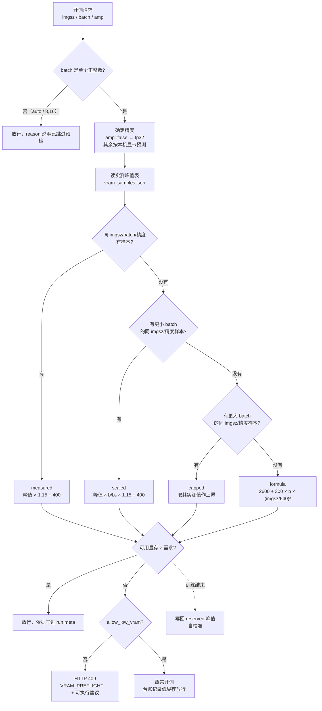

本机（T1000 8GB，fp32）实算：

| 配置 | 依据 | 需求 | 旧公式 |
| --- | --- | --- | --- |
| `640/batch=8` | `measured`（2132 MB） | 2852 MB | 4520 MB |
| `640/batch=16` | `scaled` | 5304 MB | 7400 MB |
| `640/batch=4` | `capped` | 2852 MB | 3800 MB |

**被拦住时怎么办**：`POST /api/train/yolo` 返回 **HTTP 409**，`detail` 以
`VRAM_PREFLIGHT:` 开头，并给出「停掉哪个进程 / batch 降到多少」。页面出现
「仍然开始（显存可能不够）」，确认后带 `allow_low_vram=true` 重发。
只想知道当前能不能跑，用 `GET /api/train/preflight?imgsz=640&batch=16`，不用真开训。

**二、混合精度：检测、可见、可覆盖**

Ultralytics 8.4.192 有一份 `AmpBlacklist`，命中就**静默**关闭 AMP。T1000/T1200/GTX16xx
都在名单上，本机因此一直跑 fp32——用户看到的是「训练慢、显存高」，却没有任何解释。
`6-web/backend/ampcheck.py` 复刻那份正则，命中时页面直接写明：

> 本机命中 AMP 黑名单（t1000），训练实际走 fp32：显存约为 fp16 的 1.5~2 倍，速度约慢一倍。
> 即使传 `--amp` 也无法强制开启——关闭发生在框架内部。

三个 `amp` 取值：不传 / `null` = 按本机自动（黑名单机器走 fp32）；`false` = `--no-amp`；
`true` = `--amp`（黑名单机器上仍会被关掉）。**页面上显示的实际值来自事件而不是参数**：
launcher 在 `on_train_start` 发 `amp_state`（`amp_requested` / `amp_effective` / `precision`），
训练结束再发 `vram_peak`，两者都记进 `run.meta` 并用于自校准。

**排错顺序**：先看「算力体检」里的 `source`——若是 `formula`，说明这组参数还没跑过，
拦住时按建议降 batch 跑一次，之后就有实测依据了；若是 `measured` 却仍然 OOM，
说明算余量时漏了别的进程（通常是 `infer_worker` 常驻），先停它再跑。

### 7.19 数据集指纹与来源追溯（v1.34.2）

**问题**：「这次模型比上次好 0.004，是参数改对了还是数据换了？」旧版本无从回答。
导出目录可以被覆盖、数据集可以被补图、标注可以被修，而这些全都不会在台账里留痕。
更糟的是 `autoexp` 的 `splits/_manifest.json` 只记文件名列表 + seed，**改掉一张
holdout 图的标注它完全无感**——holdout 纪律上最后一个没堵住的口子。

**指纹算法（`6-web/backend/fingerprint.py`，`algo: v1`）**

对每个 split，把图片按相对路径排序，逐行拼
`<split>/<相对路径>\t<字节数>\t<标注sha256前16位>\t<类别数>`，全部行再整体算 sha256
取前 16 位十六进制。三个层级：

| 字段 | 变什么才会变 | 用途 |
| --- | --- | --- |
| `dataset_fingerprint` | 增删改名换图、改标注、改 split 归属 | 总指纹，跨批次对比的唯一依据 |
| `split_fingerprints` | 只影响对应 split | 判断「是不是只动了 val」 |
| `label_fingerprint` | **只**看标注内容哈希（不含路径） | 区分「改了标注」与「只是重命名图片」 |

相对路径锚定在各 split 的 `images/` 目录，所以导出到别的目录、或镜像到 `splits/`
都得到同一个值。**不读图片内容**：650 张约 0.14 秒，可随时重算。

**落在哪里（五处，全自动）**

| 位置 | 文件 / 字段 |
| --- | --- |
| 导出 | `<导出目录>/manifest.json`：指纹、各 split 张数、类别数、`unchanged`（是否与上次完全相同） |
| 训练 | `run.meta["dataset"]` 预检即算；经环境变量 `TRTFORGE_DATASET_FP` 传给子进程 |
| 训练产物 | `<save_dir>/train_meta.json`：指纹 + `data`/`model`/`imgsz`/`batch`/`epochs` |
| 台账 | `runtime/runs.jsonl` 的 `data_fp`（Web）与 `results.tsv` 的 `data_fp` 列（autoexp） |
| 引擎 | `<engine>.meta.json`：ONNX/engine 的 sha256、精度、trtexec 命令、`dataset_fingerprint`、上游 `train_meta.json` |

**`unchanged: true` 的含义**：这次导出与上次导出的指纹完全相同，页面会直接提示
「数据未变化，无需重训」。注意实现上每次导出会先清空目标目录的旧文件——否则重复
导出会在 `train_` 下堆出 `xxx_2.jpg`，指纹自己就变了，`unchanged` 永远为假。

**读台账的方法**：`data_fp` 不同的行**不可横比**。`results.tsv` 里出现多个 `data_fp`
时，Web 的实验历史表会整行标色并在顶部提示「存在多个数据集指纹」。想知道是「只改了
标注」还是「重命名了图」，比对 `label_fingerprint` 与 `dataset_fingerprint` 是否
同时变化即可。

**holdout 漂移**：`autoexp.py holdout` 开跑前调 `check_split_drift()`，与
`splits/_manifest.json` 里记录的 `holdout_fingerprint` 比对，不一致就警告
「之前的验收结论不可沿用」。`splits/` 用的是硬链接，原始数据集被改动会直接透传。

**与本版的关系**：v1.34.3 补上了这里原本「已知不做」的两件事——重复图/同底板泄漏检测
（2.2/2.3）与按组切分（2.4），见 §7.20。指纹回答「是不是同一份数据」，体检回答
「这份数据本身干不干净」，两者互补、互不替代。

---

### 7.20 数据集体检与按组切分（v1.34.3）

**问题**：`PCB data/PCB缺陷检测` 共 692 张，实际只有 **10 块底板**，每块底板拍了
几十张「同位置、不同缺陷」的图。v1.6 起的划分是「逐图哈希」——同一块底板必然同时
出现在 train 和 val 里。模型学会的是底板外观，val mAP 好看，换一块新底板就崩。
以前没有任何入口能看见这件事。

**flow（三步，全部只读或可选）**

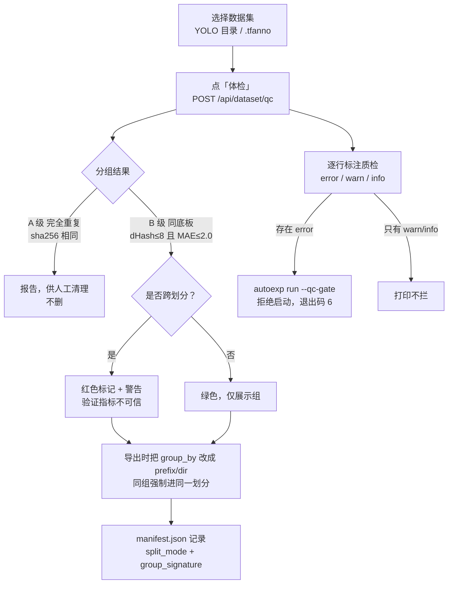

**两级判定（`6-web/backend/datasetqc.py`，`algo: dsqc-v1`）**

| 级别 | 判定 | 允许的动作 |
| --- | --- | --- |
| A 完全重复 | 文件 `sha256` 相同 | 只报告 / 人工清理。**工具从不删** |
| B 同底板 | 256 位 dHash（17×16 灰度比较相邻像素）汉明距离 ≤ 8，**且** 32×32 灰度平均绝对差 ≤ 2.0 | 泄漏告警、按组切分。**永不删除** |

为什么要 MAE 第二道关：dHash 只看梯度符号，PCB 大面积纯色板面在纯哈希下**可能**
让不同底板撞位，漏判会给出错误的「无泄漏」结论。用真实像素再确认一次。
（反过来也不成立：64 位 dHash 在阈值 ≤6 时确实能分出这 10 组，但常规「重复图去重」
会顺手删掉组内 691 张，等于毁掉全部缺陷样本——所以 B 级只告警。）

**分组实现**：候选对用 banding 生成（把 256 位切成 8 段做桶），超过 3000 张才退回
全量两两比较；分组用并查集。粒度上限：单组 ≤400 张才做「同底板异类标注」检查，
避免体检变成 O(n²) 的长时间任务。

**标注质检规则（逐行，永不抛异常）**

| 级别 | 规则码 |
| --- | --- |
| error | `LBL_MISSING` 标注缺失、`LBL_FIELD` 字段数与任务不符、`LBL_PARSE` 数值无法解析、`LBL_CLASS_RANGE` 类别越界、`LBL_COORD_RANGE` 坐标越界、`LBL_ZERO_AREA` 零面积 |
| warn | `LBL_TINY` <0.01%、`LBL_HUGE` >60%、`LBL_BORDER` 贴边、`LBL_DUP_BOX` 同图两框 IoU>0.9、`LBL_CLASS_ABSENT` 某类缺失 |
| info | `LBL_EMPTY` 空标注、`LBL_IMBALANCE` 某类占比 <2%、`GRP_LABEL_DIFF` 同底板同位置异类 |

**按组切分（`group_by`）**

| 取值 | 组键 | 适用 |
| --- | --- | --- |
| `none`（默认） | 每张图自成一键 | 与 v1.6 行为完全一致 |
| `prefix` | 文件名第一个 `_` 之前的部分（`01_missing_hole_01.jpg` → `01`） | 底板编号命名 |
| `dir` | 父目录名 | 一块板一个文件夹 |

组键相同 ⇒ 必须同一个划分。分配用「补最大缺口」贪心：每次取下一个组，放进
（目标张数 − 当前张数）缺口最大的一侧。**组数 <2 或单组过大时比例会明显偏离**，
日志与 `manifest.json` 会写明——宁可比例不准，也不要泄漏。

**验收命令**

```powershell
# 只读体检（人类可读）；有 error 时退出码 1
D:\anaconda3\envs\dpenv\python.exe 7-autoresearch-yolo\labelqc.py "PCB data/PCB缺陷检测" --fail-on error
# 机器可读
D:\anaconda3\envs\dpenv\python.exe 7-autoresearch-yolo\labelqc.py 7-autoresearch-yolo\splits\pcb.yaml --json
# 按底板前缀重新切分
D:\anaconda3\envs\dpenv\python.exe 7-autoresearch-yolo\autoexp.py split --group-by prefix
# 开跑前门禁（error 级问题拒绝启动，退出码 6）
D:\anaconda3\envs\dpenv\python.exe 7-autoresearch-yolo\autoexp.py run --config 7-autoresearch-yolo\experiments\cur.json --qc-gate
```

**实测（2026-11-11，T1000 8GB）**：`PCB data/PCB缺陷检测` → 10 组、**10 组全部跨划分**、
涉及 **689 张**（组大小 120/118/60×6/59/32，另 3 张自成一类）；`labelqc.py` 无 error 级问题，首次约 1.3 秒、二次走缓存。
`splits/pcb`（553 train / 97 tune / 42 holdout）按 `prefix` 重切后 10 组各自只在一个划分内。
**泄漏对指标的实际影响本轮尚未做训练对比**，不要把它当成已验证的收益。

**缓存**：`runtime/dsqc_cache.json`（`TRTFORGE_DSQC_CACHE` 可改），键
`绝对路径｜字节数｜纳秒mtime`，`algo` 变化整体作废，上限 2 万条。
**只读保证**：体检不写任何图片或标注，唯一写入是这份签名缓存。

### 7.21 良品图与操作点：漏检-过杀曲线（v1.34.4）

**问题**：验证只给 mAP，答不了产线真正问的两件事——「这个阈值下会漏几个」和
「为了不漏，要多报几个」。第二个问题还缺数据前提：**没有良品图就没法统计误报**。

**flow（声明良品 → 看曲线 → 存工作点 → 推理复现）**

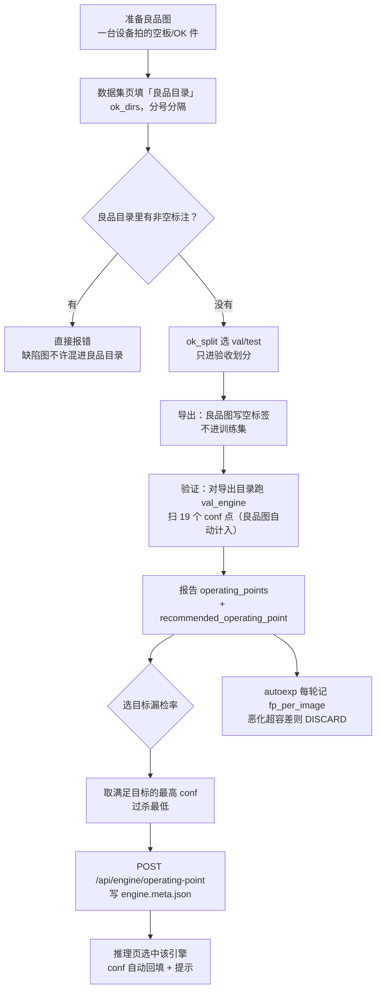

**GT 四态（分不清这四种，过杀率一定是假的）**

| 状态 | 磁盘上的样子 | 是否进过杀统计 | 说明 |
| --- | --- | --- | --- |
| `labeled` | `.txt` 存在且有内容 | 否（进漏检率） | 正常缺陷图 |
| `ok` | `.txt` 存在且**为空** | **是** | 良品图。导出时工具写的就是空文件 |
| `missing` | `.txt` **不存在** | 否 | 漏标嫌疑。当成良品会把过杀率稀释成好看的数字 |
| `unparsed` | `.txt` 有内容但解析失败 | 否 | 数据坏了，单独计数提醒 |

**曲线怎么读**

| 字段 | 含义 | 读法 |
| --- | --- | --- |
| `conf` | 置信度阈值 | 从左到右 conf 升高 |
| `miss_rate` | `1 - recall`，按 GT 框算 | 横轴。产线先给它定上限 |
| `fp_per_image` | 误报框 / 评估图片数 | 纵轴。压漏检的代价 |
| `ok_fp_rate` | 至少一个误报的良品图 / 良品图总数 | **`null` = 没有良品图**，`0.0` = 测过且零误报 |
| `ok_images` | 良品图数 | 判断 `ok_fp_rate` 可信度的分母 |

**推荐点为什么取「最高 conf」**：FP 与 recall 都随 conf 单调不增，满足漏检目标的
**最高** conf 就是过杀最低的点。取最低 conf 等于「把本可以少报的框全报出来」，
方向正好反了。目标无解时 `feasible: false` + 最接近的点 + 原因，不假装达标。

**验收命令**

```powershell
# 对「导出后」的目录验证：良品图已经在 val 里，会自动计入过杀率
D:\anaconda3\envs\dpenv\python.exe 6-web\backend\tools\val_engine.py `
  --engine runs\exp_0007\weights\best_fp16.engine --data out\dataset.yaml `
  --target-miss-rate 0.01

# 自定义扫描点（默认 0.05 → 0.95 共 19 点，上限 50）
D:\anaconda3\envs\dpenv\python.exe 6-web\backend\tools\val_engine.py `
  --engine ... --data ... --operating-confs "0.05,0.1,0.2,0.35,0.5"

# 单测（不需要 GPU / 引擎）
D:\anaconda3\envs\dpenv\python.exe 6-web\backend\tools\test_operating_points.py
```

**工作点存放位置**：`<引擎文件名>.meta.json` 的 `operating_point`，与 v1.34.2 的
sha256/来源 run 同文件。**引擎文件和 `metadata.json` 都不动**，删掉该字段即回到默认 conf。

**验收（2026-11-11）**：`test_operating_points.py` 48 项、`test_dataset_workbench.py`
良品部分 23 项、后端 53/53 套件、`run_all_tests.py` 71/71、前端 `node --check` 通过。
**本机本轮未跑 GPU 推理**，曲线在真实引擎上的数值需在产线机器跑一次 `val_engine` 后确认。

**边界**：良品图只做验收、不参与训练；自动实验的 `fp_per_image` 是 P/R 反推的近似值，
只用于拦明显恶化；异常检测是单阈值判定，不提供该曲线。

---

## 7.5 交付模型包（v1.36.0）

训练 + 编译完成后，如果这个模型要交给别人（现场机器、客户、SDK 使用者），
不要直接拷 `weights/` 目录里的五六个文件，而是先造一个模型包。

### 为什么

`.engine` 二进制里不带 GPU 型号与 TensorRT 版本。换一台机器加载失败时，
现场只能看到 `nvinfer` 的英文报错，无法判断是「显卡架构不对」还是「文件拷坏了」。
模型包把这两件事写进 `manifest.json`，加载前就能判定。

### 怎么造

网页：引擎构建页勾选「同时生成模型包」（默认已勾），构建成功即生成。

已有旧产物，用接口补造：

```powershell
curl -X POST http://127.0.0.1:8060/api/bundles/build `
  -H "Content-Type: application/json" `
  -d '{"model":"D:/.../weights/best.transd_fp16.engine","bundle_id":"pcb_detect_v1","kind":"yolo","task":"detect"}'

# 校验（含 sha256）
curl -X POST http://127.0.0.1:8060/api/bundles/verify `
  -H "Content-Type: application/json" `
  -d '{"bundle":"pcb_detect_v1","kind":"yolo","task":"detect"}'
```

产物在 `6-web/runtime/bundles/<包名>.tfbundle/`。整个目录拷走即可，
不要只拷其中的 `model.engine`。

### 到目标机器上第一件事

先在推理页选中这个包：

- 结论 `ok` → 直接推理；
- 结论 `warn` → 看提示内容。最常见是「显卡架构不同」，这种情况**大概率加载不了**，
  在那台机器上用「引擎构建」页把同一个 ONNX 重编一次（约 1 分钟）；
- 结论 `block` → 不要绕过。按提示里的 `fix` 处理，通常是重新构建或换一个包。

### 单测

```powershell
python 6-web\backend\tools\test_model_bundle.py    # 29 项，不需要 GPU
```

字段表与三档判定细节见 [模型包说明](模型包说明.md)。

---

## 8. 常见故障排查

| 现象 | 可能原因 | 排查动作 |
| --- | --- | --- |
| `missing` 非空 | 依赖缺失 | 按输出的 `pip install` 提示补装 |
| 训练第 1 个 epoch 后退出 | 缺 `polars` | `pip install polars` |
| `DATA_NOT_FOUND` | `--data` 传的是内置名而非路径 | 传绝对路径或仓库内真实路径 |
| ONNX 导出 `TypeError: dynamo` | torch < 2.5 | 已修（`export_mixin.py` 能力探测） |
| DLL 加载失败 | 缺 `os.add_dll_directory` | 确认 OpenCV / CUDA `bin` 已加入 |
| `LNK1104` | DLL 被运行中的进程占用 | 先停 Web 服务 |
| `LNK1181: 无法打开输入文件 bin\Release\ocr_infer.lib` | 主工程需要预编译的 OCR 库 | 先单独编 `ocr_infer`（见下一条） |
| `ocr_infer` 配置报 `yaml-cpp ... does not contain a CMakeLists.txt` | `ocr/ocr_infer/third_party/yaml-cpp` 是空目录，缺源码 | 补 yaml-cpp 源码后重新 configure |
| `ocr_infer` 配置报 `Compatibility with CMake < 3.5 has been removed` | clipper 里写的是 `cmake_minimum_required(VERSION 2.6.0)`，CMake 4.x 不再兼容 | 配置时加 `"-DCMAKE_POLICY_VERSION_MINIMUM=3.5"`（PowerShell 里必须带引号） |
| `Could NOT find OpenCV` | 既没传 `-DOPENCV_DIR` 也没设环境变量 | `$env:OPENCV_DIR = "E:\thirdparty\opencv"` |
| 分类训练报 `must be a directory (...) not a file` | v1.30.0 把 `dataset.yaml` 直接传给了分类入口 | 升到 v1.30.1；launcher 会自动把 yaml 解析成目录 |
| 分类训练报「没有 train 目录」 | 导出目录不是 `train/类别名/图片` | 用数据集页分类任务重新导出，或手动补 `train/` |
| 分类结果类别名反了 | 中文类别名按 Unicode 排序（`不良` 在 `良品` 前），和 yaml 的 0/1 相反 | v1.30.1 已以 ONNX metadata 为准；标签文件顺序不一致时会带 `warning` |
| 分类分数比官方便宜一截 | 旧版推理把图拉伸成正方形，比例和训练不一致 | 升到 v1.30.1；预处理已和官方 `classify_transforms` 一致 |
| `LNK1181: 无法打开输入文件 mkldnn.lib` | 链接搜索目录只有 `onednn/lib`，包实际用 `mkldnn` | 已修（两条路径都保留）；若用别的 Paddle 包，确认 `third_party/install` 下是哪个名字 |
| `TRTForge.exe` 启动即退，退出码 `-1073741515`（`0xC0000135`） | 缺运行时依赖 DLL | 确认 `bin/` 里 6 个 Paddle 依赖齐全；重编 OCR 会由 POST_BUILD 自动复制 |
| Web OCR 报 `mklml.dll` 错误码 126 | 飞桨 2.6 用普通 `LoadLibrary` 找 MKL，`add_dll_directory` 对它无效 | 升到 v1.30.2（已把 `bin` 和 `mklml` 目录前置到 `PATH`）。旧的临时办法：把 `ocr/ocr_infer/third_party/paddle_inference/third_party/install/mklml/lib/mklml.dll` 拷到 `4-qt-studio/bin`；安装包用 `-WithOcr` |
| 推理页 OCR 模型是灰色 | 目录里是 `inference.json`，或 yml 缺字段 | 改用 `legacy_v4` 的 `pdmodel`；缺 yml 时跑 `gen_legacy_ocr_yml.py` |
| OCR 视频或摄像头被拒绝 | 这一期不做实时识别 | 改用目录批量。单张 CPU 大约数秒 |
| `Could not read presets from ...\.5` | PowerShell 把 `-DCMAKE_POLICY_VERSION_MINIMUM=3.5` 拆开了 | 整个参数用双引号包住 |
| 推理页出现 `onnxruntime-fallback` | DLL 没加载成功，走了降级 | 看 `warning` 字段的原因；`GET /api/capabilities` 的 `infer_onnx_detail` 会给具体原因 |
| 推理返回 **503**，提示工作进程退出 | 推理 DLL 在工作进程内崩溃 | 看响应里的退出码与模型/图片名；一般会自动重启后再试；查 `runtime/logs/infer_worker.log` |
| 推理返回 **504** | 超过 `TRTFORGE_INFER_TIMEOUT`（默认 60 s，OCR 首次 180 s） | 加大超时或换更小模型；工作进程会被重启 |
| 顶栏「推理进程反复崩溃，已暂停」 | 60 s 内崩溃 3 次，进入熔断 | YOLO/Anomalib 会走 onnxruntime；点 **重启推理进程** 或等 300 s；`POST /api/infer/worker/restart` |
| 怀疑隔离本身有问题 | 需要与 v1.27.0 同进程行为对比 | 设 `TRTFORGE_INFER_ISOLATION=0` 重启 Web 服务后重试 |
| `无法加载 onnxruntime.dll（错误码 126）` | `bin/` 里只有 `onnx_infer.dll` | 把 `onnxruntime.dll`、`onnxruntime_providers_shared.dll` 与它放同目录，或设 `TRTFORGE_ORT_DIR` |
| ONNX 推理 provider 一直是 `CPU` | 装的是 CPU 版 ORT，或缺 cuDNN | 属预期；要 GPU 就换带 `onnxruntime_providers_cuda.dll` 的 ORT 包 |
| 创建句柄报「输入尺寸是动态的」 | 模型不是静态导出 | 用 Ultralytics 重新导出（默认静态），不要手改 shape |
| 创建句柄报「请把任务切换为 pose / segment」 | 任务与模型结构不匹配 | 按提示改任务类型，不要改模型 |
| 异常图判成 OK | 阈值过高 | 确认 `--calibrate-metadata true`，或重跑校准 |
| `imagenet_dir 不存在` | EfficientAd 目录缺失（`DATA_NOT_FOUND`），launcher 不会自动下载 | 先 `New-Item -ItemType Directory` 建空目录（见 2.4） |
| 正常图分数全为 0 | PatchCore 分数饱和 | 属预期；要趋势监控请换 EfficientAd |
| 引擎编译卡住不动 | builder 在 CPU 侧搜索 tactic | 看 GPU 显存仍在占用即正常，耐心等 |
| 推理页图像看不清缺陷 | 窗口未放大 | 滚轮以光标为锚点缩放，或点 `1:1` 看原始像素；多个窗口可独立开关 |
| 前端改了样式但浏览器没变 | 静态资源被缓存 | 硬刷新（`Ctrl+F5`）；后端已带 `Last-Modified`/`ETag`，正常刷新即可拿到新文件 |
| 训练页没有「预热」角标，开训还是慢 | 8060 上跑的是旧进程（v1.24 及以前没有预热） | `GET /api/health` 看 `version` 是否为 `1.25.0`；不是就按「端口被旧进程占着」的步骤重启服务 |
| 角标一直「预热中」不变「预热就绪」 | 预热进程导入依赖很慢，或导入失败后不断重试 | 看服务日志里 `--mode warm` 的输出；手动跑 `python <launcher> --mode warm` 看缺什么依赖。不影响训练，只是没提速 |
| 预热进程占内存 | 池子里每类各常驻一个进程（几百 MB） | 设 `TRTFORGE_WARM=0` 重启，回到冷启动；或调小 `TRTFORGE_WARM_KINDS` |
| 微调后效果反而变差 | 学习率按新训的 0.01 跑、或类别体系变了 | 确认命令里有 `--lr0 0.001`；换产品/换类别请走新训。旧结果在 `<run>/_prev/<时间戳>/`，可回退 |
| 微调后多了 `exp2` 目录 | 没带 `--exist-ok` | Web 端微调会自动带；手敲命令时记得加 |
| 微调按钮点了没反应 / 提示任务头不一致 | 该 `best.pt` 的训练任务与当前表单任务不同 | 换对应任务的 run，或改用新训；`finetune-check` 就是为了不白跑 |
| 前端配色改完对比度不达标 | 只看了「好看」没看可读性 | 跑 `node 6-web\frontend\tests\test_contrast.mjs`，它会按 WCAG 公式逐对核算 |
| 刷新页面后训练「没了」 | v1.25.1 及以前前端不记 run_id | 升级到 v1.25.2 会自动接续；旧版本只能看 `runtime/logs/*.log` 或重启服务 |
| 点「开始训练」提示「已有任务正在运行」 | 后端并发闸门（v1.25.2）：已有重任务占着 GPU | 点顶栏「运行中」条里的「停止」，或点胶囊接续它。不是报错，是保护 |
| 顶栏条写着「后端未连接 · 正在重试」 | Python 服务已退出（端口被旧进程/崩溃） | 重启 `uvicorn app:app --port 8060`；恢复后条子会自动消失，无需刷新 |
| 刷新后日志只补回一部分 | 后端只保留最近 2000 条事件（`config.EVENT_BUFFER_SIZE`） | 完整日志始终在 `runtime/logs/<run_id>.log`；重要报错请以文件为准 |
| 日志面板里没看到报错 | 面板只留最近 3000 / 800 行 | 点标题右侧「日志文件」看全文（v1.25.3）；或 `GET /api/runs/<id>/log` |
| 网络闪断后日志出现两遍 | v1.25.2 及以前重连时把历史整段又追加了一次 | v1.25.3 起事件带 `seq`，前端只接比游标大的；已重复的刷新页面即可 |
| 点「复制」没反应 | 用 `http://局域网IP` 打开（非安全上下文没有 clipboard API） | v1.25.3 起已自动退回 `textarea` 方案；若仍是旧页面请强刷（Ctrl+F5） |
| 分类推理提示「分类引擎还没做」 | 选了 `.engine` / `.trt` / `.plan` | 改用分类 ONNX。这一版不编译分类引擎 |
| 桌面版打不开某个 `.tfanno` | 工程是分类任务 | 用 Web 标注页打开。桌面版保存会把任务改成检测，所以直接拒绝 |
| 自动实验报「返回内容不是合法 JSON：返回内容为空」或 JSON 只有半截 | **`max_tokens` 被推理型模型的思考阶段吃光**（v0.2.1 前默认 900，`reasoning_tokens` 就能占满 900） | 到「模型接口」把 **max_tokens 改到 4096**；v0.2.1 起默认就是 4096 且截断会自动翻倍。核对方法：`experiments/agent/round_NNNN.json` 的 `usages` 里 `completion_tokens == max_tokens` 且 `reasoning_tokens` 接近它 |
| 自动实验报「提议被拒：`train.imgsz = 1024` 不在允许取值…」 | 模型在猜取值（v0.2.1 前上下文只给键名，不给取值） | 升级到 v0.2.1（上下文已带 `search_space`）；若仍发生，在 `configs/space.json` 里把该值加进 `enum`，别指望模型自己猜对 |
| 自动实验连跑 5 轮后提示「连续 5 轮没有进展」但其实每轮都报错 | v0.2.1 前「没提议」也计入 `stale`，文案误导 | 升级到 v0.2.1：模型侧故障走独立的 `--max-errors`（默认 3），文案会明说「不是搜索瓶颈」 |
| 自动实验点「测试连通性」说失败，但实际能跑 | 自检只有 16 token，推理型模型必然被截断 | v0.2.1 起 `ping()` 会把截断判为「连通正常（只有思考、没有正文）」；旧版请直接看日志里的真实请求结果 |
| 点「开始训练」返回 **409 / `VRAM_PREFLIGHT:`** | 显存预检不通过（v1.34.1）。`detail` 里已写明依据与建议 | 按 `hint` 停掉 `infer_worker` 或降 batch；确实要跑就点「仍然开始（显存可能不够）」（带 `allow_low_vram=true`）。想知道当前能不能跑：`GET /api/train/preflight?imgsz=640&batch=16` |
| 被拦时「降 batch」建议越降越红 | v1.34.1 之前没有单调性约束 | 升级到 v1.34.1：`capped` 档会用更大 batch 的实测峰值作上界。仍异常就删掉 `vram_samples.json` 里那个离谱样本 |
| 「算力体检」写了「训练实际为 fp32 / 混合精度不可用」 | 显卡命中 Ultralytics 的 `AmpBlacklist`（T1000/T1200/GTX16xx 等） | 属硬件事实，`--amp` 也压不住。要提速只能换卡或降 imgsz/batch；显存按 1.5~2 倍于 fp16 估算 |
| 请求了 `amp=true` 但界面显示 fp32 | 同上，黑名单在框架内部生效 | 看 `amp_state` 事件的 `amp_effective` —— 它来自 `trainer.amp`，是唯一可信的实际值 |

---

## 9. 文档索引

| 想了解 | 看这个 |
| --- | --- |
| 三个异常检测模型怎么选 | `docs/异常检测模型对比与选型_PatchCore_PaDiM_EfficientAd.md` |
| Web 工作站怎么用 | `docs/TRTForge_Web操作手册.md`。开发细节仍看 `6-web/README.md` |
| 把网页版打给别人、不附源码 | `packaging/package_web_user.ps1`，说明见下文 7.1.3 |
| 对方电脑没有 PowerShell | `docs/无PowerShell启动说明.md`（双击 `start_web_cmd.bat`） |
| 项目整体结构与层级 | `readme.md` |
| DLL C API 调用与打包 | `docs/TRTForge_yolo_infer与anomalib_infer_DLL调用与源码打包说明.md` |
| 三个推理 DLL 能怎么并发（同步/异步、单/多线程、多模型） | 本节 7.14；细节看 `3-cpp-tensorrt/{yolo,anomalib,onnx}_infer/README.md` |
| 显存预检的依据与例外、为什么本机训练是 fp32 | 本节 7.18 |
| YOLO TRT 推理细节 | `docs/trtexec_gui_YOLO_TRT推理流程说明.md` |
| 小白版算法与场景说明 | `docs/TRTForge_算法与应用场景说明_小白版.md` |
| 接 VLM 自动标注 / LLM 训练诊断要花多少 token | `docs/VLM_LLM接入方案与Token成本评估.md` |
