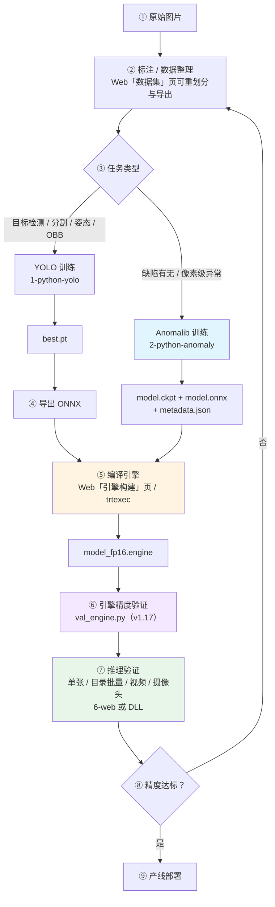

# WORKFLOW_GUIDE — TRTForge / DefectVision AI Studio 全流程作业指南

> 本文回答一个核心问题：**从原始图片到产线推理，每一步该做什么、用什么命令、产出什么文件、怎么验证。**
> 面向对象：需要独立跑通全流程的工程师（不需要深入算法细节）。
> 最后更新：2026-11-02（v1.17 新增「一键全流程串联」与引擎精度验证）

---

## 0. 全流程图



> ③~⑥ 可以一键串起来跑：见 [5.5 一键全流程串联](#55-一键全流程串联v117)。

---

## 1. 环境准备（只做一次）

### 1.1 必需组件

| 组件 | 版本要求 | 本机实测 |
| --- | --- | --- |
| NVIDIA 驱动 | 支持 CUDA 11.8+ | 596.71 |
| CUDA Toolkit | 11.8 | 11.8.89 |
| TensorRT | 8.5.x（与 CUDA 匹配） | 8.5.2 |
| cuDNN | 8.x | 8.7 |
| Visual Studio | 2022（v143） | 19.44 |
| Python | 3.10 ~ 3.12 | 3.12.4（`dpenv`） |
| OpenCV（C++ SDK） | 4.x | 4.12.0（vc17 / x64，路径由 `OPENCV_DIR` 指定） |

### 1.2 Python 依赖

```powershell
# YOLO 链路
python -m pip install torch torchvision ultralytics polars "numpy<3" onnx onnxruntime

# Anomalib 链路
python -m pip install anomalib lightning "numpy<3" onnx onnxruntime Pillow

# Web 工作站
python -m pip install fastapi uvicorn python-multipart
```

> **numpy 上限说明（2026-10-30 修订）**：早期要求 `numpy<2`，理由是 torch 2.3 按 numpy 1.x 编译。
> 实测 `torch 2.3.0 + numpy 2.5.4` 的 CUDA 前向、numpy↔torch 桥接均正常，`onnxruntime 1.20.1` 也支持
> numpy 2，故放宽到 `<3`。锁 `<2` 会被 Ultralytics AutoUpdate 在每次 `export` 时升回去，造成环境反复漂移。
> 唯一残留是 `scipy 1.14.0` 的 `UserWarning`（声明要求 numpy<2.3），不影响训练与推理。

### 1.3 环境自检（关键步骤，别跳过）

```powershell
cd 2-python-anomaly\launcher
python tf_anomalib_launcher.py --mode check-env

cd ..\..\1-python-yolo\launcher
python tf_yolo_launcher.py --mode check-env
```

**验收标准**：输出 JSON 中 `"missing":[]`。

补充验证 GPU：

```powershell
python -c "import torch; print(torch.__version__, torch.cuda.is_available(), torch.backends.cudnn.version())"
# 期望：2.3.0+cu118 True 8700
```

### 1.4 已知环境坑

| 坑 | 现象 | 解决 |
| --- | --- | --- |
| CUDA 11.8 + MSVC 14.44 | `STL1002: Unexpected compiler version, expected CUDA 12.4 or newer` | 设置 `$env:NVCC_PREPEND_FLAGS = "-D_ALLOW_COMPILER_AND_STL_VERSION_MISMATCH --allow-unsupported-compiler"` |
| Python 3.8+ DLL 搜索 | `WinDLL` 报「找不到模块或它的依赖项」 | 必须 `os.add_dll_directory()`，`6-web/backend/infer.py` 已处理 |
| numpy 2.x | 早期认为与 torch 2.3 有 ABI 冲突 | 2026-10-30 实测 `torch 2.3.0 + numpy 2.5.4` 正常，约束已放宽到 `numpy<3`；若确实遇到 torch 导入异常，再降到 `numpy<2`（实测 1.26.4） |

---

## 2. 标注与数据集准备

### 2.1 两种数据形态

| 任务 | 需要的数据 | 目录形态 |
| --- | --- | --- |
| YOLO（检测/分割/姿态/OBB） | 图片 + 标注文件 | `dataset.yaml` + `images/` + `labels/` |
| Anomalib（异常检测） | **只要正常图**（+ 少量异常图用于验证） | `root/train/good`、`root/test/good`、`root/test/abnormal` |

### 2.2 Anomalib 标准目录

```text
2-python-anomaly/anomalib-main/datasets/bottle
├── train/good        225 张   训练用正常图（唯一的训练输入）
├── test/good          20 张   测试用正常图（算误报）
├── test/abnormal      44 张   测试用异常图（算漏检）
└── ground_truth/              像素级标注（可选）
```

**要点**：

- `train/good` 决定模型能学到什么，**必须干净**（不能混入缺陷图）
- `test/abnormal` 也参与阈值校准，**至少要 10 张以上**，否则阈值偏保守
- 目录名 `good` / `abnormal` 是 anomalib Folder 数据集的约定，不要随意改

### 2.4 EfficientAd 专用：imagenette 辅助数据

只有 EfficientAd 需要这份额外数据（用于计算教师网络通道归一化统计）。**必须注意先后顺序**：launcher 会在模型创建前检查目录是否存在，**目录不存在时直接报错，不会自动下载**。

```powershell
# 第一步：先建出空目录（关键，否则训练直接 FileNotFoundError）
New-Item -ItemType Directory -Force -Path 2-python-anomaly\anomalib-main\datasets\imagenette

# 第二步：正常跑 EfficientAd 训练，此时会自动下载 imagenette2.tgz（约 1485MB / 6~10 分钟）
```

| 情况 | 结果 |
| --- | --- |
| `datasets/imagenette` 目录不存在 | **报 `DATA_NOT_FOUND` / `exit=1`**，不下载 |
| 目录存在但缺 `imagenette2/train` | 自动下载 + 解压，解压后 9469 张 / 10 类 |
| 已就绪 | 直接使用，不会重复下载 |

### 2.3 数据集划分

YOLO 训练页支持自动划分 `train / val / test`，默认 `80 / 10 / 10`。
修改比例后点「自动划分」，会按比例分配图片归属。

### 2.5 用 Web 数据集工作台重划分与导出（推荐）

当数据已经有标注、只是需要重新划分或转格式时，用 Web 的「数据集」页，不必开 Qt：

```powershell
powershell -NoProfile -ExecutionPolicy Bypass -File scripts\run_web_studio.ps1
# 浏览器打开 http://127.0.0.1:8060 → 点顶部「数据集」
```

| 步骤 | 操作 | 说明 |
| --- | --- | --- |
| 1 | 填数据源 | YOLO 目录（含 `images/` `labels/` `data.yaml`）或 `.tfanno` |
| 2 | 任务类型 | 默认「自动识别」，按标签字段数判断 detect / segment / pose / obb |
| 3 | 填比例 | train、val 两个数，test 是余数，页面会实时显示 |
| 4 | 扫描预览 | 看各集张数、空标注数、每张图的「现有 → 新划分」 |
| 5 | 选格式与输出目录 | YOLO / COCO / VOC，输出不能放在数据源内部 |
| 6 | 开始导出 | 摘要里会列出统计、跳过项和警告 |

**划分口径（与 Qt 版一致，容易误解，务必看清）**

- `train = 总数 × train% ÷ 100` **向下取整**，`val` 同理；
- **剩余全部归 test**：692 张配 80/20 会得到 553 / 138 / **1**，不是 553 / 139 / 0；
- 想要真正的 80/10/10，请填 `80 / 10`，或 `70 / 20` 得到约 70 / 20 / 10；
- 哈希为 **FNV-1a 64 位 + `_2026` 盐值**，同一份数据在任何机器上结果逐项一致。
  Qt 用的是 `qHash`，两者哈希函数不同，所以**不能与 Qt 历史划分逐张对照**。

**导出格式限制**

| 格式 | 产物 | 限制 |
| --- | --- | --- |
| YOLO | `images/{train,val,test}` + `labels/{split}` + `dataset.yaml` | 全任务支持，`dataset.yaml` 可直接被 Ultralytics 识别 |
| COCO | `annotations.json` | 不复制图片；不支持 OBB |
| VOC | `Annotations/*.xml` + `JPEGImages/` | **仅 detect** |

验收脚本（不启动服务也能跑）：

```powershell
python 6-web\backend\tools\test_dataset_workbench.py
# 期望：通过 20 项，失败 0 项
```

### 2.6 前端单测（零依赖，只需 node）

前端是零构建的，所以单测也不装任何框架，直接 `node` 跑。这三项不需要启动服务：

```powershell
node 6-web\frontend\tests\test_viewer_math.mjs
# 期望：✓ 全部通过：37 条断言

node 6-web\frontend\tests\test_engine_out.mjs
# 期望：通过：17 项断言

node 6-web\frontend\tests\test_contrast.mjs
# 期望：✓ 全部通过：23 项
```

| 脚本 | 守住什么 |
| --- | --- |
| `test_viewer_math.mjs` | 滚轮缩放必须锚定光标（连续缩放 8 次后漂移 ≤ 0.5px）、屏幕与图像坐标互逆、滚轮增量按 `deltaMode` 归一化 |
| `test_engine_out.mjs` | 「输出引擎」路径规范化：只给目录时补成 `目录\<onnx名>_<精度>.engine`、已带 `.engine/.trt/.plan` 不许改、留空保持自动推导、贴错成 `.onnx` 能救回来 |
| `test_contrast.mjs` | 从 `style.css` 读设计令牌按 WCAG 公式核算，正文与面板底色不低于 4.5:1，网格/扫描线不透明度 ≤ 0.05 |

改配色的正确流程：改令牌 → 跑 `test_contrast` → 不达标就再调，别靠眼睛判断。

---

## 3. 训练

### 3.1 入口一览

| 链路 | 入口 | 模式 |
| --- | --- | --- |
| YOLO | `1-python-yolo/launcher/tf_yolo_launcher.py` | `check-env` / `probe-model` / `train` / `val` / `export` |
| Anomalib | `2-python-anomaly/launcher/tf_anomalib_launcher.py` | `check-env` / `train-export` |

### 3.2 YOLO 训练

```powershell
cd 1-python-yolo\launcher
python tf_yolo_launcher.py --mode train `
  --model yolov8n.pt --data <dataset.yaml> `
  --epochs 100 --imgsz 640 --batch 16 --workers 8 `
  --project runs\trtforge --name my_yolo
```

产物：`runs/trtforge/my_yolo/weights/{best.pt, last.pt}` + `results.csv` + 各类曲线图。

#### 3.2.1 数据增强参数（v1.7 起可调）

launcher 支持 15 项增强参数，**默认值与 Ultralytics `DEFAULT_CFG` 逐项一致，不填即行为不变**。

```powershell
# 小缺陷场景（PCB 70px 划痕）：降 mosaic、延长 close_mosaic、减弱几何抖动
python tf_yolo_launcher.py --mode train `
  --model yolov8n.pt --data configs\pcb_detect.yaml `
  --epochs 100 --imgsz 640 --batch 16 `
  --mosaic 0.1 --close-mosaic 20 --scale 0.3
```

| 参数 | 默认 | 建议场景 |
| --- | --- | --- |
| `--mosaic` | 1.0 | **小缺陷降到 0~0.3**：四图拼接会把缺陷再缩小一半 |
| `--close-mosaic` | 10 | 小缺陷加大到 15~20，让最后几轮看完整图 |
| `--scale` | 0.5 | 缺陷很小可降到 0.2~0.3，避免缩到看不见 |
| `--fliplr` | 0.5 | 有丝印/文字/方向性图案时设 0 |
| `--degrees` | 0 | 拍摄位姿固定就保持 0 |
| `--hsv_v` / `--hsv_s` | 0.4 / 0.7 | 打光不稳、多工位时适度加大 |

> 完整 15 项清单见 `readme.md` 的 v1.7 版本记录，或直接在 Web「模型训练」页展开「数据增强」。
> 回归测试：`python 6-web/backend/tools/test_augment_params.py`（26 项）。

#### 3.2.2 训练前体检与断点续训（v1.14）

**目的**：把三类「跑到一半才发现」的返工提前到 10 秒内发现——数据集配错、增强配错、白重跑。

| 能力 | Web 位置 | 命令行等价物 |
| --- | --- | --- |
| 数据集概览 | 训练页「数据集概览」→ 扫描数据集 | 无（只读统计，不训练） |
| 增强预览 | 训练页「增强预览」→ 生成预览 | 无（cv2 近似，不写盘） |
| 断点续训 | 训练页「断点续训」→ 扫描历史 → 继续训练 | `--resume-from <weights\last.pt>` |

断点续训的唯一新增参数：

```powershell
python tf_yolo_launcher.py --mode train `
  --model  runs\trtforge\my_yolo\weights\last.pt `
  --data   configs\pcb_detect.yaml `
  --resume-from runs\trtforge\my_yolo\weights\last.pt `
  --project runs\trtforge --name my_yolo
```

- **`--resume-from` 和 `--resume` 不同**：后者靠 `get_latest_run()` 猜「最近一次 run」，机器上并存多个项目时经常猜错；
  前者是你显式指定的检查点，launcher 用 `model.train(resume=该路径)` 恢复，同时把该权重当初始模型加载。
- 续训会**写回原 run 目录**（Ultralytics `check_resume` 用检查点里记录的 `project/name`），
  `results.csv` 继续追加行。想开新实验就别用续训，直接改 `--name`。
- `weights/last.pt` 或 `dataset.yaml` 丢失时不可续训，Web 端会直接显示 `blocked_reason`，不用点进去才发现。

**体检能看到什么**

- 三个 split 各自：图片数、标注文件数、空标注数、有图无标（漏标）、有标无图（孤儿标）、框总数
- 每类框数（一眼看长尾）、抽样分辨率分布（不解码像素，只读图像头）
- 常见告警：某类 0 个框、train/val 类别集合不一致、空标比例过高、孤儿标注

**预览能看到什么**

- 「原图 vs 增强后」对照：`mosaic → 仿射 → hsv → flip → bgr → mixup` 按当前表单参数真实生效
- 同 `seed` 同参数必出同图，便于逐个参数对比
- 不预览 `copy_paste`（需分割掩码）与 `close_mosaic`（只在最后 N 轮生效的调度），结果里会列在 `ignored`

> 预览是 **OpenCV 近似**，不是 Ultralytics 逐像素复刻（概率采样顺序、缓存等无法一比一）。
> 它的定位是「确认方向和量级」，不是验收依据。


### 3.3 Anomalib 训练（三选一）

```powershell
cd 2-python-anomaly\launcher

# PatchCore —— 3分42秒，准确率高，但正常图分数饱和
python tf_anomalib_launcher.py --mode train-export --model patchcore `
  --root ..\anomalib-main\datasets\bottle `
  --project results --name my_patchcore --input-size 256

# PaDiM —— 28秒，推理最快（3.6ms），偶有漏检
python tf_anomalib_launcher.py --mode train-export --model padim `
  --root ..\anomalib-main\datasets\bottle `
  --project results --name my_padim --input-size 256

# EfficientAd —— 约1小时，准确率最高，分数有区分度
python tf_anomalib_launcher.py --mode train-export --model efficientad `
  --root ..\anomalib-main\datasets\bottle `
  --imagenet-dir ..\anomalib-main\datasets\imagenette `
  --project results --name my_efficientad --input-size 256 --max-epochs 20
```

**模型怎么选**：见 `docs/异常检测模型对比与选型_PatchCore_PaDiM_EfficientAd.md`。

### 3.4 训练产物

```text
results/<ModelName>/<run_name>/v0/weights/lightning/
├── model.ckpt            Lightning 权重（可继续训练）
├── model.onnx            含后处理的 ONNX 图
└── metadata.json         阈值、归一化、输入尺寸、输出契约
```

**`metadata.json` 是推理的必要输入**，不是可选项。

### 3.5 事件协议（给界面集成用）

launcher 通过 stdout 打印结构化事件：

```text
TRTFORGE_JSON {"type":"progress","stage":"train","epoch":3,"total":20,"pct":20.0}
TRTFORGE_JSON {"type":"metric","name":"image_F1Score","value":0.94,"step":3}
TRTFORGE_JSON {"type":"artifact","kind":"onnx","path":"..."}
TRTFORGE_JSON {"type":"error","code":"DATA_NOT_FOUND","message":"..."}
```

事件类型：`env` / `progress` / `metric` / `epoch_summary` / `gpu_status` / `artifact` / `plot` / `error` / `anomaly_model` / `anomaly_export_summary` / `event`。

**退出码约定**：

| 退出码 | 含义 | 处理 |
| --- | --- | --- |
| 0 | 成功 | — |
| 1 | 一般错误 | 看 `error` 事件 |
| 2 | argparse 语法错误 | 检查参数名 |
| 130 | 用户取消 | 正常中断 |

---

## 4. 导出 ONNX

### 4.1 YOLO

```powershell
python tf_yolo_launcher.py --mode export --model runs\trtforge\my_yolo\weights\best.pt `
  --imgsz 640 --opset 12
```

> **不想敲命令行**：Web Studio 训练页的「导出 ONNX」折叠块（v1.15）做的是同一件事，
> 还能一键把 `.transd.onnx` 送到引擎构建页。详见 `6-web/README.md`。
>
> 任务类型以**权重自带**的为准：拿 `yolov8n-seg.pt` 配 `--task detect` 时，launcher 会自动
> 按 `segment` 导出并打印 `task_overridden`，避免生成一个通道数不对的「检测头」。

> `.transd.onnx` 仅用于 TRTForge 自定义推理链路，**不要用 `YOLO()` 直接加载**
> （Ultralytics 认的是原始输出布局，转置后会解析失败）。
>
> 但反过来：**编译 TensorRT 引擎时必须用它**，见 §5.1。导出后目录里应有
> `best.onnx` 和 `best.transd.onnx` 两个文件；如果只有前者，加 `--make-transd` 重跑。

#### 4.1.1 四种任务头的 `.transd.onnx` 布局（v1.15 起）

| 任务 | 图输出 | 布局 |
| --- | --- | --- |
| `detect` | `output0` | `[1, anchors, 4+nc]` |
| `segment` | **`output1`(proto) 在前，`output0`(检测头) 在后** | proto `[1,32,H,W]`；检测头 `[1,anchors,4+nc+32]` |
| `pose` | `output0` | `[1, anchors, 56]`（4+1+17×3） |
| `obb` | `output0` | `[1, anchors, 4+nc+1]`（最后一路是角度） |

> ⚠️ **分割的输出顺序是硬约定，不是风格问题。**
> C++ 侧 `yolo.cu` 对 `V8Seg` 直接读 `static_dims(1)` 当 proto、`static_dims(2)` 当检测头；
> 而 Ultralytics 导出的顺序正好相反。v1.15 在生成 `.transd.onnx` 时会把 proto 提到第一位。
> 不重排的后果是 **trtexec 编译成功、推理时才报**
> `V8Seg channel layout invalid (det=32, proto_dim=116)`。

> v1.15 同时换了转置的定位方式：不再取「图里最后一个节点」（导出顺序的巧合，多一个
> Cast/Concat 就转错，且静默），改成按形状识别预测头，并在转置前校验通道数。


### 4.2 Anomalib

`train-export` 模式已自动完成 ONNX 导出，无需单独执行。

**注意**：导出的 ONNX **已内置 anomalib 后处理**（输出 `pred_score` / `pred_label` / `anomaly_map` / `pred_mask`，值域 0~1）。因此 metadata 里的 `normalization` 是 `none`，DLL 不会再做第二遍 ImageNet 归一化。

**batch 是动态轴（v1.18 起必须知道）**：Anomalib 的 `to_onnx` 固定
`dynamic_axes={"input": {0: "batch_size"}}`，所以用 `onnxruntime` 读到的输入形状是
`[-1, 3, 256, 256]`，**这是正常的**。编译时必须给 `--minShapes/--optShapes/--maxShapes`
（见 5.1 的 Anomalib 命令），Web 串联会自动补。只有 H/W 动态才需要重新导出。

---

## 5. 编译 TensorRT 引擎

### 5.1 trtexec 命令

> **也可以完全不敲命令行**：Web Studio 的「引擎构建」页已支持同一套能力
> （选 ONNX → 自动探测形状 → 选精度/dynamic shape → 实时日志）。
> 命令行的价值在于批量脚本和排查；日常单个模型建议直接用网页。
> 详见本章 5.4。

```powershell
$trt = "C:\Program Files\NVIDIA GPU Computing Toolkit\CUDA\v11.8\bin\trtexec.exe"

# YOLO —— 必须用 .transd.onnx 编译，不能用 model.onnx
& $trt --onnx="model.transd.onnx" --saveEngine="model_fp16.engine" --fp16 `
  --minShapes=images:1x3x640x640 --optShapes=images:1x3x640x640 `
  --maxShapes=images:8x3x640x640 --workspace=4096

# Anomalib（输入名固定为 input）
& $trt --onnx="model.onnx" --saveEngine="model_fp16.engine" --fp16 `
  --minShapes=input:1x3x256x256 --optShapes=input:1x3x256x256 `
  --maxShapes=input:8x3x256x256 --workspace=4096
```

> ⚠️ **YOLO 引擎只能用 `.transd.onnx` 编译，这是最容易踩的坑。**
>
> | | 输出 shape | `yolo_infer.dll` 能否正确解析 |
> | --- | --- | --- |
> | `best.onnx` | `[1, 4+类别数, 候选框数]` | ❌ 不能 |
> | `best.transd.onnx` | `[1, 候选框数, 4+类别数]` | ✅ 能 |
>
> DLL 里按 `bbox_head_dims_[2] - 4` 推算类别数。用 `best.onnx` 时这个值会变成
> `18900 - 4 = 18896`，解码 kernel 越界读显存，**不报任何错误**，却吐出
> `confidence = 957.26`、坐标 `top = -725` 这类垃圾框。
>
> 实测（PCB 6 类模型 @960）：
>
> - 错误引擎：5 个框，置信度 `[957.258, 956.779, 304.125, ...]` → Web 接口返回 **HTTP 400**
> - 正确引擎：3 个框，置信度 `[0.948, 0.761, 0.822]` → 正常
>
> `--mode export` 默认就会顺带生成 `.transd.onnx`（`--make-transd` 默认开启）。
> 如果没生成，加 `--make-transd` 重跑导出即可。

### 5.2 预期耗时（T1000 实测）

| 模型 | 编译耗时 |
| --- | --- |
| EfficientAd | 约 8 分钟 |
| PatchCore | 约 15 分钟 |
| PaDiM | 约 17 分钟 |
| YOLOv8n（320） | 约 5 分钟（313 秒，`Engine built in` 值） |
| YOLOv8n（640） | 约 2~3 分钟 |
| YOLOv8n（960） | 约 8 分钟（474 秒，首次无 timing cache） |

> **必须串行编译**。并行会互相抢 GPU，实测明显变慢。
> 编译期间 GPU 利用率掉到 4% 是正常的（builder 在 CPU 侧搜索 tactic）。
> 反过来，若长时间没有日志输出但 GPU 占用接近 100%，说明仍在 tactic 搜索，
> 不是在卡死，不要中断。

**为什么 320 也要 5 分钟（重要，别按面积去推算）**

第一版 Web 估算假设「耗时 ∝ 输入面积」，于是 960 的 474 秒推到 320 只剩 53 秒。
实测 320 需要 **313.6 秒**，假设直接被推翻。真实规律是：

- 耗时主要来自「层数 × 每层候选 kernel 数」，ONNX 体积是层数的代理，
  输入尺寸只影响**每次候选试跑**的成本；
- 分辨率小 → 激活值小 → 显存里能塞下更多 tactic，搜索空间反而更大，
  两者部分抵消，所以远没有「平方」那么快。

用 960（474 s）与 320（313 s）两点反解，指数 ≈ 0.37，Web 端取 0.4：

```
秒数 ≈ 38.3 × ONNX_MB × (imgsz / 960) ^ 0.4      # fp16；fp32 × 0.7
```

> 跨显卡要重算：`38.3` 是 T1000（Turing，8 GB）上的值，换 Ampere/Ada 会明显变小。
> 不需要手调 —— Web 端每次成功构建都会把真实耗时写进
> `runtime/engine_stats.json`，同类构建下次直接取历史中位数。

**tactic 搜索期间日志是静默的，这不是卡死**

真实日志里 `Local timing cache in use.` 到 `Engine built in 474.149 sec.` 之间
是 **473 秒空白**，trtexec 一行都不打。所以：

- 命令行里只能靠「等」，别以为卡住了就 Ctrl+C；
- Web 界面会用心跳线程每 2 秒推进估算进度，即使日志不动，百分比和已用时间也在动；
- 判断是否真的在跑：`nvidia-smi` 里 trtexec 是否占着 GPU，或看日志是否终于出现新行。

### 5.3 验收

输出末尾应出现：

```text
&&&& PASSED TensorRT.trtexec [TensorRT v8502]
```

并生成 `*.engine` 文件。出现 `FAILED` 通常是算子不支持或 opset 过低。

### 5.4 用 Web 界面构建（推荐）

启动工作站后打开「引擎构建」页：

```powershell
powershell -NoProfile -ExecutionPolicy Bypass -File scripts\run_web_studio.ps1
# 浏览器打开 http://127.0.0.1:8060 → 点顶部「引擎构建」
```

| 操作 | 说明 |
| --- | --- |
| 选 ONNX | 选完自动调 `/api/engine/probe` 显示输入/输出形状与体积；未转置的 YOLO 会标红 |
| 输出引擎 | 留空自动推导为 `<onnx名>_fp16.engine`；「浏览」只能选到目录，选中后自动补成 `目录\<onnx名>_<精度>.engine` |
| 精度 | `fp16` 省显存（推荐）/ `fp32` |
| 动态 shape | 勾选后填 min/opt/max，如 `1x3x960x960` |
| workspace | 默认 4096 MB |

> **「输出引擎」要写文件名，不是目录。**
> 浏览器没有系统文件对话框，「浏览」只能选目录。只填目录会被后端以
> 「输出文件名需以 .engine / .trt / .plan 结尾」拒绝（v1.18.1 之前的常见卡点）。
> 现在的规则：留空 → 自动推导；选中目录 → 自动补全文件名；已带 `.engine/.trt/.plan`
> → 原样保留；填成 `.onnx` 路径 → 换成 `<名>_<精度>.engine`。
> 文件名随时可以在输入框里手工改。逻辑见 `6-web/frontend/js/engine.js`
> 的 `normalizeEngineOut`，有单测 `tests/test_engine_out.mjs`（17 项）。
>
> 「标注」页新建 `.tfanno` 工程同理：选中目录后点「新建」会按目录名补成
> `<目录名>.tfanno`，状态栏会写明改成了什么名字。

点「开始构建」后：

- 日志通过 `/ws/runs/{run_id}` 实时滚动（与训练页同一通道）；
- 提交未转置 ONNX 会被后端 **HTTP 400** 拒绝，日志面板写明原因，不会白等十几分钟；
- 退出码为 0 但没有生成引擎文件时，任务判为 **failed** 并发 `ARTIFACT_MISSING`，
  不会出现「显示成功、去推理却找不到文件」。

**进度面板（v1.13）**

| 元素 | 说明 |
| --- | --- |
| 阶段清单 | 启动 / 解析 ONNX / 解析完成 / 构建与 tactic 搜索 / 序列化 / 校验 / 推理基准 / 完成 |
| 百分比 | `已用 ÷ 估算`，夹在本阶段区间内（构建段封顶 94%，基准段封顶 99%），只有 `PASSED` 才 100% |
| 已用 / 预计剩余 | 前端每秒刷新；后端心跳每 2 秒推一次整数百分比 |
| 估算来源 | 有历史 → 同精度/同 dynamic/体积 ±67%/分辨率 ±20% 的中位数；无历史 → 公式外推 |

三条必须守住的行为：

1. **失败或中断的构建不补 100%**，进度停在出事的位置，避免「进度满格但失败」；
2. **统计在 `Engine built in` 出现的那一刻就落盘**：那一段是真实的构建耗时，
   即使之后的推理基准被中断，它对下次估算依然有参考价值；而根本没跑到这一步的失败
   （参数错误、早期 OOM、ONNX 解析失败）不会产生任何条目；
3. **落盘的值只认 `Engine built in X sec.`**，不拿进程总时长充数（后者含解析与基准）。

验证：`python 6-web\backend\tools\test_engine_progress.py`（26 项，含真实日志按时间戳回放）。

构建产物路径可直接填进「推理演示」页的引擎文件栏。

### 5.5 一键全流程串联（v1.17）

「训练导出」页底部的 **全流程串联** 卡片把第 3~5 节再加上精度验证串成一条链：

```
训练 → 导出 .transd.onnx → 校验转置布局 → 编译引擎 → 生成 labels_*.json → 引擎精度验证
```

参数直接复用上面的「训练参数」表单（dataset.yaml / epochs / imgsz / project / name），
卡片里只多出四项串联独有的设置：

| 控件 | 说明 | 默认 |
| --- | --- | --- |
| 引擎精度 | `fp16` 省显存 / `fp32` 精度优先 | fp16 |
| 验证用 split | `val` / `test` / `train` | val |
| 编译后用引擎做精度验证 | 关掉就只到「生成标签」为止 | 勾选 |
| 跳过训练（用已有 .pt） | 勾选后必须给出 `.pt` 绝对路径，从导出开始跑 | 不勾 |

**每一段都是独立任务**：串联本身不 spawn 子进程，只负责决定"下一段跑什么"。
每段仍是一个普通 run，好处是停止只停当前那一个（Windows 上杀父进程不会连带杀子进程，
否则点"停止"后训练还会在后台占着 GPU）、每段都有独立日志与 `WS /ws/runs/{id}`、
某段失败时前面已完成的产物照常保留。

**看某一段的日志**：阶段行的「日志」按钮分两条路——该段还在跑就切到右侧训练日志面板
（实时流）；已结束或服务重启过则读 `runtime/logs/{run_id}.log` 的尾部，显示在卡片内。
只做实时流是不够的：那个面板只认内存里的 run，重启后点开只会看到「未知任务」，
而排障需要的恰恰是已经结束的那一段。

**状态语义**

| 阶段状态 | 含义 |
| --- | --- |
| `pending` / `running` / `success` | 等待 / 进行中 / 完成 |
| `failed` | 该段失败，整链 `failed`，后面全部 `skipped` |
| `cancelled` | 该段被「停止」打断 |
| `skipped` | 前面某段失败或已停止，这一段没跑 |

失败**不自动重试**：训练 OOM、数据配错这类问题重试一次只是再烧一遍时间。
停止后已完成的产物（`best.pt` / `.transd.onnx` / `.engine` / `labels_*.json`）全部保留。

**精度报告**来自 `val_engine.py`：用 `yolo_infer.dll` 在验证集上逐张推理，
按 COCO 口径（IoU 0.50:0.95、全点插值）算 AP，页面直接显示 mAP50 / mAP50-95 / P / R。
产物落在 `<run_dir>/val/val_report.json` 与 `val_report.csv`（UTF-8 BOM，Excel 直接双击）。
> 精度评估目前只支持 `detect`：分割 / 姿态 / OBB 的 GT 解码口径不同，还没对齐。

**服务重启后的行为**：内存里的编排线程没了，但记录还在 `runtime/pipelines/*.json`。
启动时会把上次遗留的 `running` 记录标成 `cancelled`（原因写「服务重启，任务已中断」），
历史列表里仍可查看——不这样处理的话，页面会对着一条永远不动的记录一直轮询。

接口：

```powershell
# 启动（示例：跳过训练，从已有权重跑到精度报告）
curl -X POST http://127.0.0.1:8060/api/pipeline/yolo -H "Content-Type: application/json" -d '{
  "data": "D:/data/dataset.yaml", "task": "detect", "precision": "fp16",
  "skip_train": true, "weights": "D:/runs/exp/weights/best.pt",
  "run_val": true, "val_split": "val"
}'

GET  /api/pipeline                 # 最近记录（含磁盘上的历史，带 live 标记）
GET  /api/pipeline/{id}            # 单条详情；live=false 表示只能从磁盘读到
GET  /api/pipeline/{id}/log?stage=export&lines=400   # 某一段的日志尾巴（纯文本）
POST /api/pipeline/{id}/stop       # 停止整条链
```

验证：`python 6-web\backend\tools\test_pipeline_stages.py`（50 项，用假 run 管理器跑完
整条状态机：全成功 / 中途失败 / 可执行段 / 停止 / 报告收集 / 重启遗留 / 产物去重），
`python 6-web\backend\tools\test_pipeline_log.py`（9 项，日志尾部截断与路径穿越）。

### 5.6 Anomalib 一键全流程串联（v1.18）

串联卡片的「类型」下拉选 **异常检测（Anomalib）**，走的是另一条四段链：

```
train_export（训练 + 导出 ONNX + 校准 metadata）
  → probe（校验 metadata 字段 + ONNX 形状）
  → build（trtexec 编译 model_<precision>.engine）
  → val（引擎逐张推理，出 anomaly_val_report.json / .csv）
```

**为什么训练和导出不拆开**：Anomalib 的 launcher 在 `train-export` 一个进程里就把
训练、ONNX 导出、`metadata.json` 阈值校准做完了。为了阶段列表好看拆成三个进程，
只会多两次模型加载，并把「导出拿到的不是刚训的模型」这类错埋进编排层。

**产物路径延迟派生（v1.18 编排层的新机制）**：异常检测的产物落在
`results/<模型类名>/<name>/v<N>/weights/lightning/`，其中 `<模型类名>` 是 `Patchcore`
这种类名、`v<N>` 每训一次递增——**训练开始前根本不知道路径**。所以 `StagePlan.resolve`
在这一段真正开始前才根据 `record["artifacts"]` 拼命令与产物路径。
硬拼 `v0` 的后果是第二次训练会拿上一次的旧模型去编译：旧模型同样能编译、同样能出分数，
错得毫无提示。

**动态 batch（本版踩过的坑）**：Anomalib 的 `to_onnx` 固定
`dynamic_axes={"input": {0: "batch_size"}}`，导出的输入是 `[-1, 3, H, W]`。
第一版 probe 把 `-1` 当成非法形状直接失败，于是训练 200 秒后在第二段报
`ONNX 输入形状 [-1, 3, 256, 256] 不是静态 4 维 NCHW`。现在的处理：

| 情况 | 处理 |
| --- | --- |
| batch 动态（`[-1, 3, H, W]`） | 自动补 `--minShapes=input:1x3xHxW --optShapes=input:1x3xHxW --maxShapes=input:<max_batch>x3xHxW`；opt 取 1 与 DLL 的 `setBindingDimensions(1x3xHxW)` 一致 |
| H/W 动态 | **拒绝编译**：DLL 用 metadata 的 `input_size` 设形状，与导出范围对不上会静默算错，要求带固定 `input_size` 重新导出 |
| 全静态 | 不传 shape 参数 |

**参数**（与页面控件一一对应，接口字段见 `6-web/README.md`）：

| 控件 | 说明 | 默认 |
| --- | --- | --- |
| 模型 | `patchcore` / `padim` / `efficientad` | patchcore |
| 输入尺寸 | 训练与导出的 H/W，必须与 ONNX 一致 | 256 |
| 数据集根目录 | Folder 数据集（`train/good`、`test/abnormal`、`test/good`） | — |
| 跳过训练 | 勾上后必须给「产物目录」（含 `metadata.json` 与 `.onnx`） | 不勾 |
| 引擎精度 | `fp16` / `fp32` | fp16 |
| 精度验证 | 关掉就停在编译 | 勾选 |
| 评估张数上限 | 每个目录最多多少张，0 = 全部 | 0 |

**精度卡片口径**（`6-web/backend/anomalymetrics.py` + `tools/val_anomaly.py`）：

| 指标 | 算法 | 备注 |
| --- | --- | --- |
| image AUROC | Mann-Whitney U 秩统计，同分取平均秩 | 与阈值无关 |
| TP/FP/TN/FN、P/R/F1 | `metadata.json` 的 `image_threshold` | 与 DLL 的 `normalized_score >= 0.5` **数学等价**（`clamp01((raw-min)/(max-min))`） |
| FPR / FNR | `FP/(FP+TN)` / `FN/(FN+TP)` | 产线最关心的误报率与漏检率 |
| best F1 阈值 | 扫全部唯一分数 | 只作参考，**不回写 metadata**（会过拟合测试集） |
| decision_mismatch | 报告判定 vs 引擎 `is_anomaly` | 非 0 说明归一化口径有偏差，必须排查 |

像素级（PRO/AUPRO）暂不提供：需要 ground_truth 掩码，成本远高于图像级；
报告里 `pixel.available=false` 并写明原因。

**实测（bottle，Patchcore / 256 / fp16 / 20 正常 + 44 异常）**

| 阶段 | 耗时 |
| --- | --- |
| train_export | 199.7 秒 |
| probe | 0.7 秒 |
| build | 1016 秒（动态 batch 1…8，比静态形状慢） |
| val | 4.0 秒 |

结果：image AUROC **1.000**、F1 **1.000**、FPR **0.000**、FNR **0.000**、`decision_mismatch=0`。

接口：

```powershell
# 跳过训练，直接用已有的 weights/lightning 目录重跑 probe → build → val
curl -X POST http://127.0.0.1:8060/api/pipeline/anomalib -H "Content-Type: application/json" -d '{
  "model": "patchcore", "root": "D:/datasets/bottle",
  "project": "results", "name": "pipe_anomaly",
  "input_size": 256, "precision": "fp16", "max_batch": 8,
  "skip_train": true,
  "artifacts_dir": "D:/dp-tool/2-python-anomaly/launcher/results/Patchcore/pipe_anomaly/v0/weights/lightning",
  "run_val": true, "val_limit": 0
}'
```

`GET /api/pipeline/{id}` 的 `metrics` 直接就是 `anomaly_val_report.json` 的内容；
阶段清单、日志、停止接口与 YOLO 侧完全共用，不另做一套。

验证：`python 6-web\backend\tools\test_pipeline_resolve.py`（26 项：延迟派生、派生失败短路、
多产物去重、`vN` 定位、metadata 缺阈值拦截、动态 batch 形状参数、H/W 动态拒绝）、
`python 6-web\backend\tools\test_anomaly_metrics.py`（31 项：归一化边界、AUROC 同分、
空输入、混淆矩阵阈值边界、直方图 AUROC）。


---

## 6. 编译 C++ 推理 DLL（仅在改了 C++ 源码时需要）

```powershell
powershell -NoProfile -ExecutionPolicy Bypass -File .\scripts\build_infer_dlls.ps1
```

- 产物：`4-qt-studio/bin/{yolo_infer.dll, anomalib_infer.dll}`
- 不依赖 Qt，只需 OpenCV + CUDA
- **编译前必须先停掉 Web 服务**，否则 DLL 被占用会报 `LNK1104`

#### OpenCV 路径怎么找（v1.8 起不再写死）

所有 `CMakeLists.txt` 和 `CMakePresets.json` 里的 `D:/thirdparty/opencv` 已全部移除，
统一按下面顺序查找：

1. 命令行 `-DOPENCV_DIR=<路径>`
2. 环境变量 `OPENCV_DIR`
3. CMake 常规搜索（系统安装目录、`CMAKE_PREFIX_PATH` 等），找不到就报标准 `Could NOT find OpenCV`

```powershell
# 只做一次；之后所有 CMake 工程（含 ocr_infer）都读这个
$env:OPENCV_DIR = "E:\thirdparty\opencv"
```

> 注意 preset 曾经自己带了 `"OPENCV_DIR": "D:/thirdparty/opencv"`，它会**盖掉**环境变量。
> 已删掉，所以如果你本地 `.vs` 或 build 目录里还缓存着旧值，删掉 `build/` 重新 configure 一次。

### 6.1 编译 Qt 桌面版 `TRTForge.exe`（2026-10-31 起可用）

主工程的 `TRTForge.vcxproj` 要链接 `ocr_infer.lib`，所以**必须先编译 OCR 子工程**。
顺序不能反。

```powershell
$env:OPENCV_DIR = "E:\thirdparty\opencv"

# 第 1 步：OCR 子工程
cd ocr\ocr_infer
cmake --preset vs2022-x64 "-DCMAKE_POLICY_VERSION_MINIMUM=3.5" `
      "-DPADDLE_LIB=<仓库根>/ocr/ocr_infer/third_party/paddle_inference"
cmake --build --preset vs2022-x64
# 产出：4-qt-studio/bin/{ocr_infer.dll, ocr_infer.lib, ocr_basic.exe}

# 第 2 步：主工程
cd ..\..\4-qt-studio
cmake --preset vs2022-x64
cmake --build --preset vs2022-x64
# 产出：4-qt-studio/bin/{TRTForge.exe, yolo_infer.dll, anomalib_infer.dll}
```

**两个参数为什么要这么写**

| 参数 | 作用 | 不写会怎样 |
| --- | --- | --- |
| `"-DCMAKE_POLICY_VERSION_MINIMUM=3.5"` | 让 CMake 4.x 接受 clipper 的老式 `cmake_minimum_required(VERSION 2.6.0)` | 报 `Compatibility with CMake < 3.5 has been removed` |
| `"-DPADDLE_LIB=<...>"` | 指向 Paddle Inference 包根目录 | 默认路径是 `4-qt-studio/bin/paddle_inference`，那里的布局通常不对 |

> PowerShell 里这两个参数**必须用双引号包住**。不加引号时 `=3.5` 会被当成独立参数，
> CMake 会把它误读成 preset 名，报 `Could not read presets from ...\.5`。

**Paddle 包布局要求**

`PADDLE_LIB` 指向的目录需要：

```
paddle/include/paddle_inference_api.h
paddle/lib/paddle_inference.lib
paddle/lib/paddle_inference.dll
third_party/install/{protobuf,glog,gflags,xxhash,mkldnn,mklml}/...
```

本机验证过的版本：**Paddle 2.6.2 / GPU / CUDA 11.8 / cuDNN 8.6 / TensorRT 8.5.1.7**。

> 注意是 `mkldnn` 不是 `onednn`。`ocr_infer/CMakeLists.txt` 原先只配了 `onednn/lib`，
> 导致链接期报 `LNK1181: 无法打开输入文件 mkldnn.lib`。现已两条都保留。

**运行时依赖自动复制**

`ocr_infer` 的 POST_BUILD 会把下面 6 个 DLL 自动拷到 `4-qt-studio/bin`：

```
paddle_inference.dll   common.dll   mkldnn.dll
libiomp5md.dll         yaml-cpp.dll polyclipping.dll
```

少任何一个，`TRTForge.exe` 启动即报 `0xC0000135`（找不到依赖）。
所以**不要手工复制**，清空 `build/` 重编即可。

---

## 7. 推理验证

### 7.1 启动 Web 工作站

**最快的方式**：双击仓库根目录的 `启动Web端.bat`（自动找 Python、查端口、就绪后开浏览器）。

```bat
启动Web端.bat                :: 默认 http://127.0.0.1:8060
启动Web端.bat 8070           :: 换端口
启动Web端.bat 8070 nobrowser :: 不自动开浏览器
启动Web端.bat 8060 reload    :: 改后端代码时热重载
```

等价的 PowerShell 方式（参数更全）：

```powershell
powershell -NoProfile -ExecutionPolicy Bypass -File .\scripts\run_web_studio.ps1
# 浏览器打开 http://127.0.0.1:8060

# 换端口
powershell -NoProfile -ExecutionPolicy Bypass -File .\scripts\run_web_studio.ps1 -Port 8070
```

**端口被占用怎么办**：两个脚本都会在启动前检查端口，打印「占用进程名 + PID + 启动时间」。
交互式终端里会直接问「结束它并继续启动？(Y/N)」，答 Y 自动清掉旧进程；
输入被重定向（脚本/CI 调用）时不猜，直接中止并给出清理命令：

```powershell
Stop-Process -Id <提示里的 PID> -Force
```

> 为什么会有残留进程：脚本是前台拉起 uvicorn，父进程被关掉后子进程在 Windows 上不会自动退出，
> 会一直占着端口。**更隐蔽的风险**是「以为重启了，其实还在跑旧后端」——
> 页面（静态文件每次读盘）已经是新版，后端（进程内代码）还是旧版，
> 于是新加的接口参数会被静默忽略。改动后端后务必确认 PID 变了。


### 7.2 推理页操作

1. 选后端：`YOLO` 或 `Anomalib`
2. 选引擎：`*.engine`
3. **Anomalib 必须再选 `metadata.json`**
4. 上传图片 → 查看分数、判定、叠加图、热力图

#### DLL 不可用时会自动降级（v1.8）

如果 `yolo_infer.dll` / `anomalib_infer.dll` 加载失败（没编译、缺 OpenCV/CUDA 运行库），
后端**不再直接返回 503**，而是自动切到 `onnxruntime` 跑同一份 ONNX，页面照常出结果。

怎么判断这次走的是哪条路：

| 观察点 | DLL 路径 | 降级路径 |
| --- | --- | --- |
| 结果里的 `backend` | `yolo_infer.dll` / `anomalib_infer.dll` | `onnxruntime-fallback` |
| 结果里的 `warning` | 无 | 有，说明 DLL 为什么不可用 |
| 页面「后端」指标 | 显示 DLL 名 | 显示 `onnxruntime-fallback`，并多一行「降级提示」 |
| `timing` | 四阶段齐全 | 只有 `inference_ms` 有意义，前/后处理记 0 |

降级的边界（别指望它替代 DLL）：

- YOLO 只支持 `detect` / `obb`；`segment` / `pose` 会明确报错，提示改用 DLL。
- Anomalib 只吃 `.onnx`；`.engine` 必须由 DLL 加载。选的是 `.engine` 时，会按
  「同目录同名 `.onnx` → `metadata.json` 的 `onnx_path`」自动找替代模型。
- 性能不作数：降级用 onnxruntime（CUDA provider 需 CUDA 12 + cuDNN 9，本机 CUDA 11.8 会退到 CPU）。

### 7.3 接口自检

```powershell
# 健康检查
Invoke-WebRequest http://127.0.0.1:8060/api/health
# 期望：{"ok":true}

# 能力检查（infer_fallback 为 true 表示 DLL 挂了也能降级跑）
Invoke-WebRequest http://127.0.0.1:8060/api/capabilities
```

### 7.4 精度验收方法

**不要只看单张图**，至少跑完整个 `test/`：

```python
# 用 test/good 算误报率，用 test/abnormal 算漏检率
# 判定口径：normalized_score >= 0.5 为 NG
# 验收线建议：漏检 = 0，误报率 < 5%
```

### 7.5 目录批量 · 视频 · 摄像头（v1.16）

推理页底部的「批量 · 视频 · 摄像头」卡片。**引擎、标签、任务类型、`conf` / `nms` 全部沿用上方
「推理设置」**，所以顺序是：先在上面选好引擎并确认单张能出框，再切到这张卡片。

#### 7.5.1 三种模式的执行位置（先搞清楚这个，排查才有方向）

| 模式 | 跑在哪 | 有 `run_id` | 能停止 | 产物 |
| --- | --- | --- | --- | --- |
| 目录批量 | 子进程 `backend/tools/infer_batch.py` | 有 | 能（杀进程，已写文件保留） | `annotated/`、`results.csv`、`results.json`、`annotated.zip`、`job.json` |
| 视频 | 子进程 `backend/tools/infer_video.py` | 有 | 能 | `*_annotated.mp4`、`detections.json` |
| 摄像头 | 后端进程内 `POST /api/infer/frame` | **无** | 点「关闭」 | 不落盘 |

判断"到底跑没跑"看产物目录：`runtime/infer/<时间戳>-<batch|video>-<随机>/`。

#### 7.5.2 目录批量

1. 在「图片目录」填服务端路径（可点「浏览」，支持中文与空格）。
2. 调试时把「最多处理张数」填 3：先确认引擎与标签对不对，再跑全量。
3. 点「开始批量推理」，进度条与逐文件表格实时刷新。
4. 完成后点「下载标注包」，或直接去产物目录拿 `results.csv`。

`results.csv` 是 `utf-8-sig` + `\n` 换行，**故意带 BOM**：不带的话 Excel 打开中文类别名是乱码；
换行必须是 `\n`，`\r\n` 会在部分工具里多出空行。

单张坏图（截断的 JPEG、0 字节文件）不会中断整批：

```
index,file,width,height,count,status,error,classes
7,mask_07.jpg,0,0,0,error,decode failed,
```

遇到 `status=error` 先看 `error` 列，再单独用单张推理复现那一张。

#### 7.5.3 视频

1. 填视频绝对路径（「浏览」已放开 mp4/avi/mov/mkv）。
2. 先设「最多处理帧数 = 30」验证编码器与画面，再放开跑全片。
3. 编码器保持 `auto` 即可：依次试 `avc1` → `H264` → `mp4v`，**实写一帧验证文件非空**才算可用。
4. 完成后视频直接在卡片里内联播放，可下载 mp4 与 `detections.json`。

抽帧（步长 N > 1）时输出帧率写为 `源帧率 ÷ N`，**播放时长与原片一致**。
如果看到"快进"，说明这一步被改坏了——它不是可选的显示细节，而是让产物可用的前提。

#### 7.5.4 摄像头

1. 选分辨率（640×480 / 1280×720 / 1920×1080）与帧率上限（默认 8）。
2. 点「开启摄像头」，浏览器首次会请求授权。
3. 画面上直接叠框；右上角显示当前帧率与单帧耗时。
4. 点「关闭」停止；关页面也会自动释放摄像头。

这条链路**不落盘、不上传图片**：每帧压成 JPEG 发一次请求，后端只回 JSON 坐标与类别色。
如果画面卡但延迟不累积，是"掉帧"（设计如此：上一帧没回来就跳过，不排队）；
如果延迟越来越长，说明在途判断失效了，属于 bug。

没有摄像头或拒绝授权时，卡片回到「未启动」并显示原因，
例如 `无法打开摄像头：Requested device not found`——不会卡在「启动中」。

#### 7.5.5 命令行等价用法（不经过页面）

```powershell
# 目录批量（自己跑，便于写进其他流水线）
D:\Anaconda3\envs\dpenv\python.exe 6-web\backend\tools\infer_batch.py `
  --source D:\pcb\images --engine <engine路径> --labels <labels_*.json> `
  --task detect --conf 0.25 --nms 0.45 --jpeg-quality 92

# 视频（--stride 3 表示每 3 帧处理一次，输出帧率自动除以 3）
D:\Anaconda3\envs\dpenv\python.exe 6-web\backend\tools\infer_video.py `
  --source D:\pcb\line.mp4 --engine <engine路径> --stride 3 --max-frames 300
```

两者都会把事件以 `TRTFORGE_JSON {...}` 单行 JSON 打到 stdout（与训练任务同一套协议），
`runners.py` 就是靠这个把进度转成 WebSocket 事件的。

#### 7.5.6 验收与回归

```powershell
D:\Anaconda3\envs\dpenv\python.exe 6-web\backend\tools\test_infer_jobs.py    # 34 项
D:\Anaconda3\envs\dpenv\python.exe 6-web\backend\tools\test_infer_batch.py   # 75 项
D:\Anaconda3\envs\dpenv\python.exe 6-web\backend\tools\test_infer_video.py   # 43 项
```

三个脚本都不需要 GPU / DLL / 真实视频，能进 CI。**实测验收线**：

| 检查项 | 期望 |
| --- | --- |
| 批量 3 张小图 | < 2 s，CSV 行数 = 3，`annotated/` 张数 = 3，zip 可解压 |
| 视频 30 帧 | < 3 s，产 mp4 能在浏览器播放（`readyState=4`），时长 = 30 / 帧率 |
| 摄像头单帧 | < 500 ms，响应无 base64 图 |
| 越权下载 | `path` 指向 `runtime/infer` 之外返回 404 |

---

## 8. 常见故障排查

| 现象 | 可能原因 | 排查动作 |
| --- | --- | --- |
| `missing` 非空 | 依赖缺失 | 按输出的 `pip install` 提示补装 |
| 训练第 1 个 epoch 后退出 | 缺 `polars` | `pip install polars` |
| `DATA_NOT_FOUND` | `--data` 传的是内置名而非路径 | 传绝对路径或仓库内真实路径 |
| ONNX 导出 `TypeError: dynamo` | torch < 2.5 | 已修（`export_mixin.py` 能力探测） |
| DLL 加载失败 | 缺 `os.add_dll_directory` | 确认 OpenCV / CUDA `bin` 已加入 |
| `LNK1104` | DLL 被运行中的进程占用 | 先停 Web 服务 |
| `LNK1181: 无法打开输入文件 bin\Release\ocr_infer.lib` | 主工程需要预编译的 OCR 库 | 先单独编 `ocr_infer`（见下一条） |
| `ocr_infer` 配置报 `yaml-cpp ... does not contain a CMakeLists.txt` | `ocr/ocr_infer/third_party/yaml-cpp` 是空目录，缺源码 | 补 yaml-cpp 源码后重新 configure |
| `ocr_infer` 配置报 `Compatibility with CMake < 3.5 has been removed` | clipper 里写的是 `cmake_minimum_required(VERSION 2.6.0)`，CMake 4.x 不再兼容 | 配置时加 `"-DCMAKE_POLICY_VERSION_MINIMUM=3.5"`（PowerShell 里必须带引号） |
| `Could NOT find OpenCV` | 既没传 `-DOPENCV_DIR` 也没设环境变量 | `$env:OPENCV_DIR = "E:\thirdparty\opencv"` |
| `LNK1181: 无法打开输入文件 mkldnn.lib` | 链接搜索目录只有 `onednn/lib`，包实际用 `mkldnn` | 已修（两条路径都保留）；若用别的 Paddle 包，确认 `third_party/install` 下是哪个名字 |
| `TRTForge.exe` 启动即退，退出码 `-1073741515`（`0xC0000135`） | 缺运行时依赖 DLL | 确认 `bin/` 里 6 个 Paddle 依赖齐全；重编 OCR 会由 POST_BUILD 自动复制 |
| `Could not read presets from ...\.5` | PowerShell 把 `-DCMAKE_POLICY_VERSION_MINIMUM=3.5` 拆开了 | 整个参数用双引号包住 |
| 推理页出现 `onnxruntime-fallback` | DLL 没加载成功，走了降级 | 看 `warning` 字段的原因；要真实性能必须修好 DLL |
| 异常图判成 OK | 阈值过高 | 确认 `--calibrate-metadata true`，或重跑校准 |
| `imagenet_dir 不存在` | EfficientAd 目录缺失（`DATA_NOT_FOUND`），launcher 不会自动下载 | 先 `New-Item -ItemType Directory` 建空目录（见 2.4） |
| 正常图分数全为 0 | PatchCore 分数饱和 | 属预期；要趋势监控请换 EfficientAd |
| 引擎编译卡住不动 | builder 在 CPU 侧搜索 tactic | 看 GPU 显存仍在占用即正常，耐心等 |
| 推理页图像看不清缺陷 | 窗口未放大 | 滚轮以光标为锚点缩放，或点 `1:1` 看原始像素；多个窗口可独立开关 |
| 前端改了样式但浏览器没变 | 静态资源被缓存 | 硬刷新（`Ctrl+F5`）；后端已带 `Last-Modified`/`ETag`，正常刷新即可拿到新文件 |
| 前端配色改完对比度不达标 | 只看了「好看」没看可读性 | 跑 `node 6-web\frontend\tests\test_contrast.mjs`，它会按 WCAG 公式逐对核算 |

---

## 9. 文档索引

| 想了解 | 看这个 |
| --- | --- |
| 三个异常检测模型怎么选 | `docs/异常检测模型对比与选型_PatchCore_PaDiM_EfficientAd.md` |
| Web 工作站怎么用 | `6-web/README.md`（含「前端视觉体系」：设计令牌、可读性护栏、查看器） |
| 项目整体结构与层级 | `readme.md` |
| DLL C API 调用与打包 | `docs/TRTForge_yolo_infer与anomalib_infer_DLL调用与源码打包说明.md` |
| YOLO TRT 推理细节 | `docs/trtexec_gui_YOLO_TRT推理流程说明.md` |
| 小白版算法与场景说明 | `docs/TRTForge_算法与应用场景说明_小白版.md` |
| 接 VLM 自动标注 / LLM 训练诊断要花多少 token | `docs/VLM_LLM接入方案与Token成本评估.md` |
