# TRTForge Web Studio 架构与功能介绍

> 对照界面 **v1.28.0**（截图取自 2026-11-06 本机 `http://127.0.0.1:8060`；推理隔离相关界面以 v1.28.0 为准）。  
> 给人看的按钮步骤在 [TRTForge_Web操作手册.md](TRTForge_Web操作手册.md)。本文讲这套软件是怎么拼起来的、每一页干什么、用了哪些技术。  
> 框图是 Mermaid。请用装了 Markdown Preview Mermaid Support 的预览打开。

---

## 1. 它是什么

Web Studio 是浏览器里的缺陷检测工作站。人在网页上标注、划分数据、训练、把模型编成这台显卡的引擎，再用新图片看检得准不准。也可以识别图上的印刷文字。

网页只负责填参数和看结果。真正算的地方有三处：

- 训练：Python 子进程（Ultralytics / Anomalib）
- 检测和异常：C++ 动态库（TensorRT 或 ONNX Runtime）
- 文字：C++ 动态库（Paddle Inference 2.6.2）

所以不用安装 Qt 也能用。原来的桌面程序 `TRTForge.exe` 还在仓库里，日常以这个网页为准。

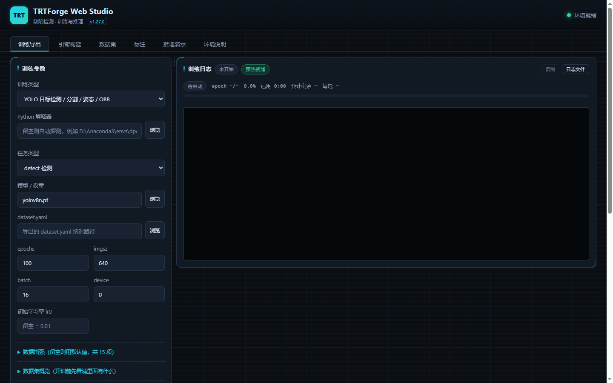

---

## 2. 一条产线怎么走

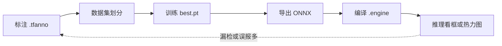

文字识别不走这条链。推理页直接选检测模型和识别模型目录。

已经有 YOLO 标签时，可以从数据集或训练开始。已经有 `best.pt` 时，训练页可以跳过训练，只做导出。

---

## 3. 总架构

浏览器、网页服务、训练进程、推理动态库是分开的。关浏览器不会停掉正在跑的训练或编译。重新打开后，顶栏「运行中」还能接回去。

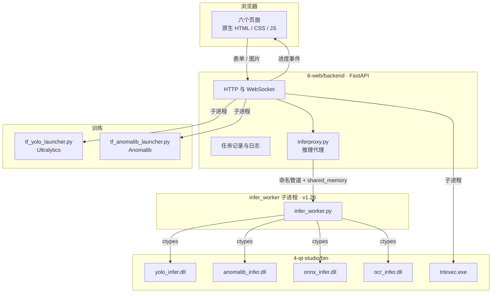

训练脚本往标准输出打 `TRTFORGE_JSON {...}`。网页服务认出这种行，就通过 WebSocket 推到页面日志。普通文字行只当日志显示。

---

## 4. 六个页面

顶栏从左到右六个页签。右上角绿灯「环境就绪」表示训练和推理要用的程序都找得到。

| 页签 | 你在这里做什么 | 做完落在磁盘上的东西 |
| --- | --- | --- |
| 训练导出 | 训 YOLO 或异常检测，或把 `best.pt` 转成 ONNX | `best.pt`、`best.onnx`、`best.transd.onnx` |
| 引擎构建 | 用 trtexec 把 ONNX 编成这台显卡的引擎 | `.engine` |
| 数据集 | 按比例把图片分成训练 / 验证 / 测试 | `dataset.yaml`，或 COCO / VOC 目录 |
| 标注 | 画框、审核自动标注 | `.tfanno`，草稿在旁边的 `.drafts.json` |
| 推理演示 | 看一张图、一个目录、一段视频或摄像头；也可识别文字 | 框、分数、热力图，或文字多边形 |
| 环境说明 | 看这台电脑的 Python、动态库、CUDA 路径 | 不写结果文件 |

### 4.1 训练导出

左侧选 YOLO 或 Anomalib，填数据、轮数、尺寸。右侧是日志。YOLO 可以检测、分割、姿态、旋转框。Anomalib 用合格图学「不像合格品的地方」，常见模型是 PatchCore、PaDiM、EfficientAd。

同一页还能导出 ONNX，以及把训练、导出、编译、验证串成一次全流程。导出默认再生成一份 `.transd.onnx`，那一份是给 TensorRT 用的。

### 4.2 引擎构建

选 ONNX，选精度（常用 fp16），点开始构建。进度按阶段走：解析 ONNX、构建、序列化、校验、推理基准。YOLO 必须拿 `.transd.onnx` 来编。用未转置的 `best.onnx` 编出来，后面框会乱。

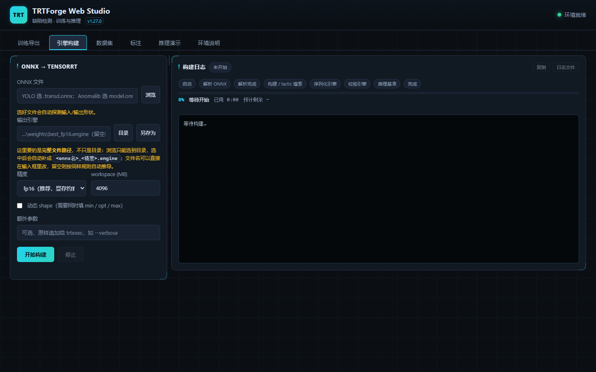

### 4.3 数据集

数据源可以是 YOLO 目录、`data.yaml` 或 `.tfanno`。先扫描预览，再按比例导出。默认训练 80%、验证 20%，剩下的进测试。导出目录不能放在数据源里面，避免把导出结果又扫进去。

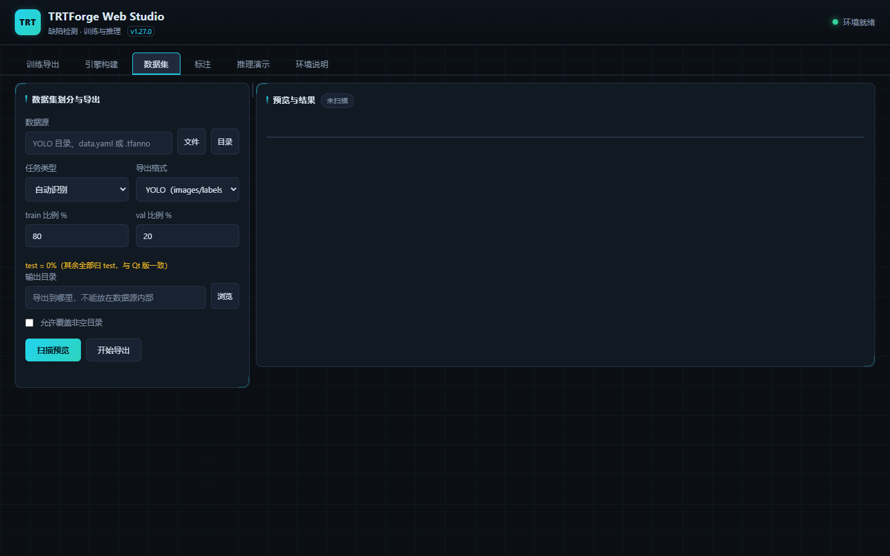

### 4.4 标注

工程文件是 `.tfanno`。可以画矩形、旋转框、多边形、线和点。也能把已有的 YOLO 数据集导进来。自动预标注先出草稿，人接受后才写进正式工程。草稿在 `.drafts.json`，桌面版打开 `.tfanno` 看不到草稿。

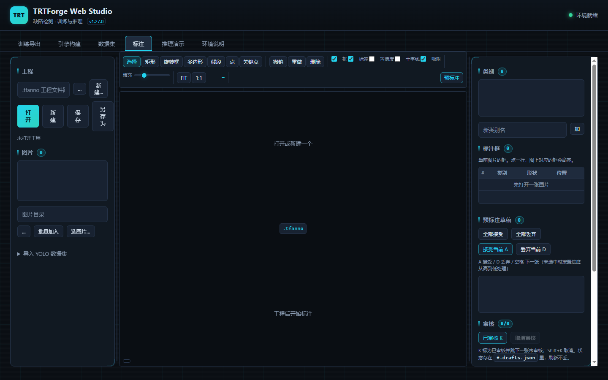

### 4.5 推理演示

三种类型：

- **YOLO**：引擎或 ONNX。任务类型要和训练时一致。
- **Anomalib**：引擎或 ONNX，还要一份 `metadata.json`。结果是分数、热力图和轮廓。
- **OCR**：不选引擎。选检测目录和识别目录，可选文本行方向。计算在 `ocr_infer.dll`。

目录批量三种都能用。视频和摄像头只支持 YOLO。OCR 的这两个页签会禁用，因为一张图在 CPU 上就要数秒。

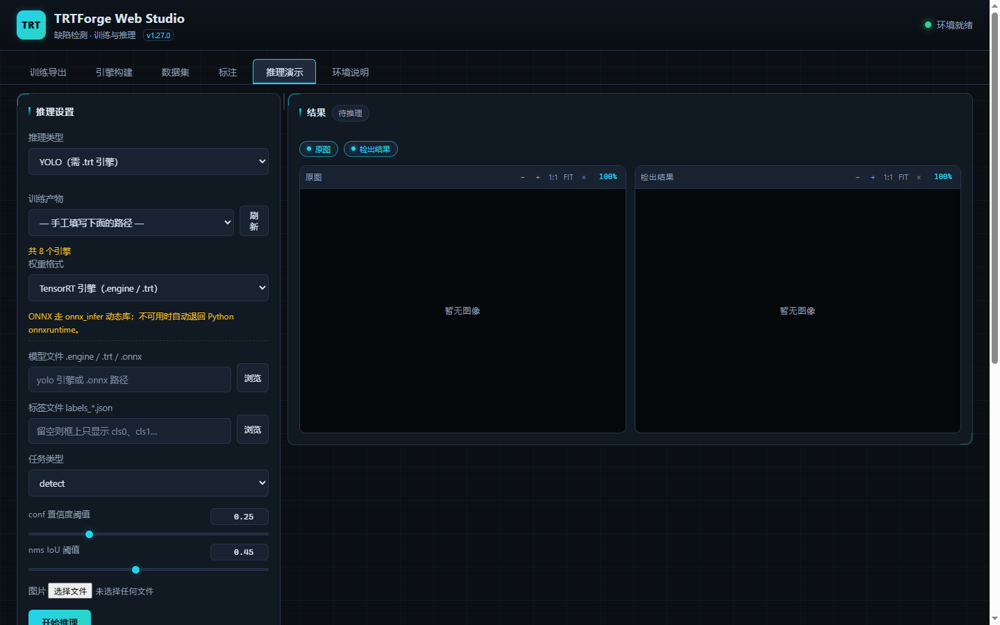

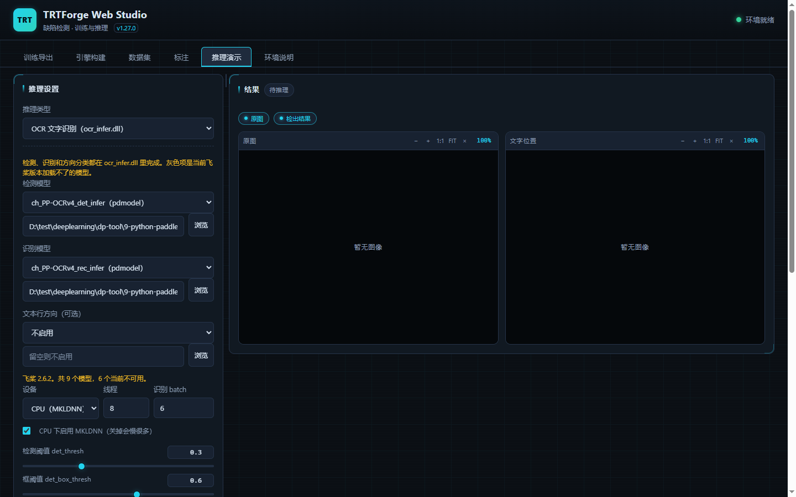

页面上灰色的 OCR 模型是 `inference.json`（飞桨 3.x）。这一版加载不了，不要选。

### 4.6 环境说明

上半部分是程序实际找到的路径：训练用的 Python、两个 launcher、动态库在不在、`trtexec` 在哪。下半部分是可以改的环境变量，改完要重启网页服务。

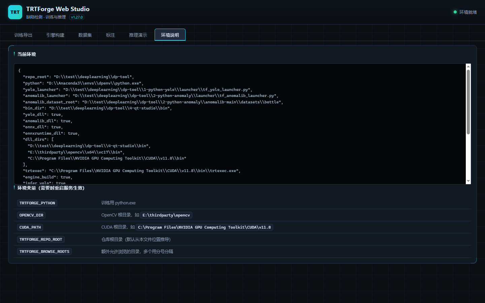

---

## 5. 一次操作在程序里怎么走

### 5.1 训练

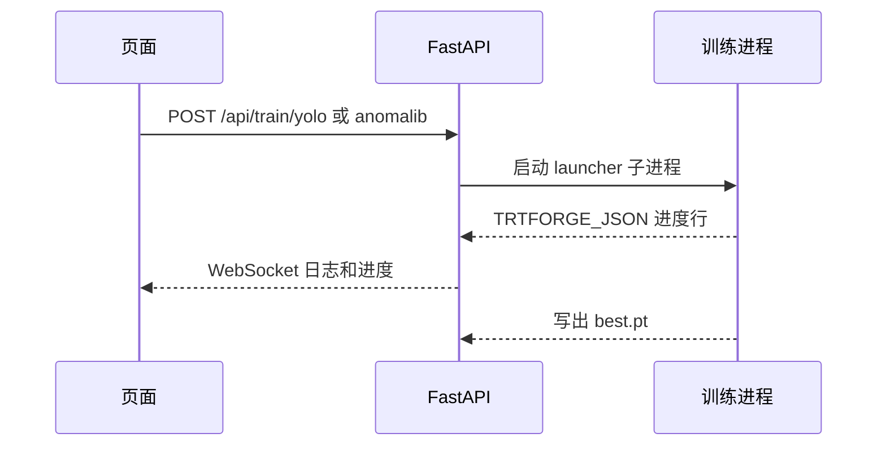

同一时间只允许一个重任务。再点一次开始，会得到「已有任务正在运行」，而不是悄悄开第二个把显卡占满。

### 5.2 编译引擎

页面把 ONNX 路径和精度交给 `POST /api/engine/build`。服务启动 `trtexec.exe`，解析它的日志，换成页面上的阶段和百分比。百分比是估算，停在后面几步时先看显卡是否还在忙。

### 5.3 推理时选谁来算

**v1.28.0 起**：单张 YOLO / Anomalib / ONNX / OCR 推理先经 **`inferproxy.py`**，在独立子进程 **`infer_worker`** 里加载 DLL（命名管道传命令，共享内存传图）。`TRTFORGE_INFER_ISOLATION=0` 时退回 Web 进程内 ctypes，行为同 v1.27.0。工作进程崩溃时当前请求 **503** 并自动重启；60 秒内崩溃 3 次进入熔断，YOLO / Anomalib 可降级 **onnxruntime**。

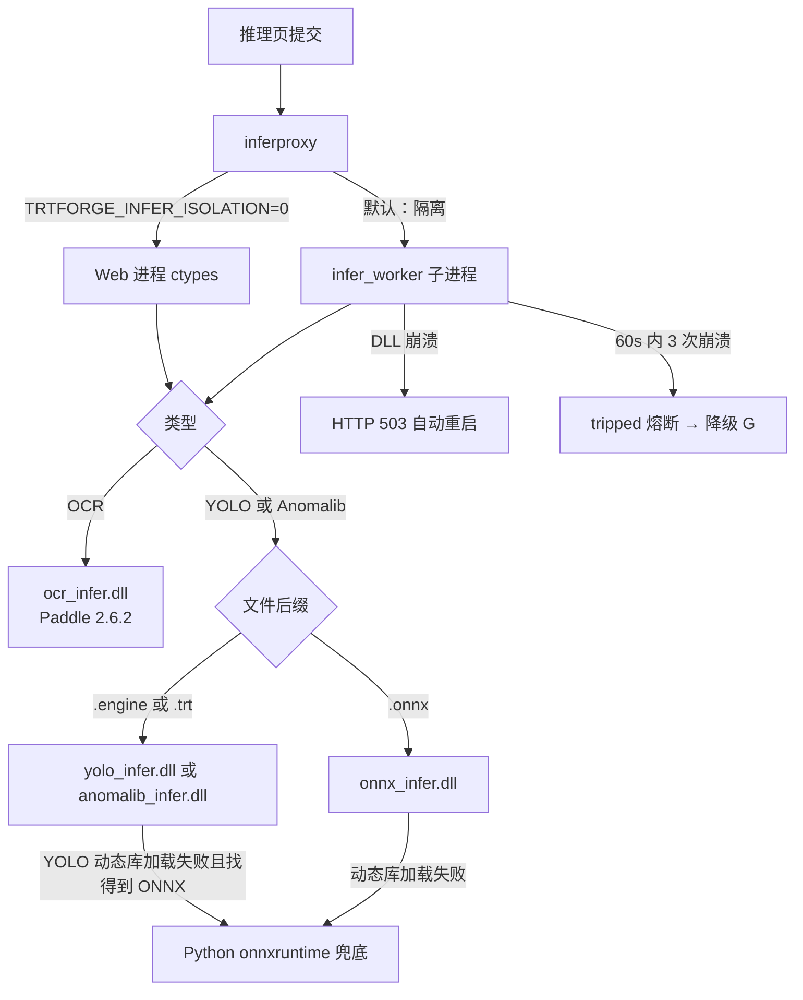

结果里的 `backend` 字段写的就是这次真正跑的程序，例如 `yolo_infer.dll`、`onnx_infer.dll`、`ocr_infer.dll` 或 `onnxruntime-fallback`。

| 你选的东西 | 谁来算 | 转置要求 |
| --- | --- | --- |
| YOLO `.engine` / `.trt` | `yolo_infer.dll` | 必须用 `.transd.onnx` 编译。未转置引擎页面会标「未转置」 |
| YOLO `.onnx` | `onnx_infer.dll` | 转置和不转置都能跑，程序看输出形状自己判断 |
| Anomalib `.engine` | `anomalib_infer.dll` | 按训练时的固定宽高编译 |
| Anomalib `.onnx` | `onnx_infer.dll` | 仍要带 `metadata.json` |
| 上面的 ONNX 动态库不可用 | Python `onnxruntime` | 能出结果，速度不能当正式性能 |
| OCR 模型目录 | `ocr_infer.dll` | 与 YOLO 转置无关。要 `inference.pdmodel` |

动态库都放在 `4-qt-studio/bin`。在隔离模式下由 **`infer_worker`** 进程内 `os.add_dll_directory` 加载；Web 进程不再直接 ctypes 这些 DLL（直通模式除外）。缺飞桨运行库时 OCR 503，YOLO 和异常检测仍可走工作进程内其他 DLL。状态见 `GET /api/capabilities` 的 **`infer_worker`** 字段；日志见 `runtime/logs/infer_worker.log`。

---

## 6. 三种算法各自适合什么

网页里不是一个万能模型。YOLO、Anomalib、OCR 解决的是三件不同的事。选错了，后面标注和训练都会白做。

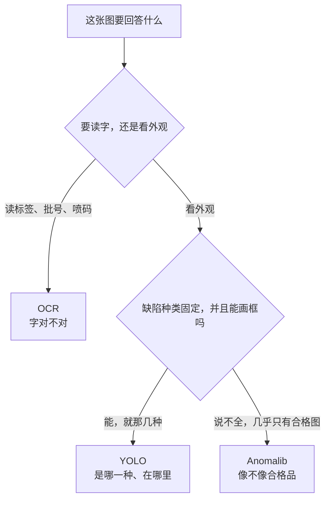

| 算法 | 适合的内容 | 不适合的内容 | 你要准备的数据 |
| --- | --- | --- | --- |
| YOLO | 缺陷或零件种类固定，要框出位置和类别 | 缺陷今天一种明天一种，标不完 | 每种都要有画好框的图 |
| Anomalib | 新产品、不良样本很少，先判断像不像合格品 | 必须说出是第几种缺陷 | 训练主要用合格图，不用逐个画缺陷 |
| OCR | 标签、批次号、丝印、激光喷码是否印对 | 判断表面有没有划痕、缺件 | 检测、识别模型目录。这一版用老版 `pdmodel` |

更细的行业例子见 [算法与应用场景说明](TRTForge_算法与应用场景说明_小白版.md)。

### 6.1 YOLO：指出「这里是哪一种」

适合已经知道要找什么、也愿意标注的外观检查。软件里四种任务对应四种画法：

| 任务 | 适合 | 例子 |
| --- | --- | --- |
| 检测 detect | 种类固定，用方框圈出来就够 | 焊点少锡、元件缺件、划痕、锈斑、孔洞 |
| 分割 segment | 方框会包进太多好区域，还要算面积或沿边抠 | 不规则划痕的面积是否超限 |
| 姿态 pose | 问题是关节点在哪，不是表面有没有伤 | 工位上人的关节位置 |
| 旋转框 obb | 目标是斜着放的，横框要么太大要么漏掉 | 传送带上斜放的元件、标签 |

要上线求速度时，把 `.transd.onnx` 编成 `.engine`，走 `yolo_infer.dll`。还在核对模型本身时，可以直接用 `.onnx`，转置和不转置都能跑。

### 6.2 Anomalib：只学合格品，找出不像的地方

适合缺陷种类多、难穷举，或者刚试产、几乎没有不良图的时候。训练时主要看合格图。推理给出分数、热力图和 OK/NG，不告诉你这是第几种缺陷。

| 模型 | 更常用来 |
| --- | --- |
| PatchCore | 先做一版。纹理表面、样本不多时比较稳 |
| PaDiM | 想更快出结果、模型更轻的时候 |
| EfficientAd | 合格品外观变化更大，PatchCore 不够用时再试 |

必须精确说出「是划痕还是缺件」时，用 YOLO，不用这一路。正常品换料、换光照后没重新训练，分数也会漂。

### 6.3 OCR：把图里的字读出来

适合核对印刷内容，不判断外观坏没坏。例如标签和批次号、丝印、运单文字、激光喷码是否错字。产线上可以和 YOLO 一起用：OCR 验字，YOLO 验外观。

这一版在 `ocr_infer.dll` 里算，飞桨 2.6.2，用带 `inference.pdmodel` 的老模型。字倒了可以打开文本行方向。文档整页转向、弯曲拉直、视频和摄像头都不在这一版里。CPU 请开着 MKLDNN；要更快再选 GPU 0。字太小、发糊、反光，和人眼看不清是同一类问题。

---

## 7. 技术栈

版本以仓库里写死或本机环境页能看到的为准。没写死的不猜小版本。

| 层 | 技术 | 在本项目里的角色 |
| --- | --- | --- |
| 页面 | HTML、CSS、原生 JavaScript | `6-web/frontend`。没有 npm 打包，改完刷新即可 |
| 页面通信 | `fetch` + WebSocket | `js/api.js` 发请求，`js/ws.js` 收训练和构建日志 |
| 网页服务 | Python、FastAPI、Uvicorn | `6-web/backend/app.py`（装配层）+ `routers/`，当前版本 **1.38.0** |
| 上传与图像 | python-multipart、OpenCV、Pillow、NumPy | 收图片、解码、数据集预览 |
| 配置文件 | PyYAML | 读 OCR 的 `inference.yml` |
| 训练 · 检测 | Ultralytics **8.4.192**、PyTorch **2.3.0**（CUDA 11.8 轮子） | 缺陷种类固定、能画框时用。检测、分割、姿态、旋转框。入口 `tf_yolo_launcher.py` |
| 训练 · 异常 | Anomalib **1.2.0**、Lightning | 几乎只有合格图、缺陷说不全时用。只判断像不像合格品。入口 `tf_anomalib_launcher.py` |
| 训练环境 | 安装包脚本创建的 Python **3.12** | 对方电脑的 `train-env`。开发机常用 conda 环境 `dpenv` |
| 表格库 | Polars，无 AVX2 时用 `polars-runtime-compat` | Ultralytics 存档时要用。虚拟机上默认包会崩溃 |
| 模型交换 | ONNX | 训练产物。`.transd.onnx` 是给 TensorRT 的转置版 |
| 引擎编译 | TensorRT **8.5+** 的 `trtexec`，Paddle 包注明 **8.5.1.7** | 本机环境页指向 CUDA **11.8** 工具包里的 `trtexec.exe` |
| 检测推理 | C++、`yolo_infer.dll`，接口前缀 `yi_` | 上线看框和类别。引擎必须由转置 ONNX 编译 |
| 异常推理 | C++、`anomalib_infer.dll`，接口前缀 `ai_` | 上线看热力图和 OK/NG。按训练时的固定宽高编译 |
| ONNX 推理 | C++、`onnx_infer.dll`，ONNX Runtime C API。拉取脚本默认 **1.16.3** | `.onnx` 的 YOLO 和 Anomalib。两种输出布局都认 |
| 文字推理 | C++、`ocr_infer.dll`，接口前缀 `oi_`，Paddle Inference **2.6.2** | 读标签、批号、喷码。不判断外观缺陷。CUDA 11.8 / cuDNN 8.6 |
| 调用动态库 | Python ctypes（**v1.28** 默认在 `infer_worker` 子进程） | `infer.py` / `ocr_infer.py` 被 worker 加载；Web 侧 **`inferproxy.py`** 代理。OCR 单独文件，避免与 ONNX 库 `oi_` 撞名 |
| 推理隔离 | 命名管道 + 共享内存 | **`infer_worker.py`** + **`inferproxy.py`**；`TRTFORGE_INFER_ISOLATION=0` 直通 |
| 桌面旧界面 | Qt、MSVC | `4-qt-studio`，产物名仍是 `TRTForge.exe`。网页版不编译它 |
| 发给别人 | Nuitka 把网页服务编成 `TRTForgeWeb.exe` | `packaging/package_web_user.ps1`。训练库不打进包，由对方联网安装 |

显卡运行时是 **CUDA 11.8**。引擎、PyTorch 训练轮子、Paddle GPU 包都按这个版本配。换 CUDA 大版本要整套重编，不能只换网页。

---

## 8. 代码放在哪

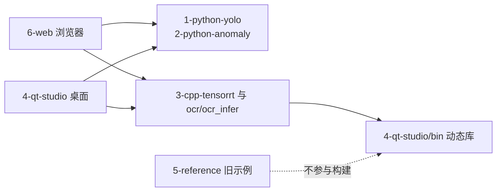

| 目录 | 作用 |
| --- | --- |
| `6-web/frontend` | 页面。入口 `index.html`，逻辑在 `js/` |
| `6-web/backend` | 接口、任务、调用动态库 |
| `1-python-yolo` | YOLO 训练源码和 launcher |
| `2-python-anomaly` | 异常检测训练源码和 launcher |
| `3-cpp-tensorrt` | `yolo_infer`、`anomalib_infer`、`onnx_infer`、命令行 trtexec |
| `ocr/ocr_infer` | 文字识别动态库。Paddle 包在它的 `third_party` |
| `4-qt-studio/bin` | 编好的 exe 和 dll。网页和桌面都从这里加载 |
| `packaging` | 打给使用人员的安装包 |
| `docs` | 操作手册和本文 |
| `openspec` | 需求规格。已完成的变更在 `changes/archive` |

### 8.1 页面对应的脚本

| 文件 | 管哪一块 |
| --- | --- |
| `main.js` | 页签、浏览文件、把路径写回输入框 |
| `api.js` | 所有 HTTP 地址 |
| `ws.js` | 日志 WebSocket |
| `train.js` | 训练表单和日志 |
| `export.js` | 导出 ONNX |
| `pipeline.js` | 训练到验证的串联 |
| `engine.js` | 引擎构建 |
| `dataset.js` | 划分和导出 |
| `annotate.js` | 标注和预标注审核 |
| `infer.js` | 单张推理 |
| `inferbatch.js` | 目录、视频、摄像头 |
| `ocr.js` | OCR 模型列表、文字表、多边形 |
| `overlay.js` / `viewer.js` | 图上的框和缩放 |
| `logs.js` | 复制日志、打开磁盘上的完整日志 |
| `splitpanes.js` | 左右分栏拖动，比例记在浏览器里 |
| `runsbar.js` | 顶栏「运行中」 |

### 8.2 服务里和功能直接对应的模块

| 文件 | 管哪一块 |
| --- | --- |
| `app.py` | **v1.38.0** 起只做装配：版本号、lifespan、异常处理、挂载 `routers/`、静态文件 |
| `web_state.py` | **v1.38.0**：路由之间共享的任务管理器、并发闸门、路径白名单 |
| `routers/system.py` | 健康检查、能力探测、目录浏览、原生对话框、首页 |
| `routers/train.py` | 训练命令拼装、预检、训练、导出、checkpoint |
| `routers/engine.py` | ONNX 探测、工作点、引擎构建 |
| `routers/pipeline.py` | 全流程每一段的状态 |
| `routers/dataset.py` | 数据集扫描、体检、导出、指纹 |
| `routers/runs.py` | 任务列表、历史、日志、WebSocket |
| `routers/infer.py` | 单图、OCR、异常检测、批量、视频、单帧、产物下载 |
| `routers/models.py` | 模型列表、模型包 `.tfbundle`、内置模型仓库 |
| `routers/annotation.py` | 标注工程、草稿、导入导出、自动标注 |
| `runners.py` | 启动训练、导出、构建子进程 |
| `infer.py` | YOLO / Anomalib / ONNX 动态库实现（worker 或直通模式调用） |
| `infer_worker.py` / `inferproxy.py` | **v1.28**：推理工作进程与 Web 侧代理（超时、熔断、重启） |
| `ocr_infer.py` / `ocr_models.py` | 文字动态库和模型扫描 |
| `onnx_fallback.py` | 动态库不可用时的 Python 兜底 |
| `pipeline.py` | 全流程每一段的状态 |
| `annotation.py` / `annotation_drafts.py` | 工程和草稿 |
| `dataset.py` | 划分导出 |
| `models.py` | 扫描训练产物，标记引擎是否由转置 ONNX 编来 |
| `warmpool.py` | 训练前预先导入 Python 库，缩短第一次点击的等待 |
| `frozen_entry.py` | 安装包里 Nuitka 编译的入口 |

---

## 9. 开发机和发给别人的包

开发机双击仓库里的 `启动Web端.bat`，用源码目录里的 Python 直接跑 FastAPI。

发给使用人员时，在开发机执行 `packaging/package_web_user.ps1`。包里是编好的网页程序和推理运行库，没有 C++ 源码，也没有 Ultralytics 源码。

对方电脑：

1. 有支持 CUDA 11.8 的显卡驱动，以及 VC++ 2015–2022 x64 运行库。
2. 要训练就双击 `install_train_env.bat`。不必事先安装 Anaconda。脚本自己准备 Python 3.12，并装上训练库。
3. 只检测可以跳过训练环境，直接双击 `app\TRTForgeWeb.exe`（不需要 PowerShell）。

文字识别运行库大约 1.7GB，打包时要另加 `-WithOcr`，默认不带。

---

## 10. 还想看哪一份

| 文档 | 适合谁 |
| --- | --- |
| [TRTForge_算法与应用场景说明_小白版.md](TRTForge_算法与应用场景说明_小白版.md) | 还在选 YOLO、异常检测还是 OCR | 按行业举例，不讲网页怎么拼 |
| [TRTForge_Web操作手册.md](TRTForge_Web操作手册.md) | 只想知道点哪里 |
| [WORKFLOW_GUIDE.md](WORKFLOW_GUIDE.md) | 要照着命令验收产物 |
| [6-web/README.md](../6-web/README.md) | 改网页、查接口和版本记录 |
| [启动与排障说明.md](启动与排障说明.md) | 现场电脑打不开、端口冲突、要不要装 PowerShell |
| [packaging/使用说明.md](../packaging/使用说明.md) | 拿到安装文件夹的人 |
