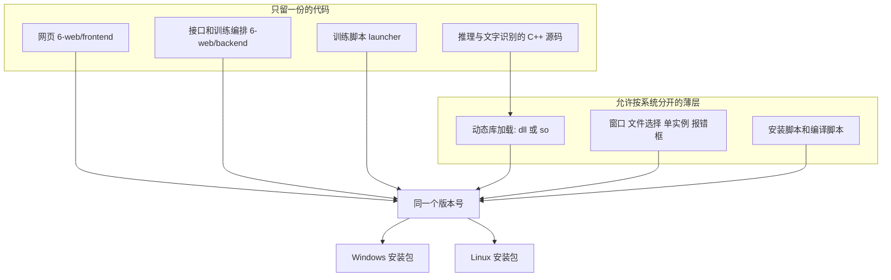
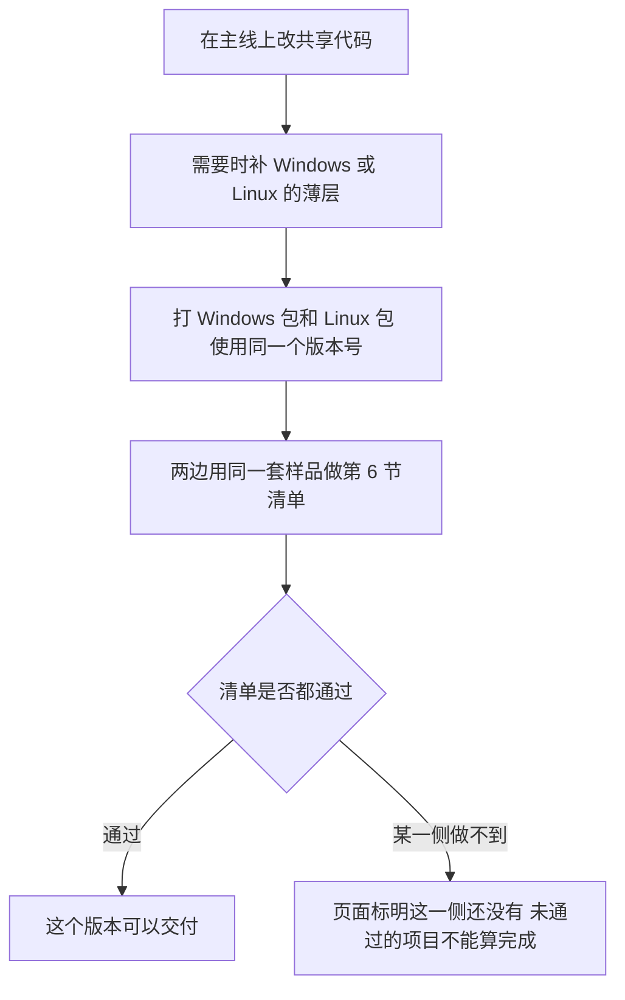
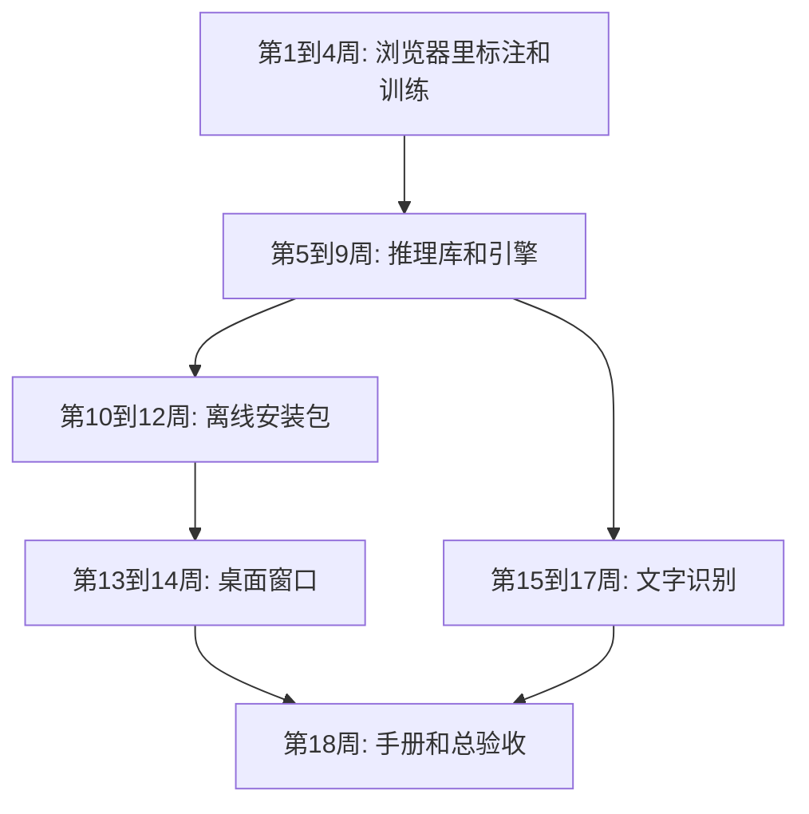

# Web 软件 Linux 迁移与双平台拉齐计划

> 本文只定计划。不改业务代码，不加新功能，不迁 Qt 桌面版。
>
> 范围按已确认的完整对齐：浏览器里的现有功能、TensorRT 推理、离线安装包、桌面窗口、文字识别。
>
> 工期按 1 个人全程只做这件事估算，共 18 周。两个人同时做（一个负责网页和安装，一个负责推理库和文字识别）时，日历时间大约 12～14 周。

## 1. 要做到什么

把现在的 TRTForge Web 搬到 Linux 上，使用人员能完成和 Windows 版相同的事：

- 标注、划分数据集
- YOLO 训练、异常检测训练、导出 ONNX
- 在本机编 TensorRT 引擎并推理（含分割、姿态、分类）
- 文字识别
- 断网安装，双击或点桌面图标打开软件窗口

Windows 版继续保留。两边用同一个版本号。

前提：

- 有一台带 NVIDIA 显卡的 Ubuntu，用来开发和验收。
- 另有一台干净的 Ubuntu，用来试离线安装包。
- 第一版先对齐现在的 CUDA 11.8 和 TensorRT 8.5。目标系统装不上这对组合时，再单独决定是否升级，并重新对比推理结果。升级大约再加 1～2 周，不计入这 18 周。

## 2. 现在哪些已经能共用

| 部分 | 现状 | 迁移时怎么处理 |
| --- | --- | --- |
| 网页 `6-web/frontend` | 普通 HTML / JS，能识别 Linux 路径 | 继续一份，不复制 |
| 网页接口 `6-web/backend/routers` | FastAPI，大部分与系统无关 | 继续一份 |
| 训练脚本 `1-python-yolo/launcher`、`2-python-anomaly/launcher` | Python | Linux 上直接跑这些脚本。安装包里不必再编成 Windows 那种 `.pyd` |
| 推理 C++ 源码 `3-cpp-tensorrt`、`ocr/ocr_infer` | 已有 CMake，当前只用 MSVC 编出 `.dll` | 源码仍一份，Linux 另编成 `.so` |
| 标注文件、ONNX、数据集 | 与系统无关 | 两边互相拷贝 |

绑在 Windows 上、迁移时必须另做一层的部分：

| 部分 | 现在的做法 |
| --- | --- |
| 软件窗口 | Edge WebView2。打包自检会检查 `webview.platforms.winforms`，缺了不许出 Windows 包 |
| 推理加载 | `infer.py`、`ocr_infer.py` 用 `ctypes.WinDLL` 按 `.dll` 名字加载 |
| 引擎工具 | `trtexec.exe`、`int8_calib.exe` |
| 安装与训练环境 | `package_web_user.ps1`、`一键安装.bat`、`win_amd64` 的 wheel、Python 3.12 嵌入包 |
| 单实例和报错框 | `CreateMutexW`、`MessageBoxW` |
| 系统文件选择框 | `nativedialog.py` 只在 Windows 弹出。网页里的目录浏览已经走 `/api/browse` |
| 推理库产物 | 放在 `4-qt-studio/bin`，Web 不依赖 Qt 程序本身，只共用这个目录里的动态库 |

## 3. 什么算拉齐

拉齐的是使用人员能做的事，以及同一张图上的结果。两边的安装文件不必同名。

### 3.1 要一样

| 项 | 怎么算通过 |
| --- | --- |
| 版本号 | 两边同号，例如都是某个 `1.x.x` |
| 页面和操作 | 同一套网页。按钮、训练参数、标注操作一致 |
| 标注和数据集 | 一边做的工程，另一边能打开并导出 |
| 训练 | 两边都能做 YOLO 短训练、异常检测短训练，并导出 ONNX |
| ONNX | 模型文件可以互相拷贝使用 |
| 推理结果 | 同一张样品图上，检测框、分割、姿态、异常结果、中文文字一致。分数允许有很小的数值差，类别和框的位置要一致 |
| 安装后的目录名 | 两边都有 `frontend`、`bin`、`train-env`、`launchers`、`config.json` |
| 离线 | 安装包内自带 `ultralytics`、`anomalib`、`onnx`、`onnxruntime`、`polars`。缺任何一个就停止打包 |
| 关闭行为 | 关掉软件窗口后端口释放 |

### 3.2 允许不一样

| 项 | Windows | Linux |
| --- | --- | --- |
| 安装脚本 | 现有 `一键安装.bat` 和 PowerShell | shell 脚本 |
| 主程序形态 | `app/TRTForgeWeb.exe` | 安装目录里的启动脚本。先做成文件夹，方便排查 GPU 库问题 |
| 推理库 | `yolo_infer.dll` 等 | `yolo_infer.so` 等 |
| 引擎工具 | `trtexec.exe`、`int8_calib.exe` | `trtexec`、`int8_calib` |
| 桌面窗口组件 | Edge WebView2 | Linux 系统自带的网页组件 |
| 引擎文件 `.engine` | 在 Windows 显卡上编 | 在 Linux 显卡上编。两边不能互相拷贝 |
| 自动实验的密钥 | Windows DPAPI，离开这台电脑解不开 | 沿用现有代码：非 Windows 写成明文，并在文件里标明 `key_enc` 为 `plain` |

页面上如果某一侧暂时没有某项能力，要明确显示「这一侧还没有」。不要让另一侧看起来好像已经有了。

## 4. 代码怎么放才不会分成两套

Windows 和 Linux 共用一个仓库、一条主线。不为两个系统各维护一套网页和业务代码。

共享代码改一次，两边一起生效：

- `6-web/frontend` 全部页面
- `6-web/backend` 里的接口、训练任务、标注、数据集、引擎参数拼装
- `1-python-yolo/launcher`、`2-python-anomaly/launcher`
- `3-cpp-tensorrt/yolo_infer`、`anomalib_infer`、`onnx_infer` 的源码
- `ocr/ocr_infer` 的源码

只有这些位置可以出现「这是 Windows 还是 Linux」的分支：

| 位置 | 分支里允许写什么 |
| --- | --- |
| `6-web/backend/infer.py`、`ocr_infer.py` | 按系统加载 `.dll` 或 `.so` |
| `6-web/backend/config.py` | 查找 `python`、`trtexec`、推理库的路径 |
| `6-web/backend/desktop.py`、`launcher.py`、`nativedialog.py` | 窗口、单实例、报错框、系统文件选择 |
| `6-web/backend/int8calib.py` | 校准程序的文件名 |
| `packaging/` | Windows 继续用现有 PowerShell；Linux 另加 shell，目录布局与 Windows 包对齐 |
| `scripts/` | Windows 继续用 `build_infer_dlls.ps1`；Linux 另加对应的编译脚本，产物仍可放到各自的 `bin` |

新增功能时按这个顺序：

1. 改共享代码。
2. 需要碰动态库、窗口或安装包时，只改上面那层。
3. 用第 6 节的清单在两边各验一次。
4. 两边都通过，才把这个版本号视为完成。

不要做的事：

- 不要把 `6-web` 复制成 `6-web-linux`。
- 不要让 Windows 主线和 Linux 主线各写各的页面和接口。
- 不要把 `.engine` 放进安装包当通用模型。模型包继续只带 ONNX。

## 5. 以后怎么拉齐

每个版本只维护这一条主线，发版时打两个包。

发版时同时交出：

| 产物 | 说明 |
| --- | --- |
| Windows 软件包 | 继续由 `packaging/package_web_user.ps1` 产出 |
| Linux 软件包 | 由后续的 Linux 打包脚本产出，目录名与 Windows 包对应 |
| 同一份样品结果记录 | 同一张图在两边的框、类别、文字 |

样品固定一套小图，放在仓库里可重复使用。换样品要同时换两边，避免「各测各的图」导致看起来对齐、实际上没比过。

日常只改某一侧安装脚本时，也要确认共享代码没有被拷出一份私货。发现同一段业务在两个文件里各写一遍，先并回共享代码，再继续发版。

## 6. 每版验收清单

同一套样品，Windows 和 Linux 各做一遍。

| 序号 | 步骤 | 通过标准 |
| --- | --- | --- |
| 1 | 打开软件 | 状态灯为环境就绪，版本号两边相同 |
| 2 | 标注并导出 | 一边的标注工程另一边能打开 |
| 3 | 训练 | YOLO、异常检测都能完成短训练并导出 ONNX |
| 4 | 编引擎 | 在本机编出 FP16 引擎。已有的 `.engine` 不拿去另一侧用 |
| 5 | 推理 | 检测、旋转框、分割、姿态、分类、异常结果与另一侧一致 |
| 6 | 文字识别 | 同一张中文图的文字框和文字内容一致 |
| 7 | 关闭 | 关掉窗口后端口释放，再次打开仍是该版本 |
| 8 | 离线安装 | 在没装过这套软件的机器上断网安装，能完成第 1 步和第 3 步的一小段训练 |

第 5、6 步对的是结果，不对引擎文件的二进制。

## 7. 18 周迁移计划

一个人全职。文字识别和桌面窗口互不依赖，两个人做时可以把第 15～17 周提前到推理库编通之后。

### 第 1～4 周：浏览器里能训练

| 周 | 做什么 | 本周结束时 |
| --- | --- | --- |
| 1 | 在 Ubuntu 上装驱动、CUDA 11.8、TensorRT 8.5、OpenCV。确认 PyTorch 能看见 GPU | 训练用的 Python 能认出显卡 |
| 2 | 浏览器模式能启动。路径查找按系统区分，去掉对 Windows 弹窗和互斥锁的硬依赖 | 打开网页，状态灯能报告缺什么 |
| 3 | 在 Linux 路径下新建标注、导入图片、导出数据集。目录浏览继续用网页里的列表 | 一套小图能导出 `dataset.yaml` |
| 4 | 装上训练库并跑通短训练和 ONNX 导出。检测、旋转框先用现有 ONNX 兜底出框 | 网页里能看到训练日志和框。分割和姿态这一阶段还没有 |

### 第 5～9 周：推理库和引擎

| 周 | 做什么 | 本周结束时 |
| --- | --- | --- |
| 5～6 | 把 `yolo_infer` 编成 `.so`，加载处按系统选择 `.dll` 或 `.so` | 同一张图与 Windows 的检测框、类别、分数一致 |
| 7 | 编出 `anomalib_infer.so`、`onnx_infer.so` | 异常结果和分类与 Windows 对齐 |
| 8 | 引擎页改用 Linux 的 `trtexec`。INT8 校准程序一并编出 Linux 版 | 本机 ONNX 能编出 FP16 引擎并推理 |
| 9 | 分割、姿态、短视频走新的推理库 | 这三项与 Windows 对齐 |

### 第 10～12 周：离线安装包

| 周 | 做什么 | 本周结束时 |
| --- | --- | --- |
| 10～11 | 用 shell 脚本打出 Linux 安装目录。自带 Python 环境和推理库。缺任一训练库就停止打包 | 目录里能找到 `frontend`、`bin`、`train-env`、`launchers`、`config.json` |
| 12 | 在另一台干净 Ubuntu 上断网安装，从标注走到推理 | 安装包可以交给使用人员试用。此时还没有独立窗口和文字识别 |

### 第 13～14 周：桌面窗口

用 Linux 自带网页组件做无地址栏窗口。只允许开一个，关掉窗口服务就停，窗口大小能记住。文件选择可用。

本周结束时：双击或点桌面图标能进软件，关掉后端口释放。

### 第 15～17 周：文字识别

在 Linux 上编译 Paddle 推理库，再编出 `ocr_infer.so`，带上现有中文模型和字典。

本周结束时：同一张中文图与 Windows 的文字框、文字内容一致。这一段最容易超时，所以单独留了 3 周。编不过时，窗口和安装包仍可先交付，文字识别在页面上标成「这一侧还没有」，不把整个版本算作文字识别已对齐。

### 第 18 周：说明和总验收

补 Linux 安装、启动、排障说明。写清三件使用人员必须知道的事：引擎要在本机重编，ONNX 可以拷贝，自动实验密钥在 Linux 上是明文存储。再用第 6 节清单做一次总验收。

## 8. 什么情况会超出 18 周

| 情况 | 处理 |
| --- | --- |
| 目标 Ubuntu 装不上 CUDA 11.8 和 TensorRT 8.5 | 先停下来决定是否升级 CUDA / TensorRT。升级后要重做第 5～9 周的结果对比，大约再加 1～2 周 |
| 没有第二台干净 Linux | 第 12 周的离线安装验收做不了 |
| Paddle 推理库编译失败 | 按第 15～17 周的规则，文字识别延后，其余照常交付 |
| 迁移期间又插入别的功能开发 | 18 周不再成立。新功能等迁移清单通过后再进主线，进主线时仍按第 4、5 节两边一起验 |
