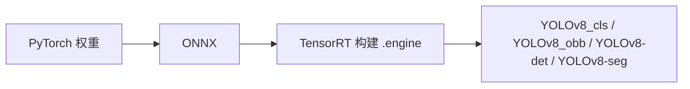

# YOLOv8 多任务 TensorRT 部署工程总结

> 文档说明：归纳仓库内 `YOLOv8_cls`、`YOLOv8_obb`、`YOLOv8-det`、`YOLOv8-seg` 四套 C++/CUDA 推理工程，及与 `ultralytics` 导出链路的关系。  
> 更新日期：2026-04-21

---

## 1. 总体定位

四个工程均面向 **NVIDIA GPU + TensorRT**：先获得序列化引擎文件（`.engine`），在 C++ 中 **反序列化 → 分配绑定内存 → CUDA 流推理 → 后处理**。  
训练与模型转换可依托同仓库下的 **`ultralytics`**（PyTorch → ONNX 等）；部署运行时使用上述四工程之一加载 **与任务匹配的 engine**。

---

## 2. 四套工程对照

| 目录 | 任务 | 典型产物 | 推理封装要点 |
|------|------|----------|----------------|
| `YOLOv8_cls/normal` | 图像分类 | 可执行程序 `yolov8-cls` | 类 `YOLOv8_cls`（`yolov8-cls.hpp`）：读 engine、插件初始化、binding、`copy_from_Mat` / `infer` / `postprocess` |
| `YOLOv8_obb/normal` | 旋转框检测 (OBB) | 可执行程序 `yolov8-obb` | 类 `YOLOv8_obb`：含 `letterbox`、OBB 后处理（score / iou / topk / 类别数等）；示例为 DOTA 风格 15 类 |
| `YOLOv8-det` | 水平框检测 | **共享库 `yolov8`（DLL）** + `detect` | `yolo::Type::V8`；`yolo.cu` / `infer.cu` 承担 GPU 侧预处理与解码；`workspace/detect_trt.py` 通过 ctypes 调用 |
| `YOLOv8-seg` | 实例分割 | **同上工程名 `yolov8`（DLL）** + `segment` | `yolo::Type::V8Seg`；`Box` 关联 `InstanceSegmentMap`；`workspace/segment_trt.py` 扩展 mask 缓冲 |

检测与分割共用 `yolo.hpp` 中的 **`Type` 枚举**（`V8` / `V8Seg`），差异主要在 **引擎输出头与后处理（含 mask）**。

**说明**：`YOLOv8-seg` 与 `YOLOv8-det` 在源码上共用同一套 **`infer` / `yolo` 实现结构**（`infer.hpp`、`infer.cu`、`yolo.hpp`、`yolo.cu`）：TensorRT 封装与 GPU 侧预处理、框解码、NMS 及 V8Seg 掩码解码均在此；两工程差异主要体现在入口与集成（`detect.cpp` / `segment.cpp`）、`Type` 取值，以及分割侧的可视化与 C 接口中的掩码字段。

---

## 3. 各工程技术要点

### 3.1 YOLOv8_cls

- **构建**：CMake，`CUDA` + `OpenCV` + `find_package(TensorRT)`；TensorRT 主版本 ≥10 时可定义 `TRT_10`。
- **运行时**：`NvInferPlugin.h`、`deserializeCudaEngine`、按 binding 分配 device/host、异步拷贝与执行。
- **业务**：示例为 ImageNet 千类标签（`main.cpp`），需与 **分类用 engine** 一致。

### 3.2 YOLOv8_obb

- **构建**：与 cls 类似；示例 CMake 中含 **本机 TensorRT / OpenCV 路径**（如 CUDA 11.8 + TensorRT 8.5.x），换环境需修改。
- **业务**：OBB 后处理参数在接口中可见，类别表需与训练数据一致。

### 3.3 YOLOv8-det

- **构建**：`TRT_DIR` 指向 CUDA 根目录（含 `include`、`lib`、`samples/common`）；链接 `nvinfer`、`nvinfer_plugin`、`nvonnxparser`、`nvparsers`；`src` 下 `*.cpp` / `*.cu` / `*.hpp` 一并编译为 **动态库与 `detect` 可执行文件**。
- **算法侧**：`yolo.cu` 中归一化、letterbox、框解码等多在 **GPU** 完成，适合低延迟场景。
- **Python**：`workspace/detect_trt.py` — `Init(engine)`、`Detect(高, 宽, 图像指针, float32[100,6])`，输出 xywh + 类别 + 分数。

### 3.4 YOLOv8-seg

- **与 det 同构**，入口为 `yolo::load(..., Type::V8Seg)`；Python 侧需处理 **掩码** 与 C 结构对齐。

---

## 4. 与 ultralytics 导出链的关系

- `ultralytics/requirements.txt` 中注释了 TensorRT 相关说明与 `trtexec` 示例（ONNX → engine）。
- `ultralytics/export-det.py` 等：PyTorch 权重导出 ONNX，可配置 NMS 插件相关阈值；`ultralytics/models/api.py` 等含 TensorRT 网络构建与 **EfficientNMS_TRT** 等插件思路。
- `ultralytics` 内 `autobackend.py` 等支持 Python 直接加载 `*.engine`，与四工程 C++ 运行时 **可共用同一 engine 文件**，但运行栈不同。

### 部署数据流（Mermaid）

---

## 5. 环境、版本与迁移注意

1. **路径**：`YOLOv8-det`、`YOLOv8-seg`、`YOLOv8_obb` 的 CMake 多含 **绝对路径**（CUDA、TensorRT、OpenCV），迁移需逐项修改。
2. **CUDA 架构**：例如 det/seg 中 `CMAKE_CUDA_ARCHITECTURES` 示例为 75；cls/obb 列出多架构，需与目标 GPU 匹配。
3. **TensorRT 大版本**：cls/obb 已按主版本切换 `TRT_10`；det/seg 升级 TRT 时需核对 API 与插件兼容性。
4. **引擎与模型一致**：输入尺寸、类别数、任务头（分类 / 检测 / 分割 / OBB）必须与导出时一致。
5. **插件**：广泛使用 `initLibNvInferPlugins`；ONNX 若含 **NMS 等插件**，构建 engine 与运行时插件版本需一致。

---

## 6. 目录索引（仓库内）

| 路径 | 说明 |
|------|------|
| `YOLOv8_cls/normal/` | 分类：源码、`CMakeLists.txt`、`cmake/FindTensorRT.cmake` |
| `YOLOv8_obb/normal/` | OBB：同上结构 |
| `YOLOv8-det/` | 检测：`src/`（`yolo.cu`、`infer.cu`、`detect.cpp`…）、`workspace/detect_trt.py` |
| `YOLOv8-seg/` | 分割：`src/`、`workspace/segment_trt.py`、`test/` 等 |
| `ultralytics/` | 训练、导出 ONNX、可选 TensorRT 相关 Python 代码 |

---

## 7. 小结

- **四工程**覆盖 YOLOv8 **分类、OBB、检测、分割**，均以 **TensorRT engine** 为推理载体。  
- **det / seg** 侧重 **DLL + GPU 后处理 + Python ctypes 示例**；**cls / obb** 侧重 **单可执行程序、快速联调**。  
- **完整闭环**：`ultralytics`（或等价工具）导出 ONNX → TensorRT 生成 engine → 按任务选择对应 C++ 工程加载运行；导出时的 **NMS 插件、输入尺寸、类别** 必须与 C++ 后处理约定一致。
