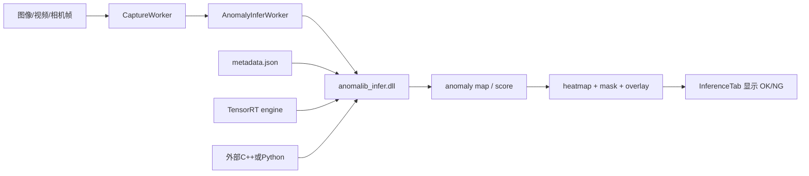
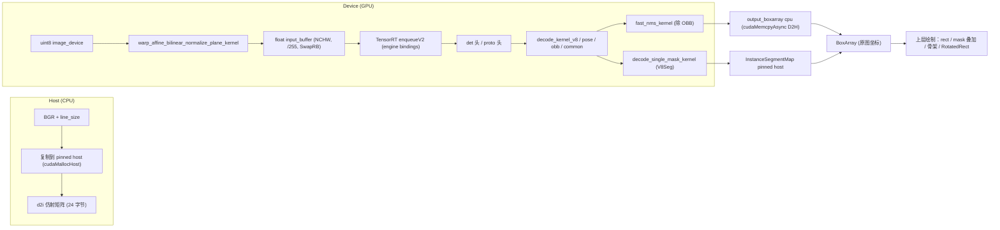
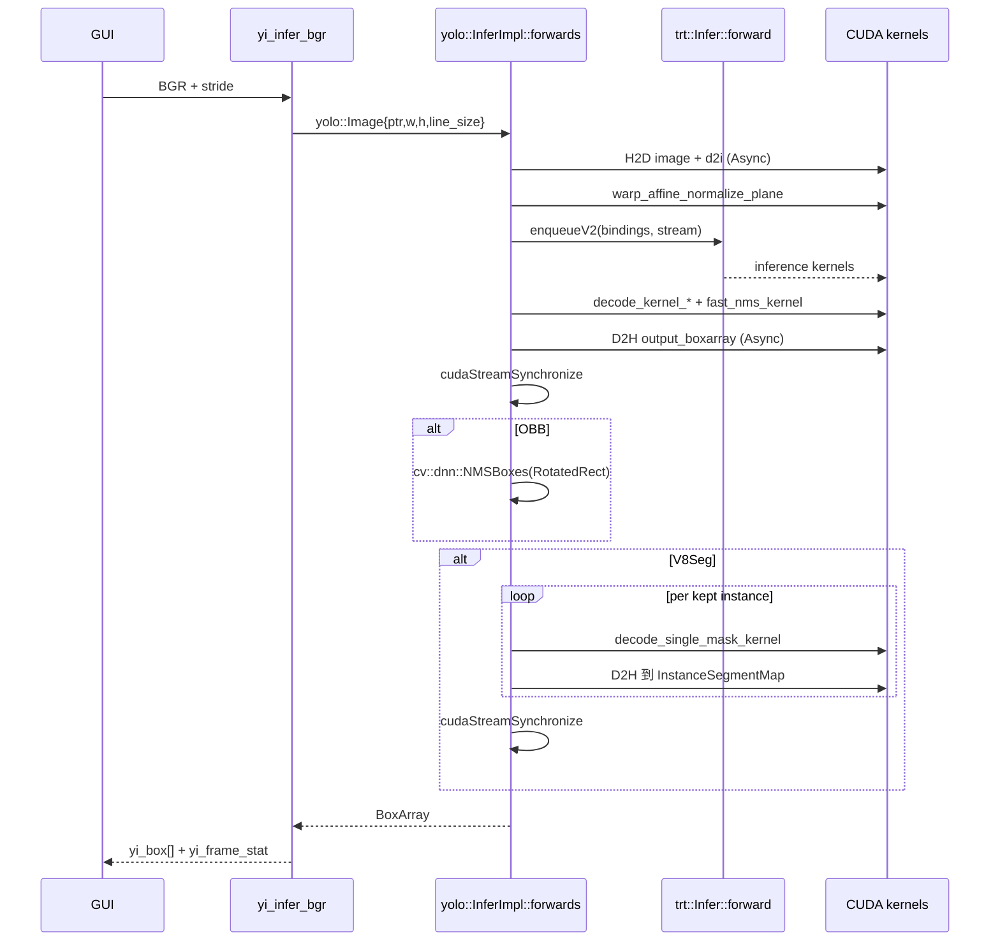

# trtexec/gui/inference：YOLO TensorRT 推理流程说明（详尽版）

本文档完整说明 `trtexec/gui/inference/yolo_infer` 中的推理库实现，覆盖 **TensorRT 引擎加载与执行、CUDA 显存/锁页内存/流/事件、各类型输出头（DET/SEG/POSE/OBB）的张量布局与解码、letterbox 仿射、NMS、实例分割 mask 合成、原图坐标还原、C API 与常见坑**。所有引用均给出代码位置（`startLine:endLine:相对路径`）。文内英文/缩写可查阅 **§0.1 英文名词与缩写释义**；对外可调用的 C/C++ 接口见 **§11 API 参考**。

---

## 0. 源码索引

- `trtexec/gui/inference/yolo_infer/src/yolo.cu` — YOLO 前处理 / 多版本 decode / NMS / 分割 mask / 业务侧 `InferImpl`
- `trtexec/gui/inference/yolo_infer/src/yolo.hpp` — `Type` / `Box` / `Image` / `InstanceSegmentMap` / `Infer`
- `trtexec/gui/inference/yolo_infer/src/infer.cu` — TRT `Runtime/Engine/Context` 封装、`enqueueV2`、`BaseMemory` / `Memory` 实现、`Timer`
- `trtexec/gui/inference/yolo_infer/src/infer.hpp` — `trt::Infer` 抽象接口与 RAII 内存
- `trtexec/gui/inference/yolo_infer/src/yolo_infer_c.cpp` / `include/yolo_infer_c.h` — 给 Qt/GUI 用的 C API（`yi_*`）
- `trtexec/gui/inference/anomalib_infer/src/anomalib_infer_c.cpp` / `include/anomalib_infer_c.h` — Anomalib TensorRT 异常检测推理 DLL，读取 `metadata.json` 并输出热力图、Mask 和 OK/NG 状态
- `trtexec/gui/src/AnomalyInferWorker.cpp` / `include/AnomalyInferWorker.h` — 给 Qt/GUI 用的 Anomalib DLL 薄适配 worker，负责 QImage 与 C API 结果转换

### 0.0.1 Windows 中文路径兼容

TRTForge GUI 的推理演示需要同时加载 `.trt` 引擎、图片/视频和 `labels_*.json`。Windows 下 OpenCV 与 C++ 窄字符串文件 API 对中文路径不稳定，因此当前约定如下：

- `.trt` 引擎路径由 GUI 以 UTF-8 传入 `yi_create`，`yolo_infer` 内部在读取 engine 文件时转为 Windows 宽字符路径再打开。
- 图片文件由 Qt `QFile` 读取字节，再通过 `cv::imdecode` 解码，避免 `cv::imread(std::string)` 直接处理中文路径。
- 视频文件若路径包含中文，GUI 会复制到系统临时目录下的 ASCII 文件名，再交给 `cv::VideoCapture`；视频读取结束后删除临时文件。
- 标签 JSON 使用 Qt `QFile` 读取，天然支持 Windows Unicode 路径。
- ONNX 构建输入若路径包含中文，会临时复制到 ASCII 路径供 TensorRT ONNX Parser 解析，输出 engine 仍写回用户选择的原路径。
- 引擎构建页选择 ONNX 后，会把输入 tensor 自动识别放到后台线程执行，并弹出“ONNX 加载中”进度提示；识别完成后再回到 UI 线程填充输入名称和 `min / opt / max` 动态 shape，避免大模型解析期间主界面无响应。

### 0.0.2 推理画布缩放与拖动

推理演示右侧画布使用自定义显示控件保存原始帧，在 `paintEvent` 中按当前缩放比例和平移偏移绘制，不再把图像预先缩放后塞入普通 `QLabel`。交互规则：

- 鼠标滚轮围绕鼠标位置缩放，适合查看大图局部细节。
- 鼠标左键按住拖动可平移画面。
- 鼠标左键双击恢复到适配窗口并居中显示。

### 0.0.3 Anomalib TRT 异常检测模式

TRTForge 推理演示新增 `异常检测 ANOMALY` 模式，用于加载 Anomalib 已生成的 TensorRT engine 和部署用 `metadata.json`。该模式只做推理，不在 GUI 内负责 Anomalib 训练、ONNX 导出或 engine 构建。Anomalib 推理核心已封装为独立 `anomalib_infer.dll`，TRTForge GUI、外部 C++ 和 Python ctypes 都通过同一套 `ai_*` C API 调用。Anomalib 2.x 训练默认只保存 Lightning `model.ckpt`，因此本工程在 `anomalib/anomalib-main/train.py` 导出 `model.onnx` 后，额外生成 C++ 可读取的 `metadata.json`。

运行链路为：



`metadata.json` 读取字段包括 `image_threshold`、`pixel_threshold`、`transform.height/width`、`input_size`、`pred_scores.min/max`、`anomaly_maps.min/max`。同时兼容实际导出中常见的带点扁平键，例如 `pred_scores.min`、`pred_scores.max`、`anomaly_maps.min`、`anomaly_maps.max`；旧版扁平字段 `min/max` 会作为 score/map 的兼容归一化范围。如果 metadata 没有输入尺寸，静态 engine 会回填自身输入尺寸，动态 engine 则默认按 `256×256` 兜底。engine 与 metadata 路径以 UTF-8 传入 DLL，Windows 下由 DLL 内部转换并读取，避免中文路径失败。

输出头解析规则：

| 输出数量 | 解析方式 |
| --- | --- |
| 1 个输出 | 输出视为 anomaly map，score 取 map 最大值 |
| 2 个输出 | 第 1 个输出视为 score，第 2 个输出视为 anomaly map |
| 3 个及以上输出 | 按 EfficientAd 规则取第 3 个输出为 anomaly map，score 取 map 最大值 |

UI 输出为原图、热力图叠加图、红色异常轮廓预测图三个子窗口，双击任一子窗口可全屏，再次双击恢复三窗口，同时显示 normalized score、raw score、阈值和 OK/NG 状态。

外部调用入口为 `trtexec/gui/inference/anomalib_infer/include/anomalib_infer_c.h`。调用顺序为 `ai_create` → `ai_get_metadata` → `ai_infer_rgb` → `ai_destroy`。`ai_infer_rgb` 返回的 `ai_result` 指针和其中图像/map 内存由 DLL 句柄持有，只保证到下一次 `ai_infer_rgb` 或 `ai_destroy` 前有效，外部 C++/Python 程序必须立即深拷贝。示例见 `trtexec/gui/inference/anomalib_infer/examples/cpp_basic` 和 `trtexec/gui/inference/anomalib_infer/examples/python_ctypes/infer_image.py`。

训练/导出侧新增两个 Python 文件：

| 文件 | 作用 |
| --- | --- |
| `anomalib/anomalib-main/train.py` | 训练并导出 Anomalib 模型，支持 `--model patchcore|padim|efficientad` 选择 PatchCore、PaDiM、EfficientAd |
| `anomalib/anomalib-main/trtforge_metadata.py` | 生成 TRTForge metadata 契约，并复用 ONNX 预处理、输出解析、归一化公式 |
| `anomalib/anomalib-main/compare_ckpt_onnx_inference.py` | 对同一输入比较 `model.ckpt` 与 `model.onnx` 的耗时、score、OK/NG 和 anomaly map 差异 |

典型验证顺序：

```powershell
cd anomalib\anomalib-main
python train.py --model patchcore
python compare_ckpt_onnx_inference.py --model patchcore --ckpt weights\lightning\model.ckpt --onnx weights\lightning\model.onnx --metadata weights\lightning\metadata.json --input D:\test1\deeplearning\anomalib\bottle\test\good
```

---

## 0.1 英文名词与缩写释义（速查表）

下表归纳本文档与源码注释中常见 **英文/缩写** 的含义，阅读正文时可对照。同一术语在图形学、深度学习、CUDA 中可能有细微差别，此处以**本工程推理代码中的用法**为准。

### TensorRT 与执行相关

| 英文/缩写 | 中文含义与在本库中的指代 |
|----------|---------------------------|
| **TensorRT (TRT)** | 英伟达 **TensorRT™**：在 GPU 上跑深度学习推理的库；把训练好的网络编译成**引擎 engine**，在推理时以较低延迟执行。 |
| **Engine** | **ICudaEngine**：从 `.engine` 文件**反序列化**得到的、包含网络结构/权重/优化信息的可执行表示；是推理的「可执行体」。 |
| **Runtime** | **IRuntime**：在进程内创建/加载 engine 的**运行时工厂**；`createInferRuntime` 得到。 |
| **Context / IExecutionContext** | **IExecutionContext**：在 engine 上创建的**一次推理会话**，内部保存动态 shape 状态、临时缓冲等；多线程/多路流通常各用各的 context 或分锁。 |
| **deserialize / deserializeCudaEngine** | **反序列化**：把磁盘上的二进制成数据 **blob** 解析成可执行的 `ICudaEngine` 对象。 |
| **Binding** | **输入/输出槽位**（I/O 绑定）。引擎里第 `i` 个 binding 对应一个张量，有**名字、形状、数据类型、是否输入**。推理时给每个 binding 提供一块 **GPU 显存地址**。 |
| **Binding index / 序号** | 从 `0` 到 `getNbBindings()-1` 的编号；`bindings` 数组按此顺序放指针。本代码里约定输入常为 **0**，输出为 **1、2**（V8Seg 时两个输出）。 |
| **forward** | 神经网络里的 **前向计算**（与训练时的 backward 相对）；这里指一次 **从输入到输出** 的推理。 |
| **enqueueV2** | TensorRT 的 **GPU 上异步入队** API：在指定 **CUDA stream** 上把当前输入交给引擎执行。 |
| **static_dims / run_dims** | `static`：图里/引擎**声明**的维度（动态维为 `-1`）。`run`：**本次执行**在 context 中设定后的**实际**维度。 |
| **Profile / 动态 shape** | 为「可变 batch/可变高宽」等预定义的 **(min, opt, max)** 范围；`has_dynamic_dim` 表示存在 `-1` 需运行时 `set_run_dims`。 |
| **Plugin** | **自定义层插件**；`deserializeCudaEngine(..., nullptr)` 表示不注入自定义 op 工厂，标准 YOLO 导出一般不需要。 |
| **ILogger** | TensorRT 的日志回调，用于把内部错误/警告打印出来。 |
| **nvinfer1** | TensorRT 的 C++ 命名空间前缀（NVIDIA INFERence）。 |
| **NvInfer.h** | TensorRT 主头文件；本工程用 `trt::Infer` 包装，上层不必直接 include。 |

### CUDA 与显存/内存

| 英文/缩写 | 中文含义与在本库中的指代 |
|----------|---------------------------|
| **CUDA** | 英伟达 **计算设备架构**：含驱动、**Runtime**（`cudaMalloc` 等）与在 GPU 上运行的 **Kernel**。 |
| **Device** | 通常指 **GPU 设备** 及其上的显存/执行单元；`device` 指针指向 **显存 (VRAM)**。 |
| **Host** | 相对 GPU 的 **CPU 与系统内存 (DRAM)**。 |
| **H2D / D2H** | **Host to Device** / **Device to Host** 的异步或同步**内存拷贝**；`cudaMemcpyAsync` 在指定 **stream** 上排队。 |
| **Stream / cudaStream** | **CUDA 流**：同一流上的操作**按入队顺序**在 GPU 上执行；多流可重叠拷贝与计算。`nullptr` 时多为**默认流**（与旧版同步行为有关，依赖驱动版本）。 |
| **Event / cudaEvent** | **事件**：在流上打时间戳、测量耗时，或作 **流间同步** 信号。`Timer` 用 `EventRecord/ElapsedTime` 计毫秒。 |
| **Kernel / `<<<>>>`** | **CUDA 核函数**：在 GPU 上**并行**运行的函数，由**线程格点 grid** 和 **线程序 block** 启动。本项目的 decode、letterbox 都是 kernel。 |
| **cudaMalloc** | 在**设备**上分配**全局显存**；本库由 `BaseMemory::gpu_realloc` 包装。 |
| **cudaMallocHost / Pinned** | 分配**锁页 (page-locked) 主机内存**：CPU 能直接 DMA，与 `cudaMemcpyAsync` 搭配才能**真异步**；常称 **固定内存/钉扎内存**。 |
| **RAII** | *Resource Acquisition Is Initialization*，**在构造时拿资源、析构时放资源** 的 C++ 惯用法；`Memory<>` 析构时 `cudaFree/cudaFreeHost`。 |
| **owner / reference** | `BaseMemory` 的 **是否拥有** 该块内存；`reference` 可挂外部已有指针而不释放。 |
| **realloc 按需** | 仅当**容量不足**再重新 `cudaMalloc`；避免每帧 `malloc/free` 的抖动。 |
| **checkRuntime / checkKernel** | 检查 CUDA **Runtime API 返回值**与 **核函数启动**后 `cudaPeekAtLastError` 的宏。 |
| **grid / block / thread** | 核函数**三维线程组织**：`grid` 在设备上**启动多少次 block**，`block` 内**多少 thread**；`warp`（未在文档展开）是 32 线程一组的硬件调度单位。 |
| **atomicAdd** | **原子加**：多线程**无竞争**地更新同一地址；decode 用其累加**候选框计数**。 |
| **abort** | 遇错**立即终止进程**；生产环境常改为可恢复错误码。 |
| **workspace** | 某一步骤临时占用的**工作缓冲**；前处理里 `d2i` + 原图拷到同一块 `gpu_workspace`。 |

### 数据布局与图像/颜色

| 英文/缩写 | 中文含义与在本库中的指代 |
|----------|---------------------------|
| **NCHW** | 四维张量排布 **Batch × Channel × Height × Width**；本工程网络输入的 channel 在 **1** 维（OpenCV/常见约定）。 |
| **BGR** | 蓝-绿-红 **三通道**字节顺序；OpenCV 默认、本库**输入**约定为 BGR，核内用 **SwapRB** 当 RGB 用。 |
| **SwapRB** | 在归一化前交换 B 与 R，相当于把 **BGR 当 RGB** 送网络（与 Ultralytics 训练一致）。 |
| **Norm / AlphaBeta / MeanStd** | **归一化策略**：`×1/255+0` 为 **alpha-beta**；减均值除方差为 **ImageNet 风格 mean/std**；`None` 为不归一化。 |
| **line_size / stride** | 图像**每行字节数**；含行尾 padding 时必须传**真实**步长，否则行错位。与 `QImage::bytesPerLine()`、`cv::Mat::step` 同义。 |
| **const_value 114** | letterbox 填边**常数灰度**（与 Ultralytics **letterbox 填充**一致），三通道都填 114。 |
| **bilinear** | **双线性插值**；缩小/放大采样时用周围四像素的加权平均。 |
| **warp / affine** | **仿射/透视外的二维仿射**；这里为 **2×3 仿射**（6 个参数），`warp_affine` 即按该矩阵**从原图采样**到网络输入。 |
| **letterbox** | 保持纵横比、**等比缩放** 后，在短边**补边** 成固定 `W×H` 的**信箱式**放缩。 |
| **i2d / d2i** | **原图 (image) → 网络 (det)** 与 **反变换**：`d2i` 将网络坐标/框**还原**到**原图坐标**；`i2d` 在分割头里将原图 AABB 映到**网络/ proto 平面**。 |
| **AABB** | **轴对齐包围盒** (Axis-Aligned Bounding Box)；相对 **OBB 旋转框** 的外接**水平矩形**。 |
| **ROI** | **感兴趣区域** (Region of Interest)；分割里把 mask **裁**到**画面内**可见矩形再 resize。 |
| **uint8 / float (fp32)** | 无符号 8 位/单精度浮点；网络输入为 **float 32**，中间图像为 `uint8`。 |
| **numel** | *number of elements*，张量**元素总个数**（各维相乘）。 |

### 网络输出头与任务

| 英文/缩写 | 中文含义与在本库中的指代 |
|----------|---------------------------|
| **Head / 头** | 检测/分割/姿态等**分支输出**；`det` 为**检测头**，`proto` 为**掩膜原型头**。 |
| **DET** | **Detection** 目标**检测**（水平框+类别）。 |
| **SEG / V8Seg** | **Instance segmentation 实例分割**：每目标一张 mask；本库为 **Yolov8 分割**两输出。 |
| **POSE / V8Pose** | **姿态估计**：**关键点** (keypoint) + 人框。 |
| **OBB / V8OBB** | **Oriented Bounding Box 定向框/旋转框**；输出中心、宽、高、**弧度角**。 |
| **proto / mask prototype** | **掩膜的原型基底**：高维特征图 (如 32 通道)；与每实例的 **mask 系数** 线性组合后得 logits。 |
| **mask 系数 / mask weights** | 每个实例 **32 维**（与 proto 通道一致）的系数，和 proto 在 (x,y) 处做**点积**。 |
| **decode** | 把**原始网络张量**解析成**框/点/角** 等**人类可读结构**的 GPU/CPU 过程。 |
| **anchor** | 原意**锚点/先验**；v8 里常指**展平后的一行/一格预测**，即 `output_cdim` 一条。 |
| **objectness** | 旧版 YOLO 的 **含物体置信度**；v8 已融入类别分，v5 路径仍用 `obj × cls`。 |
| **class / label / nc** | **类别/标签**；`nc` = **number of classes 类别数**。 |
| **confidence / conf** | **置信度**；可与 **score** 混用。 |
| **argmax** | 在多个类别分里取**最大**的索引。 |
| **position / row index** | v8 检测里**保留的锚点/行下标**；用于分割时回到原张量**同一行**取 mask 系数。 |
| **keypoint (kpt) / kps** | **人体关节点**；COCO 常 **17 点**；每点 (x, y, **visibility 可见性**)。 |
| **visibility** | 点是否**被遮挡/不可见**的标量；画骨架时可设阈值不画。 |
| **OBB 角度 (radian)** | 网络输出**弧度**；`cv::RotatedRect` 常用**度 (degree)**，代码中有 `*180/π` 转换。 |
| **RotatedRect** | OpenCV 的 **带角度矩形**（中心+宽高+角）。 |
| **COCO** | 公共数据集/关键点**骨架**约定名；17 点连线顺序有标准。 |
| **Ultralytics** | YOLOv8 系官方实现与**导出/训练**约定，本后处理**对齐**其 letterbox 与头布局。 |

### 后处理与评价

| 英文/缩写 | 中文含义与在本库中的指代 |
|----------|---------------------------|
| **NMS** | **Non-Maximum Suppression 非极大值抑制**：同类别、高 IoU 的重复框**只留置信度高的**。 |
| **IoU** | **Intersection over Union 交并比**；两**水平框**交面积 ÷ 并面积。 |
| **IOU 阈值 (nms_threshold)** | NMS 里**抑制**的 IoU 门槛。 |
| **rotated NMS** | 对**旋转框**的 NMS，本工程用 `cv::dnn::NMSBoxes` + `RotatedRect` 在 **CPU** 上算。 |
| **keepflag** | 本库内部标记该候选在 NMS 后**是否保留** (1/0)。 |
| **box_stride** | 每条**临时候选**在 `output_boxarray` 里占的 **float 个数**（8 或 59 或 13 等）。 |
| **fast_nms_kernel** | **GPU 上**实现的简化 NMS（**非**官方 batched 完全等价实现；对小 N 足够快）。 |
| **sigmoid** | **S 型**激活 \(\sigma(x)=1/(1+e^{-x})\)；**mask  logits 转** 0~1 再乘 255。 |
| **logit** | **未归一化**的得分、sigmoid/softmax 前的**原始加权和**。 |
| **cumprod** | 本代码中变量名，实为 mask 的 **点积/加权和**（与数学上的 cumulative product 不同，勿混）。 |

### API 与工程常用词

| 英文/缩写 | 中文含义与在本库中的指代 |
|----------|---------------------------|
| **C API** | **C 语言接口**（`extern "C"`），便于 Qt/其它语言**动态链接** `dll`。 |
| **handle (yi_handle)** | **不透明的句柄/把手**：指向封装的**上下文**指针，不暴露内部 C++ 类型。 |
| **thread_local** | **线程局部**存储；`g_last_error` 每线程**各自一份** 错误信息。 |
| **GUI** | 图形用户界面 (Graphical User Interface)。 |
| **API / ABI** | 应用编程接口 / 二进制接口；`YI_API` 为 `dllexport/dllimport`。**完整函数表与参数说明见 §11**。 |
| **framerate / ms** | 推理**毫秒**与 **fps** 性能；`yi_frame_stat` 给各阶段**耗时**分解。 |
| **buffer** | **缓冲区**；泛指一块连续内存。 |
| **Blob** | **二进制大对象**；这里特指**整个** `.engine` 文件内容。 |

若正文出现未收进表中的缩写，可结合**章节主题**（TRT 文档 / CUDA 编程指南 / YOLO 论文）在对应官方文档中查阅。

---

## 1. 系统总览



要点：

- **整条链路尽量在显存上完成**，host 只承担「拷入原图 / 拷出最终 box 与 mask」，其它（letterbox、归一化、解码、NMS、mask 合成）全部 CUDA 核完成。
- 所有 host 端缓冲使用 **pinned 内存（`cudaMallocHost`）**，使 `cudaMemcpyAsync` 真正异步、可与 kernel 并发。
- **decode 核** 直接利用 `d2i`（letterbox 的逆仿射）把网络坐标变回 **原图坐标系**，省掉 host 端的还原。

---

## 2. TensorRT 模型如何被使用（引擎 / 上下文 / 推理）

`trt::Infer`（`infer.hpp` 第 102–132 行）把 TensorRT 三大对象 **`IRuntime / ICudaEngine / IExecutionContext`** 封装为一个抽象接口，业务侧 `yolo::InferImpl` 只用 `forward(bindings, stream)` 与 `static_dims/run_dims/...` 等查询接口，避免把 `<NvInfer.h>` 散到上层。

### 2.1 RAII：`__native_engine_context`

构造时一次完成 **反序列化 → 创建上下文**，析构按相反顺序释放，避免 nvinfer 句柄泄漏。

```267:300:trtexec/gui/inference/yolo_infer/src/infer.cu
class __native_engine_context {
 public:
  virtual ~__native_engine_context() { destroy(); }

  bool construct(const void *pdata, size_t size) {
    destroy();

    if (pdata == nullptr || size == 0) return false;

    runtime_ = shared_ptr<IRuntime>(createInferRuntime(gLogger), destroy_nvidia_pointer<IRuntime>);
    if (runtime_ == nullptr) return false;

    engine_ = shared_ptr<ICudaEngine>(runtime_->deserializeCudaEngine(pdata, size, nullptr),
                                      destroy_nvidia_pointer<ICudaEngine>);
    if (engine_ == nullptr) return false;

    context_ = shared_ptr<IExecutionContext>(engine_->createExecutionContext(),
                                             destroy_nvidia_pointer<IExecutionContext>);
    return context_ != nullptr;
  }
```

- `createInferRuntime(gLogger)`：与 NV 日志器关联，过滤普通 INFO，仅打印 ERROR/INTERNAL_ERROR（见 `__native_nvinfer_logger`，第 222–241 行）。
- `deserializeCudaEngine(pdata, size, nullptr)`：从 **整个 `.engine` 二进制 blob** 重建 `ICudaEngine`；`nullptr` 表示不使用自定义 plugin factory（YOLO 标配未含特殊 plugin）。
- `createExecutionContext()`：从 engine 派生 **执行上下文**，里面持有 **该 engine 的运行期缓冲（profile、动态 shape 状态等）**，每个推理线程一般独占一个。

**注意**：`ICudaEngine` 内部已经包含权重、profile 等大块显存；engine 本身就是显存占用主体之一，**不要每帧反复反序列化**。本仓库通过 `trt::load` → `shared_ptr<Infer>` 持有，整个生命周期一份。

### 2.2 加载 `.engine` 文件

```249:265:trtexec/gui/inference/yolo_infer/src/infer.cu
static std::vector<uint8_t> load_file(const string &file) {
  ifstream in(file, ios::in | ios::binary);
  if (!in.is_open()) return {};

  in.seekg(0, ios::end);
  size_t length = in.tellg();

  std::vector<uint8_t> data;
  if (length > 0) {
    in.seekg(0, ios::beg);
    data.resize(length);

    in.read((char *)&data[0], length);
  }
  in.close();
  return data;
}
```

```318:325:trtexec/gui/inference/yolo_infer/src/infer.cu
  bool load(const string &file) {
    auto data = load_file(file);
    if (data.empty()) {
      INFO("An empty file has been loaded. Please confirm your file path: %s", file.c_str());
      return false;
    }
    return this->construct(data.data(), data.size());
  }
```

整体流程：**读盘 → `construct(data, size)` → setup binding 索引表**。

### 2.3 Binding 索引表：`name → index`

```327:336:trtexec/gui/inference/yolo_infer/src/infer.cu
  void setup() {
    auto engine = this->context_->engine_;
    int nbBindings = engine->getNbBindings();

    binding_name_to_index_.clear();
    for (int i = 0; i < nbBindings; ++i) {
      const char *bindingName = engine->getBindingName(i);
      binding_name_to_index_[bindingName] = i;
    }
  }
```

- `index(name)` 把 ONNX 输出名（如 `output0`、`mask`）查成 binding 序号。
- `static_dims(i)`、`run_dims(i)`、`dtype(i)`、`is_input(i)` 都是按 **binding 序号** 工作；上层既可用名字，也可用序号。

### 2.4 形状信息与动态 shape

```351:368:trtexec/gui/inference/yolo_infer/src/infer.cu
  virtual std::vector<int> run_dims(const std::string &name) override {
    return run_dims(index(name));
  }

  virtual std::vector<int> run_dims(int ibinding) override {
    auto dim = this->context_->context_->getBindingDimensions(ibinding);
    return std::vector<int>(dim.d, dim.d + dim.nbDims);
  }

  virtual std::vector<int> static_dims(const std::string &name) override {
    return static_dims(index(name));
  }

  virtual std::vector<int> static_dims(int ibinding) override {
    auto dim = this->context_->engine_->getBindingDimensions(ibinding);
    return std::vector<int>(dim.d, dim.d + dim.nbDims);
  }
```

- `static_dims`：从 **engine** 取「设计时形状」，动态维处为 `-1`。
- `run_dims`：从 **context** 取「当前实际形状」，需先 `set_run_dims` 才会更新。
- `has_dynamic_dim()`（第 399–409 行）逐 binding 扫描，遇到 `-1` 则视为动态模型。

```379:384:trtexec/gui/inference/yolo_infer/src/infer.cu
  virtual bool set_run_dims(int ibinding, const std::vector<int> &dims) override {
    Dims d;
    memcpy(d.d, dims.data(), sizeof(int) * dims.size());
    d.nbDims = dims.size();
    return this->context_->context_->setBindingDimensions(ibinding, d);
  }
```

业务层在 batch 变化时调用：

```815:831:trtexec/gui/inference/yolo_infer/src/yolo.cu
    auto input_dims = trt_->static_dims(0);
    int infer_batch_size = input_dims[0];
    if (infer_batch_size != num_image) {
      if (isdynamic_model_) {
        infer_batch_size = num_image;
        input_dims[0] = num_image;
        if (!trt_->set_run_dims(0, input_dims)) return {};
      } else {
        if (infer_batch_size < num_image) {
          INFO(
              "When using static shape model, number of images[%d] must be "
              "less than or equal to the maximum batch[%d].",
              num_image, infer_batch_size);
          return {};
        }
      }
    }
```

- 若 engine 是 **静态 batch**：传入图片数 ≤ 最大 batch；输出仍按最大 batch 解读，但只取前 `num_image` 个。
- 若 engine 是 **动态 batch**：每帧 `set_run_dims` 把 `dims[0]` 改为当前张数。注意 **动态 shape 的优化要点是 profile**，本仓库假定 engine 已用合适 profile 构建。

### 2.5 真正的推理：`enqueueV2`

```345:349:trtexec/gui/inference/yolo_infer/src/infer.cu
  virtual bool forward(const std::vector<void *> &bindings, void *stream,
                       void *input_consum_event) override {
    return this->context_->context_->enqueueV2((void**)bindings.data(), (cudaStream_t)stream,
                                               (cudaEvent_t *)input_consum_event);
  }
```

- `bindings` 是 **按 binding 序号排列的 GPU 指针数组**，`bindings[i]` 必须是 binding `i` 的 **设备指针**（输入/输出都是）。
- `stream`：CUDA 流；为 `nullptr` 时 TRT 会用默认流，但建议传入业务流，便于与前/后处理并发。
- `input_consum_event`：可选的 CUDA event，TRT 完成「读入完输入」即触发，调用方可据此回收输入缓冲；本仓库未使用。

### 2.6 业务层组织 bindings

```839:844:trtexec/gui/inference/yolo_infer/src/yolo.cu
    float *bbox_output_device = bbox_predict_.gpu();
    vector<void *> bindings{input_buffer_.gpu(), bbox_output_device};

    if (has_segment_) {
      bindings = {input_buffer_.gpu(), segment_predict_.gpu(), bbox_output_device};
    }
```

- **DET / POSE / OBB**：`{input, det_output}`，2 个指针；
- **V8Seg**：`{input, proto_output, det_output}`，3 个指针；与 `static_dims` 中 `[1] = proto`、`[2] = det` 一致。

### 2.7 推理打印

`InferImpl::print()`（`infer.cu` 411–438 行）输出每个输入/输出的 **名字、形状**，便于和 `yolo.cu` 中对通道数的检查（如 v8 要求 `4+nc`、pose 要求 56、obb 要求 `4+nc+1`）相互验证。

---

## 3. CUDA 内存模型：`BaseMemory` / `Memory<_DT>`

YOLO 高频推理对内存分配极为敏感（`cudaMalloc/cudaFree` 走驱动同步路径，毫秒级），本仓库统一封装出一套 **「按需扩容、不收缩」** 的 RAII 内存。

### 3.1 类层次

`BaseMemory`：以 **字节** 为单位，同时管理 **pinned host + device** 两块内存；`Memory<_DT>`：以 **元素个数** 为单位的模板化包装，便于 `gpu(N)` 直接得到 `_DT *`。

```46:79:trtexec/gui/inference/yolo_infer/src/infer.hpp
class BaseMemory {
 public:
  BaseMemory() = default;
  BaseMemory(void *cpu, size_t cpu_bytes, void *gpu, size_t gpu_bytes);
  virtual ~BaseMemory();
  virtual void *gpu_realloc(size_t bytes);
  virtual void *cpu_realloc(size_t bytes);
  void release_gpu();
  void release_cpu();
  void release();
  inline bool owner_gpu() const { return owner_gpu_; }
  inline bool owner_cpu() const { return owner_cpu_; }
  inline size_t cpu_bytes() const { return cpu_bytes_; }
  inline size_t gpu_bytes() const { return gpu_bytes_; }
  virtual inline void *get_gpu() const { return gpu_; }
  virtual inline void *get_cpu() const { return cpu_; }
  void reference(void *cpu, size_t cpu_bytes, void *gpu, size_t gpu_bytes);

 protected:
  void *cpu_ = nullptr;
  size_t cpu_bytes_ = 0, cpu_capacity_ = 0;
  bool owner_cpu_ = true;

  void *gpu_ = nullptr;
  size_t gpu_bytes_ = 0, gpu_capacity_ = 0;
  bool owner_gpu_ = true;
};
```

```86:101:trtexec/gui/inference/yolo_infer/src/infer.hpp
template <typename _DT>
class Memory : public BaseMemory {
 public:
  Memory() = default;
  Memory(const Memory &other) = delete;
  Memory &operator=(const Memory &other) = delete;
  virtual _DT *gpu(size_t size) { return (_DT *)BaseMemory::gpu_realloc(size * sizeof(_DT)); }
  virtual _DT *cpu(size_t size) { return (_DT *)BaseMemory::cpu_realloc(size * sizeof(_DT)); }

  inline size_t cpu_size() const { return cpu_bytes_ / sizeof(_DT); }
  inline size_t gpu_size() const { return gpu_bytes_ / sizeof(_DT); }

  virtual inline _DT *gpu() const { return (_DT *)gpu_; }
  virtual inline _DT *cpu() const { return (_DT *)cpu_; }
};
```

### 3.2 按需扩容（关键性能点）

```170:194:trtexec/gui/inference/yolo_infer/src/infer.cu
void *BaseMemory::gpu_realloc(size_t bytes) {
  if (gpu_capacity_ < bytes) {
    release_gpu();

    gpu_capacity_ = bytes;
    checkRuntime(cudaMalloc(&gpu_, bytes));
  }
  gpu_bytes_ = bytes;
  return gpu_;
}

void *BaseMemory::cpu_realloc(size_t bytes) {
  if (cpu_capacity_ < bytes) {
    release_cpu();

    cpu_capacity_ = bytes;
    checkRuntime(cudaMallocHost(&cpu_, bytes));
    Assert(cpu_ != nullptr);
  }
  cpu_bytes_ = bytes;
  return cpu_;
}
```

- **只在容量不够时** 真正 `cudaMalloc / cudaMallocHost`；够用时只更新「已用大小」。
- **CPU 端用 `cudaMallocHost`（pinned）**，使 `cudaMemcpyAsync` 与 kernel 真异步；普通 `malloc` 会在 async 拷贝时退化为同步路径。
- **不主动收缩**：避免「图像变小一帧 → 释放 → 下一帧大图再 malloc」的颠簸。
- `release_gpu/release_cpu`（第 196–215 行）只有 **owner** 才释放；通过 `reference()` 借用外部缓冲时不释放。

### 3.3 业务侧的内存布局

`yolo::InferImpl` 持有以下 `Memory<>`：

```615:628:trtexec/gui/inference/yolo_infer/src/yolo.cu
  vector<shared_ptr<trt::Memory<unsigned char>>> preprocess_buffers_;
  trt::Memory<float> input_buffer_, bbox_predict_, output_boxarray_;
  trt::Memory<float> segment_predict_;
  // ...
  bool isdynamic_model_ = false;
  vector<shared_ptr<trt::Memory<unsigned char>>> box_segment_cache_;
```

容量根据 **batch 与 head 形状** 计算（`adjust_memory`）：

```632:648:trtexec/gui/inference/yolo_infer/src/yolo.cu
  void adjust_memory(int batch_size) {
    size_t input_numel = network_input_width_ * network_input_height_ * 3;
    input_buffer_.gpu(batch_size * input_numel);
    bbox_predict_.gpu(batch_size * bbox_head_dims_[1] * bbox_head_dims_[2]);
    output_boxarray_.gpu(batch_size * (32 + MAX_IMAGE_BOXES * box_stride_));
    output_boxarray_.cpu(batch_size * (32 + MAX_IMAGE_BOXES * box_stride_));

    if (has_segment_)
      segment_predict_.gpu(batch_size * segment_head_dims_[1] * segment_head_dims_[2] *
                           segment_head_dims_[3]);

    if ((int)preprocess_buffers_.size() < batch_size) {
      for (int i = preprocess_buffers_.size(); i < batch_size; ++i)
        preprocess_buffers_.push_back(make_shared<trt::Memory<unsigned char>>());
    }
  }
```

- `input_buffer_`：**网络输入**，形状 `B × 3 × H × W`，float。
- `bbox_predict_`：**检测头输出**，按 binding 第 1 维和第 2 维推算（如 v8 检测：`anchors × (4+nc)`）。
- `segment_predict_`：**proto 头输出**，`B × 32 × Hm × Wm`，仅 V8Seg。
- `output_boxarray_`：**解码后 + NMS 候选**，每张图占 `32 + MAX_IMAGE_BOXES * box_stride_` 个 float（前面预留 32 floats，第一个用作 `atomicAdd` 的计数；`box_stride_` 因任务不同：DET=8、POSE=59、OBB=13）。GPU 端写入，最终拷回同形 CPU 端做 OBB 旋转 NMS / 取最终结果。
- `preprocess_buffers_`：每张图一份 workspace，**前部 32 字节对齐区** 放 `d2i`，后面紧跟 **原图 BGR** 的连续拷贝。
- `box_segment_cache_`：用于 **每个保留实例 mask** 的 GPU 临时缓冲（一次推理可能产生 N 个不同尺寸的小 mask），按需扩张并循环复用。

### 3.4 `InstanceSegmentMap`：pinned host 上的实例 mask

```593:606:trtexec/gui/inference/yolo_infer/src/yolo.cu
InstanceSegmentMap::InstanceSegmentMap(int width, int height) {
  this->width = width;
  this->height = height;
  checkRuntime(cudaMallocHost(&this->data, width * height));
}

InstanceSegmentMap::~InstanceSegmentMap() {
  if (this->data) {
    checkRuntime(cudaFreeHost(this->data));
    this->data = nullptr;
  }
  this->width = 0;
  this->height = 0;
}
```

每个保留实例的 mask 直接落到 **pinned host**，方便上层 `cv::Mat` / Qt 直接读取，且 D2H 仍可异步。

---

## 4. CUDA Stream / Event：异步与计时

### 4.1 Stream 来源

`Infer::forward(image, stream)` 与 `forwards(images, stream)` 的 `stream` 是 **`void*`，实际为 `cudaStream_t`**。本仓库默认 `stream=nullptr`（默认流）；若上层有自己的 `cudaStreamCreate`（例如和某 Qt 渲染线程绑定），可以传入实现 **流间并发**。

`yolo::InferImpl::forwards`：

```833:865:trtexec/gui/inference/yolo_infer/src/yolo.cu
    adjust_memory(infer_batch_size);

    vector<AffineMatrix> affine_matrixs(num_image);
    cudaStream_t stream_ = (cudaStream_t)stream;
    for (int i = 0; i < num_image; ++i)
      preprocess(i, images[i], preprocess_buffers_[i], affine_matrixs[i], stream);
    // ...
    if (!trt_->forward(bindings, stream)) { /* ... */ }

    for (int ib = 0; ib < num_image; ++ib) {
      // decode_kernel_invoker(...) 在同一 stream
    }
    checkRuntime(cudaMemcpyAsync(output_boxarray_.cpu(), output_boxarray_.gpu(),
                                 output_boxarray_.gpu_bytes(), cudaMemcpyDeviceToHost, stream_));
    checkRuntime(cudaStreamSynchronize(stream_));
```

- **同一个 stream** 上完成「H2D → 前处理 kernel → TRT enqueueV2 → 解码 kernel → NMS kernel → D2H」，依赖关系自动按入队顺序串行。
- **`cudaStreamSynchronize`** 在拷回 box 数组后调用，保证 host 端读到的是最终结果。
- 分割 mask 的 D2H 是在 **后续的 mask 解析循环** 内逐实例 `cudaMemcpyAsync`，最后再做一次 `cudaStreamSynchronize`（`yolo.cu` 993 附近）。

### 4.2 Event 计时：`Timer`

```112:138:trtexec/gui/inference/yolo_infer/src/infer.cu
Timer::Timer() {
  checkRuntime(cudaEventCreate((cudaEvent_t *)&start_));
  checkRuntime(cudaEventCreate((cudaEvent_t *)&stop_));
}

Timer::~Timer() {
  checkRuntime(cudaEventDestroy((cudaEvent_t)start_));
  checkRuntime(cudaEventDestroy((cudaEvent_t)stop_));
}

void Timer::start(void *stream) {
  stream_ = stream;
  checkRuntime(cudaEventRecord((cudaEvent_t)start_, (cudaStream_t)stream_));
}

float Timer::stop(const char *prefix, bool print) {
  checkRuntime(cudaEventRecord((cudaEvent_t)stop_, (cudaStream_t)stream_));
  checkRuntime(cudaEventSynchronize((cudaEvent_t)stop_));

  float latency = 0;
  checkRuntime(cudaEventElapsedTime(&latency, (cudaEvent_t)start_, (cudaStream_t)stop_));
  // ...
  return latency;
}
```

业务侧的 `yi_frame_stat` 用 `chrono` 划分 **前处理 / 推理 / 后处理 / 总耗时**：

```164:175:trtexec/gui/inference/yolo_infer/src/yolo_infer_c.cpp
        if (out_stat) {
            auto ms = [](auto a, auto b) {
                return std::chrono::duration<double, std::milli>(b - a).count();
            };
            out_stat->src_w = w;
            out_stat->src_h = height;
            out_stat->count = static_cast<int>(ctx->boxes_buf.size());
            out_stat->preprocess_ms  = ms(t0, t1);
            out_stat->inference_ms   = ms(t1, t2);
            out_stat->postprocess_ms = ms(t2, t3);
            out_stat->total_ms       = ms(t0, t3);
        }
```

注意：`ms(t0,t1)` 这段近乎为 0（仅 `stride` 校正），真正包含 GPU 时间的是 `ms(t1,t2)`，因为 `forward` 内部最后会 `cudaStreamSynchronize`。

---

## 5. 错误检查宏

`yolo.cu` 与 `infer.cu` 均定义如下宏（推荐在所有 CUDA / kernel 调用处使用）：

```32:47:trtexec/gui/inference/yolo_infer/src/yolo.cu
#define checkRuntime(call)                                                                 \
  do {                                                                                     \
    auto ___call__ret_code__ = (call);                                                     \
    if (___call__ret_code__ != cudaSuccess) {                                              \
      INFO("CUDA Runtime error %s # %s, code = %s [ %d ]", #call,                              \
           cudaGetErrorString(___call__ret_code__), cudaGetErrorName(___call__ret_code__), \
           ___call__ret_code__);                                                           \
      abort();                                                                             \
    }                                                                                      \
  } while (0)

#define checkKernel(...)                 \
  do {                                   \
    { (__VA_ARGS__); }                   \
    checkRuntime(cudaPeekAtLastError()); \
  } while (0)
```

- `checkRuntime`：包裹 **runtime API** 调用，错误立即打印并 `abort`（生产建议改成抛异常）。
- `checkKernel`：在 `<<<>>>` 之后立刻 `cudaPeekAtLastError`，便于把 kernel 启动错误（如 grid 配置错误）捕获到当前行。

---

## 6. 前处理（GPU letterbox + 归一化）

### 6.1 输入抽象 `yolo::Image`：行步长 `line_size`

```72:95:trtexec/gui/inference/yolo_infer/src/yolo.hpp
 * - line_size: 每行字节数（与 OpenCV Mat::step、Qt QImage::bytesPerLine() 等价的概念）。
 *              紧凑缓冲：传 width * 3 或 0；
 *              带 padding：例如 QImage::Format_RGB888 通常按 4 字节对齐，
 *              宽 810 时 width*3=2430，但 bytesPerLine()=2432，必须传真实的 2432。
 *              line_size == 0 时由构造函数自动取 width * 3，与历史「紧凑 BGR」调用完全兼容。
 */
struct Image {
  const void *bgrptr = nullptr;
  int width = 0, height = 0;
  int line_size = 0;
```

`line_size` 错误是 GUI 集成时最常见的「图像被斜切」根因。

### 6.2 letterbox 仿射 `i2d` / `d2i`

```563:591:trtexec/gui/inference/yolo_infer/src/yolo.cu
struct AffineMatrix {
  float i2d[6];
  float d2i[6];

  void compute(const std::tuple<int, int> &from, const std::tuple<int, int> &to) {
    float scale_x = get<0>(to) / (float)get<0>(from);
    float scale_y = get<1>(to) / (float)get<1>(from);
    float scale = std::min(scale_x, scale_y);
    i2d[0] = scale; i2d[1] = 0;
    i2d[2] = -scale * get<0>(from) * 0.5 + get<0>(to) * 0.5 + scale * 0.5 - 0.5;
    i2d[3] = 0; i2d[4] = scale;
    i2d[5] = -scale * get<1>(from) * 0.5 + get<1>(to) * 0.5 + scale * 0.5 - 0.5;

    double D = i2d[0] * i2d[4] - i2d[1] * i2d[3];
    D = D != 0. ? double(1.) / D : double(0.);
    double A11 = i2d[4] * D, A22 = i2d[0] * D, A12 = -i2d[1] * D, A21 = -i2d[3] * D;
    double b1 = -A11 * i2d[2] - A12 * i2d[5];
    double b2 = -A21 * i2d[2] - A22 * i2d[5];

    d2i[0] = A11; d2i[1] = A12; d2i[2] = b1;
    d2i[3] = A21; d2i[4] = A22; d2i[5] = b2;
  }
};
```

- `i2d`：原图 → 网络输入（**等比缩放** + 居中 + 半像素对齐）。
- `d2i`：网络输入 → 原图（解析模型坐标用）。
- `i2d[0] == i2d[4] == scale`，`d2i[0] == d2i[4] == 1/scale`，OBB 直接用 `d2i[0]` 作 **均匀缩放系数** 还原 `ow/oh`。

### 6.3 拷贝与启动 kernel

```650:689:trtexec/gui/inference/yolo_infer/src/yolo.cu
  void preprocess(int ibatch, const Image &image,
                  shared_ptr<trt::Memory<unsigned char>> preprocess_buffer, AffineMatrix &affine,
                  void *stream = nullptr) {
    affine.compute(make_tuple(image.width, image.height),
                   make_tuple(network_input_width_, network_input_height_));

    size_t input_numel = network_input_width_ * network_input_height_ * 3;
    float *input_device = input_buffer_.gpu() + ibatch * input_numel;

    const int src_line_size_bytes =
        (image.line_size > 0) ? image.line_size : (image.width * 3);
    size_t size_image = static_cast<size_t>(src_line_size_bytes) * image.height;
    size_t size_matrix = upbound(sizeof(affine.d2i), 32);
    uint8_t *gpu_workspace = preprocess_buffer->gpu(size_matrix + size_image);
    float *affine_matrix_device = (float *)gpu_workspace;
    uint8_t *image_device = gpu_workspace + size_matrix;

    uint8_t *cpu_workspace = preprocess_buffer->cpu(size_matrix + size_image);
    float *affine_matrix_host = (float *)cpu_workspace;
    uint8_t *image_host = cpu_workspace + size_matrix;

    cudaStream_t stream_ = (cudaStream_t)stream;
    memcpy(image_host, image.bgrptr, size_image);
    memcpy(affine_matrix_host, affine.d2i, sizeof(affine.d2i));
    checkRuntime(
        cudaMemcpyAsync(image_device, image_host, size_image, cudaMemcpyHostToDevice, stream_));
    checkRuntime(cudaMemcpyAsync(affine_matrix_device, affine_matrix_host, sizeof(affine.d2i),
                                 cudaMemcpyHostToDevice, stream_));

    warp_affine_bilinear_and_normalize_plane(image_device, src_line_size_bytes, image.width,
                                             image.height, input_device, network_input_width_,
                                             network_input_height_, affine_matrix_device, 114,
                                             normalize_, stream_);
  }
```

布局技巧：**`d2i` 紧贴在 image 前，统一一块显存**，少做一次 `cudaMalloc`，且对齐到 32 字节避免影响后续 image 的对齐。

### 6.4 关键 kernel：letterbox + 归一化合一

```405:485:trtexec/gui/inference/yolo_infer/src/yolo.cu
static __global__ void warp_affine_bilinear_and_normalize_plane_kernel(
    uint8_t *src, int src_line_size, int src_width, int src_height, float *dst, int dst_width,
    int dst_height, uint8_t const_value_st, float *warp_affine_matrix_2_3, Norm norm) {
  int dx = blockDim.x * blockIdx.x + threadIdx.x;
  int dy = blockDim.y * blockIdx.y + threadIdx.y;
  if (dx >= dst_width || dy >= dst_height) return;
  // ...用 d2i 反映射到原图，越界返回 114；否则双线性插值
  // SwapRB / AlphaBeta / MeanStd 三选一，写到 NCHW 的 dst
```

- **每个线程负责网络输入的一个像素**，反向取原图 → 一次 kernel 同时完成 **缩放 + 填边 (114) + RGB 转换 + 归一化 + NCHW 排布**。
- 使用 `d2i`，所以输出像素与原图无 padding；`dst` 直接是 `input_buffer_`。

启动配置：

```487:498:trtexec/gui/inference/yolo_infer/src/yolo.cu
static void warp_affine_bilinear_and_normalize_plane(...) {
  dim3 grid((dst_width + 31) / 32, (dst_height + 31) / 32);
  dim3 block(32, 32);
  checkKernel(warp_affine_bilinear_and_normalize_plane_kernel<<<grid, block, 0, stream>>>(
      src, src_line_size, src_width, src_height, dst, dst_width, dst_height, const_value,
      matrix_2_3, norm));
}
```

`32x32` 的 2D block，刚好覆盖一个 warp 排布友好的瓦片。

### 6.5 归一化策略 `Norm`

```49:91:trtexec/gui/inference/yolo_infer/src/yolo.cu
enum class NormType : int { None = 0, MeanStd = 1, AlphaBeta = 2 };
enum class ChannelType : int { None = 0, SwapRB = 1 };

struct Norm {
  float mean[3]; float std[3];
  float alpha, beta;
  NormType type = NormType::None;
  ChannelType channel_type = ChannelType::None;

  static Norm mean_std(const float mean[3], const float std[3], float alpha = 1 / 255.0f,
                       ChannelType channel_type = ChannelType::None);
  static Norm alpha_beta(float alpha, float beta = 0, ChannelType channel_type = ChannelType::None);
  static Norm None();
};
```

- YOLOv8 系列在 `load` 中固定为 `Norm::alpha_beta(1/255, 0, SwapRB)`：**出网络的张量等同 `RGB / 255`**，与 Ultralytics 训练时一致。
- YOLOX 用 `Norm::None()`，原值保留。
- 自定义模型若要 ImageNet 均值/方差，可改成 `Norm::mean_std(...)`。

---

## 7. 推理加载阶段：任务与 engine 的契约校验

`InferImpl::load`（`yolo.cu` 691–803 行）做以下事情：

1. **`trt::load(engine_file)`**：完成 engine 反序列化、binding 表建立。
2. **`trt_->print()`**：打印 `Inputs:`、`Outputs:` 形状（与 `trtexec --loadEngine` 风格一致）。
3. **检查输出个数**：
   - V8Seg 必须 **2 个输出**（proto + det），否则抛异常并提示「请换 engine 或换 task」。
   - 其它任务必须 **1 个输出**，遇到 2 个输出会提示「这是 SEG engine」。
4. **保存形状**：
   - 非 Seg：`bbox_head_dims_ = static_dims(1)`；
   - Seg：`segment_head_dims_ = static_dims(1)`，`bbox_head_dims_ = static_dims(2)`。
5. **解析输入分辨率**：`network_input_width_/height_ = input_dim[3]/[2]`，对 NCHW 摄取。
6. **判断动态**：`isdynamic_model_ = trt_->has_dynamic_dim()`。
7. **按 Type 设置归一化与 `num_classes_`**：
   - V5/V3/V7：`nc = C - 5`（`obj + cls`）。
   - V8：`nc = C - 4`，且通道数为 56 时强制提示「应为 POSE」。
   - V8Seg：`nc = C - 4 - proto_dim`（典型 proto_dim=32）。
   - V8Pose：`nc = 1`，`box_stride_ = NUM_BOX_ELEMENT_POSE = 59`，并断言 `C == 56`。
   - V8OBB：`nc = C - 4 - 1`，`box_stride_ = NUM_BOX_ELEMENT_OBB = 13`。
   - YOLOX：`Norm::None()`，`nc = C - 5`。

这一步是把 **engine 的物理布局** 对齐到 **业务的逻辑任务**，防止「拿一个 SEG engine 当 DET 跑」之类静默错误。

---

## 8. 按输出头分类的 decode 与还原（核心）

通用约定：`decode_kernel_*` 把每个候选写到 `output_boxarray_` 的连续区段：

- 第 0 个 float 用 **`atomicAdd`** 原子计数；
- 之后每 `box_stride_` 个 float 是一条候选，统一前缀：`left, top, right, bottom, conf, label, keepflag, position`，再附加任务专属字段。

### 8.1 公共：`affine_project` 与 `box_iou`

```103:107:trtexec/gui/inference/yolo_infer/src/yolo.cu
static __host__ __device__ void affine_project(float *matrix, float x, float y, float *ox,
                                               float *oy) {
  *ox = matrix[0] * x + matrix[1] * y + matrix[2];
  *oy = matrix[3] * x + matrix[4] * y + matrix[5];
}
```

`box_iou`（318–331 行）为水平 IoU；OBB 不走这条，留给 CPU 的 `cv::dnn::NMSBoxes(RotatedRect)`。

### 8.2 YOLOv5 / v3 / v7 — `decode_kernel_common`

每锚点：`cx, cy, w, h, obj, cls0, cls1, ...`。`obj × max(cls)` 与阈值比较，超过则原子写入。坐标用 **`d2i`** 映射回原图。

### 8.3 YOLOv8 检测 — `decode_kernel_v8`

```157:199:trtexec/gui/inference/yolo_infer/src/yolo.cu
static __global__ void decode_kernel_v8(float *predict, int num_bboxes, int num_classes,
                                        int output_cdim, float confidence_threshold,
                                        float *invert_affine_matrix, float *parray,
                                        int MAX_IMAGE_BOXES) {
  // ...无 objectness，直接对 4..4+nc 取 argmax
  // ...affine_project(d2i, cx-w/2, cy-h/2)、(cx+w/2, cy+h/2) -> 原图
  *pout_item++ = position;  // 行索引，供 V8Seg 取 mask 系数
}
```

要点：

- **没有 objectness**，只取类别最大分；
- 写入 `position`（候选行号），**V8Seg** 用它从同一张表中再读 `mask_dim` 个系数。
- `output_cdim = 4 + nc`，张量必须是 **转置布局 `[1, anchors, 4+nc]`**（与 Ultralytics 默认一致）。

### 8.4 YOLOv8 实例分割 — proto + 系数 + sigmoid

a) decode 部分与 v8 检测一致，但 `output_cdim = 4 + nc + 32`，每行后 32 维即 **mask 系数**。

b) NMS 后，每个保留实例做 mask 合成（**网络输入空间 → proto 空间** 的等比缩放）：

```500:526:trtexec/gui/inference/yolo_infer/src/yolo.cu
static __global__ void decode_single_mask_kernel(int left, int top, float *mask_weights,
                                                 float *mask_predict, int mask_width,
                                                 int mask_height, unsigned char *mask_out,
                                                 int mask_dim, int out_width, int out_height) {
  // 每线程负责输出 mask 的一个像素
  int sx = left + dx;
  int sy = top + dy;
  // ...
  float cumprod = 0;
  for (int ic = 0; ic < mask_dim; ++ic) {
    float cval = mask_predict[(ic * mask_height + sy) * mask_width + sx];
    float wval = mask_weights[ic];
    cumprod += cval * wval;
  }
  float alpha = 1.0f / (1.0f + exp(-cumprod));
  mask_out[dy * out_width + dx] = alpha * 255;
}
```

c) 业务侧把每实例 mask 限定在 **检测框对应 ROI**：

```940:990:trtexec/gui/inference/yolo_infer/src/yolo.cu
          if (has_segment_) {
            int row_index = pbox[7];
            int mask_dim = segment_head_dims_[1];
            float *mask_weights = bbox_output_device +
                                  (ib * bbox_head_dims_[1] + row_index) * bbox_head_dims_[2] +
                                  num_classes_ + 4;

            float *mask_head_predict = segment_predict_.gpu();
            float left, top, right, bottom;
            float *i2d = affine_matrixs[ib].i2d;
            affine_project(i2d, pbox[0], pbox[1], &left, &top);
            affine_project(i2d, pbox[2], pbox[3], &right, &bottom);

            float box_width = right - left;
            float box_height = bottom - top;

            float scale_to_predict_x = segment_head_dims_[3] / (float)network_input_width_;
            float scale_to_predict_y = segment_head_dims_[2] / (float)network_input_height_;
            int mask_out_width = box_width * scale_to_predict_x + 0.5f;
            int mask_out_height = box_height * scale_to_predict_y + 0.5f;
            // ...
            decode_single_mask(left * scale_to_predict_x, top * scale_to_predict_y, mask_weights,
                               mask_head_predict + ib * segment_head_dims_[1] *
                                                       segment_head_dims_[2] *
                                                       segment_head_dims_[3],
                               segment_head_dims_[3], segment_head_dims_[2], mask_out_device,
                               mask_dim, mask_out_width, mask_out_height, stream_);
            // D2H 到 InstanceSegmentMap (pinned host)
          }
```

d) C 层把 `InstanceSegmentMap`（**框尺度**）按 **可见 ROI** 裁剪、缩放到 **原图像素尺寸**，便于 GUI 直接叠图：

```116:155:trtexec/gui/inference/yolo_infer/src/yolo_infer_c.cpp
            if (box.seg && box.seg->data && box.seg->width > 0 && box.seg->height > 0) {
                // 可见 ROI（裁到画面内）
                // 把 ROI 换算到 segMask 坐标（按比例 "先裁后缩"）
                // cv::resize(segMask(segCrop), resized, cv::Size(vw, vh));
                ob.has_mask  = 1;
                ob.mask_x    = vx0; ob.mask_y    = vy0;
                ob.mask_w    = vw;  ob.mask_h    = vh;
                ob.mask_data = ctx->mask_hold.back().data;
            }
```

### 8.5 YOLOv8 姿态 — `decode_kernel_v8_pose`

```201:251:trtexec/gui/inference/yolo_infer/src/yolo.cu
// per anchor = [cx,cy,w,h, score, k1x,k1y,k1v,..., k17x,k17y,k17v]
// ...
  for (int k = 0; k < NUM_KPT; ++k) {
    affine_project(invert_affine_matrix, kx, ky, &ox, &oy);
    pkpt_dst[k * 3 + 0] = ox;
    pkpt_dst[k * 3 + 1] = oy;
    pkpt_dst[k * 3 + 2] = kv;
  }
```

- 单类（person），`nc=1`；通道必须 56；
- 17 个关节同样用 **`d2i`** 还原到原图；
- 业务侧拷出后写入 `Box::kps`（51 floats），C 层再放进 `kpt_hold`，由 `yi_box.kpts` 指向（**下次 `yi_infer_bgr` 前有效**）。

### 8.6 YOLOv8 旋转框 — `decode_kernel_v8_obb`

```253:316:trtexec/gui/inference/yolo_infer/src/yolo.cu
// per anchor = [cx,cy,w,h, c0..c{nc-1}, angle]
  float cx_in = pitem[0], cy_in = pitem[1];
  float w_in  = pitem[2], h_in  = pitem[3];
  float angle = pitem[4 + num_classes];  // radians

  affine_project(invert_affine_matrix, cx_in, cy_in, &cx_out, &cy_out);
  float scale = invert_affine_matrix[0];   // letterbox: 均匀缩放
  float ow = w_in * scale;
  float oh = h_in * scale;

  // 外接 AABB（用于兼容老的渲染路径）
  float cosA = fabsf(cosf(angle));
  float sinA = fabsf(sinf(angle));
  float bw = ow * cosA + oh * sinA;
  float bh = ow * sinA + oh * cosA;
```

- 通道必须 `4 + nc + 1`，**最后一维是弧度**；
- `(cx, cy)` 用 `d2i` 还原到原图；`(ow, oh)` 用 `d2i[0]`（均匀缩放）放大；
- `keepflag` 暂置 1，**真正的 NMS 在 host**：

```866:909:trtexec/gui/inference/yolo_infer/src/yolo.cu
    if (is_obb_) {
      for (int ib = 0; ib < num_image; ++ib) {
        // 按 label 分组 -> RotatedRect + scores
        // cv::dnn::NMSBoxes(rects, scores, conf, nms, keep)
        // 先把所有 keepflag 清 0，再按 keep 写回 1
```

—— 等价于 Ultralytics 的旋转 IoU NMS，避免 GPU 实现旋转 IoU 的复杂度。

---

## 9. NMS：GPU `fast_nms_kernel`

```333:357:trtexec/gui/inference/yolo_infer/src/yolo.cu
static __global__ void fast_nms_kernel(float *bboxes, int MAX_IMAGE_BOXES, float threshold,
                                       int box_stride) {
  int position = (blockDim.x * blockIdx.x + threadIdx.x);
  int count = min((int)*bboxes, MAX_IMAGE_BOXES);
  if (position >= count) return;

  float *pcurrent = bboxes + 1 + position * box_stride;
  for (int i = 0; i < count; ++i) {
    float *pitem = bboxes + 1 + i * box_stride;
    if (i == position || pcurrent[5] != pitem[5]) continue;     // 同类才比

    if (pitem[4] >= pcurrent[4]) {
      if (pitem[4] == pcurrent[4] && i < position) continue;     // 等分时按下标平局
      float iou = box_iou(pcurrent[0..3], pitem[0..3]);
      if (iou > threshold) {
        pcurrent[6] = 0;  // 抑制：keepflag = 0
        return;
      }
    }
  }
}
```

特点：

- **每框一线程**，对全部其它候选做 O(N) 比较；适合 N≤1024 的 YOLO 场景。
- **同类才比**（`pcurrent[5] != pitem[5]` 跳过）。
- **不做排序**，依赖 `>` 比较 + 平局规则得到稳定结果。

---

## 10. 模型输出 → 效果图（绘制建议）

| 任务 | 数据来源 | 绘制 |
|------|----------|------|
| DET | `Box{left,top,right,bottom,conf,label}` | `cv::rectangle` + `cv::putText`；颜色 `random_color(label)` |
| SEG | `Box.seg` 或 C 层 `yi_box{mask_x,mask_y,mask_w,mask_h,mask_data}` | 在 ROI 上 `cv::addWeighted` 半透明叠色；mask 阈值常用 128 |
| POSE | `Box.kps`（51 floats）或 `yi_box.kpts` | 按 COCO 17 点骨架连线；visibility 低于阈值跳过 |
| OBB | `Box{cx,cy,ow,oh,angle}`（弧度） | `cv::RotatedRect(cv::Point2f(cx,cy), cv::Size2f(ow,oh), angle*180/π)` → `boxPoints` → `polylines` |

颜色生成：

```1054:1059:trtexec/gui/inference/yolo_infer/src/yolo.cu
std::tuple<uint8_t, uint8_t, uint8_t> random_color(int id) {
  float h_plane = ((((unsigned int)id << 2) ^ 0x937151) % 100) / 100.0f;
  float s_plane = ((((unsigned int)id << 3) ^ 0x315793) % 100) / 100.0f;
  return hsv2bgr(h_plane, s_plane, 1);
}
```

---

## 11. API 参考（C / C++ / 底层 trt::Infer）

本工程对外主要有两层：**C API**（`yolo_infer_c.h`，供 Qt/其它语言通过 DLL 调用）与 **C++ API**（`yolo.hpp`，在工程内或静态链接使用）。`trt::Infer`（`infer.hpp`）为 **仅被 `yolo.cu` 与自定义扩展** 使用的 TensorRT 薄封装，高级调试或自写后处理时也可直接操作。

头文件与库：

| 头文件 | 作用 |
|--------|------|
| `yolo_infer/include/yolo_infer_c.h` | C 接口、宏 `YI_API`、任务枚举、结果结构体 |
| `yolo_infer/src/yolo.hpp` | C++ 推理、类型/图像/结果结构、工厂 `load` |
| `yolo_infer/src/infer.hpp` | `trt::Infer` 与 I/O 形状查询，一般不由 GUI 直接 include |

- **YI_API**：在编译 yolo 推理 **DLL 本体** 时定义 `YOLO_INFER_EXPORTS` → `__declspec(dllexport)`；**使用方** 不定义该宏 → `__declspec(dllimport)`。链接时与对应 `.lib` 链接。

### 11.1 C API（`yi_*`）—— 函数与行为

| 函数 | 作用概述 |
|------|-----------|
| `yi_create` | 打开 `.engine` 文件，按任务类型构造内部 `yolo::Infer`，返回不透明句柄。 |
| `yi_infer_bgr` | 对一帧 BGR 图像做整链 **前处理 → TRT → 后处理**，输出检测框等。 |
| `yi_destroy` | 释放句柄上所有资源（显存/锁页/内部缓冲）。 |
| `yi_last_error` | 取**最近一次** C API 调用的**错误说明字符串**；失败返回 `const char*`，无错时可能为空或旧信息（以具体实现为准，失败时务必读）。 |

#### `yi_create`

```c
yi_handle yi_create(const char* engine_path, yi_task task,
                    float conf_thr, float nms_thr);
```

| 参数 | 含义 |
|------|------|
| `engine_path` | TensorRT 序列化 **`.engine` 文件**路径（UTF-8/本地编码取决于调用环境）。 |
| `task` | 任务类型，见下表 **11.4 与 yolo::Type 映射**；**必须与导出的网络结构一致**（输出个数/通道数）。 |
| `conf_thr` | **置信度阈值**；低于该值的 anchor 在 decode 阶段被丢弃。 |
| `nms_thr` | **NMS 的 IoU 阈值**（非 OBB 为 GPU 水平框 NMS；OBB 为 OpenCV 旋转 NMS）。 |

| 返回值 | 含义 |
|--------|------|
| 非 `NULL` | 成功，后续传入 `yi_infer_bgr` / 最后 `yi_destroy`。 |
| `NULL` | 失败；可调用 `yi_last_error()` 获取原因（如 engine 与 task 不匹配、文件不存在、内部 `std::exception` 文本见 `yi_create exception:` 前缀）。 |

**注意**：`yolo_infer_c.cpp` 在失败路径会 `set_error()`；成功时**不会**清空前一次错误，建议成功路径后**不要**依赖 `yi_last_error` 为空来判断「全程无错」，而以返回值为准。

#### `yi_infer_bgr`

```c
int yi_infer_bgr(yi_handle h,
                 const unsigned char* bgr, int w, int height, int stride,
                 yi_box** out_boxes, int* out_count,
                 yi_frame_stat* out_stat);
```

| 参数 | 含义 |
|------|------|
| `h` | `yi_create` 返回的句柄；`NULL` 时返回 `-1` 并记错。 |
| `bgr` | **BGR 8bit** 图像首地址，**在推理期间及返回结果使用完毕前**必须有效（通常整帧数据驻留，勿传栈上临时后立刻销毁的指针，除非已同步画完）。 |
| `w`, `height` | 图像宽、高（像素）。 |
| `stride` | **每行字节数**；`≤0` 时按**紧凑** `w * 3` 处理。含行对齐 padding 的 **QImage** / **Mat** 须传 `bytesPerLine()` / `step[0]`。 |
| `out_boxes` | 若非 `NULL`，**输出**为指向 **`yi_box` 数组首元素** 的指针；**数组内存属于句柄内部**，见下文生命周期。 |
| `out_count` | 若非 `NULL`，**输出**检测框**个数**。 |
| `out_stat` | 若非 `NULL`，**输出**本帧各阶段**毫秒**与源图尺寸、框数；`preprocess_ms` 在现实现中几乎为 0（计时点紧贴），`inference_ms` 覆盖 `yolo::Infer::forward` 内部（含 `cudaStreamSynchronize` 等），见 §11.5 说明。 |

| 返回值 | 含义 |
|--------|------|
| `0` | 成功。 |
| `-1` | 失败（如空句柄、内部异常）；`yi_last_error()` 有描述。 |

**结果内存规则（必读）**：

- `*out_boxes` 指向的 **`ctx->boxes_buf` 内连续 `yi_box`**，**在下次对同一 `h` 调用 `yi_infer_bgr` 之前**有效。  
- `yi_box.mask_data`：指向 **C 层为分割任务 resize 后**的 ROI mask 像素的**内部 `cv::Mat` 数据**；仍在同一规则下失效。  
- `yi_box.kpts`：指向 **`kpt_hold` 中 vector** 的 `data()`；仍在同一规则下失效。  
- 若需跨帧保存，调用方应 **深拷贝** 框、mask 像素、关键点数组。  
- **多线程**：多个线程共用一个 `h` 会竞争上述缓冲 → **每线程一 handle** 或 **互斥锁** 保护 `yi_infer_bgr`。

#### `yi_destroy`

```c
void yi_destroy(yi_handle h);
```

- 释放 `YoloContext` 及内部 `yolo::Infer`、所有 CUDA/TRT/临时 Mat；`h` 为 `NULL` 时**安全空操作**。
- 调用后**不得**再使用该 `h` 与之前 `yi_infer_bgr` 返回的任何指针。

#### `yi_last_error`

```c
const char* yi_last_error(void);
```

- 使用 **`thread_local std::string g_last_error`** 存储，故 **每线程** 各自最后一条错误信息。  
- 典型前缀：`"Failed to load engine: ..."`、`"yi_create exception: ..."`、`"yi_infer_bgr exception: ..."`。  
- 若需 UI 弹窗，可将返回的 C 字符串**复制**到宽字符再显示，避免多线程下指针悬空（实现上字符串在**本线程** TLS 中直至下次 `set_error`）。

### 11.2 C API 数据类型

#### `yi_task`

| 枚举值 | 数值 | 内部映射 `yolo::Type` | 对 engine 的**最小**要求（简述） |
|--------|------|------------------------|----------------------------------|
| `YI_DETECT` | 0 | `V8` | 单路检测输出，通道 `4+nc`，转置布局。 |
| `YI_SEGMENT` | 1 | `V8Seg` | **两路输出**（proto + det），det 为 `4+nc+32` 等。 |
| `YI_POSE` | 2 | `V8Pose` | 单路，通道 **56**（4+1+17×3）。 |
| `YI_OBB` | 3 | `V8OBB` | 单路，通道 `4+nc+1`（含角度），非 56。 |

`yi_create` 内映射代码：

```32:35:trtexec/gui/inference/yolo_infer/src/yolo_infer_c.cpp
        yolo::Type type = yolo::Type::V8;
        if (task == YI_SEGMENT) type = yolo::Type::V8Seg;
        else if (task == YI_POSE) type = yolo::Type::V8Pose;
        else if (task == YI_OBB) type = yolo::Type::V8OBB;
```

#### `yi_box`（一框一项）

| 字段 | 类型 | 含义（各任务可能不用部分填 0 / NULL） |
|------|------|----------------------------------------|
| `left, top, right, bottom` | `float` | **原图**轴对齐外接矩（AABB），像素坐标；OBB 时为中心旋转矩形的外接水平框，便于老代码画框。 |
| `confidence` | `float` | 置信度。 |
| `class_label` | `int` | 类别索引。 |
| `has_mask` | `int` | 非 0 表示有实例分割 **ROI mask** 有效。 |
| `mask_x, mask_y, mask_w, mask_h` | `int` | mask 相对**原图**的矩形区域（裁到**图像内**后的左上角与宽高）。 |
| `mask_data` | `const unsigned char*` | 行优先灰度/透明度权重，与 ROI 同尺寸，每像素 0~255。 |
| `num_kpts` | `int` | 人体关键点**个数**（如 17）；非姿态任务为 0。 |
| `kpts` | `const float*` | 展平为 `num_kpts * 3` 的 `(x, y, visibility)`，**浮点、原图坐标**，见头文件注释。 |
| `is_obb` | `int` | 非 0 时以下 OBB 字段有效。 |
| `cx, cy, ow, oh` | `float` | 旋转框中心、**有向**宽高（原图空间）。 |
| `angle` | `float` | 旋转角 **弧度 (radians)**。 |

#### `yi_frame_stat`（性能与尺寸）

| 字段 | 含义 |
|------|------|
| `src_w, src_h` | 本帧输入宽、高。 |
| `count` | 本帧输出行数（与 `out_count` 一致，便于记录）。 |
| `preprocess_ms` | 当前实现中 `t0→t1` 间隔极短，**不表示完整 GPU 前处理**；主耗时在 `inference_ms`。 |
| `inference_ms` | `yolo::Infer::forward` 起止。 |
| `postprocess_ms` | `forward` 返回后到填完 `yi_box` 止。 |
| `total_ms` | 自进入 `yi_infer_bgr` 到返回的墙钟等效毫秒。 |

### 11.3 C++ API（`namespace yolo`）—— 类型与成员函数

**工厂函数**

| 声明 | 说明 |
|------|------|
| `std::shared_ptr<Infer> load(const std::string& engine, Type type, float conf=0.25f, float nms=0.5f)` | 与 C 层相同语义；失败抛异常或 `loadraw` 场景见下。 |
| `Infer* loadraw(const std::string& engine, Type type, float conf, float nms)` | 返回**裸指针** `InferImpl*`，**调用方** `delete` 释放；`yi_create` 用 `load`+`shared_ptr` 更稳妥。 |

**`enum class Type`**：除本文常用的 `V8 / V8Seg / V8Pose / V8OBB` 外，还有 `V5, X, V3, V7` 等，对应**不同** decode 与归一化分支（`yolo.cu` 中 `load`）。旧版 v5 需独立导出的 engine。

**`class Infer`（纯虚）**

- `BoxArray forward(const Image& image, void* stream = nullptr)`：单张图，返回 `std::vector<Box>`。  
- `std::vector<BoxArray> forwards(const std::vector<Image>& images, void* stream = nullptr)`：**batch** 多张，与 engine 的 batch/动态维一致。  
- `void* stream`：传入 **`cudaStream_t`** 可并入自定义流；默认 `nullptr` 走默认流。

**`struct Image`**：`bgrptr, width, height, line_size`；见前文 letterbox 与行步长说明。

**`struct Box`**：水平框、可选 `std::shared_ptr<InstanceSegmentMap> seg`、pose 的 `kps`、OBB 的 `cx, cy, ow, oh, angle`；C API 从该结构**拷贝/转换**出 `yi_box` 与 ROI mask。

**`InstanceSegmentMap`**：构造时 `cudaMallocHost` 出 `width*height` 的 `data`，析构 `cudaFreeHost`；C++ 使用方可长期持有 `Box::seg` 的 `shared_ptr`。

**工具**

- `const char* type_name(Type t)`：返回如 `"YoloV8Seg"` 的**英文简称**（见 `yolo.cu` `type_name`）。  
- `hsv2bgr` / `random_color(id)`：为可视化生成 **BGR 三元组** 颜色；`id` 可用 `class_label`。

### 11.4 任务 ↔ C++ `Type` 速查

| 场景 | 建议 `yolo::Type` | 说明 |
|------|-------------------|------|
| 通用 v8 检测 | `V8` | 单检测头。 |
| 实例分割 | `V8Seg` | 必须双输出 + proto。 |
| 人体姿态 | `V8Pose` | 需 56 通道导出的转置版 ONNX/Engine。 |
| 旋转目标检测 | `V8OBB` | 输出需含角度通道；**不在** C API 的 `V5` 等枚举里。 |

C API 的 `YI_*` 仅覆盖上表四任务；C++ 可选 `V5`/`V3` 等**需**换 `Type`+匹配 engine，无对应 `yi_task`。

### 11.5 底层 `trt::Infer`（`infer.hpp`）—— 功能列表

`yolo` 实现内部通过 `trt::load(engine_file)` 得到 `std::shared_ptr<trt::Infer> trt_`，用于**仅 GPU 上喂 binding**，业务侧**若**自己接原始输出可复用同接口。

| 方法 | 作用 |
|------|------|
| `forward(bindings, stream, input_consum_event)` | 执行 `enqueueV2`；`bindings` 为按 binding **索引 0..N-1** 排列的**设备指针**列表。 |
| `index(name)` | 将 binding 名称转索引。 |
| `static_dims(i)` / `static_dims(name)` | 引擎**声明**形状。 |
| `run_dims(i)` / `run_dims(name)` | 当前**执行**上下文的形状。 |
| `set_run_dims(i, dims)` | 为动态维设定本次推理形状。 |
| `num_bindings()` | 输入+输出**总数**。 |
| `is_input(i)` | 该 binding 是否为输入。 |
| `dtype(i)` / `numel(i)` | 数据类型、元素总个数。 |
| `has_dynamic_dim()` | 是否含 **-1** 动态维。 |
| `print()` | 打印 I/O 名称与形状（日志）。 |
| 工厂 `trt::load(file)` | 从 `.engine` 文件建 `trt::Infer`，无 `yolo` 后处理。 |

`trt::DType`：与 `nvinfer1::DataType` 对齐的轻量枚举（`infer.hpp`）。  
`format_shape`：把 `vector<int>` 打成 `1x3x640x640` 样式字符串，便于日志。

### 11.6 与本文其它章节的对应关系

- 前处理、TRT 绑定顺序、后处理、分割 mask 细节 → 见 **§2–§8**。  
- 错误类型与多线程注意 → 见 **§14 常见坑**。  
- 英文缩写 → 见 **§0.1**。

---

## 12. 端到端时序回顾



---

## 13. 性能与稳定性建议

1. **Engine 复用**：长生命周期持有 `yi_handle`，避免反复反序列化与显存分配。
2. **Pinned 缓冲**：原图 BGR 若由调用方提供，可考虑改成 pinned，减少一次 host-side memcpy。
3. **Stream**：多路视频可为每路 `cudaStreamCreate` 各一条流，并各自一个 `yi_handle`；当前实现「单 handle 单流」线程不安全。
4. **动态 shape**：尽量在 engine 构建期固定 `min/opt/max` profile，运行时只做整 batch 调整。
5. **数值稳定性**：sigmoid 在 `cumprod` 极端时可能溢出（CUDA `exp` 对极大负数返回 `+inf` 不会出问题，但极大正数 `1+exp(-x)` 取倒数时 OK；保留默认 fp32）。
6. **错误处理**：发布版本建议把 `checkRuntime` 的 `abort()` 替换成抛异常 / 设置错误码 + 提前 return，避免整个 GUI 崩溃。

---

## 14. 常见坑（必看）

| 现象 | 根因 | 解决 |
|------|------|------|
| 框位置/分割位置整体倾斜或撕裂 | `line_size` 没传真实行步长 | 传入 `Mat::step` 或 `QImage::bytesPerLine()` |
| `Failed to tensorRT forward.` | bindings 顺序与 engine 不一致 | 检查 `print()` 的 binding 顺序，按 `static_dims` 索引正确填 |
| `Task/model mismatch ... 56 looks like POSE` | 通道 56 既像 POSE 又像 OBB（不会同时）| 切换 `yi_task` 为 `YI_POSE` 或换匹配的 engine |
| 启动很慢 | 反复 `cudaMalloc` / 反序列化 | `yi_create` 一次，长期复用 |
| 多线程崩溃 | `ctx->boxes_buf` 等是非线程安全成员 | 每线程一个 handle 或自加锁 |

---

## 15. 修订记录

| 版本 | 日期 | 说明 |
|------|------|------|
| 1.0 | 2026-04-23 | 初版整理 |
| 2.0 | 2026-04-23 | 扩写：新增 TRT engine 反序列化/上下文/动态 shape 详解；CUDA 内存池 `BaseMemory/Memory` 实现；stream/event/Timer；`adjust_memory` 各缓冲容量公式；分头解码与 NMS 的全链路；mermaid 时序图；性能与稳定性建议 |
| 2.1 | 2026-04-23 | 新增 **§0.1 英文名词与缩写释义**（TensorRT、CUDA、数据布局、任务头、后处理、API 等中英对照表） |
| 2.2 | 2026-04-23 | 将 **§11** 扩写为 **API 参考**：C API（`yi_*`）全函数、参数/返回值/内存规则/线程与 `yi_last_error`；`yi_box`/`yi_frame_stat`/`yi_task` 字段表；C++ `yolo::load/forward/Type/Box/Image`；`trt::Infer` 方法列表；与 `YI_*` ↔ `Type` 映射表 |
