# 从标注到推理：照着点的手册

> **这本手册写给谁**：第一次用网页版的现场人员。一步只做一个动作，一步配一张当时的屏幕。  
> **和另一本手册怎么分**：按页面查按钮，看 [TRTForge Web 操作手册](TRTForge_Web操作手册.md)。那本是参考。这本只走检测（画框）这一条，从打开软件走到推理。异常检测仍看参考手册第 7 节和第 13.2 节。  
> **截图版本**：下面的图是当前界面（v1.44.0，2026-11-17）当场跑出来的。按钮以你屏幕上的字为准。图里有些黄色说明是直接写在表单上的；现在这些说明默认收起，鼠标放到带问号的词条上才出现。  
> **怎么看图**：文中的流程图是 Mermaid。用支持 Mermaid 的 Markdown 预览打开（Cursor / VS Code 安装 Markdown Preview Mermaid Support）。

这是一次教学用的短跑：12 张瓶子破损图，训练 2 轮，图片边长 320。用来看清每一步点哪里、文件落在哪。正式检出要换成自己的图，并把轮数加回去（页面上默认是 100 轮）。这次训完后，`results.csv` 里第 2 轮的 mAP50 是 0，推理框几乎铺满整张图、分数大约 0.30。按钮都走通了，模型还不能拿去检出。

演示文件都在 `6-web\runtime\walkthrough\`。下面写的是这次真实出现的路径，换成自己的目录即可。权重和引擎只留在这台电脑的 runtime 里，不放进安装包。

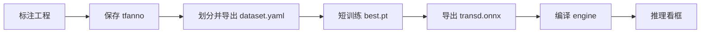

浏览器地址是 `http://127.0.0.1:8060`。桌面上的 `TRTForgeWeb.exe` 打开的是同一套页面。

---

## 1. 打开软件

还没在「环境说明」里设过密码时，密码可以空着，直接点 **进入**。设过之后，必须填对才能进。

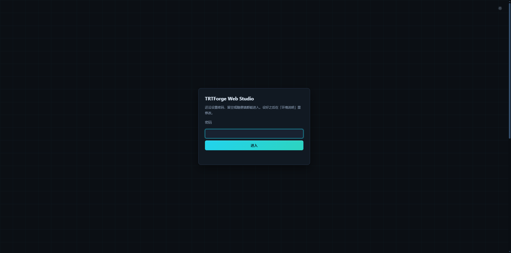

这一步点了 **进入**。磁盘上还没有新文件。画面上的原话是：「还没设置密码，留空或随便填都能进入。设好之后在「环境说明」里修改。」

点进去之后先出现等待画面，训练和推理环境在后台准备。准备好会自己进入主界面。

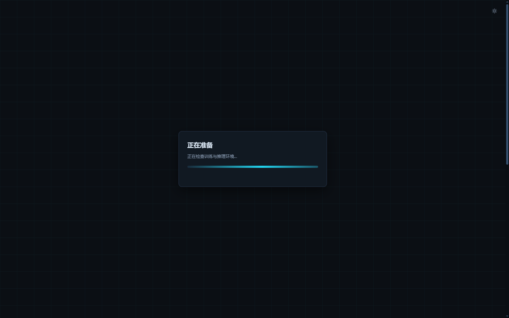

这一步没有按钮。画面上的原话是：「正在准备」「正在检查训练与推理环境…」

进来后默认停在 **训练导出**。顶栏版本是 v1.44.0。页面从左到右是：训练导出、引擎构建、数据集、标注、推理演示、自动实验、环境说明。

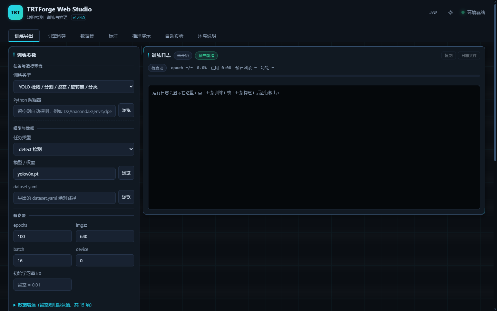

这一步还没改任何参数。页面上 epochs 仍是 100、imgsz 仍是 640、模型仍是 `yolov8n.pt`。后面训练时会把轮数和尺寸改小。

---

## 2. 标注

点顶栏 **标注**。还没有工程时，中间写着「打开或新建一个」。

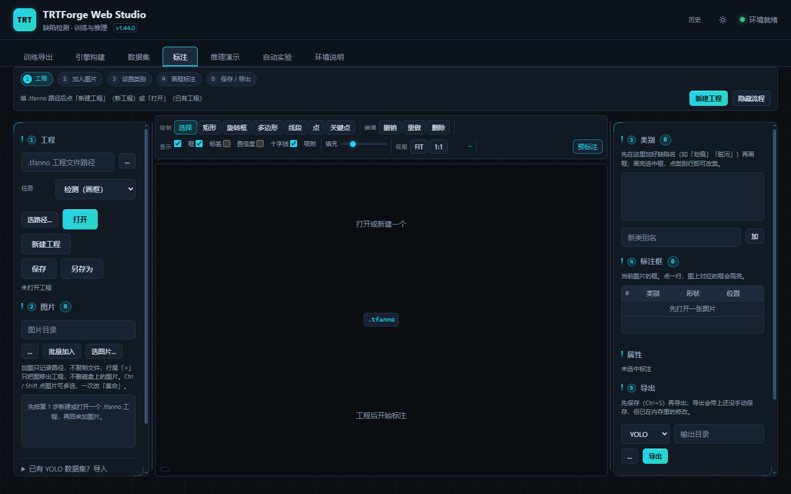

这一步只是打开标注页。任务保持「检测（画框）」。

在工程路径里填这次要用的文件名，点 **新建工程**。路径：

`D:\test\deeplearning\dp-tool\6-web\runtime\walkthrough\bottle_demo.tfanno`

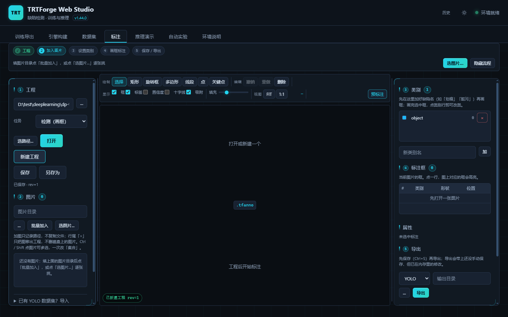

这一步点了 **新建工程**。磁盘上多了 `bottle_demo.tfanno`。底部原话是「已新建工程 rev=1」。新建时自带一个类别，名字叫 `object`，个数是 0。

图片用仓库里已有的瓶子破损图，复制了 12 张到：

`D:\test\deeplearning\dp-tool\6-web\runtime\walkthrough\images`

文件名是 `000.png` 到 `011.png`，来源是 `2-python-anomaly\anomalib-main\datasets\bottle\test\broken_large`。`019.png` 没有复制进来，留到最后推理。

图片目录填上面的 `images`，点 **批量加入**。

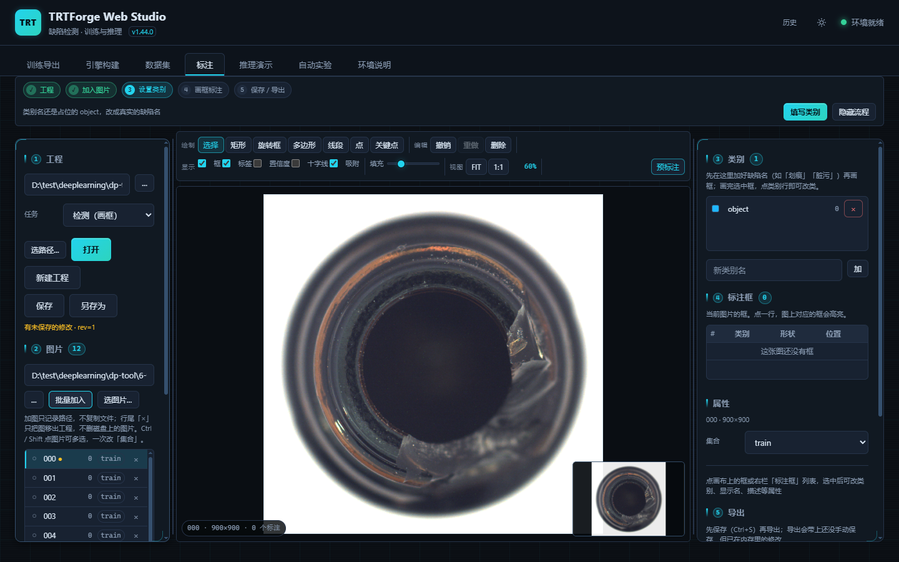

这一步点了 **批量加入**。工程里变成 12 张，当前是 `000.png`，尺寸 900×900，还没有框。黄字原话是：「类别名还是自带的 object，改成真实的缺陷名。」

在「新类别名」里填 `破损`，点 **加**。类别变成两个：`object` 和 `破损`，这时个数都还是 0。

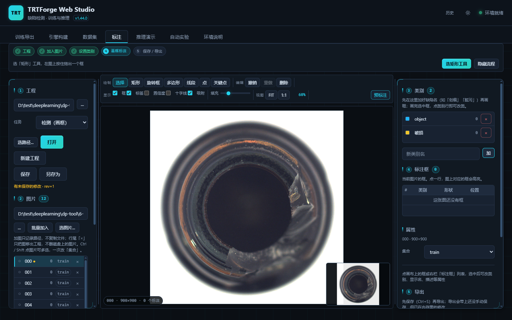

这一步点了 **加**。磁盘上的工程还没在这一下单独存成新文件，左边提示「有未保存的修改 · rev=1」。

画框前先点一下要用的那个类别。这次画的时候，当前类别仍是自带的 `object`，所以框都记在 `object` 上，`破损` 一直是 0。正式使用时，画之前先点中真实缺陷名。

点工具栏 **矩形**，在瓶口破损处按住拖出一个框。12 张都画了：`000.png` 两个框，其余每张一个，一共 13 个，类别都是 `object`。下面这张是 `005.png`。

这一步用 **矩形** 拖出了框。框上的字是 `object`。右边标注框表写着「object　矩形　378,448 251×233」。底部是「005 · 900×900 · 1 个标注」。

点 **保存**。向导五步都变绿，原话是「五步都完成了」。类别表是 `object` 13、`破损` 0。

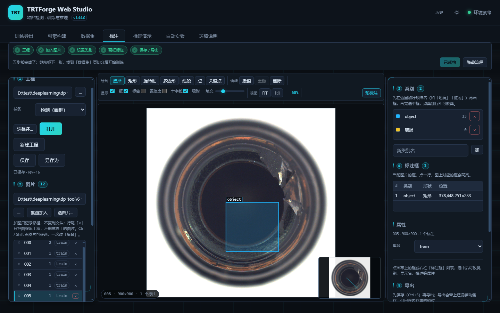

这一步点了 **保存**。`bottle_demo.tfanno` 更新为已保存，rev=16（中间自动存过几次，所以不是 rev=2）。

---

## 3. 划分数据集

点顶栏 **数据集**。数据源选 **文件**，填刚才的 `bottle_demo.tfanno`。导出格式保持 YOLO。train 填 80，val 填 20。输出目录填：

`D:\test\deeplearning\dp-tool\6-web\runtime\walkthrough\dataset_out`

输出目录不要放进图片目录里面。

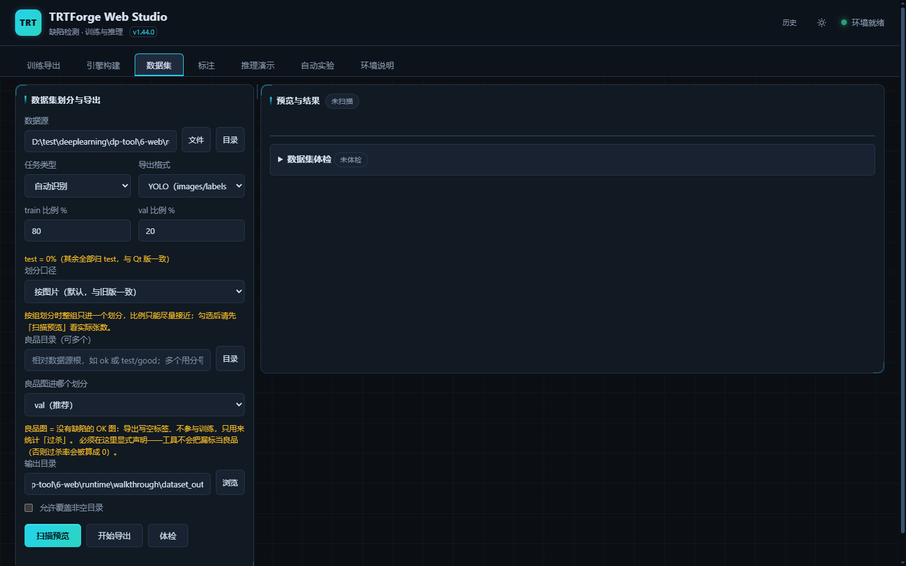

这一步还没扫描。右边是「未扫描」。页面上写着「test = 0%（其余全部归 test）」。

点 **扫描预览**。

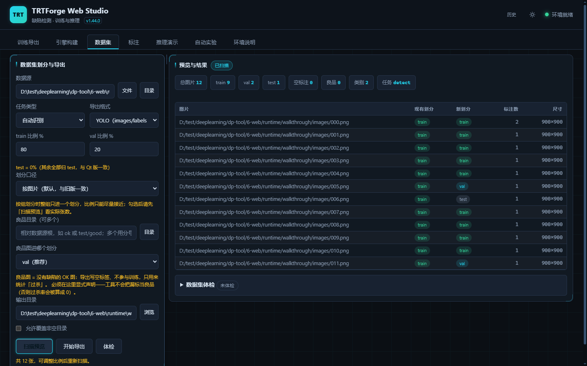

这一步点了 **扫描预览**。原话是「共 12 张，可调整比例后重新扫描。」统计是：总图片 12，train 9，val 2，test 1，空标注 0，良品 0，类别 2，任务 detect。12 张按 80/20 除不尽，多出来的 1 张进了 test（`006.png`）。

点 **开始导出**。

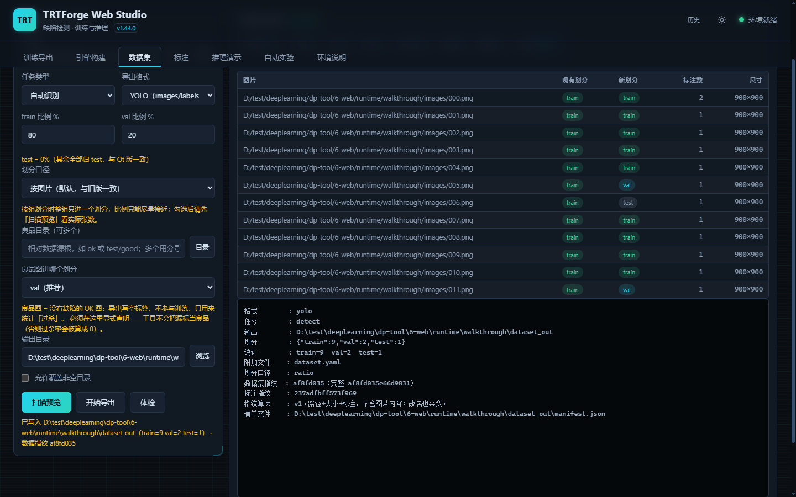

这一步点了 **开始导出**。徽章是「导出完成」。原话是已写入 `dataset_out`（train=9 val=2 test=1），附加文件 `dataset.yaml`。磁盘上多了这些：

| 文件 | 作用 |
| --- | --- |
| `dataset_out\dataset.yaml` | 训练要填的数据说明。类别是 `0: object`、`1: 破损` |
| `dataset_out\images\train`、`val`、`test` | 分好的图片 |
| `dataset_out\labels\train`、`val`、`test` | 跟图片同名的框坐标 |
| `dataset_out\manifest.json` | 这次划分的清单 |

---

## 4. 短训练

点顶栏 **训练导出**。这次填的是：

| 格子 | 填的值 |
| --- | --- |
| dataset.yaml | `D:\test\deeplearning\dp-tool\6-web\runtime\walkthrough\dataset_out\dataset.yaml` |
| epochs | 2 |
| imgsz | 320 |
| batch | 4 |
| device | 0（页面默认，这次日志里是 CUDA:0，NVIDIA T1000 8GB） |
| 模型 | `yolov8n.pt`（没改） |
| 输出目录 project | `D:\test\deeplearning\dp-tool\6-web\runtime\walkthrough\runs` |
| 实验名称 name | `bottle2ep` |

截图停在页面下方，能看到输出目录和实验名。上面的 yaml、轮数、尺寸已经填好。

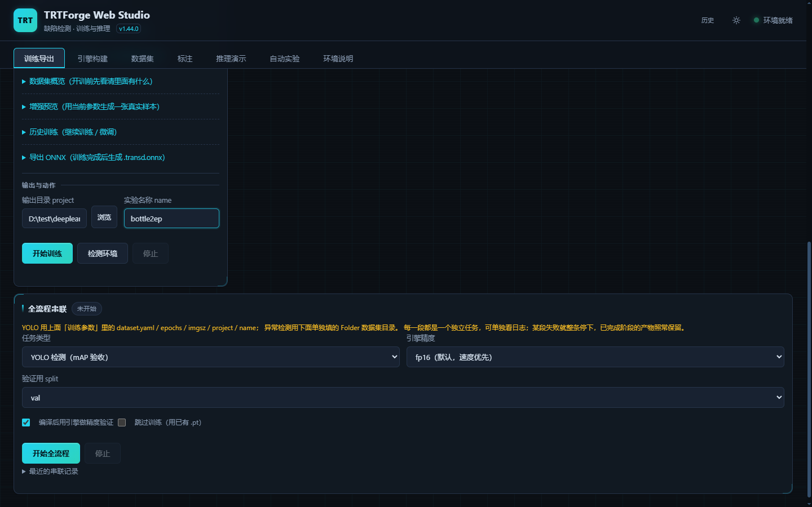

点 **开始训练**。日志先出现「正在启动任务…」

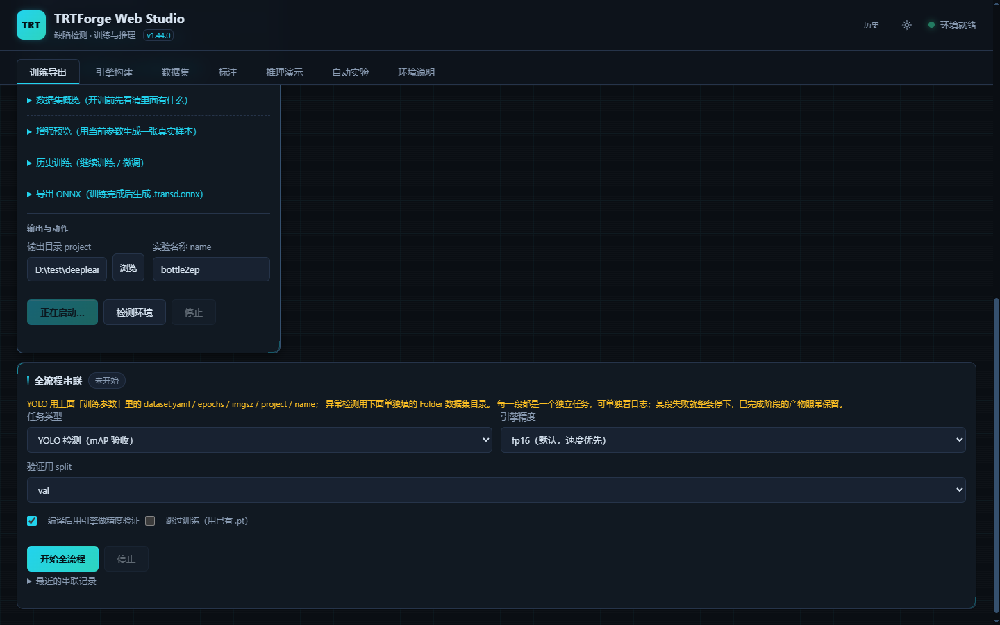

这一步点了 **开始训练**。权重还没写出来。

跑完后，日志列出这次实验目录里的文件，其中有 `weights\best.pt` 和 `results.csv`。

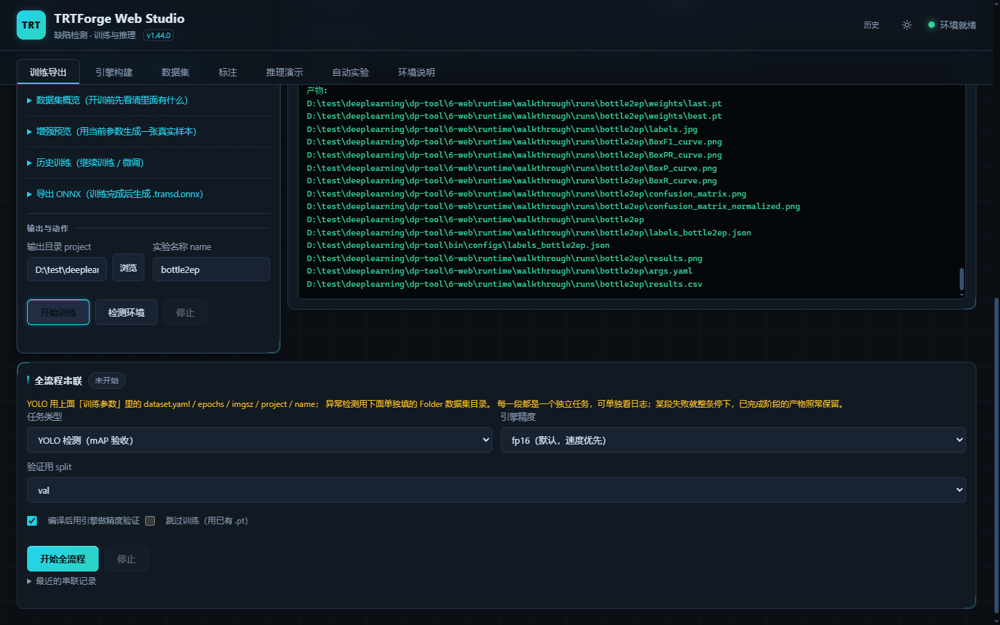

这一步训练结束。磁盘上多了：

`D:\test\deeplearning\dp-tool\6-web\runtime\walkthrough\runs\bottle2ep\weights\best.pt`

同目录还有 `last.pt`、`results.csv`、`results.png`、`args.yaml`，以及标签文件：

`D:\test\deeplearning\dp-tool\6-web\runtime\walkthrough\runs\bottle2ep\labels_bottle2ep.json`

内容是两个类名：`object`、`破损`。日志里还会再列一份 `dp-tool\bin\configs\labels_bottle2ep.json`，推理用实验目录里这份即可。

`results.csv` 第 2 轮的 precision、recall、mAP50、mAP50-95 都是 0。2 轮、9 张训练图，就是这个结果。正式训练把 epochs 改回自己的轮数，并换上足够的图。

---

## 5. 导出 ONNX，再编引擎

仍在 **训练导出**。展开 **导出 ONNX**。权重填：

`D:\test\deeplearning\dp-tool\6-web\runtime\walkthrough\runs\bottle2ep\weights\best.pt`

导出尺寸 imgsz 填 `320`，和训练一致。勾着 **生成 .transd.onnx**（这次默认就是勾着的）。simplify 也勾着。不要勾 half。

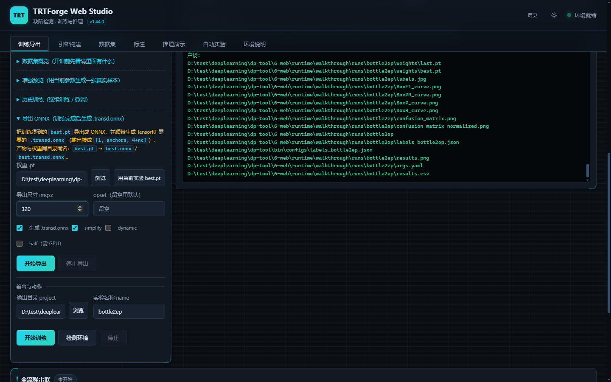

点 **开始导出**。完成后左边出现两行路径，底部原话是：「已生成 .transd.onnx（output0[1, 2100, 6]）」。

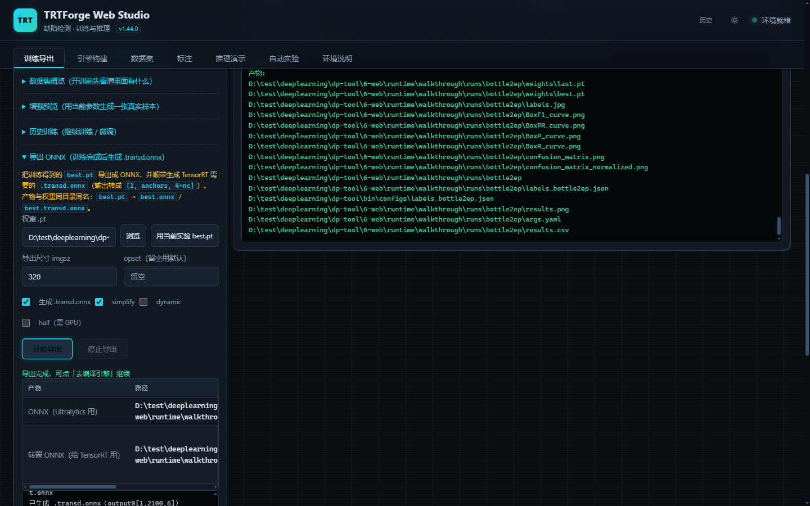

这一步点了 **开始导出**。和 `best.pt` 同一层多了两个文件：

| 文件 | 给谁用 |
| --- | --- |
| `weights\best.onnx` | 普通 ONNX |
| `weights\best.transd.onnx` | 下一步编引擎用这份 |

点顶栏 **引擎构建**。ONNX 文件填 `best.transd.onnx` 的完整路径。精度选 **fp16**。输出框留空，程序按文件名推导。

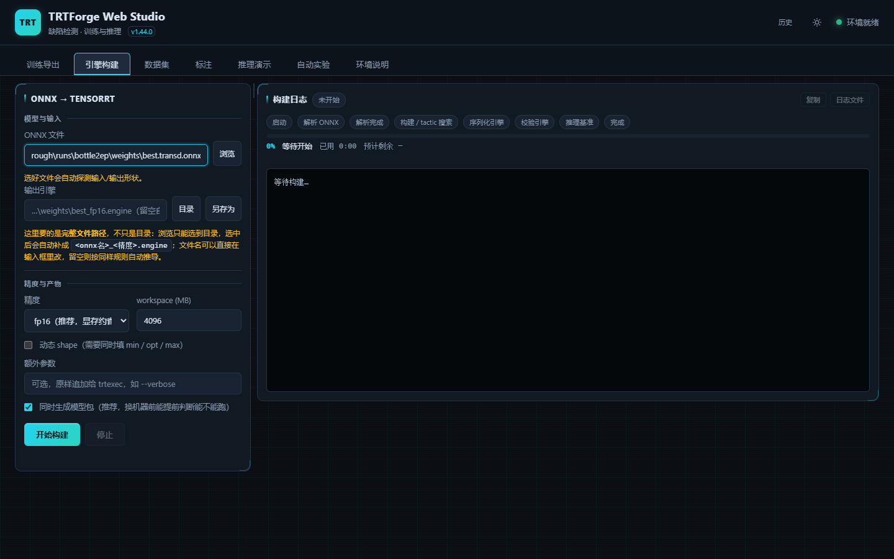

点 **开始构建**。这一步要几分钟。这次进度走到 100%，已用 6 分 43 秒。日志末尾原话是 `&&&& PASSED`，并且「[结果] 退出码=0」。左边原话是「构建完成：best.transd_fp16.engine」。输入形状是 `[1, 3, 320, 320]`。

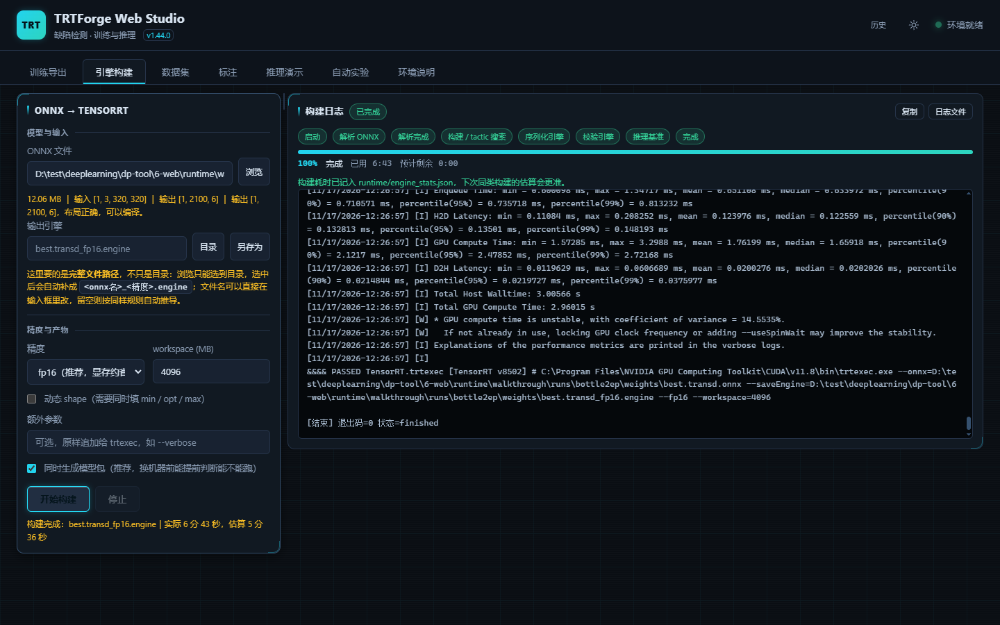

这一步点了 **开始构建**。磁盘上多了：

`D:\test\deeplearning\dp-tool\6-web\runtime\walkthrough\runs\bottle2ep\weights\best.transd_fp16.engine`

---

## 6. 推理

点顶栏 **推理演示**。推理类型选 **YOLO**。模型文件填刚才的 `best.transd_fp16.engine`。标签文件填：

`D:\test\deeplearning\dp-tool\6-web\runtime\walkthrough\runs\bottle2ep\labels_bottle2ep.json`

任务类型 detect。conf 保持 0.25。图片选一张没拿去训练的图：

`D:\test\deeplearning\dp-tool\2-python-anomaly\anomalib-main\datasets\bottle\test\broken_large\019.png`

这张不在上面的 12 张里，也没有进 `dataset_out`。

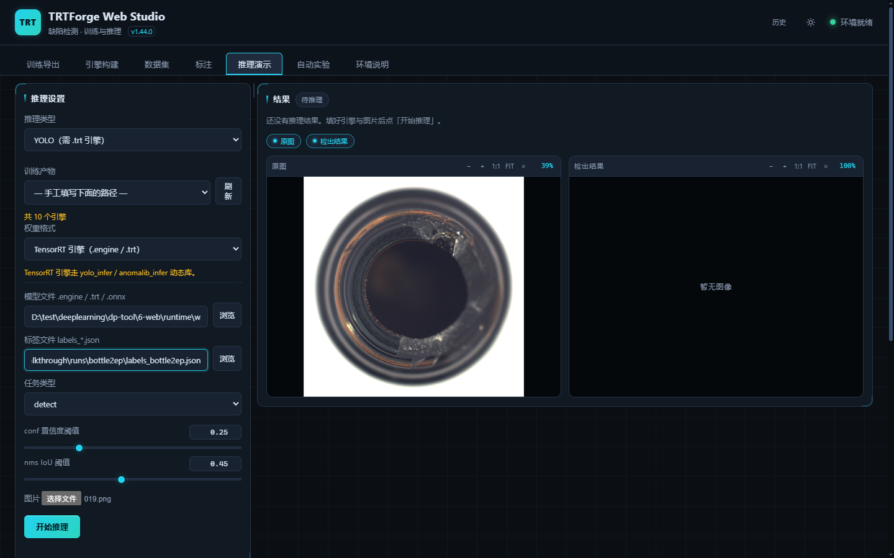

点 **开始推理**。右边原话是「完成」「目标数 2」「后端 yolo_infer.dll」「推理耗时 85.3 ms」「标签文件 bottle2ep · 2 类」。检出结果上能看见框和分数。明细两行是：

| # | 类别 | 置信度 | 位置 |
| --- | --- | --- | --- |
| 2 | object | 0.3016 | 几乎铺满整张图（840×808） |
| 1 | 破损 | 0.2991 | 同样几乎铺满（807×805） |

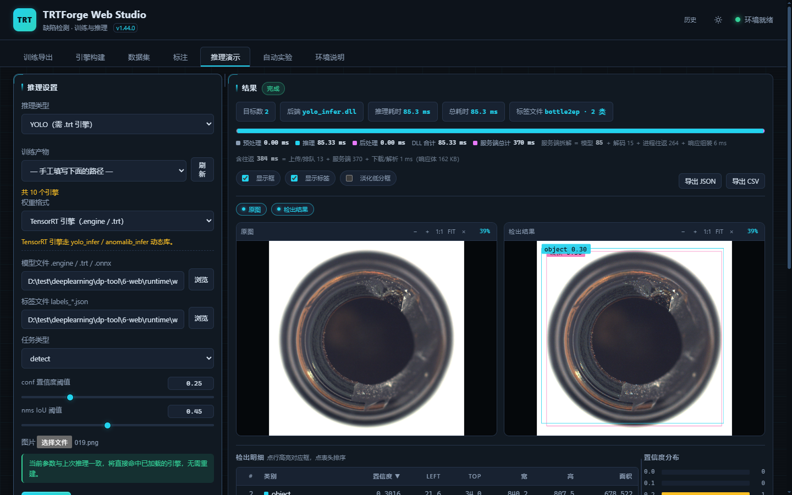

这一步点了 **开始推理**。没有新的权重文件。框又大、分数又低，是因为只训了 2 轮。正式检出要换自己的图、把轮数加回去，再用没参与训练的图看框是否贴住缺陷。

---

## 这次磁盘上的东西

都在 `D:\test\deeplearning\dp-tool\6-web\runtime\walkthrough\`：

| 路径 | 是什么 |
| --- | --- |
| `images\000.png` … `011.png` | 拿来标注的 12 张图 |
| `bottle_demo.tfanno` | 标注工程 |
| `dataset_out\dataset.yaml` | 训练用的数据说明 |
| `runs\bottle2ep\weights\best.pt` | 短训练权重 |
| `runs\bottle2ep\weights\best.transd.onnx` | 给 TensorRT 的 ONNX |
| `runs\bottle2ep\weights\best.transd_fp16.engine` | 这台显卡上的引擎 |
| `runs\bottle2ep\labels_bottle2ep.json` | 推理时的类别名 |

推理用的 `019.png` 仍在原来的瓶子样例目录，没有复制进 `walkthrough`。

换成自己的数据时：新建自己的 `.tfanno`，图片放自己的目录，输出目录和实验名也换成自己的。轮数用页面上的默认或按缺陷难度加，不要停在 2。画框前先点中真实类别名。导出尺寸和训练的 imgsz 保持同一个数。编引擎只选 `.transd.onnx`。
