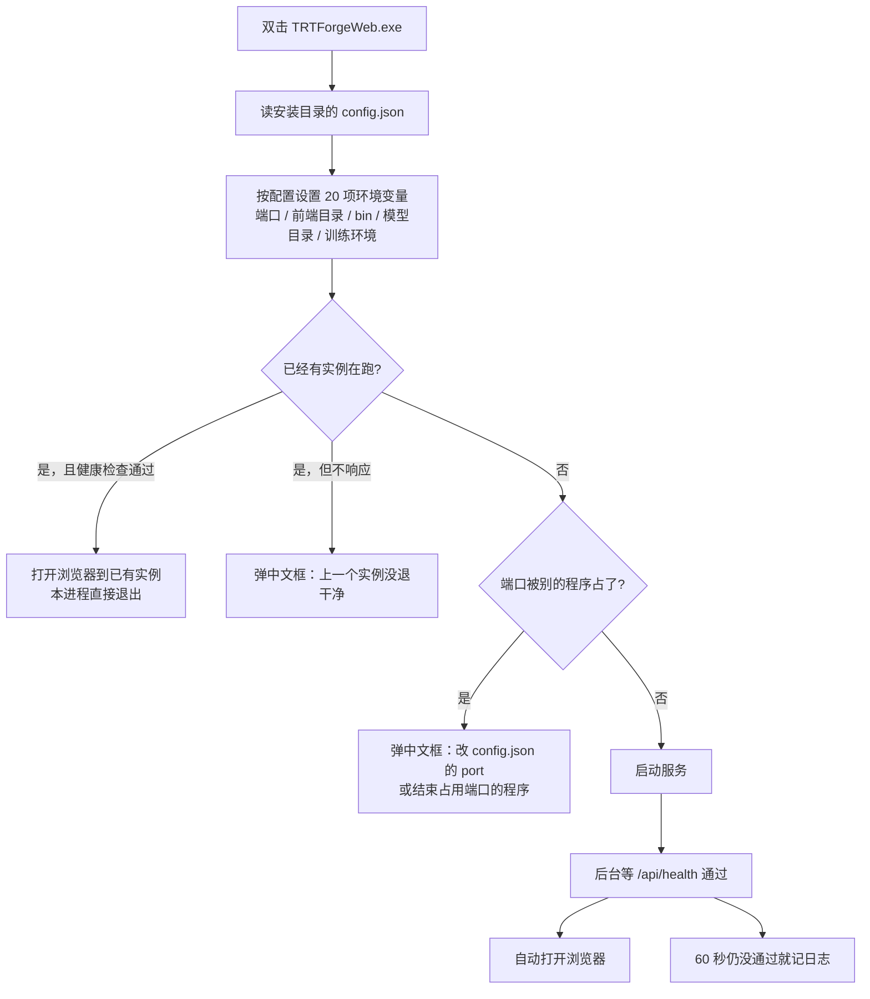

# 启动与排障说明

> 给现场使用。讲清楚「怎么打开软件」「启动失败怎么看」「配置改在哪里」。
> 不需要 PowerShell，也不需要任何命令行操作——双击就够了。

安装是把整个 `TRTForgeWeb` 文件夹拷过去，软件没有单独的安装向导。

---

## 1. 正常启动：双击一个文件

```
D:\TRTForgeWeb\app\TRTForgeWeb.exe     ← 双击这个
```

浏览器几秒后自己打开 `http://127.0.0.1:8060/`。窗口右上角出现版本号、并变成「环境就绪」就可以用。

以下三个入口效果完全相同，任选其一：

| 入口 | 什么时候用 |
| --- | --- |
| `app\TRTForgeWeb.exe` | 正常启动，推荐 |
| 安装目录的 `start_web.bat` | 快捷方式指向它、或其双击 exe 被安全软件拦下时 |
| `start_web_cmd.bat` | 旧快捷方式，现在只是转手调 `start_web.bat` |

已经开着的时候再双击一次，**不会**起第二个：程序会把浏览器重新打开到已经运行的实例上。

启动过程记录在 `runtime\logs\launcher.log`（UTF-8）。求助时把这个文件发出去即可。

---

## 2. 启动时到底发生了什么



要点：

- **配置只有一处**：安装目录的 `config.json`。bat 文件里不再有第二份端口设置。
- **环境变量只有一处实现**：编译进程序的 `launcher.py`。以前的 `start_user.ps1` 已降级为排障脚本。
- **失败一定有话说**：错误框分三段——发生了什么、为什么、该怎么办。

---

## 3. 改端口、让别的电脑访问

用记事本（或任何文本编辑器）打开安装目录的 `config.json`：

```json
{
  "port": 8060,
  "host": "127.0.0.1",
  "python": "",
  "data_roots": ["D:\\检测数据"]
}
```

| 想做的事 | 怎么改 |
| --- | --- |
| 换端口，避开别的程序 | `"port": 8070`。改完重新双击，浏览器地址自动变成新端口 |
| 车间其他电脑也要打开 | `"host": "0.0.0.0"`。本机仍访问 `http://127.0.0.1:8060/`，其他电脑访问 `http://这台机器的IP:8060/` |
| 限制「浏览」按钮只能选某几个盘 | `data_roots` 写多个目录，例如 `["D:\\检测数据", "E:\\数据集"]` |
| 指定训练用的 Python | `python` 填完整路径。留空时自动用旁边的 `train-env\python.exe` |

改 `host` 成 `0.0.0.0` 之后，还要在 Windows 防火墙入站规则里放行这个端口，否则其他电脑连不上。

`config.json` 存成 UTF-8（记事本默认就是）。文件坏掉、或写成 `"port": "abc"` 这类非法值时，
软件不会崩：会退回 `127.0.0.1:8060` 并继续启动。

---

## 4. 启动失败时看什么

### 4.1 弹出的中文框

| 框里说什么 | 意思 | 怎么办 |
| --- | --- | --- |
| 端口 xxx 已被其它程序占用 | 端口被别的软件占着，不是本软件 | 按框里给的两个办法任一处理：改 `config.json` 的 `port`，或结束占用端口的程序 |
| 上一个实例还没退干净 | 有个本软件进程还在，但网页服务已经不响应 | 等 5 秒重试；仍不行就在任务管理器结束 `TRTForgeWeb.exe` |
| 服务没能启动 | 后端 import 或启动阶段抛了异常 | 框里写了错误摘要和日志路径，把 `runtime\logs\launcher.log` 发出去 |
| 找不到程序 `app\TRTForgeWeb.exe`（bat 里的文字） | 文件夹不完整，只拷了部分文件 | 重新拷贝整个目录 |

### 4.2 没有弹框，但页面打不开

| 现象 | 处理 |
| --- | --- |
| 浏览器没自动打开，但托盘/任务管理器里有 `TRTForgeWeb.exe` | 手动访问 `http://127.0.0.1:8060/`。服务器上没装默认浏览器时这是正常的 |
| 提示找不到 `VCRUNTIME140.dll` / `MSVCP140.dll` | 安装微软 Visual C++ 2015–2022 x64 运行库 |
| 其他电脑打不开 | 确认 `host` 是 `0.0.0.0`，并放行防火墙入站端口 |
| 页面能开，推理报 `onnxruntime-fallback` | `bin` 里要同时有 `onnx_infer.dll`、`onnxruntime.dll`、`onnxruntime_providers_shared.dll` |

### 4.3 日志

```
runtime\logs\launcher.log     启动过程：安装根、端口、结果、完整异常栈
runtime\logs\                 训练与推理日志也在这一层
```

日志是追加写的，多次启动的记录都在里面；最新的在最后。

---

## 5. 排障启动（只有技术支持才需要）

正常启动不要用本节的东西。两个入口用于「双击没反应，想看到完整报错」。

### 5.1 在窗口里看实时输出

```bat
cd /d D:\TRTForgeWeb
start_web.bat
```

bat 会转手调 exe，并把输出留在当前窗口；失败时窗口不会一闪而过。

### 5.2 跳过单实例与自动开浏览器

```powershell
cd /d D:\TRTForgeWeb   # 或直接双击安装目录的 start_user.ps1
powershell -NoProfile -ExecutionPolicy Bypass -File .\start_user.ps1
```

它会设置 `TRTFORGE_LEGACY_START=1`，让程序直接在当前窗口跑服务、不抢单实例锁、不开浏览器。
怀疑「单实例判断误伤」或「端口探测有误」时用这种方式对照。

这个脚本**不设置任何业务环境变量**——那些仍由程序内部的启动器统一负责，避免两处配置打架。

---

## 6. 还要训练

双击 `install_train_env.bat`。要联网；对方电脑不必事先装 Anaconda 或 Miniconda，脚本会自己下载环境工具，
在旁边生成 `train-env`，并把路径写进 `config.json`。完成后再双击软件即可。

虚拟机或没有 AVX2 的处理器上，脚本会改用 Polars 兼容包，避免一点「检测环境」就崩溃。

### 6.1 没有 PowerShell 的电脑

`install_train_env.bat` 内部用到 PowerShell。机器上确实禁用了它时，可以手工建训练环境。
这一步需要本机已装 Anaconda 或 Miniconda、并能访问互联网。把 `D:\TRTForgeWeb` 换成实际目录，逐行执行：

```bat
cd /d D:\TRTForgeWeb
conda create -y -p D:\TRTForgeWeb\train-env python=3.12 pip
D:\TRTForgeWeb\train-env\python.exe -m pip install --upgrade pip
D:\TRTForgeWeb\train-env\python.exe -m pip install torch==2.3.0 torchvision==0.18.0 --index-url https://download.pytorch.org/whl/cu118
D:\TRTForgeWeb\train-env\python.exe -m pip install ultralytics==8.4.192 anomalib==1.2.0 onnx onnxruntime
D:\TRTForgeWeb\train-env\python.exe -m pip install polars-runtime-compat
D:\TRTForgeWeb\train-env\python.exe -m pip uninstall -y polars-runtime-32
```

`polars-runtime-32` 需要 AVX2，虚拟机或老处理器一导入就退出（退出码 `3221225501`），所以最后两行换成兼容包。
`onnx` 和 `onnxruntime` 是环境自检要检查的包，缺了会报未安装。

PyTorch 官方源超时的话，把 `--index-url` 换成 `https://mirrors.aliyun.com/pytorch-wheels/cu118` 再执行一次。

建好之后双击软件，网页右上角会显示「环境就绪」。「未配置」不影响推理，只是训练按钮不可用。

---

## 7. 电脑上要先有的东西

- 64 位 Windows 10、Windows 11，或 Windows Server 2016 及以上。
- 英伟达显卡驱动，支持 CUDA 11.8 即可。不必再装 CUDA 工具包。只用 CPU 跑 ONNX 时没有显卡也能打开页面，引擎推理会不可用。
- 微软 Visual C++ 2015–2022 x64 运行库。
- 一个浏览器。服务器上没有浏览器时，把 `host` 改成 `0.0.0.0`，换一台电脑访问 `http://服务器IP:8060/`。

---

## 8. v1.37.0 改了什么（和旧安装包的区别）

| 项目 | v1.36 及以前 | v1.37.0 起 |
| --- | --- | --- |
| 启动入口 | 双击 `start_web.bat` → 调 PowerShell → 设环境 → 调 exe | 双击 `app\TRTForgeWeb.exe`，环境变量由程序自己设 |
| 依赖 PowerShell | 是（`-ExecutionPolicy Bypass`） | 否 |
| 双击时是否弹黑框 | 有（PowerShell 窗口） | 无 |
| 启动失败 | 英文报错，窗口可能一闪而过 | 中文三段式错误框 + `runtime\logs\launcher.log` |
| 重复双击 | 起第二个实例，端口冲突后报错 | 识别已有实例，只打开浏览器 |
| 端口/地址配置 | `config.json` 与 `start_web_cmd.bat` 两处 | 只有 `config.json` |

旧安装包仍然可用，按旧文档操作即可。新安装包里的 `start_web_cmd.bat` 只保留兼容，不再有自己的端口设置。

页面上的训练、导出、推理操作没有变化，见 `docs\TRTForge_Web操作手册.md`。
