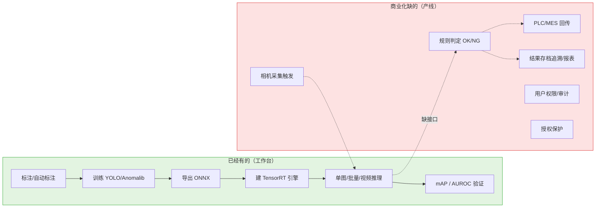
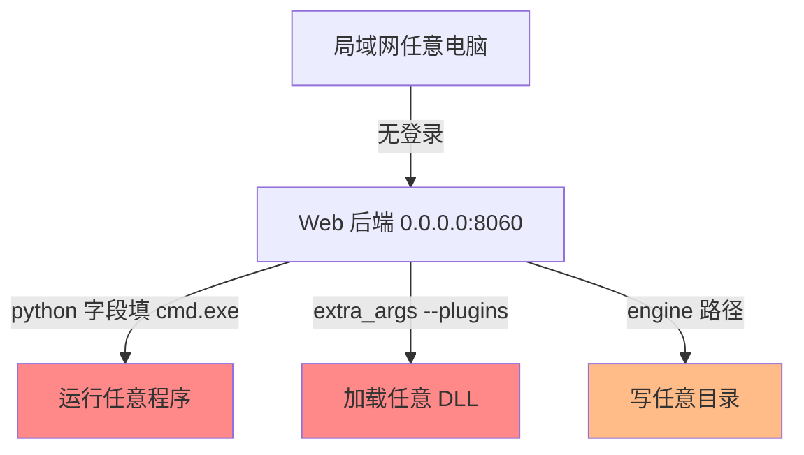
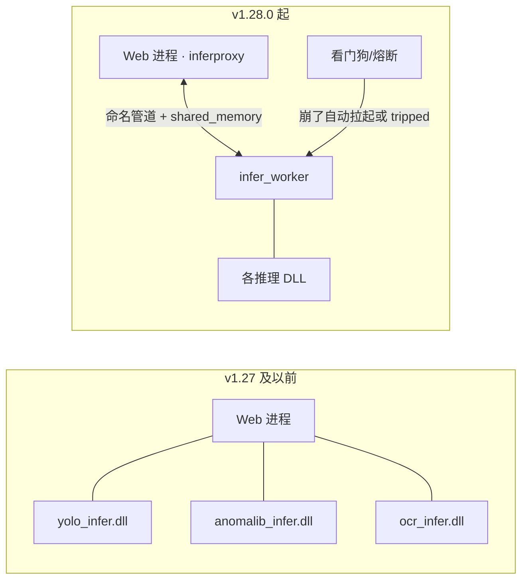
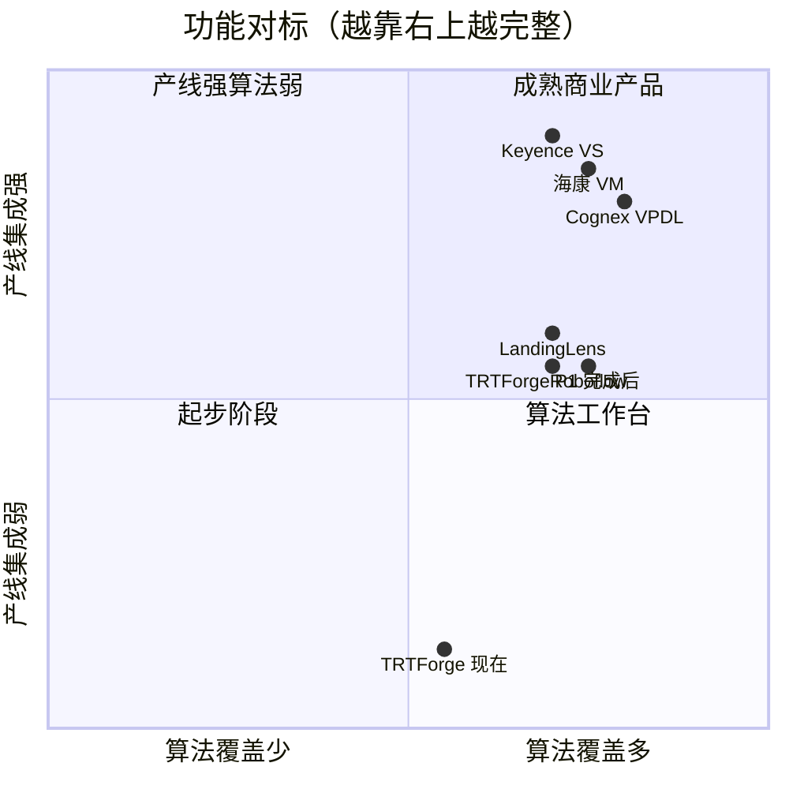
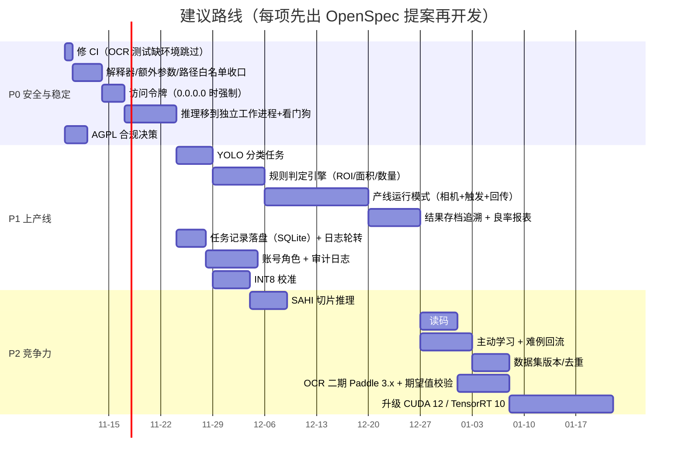
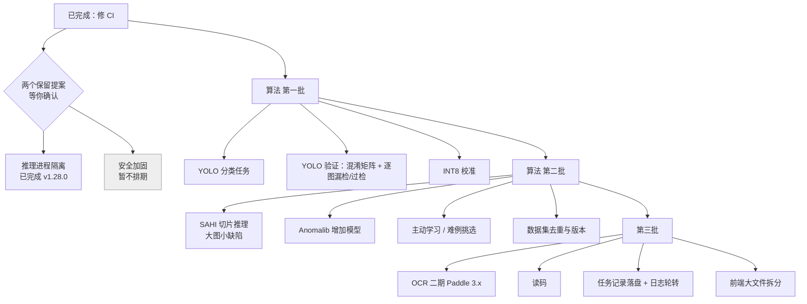

# TRTForge Web Studio 商业化差距分析与优化建议

> 版本基线：Web Studio v1.28.0（`6-web/backend/app.py` 中 `APP_VERSION`）
> 分析日期：2026-11-06
> 性质：只做分析，不改代码。每一项要动手前，先写 OpenSpec 提案，经确认后再开发。

> **范围调整（2026-11-06，以此为准）**：用户确认以下三块**不作为当前目标**：
> ① 安全（登录、局域网访问控制）；② 上产线（相机、PLC、MES、存档追溯）；③ 商业要素（授权保护、AGPL、签名、权限审计）。
> 第 2 节和第 6 节里相关内容只作记录保留，不排期。**推理进程隔离**已于 **v1.28.0** 落地（见 R1）；**安全加固**提案仍保留，等确认后再决定是否开发。
> 当前路线见第 8 节。

```yaml
doc_meta:
  kind: gap_analysis
  baseline_version: 1.28.0
  scope: [安全, 稳定性, 工程化, 算法, 产线集成, 商业要素]
  method: 四路只读核查（后端安全并发 / 算法能力盘点 / 前端与工程化 / 商业产品对标）+ 关键结论人工复核代码
  priority_levels:
    P0: 不修就不能交付给客户（安全漏洞、会把服务带崩的问题、合规硬伤）
    P1: 商业化必备能力，缺了客户会直接比下去
    P2: 加分项，做了更有竞争力
```

---

## 1. 一句话结论

现在的软件是一个**好用的「训练 + 建引擎 + 离线验证」工作台**，从标注到 TensorRT 引擎的链路完整，三类算法（YOLO、Anomalib、OCR）都能跑通。
但离「能卖给工厂、上产线」还差三块：

1. **安全**：没有登录，一旦开放到局域网，任何人都能让服务器运行任意程序。
2. **上产线**：没有相机、PLC、OK/NG 规则判定，只能「看图」，不能「管产线」。
3. **商业要素**：没有授权保护，训练框架 Ultralytics 是 AGPL-3.0，直接闭源销售有法律风险。



---

## 2. 安全漏洞（P0）

前提：默认只监听 `127.0.0.1`，此时只有本机能访问，风险有限。
但 `packaging/使用说明.md` 建议把 `host` 改成 `0.0.0.0` 让车间其他电脑访问——**一旦这么做，下面的问题全部暴露**。

| # | 问题 | 代码位置 | 后果 |
|---|------|----------|------|
| S1 | 没有任何登录、令牌、CORS 限制，WebSocket 也不校验 | `app.py` 全局；`frozen_entry.py:45` | 局域网任何人都能训练、删改、读日志 |
| S2 | 训练页「Python 解释器」只检查文件存在，不检查是不是 Python | `app.py:343` `_resolve_python` | **可让服务器运行任意 exe**（远程代码执行） |
| S3 | 引擎页「额外参数」原样追加给 trtexec | `app.py:1044` | 可加 `--plugins=xxx.dll` 加载任意 DLL，或 `--saveEngine` 写任意位置 |
| S4 | 引擎输出路径、训练数据路径、单图推理 engine/labels 没走白名单 | `app.py:982-996`、`452`、`2315` | 白名单形同虚设，可在任意目录写 `.engine` 文件、读任意模型 |
| S5 | 上传只看扩展名不看文件头；摄像头帧接口不经过统一上传校验 | `app.py:2179`、`2854` | 畸形文件直接进 OpenCV/DLL |



**建议修法（待确认）**

- S2：解释器只能从「自动发现结果 + `config.json` 配置 + 环境变量」里选，网页传进来的路径必须在白名单内且文件名是 `python.exe`。
- S3：额外参数改成白名单（只放行 `--memPoolSize`、`--builderOptimizationLevel` 等少数几个），禁止 `--plugins`、`--saveEngine`、`--loadEngine`、`--exportTimes` 一类。
- S4：所有接收路径的接口统一走 `_ensure_allowed_path`，加一个测试遍历全部路由检查。
- S1：加最简单的访问令牌（启动时生成，写在 `config.json`，首次打开网页输入一次）；监听 `0.0.0.0` 时强制开启。后续再做账号与角色（见第 6 节）。

---

## 3. 稳定性与架构问题

| # | 问题 | 级别 | 说明 |
|---|------|------|------|
| R1 | 推理 DLL 在 Web 进程内用 ctypes 调用 | P0 | **已完成（1.28.0）**：推理改在独立 `infer_worker` 子进程加载 DLL，Web 侧 `inferproxy` 代理；崩溃 503 + 自动重启，熔断时可降级 onnxruntime |
| R2 | 任务列表只在内存里 | P1 | 服务重启后「运行记录」清空（日志文件还在，但页面上找不回来） |
| R3 | 推理路由是同步函数 + 全局锁 | P1 | 同一时刻只能推一张图；多人同时用会排队，接产线后吞吐不够 |
| R4 | 没有日志轮转、没有结构化日志、没有审计 | P1 | 长期运行日志会撑满磁盘；出事后查不到「谁改了什么」 |
| R5 | 兜底路径写死 `D:\Anaconda3`、`D:\TensorRT-8.5.2.2` | P2 | 只是兜底，影响小，但客户机器上会误导 |
| R6 | CI 会失败 | P0（小） | `test_ocr_infer_dll.py` 缺模型时 `return 1`，而 `.gitignore` 排除了所有 `*.dll`，GitHub 上必然缺 → CI 红。其他 DLL 测试缺环境是 `[SKIP]`。这是 v1.27.0 引入的 |
| R7 | 版本锁死 CUDA 11.8 / TensorRT 8.5 / Paddle 2.6 | P2 | 新显卡（RTX 50 系 Blackwell）需要 CUDA 12.8+，老栈跑不了 |

R1 的推荐结构（**已于 v1.28.0 实现**）：



实现文件：`6-web/backend/infer_worker.py`、`inferproxy.py`；`TRTFORGE_INFER_ISOLATION=0` 可退回 v1.27.0 同进程行为以便排障。

---

## 4. 工程化问题

| # | 问题 | 级别 | 说明 |
|---|------|------|------|
| E1 | `annotate.js` 4167 行，`train.js` 1581 行 | P2 | 单文件过大，改一处容易牵连别处；按功能拆分即可，不必上框架 |
| E2 | `escapeHtml` 在 `infer.js`、`train.js` 各写了一份 | P2 | 抽成公共模块，防止以后新页面忘了转义 |
| E3 | 浏览器端到端测试只在文档里手工记录 | P1 | 每次发版靠人点，容易漏；把 Playwright 脚本固化下来 |
| E4 | CI 注释还写「29 个脚本」，实际 40 个 | P2 | 文档滞后 |
| E5 | 安装包没有数字签名、没有自动更新 | P1 | 客户机器杀毒软件容易拦；升级要手工替换 |
| E6 | 界面只有中文 | P2 | 出海客户需要英文 |

---

## 5. 算法能力盘点：有什么、缺什么

### 5.1 现状

| 能力 | 状态 | 说明 |
|------|------|------|
| YOLO 检测 / 分割 / 姿态 / 旋转框 | ✅ | `detect / segment / pose / obb` |
| **YOLO 图像分类** | ❌ | `SUPPORTED_TASKS` 里没有 `classify`。而**分类是商业产品的第一标配**（整图判 OK/NG、缺陷分档） |
| Anomalib 无监督异常 | ✅ | 仅 PatchCore / PaDiM / EfficientAd 三种 |
| 异常阈值校准 | ✅ | 用正常/异常样本校准 |
| OCR | ✅ | PP-OCRv4，仅老格式模型；无「期望文本校验」 |
| 读码（一维码/二维码） | ❌ | 追溯必备，商业产品几乎都有 |
| TensorRT FP16 | ✅ | |
| **TensorRT INT8 校准** | ❌ | 界面只有 fp32/fp16，没有校准数据集流程 |
| 小目标切片推理（SAHI） | ❌ | 大图小缺陷（如 5000×5000 面板上 10 像素划痕）检不到 |
| C API 批量 / 异步推理 | ❌ | 内部有 `forwards` 多图能力，但 C 接口没暴露 |
| 规则判定（面积/长度/数量/ROI → OK/NG） | ❌ | **产线最需要的一层**，没有它模型输出无法直接变成判定 |
| 多模型级联（异常检测 → YOLO 分类缺陷类型） | ❌ | |
| 自动标注 SAM / GroundingDINO | ✅ | |
| 主动学习（挑最不确定的图优先标） | ❌ | |
| 数据集版本、去重 | ❌ | |
| YOLO 验证混淆矩阵、逐图漏检/过检明细 | ❌ | 只有 mAP；Anomalib 侧有逐图报告 |
| 超参搜索、类别不平衡处理 | ❌ | |

### 5.2 对标商业产品

对比对象：Cognex VisionPro Deep Learning、Keyence VS、MVTec MERLIC/HALCON、海康 VisionMaster、LandingLens、Roboflow。



> 坐标是定性估计，用来看方向，不是测量值。

商业产品几乎都有、我们缺的「标配」：

1. 图像分类
2. 读码（一维/二维码）
3. 规则判定（AI 结果 + 面积/数量阈值）
4. 相机接入 + PLC 握手（触发拍照 → 回传 OK/NG）
5. 图形化/低代码流程编排
6. 用户权限 + 审计
7. 授权保护（加密狗或软授权）
8. 结果存图追溯 + 良率报表

---

## 6. 优化路线图



> 天数是粗估，用于排序和沟通，不是承诺工期。

### 6.1 P0：不修不能交付

| 编号 | 事项 | 为什么 |
|------|------|--------|
| P0-1 | 修 CI：OCR 测试缺环境改为 `[SKIP]` | 1 行级改动，现在 CI 必红 |
| P0-2 | 安全收口：解释器、trtexec 额外参数、全部路径走白名单 | 堵住远程执行任意程序 |
| P0-3 | 访问令牌 | 开放局域网的最低门槛 |
| P0-4 | 推理移到独立进程 + 崩溃自动拉起 | 产线 7×24 运行，不能因为一张坏图把服务带走 |
| P0-5 | **AGPL 合规决策** | 三选一：① 购买 Ultralytics 商业授权；② 训练环境由客户自行安装、我方只分发自研推理 DLL（需法务确认是否足够）；③ 检测训练换成 Apache-2.0 的框架（如 RT-DETR 官方实现、PaddleDetection、YOLOX）。**这是商业决策，需要你来定** |

### 6.2 P1：商业化必备

| 编号 | 事项 | 价值 |
|------|------|------|
| P1-1 | YOLO 分类任务（`classify`），含训练、导出、C++ 推理 | 补上第一标配；最简单的 OK/NG 判定场景 |
| P1-2 | 规则判定引擎：ROI、最小面积/长度、数量上限、按类别设置，输出 OK/NG + 原因 | 让模型结果变成产线能用的判定 |
| P1-3 | 产线运行模式：独立的「运行」页面，相机（GenICam/海康 MVS/Basler）采图 → 推理 → 判定 → 输出；PLC 先做 Modbus TCP，再做 OPC UA | 真正能上产线 |
| P1-4 | 结果存档：每次判定写 SQLite（时间、条码、结果、原因、图片路径），NG 图保留，OK 图可抽样；良率报表导出 Excel | 追溯，客户验收必问 |
| P1-5 | 任务记录落盘 + 日志轮转 | 重启不丢记录、磁盘不撑爆 |
| P1-6 | 账号与三级角色（管理员 / 工程师 / 操作员）+ 审计日志 | 操作员只能看运行页，不能改模型 |
| P1-7 | INT8 校准（用验证集图片做校准） | 速度再提升约 1.5～2 倍，可上更便宜的显卡 |
| P1-8 | YOLO 验证补混淆矩阵、逐图漏检/过检清单 | 工程师调模型最需要的信息 |
| P1-9 | 安装包数字签名 | 避免被杀毒软件拦截 |

### 6.3 P2：增强竞争力

| 编号 | 事项 | 适合场景 |
|------|------|----------|
| P2-1 | SAHI 切片推理 | 大幅面、小缺陷（面板、晶圆、钢板） |
| P2-2 | 读码（可用 OpenCV 自带的二维码 + zxing-cpp，均为宽松许可） | 产品追溯，与 OCR 组合 |
| P2-3 | 主动学习 + 难例回流：产线 NG/低置信度图自动进待标注池 | 模型越用越准 |
| P2-4 | 数据集快照/版本、相似图去重 | 可复现、防止验证集泄漏 |
| P2-5 | 多模型级联：异常检测找区域 → 分类模型判缺陷类型 | 「没见过的缺陷也要报，见过的要分类」 |
| P2-6 | Anomalib 加模型（如 FastFlow、Reverse Distillation） | 不同纹理场景效果差异大，多一个可选 |
| P2-7 | OCR 二期：Paddle 3.x 新格式 + 期望文本/正则校验 | 日期码、批号校验 |
| P2-8 | 升级 CUDA 12 / TensorRT 10 | 支持新显卡 |
| P2-9 | 英文界面、前端大文件拆分、Playwright 回归入 CI | 出海与可维护性 |

---

## 7. 不建议现在做的

| 事项 | 原因 |
|------|------|
| 换 React/Vue 重写前端 | 现有零构建方案能用，重写成本高、收益低；拆文件即可 |
| 云端多租户 SaaS | 工厂客户以离线工控机为主，先把单机产线模式做好 |
| 图形化拖拽流程编排 | 工作量大；先用「规则判定 + 级联」的表单配置满足 80% 场景 |
| 大模型/多模态缺陷描述 | 产线要的是稳定判定和速度，暂无刚需 |

---

## 8. 调整后的路线（2026-11-06，以此为准）

安全、上产线、商业要素三块不作为当前目标。剩下的重点是**算法能力**和**软件本身的稳定与好用**。



| 批次 | 事项 | 原编号 | 为什么排这里 |
|------|------|--------|--------------|
| 已完成 | 修 CI（OCR 测试缺环境时跳过） | P0-1 | — |
| 已完成 | 推理进程隔离 | P0-4 | **v1.28.0** 已上线 infer_worker；提案见 `openspec/changes/refactor-infer-worker-isolation` |
| 保留待定 | 安全加固 | P0-2/3 | 用户确认不作为目标，提案保留不排期 |
| 第一批 | YOLO 分类任务 | P1-1 | 缺陷检测最常用的能力，现在完全没有 |
| 第一批 | YOLO 验证补混淆矩阵、逐图漏检/过检清单 | P1-8 | 调模型最需要的信息，改动小 |
| 第一批 | INT8 校准 | P1-7 | 推理速度再提升约 1.5～2 倍 |
| 第二批 | SAHI 切片推理 | P2-1 | 大幅面、小缺陷场景 |
| 第二批 | Anomalib 增加模型 | P2-6 | 不同纹理效果差异大 |
| 第二批 | 主动学习 / 难例挑选 | P2-3 | 减少标注量（不依赖产线回流，用现有图片目录） |
| 第二批 | 数据集去重与版本 | P2-4 | 防止验证集泄漏、结果可复现 |
| 第三批 | OCR 二期、读码 | P2-7、P2-2 | |
| 第三批 | 任务记录落盘、日志轮转、前端拆分 | P1-5、E1 | 工程质量 |

不再排期：访问令牌与登录、账号角色审计、相机/PLC/MES、规则判定接产线、结果存档报表、授权保护、AGPL、安装包签名、多语言。

---

## 9. 相关文档

| 文档 | 用途 |
|------|------|
| [WebStudio架构与功能介绍.md](WebStudio架构与功能介绍.md) | 现有架构与技术栈 |
| [TRTForge_算法与应用场景说明_小白版.md](TRTForge_算法与应用场景说明_小白版.md) | 三类算法分别适合什么 |
| [WORKFLOW_GUIDE.md](WORKFLOW_GUIDE.md) | 开发与打包流程 |
| [../packaging/使用说明.md](../packaging/使用说明.md) | 安装包说明、第三方许可 |
