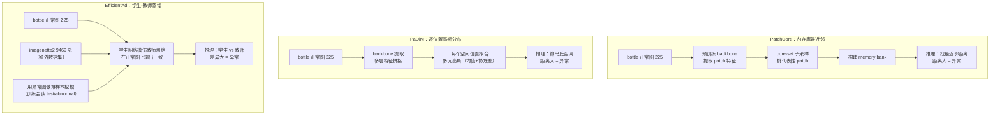
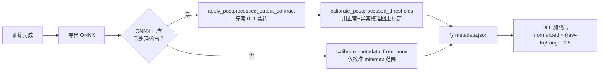

# 异常检测模型对比与选型：PatchCore / PaDiM / EfficientAd

> 本文所有数据均为 **本机实测**，不是论文引用值。
> 用途：告诉使用者「三个模型到底差在哪、什么场景选哪个、参数怎么填、坑在哪」。
> 最后更新：2026-10-30

---

## 0. 一句话结论（先看这个）

| 你的诉求 | 直接选 | 原因 |
| --- | --- | --- |
| 产线要快、要省显存、模型要小 | **PaDiM** | TRT 推理 3.6ms，引擎仅 87MB，训练 28 秒 |
| 要最高检出率、允许等训练 | **EfficientAd** | 实测 100% 准确率，且正常图分数有区分度 |
| 样本少、不想等训练、可接受分数饱和 | **PatchCore** | 3分42秒出结果，准确率 100%，但正常图分数恒为 0 |

**不要做的事**：拿 PatchCore 的正常图分数做「质量趋势监控」——它的正常图分数被完全饱和成 0，看不出良品之间的差异。

---

## 1. 实测环境

| 项目 | 值 |
| --- | --- |
| GPU | NVIDIA T1000 8GB（算力 7.5） |
| CUDA | 11.8.89 |
| TensorRT | 8.5.2 |
| PyTorch | 2.3.0+cu118 |
| cuDNN | 8.7 |
| Python | 3.12.4（`dpenv`） |
| anomalib | 1.2.0（本地源码 `2-python-anomaly/anomalib-main/src`） |
| 输入尺寸 | 256 × 256 |
| 引擎精度 | FP16 |
| trtexec 参数 | `--fp16 --minShapes=input:1x3x256x256 --optShapes=input:1x3x256x256 --maxShapes=input:8x3x256x256 --workspace=4096` |

### 测试数据集：bottle

```text
2-python-anomaly/anomalib-main/datasets/bottle
├── train/good        225 张   （训练用正常图）
├── test/good          20 张   （测试用正常图）
├── test/abnormal      44 张   （测试用异常图）
└── ground_truth/      像素级标注（本对比未使用）
```

> EfficientAd 额外需要 `datasets/imagenette`（9469 张，10 类，约 1485MB）。
> **注意：该目录不存在时训练直接报错，不会自动下载**——必须先建空目录，详见第 3 节。

---

## 2. 原理差异（决定了一切后续差异）



三种方法都属于**无监督异常检测**：只用正常样本建模，推理时判断「这张图偏离正常有多远」。

关键区别：

| 维度 | PatchCore | PaDiM | EfficientAd |
| --- | --- | --- | --- |
| 建模方式 | 特征最近邻（非参数） | 逐位置高斯（统计） | 知识蒸馏（需训练） |
| 是否需要梯度训练 | ❌ 否 | ❌ 否 | ✅ **是** |
| 是否需要第二个数据集 | ❌ | ❌ | ✅ **需要 imagenette** |
| 训练阶段是否读异常图 | ❌ 不读 | ❌ 不读 | ✅ **会读**（难样本挖掘） |
| `max_epochs` 语义 | 恒为 1（一次遍历） | 恒为 1 | 实际 20 轮迭代 |

---

## 3. 训练流程差异（实测耗时）

| 阶段 | PatchCore | PaDiM | EfficientAd |
| --- | --- | --- | --- |
| 准备额外数据 | 无 | 无 | **下载 imagenette2 1485MB**（首次） |
| 构建统计量 / 训练 | 特征提取 + core-set 采样 | 高斯拟合 | 20 epoch 蒸馏 |
| **训练+导出总耗时** | 3 分 42 秒 | **28 秒** | 59 分 35 秒 |
| 训练集自评 F1 | 0.8387 | 0.9254 | **1.0000** |

### 为什么差这么多

- **PaDiM 最快（28 秒）**：一次前向遍历算均值和协方差，没有采样、没有迭代。
- **PatchCore 稍慢（3分42秒）**：多了一步 core-set 子采样，这步是 CPU 密集的贪心选点，在 225 张图上要跑几分钟。
- **EfficientAd 最慢（59分钟）**：真梯度训练 20 个 epoch，而且每个 epoch 还要算「验证集分位数」（日志里会反复出现 `Calculate Validation Dataset Quantiles`，这是它的正常行为，不是卡死）。

### EfficientAd 的额外依赖

```python
# 源码位置：anomalib-main/src/anomalib/models/image/efficient_ad/lightning_model.py:192-202
extract_root = self.imagenet_dir
train_root = extract_root / "imagenette2" / "train"
if not train_root.is_dir():
    download_and_extract(extract_root, IMAGENETTE_DOWNLOAD_INFO)
```

- 默认路径：`2-python-anomaly/anomalib-main/datasets/imagenette`
- 下载源：`https://s3.amazonaws.com/fast-ai-imageclas/imagenette2.tgz`
- 测速：约 4 MB/s，总耗时 6~10 分钟，解压后 9469 张 / 10 类

**这里有个容易踩的坑**：launcher 在模型自动下载**之前**就先检查目录是否存在：

```python
# tf_anomalib_launcher.py:453-454
if model_name == "efficientad" and not imagenet_dir.exists():
    raise FileNotFoundError(f"EfficientAd imagenet_dir 不存在：{imagenet_dir}")
```

所以实际行为分两种：

| 情况 | 结果 |
| --- | --- |
| `datasets/imagenette` **目录不存在** | **直接报 `DATA_NOT_FOUND` / `exit=1`**，不下载（已实测确认） |
| 目录存在但为空 / 缺 `imagenette2/train` | 自动下载并解压（约 1485MB） |

界面或日志里会看到：

```text
TRTFORGE_JSON {"type":"error","code":"DATA_NOT_FOUND","message":"EfficientAd imagenet_dir 不存在：..."}
```

**结论：首次使用必须先手动建出这个空目录**，否则「自动下载」根本不会触发：

```powershell
New-Item -ItemType Directory -Force -Path 2-python-anomaly\anomalib-main\datasets\imagenette
```

然后再跑训练，就会自动下载。

---

## 4. 转换差异（ONNX → TensorRT）

### 4.1 ONNX 图结构

| 指标 | PatchCore | PaDiM | EfficientAd |
| --- | --- | --- | --- |
| ONNX 大小 | 301.55 MB | 168.46 MB | **30.78 MB** |
| 节点总数 | 363 | 198 | 316 |
| Conv 层数 | 44 | 16 | 22 |
| 主要算子 | Constant(93), Conv(44), Relu(40), Gather(24) | Constant(60), Shape(17), Conv(16) | Constant(106), Cast(34), Conv(22) |
| 输出张量 | pred_score / pred_label / anomaly_map / pred_mask | 同左 | 同左 |

**注意**：三者输出契约一致（都是 4 个输出），但**模型大小和编译难度不成正比**（见下表）。

### 4.2 TensorRT 引擎

| 指标 | PatchCore | PaDiM | EfficientAd |
| --- | --- | --- | --- |
| 引擎大小（FP16） | 275.9 MB | 87.2 MB | **19.4 MB** |
| trtexec 编译耗时 | 924 秒 | **1023 秒（最慢）** | **480 秒（最快）** |
| 编译是否成功 | ✅ PASSED | ✅ PASSED | ✅ PASSED |

**反直觉现象**：PaDiM 的 ONNX 只有 168MB，比 PatchCore 小一半，但编译耗时最长（1023 秒）。
原因是它的马氏距离计算在 TensorRT builder 里优化空间很小，builder 要反复尝试 tactic。

### 4.3 metadata.json 契约（最容易踩坑的地方）

三个模型走了**两条不同的代码分支**：

| 模型 | `output_contract` | `normalization` | metadata 生成分支 |
| --- | --- | --- | --- |
| PatchCore | `anomalib_post_processed_0_1` | `none` | 后处理契约 + 阈值校准 |
| PaDiM | `anomalib_post_processed_0_1` | `none` | 后处理契约 + 阈值校准 |
| EfficientAd | `efficientad_distribution_calibrated` | `none` | `calibrate_efficientad_metadata`（独立分支） |

对应源码分支：`2-python-anomaly/launcher/tf_anomalib_launcher.py` 的 metadata 生成段。

实测阈值：

| 模型 | `image_threshold` | `pixel_threshold` |
| --- | --- | --- |
| PatchCore | 0.1720 | 0.1634 |
| PaDiM | 0.2941 | 0.1896 |
| EfficientAd | 0.7477 | 0.6650 |

> 阈值不再是固定的 0.5，而是用「正常校准图 + 异常校准图」重新标定得到的。
> 详见 `docs/异常检测阈值校准说明.md` 与本文第 8 节。

---

## 5. 效果差异（部署实测，44 异常 + 20 正常）

所有数据来自 **C++ DLL（`anomalib_infer.dll`）加载 FP16 引擎**的真实推理，不是 Python 模拟。

| 模型 | 正常图 raw_score | 异常图 normalized_score | TP | FN | TN | FP | 准确率 | F1 |
| --- | --- | --- | --- | --- | --- | --- | --- | --- |
| PatchCore | **20 张全是 0.000000** | 0.6688 ~ 1.0000 | 44 | 0 | 20 | 0 | **1.0000** | 1.0000 |
| PaDiM | 17 张 0.0，3 张 0.015~0.133 | 0.4425 ~ 1.0000 | 43 | 1 | 20 | 0 | 0.9844 | 0.9885 |
| EfficientAd | 0.5393 ~ 0.6268（**19 种取值**） | 0.7241 ~ 1.0000 | 44 | 0 | 20 | 0 | **1.0000** | 1.0000 |

### 关键差异：分数区分度

这是三个模型**最本质的差别**，比准确率更重要：

| 模型 | 正常图分数有几种取值 | 意味着什么 |
| --- | --- | --- |
| PatchCore | **1 种（全 0）** | 看不出良品之间的差异，无法做趋势预警 |
| PaDiM | 4 种 | 有微弱区分度 |
| EfficientAd | **19 种** | 有真正可用的连续分数 |

**为什么 PatchCore 正常图全是 0？**

anomalib 把后处理归一化也编进了导出的 ONNX 图里，而这个归一化的统计量（min/max）是在「全正常验证集」上算的。分母退化后，所有正常样本的输出被 clip 到边界 0.0。

分类结果不受影响（照样 100% 正确），但**你不能用它判断「这张良品比那张更接近缺陷」**。

### 推理性能

| 模型 | TRT 推理（中位） | 前处理（中位） | 后处理（中位） | 单张总耗时 |
| --- | --- | --- | --- | --- |
| PatchCore | 24.76 ms | 1.30 ms | 10.56 ms | ~36.6 ms |
| **PaDiM** | **3.56 ms** | 1.30 ms | 10.28 ms | **~15.1 ms** |
| EfficientAd | 23.79 ms | 1.29 ms | 10.08 ms | ~35.2 ms |

> 后处理耗时（约 10ms）主要来自热力图生成、上采样和轮廓绘制，三个模型基本一致。
> **追求高帧率时，后处理同样值得优化。**

---

## 6. 参数说明

训练入口：`2-python-anomaly/launcher/tf_anomalib_launcher.py --mode train-export`

### 6.1 通用参数

| 参数 | 默认值 | 说明 |
| --- | --- | --- |
| `--model` | `patchcore` | 可选：`patchcore` / `padim` / `efficientad` |
| `--root` | 空 | 数据集根目录 |
| `--normal-dir` | `train/good` | 正常训练图子目录（相对 `--root`） |
| `--abnormal-dir` | `test/abnormal` | 异常测试图子目录 |
| `--normal-test-dir` | `test/good` | 正常测试图子目录 |
| `--project` | `results` | 输出根目录 |
| `--name` | `latest` | 本次运行名称 |
| `--input-size` | `256` | 输入边长（宽=高） |
| `--max-epochs` | `auto` | `auto` 时：patchcore/padim 为 1，efficientad 为 20 |
| `--train-batch-size` | `4` | 训练 batch（efficientad 强制为 1） |
| `--eval-batch-size` | `4` | 评估 batch |
| `--num-workers` | `0` | DataLoader 进程数（Windows 建议 0） |
| `--val-split-ratio` | `0.2` | 从训练集切出的验证集比例 |
| `--calibrate-metadata` | `true` | 是否用校准样本重标定阈值 |
| `--calib-limit` | `64` | 每类校准样本上限 |
| `--calib-normal-dir` | 空 | 额外的正常校准目录 |
| `--calib-abnormal-dir` | 空 | 额外的异常校准目录 |

### 6.2 模型差异化参数

| 参数 | 生效模型 | 说明 |
| --- | --- | --- |
| `--imagenet-dir` | **仅 efficientad** | imagenette 根目录，默认 `<anomalib-main>/datasets/imagenette`，缺失会报错 |

> ⚠️ **两条链路的默认 epoch 不一致，不要混用**：
>
> | 入口 | PatchCore | PaDiM | EfficientAd |
> | --- | --- | --- | --- |
> | `tf_anomalib_launcher.py --max-epochs auto` | 1 | 1 | **20** |
> | `anomalib-main/train.py` 独立脚本 | 50 | 1 | **5** |
>
> 本工程训练页 / Web 工作站走的是 **launcher**，以 launcher 的 1 / 1 / 20 为准。
> `train.py` 是另一条独立命令行链路，不参与界面集成。

### 6.3 各模型特殊规则（源码级）

| 规则 | 源码位置 | 说明 |
| --- | --- | --- |
| EfficientAd 训练 batch 强制为 1 | `tf_anomalib_launcher.py` `train_batch_size = 1 if model_name == "efficientad"` | 论文设定，imagenet dataloader batch=1 |
| EfficientAd 需要 imagenet_dir | `tf_anomalib_launcher.py` `create_model()` | 缺失直接 `FileNotFoundError` |
| EfficientAd 走独立校准函数 | `calibrate_efficientad_metadata()` | 与另两个模型不同分支 |
| patchcore/padim 恒为 1 epoch | `resolve_max_epochs()` | `max_epochs` 对它们无意义 |

---

## 7. 使用方式

### 7.1 方式 A：浏览器工作站（推荐）

```powershell
# 1) 启动后端
powershell -NoProfile -ExecutionPolicy Bypass -File .\scripts\run_web_studio.ps1

# 2) 浏览器打开 http://127.0.0.1:8060
# 3) 训练页选「异常检测」→ 选模型 → 填数据集 → 开始
```

界面上需要注意：

- **选 EfficientAd 时**，Web 界面**没有 `imagenet_dir` 输入框**，固定使用 `2-python-anomaly/anomalib-main/datasets/imagenette`。如果该目录不存在，会直接报 `FileNotFoundError`（launcher 不会自动创建）。务必先建出空目录，见本文第 3 节。
- **阈值**默认已自动校准，不需要手动填 0.5。
- Web 界面只暴露 `root` / 三个子目录 / `input_size` / `max_epochs` / `project` / `run_name`。
  `train_batch_size`、`val_split_ratio`、`calib_limit`、`imagenet_dir` 等走后端默认值，需要调整时请用命令行方式（7.2 节）。

### 7.2 方式 B：命令行

```powershell
cd 2-python-anomaly\launcher

# PatchCore
python tf_anomalib_launcher.py --mode train-export --model patchcore `
  --root ..\anomalib-main\datasets\bottle `
  --normal-dir train/good --abnormal-dir test/abnormal --normal-test-dir test/good `
  --project results --name pc_bottle --input-size 256

# PaDiM
python tf_anomalib_launcher.py --mode train-export --model padim `
  --root ..\anomalib-main\datasets\bottle `
  --project results --name padim_bottle --input-size 256

# EfficientAd（注意 max-epochs 与 imagenet-dir）
python tf_anomalib_launcher.py --mode train-export --model efficientad `
  --root ..\anomalib-main\datasets\bottle `
  --imagenet-dir ..\anomalib-main\datasets\imagenette `
  --project results --name ea_bottle --input-size 256 --max-epochs 20
```

产物位置：`results/<ModelName>/<run_name>/v0/weights/lightning/`

```text
results/Patchcore/cmp_patchcore/v0/weights/lightning/
├── model.ckpt            198.46 MB   Lightning 权重
├── model.onnx            301.55 MB   ONNX 图（含后处理）
└── metadata.json                  阈值与归一化契约
```

### 7.3 方式 C：编译 TensorRT 引擎

```powershell
$trt = "C:\Program Files\NVIDIA GPU Computing Toolkit\CUDA\v11.8\bin\trtexec.exe"
$d = "results\Patchcore\cmp_patchcore\v0\weights\lightning"

& $trt --onnx="$d\model.onnx" --saveEngine="$d\model_fp16.engine" --fp16 `
  --minShapes=input:1x3x256x256 --optShapes=input:1x3x256x256 `
  --maxShapes=input:8x3x256x256 --workspace=4096 --verbose=0
```

> 编译耗时：PatchCore ≈ 15 分钟，PaDiM ≈ 17 分钟，EfficientAd ≈ 8 分钟。
> 三个同时编译会互相抢 GPU，实际会明显变慢，建议串行。

### 7.4 方式 D：C++ DLL / Python ctypes 推理

```python
# 6-web/backend/infer.py 已封装好，直接调用
import infer

result = infer.run_anomalib(
    engine_path=".../model_fp16.engine",
    metadata_path=".../metadata.json",
    image=bgr_image,          # numpy BGR uint8
    model_type="Auto",        # 可与 metadata 一致，用于消歧
)
# result 包含：raw_score / normalized_score / is_anomaly
#              overlay_png / mask_png / timing / metadata
```

---

## 8. 阈值校准说明

### 8.1 老版本的问题（重要）

老版本 metadata 里 `image_threshold` 固定为 `0.5`，实测导致 PatchCore 漏检 2 张：

| 阈值 | 异常检出 | 正常误判 | 准确率 |
| --- | --- | --- | --- |
| 0.5（老版本） | 42/44 | 0/20 | 0.969 |
| **校准后（新版本）** | **44/44** | **0/20** | **1.000** |

**根因**：anomalib 的自适应阈值需要在「含异常样本的验证集」上算，而本工程的验证集是从 `train/good` 切出来的，**全是正常图**，算不出有意义的阈值，于是回落到默认 0.5。

### 8.2 新版本的做法



- 新增函数：`calibrate_postprocessed_thresholds()`，位于 `anomalib-main/trtforge_metadata.py`
- 校准逻辑：正常图上沿取 99 分位，异常图下沿取 5 分位，可分时取中点，重叠时退化为略高于正常上沿
- 校准产物会写入 `metadata.json` 的 `calibration` 字段，包含样本准确率，便于追溯
- **只改 metadata，不需要重新编译引擎**

### 8.3 校准的局限

校准在 **ONNX Runtime (FP32)** 上做，部署在 **TensorRT (FP16)** 上。实测 FP16 会让 PatchCore 的分数整体上移（正常图从 0.0 抬到约 0.33）。

分数排序没变，所以判定仍正确，但这说明**校准阈值带有 FP16 数值误差的安全余量**。如果换了硬件或 TensorRT 版本，建议重跑一次全测试集验证。

---

## 9. 选型决策表

| 场景 | 推荐 | 理由 | 注意事项 |
| --- | --- | --- | --- |
| 产线实时检测、算力紧张 | **PaDiM** | 3.6ms，比另两个快 7 倍 | 偶有漏检（本次 1/44） |
| 缺陷尺度差异大、要最高召回 | **EfficientAd** | 正常/异常边界清晰（0.63 vs 0.72） | 训练 1 小时，需 imagenette |
| 样本极少、不想等训练 | **PaDiM** / **PatchCore** | 秒级~分钟级训练 | PatchCore 分数饱和 |
| 需要质量趋势监控 | **EfficientAd** | 唯一有连续可用分数 | 显存占用最高 |
| 边缘设备、模型要小 | **EfficientAd** | 引擎仅 19.4MB | 训练阶段反而不轻 |
| 快速验证链路是否通 | **PaDiM** | 28 秒训练 + 最小引擎 | 编译耗时最长 |

---

## 10. 已知限制与坑

| 问题 | 现象 | 处理 |
| --- | --- | --- |
| PatchCore 分数饱和 | 正常图 raw_score 全为 0.0 | 属预期行为，不要用于趋势判断 |
| EfficientAd 缺 imagenette | `DATA_NOT_FOUND`（目录不存在时**不会**自动下载） | 先 `New-Item -ItemType Directory` 建空目录，再跑训练即自动下载 |
| EfficientAd 日志刷屏 | 反复打印 `Calculate Validation Dataset Quantiles` | 正常阶段，不是卡死 |
| PaDiM 编译最慢 | 引擎最小但编译 1023 秒 | 预留时间，不要误以为卡住 |
| Windows 符号链接失败 | `latest` 目录创建报权限错 | launcher 已打补丁，改为直接返回 `vN` 目录 |
| `dynamo` 参数不兼容 | `TypeError: export() got an unexpected keyword argument 'dynamo'` | torch < 2.5 没有该参数，`export_mixin.py` 已做能力探测 |
| 并行编译抢 GPU | 三个模型同时编译明显变慢 | 串行编译 |
| 显存接近上限 | EfficientAd 训练占 7.8GB / 8GB | 降低 `--input-size` 或 `--eval-batch-size` |

---

## 11. 版本变更记录（新旧对比）

### v1.1 — 2026-10-30（本次）

| 项目 | 老版本 | 新版本 | 影响 |
| --- | --- | --- | --- |
| ONNX 导出（torch 2.3） | 直接崩溃：`TypeError: unexpected keyword argument 'dynamo'` | 能力探测，老 torch 不传该参数 | 训练导出链路可用了 |
| 后处理契约模型阈值 | 固定 `0.5` | 用正常+异常样本自动标定 | PatchCore 漏检 2→0 |
| 阈值校准覆盖范围 | 仅 EfficientAd | PatchCore / PaDiM / EfficientAd 全覆盖 | 三个模型都不用手调 |
| 校准样本取样 | 按目录顺序取满即止 | 多目录轮转取样 | 校准样本来源更均衡 |
| metadata `calibration` 字段 | 仅计数 | 增加 `sample_accuracy`、`normal_score_range` 等 | 可追溯校准质量 |

### v1.0 — 2026-10-28

| 项目 | 老版本 | 新版本 |
| --- | --- | --- |
| 目录结构 | 根目录平铺 | 五级分层（`1-python-yolo` ~ `6-web`） |
| 界面 | Qt 桌面程序 `TRTForge.exe` | 浏览器工作站 `6-web`（FastAPI + 零构建前端） |
| 脚本路径 | 硬编码 `D:\test1\deeplearning\...` | 按脚本自身位置推导 |

---

## 12. 复现步骤速查

```powershell
# 0) 环境自检
cd 2-python-anomaly\launcher
python tf_anomalib_launcher.py --mode check-env
# 期望输出 "missing":[]

# 1) 三模型依次训练（约 1 小时，主要耗在 EfficientAd）
python tf_anomalib_launcher.py --mode train-export --model patchcore   --root ..\anomalib-main\datasets\bottle --project results --name cmp_patchcore
python tf_anomalib_launcher.py --mode train-export --model padim       --root ..\anomalib-main\datasets\bottle --project results --name cmp_padim
python tf_anomalib_launcher.py --mode train-export --model efficientad --root ..\anomalib-main\datasets\bottle --project results --name cmp_efficientad

# 2) 串行编译引擎（约 40 分钟）
#    见 7.3 节命令，逐个替换 $d

# 3) 起服务验证
powershell -File ..\..\scripts\run_web_studio.ps1
# 浏览器 http://127.0.0.1:8060 → 推理页 → 上传 test/abnormal 里的图
```
