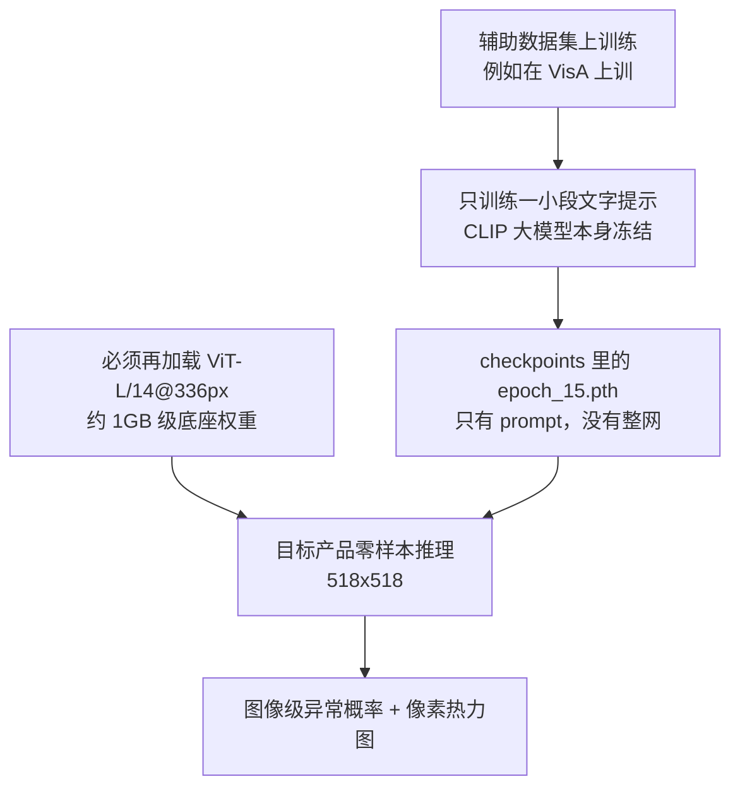
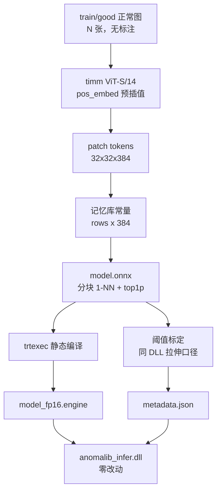
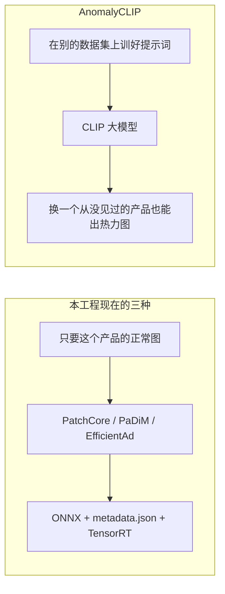
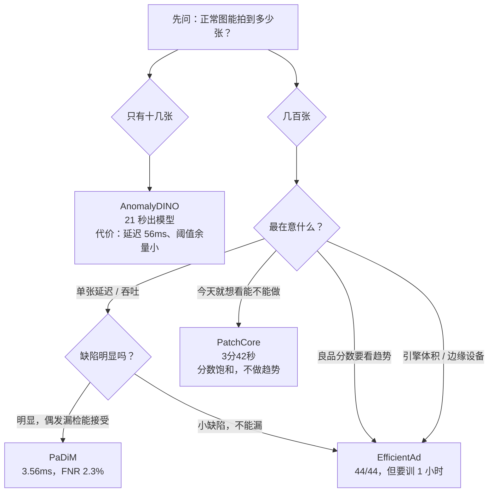

# 异常检测模型对照：AnomalyCLIP、Anomalib 与 AnomalyDINO

> 用途：说明 `10-AnomalyCLIP-main` 和 `2-python-anomaly/anomalib-main/examples` 里的模型差在哪，以及哪些已经接到本工程的网页和推理。
> 本文是代码与现有文档的对照，不是新的本机速度实测。PatchCore / PaDiM / EfficientAd 的耗时和准确率仍以 `docs/异常检测模型对比与选型_PatchCore_PaDiM_EfficientAd.md` 为准；AnomalyDINO 的数字见第 3 节与 `openspec/changes/archive/2026-11-14-add-anomalydino-inference/design.md` 的「实测结果」。
> 最后更新：2026-11-14（3.6 新增：现成可测的 AnomalyDINO 引擎与上游仓库新位置）

---

## 0. 一句话

现在网页和安装包里能训练（建库）、能导出 ONNX、能编 TensorRT 的，是 **PatchCore、PaDiM、EfficientAd、AnomalyDINO** 四个。前三个来自 Anomalib 的 Lightning 流程，AnomalyDINO 是独立启动器（见第 3 节）。

`10-AnomalyCLIP-main` 是另一套独立工程，没有接到网页、训练启动器或推理 DLL。

`anomalib-main` 源码里一共 **20 个图像模型 + 1 个视频模型**。examples 的 yaml 只覆盖其中 17 个。真正有脚本、并且本工程已经接入、还在这台电脑上测过速度和准确率的，只有上面这 3 个。其余模型只对照了「靠什么找缺陷」，没有在本机比过耗时和准确率。

两边解决的不是同一件事：

| 你有什么 | 用什么 |
| --- | --- |
| 这个产品自己的一批正常图，要上产线 | PatchCore / PaDiM / EfficientAd / AnomalyDINO |
| 这个产品一张正常图都没有，只想先看热力图 | AnomalyCLIP 的现成提示词权重（还没接到产线） |

---

## 1. AnomalyCLIP 在做什么

它是 ICLR 2024 的论文代码。核心不是记住「这个产品长什么样」，而是让 CLIP 学会两句和产品无关的话：「这块区域正常」「这块区域不正常」。提示词在一个辅助数据集上训练一次，换到没见过的产品上直接测，论文把这叫做零样本。



核对过的事实（路径都在 `10-AnomalyCLIP-main`）：

| 项 | 实际情况 |
| --- | --- |
| 底座 | `train.py` / `test.py` 写死 `ViT-L/14@336px` |
| 底座权重 | `AnomalyCLIP_lib/model_load.py` 指向 OpenAI 的 `ViT-L-14-336px.pt`，第一次运行要联网下载 |
| 缓存目录 | 仍是作者服务器路径 `/remote-home/...`，本机不改路径不能直接跑 |
| 可训练部分 | `train.py` 只更新 `prompt_learner`，CLIP 图像编码器冻结 |
| 仓库里的权重 | `checkpoints/9_12_4_multiscale`（在 MVTec 上训，用来测别的集）；`checkpoints/9_12_4_multiscale_visa`（在 VisA 上训，用来测 MVTec）。文件只有提示词，没有整网 |
| 输入尺寸 | 默认 **518**。本工程已接入的三种异常检测是 **256** |
| 训练数据 | 需要缺陷图和像素 mask。`dataset.py` 的 `Dataset` 默认 `mode='test'`，吃的是「有缺陷、有标注」的那一份，不是只吃 `train/good` |
| 批量测试输出 | 图像级 AUROC，以及像素级 AUROC / AUPRO |
| 单张图脚本 | `test_one_example.py` 只把热力图画回原图旁边，不把分数打印出来 |
| 特征层 | `train.sh` / `test.sh` 只取第 24 层；`test_one_example.sh` 取 6 / 12 / 18 / 24 四层。数据路径全是作者机器上的 `/remote-home/...` |
| 依赖 | `requirements.txt` 写 `torch==2.0.0`。本工程训练环境是 PyTorch 2.3，两边不要装进同一个环境 |
| 论文机器 | 单张 RTX 3090 24GB。本机是 T1000 8GB，训练脚本里的 batch=8 不适合这张卡；单张推理够不够显存，还没在本机跑过 |

---

## 2. Anomalib 源码里有什么

名单以 `2-python-anomaly/anomalib-main/src/anomalib/models/image/__init__.py` 和 `models/__init__.py` 为准，不是以 examples 为准。

| 范围 | 数量 | 比过什么 |
| --- | --- | --- |
| 源码图像模型 | 20 | 见下面分类 |
| 源码视频模型 | 1（AI-VAD） | 只确认它是视频模型，不适合单张工业图 |
| examples 里的 yaml | 17 | 有配置，其中 14 个没有本机实测 |
| 本机实测 + 已接入网页 | 3 | PatchCore、PaDiM、EfficientAd |

examples 配置在 `examples/configs/model`。`examples/configs/README.md` 的目录树还漏了 `fre.yaml`、`uflow.yaml`、`dsr.yaml`、`ganomaly.yaml`。源码里另有 3 个模型连 yaml 都没有：SuperSimpleNet、WinCLIP、VlmAd。

带独立脚本、并且本工程网页已经能选的只有 3 个：

| 模型 | 它靠什么找缺陷 | 训练要什么 |
| --- | --- | --- |
| PatchCore | 用正常图的小块特征建记忆库，推理时看离记忆库有多远 | 只要这个产品的正常图 |
| PaDiM | 每个位置用正常图拟合一个高斯分布，推理时算马氏距离 | 只要这个产品的正常图 |
| EfficientAd | 学生网络学着模仿教师；正常图上两者接近，缺陷处差得远 | 正常图，另外还要 imagenette |

其余 14 个只有 yaml，没有接到网页：

| 这一类 | 模型 | 说明 |
| --- | --- | --- |
| 教师-学生 | STFPM、CFA、Reverse Distillation | 和学生-教师的 EfficientAd 同类，但不是现在网页里的那个 |
| 流模型 | FastFlow、CFlow、CS-Flow、U-Flow | 算「这张图有多不像正常分布」 |
| 重建 | FRE、GANomaly | 重建不回来就算异常。GANomaly 基本只给整图分数 |
| 合成缺陷后再重建 | DRAEM、DSR | 训练时自己造假缺陷，仍然不要求你提供真实缺陷标注 |
| 特征匹配 / 密度 | DFM、DFKDE | DFKDE 基本只给整图分数，没有可用热力图 |
| 视频 | AI-VAD | 给人流、监控用，配 Avenue / ShanghaiTech，不是 PCB 这种单张工业图 |

源码有、examples 没有的 3 个：

| 模型 | 它靠什么找缺陷 | 和现有三种的差别 |
| --- | --- | --- |
| SuperSimpleNet | 预训练特征加上训练时合成的假缺陷，再出一个热力图和一个整图分数 | 论文说又快又准。Anomalib 这份实现只支持无监督，没有本机实测，也没有 yaml |
| WinCLIP | 用 CLIP 加滑动窗口。可以零样本，也可以再给几张正常图（few-shot） | 和 AnomalyCLIP 同一类「靠 CLIP」，不是靠这个产品的正常图建记忆库。没有接到网页 |
| VlmAd | 把图发给 GPT-4V、LLaVA 这类视觉语言模型，用文字判断有没有异常 | 要外网模型和密钥，不是本地 TensorRT 引擎 |

除已接入的三种以外，上面这些都只做了原理分类。没有在 T1000 上比训练时间、引擎大小、推理延迟和准确率。

这些图像模型里，多数仍是「只用这个产品的正常图」，输入大多按 **256×256**。WinCLIP 和 VlmAd 不是这条路。

---

## 3. AnomalyDINO（第 4 个已接入的模型，不在 Anomalib 里）

它是 MVTec 那篇 *AnomalyDINO: Boosting Patch-based Few-shot Anomaly Detection with DINOv2* 的做法。
和 PatchCore 一样是「正常特征记忆库 + 最近邻距离」，只是把 CNN 特征换成了 **DINOv2（ViT-S/14）的 patch token**。

关键一点：**它根本不是 anomalib 的模型**，所以不能走 `tf_anomalib_launcher.py` 那条 Lightning 路线。
「训练」只是一次冻结主干的前向——把正常图喂进去、抽出 32×32 个 token 存进库，没有反向传播、没有 Lightning、没有超参搜索。



| 项 | 实际情况 |
| --- | --- |
| 主干 | `timm` 的 `vit_small_patch14_dinov2.lvd142m` + 官方 `dinov2_vits14_pretrain.pth`（88.3 MB，走「模型仓库」下载，带 sha256 校验） |
| 输入 | 默认 **448×448**。448 = 14 × 32，网格正好 32×32，没有 padding。分辨率可配，但必须是 14 的倍数 |
| 记忆库 | `shots × 1024` 行 × 384 维。默认 16 张 → 16384 行 = 25.2 MB。可选 8 个角度的旋转增强（库行数 ×8） |
| 距离 | `d = 1 - max_j cos(f_i, b_j)`，就是 1-最近邻余弦距离 |
| 整图分数 | 全网格距离降序前 1% 的均值（1024 个 token 取前 10 个） |
| 训练数据 | 只要这个产品的正常图，**不需要任何缺陷标注**。少于 8 张直接报错，不静默降级 |
| 产物 | `results/AnomalyDINO/<实验名>/v<N>/weights/lightning/` 下的 `model.onnx` + `metadata.json`，与现有三种同结构，网页与 DLL 不用改 |
| 依赖 | `torch` + `timm` + `onnx` + `onnxruntime`，**不 import anomalib / lightning** |

### 3.1 本机实测（T1000 8GB / TRT 8.5 / FP16）

| 项目 | 结果 |
| --- | --- |
| 主干与上游 `torch.hub` 一致性 | 逐 token 余弦 min 0.9999998，逐元素最大差 4.5e-4 |
| 建库耗时（16 张） | 1.40 s |
| ONNX 大小 | 113.0 MB（主干 88 + 库 25） |
| ONNX vs PyTorch | 热力图相关 min 0.99999999992，分数最大差 8.0e-7 |
| FP16 引擎 vs ONNX（经真实 DLL） | 分数最大差 8.7e-4，8/8 张判定一致 |
| 单张 GPU 计算时间 | 56.3 ms（PyTorch 端到端 66.3 ms） |
| 建库 + 导出 + 标定 | 21 s |
| bottle（16-shot） | broken_large / broken_small AUROC 1.0000、contamination 0.9976；F1 0.992，漏检 1.6%，误报 0% |

### 3.2 和旧三种的差别

| 问题 | PatchCore / PaDiM | EfficientAd | AnomalyDINO |
| --- | --- | --- | --- |
| 特征来自 | ResNet / WideResNet（ImageNet 预训练） | 教师-学生，训练时自己学 | DINOv2 ViT-S/14（自监督大模型） |
| 要几张正常图就够 | 越多越好，几百张 | 越多越好 | 16 张就接近满分，2 张也能跑（效果差） |
| 「训练」有多久 | 分钟级 | 10 分钟以上 | 21 秒（含导出与标定） |
| 输入尺寸 | 256 | 256 | 448（计算量约 3 倍，但仍 56 ms） |
| 依赖 | anomalib + Lightning | anomalib + Lightning | torch + timm，无 Lightning |
| 需要联网 | 首次要下 ImageNet 预训练权重 | 还要 imagenette | 首次要下 88 MB DINOv2 权重 |

### 3.3 两条必须知道的口径差异

1. **预处理是拉伸，不是等比例缩放**。推理 DLL 固定 `cv::resize` 拉成 448×448 再 `/255` + ImageNet 归一
   （`anomalib_infer_c.cpp:367-373`）。上游是「短边缩放到 448 + BICUBIC + 裁到 patch 倍数」。
   非方形图上两者结果不同，所以标定脚本按 DLL 的拉伸口径复刻了一遍——阈值与线上判定自洽，
   但不要拿第 3.1 节的数字去对标论文里「原版预处理」的分数。
2. **没做 PCA 背景掩码**。上游的 `compute_background_mask` 只在 VisA 这类背景杂乱的场景收益明显，
   MVTec 上游默认就关了。`metadata.json` 里标的是 `masking: false`。

### 3.4 什么时候用它

- 现场只有十几张正常图，还要当天出结果 → AnomalyDINO（21 秒一套）。
- 已经攒了几百张正常图，追求极致延迟 → 仍用 PaDiM（256 输入、更快）。
- 需要一个能指位置的模型又不想装 anomalib / Lightning → AnomalyDINO。

### 3.5 为什么不改 `anomalib_infer.dll`

算法形态与 PatchCore 同构（库 + 最近邻 + 热力图），所以只需要在 Python 侧多一个导出启动器：
把库固化成 ONNX 的常量 buffer，导出的就是 `anomaly_map`（32×32）+ `pred_score`（1 个元素）两个张量。
DLL 现有的启发式正好选得对（`anomalib_infer_c.cpp:453-472`），C++ 一行没改。

代价是**改库必然重导重编**：库在图里是常量，做不到只换库不换引擎。要支持就得改成第二个输入，
那属于 ABI 变更，v1 不做。

### 3.6 现在就能测的产物，以及上游仓库放在哪

**现成可测模型**（本机已编译好 FP16 引擎，不用重新训练）：

| 用途 | 路径 |
| --- | --- |
| 模型本体 | `2-python-anomaly/launcher/results/AnomalyDINO/bottle_spike/v0/weights/lightning/` |
| ONNX（107.8 MB，含 16384 行库） | 同目录 `model.onnx` |
| TensorRT FP16 引擎（T1000 上编的，换显卡要重编） | 同目录 `model_fp16.engine` |
| 阈值与标定记录 | 同目录 `metadata.json`（`input_size` 448、`grid` 32×32、`shots` 16、阈值 0.2203 / 0.2106） |

它没有 `model.ckpt`：这一份是技术验证时导出的（实验名 `bottle_spike`），推理只需要 ONNX + metadata，
不需要 checkpoint；要续训/复现就照 3.4 重新跑一次建库（16 张正常图约 21 秒）。

**网页里怎么测**：启动网页后进「推理演示」页，模型下拉里会出现 `model_fp16.engine`
（`/api/models` 已扫到）；模型类型选 AnomalyDINO 或 Auto，metadata 用同目录那份。

**命令行怎么测**（MVTec bottle 测试集，20 正常 + 44 异常）：

```powershell
cd D:\test\deeplearning\dp-tool\6-web\backend
$root = "D:\test\deeplearning\dp-tool\2-python-anomaly\launcher\results\AnomalyDINO\bottle_spike\v0\weights\lightning"
D:\Anaconda3\envs\dpenv\python.exe tools\val_anomaly.py `
  --engine "$root\model_fp16.engine" --metadata "$root\metadata.json" `
  --normal-dir "D:\test\deeplearning\dp-tool\2-python-anomaly\anomalib-main\datasets\bottle\test\good" `
  --abnormal-dir "D:\test\deeplearning\dp-tool\2-python-anomaly\anomalib-main\datasets\bottle\test\abnormal" `
  --out "D:\test\deeplearning\dp-tool\runtime\val\anomalydino_bottle"
```

2026-11-14 在本机按上面命令实跑的结果（与 3.1 表一致，可作为「引擎没坏」的回归基线）：

| 指标 | 结果 |
| --- | --- |
| 图片数 | 64（正常 20 / 异常 44），失败 0 |
| 图像级 AUROC | **1.0000** |
| 阈值下 P / R / F1 | 1.0000 / 1.0000 / 1.0000 |
| 漏检 / 误报 | 0.00% / 0.00% |
| 像素诊断 | 好图乱指 0.024%，异常图定位面积 5.65%，指不出位置 0 张 |
| 总耗时 | 5.56 s（约 87 ms/张，含解码与后处理） |

**上游仓库位置（v1.40.0 起）**：官方实现 `git clone https://github.com/dammsi/AnomalyDINO.git`
已经放在 **`dp-tool/11-AnomalyDINO/`**（原来在仓库同级目录 `deeplearning/11-AnomalyDINO`）。
它是独立 git 仓库、带自己的 `.git` 和 Windows 补丁，所以 `dp-tool/.gitignore` 整目录忽略
（嵌套仓库只能存一个 gitlink，里面的补丁反而会丢）。本仓库自己的实现仍是
`2-python-anomaly/launcher/anomalydino_core.py`，两者是「参考实现 vs 交付实现」的关系，
本工程不 import 上游代码。补丁内容与撤除方法见 `11-AnomalyDINO/LOCAL_CHANGES.md`。

### 3.7 good 图全判 NG 时按这三步查（2026-11-14）

这个模型的好图分数（0.09~0.20）离标定阈值（0.2203）本来就只有一个量级的余量，
所以一旦哪一环口径偏了，最先暴露的就是「good 全 NG」。按下面顺序查，一步能定位一层：

| 步骤 | 看什么 | 结论 |
| --- | --- | --- |
| 1 | 接口返回的 `backend` 字段 | `anomalib_infer.dll` / `onnx_infer.dll` = 主路径，跳到第 2 步；`onnxruntime-fallback` = 走了 Python 降级，**v1.40.1 之前这条路径漏做 ImageNet 归一化，必然全 NG**，升级即修 |
| 2 | `raw_score` 与 `image_threshold` | 判定是 `raw >= threshold`。拿 0.1959 < 0.2203 → OK 就是对的；别拿**归一化分数**（0.4438）去比 0.2203，那是以 0.5 为判定线的另一个尺度 |
| 3 | metadata 与引擎是否同一套 | 引擎来自 `results\AnomalyDINO\bottle_spike\...`，metadata 就必须是**同目录**那份（`normalization: imagenet`、`input_size 448`、`grid 32×32`）。配错成 PatchCore 的（`normalization: none`）等于没做归一化，症状与第 1 步一模一样 |

本机 2026-11-14 的基线（两条主路径一致，可直接当验收线）：

| 路径 | `000.png`（good）raw | 20 张 good 的判定 |
| --- | --- | --- |
| `anomalib_infer.dll`（`.engine`） | 0.0971 | 20 OK |
| `onnx_infer.dll`（`.onnx`） | 0.0975 | 20 OK |
| `onnxruntime-fallback`（v1.40.1 前） | 0.1996 | **20 NG** |
| `onnxruntime-fallback`（v1.40.1 后） | 0.0975 | 20 OK |

---

## 4. 两边差在哪



| 问题 | 已接入的四个 | AnomalyCLIP |
| --- | --- | --- |
| 测这个产品时，要不要它自己的正常图 | 要 | 不要。提示词是在别的数据集上训好的 |
| 训练时要不要缺陷标注 | 产线训练不要真实缺陷标注。EfficientAd 会读异常图做难样本挖掘，那是它自己的训练细节 | 要。训练提示词时要像素 mask |
| 能不能进现有推理链 | 能。已经有 `model.onnx`、`metadata.json`、`anomalib_infer.dll` | 不能。它是完整 ViT-L，还改过注意力（DPAM），塞不进现在的 256 输入异常检测引擎 |
| 这台 T1000 8GB | 四个都已经实测能训能推 | 论文用 3090 24GB。底座更大、输入是 518，训练不适合这张卡 |

已接入的四个在本机 bottle 数据上的选型（旧三种 2026-10-30、AnomalyDINO 2026-11-13 实测，细节见选型文档与第 3.1 节）：

| 诉求 | 选 |
| --- | --- |
| 产线要快、要省显存 | PaDiM |
| 要检出，还要正常图分数能分开 | EfficientAd |
| 样本少、想快点看结果 | PatchCore。它的正常图分数会饱和成 0，不能拿来看趋势 |
| 正常图只有十几张、还要当天出结果 | AnomalyDINO（16 张 21 秒出模型，F1 0.992） |

### 4.1 四个集成模型的场景与优劣（速查）

> 数据口径：NVIDIA T1000 8GB / TensorRT 8.5.2 / FP16，输入 PatchCore·PaDiM·EfficientAd = 256、AnomalyDINO = 448；
> 精度在 MVTec bottle（`test/good` 20 张 + `test/abnormal` 44 张 + `broken_*` 等）上实测。**20+44 张只够证明「分数能分开」，不等于量产稳定性**，
> 上线前请另留 100 张以上现场良品单独算误报率。

| 项目 | PaDiM | PatchCore | EfficientAd | AnomalyDINO |
| --- | --- | --- | --- | --- |
| 一句话定位 | 快而轻的产线首选 | 零调参的验证工具 | 唯一能做趋势监控 | 十几张图当天出结果 |
| 训练 / 建库耗时 | **28 秒** | 3 分 42 秒 | 59 分 35 秒 | **21 秒**（16 张） |
| 单张延迟（TRT） | **3.56 ms** | 24.76 ms | 23.79 ms | 56.3 ms（端到端约 87 ms） |
| 引擎体积 | 87.2 MB | 275.9 MB | **19.4 MB** | ONNX 113 MB |
| 需要的正常图 | 几百张（越多越好） | 几百张 | 几百张 + imagenette 1.5 GB | **16 张**（少于 8 张直接报错） |
| 训练显存 | 未记录 | 未记录 | **7.8 / 8 GB（贴上限）** | 建库峰值 317.6 MB |
| bottle 实测 | 43/44，F1 0.9885，FNR 2.3% | 44/44，F1 1.000 | 44/44，F1 1.000 | AUROC 1.0000、F1 1.000 |
| 良品分数是否可用 | 只有 4 种取值 | **恒为 0（饱和）** | 0.539~0.627，19 种 | 0.09~0.20，连续但余量小 |
| 引擎编译耗时 | 17 分钟 | 15 分钟 | **8 分钟** | — |
| 训练是否读异常图 | 否 | 否 | 是（难样本挖掘，无需人工标注） | 否 |

**逐个说明**

| 模型 | 优势 | 劣势 | 最适合 | 不适合 |
| --- | --- | --- | --- | --- |
| PaDiM | 3.56 ms 比另两个快约 7 倍；训练 28 秒；引擎 87 MB | 本次漏 1/44；分数只有 4 档，做不了趋势；编译最慢（17 分钟） | 节拍要求高、缺陷明显（大孔 / 缺件 / 断裂）、能容忍偶尔漏检 | 小划痕、浅污染这类要高保真的场景 |
| PatchCore | 3 分 42 秒出模型，100% 判对，零调参 | **良品分数恒为 0**，放弃分数曲线；引擎 275 MB 最大；FP16 后良品分数会被抬到约 0.33，跨精度看分数不一致 | 新项目评估可行性、要最高召回、离线抽检 | 要监控良品分数漂移、要装到小设备 |
| EfficientAd | 唯一良品分数连续可用（0.539~0.627 vs 异常 0.72+）；引擎最小 19.4 MB；编译最快 8 分钟 | 训练 1 小时、显存 7.8/8 GB；必须先建 `imagenet_dir`（否则 `DATA_NOT_FOUND` 且不自动下载）；训练 batch 强制 1；训练会读 `test/abnormal` | 要按趋势提前预警；边缘设备、体积敏感 | 8 GB 卡还要同时跑别的任务；当天要结果 |
| AnomalyDINO | 16 张图 21 秒出模型；不依赖 anomalib/Lightning；分数与位置都给 | 输入 448 静态（计算量约 3 倍），延迟 56 ms；良品与阈值余量只有一个量级；直接拉伸 + 无 PCA 掩码，背景杂乱时弱于论文；库固化成 ONNX 常量，换库要重导重编 | 新品试产、正常图只有十几张、当天出结果；客户端装不上 anomalib | 极限延迟；背景很乱又要求高精度 |

**选型决策树**



**四条硬红线（违反必踩坑）**

| 红线 | 违反的后果 |
| --- | --- |
| 要**趋势监控**只能用 EfficientAd | PatchCore 良品分数全 0、PaDiM 只有 4 档，曲线是台阶或直线 |
| **阈值不能跨模型套用** | 四个模型分别是 0.2941 / 0.1720 / 0.7477 / 0.2203，套错必翻车 |
| 不能用 AnomalyDINO 的**归一化分数**比 `image_threshold` | 判定线恒为 0.5；拿 0.4438 比 0.2203 会误判成 NG（v1.40.1 已修，见 §3.7） |
| EfficientAd 必须先建 `imagenet_dir` | 否则 `DATA_NOT_FOUND`、`exit=1`，不会自动下载 |

---

## 5. 什么时候才值得用 AnomalyCLIP

- 新产品完全没有正常图，又不能等着拍照训练：可以用仓库里现成的 `epoch_15.pth` 先出一张热力图看看。这还要单独环境、改掉作者机器上的路径，并且本机还没跑通。
- 每个产品都能拍到一批正常图：继续用现在的四个（PatchCore / PaDiM / EfficientAd / AnomalyDINO）。
- 源码里其余 18 个模型（examples 里 14 个，再加上 SuperSimpleNet、WinCLIP、VlmAd、AI-VAD）：没有本机速度和精度数据，也没有接到网页。在没有新需求之前，不换。

这次对照**没有**改推理 DLL，也没有把 AnomalyCLIP 打进安装包。AnomalyDINO 是另一条独立改动（第 3 节），它同样没有碰 `bin/`、`include/`、`lib/`。

---

## 6. 机器可读摘要

```yaml
document: docs/异常检测模型对照_AnomalyCLIP与Anomalib.md
updated: 2026-11-14
references:
  - docs/异常检测模型对比与选型_PatchCore_PaDiM_EfficientAd.md   # 三模型原始实测
  - docs/WORKFLOW_GUIDE.md                                        # 3.3 / 3.3.1 节与第 8 章排障
sections_added_2026_11_14:
  - "3.7 good 图全判 NG 的三步排查"
  - "4.1 四个集成模型的场景与优劣（含决策树与四条红线）"
integrated_models:
  - name: PatchCore
    train_needs: normal_images_of_this_product
    input_size: 256
    export: onnx_plus_metadata_plus_tensorrt
    launcher: 2-python-anomaly/launcher/tf_anomalib_launcher.py
  - name: PaDiM
    train_needs: normal_images_of_this_product
    input_size: 256
    export: onnx_plus_metadata_plus_tensorrt
    launcher: 2-python-anomaly/launcher/tf_anomalib_launcher.py
  - name: EfficientAd
    train_needs: normal_images_of_this_product_plus_imagenette
    input_size: 256
    export: onnx_plus_metadata_plus_tensorrt
    launcher: 2-python-anomaly/launcher/tf_anomalib_launcher.py
  - name: AnomalyDINO
    train_needs: normal_images_of_this_product_only
    min_images: 8
    default_shots: 16
    input_size: 448
    backbone: timm_vit_small_patch14_dinov2_lvd142m
    export: onnx_plus_metadata_plus_tensorrt
    launcher: 2-python-anomaly/launcher/tf_anomalydino_launcher.py
    no_lightning: true
    masking: false
    not_anomalib_model: true
selection_metrics:            # 2026-11-14 实测，T1000 8GB / TRT 8.5.2 / FP16
  env: { gpu: NVIDIA T1000 8GB, cuda: 11.8.89, tensorrt: 8.5.2, precision: fp16 }
  dataset: { name: mvtec_bottle, test_good: 20, test_abnormal: 44 }
  models:
    PaDiM:
      train_seconds: 28
      latency_ms: 3.56
      engine_mb: 87.2
      engine_build_seconds: 1023
      bottle: { tp: 43, fn: 1, tn: 20, fp: 0, f1: 0.9885, fnr: 0.0227 }
      score_levels: 4
      best_for: 高节拍产线、缺陷明显、能容忍偶发漏检
      avoid_for: 小划痕与浅污染；分数趋势监控
    PatchCore:
      train_seconds: 222
      latency_ms: 24.76
      engine_mb: 275.9
      engine_build_seconds: 924
      bottle: { tp: 44, fn: 0, tn: 20, fp: 0, f1: 1.0 }
      score_saturated: true      # 良品 raw 恒为 0，不可做趋势
      best_for: 新项目可行性验证、最高召回、离线抽检
      avoid_for: 分数漂移监控；边缘小体积设备
    EfficientAd:
      train_seconds: 3575
      latency_ms: 23.79
      engine_mb: 19.4
      engine_build_seconds: 480
      train_vram_gb: 7.8
      needs_imagenette: true
      bottle: { tp: 44, fn: 0, tn: 20, fp: 0, f1: 1.0 }
      normal_score_range: [0.5393, 0.6268]
      score_levels: 19
      best_for: 良品分数趋势预警；边缘设备；模型体积敏感
      avoid_for: 当天要结果；8GB 卡上多任务并行
    AnomalyDINO:
      build_seconds_16_shots: 21
      latency_ms: 56.3
      onnx_mb: 113.0
      input_size: 448
      bottle_auroc: 1.0
      bottle_f1: 1.0
      sixteen_shot_f1: 0.992
      image_threshold: 0.2203
      threshold_margin_note: 良品 0.09~0.20，余量只有一个量级
      best_for: 新品试产、正常图十几张、当天出结果、无法安装 anomalib
      avoid_for: 极限延迟；背景杂乱的场景
  hard_rules:
    - 趋势监控只能用 EfficientAd（PatchCore 全 0、PaDiM 仅 4 档）
    - 阈值不可跨模型套用（0.2941 / 0.1720 / 0.7477 / 0.2203）
    - AnomalyDINO 判定看 raw_score >= image_threshold，normalized 的判定线恒为 0.5
    - EfficientAd 必须先建 imagenet_dir，否则 DATA_NOT_FOUND 且不会自动下载
anomalyclip:
  path: 10-AnomalyCLIP-main
  integrated: false
  backbone: ViT-L/14@336px
  trainable: prompt_learner_only
  input_size: 518
  train_needs: defect_images_and_pixel_masks_on_auxiliary_dataset
  local_checkpoints:
    - checkpoints/9_12_4_multiscale/epoch_15.pth
    - checkpoints/9_12_4_multiscale_visa/epoch_15.pth
  blocks_direct_run:
    - author_data_paths_under_/remote-home
    - clip_cache_path_under_/remote-home
    - torch_2.0.0_requirement_vs_project_torch_2.3
anomalib_source:
  image_model_count: 20
  video_model_count: 1
  registry: 2-python-anomaly/anomalib-main/src/anomalib/models/image/__init__.py
  benchmarked_on_this_machine: [PatchCore, PaDiM, EfficientAd]
  others_compared_by_mechanism_only: true
anomalib_examples:
  yaml_count: 17
  yaml_dir: 2-python-anomaly/anomalib-main/examples/configs/model
  scripted_and_integrated: [PatchCore, PaDiM, EfficientAd]
  in_source_but_not_in_examples: [SuperSimpleNet, WinCLIP, VlmAd]
  yaml_only:
    teacher_student: [STFPM, CFA, ReverseDistillation]
    flow: [FastFlow, CFlow, CSFlow, UFlow]
    reconstruction: [FRE, GANomaly, DRAEM, DSR]
    feature_density: [DFM, DFKDE]
    video: [AiVad]
selection_when_normal_images_exist:
  fastest: PaDiM
  best_score_separation: EfficientAd
  quick_check: PatchCore
  fewest_normal_images: AnomalyDINO
  fastest_to_train: AnomalyDINO
do_not:
  - put_anomalyclip_into_anomalib_infer_dll
  - mix_anomalyclip_torch_2.0_into_dpenv
  - use_patchcore_normal_score_for_trend
  - export_anomalydino_with_more_than_two_outputs
  - export_anomalydino_with_opset_17
  - add_pca_background_mask_in_v1
```
