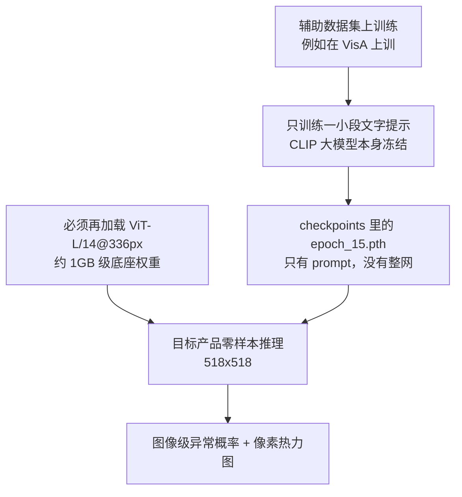
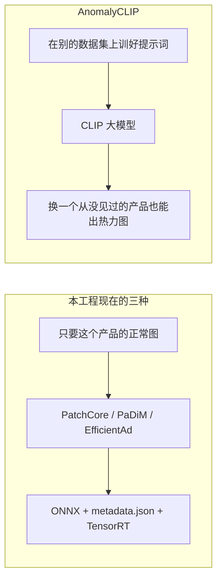

# 异常检测模型对照：AnomalyCLIP 与 Anomalib

> 用途：说明 `10-AnomalyCLIP-main` 和 `2-python-anomaly/anomalib-main/examples` 里的模型差在哪，以及哪些已经接到本工程的网页和推理。
> 本文是代码与现有文档的对照，不是新的本机速度实测。PatchCore / PaDiM / EfficientAd 的耗时和准确率仍以 `docs/异常检测模型对比与选型_PatchCore_PaDiM_EfficientAd.md` 为准。
> 最后更新：2026-11-12

---

## 0. 一句话

现在网页和安装包里能训练、能导出 ONNX、能编 TensorRT 的，只有 **PatchCore、PaDiM、EfficientAd**。

`10-AnomalyCLIP-main` 是另一套独立工程，没有接到网页、训练启动器或推理 DLL。

`anomalib-main` 源码里一共 **20 个图像模型 + 1 个视频模型**。examples 的 yaml 只覆盖其中 17 个。真正有脚本、并且本工程已经接入、还在这台电脑上测过速度和准确率的，只有上面这 3 个。其余模型只对照了「靠什么找缺陷」，没有在本机比过耗时和准确率。

两边解决的不是同一件事：

| 你有什么 | 用什么 |
| --- | --- |
| 这个产品自己的一批正常图，要上产线 | PatchCore / PaDiM / EfficientAd |
| 这个产品一张正常图都没有，只想先看热力图 | AnomalyCLIP 的现成提示词权重（还没接到产线） |

---

## 1. AnomalyCLIP 在做什么

它是 ICLR 2024 的论文代码。核心不是记住「这个产品长什么样」，而是让 CLIP 学会两句和产品无关的话：「这块区域正常」「这块区域不正常」。提示词在一个辅助数据集上训练一次，换到没见过的产品上直接测，论文把这叫做零样本。



核对过的事实（路径都在 `10-AnomalyCLIP-main`）：

| 项 | 实际情况 |
| --- | --- |
| 底座 | `train.py` / `test.py` 写死 `ViT-L/14@336px` |
| 底座权重 | `AnomalyCLIP_lib/model_load.py` 指向 OpenAI 的 `ViT-L-14-336px.pt`，第一次运行要联网下载 |
| 缓存目录 | 仍是作者服务器路径 `/remote-home/...`，本机不改路径不能直接跑 |
| 可训练部分 | `train.py` 只更新 `prompt_learner`，CLIP 图像编码器冻结 |
| 仓库里的权重 | `checkpoints/9_12_4_multiscale`（在 MVTec 上训，用来测别的集）；`checkpoints/9_12_4_multiscale_visa`（在 VisA 上训，用来测 MVTec）。文件只有提示词，没有整网 |
| 输入尺寸 | 默认 **518**。本工程已接入的三种异常检测是 **256** |
| 训练数据 | 需要缺陷图和像素 mask。`dataset.py` 的 `Dataset` 默认 `mode='test'`，吃的是「有缺陷、有标注」的那一份，不是只吃 `train/good` |
| 批量测试输出 | 图像级 AUROC，以及像素级 AUROC / AUPRO |
| 单张图脚本 | `test_one_example.py` 只把热力图画回原图旁边，不把分数打印出来 |
| 特征层 | `train.sh` / `test.sh` 只取第 24 层；`test_one_example.sh` 取 6 / 12 / 18 / 24 四层。数据路径全是作者机器上的 `/remote-home/...` |
| 依赖 | `requirements.txt` 写 `torch==2.0.0`。本工程训练环境是 PyTorch 2.3，两边不要装进同一个环境 |
| 论文机器 | 单张 RTX 3090 24GB。本机是 T1000 8GB，训练脚本里的 batch=8 不适合这张卡；单张推理够不够显存，还没在本机跑过 |

---

## 2. Anomalib 源码里有什么

名单以 `2-python-anomaly/anomalib-main/src/anomalib/models/image/__init__.py` 和 `models/__init__.py` 为准，不是以 examples 为准。

| 范围 | 数量 | 比过什么 |
| --- | --- | --- |
| 源码图像模型 | 20 | 见下面分类 |
| 源码视频模型 | 1（AI-VAD） | 只确认它是视频模型，不适合单张工业图 |
| examples 里的 yaml | 17 | 有配置，其中 14 个没有本机实测 |
| 本机实测 + 已接入网页 | 3 | PatchCore、PaDiM、EfficientAd |

examples 配置在 `examples/configs/model`。`examples/configs/README.md` 的目录树还漏了 `fre.yaml`、`uflow.yaml`、`dsr.yaml`、`ganomaly.yaml`。源码里另有 3 个模型连 yaml 都没有：SuperSimpleNet、WinCLIP、VlmAd。

带独立脚本、并且本工程网页已经能选的只有 3 个：

| 模型 | 它靠什么找缺陷 | 训练要什么 |
| --- | --- | --- |
| PatchCore | 用正常图的小块特征建记忆库，推理时看离记忆库有多远 | 只要这个产品的正常图 |
| PaDiM | 每个位置用正常图拟合一个高斯分布，推理时算马氏距离 | 只要这个产品的正常图 |
| EfficientAd | 学生网络学着模仿教师；正常图上两者接近，缺陷处差得远 | 正常图，另外还要 imagenette |

其余 14 个只有 yaml，没有接到网页：

| 这一类 | 模型 | 说明 |
| --- | --- | --- |
| 教师-学生 | STFPM、CFA、Reverse Distillation | 和学生-教师的 EfficientAd 同类，但不是现在网页里的那个 |
| 流模型 | FastFlow、CFlow、CS-Flow、U-Flow | 算「这张图有多不像正常分布」 |
| 重建 | FRE、GANomaly | 重建不回来就算异常。GANomaly 基本只给整图分数 |
| 合成缺陷后再重建 | DRAEM、DSR | 训练时自己造假缺陷，仍然不要求你提供真实缺陷标注 |
| 特征匹配 / 密度 | DFM、DFKDE | DFKDE 基本只给整图分数，没有可用热力图 |
| 视频 | AI-VAD | 给人流、监控用，配 Avenue / ShanghaiTech，不是 PCB 这种单张工业图 |

源码有、examples 没有的 3 个：

| 模型 | 它靠什么找缺陷 | 和现有三种的差别 |
| --- | --- | --- |
| SuperSimpleNet | 预训练特征加上训练时合成的假缺陷，再出一个热力图和一个整图分数 | 论文说又快又准。Anomalib 这份实现只支持无监督，没有本机实测，也没有 yaml |
| WinCLIP | 用 CLIP 加滑动窗口。可以零样本，也可以再给几张正常图（few-shot） | 和 AnomalyCLIP 同一类「靠 CLIP」，不是靠这个产品的正常图建记忆库。没有接到网页 |
| VlmAd | 把图发给 GPT-4V、LLaVA 这类视觉语言模型，用文字判断有没有异常 | 要外网模型和密钥，不是本地 TensorRT 引擎 |

除已接入的三种以外，上面这些都只做了原理分类。没有在 T1000 上比训练时间、引擎大小、推理延迟和准确率。

这些图像模型里，多数仍是「只用这个产品的正常图」，输入大多按 **256×256**。WinCLIP 和 VlmAd 不是这条路。

---

## 3. 两边差在哪



| 问题 | 已接入的三种 | AnomalyCLIP |
| --- | --- | --- |
| 测这个产品时，要不要它自己的正常图 | 要 | 不要。提示词是在别的数据集上训好的 |
| 训练时要不要缺陷标注 | 产线训练不要真实缺陷标注。EfficientAd 会读异常图做难样本挖掘，那是它自己的训练细节 | 要。训练提示词时要像素 mask |
| 能不能进现有推理链 | 能。已经有 `model.onnx`、`metadata.json`、`anomalib_infer.dll` | 不能。它是完整 ViT-L，还改过注意力（DPAM），塞不进现在的 256 输入异常检测引擎 |
| 这台 T1000 8GB | 三种都已经实测能训能推 | 论文用 3090 24GB。底座更大、输入是 518，训练不适合这张卡 |

已接入三种在本机 bottle 数据上的选型（2026-10-30 实测，细节见选型文档）：

| 诉求 | 选 |
| --- | --- |
| 产线要快、要省显存 | PaDiM |
| 要检出，还要正常图分数能分开 | EfficientAd |
| 样本少、想快点看结果 | PatchCore。它的正常图分数会饱和成 0，不能拿来看趋势 |

---

## 4. 什么时候才值得用 AnomalyCLIP

- 新产品完全没有正常图，又不能等着拍照训练：可以用仓库里现成的 `epoch_15.pth` 先出一张热力图看看。这还要单独环境、改掉作者机器上的路径，并且本机还没跑通。
- 每个产品都能拍到一批正常图：继续用现在的三种。
- 源码里其余 18 个模型（examples 里 14 个，再加上 SuperSimpleNet、WinCLIP、VlmAd、AI-VAD）：没有本机速度和精度数据，也没有接到网页。在没有新需求之前，不换。

这次对照**没有**改训练启动器、网页、推理 DLL，也没有把 AnomalyCLIP 打进安装包。

---

## 5. 机器可读摘要

```yaml
document: docs/异常检测模型对照_AnomalyCLIP与Anomalib.md
updated: 2026-11-12
integrated_models:
  - name: PatchCore
    train_needs: normal_images_of_this_product
    input_size: 256
    export: onnx_plus_metadata_plus_tensorrt
  - name: PaDiM
    train_needs: normal_images_of_this_product
    input_size: 256
    export: onnx_plus_metadata_plus_tensorrt
  - name: EfficientAd
    train_needs: normal_images_of_this_product_plus_imagenette
    input_size: 256
    export: onnx_plus_metadata_plus_tensorrt
anomalyclip:
  path: 10-AnomalyCLIP-main
  integrated: false
  backbone: ViT-L/14@336px
  trainable: prompt_learner_only
  input_size: 518
  train_needs: defect_images_and_pixel_masks_on_auxiliary_dataset
  local_checkpoints:
    - checkpoints/9_12_4_multiscale/epoch_15.pth
    - checkpoints/9_12_4_multiscale_visa/epoch_15.pth
  blocks_direct_run:
    - author_data_paths_under_/remote-home
    - clip_cache_path_under_/remote-home
    - torch_2.0.0_requirement_vs_project_torch_2.3
anomalib_source:
  image_model_count: 20
  video_model_count: 1
  registry: 2-python-anomaly/anomalib-main/src/anomalib/models/image/__init__.py
  benchmarked_on_this_machine: [PatchCore, PaDiM, EfficientAd]
  others_compared_by_mechanism_only: true
anomalib_examples:
  yaml_count: 17
  yaml_dir: 2-python-anomaly/anomalib-main/examples/configs/model
  scripted_and_integrated: [PatchCore, PaDiM, EfficientAd]
  in_source_but_not_in_examples: [SuperSimpleNet, WinCLIP, VlmAd]
  yaml_only:
    teacher_student: [STFPM, CFA, ReverseDistillation]
    flow: [FastFlow, CFlow, CSFlow, UFlow]
    reconstruction: [FRE, GANomaly, DRAEM, DSR]
    feature_density: [DFM, DFKDE]
    video: [AiVad]
selection_when_normal_images_exist:
  fastest: PaDiM
  best_score_separation: EfficientAd
  quick_check: PatchCore
do_not:
  - put_anomalyclip_into_anomalib_infer_dll
  - mix_anomalyclip_torch_2.0_into_dpenv
  - use_patchcore_normal_score_for_trend
```
