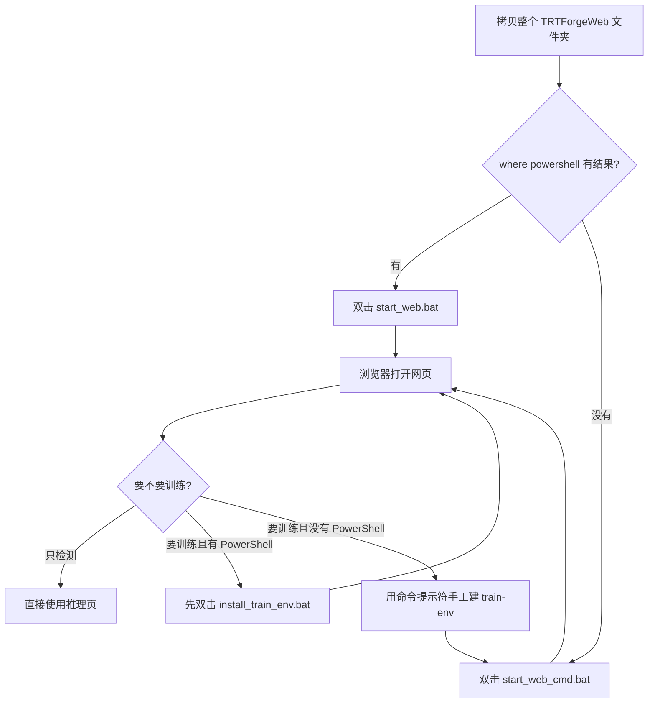

# 没有 PowerShell 时怎么打开 TRTForge Web

> 给现场使用。电脑是 Windows 10、Windows 11 或 Windows Server，但打不开 PowerShell，或者安全策略禁止运行 `powershell.exe` 时，按本文操作。  
> 有 PowerShell 的电脑仍双击 `start_web.bat`，不必看本文。

本文说的「安装」是把整个文件夹拷过去再启动。软件没有单独的安装向导。

---

## 1. 先确认是不是真的没有 PowerShell

在开始菜单搜索「命令提示符」，打开后输入：

```bat
where powershell
```

能看到类似 `C:\Windows\System32\WindowsPowerShell\v1.0\powershell.exe`，说明系统里有 PowerShell。这时双击 `start_web.bat` 即可，`.bat` 已自带 `-ExecutionPolicy Bypass`，不用改系统策略。

没有任何输出，或双击 `start_web.bat` 后提示找不到 `powershell`，再用下面的方式。

---

## 2. 两种启动方式



| | 有 PowerShell | 没有 PowerShell |
| --- | --- | --- |
| 打开网页 | 双击 `start_web.bat` | 双击 `start_web_cmd.bat` |
| 读 `config.json` | 会读端口、地址、Python、浏览目录 | 不读。端口和地址改 bat 文件顶部两行 |
| 准备训练环境 | 双击 `install_train_env.bat`。没有 Anaconda 也会自己下载 | 用第 5 节的命令。没有 Anaconda 时请改用上一列 |

推理程序是 `app\TRTForgeWeb.exe`。PowerShell 只负责设环境变量和打开浏览器，检测本身不依赖它。

---

## 3. 电脑上要先有的东西

- 64 位 Windows 10、Windows 11，或 Windows Server 2016 及以上。
- 英伟达显卡驱动，支持 CUDA 11.8 即可。不必再装 CUDA 工具包。只用 CPU 跑 ONNX 时，没有显卡也能打开页面，引擎推理会不可用。
- 微软 Visual C++ 2015–2022 x64 运行库。缺了会提示找不到 `VCRUNTIME`。到微软官网搜索这个名字，下载 `.exe` 安装。这一步不经过 PowerShell。
- 一台能打开网页的浏览器。服务器上没有浏览器时，把第 4 节的 `WEBHOST` 改成 `0.0.0.0`，换一台电脑访问 `http://服务器IP:8060/`。防火墙要放行 8060。

---

## 4. 只做检测

1. 把整个 `TRTForgeWeb` 文件夹拷到目标电脑，例如 `D:\TRTForgeWeb`。不要只拷其中一个文件。
2. 看文件夹里有没有 `start_web_cmd.bat`。
   - 有：直接双击。
   - 没有（旧安装包）：用记事本在同一层新建 `start_web_cmd.bat`，把仓库里 `packaging\templates\start_web_cmd.bat` 的内容原样贴进去，保存。保存时编码选 UTF-8。
3. 黑窗口要留着。关掉它，网页就停了。
4. 浏览器打开 `http://127.0.0.1:8060/`。约几秒后页面出现。右上角版本号应为 `v1.26.0` 或更高。

窗口里会看到：

```text
TRTForge Web Studio
  地址     : http://127.0.0.1:8060/
  训练环境 : 未配置。只能推理，不能训练。
```

「未配置」不影响检测。推理页可以选 `.engine` 或 `.onnx`。

### 4.1 改端口，或让别的电脑打开

用记事本打开 `start_web_cmd.bat`，只改最上面两行：

```bat
set "PORT=8060"
set "WEBHOST=127.0.0.1"
```

| 想做的事 | 改成 |
| --- | --- |
| 换端口，避免和别的程序冲突 | `set "PORT=8070"`，浏览器用新端口 |
| 车间其他电脑也要打开 | `set "WEBHOST=0.0.0.0"`。本机仍用 `http://127.0.0.1:8060/`，其他电脑用 `http://服务器IP:8060/` |

`start_web_cmd.bat` 不读取 `config.json`。在 `config.json` 里改 `port` 和 `host`，对这个启动方式无效。

### 4.2 启动失败时看什么

| 窗口里的字 | 处理 |
| --- | --- |
| 找不到程序 `app\TRTForgeWeb.exe` | 文件夹不完整。重新拷贝整个目录 |
| 找不到 `VCRUNTIME140.dll` 或 `MSVCP140.dll` | 安装 Visual C++ 2015–2022 x64 运行库 |
| 浏览器打不开，窗口还在 | 手动输入 `http://127.0.0.1:8060/`。服务器没有默认浏览器时这是正常的 |
| 别的电脑打不开 | `WEBHOST` 改为 `0.0.0.0`，并在 Windows 防火墙入站规则里放行该端口 |
| 页面能开，推理失败并出现 `onnxruntime-fallback` | `bin` 里要同时有 `onnx_infer.dll`、`onnxruntime.dll`、`onnxruntime_providers_shared.dll` |

---

## 5. 还要训练

没有 PowerShell 时不能双击 `install_train_env.bat`。有 PowerShell 的电脑请优先双击那个文件：它不要求事先安装 Anaconda，并且会换上 Polars 兼容包。

只能用命令提示符时，训练环境要手工创建。这一步需要本机已经安装 Anaconda 或 Miniconda，并且能访问互联网。把下面命令里的 `D:\TRTForgeWeb` 换成实际目录，逐行执行：

```bat
cd /d D:\TRTForgeWeb
conda create -y -p D:\TRTForgeWeb\train-env python=3.12 pip
D:\TRTForgeWeb\train-env\python.exe -m pip install --upgrade pip
D:\TRTForgeWeb\train-env\python.exe -m pip install torch==2.3.0 torchvision==0.18.0 --index-url https://download.pytorch.org/whl/cu118
D:\TRTForgeWeb\train-env\python.exe -m pip install ultralytics==8.4.192 anomalib==1.2.0 onnx onnxruntime
D:\TRTForgeWeb\train-env\python.exe -m pip install polars-runtime-compat
D:\TRTForgeWeb\train-env\python.exe -m pip uninstall -y polars-runtime-32
```

`polars-runtime-32` 需要 AVX2。虚拟机或老处理器一导入就会退出，退出码 `3221225501`。上面两行改用兼容包。`onnx` 和 `onnxruntime` 是环境自检要检查的包，缺了会报未安装。

PyTorch 官方源超时的话，把上面那条 `--index-url` 换成 `https://mirrors.aliyun.com/pytorch-wheels/cu118` 再执行一次。

完成后重新双击 `start_web_cmd.bat`。窗口里「训练环境」应变成 `D:\TRTForgeWeb\train-env\python.exe`。

没有 Anaconda / Miniconda、也没有 PowerShell 时，这条手工命令创建不了环境。只做检测不受影响。有 PowerShell 就改双击 `install_train_env.bat`。

`config.json` 里的 `python` 可以不填。`start_web_cmd.bat` 发现旁边的 `train-env\python.exe` 就会用它。

---

## 6. 和原来的启动方式差在哪里

| 项目 | `start_web.bat` | `start_web_cmd.bat` |
| --- | --- | --- |
| 依赖 | 系统自带的 Windows PowerShell 5.1 | 只要有命令提示符 |
| 配置来源 | `config.json` 的端口、地址、Python、`data_roots` | bat 顶部的 `PORT`、`WEBHOST`；Python 固定看 `train-env\python.exe` |
| 浏览按钮能选的目录 | 受 `data_roots` 限制 | 不设置这项限制 |
| 等网页就绪再开浏览器 | 会等到 `/api/health` 返回后再开 | 固定等约 10 秒再开。太快没开成就手动刷新 |
| 训练环境安装 | `install_train_env.bat` | 第 5 节的命令 |

页面上的训练、导出、推理操作，两种启动方式相同。看 `docs\TRTForge_Web操作手册.md`。
