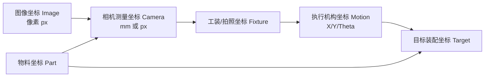
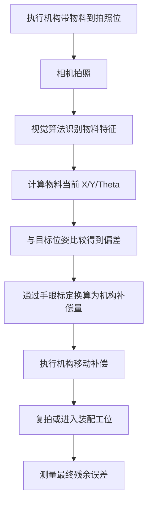
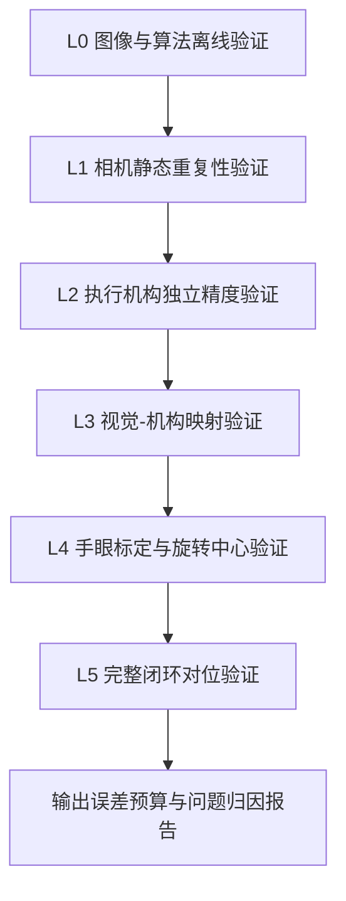
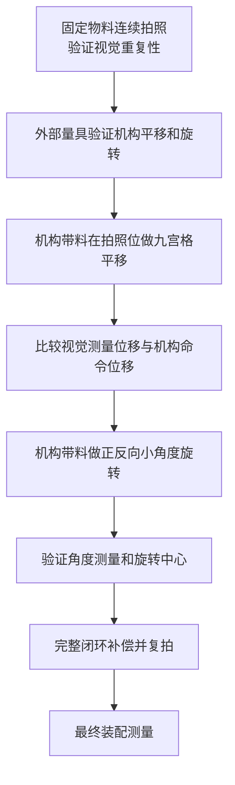

# 机器视觉引导对位系统精度解构与验证方法

> 文档版本：v1.0  
> 更新日期：2026-05-08  
> 适用范围：下相机对位、上相机引导、XYθ 平台、机械手/龙门执行机构、贴装/组装/点胶/焊接/检测前定位等 2D 视觉引导对位系统。  
> 核心目标：把“最终对位不准”拆解成可测量、可复现、可定位的问题，分别判断工装治具、执行机构、视觉测量、手眼标定和工艺过程的误差贡献。

---

## 1. 一句话结论

最终对位精度不是单一指标，而是一条误差链的结果。

```text
最终对位误差
= 工装治具误差
+ 执行机构误差
+ 视觉测量误差
+ 手眼标定误差
+ 夹持/吸附/工艺过程误差
+ 环境漂移误差
```

工程验证时不能只看最后装配偏差。正确做法是：

```text
固定不动测视觉
外部量具测机构
机构带料运动测视觉-机构映射
旋转测试验证旋转中心
完整闭环验证最终残差
```

判断问题来源时，先区分两种误差：

| 误差类型 | 典型现象 | 常见来源 | 处理方式 |
|---|---|---|---|
| 系统误差 Bias | 每次都往同一方向偏 | 标定矩阵、坐标系方向、工装基准、旋转中心、比例尺 | 可通过重新标定、补偿表、机械调整改善 |
| 随机误差 Repeatability | 每次偏差大小和方向不稳定 | 光源、振动、视觉算法重复性、机构重复定位、夹持滑移 | 需要提升硬件稳定性、算法鲁棒性、机构重复性 |

---

## 2. 对位系统的坐标链

视觉引导对位的本质是坐标变换和误差补偿。典型坐标链如下：



完整对位流程如下：



任何一个坐标转换或物理动作不稳定，最后都会表现为“对不准”。

---

## 3. 误差项定义

### 3.1 工装治具误差

工装治具误差指物料、载具、定位销、吸嘴、夹爪、托盘、治具基准之间的误差。

常见表现：

- 同一套视觉和机构参数下，不同治具之间偏差不同。
- 同一物料重新放入治具后，视觉测量位置变化明显。
- 空跑对位准确，带料后不准确。
- 视觉补偿正确，但最终装配仍偏。

主要来源：

- 定位销间隙。
- 物料外形公差。
- 吸嘴偏心或吸附面不平。
- 夹爪夹紧力不一致。
- 治具加工精度不足。
- 治具磨损、脏污、温漂。

#### 3.1.1 工装治具精度必须单独验证

工装治具不能只看机械加工图纸上的公差。因为视觉对位最终关心的是“物料在治具中的实际位置是否稳定”，而不是单个零件的尺寸是否合格。

工装治具至少要分成三类精度来验证：

| 验证项 | 说明 | 典型影响 |
|---|---|---|
| 制造精度 | 治具本体、定位销、基准面、安装孔的加工误差 | 决定治具之间的一致性 |
| 装夹重复性 | 同一物料反复放入同一治具后的位姿变化 | 决定每次生产是否稳定 |
| 使用稳定性 | 治具受力、磨损、温度、脏污后的变化 | 决定长时间量产是否漂移 |

现场最容易忽略的是装夹重复性。很多治具加工精度看起来很好，但物料放进去后因为间隙、毛刺、弹片压力、吸附变形，实际位姿仍然不稳定。

#### 3.1.2 是否需要额外测量设备

需要。只用相机看治具，容易把视觉误差和治具误差混在一起。工装治具精度验证建议至少准备一种独立测量手段。

| 精度要求 | 推荐测量设备 | 适用说明 |
|---|---|---|
| `±0.10 mm` 级 | 游标卡尺、高度尺、投影仪 | 适合粗定位治具和低精度上料定位 |
| `±0.05 mm` 级 | 工具显微镜、二次元影像仪、百分表 | 适合常规视觉定位和装配治具 |
| `±0.02 mm` 级 | 二次元影像仪、三坐标、千分表、标准量块 | 适合精密贴装、点胶、焊接前定位 |
| `±0.01 mm` 及以下 | 高精度三坐标、激光位移计、精密光栅尺、定制标准件 | 适合高精度对位或量产验收 |

测量设备精度建议至少优于被测指标 3 到 5 倍。例如要验证治具重复性 `0.01 mm`，测量设备自身重复性最好达到 `0.002 ~ 0.003 mm`。

#### 3.1.3 是否需要制作高精度验证工装

多数正式项目需要。高精度验证工装不是生产治具，而是用于“排除物料和生产治具不确定性”的标准参照物。

建议制作高精度验证工装的场景：

- 最终对位要求优于 `±0.05 mm`。
- 需要区分视觉误差、机构误差和治具误差。
- 物料本身尺寸公差较大，不能作为稳定标准件。
- 物料容易变形、反光、毛刺、翘曲。
- 多套治具之间一致性需要验收。
- 需要做供应商验收或客户现场交付报告。

可以不单独制作高精度验证工装的场景：

- 最终精度要求较低，例如 `±0.2 mm`。
- 工艺只需要粗定位，后续有机械自定位。
- 已有可靠的标准件、标定板或三坐标测量报告。
- 只是早期方案验证，不做正式精度验收。

高精度验证工装建议具备这些特征：

| 设计要点 | 说明 |
|---|---|
| 明确基准 | 至少有一个机械基准面、一个定位基准点和一个方向基准 |
| 高稳定材料 | 优先使用钢、陶瓷、玻璃、硬质铝合金，避免易变形材料 |
| 可被视觉识别 | 加工圆孔、十字线、圆点、棋盘格、边缘台阶等稳定特征 |
| 可被量具测量 | 特征尺寸和位置能被二次元、三坐标或显微镜复测 |
| 覆盖工作范围 | 特征点应覆盖相机视野中心、四角和实际补偿范围 |
| 附带计量报告 | 关键尺寸和位置最好有第三方或内部计量数据 |

高精度验证工装的精度应明显高于系统目标精度。经验上：

```text
验证工装精度 <= 最终对位公差的 1/5 ~ 1/10
```

例如最终要求 `±0.02 mm`，验证工装关键特征的位置不确定度建议做到 `0.002 ~ 0.004 mm`。

#### 3.1.4 工装治具推荐测试方法

工装治具建议做四类测试。

第一类是同一治具重复装夹测试：

```text
同一物料 -> 放入治具 -> 测量位置 -> 取出
重复 30 次
```

如果每次放入后物料中心和角度波动大，说明治具定位方式不稳定。

第二类是不同治具一致性测试：

```text
同一标准件 -> 依次放入 F01/F02/F03... -> 测量位置
```

如果不同治具之间存在固定偏移，说明治具制造或装配基准不一致。

第三类是夹持/吸附稳定性测试：

```text
放料 -> 夹紧/吸附 -> 测量
保持 10 s / 30 s / 60 s -> 再测量
释放 -> 再夹紧 -> 再测量
```

如果保持过程中位置慢慢变化，说明夹持力、吸附面、物料变形或气压稳定性有问题。

第四类是工装磨损和脏污测试：

```text
新治具测一次
运行 N 次后测一次
清洁前测一次
清洁后测一次
```

如果清洁前后偏差明显，说明治具定位基准对脏污敏感，需要增加防呆、清洁、吹气或磨损监控。

#### 3.1.5 工装治具验证数据判定

工装治具报告中至少要输出：

| 指标 | 含义 |
|---|---|
| `fixture_bias_x/y/theta` | 治具相对理论基准的固定偏差 |
| `fixture_repeat_sigma_x/y/theta` | 同一治具重复装夹标准差 |
| `fixture_to_fixture_range_x/y/theta` | 多套治具之间最大差异 |
| `clamp_drift_x/y/theta` | 夹持或吸附保持过程中的漂移 |
| `wear_drift_x/y/theta` | 长周期使用后的漂移 |

判断原则：

- 固定偏差可以通过治具补偿、软件偏置或重新加工改善。
- 重复装夹波动不能简单靠软件补偿解决，必须改善定位结构。
- 多治具差异大时，应建立治具编号和补偿参数绑定关系。
- 治具漂移随时间变大时，应加入保养周期和更换标准。

### 3.2 执行机构误差

执行机构误差指平台、机械手、龙门、旋转轴、伺服系统实际运动与命令运动之间的差异。

常见表现：

- 命令移动 1.000 mm，实际移动不是 1.000 mm。
- 正向移动准，反向移动不准。
- 小步距补偿不稳定。
- 长时间运行后位置漂移。
- 旋转后 X/Y 中心跟着漂移。

主要来源：

- 重复定位精度不足。
- 反向间隙。
- 丝杆/导轨直线度不足。
- XY 垂直度误差。
- 编码器分辨率不足。
- 负载变化导致变形。
- 旋转轴中心不稳定。

### 3.3 视觉测量误差

视觉测量误差指相机、镜头、光源、图像处理算法对物料位置和角度测量的误差。

常见表现：

- 机构不动，连续拍照结果跳动。
- 同一位置中心区域准，视野边缘不准。
- 换光源亮度或曝光后结果变化。
- 物料反光、毛刺、脏污时定位跳动。
- 不同批次物料识别中心不一致。

主要来源：

- 光源不稳定。
- 曝光、增益、触发时序不稳定。
- 镜头畸变。
- 景深不足或失焦。
- 物料边缘不清晰。
- 算法特征选择不合理。
- 像素分辨率不足。

### 3.4 手眼标定误差

手眼标定误差指视觉测量坐标和执行机构坐标之间的转换误差。

常见表现：

- X 方向移动后，视觉测得 X/Y 都变化。
- 移动距离越大，误差越大。
- 视野中心补偿准，边缘补偿不准。
- 平移补偿准，旋转补偿不准。
- 角度补偿后，X/Y 残差变大。

主要来源：

- 标定点数量不足。
- 标定点分布范围太小。
- 标定板或标准件精度不足。
- 标定时机构运动不准。
- 坐标轴方向定义错误。
- 像素到毫米比例不准。
- 旋转中心没有正确建模。

### 3.5 工艺过程误差

工艺过程误差指从视觉补偿完成到最终装配完成之间产生的误差。

常见表现：

- 复拍位置准确，但最终装配偏。
- 慢速装配准，高速装配偏。
- 物料薄、软、易变形时偏差变大。
- 点胶、贴合、压合、焊接后位置变化。

主要来源：

- 取放料过程滑移。
- 压合变形。
- 胶水流动。
- 吸附释放瞬间回弹。
- 机械接触冲击。
- 工艺温度变化。

---

## 4. 误差合成与预算方法

如果各误差项近似独立，可以按不确定度平方和估算总误差：

```text
u_total = sqrt(
    u_fixture^2
  + u_motion^2
  + u_vision^2
  + u_calibration^2
  + u_process^2
  + u_environment^2
)
```

其中：

| 符号 | 含义 | 推荐获取方式 |
|---|---|---|
| `u_fixture` | 工装治具标准不确定度 | 重复装夹测试、治具计量报告 |
| `u_motion` | 执行机构标准不确定度 | 激光干涉仪、光栅尺、千分表、供应商精度报告 |
| `u_vision` | 视觉测量标准不确定度 | 静止重复拍照、标准件测量 |
| `u_calibration` | 标定标准不确定度 | 独立验证点、九宫格验证 |
| `u_process` | 工艺过程标准不确定度 | 补偿后复拍与最终装配结果对比 |
| `u_environment` | 环境漂移标准不确定度 | 温漂、光源老化、振动测试 |

如果要表达约 95% 置信水平的扩展不确定度，可使用：

```text
U = k * u_total
k = 2
```

注意事项：

- 供应商给的“重复定位精度 ±0.005 mm”通常不是最终对位精度。
- 视觉算法的 `σ` 很小，不代表最终装配一定准。
- 最终指标要留预算，不要让任何一个单项误差接近最终公差。
- 对高精度系统，建议视觉和标定误差预算小于最终公差的 1/3。

---

## 5. 分层验证总流程

推荐按 L0 到 L5 分层验证。



| 层级 | 目的 | 是否运动机构 | 是否带物料 | 主要判断对象 |
|---|---|---:|---:|---|
| L0 | 验证算法本身稳定性 | 否 | 可选 | 算法确定性、图像质量 |
| L1 | 验证视觉系统重复性 | 否 | 是 | 相机、光源、镜头、识别算法 |
| L2 | 验证机构运动能力 | 是 | 可选 | 平台、机器人、旋转轴 |
| L3 | 验证视觉与机构坐标映射 | 是 | 是 | 比例尺、轴夹角、标定矩阵 |
| L4 | 验证旋转补偿和手眼标定 | 是 | 是 | 旋转中心、角度补偿 |
| L5 | 验证最终工程能力 | 是 | 是 | 整机综合精度 |

---

## 6. L0 图像与算法离线验证

### 6.1 测试目的

先排除算法实现不稳定的问题。该阶段不需要运动机构，只使用保存图片或标准图片。

### 6.2 测试方法

1. 保存一张现场原始图像。
2. 使用相同算法、相同参数、相同 ROI 重复运行 100 次。
3. 记录每次输出的 `x_px`、`y_px`、`theta_deg`、得分、边缘点数量或匹配分数。
4. 计算均值、标准差、最大偏差、极差。

### 6.3 判定逻辑

| 结果 | 说明 |
|---|---|
| 同一张图每次结果完全一致 | 算法实现确定性正常 |
| 同一张图结果仍跳动 | 算法内部存在随机处理、多线程非确定性或初值敏感 |
| 得分稳定但坐标跳动 | 定位基准定义可能不稳定 |
| 坐标稳定但角度跳动 | 角度特征弱、轮廓方向不唯一或形状接近对称 |

---

## 7. L1 视觉系统静态重复性验证

### 7.1 测试目的

在执行机构完全不动的条件下，验证相机、光源、镜头、触发、算法组合后的视觉重复性。

### 7.2 测试准备

建议使用：

- 真实物料。
- 标准标定板。
- 高对比度圆点板。
- 与生产一致的光源、曝光、焦距、工作距离。

必须固定：

- 相机位置。
- 光源亮度。
- 曝光时间。
- 物料位置。
- ROI 和算法参数。

### 7.3 测试步骤

1. 物料或标准件固定在拍照位置。
2. 执行机构断开补偿动作或保持伺服使能但不移动。
3. 连续触发拍照 30 到 100 次。
4. 每次记录视觉输出。
5. 计算 `X/Y/Theta` 的均值、标准差、最大偏差。

### 7.4 输出指标

| 指标 | 含义 |
|---|---|
| `sigma_x_mm` | X 方向视觉重复性 |
| `sigma_y_mm` | Y 方向视觉重复性 |
| `sigma_theta_deg` | 角度重复性 |
| `max_range_x_mm` | X 方向最大波动范围 |
| `max_range_y_mm` | Y 方向最大波动范围 |
| `score_mean` | 识别得分均值 |
| `score_sigma` | 识别得分稳定性 |

### 7.5 工程判断

如果最终对位要求是 `±0.02 mm`，建议视觉静态重复性至少达到：

```text
sigma_x_mm <= 0.003 ~ 0.006 mm
sigma_y_mm <= 0.003 ~ 0.006 mm
```

如果视觉静态重复性已经接近最终公差，后续机构和工装即使很好，最终结果也很难稳定达标。

---

## 8. L2 执行机构独立精度验证

### 8.1 测试目的

验证执行机构命令运动和实际运动是否一致。此步骤尽量不要依赖视觉系统，避免视觉误差和机构误差混在一起。

### 8.2 推荐测量工具

| 工具 | 适用场景 |
|---|---|
| 激光干涉仪 | 高精度直线轴定位精度验证 |
| 光栅尺 | XY 平台实际位置反馈 |
| 千分表/杠杆表 | 小行程重复定位和反向间隙测试 |
| 高精度显微镜 | 小尺寸平面位移观察 |
| 激光跟踪仪 | 机器人位姿精度验证 |

测量工具精度建议至少优于被测指标 3 到 5 倍。

### 8.2.1 是否必须使用外部测量设备

正式验收时建议必须使用。执行机构控制器显示的坐标只是“系统认为自己到了哪里”，不是外部真实位置。视觉系统也不能直接作为唯一测量依据，因为这样会把机构误差、视觉误差和标定误差混在一起。

可以按阶段选择测量方式：

| 阶段 | 可接受方式 | 目的 |
|---|---|---|
| 方案预研 | 视觉观察 + 千分表/百分表 | 快速判断机构是否大致稳定 |
| 内部调试 | 千分表、光栅尺、显微镜、二次元 | 定位重复性、回差、小步距能力验证 |
| 客户验收 | 激光干涉仪、三坐标、激光跟踪仪、计量报告 | 提供可追溯的精度证据 |
| 高精度量产 | 在线光栅尺、外部测量闭环、周期性计量 | 长期稳定性和漂移监控 |

如果没有外部测量设备，最多只能说“整机闭环效果看起来可以”，不能严谨证明执行机构本身满足精度要求。

### 8.2.2 不同执行机构的测量设备选择

| 执行机构 | 必测项目 | 推荐设备 |
|---|---|---|
| 单轴直线模组 | 定位误差、重复定位、反向间隙 | 千分表、激光干涉仪、光栅尺 |
| XY 平台 | X/Y 定位、直线度、垂直度、平面度 | 激光干涉仪、二次元、光栅尺、三坐标 |
| XYθ 平台 | X/Y 定位、θ 角度、旋转中心漂移 | 千分表、显微镜、角度编码器、圆光栅 |
| 龙门平台 | 双驱同步、横梁变形、不同区域误差 | 激光干涉仪、激光跟踪仪、光栅尺 |
| SCARA/六轴机器人 | 位姿精度、重复性、负载影响 | 激光跟踪仪、三坐标、标准球杆 |
| 吸嘴/夹爪末端 | TCP 偏心、吸附后偏移、释放漂移 | 工具显微镜、二次元、标准针规 |

### 8.2.3 是否需要制作机构验证工装

很多场景需要。机构验证工装的作用是提供稳定、可测、可重复识别的末端基准，让外部量具或视觉系统能准确观测机构真实运动。

推荐制作的验证件：

| 验证件 | 用途 |
|---|---|
| 精密圆柱销/标准针 | 验证末端中心位置、吸嘴偏心、夹爪 TCP |
| 十字线玻璃板 | 验证相机下的 X/Y 平移和角度 |
| 高精度圆点板 | 验证九宫格位置、视野边缘误差、机构映射 |
| 标准球/球杆 | 验证机器人 TCP 和空间位姿 |
| 旋转中心验证盘 | 验证 θ 轴旋转中心漂移 |
| 平面标准板 | 验证 Z 高度、平面度和吸附变形 |

验证工装的关键要求：

- 刚性好，不因夹持、吸附、移动而变形。
- 特征清晰，便于视觉、显微镜或二次元测量。
- 尺寸和位置经过计量，不能只靠 CAD 理论值。
- 安装方式和实际生产末端一致，避免测了一个“理想状态”。

如果执行机构是带吸嘴或夹爪的系统，建议制作“假物料标准件”。它的外形、厚度、重量、吸附面尽量接近真实物料，但关键定位特征更稳定、更容易计量。这样可以区分真实物料不一致和机构本身不准。

### 8.2.4 设备精度和目标精度的关系

测量设备和验证工装都不能和目标精度同等级。否则测量结果本身就不可信。

推荐关系：

```text
测量设备不确定度 <= 被测机构允许误差的 1/3 ~ 1/5
验证工装不确定度 <= 最终对位公差的 1/5 ~ 1/10
```

举例：

| 最终对位目标 | 机构重复性预算 | 推荐测量设备能力 | 推荐验证工装能力 |
|---|---:|---:|---:|
| `±0.10 mm` | `0.03 ~ 0.05 mm` | `0.01 mm` 级 | `0.01 ~ 0.02 mm` |
| `±0.05 mm` | `0.01 ~ 0.02 mm` | `0.003 ~ 0.005 mm` | `0.005 ~ 0.010 mm` |
| `±0.02 mm` | `0.005 ~ 0.008 mm` | `0.001 ~ 0.003 mm` | `0.002 ~ 0.004 mm` |
| `±0.01 mm` | `0.002 ~ 0.004 mm` | `0.001 mm` 或更高 | `0.001 ~ 0.002 mm` |

### 8.3 XY 平移轴测试

测试动作：

```text
X: 0 -> +1 mm -> 0 -> -1 mm -> 0
Y: 0 -> +1 mm -> 0 -> -1 mm -> 0
```

每个动作重复 30 次，记录命令位移和实测位移。

重点计算：

| 指标 | 含义 |
|---|---|
| 定位误差 | 实际位置 - 命令位置 |
| 重复定位精度 | 多次到同一位置的离散度 |
| 反向间隙 | 正向趋近和反向趋近同一位置的差异 |
| 直线度误差 | X 运动时 Y 是否漂移 |
| 垂直度误差 | X/Y 两轴是否正交 |

### 8.4 θ 旋转轴测试

测试动作：

```text
Theta: 0 -> +0.1° -> 0 -> -0.1° -> 0
Theta: 0 -> +0.5° -> 0 -> -0.5° -> 0
Theta: 0 -> +1.0° -> 0 -> -1.0° -> 0
```

重点验证：

- 实际角度是否等于命令角度。
- 正反转是否有回差。
- 旋转中心是否稳定。
- 旋转后物料中心是否发生不可解释漂移。

---

## 9. L3 视觉-机构映射验证

### 9.1 测试目的

验证机构移动量在视觉坐标中是否表现为正确的移动量。这个步骤开始同时使用机构和视觉。

它测到的是：

```text
视觉测量误差 + 机构运动误差 + 手眼标定/比例尺误差
```

如果 L1 和 L2 已经分别确认稳定，那么 L3 中剩余的主要问题通常就是标定或坐标映射问题。

### 9.2 平移验证方法

以拍照位置为中心点，执行机构带着物料做九宫格移动：

```text
(-dx, +dy)   (0, +dy)   (+dx, +dy)
(-dx,  0 )   (0,  0 )   (+dx,  0 )
(-dx, -dy)   (0, -dy)   (+dx, -dy)
```

建议：

- `dx/dy` 取实际补偿范围的 50% 到 80%。
- 小补偿场景可取 `0.1 mm`、`0.2 mm`、`0.5 mm`。
- 大视野场景可取 `1 mm`、`2 mm`、`5 mm`。
- 每个点重复拍照 10 到 30 次。

### 9.3 数据比较

每次移动后计算：

```text
视觉测得位移 ΔV = V_i - V_0
机构命令位移 ΔM = M_i - M_0
映射残差 E = ΔV - ΔM
```

如果坐标方向和单位已经统一，理想情况下：

```text
E_x ≈ 0
E_y ≈ 0
```

### 9.4 典型问题判断

| 现象 | 可能原因 |
|---|---|
| X 移动时 Y 也跟着变化 | 坐标轴夹角错误、相机安装角度未补偿、平台直线度问题 |
| 移动 1 mm，视觉显示 0.97 mm | 像素比例尺错误、标定板尺寸错误、相机标定错误 |
| 中心点准，边缘点误差大 | 镜头畸变、标定点覆盖不足、视野边缘成像差 |
| 正向移动准，反向移动不准 | 机构反向间隙、摩擦、夹持滑移 |
| 大位移误差比小位移明显 | 标定模型线性不足、比例尺错误、平台几何误差 |

---

## 10. L4 手眼标定与旋转中心验证

### 10.1 测试目的

验证视觉坐标到执行机构坐标的变换是否正确，特别是旋转补偿是否围绕正确中心进行。

对于 XYθ 对位系统，很多现场问题不是 X/Y 平移，而是 θ 轴旋转中心没有处理好。

### 10.2 平移闭环验证

步骤：

1. 在拍照位拍照，记录初始视觉位姿 `P0 = (x0, y0, theta0)`。
2. 人为让机构移动 `(+dx, 0, 0)`。
3. 视觉测量新位姿 `P1`。
4. 系统计算补偿量，并让机构执行补偿。
5. 复拍得到 `P2`。
6. 计算残差 `P2 - P0`。

判断：

| 结果 | 说明 |
|---|---|
| 补偿后回到 P0 附近 | 平移手眼映射基本正确 |
| 补偿后仍有固定偏差 | 标定矩阵、坐标方向、比例尺存在系统误差 |
| 补偿后随机偏差大 | 视觉重复性、机构重复性或夹持稳定性不足 |

### 10.3 旋转中心验证

让机构带着物料在拍照位做旋转：

```text
0° -> +0.1° -> 0°
0° -> -0.1° -> 0°
0° -> +0.5° -> 0°
0° -> -0.5° -> 0°
```

视觉记录每个角度下的物料中心 `X/Y` 和角度 `Theta`。

理想情况：

```text
角度变化 = 命令角度
中心漂移 = 可由旋转中心模型解释
回到 0° 后中心和角度接近初始值
```

如果角度补偿后 X/Y 变差，要重点检查：

- 视觉识别中心是否等于机构旋转中心。
- 物料中心、吸嘴中心、旋转轴中心是否一致。
- 手眼标定是否包含 θ 轴中心。
- θ 轴正方向是否和视觉角度正方向一致。
- 旋转补偿公式是否先平移后旋转，还是先旋转后平移。

### 10.4 旋转补偿的关键公式思想

旋转补偿不能只补角度，还要考虑旋转引起的中心位置变化。

如果物料识别点 `P` 不在旋转中心 `C` 上，旋转 `θ` 后位置会变化：

```text
P_after = C + R(θ) * (P_before - C)
```

其中 `R(θ)` 是二维旋转矩阵。

所以 XYθ 对位中必须明确：

```text
视觉识别点
物料设计中心
吸嘴/夹爪中心
机构旋转中心
目标装配中心
```

这几个点只要混淆，现场就会出现“角度越补越偏”。

---

## 11. L5 完整闭环对位验证

### 11.1 测试目的

验证整机在真实工况下的最终能力。此阶段包括视觉、机构、工装、取放料和实际工艺。

### 11.2 标准闭环测试

人为制造偏差：

```text
X = +0.5 mm
Y = -0.3 mm
Theta = +0.2°
```

系统执行：

```text
拍照 -> 识别 -> 计算补偿 -> 执行补偿 -> 复拍 -> 装配/贴合 -> 最终测量
```

每组偏差至少重复 30 次。

### 11.3 推荐偏差组合

| 测试组 | X 偏差 | Y 偏差 | Theta 偏差 | 目的 |
|---|---:|---:|---:|---|
| G1 | 0 | 0 | 0 | 基准重复性 |
| G2 | +X | 0 | 0 | X 正向补偿 |
| G3 | -X | 0 | 0 | X 反向补偿 |
| G4 | 0 | +Y | 0 | Y 正向补偿 |
| G5 | 0 | -Y | 0 | Y 反向补偿 |
| G6 | 0 | 0 | +Theta | 正向角度补偿 |
| G7 | 0 | 0 | -Theta | 反向角度补偿 |
| G8 | +X | +Y | +Theta | 组合补偿 |
| G9 | -X | -Y | -Theta | 组合补偿 |

### 11.4 闭环结果分解

每次测试记录：

```text
补偿前视觉误差 E_before
系统计算补偿量 C_cmd
机构实际执行量 C_actual
补偿后复拍误差 E_after
最终装配误差 E_final
```

由此可以判断：

```text
E_before 大，但 E_after 小
=> 视觉识别和补偿有效。

E_after 小，但 E_final 大
=> 主要问题在取放、夹持、压合、装配过程。

E_before 和 E_after 都随机跳动
=> 视觉或机构重复性不足。

E_after 每次固定偏一边
=> 标定、坐标系或旋转中心存在系统偏差。
```

---

## 12. 下相机对位纠正专项方法

### 12.1 应用特点

下相机对位常见结构：

```text
相机固定在下方或拍照位
执行机构带着物料移动到相机视野
相机识别物料特征
系统计算物料相对目标的 X/Y/Theta 偏差
执行机构补偿后进入装配位
```

该结构的优点是相机环境稳定、拍照位置固定；难点是执行机构在拍照位和装配位之间移动时可能引入误差。

### 12.2 用机构带料平移验证视觉和标定

你提到的方法在工程上非常常用：

```text
在拍照位置，让执行机构带着物料做已知平移或旋转；
视觉系统测量物料位置变化；
比较视觉测量变化和机构命令变化。
```

这个方法可以验证：

- 视觉测量是否线性。
- 手眼坐标方向是否正确。
- 像素到毫米比例是否正确。
- 标定结果是否能覆盖实际补偿范围。
- 旋转中心和角度方向是否正确。

但要注意，它不是纯视觉精度测试，而是组合测试：

```text
测试结果 = 视觉误差 + 机构误差 + 标定误差 + 夹持稳定性误差
```

所以必须先做 L1 和 L2，才能解释 L3/L4 的结果。

### 12.3 下相机推荐验证顺序



### 12.4 下相机常见风险

| 风险 | 表现 | 验证方法 |
|---|---|---|
| 拍照位到装配位之间机构漂移 | 复拍准，装配不准 | 拍照位和装配位分别设置检测基准 |
| 吸嘴中心与旋转中心不一致 | 旋转补偿后 X/Y 偏 | 旋转中心测试 |
| 物料吸附后微滑移 | 空跑准，带料不准 | 带料重复取放测试 |
| 相机视野边缘畸变 | 中心准，边缘不准 | 九宫格验证 |
| 光源角度导致边缘变化 | 不同批次物料结果跳动 | 换料、换方向、换曝光测试 |
| 目标装配基准和视觉基准不一致 | 视觉复拍准但装配偏 | 最终产品测量与视觉基准对比 |

---

## 13. 问题归因速查表

| 现场现象 | 首先怀疑 | 重点验证 |
|---|---|---|
| 机构不动，视觉结果跳动 | 视觉重复性 | L0、L1 |
| 同一张图重复跑结果不一致 | 算法实现 | L0 |
| 视觉得分波动大 | 光源/成像/特征 | L1 |
| 移动 1 mm，视觉显示比例不对 | 标定比例尺 | L3 |
| X 移动导致 Y 变化 | 坐标轴夹角或机构直线度 | L2、L3 |
| 正向补偿准，反向补偿不准 | 机构反向间隙 | L2 |
| 中心准，边缘不准 | 镜头畸变或标定覆盖不足 | L3 |
| 角度补偿后 X/Y 变差 | 旋转中心错误 | L4 |
| 复拍准，最终装配不准 | 工艺过程或治具 | L5 |
| 换治具后偏差方向变化 | 治具基准差异 | 工装重复装夹测试 |
| 换物料批次后偏差变大 | 物料一致性/视觉特征 | L1、换批次测试 |
| 长时间运行后逐渐偏 | 温漂/光源老化/机构热变形 | 老化测试 |

---

## 14. 数据记录模板

### 14.1 单次测试记录

| 字段 | 示例 | 说明 |
|---|---|---|
| test_id | A001 | 测试编号 |
| timestamp | 2026-05-08 09:00:00 | 时间 |
| part_id | P0001 | 物料编号 |
| fixture_id | F01 | 治具编号 |
| camera_id | C01 | 相机编号 |
| exposure_ms | 3.5 | 曝光时间 |
| light_value | 128 | 光源亮度 |
| motion_cmd_x_mm | 1.000 | 机构命令 X |
| motion_cmd_y_mm | 0.000 | 机构命令 Y |
| motion_cmd_theta_deg | 0.000 | 机构命令角度 |
| vision_x_mm | 1.002 | 视觉测量 X |
| vision_y_mm | 0.004 | 视觉测量 Y |
| vision_theta_deg | 0.001 | 视觉测量角度 |
| compensation_x_mm | -1.002 | 系统计算 X 补偿 |
| compensation_y_mm | -0.004 | 系统计算 Y 补偿 |
| compensation_theta_deg | -0.001 | 系统计算角度补偿 |
| after_x_mm | 0.003 | 补偿后复拍 X |
| after_y_mm | -0.002 | 补偿后复拍 Y |
| after_theta_deg | 0.0005 | 补偿后复拍角度 |
| final_x_mm | 0.006 | 最终装配 X |
| final_y_mm | -0.004 | 最终装配 Y |
| final_theta_deg | 0.001 | 最终装配角度 |
| result | PASS | 判定 |
| note | 无 | 备注 |

### 14.2 汇总报告指标

| 指标 | 含义 |
|---|---|
| `mean_error_x_mm` | X 平均偏差 |
| `sigma_error_x_mm` | X 重复性 |
| `max_abs_error_x_mm` | X 最大绝对误差 |
| `mean_error_y_mm` | Y 平均偏差 |
| `sigma_error_y_mm` | Y 重复性 |
| `max_abs_error_y_mm` | Y 最大绝对误差 |
| `mean_error_theta_deg` | 角度平均偏差 |
| `sigma_error_theta_deg` | 角度重复性 |
| `max_abs_error_theta_deg` | 角度最大绝对误差 |
| `cpk_x/y/theta` | 能力指数，量产验收建议使用 |
| `bias_vector` | 系统偏差方向 |
| `random_sigma` | 随机波动 |

---

## 15. 行业大厂常用标准与专用验证装备

### 15.1 是否存在统一验证标准

严格来说，行业内没有一个“所有视觉对位加工设备都统一适用”的单一标准。不同大厂通常按设备类型和应用行业组合使用多套标准：

```text
贴片/电子组装设备
    -> IPC-9850 / MSA / Cp / Cpk / 专用贴装测试板

数控平台/龙门/精密运动平台
    -> ISO 230-2 / GB/T 17421.2 / 激光干涉仪 / 光栅尺

机器人上下料/机器人对位
    -> ISO 9283 / 激光跟踪仪 / 标准球 / TCP 标定工具

光学测量/视觉测量系统
    -> ISO 5725 / ISO 10360 系列 / VDI/VDE 2634 思路 / 标定板 / 标准件

高精度量测和验收判定
    -> GUM 不确定度 / ISO 14253-1 / GR&R / MSA
```

因此，大厂的做法不是只问“有没有一个标准”，而是先把设备拆成：

```text
运动平台
视觉测量
手眼标定
工装夹持
最终工艺结果
```

然后分别选择对应的标准、测量设备和标准件。

### 15.2 典型行业的公开验证思路

| 行业/设备 | 常用验证思路 | 常见验证工装/设备 |
|---|---|---|
| SMT 贴片机 | 按标准测试板和贴装测试元件验证贴装位置、角度、重复性和能力指数 | IPC-9850 测试板、玻璃测试片、贴装验证元件、高精度测量机 |
| 半导体固晶/贴合/曝光对位 | 使用高稳定基准片验证 X/Y/Theta、缩放、正交、全场误差 | 玻璃基准片、陶瓷基准片、掩膜版、晶圆标准片、激光干涉仪 |
| FPD/面板贴合 | 大视野多点对位，关注全场畸变、平台平面度和热漂移 | 大尺寸玻璃标定板、金属/玻璃基准板、激光跟踪仪、光栅尺 |
| 精密点胶/焊接/组装 | 验证视觉定位、喷嘴/焊头 TCP、平台补偿和最终加工点位 | 标准孔板、十字线板、针规、显微镜、二次元 |
| 机器人视觉引导 | 验证机器人 TCP、位姿重复性、相机到机器人坐标转换 | 标准球、球杆、激光跟踪仪、机器人标定板 |
| AOI/测量设备 | 验证测量重复性、真实性、全视场一致性 | 玻璃标定板、线宽片、圆点板、量块、标准样片 |

这些设备大厂的共同点是：不会只靠生产物料验证精度，而会准备“比产品更稳定、比设备目标精度更高”的标准件。

### 15.3 大厂常用的专用验证工装

#### 15.3.1 玻璃/陶瓷高精度基准板

用途：

- 验证相机像素到毫米比例。
- 验证全视场畸变。
- 验证 X/Y 正交和比例误差。
- 验证九宫格或多点对位补偿。

常见特征：

- 高精度圆点阵列。
- 十字线阵列。
- 棋盘格。
- Chrome-on-glass 镀铬图案。
- 多区域 fiducial mark。

适用场景：

```text
视觉标定
全视场补偿
下相机对位验证
面板/玻璃/晶圆类大视野定位
```

#### 15.3.2 假物料标准件

用途：

- 替代真实物料，排除物料尺寸、反光、毛刺、变形影响。
- 验证吸嘴、夹爪、载具对物料位姿的影响。
- 验证带料运动时的滑移和旋转中心。

设计建议：

- 外形、厚度、重量尽量接近真实物料。
- 关键定位特征比真实物料更清晰稳定。
- 可用二次元或三坐标测出特征真值。
- 表面处理尽量接近真实成像状态。

适用场景：

```text
下相机带料对位
吸嘴取放
夹爪搬运
贴合/装配前补偿
```

#### 15.3.3 贴装/加工验证板

用途：

- 验证“补偿后最终是否真的加工到目标位置”。
- 不只测视觉和平台，而是测最终工艺结果。

常见形式：

- PCB 贴装测试板。
- 点胶落点测试板。
- 焊点位置测试板。
- 激光打标测试板。
- 微孔加工测试板。

测量方式：

- 高精度二次元。
- AOI 测量机。
- 显微镜测量。
- 三坐标或轮廓仪。

这类工装验证的是最终结果，不能替代视觉或机构单项测试，但非常适合客户验收。

#### 15.3.4 旋转中心验证盘

用途：

- 验证 θ 轴真实旋转中心。
- 验证吸嘴中心、夹爪中心、视觉识别中心是否一致。
- 验证角度补偿是否引入 X/Y 偏差。

常见设计：

- 中心高精度圆点。
- 不同半径上的圆点阵列。
- 十字线和角度刻线。
- 可被相机或显微镜稳定识别的 fiducial。

测试方法：

```text
固定验证盘
旋转 +θ / -θ
记录各 fiducial 的圆轨迹
拟合真实旋转中心
比较理论旋转中心和实际旋转中心
```

#### 15.3.5 标准球、球杆和 TCP 标定件

用途：

- 机器人末端 TCP 标定。
- 机器人位姿准确度和重复性验证。
- 多相机、多机器人坐标统一。

常用测量设备：

- 激光跟踪仪。
- 三坐标。
- 机器人标定系统。
- 标准球杆。

这类方法更适合机械手、SCARA、六轴机器人、大龙门等空间运动设备。

### 15.4 大厂常用的验证设备

| 验证设备 | 主要验证对象 | 说明 |
|---|---|---|
| 激光干涉仪 | 直线轴定位精度、重复定位、反向间隙 | 精密平台和龙门常用 |
| 激光跟踪仪 | 机器人、大尺寸龙门、空间位姿 | 适合大范围 3D 位姿验证 |
| 光栅尺/圆光栅 | 在线位置反馈、平台闭环、旋转角度 | 高精度设备常做内置反馈 |
| 二次元影像仪 | 工装、标准件、贴装结果测量 | 工厂最常见的平面精度测量设备 |
| 三坐标 CMM | 治具、标准件、空间几何关系 | 适合计量报告和供应商验收 |
| 工具显微镜 | 小尺寸特征、点胶/焊接/贴装偏差 | 适合微小产品和实验室验证 |
| 自准直仪/电子水平仪 | 角度、平台倾斜、导轨姿态 | 高精度机构调试常用 |
| 温度传感器/环境记录仪 | 热漂移分析 | 高精度对位必须记录环境条件 |

### 15.5 大厂验收通常看哪些指标

大厂验收一般不会只看“最大误差”。更常见的是组合看：

| 指标 | 用途 |
|---|---|
| Mean/Bias | 判断系统性偏差 |
| Sigma/3σ | 判断重复性 |
| Max Error | 判断最差风险 |
| Range | 判断波动范围 |
| GR&R | 判断测量系统是否可信 |
| Cp/Cpk | 判断量产过程能力 |
| Drift | 判断长时间运行是否漂移 |
| Thermal Stability | 判断温度变化影响 |
| Fixture-to-fixture Difference | 判断多套治具一致性 |

其中 `Cp/Cpk` 很重要。设备调试阶段看平均误差和标准差，量产验收阶段更关注过程能力。

简化理解：

```text
平均偏差小
    -> 说明系统没有明显固定偏

标准差小
    -> 说明每次结果稳定

Cpk 高
    -> 说明量产时不容易超规格
```

### 15.6 对本类下相机对位设备的建议

如果要按大厂思路做一套比较专业的验证体系，建议准备以下标准装备：

| 类别 | 建议配置 | 用途 |
|---|---|---|
| 视觉标准件 | 玻璃圆点板或十字线板 | 验证视觉重复性、比例尺、畸变 |
| 带料标准件 | 假物料标准件 | 验证吸附/夹持后位姿稳定性 |
| 机构测量 | 千分表 + 二次元；高精度项目加激光干涉仪 | 验证平移、回差、小步距 |
| 旋转验证 | 旋转中心验证盘或带多 fiducial 的标准件 | 验证 θ 轴中心和角度补偿 |
| 最终结果验证 | 加工/贴合/装配测试板 | 验证最终闭环结果 |
| 环境监控 | 温度、湿度、光源亮度记录 | 分析热漂移和光源漂移 |

推荐最低配置：

```text
二次元影像仪
+ 千分表/杠杆表
+ 高精度玻璃标定板
+ 假物料标准件
+ 旋转中心验证件
```

推荐高精度配置：

```text
激光干涉仪
+ 高精度二次元或三坐标
+ 玻璃/陶瓷高精度基准板
+ 带计量报告的假物料标准件
+ 圆光栅或高精度角度测量装置
+ 温度漂移记录系统
```

### 15.7 关键结论

大厂通常不会把“视觉对位精度”当成一个黑盒指标来验收，而是用标准件和外部计量设备把系统拆开：

```text
标准板测视觉
干涉仪/光栅尺测机构
假物料测夹持
旋转盘测 θ 中心
测试板测最终加工结果
GR&R 验证测量系统可信
Cp/Cpk 验证量产能力
```

因此，如果目标是做专业级对位加工设备，建议从一开始就设计配套的验证工装和验证流程。否则设备可以调到“某次看起来很准”，但很难证明“长期、批量、跨治具、跨物料也稳定准”。

---

## 16. 验收建议

### 16.1 单项精度不要贴近最终公差

如果最终要求：

```text
最终对位误差 <= ±0.02 mm
```

不建议让视觉、机构、标定任一单项达到 `±0.02 mm` 才算合格。更合理的预算示例：

| 误差项 | 建议预算 |
|---|---:|
| 视觉重复性 | 0.003 ~ 0.006 mm |
| 标定验证 RMS | 0.005 ~ 0.008 mm |
| 机构重复定位 | 0.003 ~ 0.008 mm |
| 工装重复装夹 | 0.005 ~ 0.010 mm |
| 工艺过程残差 | 0.005 ~ 0.010 mm |

以上只是预算示例，实际阈值应根据产品公差、像素分辨率、机构等级、工艺难度重新计算。

### 16.2 测试采样量建议

| 测试类型 | 最少次数 | 推荐次数 |
|---|---:|---:|
| 同图算法重复运行 | 30 | 100 |
| 静态连续拍照 | 30 | 100 |
| 机构单点重复定位 | 30 | 50 |
| 九宫格每点采样 | 10 | 30 |
| 完整闭环对位 | 30 | 100 |
| 量产稳定性/老化 | 300 | 1000+ |

### 16.3 报告判定原则

报告中必须同时写：

- 平均偏差，用于判断系统误差。
- 标准差，用于判断重复性。
- 最大误差，用于判断最差风险。
- 测试条件，用于保证结果可复现。
- 样本数量，用于保证统计可信度。
- 测量工具精度，用于判断数据是否可信。

---

## 17. 现场排查推荐顺序

当现场发现最终对位不准，按下面顺序排查：

```text
1. 保存原图，确认算法同图重复结果是否稳定。
2. 固定物料连续拍照，确认视觉重复性。
3. 外部量具确认机构平移和旋转是否准确。
4. 机构带料做九宫格平移，确认视觉-机构映射。
5. 做正反向旋转，确认角度方向和旋转中心。
6. 做补偿后复拍，确认闭环残差。
7. 对比复拍残差和最终装配误差，区分视觉/机构问题与工艺问题。
8. 换治具、换物料、跨时间测试，确认再现性和环境漂移。
```

不要一开始就反复调标定参数。标定只是误差链中的一环，视觉不稳、机构回差、治具松动、吸附滑移都会让标定看起来“不准”。

---

## 18. 面向工程落地的结论

机器视觉引导对位系统的精度解构要遵循一个原则：

```text
先拆开，再组合；
先静态，再动态；
先测量，再补偿；
先复拍，再装配；
先看系统偏差，再看随机波动。
```

对于下相机对位纠正应用，在拍照位置让执行机构带着物料平移或旋转，是非常有效的验证方法。但这个测试本身是组合测试，必须结合静态视觉重复性和机构独立精度，才能判断问题到底来自视觉、标定、机构还是夹持工艺。

最终建议形成固定验收包：

- `L0` 同图算法重复性报告。
- `L1` 静态视觉重复性报告。
- `L2` 执行机构精度报告。
- `L3` 九宫格视觉-机构映射报告。
- `L4` 旋转中心和手眼标定报告。
- `L5` 完整闭环对位报告。
- 误差预算表和问题归因结论。

这样才能把“对位不准”从经验判断变成可复现、可量化、可追责、可优化的工程问题。
