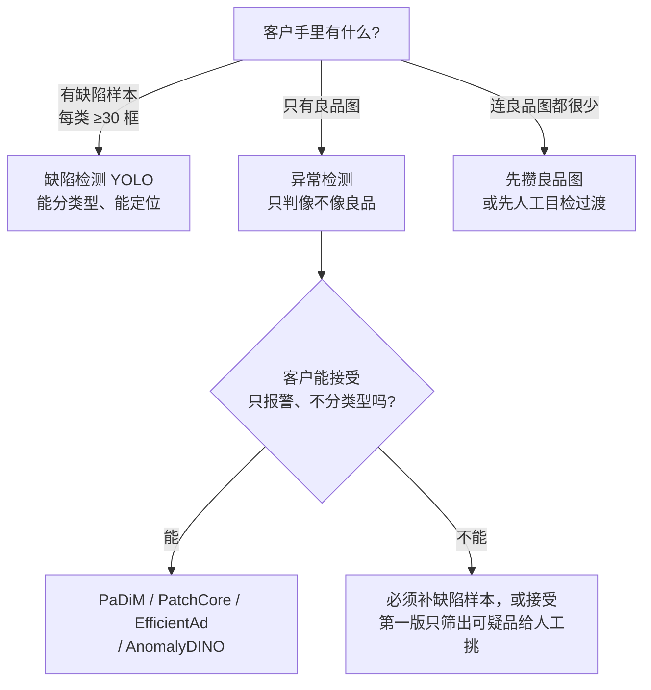

# 样本量需求与检出率承诺（客户沟通版）

> **用途**：这是给客户看的对答口径。客户问「你们这个 AI 检测，我给多少图片才能到多少检出率」时，
> 直接翻这一篇，照第 0 节回答，照第 8 节发清单，照第 9 节抄进技术协议。
> **不是**内部实现文档；算法细节见 `docs/WORKFLOW_GUIDE.md` §2.11 与 §3。
> 最后更新：2026-11-16

---

## 0. 一页速答（客户等着听的就这一段）

**先说一句实话**：检出率不是一个能单独承诺的数字。**「检出率」和「误报率」是一对**，
把检出率压到 99% 的同时，误报一定会涨。所以对客户永远这样回答：

> 「给我 **每个缺陷类别 100~150 个标注框**（细小、低对比的缺陷要 **300~500 个**）、覆盖 **至少 10 个不同的工件/批次**，
> 再给 **10~20% 的良品图**，第一版可以做到 **单类检出率 85% 以上、良品误报 5% 以内**，
> 用于设备报警 + 人工复核。要做到 **单类 95% 检出、少人值守**，需要 **每类 400~800 个框**。」

> 按缺陷大小细分的三档见第 3 节。下面这张表是通用口径，细小缺陷请往上加。

| 客户能给到的 | 我们能做到 | 能不能直接对客户判 OK/NG |
| --- | --- | --- |
| 每类 **30 框**、5 个工件 | 只能看出「这条路走不走得通」，指标 40%~70% | **不能**，只能演示 |
| 每类 **100~150 框**（细小 300~500）、≥10 个工件、10~20% 良品图 | 单类检出 ≥85%，良品误报 ≤5%，mAP50 ≥0.80 | **能**，报警 + 人工复核（第一版） |
| 每类 **400~800 框**、≥30 个工件、良品图充足 | 单类检出 ≥95%，mAP50 ≥0.93 | **能**，可少人值守 |
| 一个缺陷样本都没有，只有良品 | 只能做「像不像良品」的异常检测，给不出缺陷类别 | **要看客户能不能接受只报警**（见第 6 节） |

**一句话记住**：**样本量按「框」算，不按「张」算；覆盖的「工件数」比张数重要。**

---

## 1. 先对齐三个词，不然后面一定吵架

客户口中的「检出率」，和我们报告里的「召回率」，和验收单上的「漏检率」，是三件事的三种说法。
先统一，再谈数字。

| 说法 | 意思 | 怎么测 | 常见的错说法 |
| --- | --- | --- | --- |
| **检出率** = 召回率 `recall` | 有缺陷的产品里，我们报出来的比例 | 拿一批**已知有缺陷**的图，看漏掉几个 | 和「准确率」混着说 |
| **漏检率** | `1 − 检出率` | 同上，反过来算 | 「漏检 1%」被理解成「100 件漏 1 件」——只有在这批图一件只有一个缺陷时才成立 |
| **误报率** / **过杀率** | 良品里，我们报成缺陷的比例 | 必须拿**良品图**单独测 | 「我们没误报」——没测过良品就不叫 0，叫**不知道** |
| **mAP50** | 一个把「位置准不准」也算进去的综合分 | 内部调参用 | 拿 mAP 当检出率跟客户报数 |
| **节拍** | 每张图多少毫秒 | 在客户的机器上跑 | 拿我们开发机的数字当客户产线的数字 |

**对客户的三句硬话：**

1. 「说检出率必须同时说误报率，否则这个数字没有意义。」
2. 「说检出率必须同时说是**哪个缺陷类别**的。总体 95% 可能掩盖某个类别只有 40%。」
3. 「说检出率必须同时说是**什么阈值下**的。阈值调一调，检出率和误报率会一起变。」

> 参考：本工程的操作点曲线（`docs/WORKFLOW_GUIDE.md` §7.21）就是专门算这个的——
> 同一个模型，在 19 个阈值上同时画出「漏检率」和「良品误报率」，让客户自己挑一个点。
> 页面上的原话是：**漏检率 / 过杀率才是产线口径，mAP 只是训练时的相对尺子。**

---

## 2. 数的是「框」，不是「张」

这是报价和工期谈崩的最主要原因，必须当场说清。

| 客户以为 | 实际 | 后果 |
| --- | --- | --- |
| 「我给你 500 张图」 | 一张图上有 5 处缺陷 = **5 个样本**；一张图一个缺陷 = 1 个样本 | 500 张可能只有 500 个样本，也可能有 2500 个 |
| 「我把这块板拍了 1000 张」 | 对模型来说**几乎等于 1 个工件** | 换一块板就全错 |
| 「我拍了 3000 张」 | 如果是同一台设备、同一光照、同一批次 | 只证明了「这一批没问题」，不证明泛化 |

**判别方法（当着客户面问）**：这些图**来自多少个不同的工件 / 批次 / 班次 / 供应商？**
这个数字比总张数重要得多。

**本工程踩过的真实例子**：PCB 数据集 **692 张图、6 类缺陷、每类约 490 个框**，
体检发现**其实只有 10 块底板**，而且 10 块板**全部跨了训练集和验证集**（数据泄漏）。
指标因此偏乐观。所以我们的数据集体检（`docs/WORKFLOW_GUIDE.md` §7.20）会先按底板编号查重、
再按「同一块板只进一个划分」重新切分——**客户的验收集必须来自没参与训练的工件**，
这一条要写进协议。

---

## 3. 我需要多少：按缺陷难度分三档

同样是 150 个框，大缺陷学得会，细划痕学不会。所以先给客户的缺陷分档，再报价。

| 缺陷类型 | 举例 | 可行性验证 | **第一版（推荐起点）** | 量产（少人值守） | 输入分辨率要求 |
| --- | --- | --- | --- | --- | --- |
| **大缺陷 / 边界清晰** | 缺件、错件、大孔、断裂、装反、异物 | 每类 30 框 | **每类 80~120 框** | 每类 300~500 框 | 640 够用 |
| **中等** | 划痕、污渍、偏位、错字、少锡、压伤 | 每类 40 框 | **每类 150~250 框** | 每类 400~800 框 | 建议 960 |
| **细小 / 低对比** | 针孔、细裂纹、氧化、虚焊、发丝划痕 | 每类 60 框 | **每类 300~500 框** | 每类 800+ 框 | **必须 960**，仍不稳改走异常检测 |

**换算成张数**：

```
需要的张数 ≈ 目标框数 ÷ 每张图平均缺陷数
```

| 每张图平均缺陷数 | 目标 150 框需要 | 目标 400 框需要 |
| --- | --- | --- |
| 1 处（一图一缺陷） | 150 张 | 400 张 |
| 2 处 | 75 张 | 200 张 |
| 5 处（PCB 这类） | 30 张 | 80 张 |

**另外两条不算数的要求**（缺一条，上面的框数就白标）：

| 要求 | 数值 | 为什么 |
| --- | --- | --- |
| 独立工件 / 批次 | 第一版 **≥10 个**，量产 ≥30 个 | 板子都一样，模型记的是板子不是缺陷 |
| 良品图（合格品） | 占总量 **10%~20%**，至少 60 张 | 不给良品，就算不出误报率；模型也会「看什么都像缺陷」 |

**小缺陷为什么要翻倍**：PCB 原图 3034×1586，缺陷框只占约 **2.3% 宽（≈70 像素）**，
缩到 640 输入就只剩约 30 像素。本工程实测同一 600 秒预算下，**960 输入跑 12 轮胜过 640 输入跑 24 轮**；
而 1152 / 1280 在 8 GB 显卡上直接显存不足。**这条要提前问客户的上位机配置。**

---

## 4. 我承诺什么：三档指标

| 档位 | 每类框数 | 每类检出率 | 良品误报率 | mAP50（内部） | 用途 | 能不能对客户报 OK/NG |
| --- | --- | --- | --- | --- | --- | --- |
| T0 可行性 | 30 | 40%~70% | 不承诺 | 0.40~0.70 | 决定要不要继续投 | 不能，只演示 |
| **T1 第一版** | **100~150**（细小 300~500） | **≥85%** | **≤5%** | ≥0.80 | 报警 + 人工复核 | **能，灰度试跑** |
| T2 量产 | 400~800 | ≥95% | ≤2% | ≥0.93 | 少人值守 | 能 |

**本工程唯一一组真实实测（可在客户现场复现）**：

| 项目 | 实际值 |
| --- | --- |
| 数据 | 692 张 / 6 类缺陷 / **每类约 490 框** / 每类约 115 张图 |
| 结果 | **检出率 93.0% / 精确率 95.1% / mAP50 0.945 / mAP50-95 0.514** |
| 速度 | 8 GB 显卡上 960 输入 **8.4 毫秒/张**（约 125 张/秒） |
| 训练耗时 | 30 轮约 **27 分钟** |

也就是说：**每类 490 框 → 检出 93%**。客户要 95% 以上，就按 T2 的量准备；
只要第一版能报警，按 T1 准备即可，别一上来要 800 框把项目拖死。

**承诺必须带三个限定词**，否则日后扯不清：

> 在同一台相机、同一套光照、同一工位、同一产品型号下，**每类 ≥XXX 个标注框、覆盖 ≥10 个独立工件**，
> 验收集**不来自训练用的工件**，则单类检出率 ≥XX%、良品误报率 ≤X%。

---

## 5. 关键一步：验证集要多大，才能「证明」这个数

这一段是**保护双方**的，谈协议时一定要摆出来。
客户常说「我要 99% 检出率」——问题是，**你得先有足够多的缺陷图，才能证明你是 99%**。

### 5.1 想证明「漏检率 ≤ X%」，至少需要多少张缺陷图

按 95% 置信度、且验收时**零漏检**计算：

| 想承诺的漏检率 | 至少需要的缺陷图（零漏检） | 客户听着什么感受 |
| --- | --- | --- |
| ≤10% | 30 张 | 合理，可行性验证 |
| ≤5% | 60 张 | 合理，第一版 |
| ≤3% | 100 张 | 合理 |
| ≤2% | 150 张 | 一般 |
| ≤1% | **300 张** | 开始贵了 |
| ≤0.6% | 500 张 | 贵 |
| ≤0.3% | 1000 张 | 很贵 |
| ≤0.1% | **3000 张** | 多数项目做不到 |

**换句话说**：客户手里如果只有 50 张缺陷图，那**最多只能证明漏检率 ≤6%**。
跟我们要 99.9% 检出率，不是模型不行，是**样本量在法律意义上证明不了**。

> 口径说明：上表按**张**算（保守）。一张缺陷图里有多个缺陷时，实际样本是「框」，
> 可以按框数放宽；但协议里建议按张写，避免双方对「一个样本」理解不同。

### 5.2 想证明「误报率 ≤ X%」，至少需要多少张良品图

同理，验收时**零误报**：

| 想承诺的误报率 | 至少需要的良品图 | 备注 |
| --- | --- | --- |
| ≤10% | 30 张 | 太松，不建议 |
| ≤6% | 60 张 | 第一版底线 |
| ≤4% | 100 张 | 推荐 |
| ≤1.3% | 300 张 | 量产推荐 |

> 如果客户一条良品图都不给，我们能给的唯一诚实回答是：
> **「误报率未知，不是 0。」** 系统里这种情况会显示为空（`null`），不要被当成零误报。

### 5.3 测到 95%，但样本少，真值可能低得多

这是客户最难接受、也最该知道的一点。实测检出 95% 时，**真实检出率的 95% 置信区间**：

| 验收样本数 | 实测 95% 时，真值的可能范围 | 结论 |
| --- | --- | --- |
| 30 张 | **78.7% ~ 98.2%** | 太小，说明不了问题 |
| 50 张 | 86.5% ~ 98.9% | 勉强 |
| 100 张 | 88.8% ~ 97.8% | 可用 |
| 300 张 | 91.9% ~ 96.9% | 推荐 |
| 1000 张 | 93.5% ~ 96.2% | 严谨 |

**话术**：「您给我 30 张缺陷图，我可能测出 95%，但这个 95% 的真实含义是
『真值在 79% 到 98% 之间』——这个区间太宽，签不了字。给我 300 张，区间才收到 ±2.5%。」

### 5.4 所以建议这样定验收

| 做法 | 具体 | 好处 |
| --- | --- | --- |
| **分档验收** | 第一版只承诺 ≥85% / 误报 ≤5%，并写明"样本 100/类" | 双方都能兑现 |
| **分批抽检** | 上线后每月抽 200~300 件已知结果的产品复测，累计样本 | 样本量随时间增长，承诺逐步收紧 |
| **在线复核兜底** | 第一版一律人工复核，记录每天被复核改判的数量 | 实际数据比离线指标更可信 |
| **不承诺 0 漏检** | 任何检测系统都有漏检；写"≤X%"，不写"0" | 避免无限责任 |

---

## 6. 客户一个缺陷样本都没有，怎么办

这是很常见的情况，要给出两条路，让客户选，而不是硬答「做不了」。



| 路线 | 客户要给什么 | 能得到什么 | **不能**得到什么 |
| --- | --- | --- | --- |
| **缺陷检测**（YOLO） | 每类 100~150 个标注框 + 10~20% 良品图 | 分类型、带框/带掩膜的定位 | 样本少就学不会；没见过的缺陷类型不会认 |
| **异常检测**（Anomalib / AnomalyDINO） | **只要良品图**，十几张到几百张 | 「这张像不像良品」+ 缺陷热力图 | **给不出缺陷类别**；阈值附近容易误报/漏检 |
| **整图分类** | 每类几十到几百张，只标类别不画框 | 「这一件属于哪一类」 | 不知道缺陷在哪；一张图有多个缺陷时不准 |

**本工程实测的异常检测数字**（同一台 8 GB 显卡）：

| 模型 | 只用良品图多少张 | 建模型耗时 | 单张推理 | 特点 |
| --- | --- | --- | --- | --- |
| PaDiM | 少量良品图 | **28 秒** | **3.6 毫秒**（最快） | 偶有漏检（约 2.3%） |
| PatchCore | 少量良品图 | 3 分 42 秒 | 数十毫秒 | 准确率高，但正常图分数容易饱和、不便趋势监控 |
| EfficientAd | 良品图 + 辅助数据集 | 约 60 分钟 | 数十毫秒 | 分数有区分度，适合做趋势；显存吃满 |
| **AnomalyDINO** | **16 张良品图** | **21 秒** | 56 毫秒 | 零样本/少样本，AUROC 1.000（bottle 实测） |

**关键区别，一定要说清**：异常检测回答的是「**这件东西不像我见过的良品**」，
不是「**这是第 3 类缺陷**」。客户如果一定要知道是哪种缺陷，只能补缺陷样本走 YOLO。

---

## 7. 达不到怎么办：五种情况和补救代价

| 客户症状 | 真实原因 | 补救 | 代价 |
| --- | --- | --- | --- |
| 「换了一批料就乱报」 | 工件/批次太少，模型记的是纹理 | 按批次补样，按批次验收 | 客户停工配合采样 |
| 「小划痕总是漏」 | 输入分辨率不够（30 像素以下） | 输入提到 960；相机/镜头换更高分辨率 | 显存、算力、节拍都变差 |
| 「误报太多没法用」 | 没给良品图，或良品图不含正常波动（反光、油污、模具差异） | 补良品图；按操作点调阈值 | 阈值放宽 → 漏检上升 |
| 「同一类缺陷时好时坏」 | 缺陷定义本身不统一（多个人标的边界不一致） | 先统一判定标准、出缺陷图册 | 一次评审会 + 标注返工 |
| 「新出现的缺陷检测不到」 | 训练集里没有这类缺陷 | 增量补样后微调 | 每轮几天；微调学习率要调小（0.001），否则会冲掉原有能力 |

**这条要提前讲**：模型只能检出**训练集里出现过**的缺陷类型。
「未来所有缺陷都能检」这种承诺不要接，正确说法是：

> 「当前能覆盖这 N 类缺陷；后续新增类型，按每类 80~150 个框补样后重新微调，交付周期约 X 天。」

---

## 8. 数据交接清单（可直接发给客户）

把这张表直接发过去，让客户照着准备，比反复解释省一半沟通时间。

### 8.1 必给项

| # | 项目 | 要求 | 客户填 |
| --- | --- | --- | --- |
| 1 | 缺陷类别清单 | 每类写清**判定标准**，附典型图 | |
| 2 | 每类缺陷图 | 第一版 **100~150 张/类**（细小的 300~500） | |
| 3 | 每类标注框 | 每类 **100~150 个框**（细小 300~500） | |
| 4 | 独立工件数 | 每类至少覆盖 **10 个**不同工件/批次 | |
| 5 | 良品图 | 总量 **10%~20%**，至少 **60 张**，含正常波动 | |
| 6 | 验收集 | 单独留出 **不参与训练** 的工件，建议 ≥30% | |
| 7 | 拍摄条件 | 相机型号、镜头、工作距离、光照、曝光参数 | |
| 8 | 节拍要求 | 每张允许多少毫秒；上位机 CPU/显卡型号 | |

### 8.2 格式要求

| 项 | 要求 |
| --- | --- |
| 图片 | 原图不压缩、不裁剪、不加水印；保留原始分辨率 |
| 命名 | 建议 `工件号_缺陷类型_序号.jpg`，便于按工件分组查重 |
| 缺陷图 | **必须画框标注**（谁画的都要能追溯）；画框要紧贴缺陷边界 |
| 良品图 | 必须**显式标记为良品**（导出后是空标注文件），不能只是「没标」 |
| 不要给 | 已经做过增强/拉伸/美颜的图；截图；微信转发过的图 |

### 8.3 三条最容易出错的地方

1. **「没标注」不等于「良品」**。系统里两者是不同状态：没有标注文件 = 漏标嫌疑，**不计入误报统计**；空标注文件 = 明确良品。客户图省事不标良品，最后误报率就算不出来。
2. **同一块板不能同时出现在训练集和验证集**。否则指标虚高，上线就打脸。
3. **验收集必须独立留出**，而且要用**没参与训练的工件**。

---

## 9. 技术协议可用条款（直接抄，替换 XXX）

> **一、数据条件**
> 甲方按《数据交接清单》提供数据：每个缺陷类别不少于 **XXX 个标注框**，覆盖不少于 **XXX 个独立工件/批次**；
> 良品图不少于专案总量的 **15%**（不少于 60 张）；另留出不少于 **XXX 张**缺陷图与 **XXX 张**良品图作为**独立验收集**，
> 其工件不参与训练。
>
> **二、性能承诺**
> 在上述条件下，同一相机、同一光照、同一工位、同一型号产品：
> 单一缺陷类别的**检出率（召回）不低于 XX%**，**良品误报率不高于 X%**，
> 验收阈值以双方确认的操作点为准（同一阈值下同时考核两项，不接受只考核其中一项）。
>
> **三、验收方法与不确定性**
> 验收样本量须满足统计要求：承诺漏检率为 **X%** 时，验收缺陷图不少于 **300 ÷ X** 张
> （例：承诺漏检 ≤1%，需 ≥300 张缺陷图；承诺漏检 ≤5%，需 ≥60 张）；
> 承诺误报率为 **Y%** 时，验收良品图不少于 **300 ÷ Y** 张（例：承诺误报 ≤5%，需 ≥60 张）。
> 样本量不足时，按实际样本量所能支撑的置信区间考核，不视为乙方违约。
>
> **四、覆盖范围**
> 本承诺仅覆盖双方确认的 **N 类缺陷**（见附件类别清单）。新增缺陷类型、更换产品型号、
> 变更相机或光照条件，需另行补样并重新验收，不属本条款范围。
>
> **五、不承诺事项**
> 乙方不承诺「零漏检」；不承诺对训练集中未出现过的缺陷类型有效；
> 不承诺在超出约定拍摄条件下的性能。

---

## 10. 不能承诺的六件事

| 不能承诺 | 为什么 | 正确说法 |
| --- | --- | --- |
| **零漏检 / 100% 检出** | 任何检测系统都有漏检，且阈值越严误报越高 | 「≤X%，并配合人工复核」 |
| 任意新缺陷都能检 | 模型只认训练时见过的类型 | 「当前覆盖 N 类，新增需补样」 |
| 没给良品图也能保证低误报 | 误报率根本没被测过 | 「误报率未知，需补良品图」 |
| 换了相机/光照还一样准 | 预处理和分布都变了 | 「变更拍摄条件需重新验收」 |
| 换材料/换供应商不用重测 | 表面纹理变了，模型最容易在这里翻车 | 「新材料需补样复测」 |
| 单看 mAP 就代表产线能用 | mAP 是内部调参尺子，不是产线口径 | 「看漏检率 / 误报率 / 节拍」 |

---

## 11. 附录：怎么自己复算（给现场工程师）

```python
# 1) 零漏检时，能宣称的漏检率上限（95% 置信，规则三）
upper = 3 / n_defect_images        # n=300 -> 1.0%

# 2) 零误报时，能宣称的误报率上限（95% 置信，Wilson 更准）
import math
def wilson_upper(k, n, z=1.96):
    p = k / n
    d = 1 + z*z/n
    c = (p + z*z/(2*n)) / d
    h = z*math.sqrt(p*(1-p)/n + z*z/(4*n*n)) / d
    return min(1.0, c + h)

wilson_upper(0, 60)     # 0.0602 -> 6.0%
wilson_upper(0, 300)    # 0.0126 -> 1.3%

# 3) 实测检出率的置信区间（Wilson）
def wilson(k, n, z=1.96):
    p = k / n
    d = 1 + z*z/n
    c = (p + z*z/(2*n)) / d
    h = z*math.sqrt(p*(1-p)/n + z*z/(4*n*n)) / d
    return (max(0.0, c-h), min(1.0, c+h))

wilson(285, 300)        # 0.919 ~ 0.969
```

**平台侧对应的验证入口**（内部用，别让客户看见命令）：

```powershell
# 每类框数、空标、漏标、孤儿标：训练页点「扫描数据集」（只读）
# 按工件/底板查重并重新切分：7-autoresearch-yolo\labelqc.py
# 出漏检率-过杀率曲线并推荐工作点：6-web\backend\tools\val_engine.py
```

详见 `docs/WORKFLOW_GUIDE.md` §2.11（标注量分档）、§7.20（数据体检与按组切分）、§7.21（操作点曲线）。

---

## 12. 机器可读元数据

```yaml
doc_id: sample-budget-and-detection-rate-customer
audience: customer
version: 1
updated: 2026-11-16
companion_docs:
  - docs/WORKFLOW_GUIDE.md#211
  - docs/WORKFLOW_GUIDE.md#720
  - docs/WORKFLOW_GUIDE.md#721
  - docs/异常检测模型对照_AnomalyCLIP与Anomalib.md
units:
  sample: bounding_box_instance    # 按框，不按张
  coverage: distinct_workpiece     # 独立工件/批次
tiers:
  T0_feasibility:
    boxes_per_class: 30
    workpieces_min: 5
    recall: 0.40-0.70
    deployable: false
  T1_first_version:
    boxes_per_class: 100-150
    workpieces_min: 10
    recall_min: 0.85
    false_alarm_max: 0.05
    map50_min: 0.80
    deployable: true
    mode: alarm_plus_human_review
  T2_production:
    boxes_per_class: 400-800
    workpieces_min: 30
    recall_min: 0.95
    false_alarm_max: 0.02
    map50_min: 0.93
    deployable: true
    mode: low_staffing
difficulty_multiplier:
  large_clear: 1.0      # 80-120 @ T1
  medium: 1.8           # 150-250 @ T1
  tiny_low_contrast: 3.0 # 300-500 @ T1
good_image_ratio: 0.10-0.20
good_images_min: 60
verification_rule_of_three:   # 0 misses, 95% confidence
  required_defect_images_for_target_miss_rate:
    0.10: 30
    0.05: 60
    0.03: 100
    0.02: 150
    0.01: 300
    0.006: 500
    0.003: 1000
    0.001: 3000
  required_good_images_for_target_false_alarm:
    0.06: 60
    0.04: 100
    0.013: 300
measured_anchor:
  dataset: PCB缺陷检测
  images: 692
  classes: 6
  boxes_per_class: 490
  distinct_workpieces: 10
  recall: 0.930
  precision: 0.951
  map50: 0.945
  map50_95: 0.514
  latency_ms_960_fp16: 8.41
  train_epochs: 30
  train_minutes: 27
do_not_promise:
  - zero_miss
  - any_unseen_defect_type
  - low_false_alarm_without_good_images
  - same_accuracy_after_camera_or_lighting_change
  - same_accuracy_after_material_or_supplier_change
  - map_as_production_metric
```
