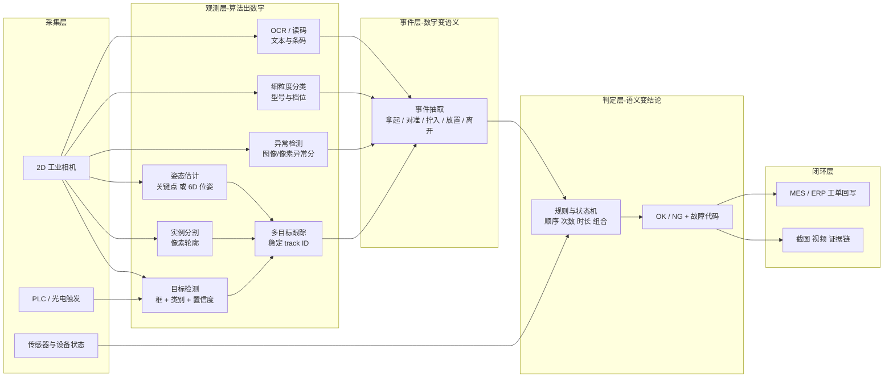
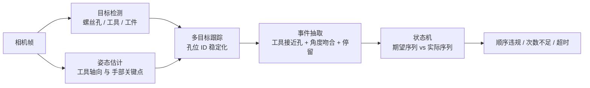
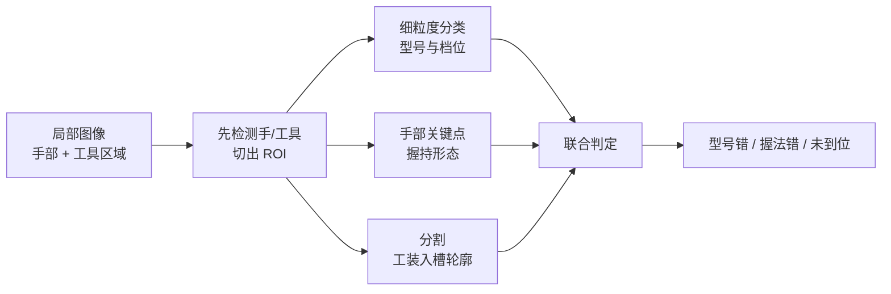
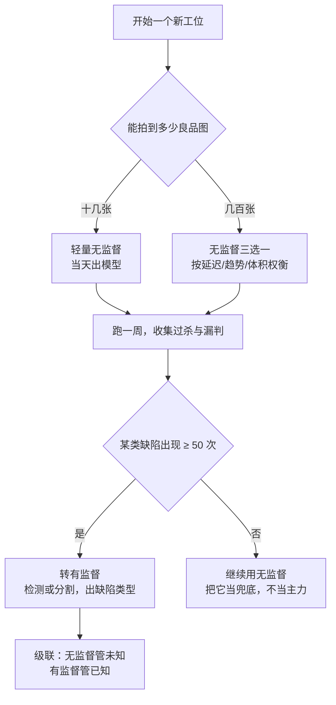
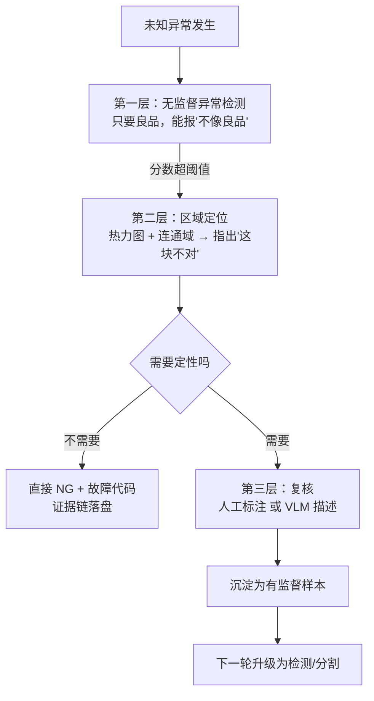
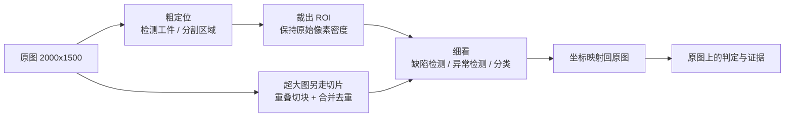
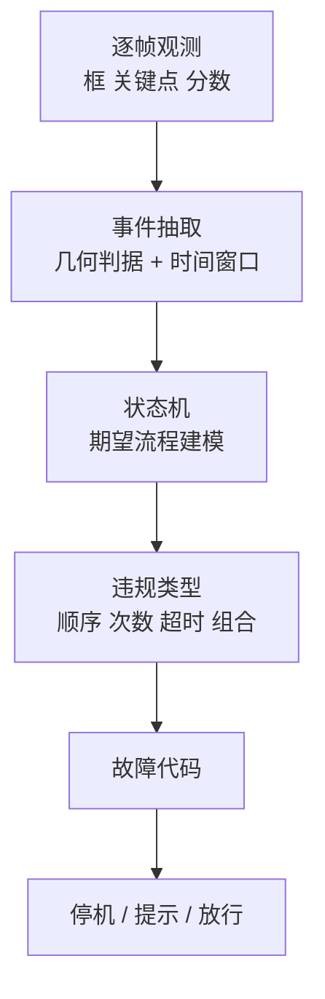
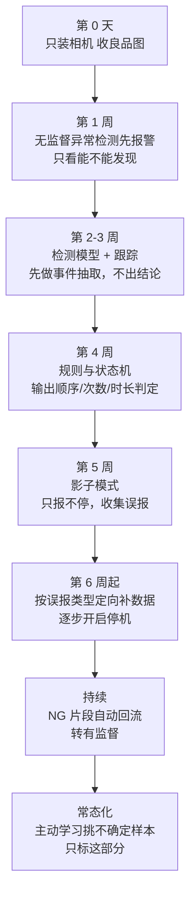
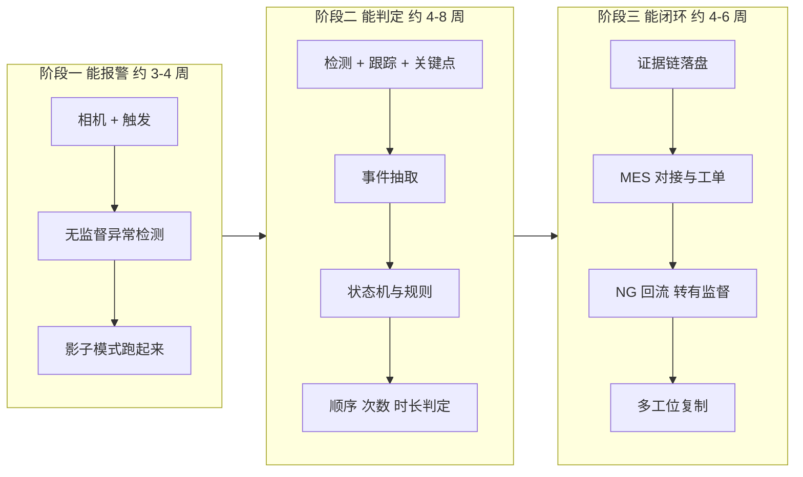

# 生产过程智能管控：AI 算法融合方案

> 用途：给《面向生产过程的有效智能管控（JY INSENSOR）》这份方案补上"算法那一层"。
> 它回答三个问题：PPT 里承诺的事，落到算法上分别是什么问题；目标检测 / 异常检测 / 姿态估计这些算法怎么和现场场景咬合；多个算法怎么拼成一条能出 OK/NG 的链。
> 口径：**通用算法选型**，讲模型族、数据需求、延迟量级、失败模式，不绑定某一个具体仓库。落地工具链的参考清单放在 §11.4。
> 最后更新：2026-11-15（首版；同日把 §11.2 的三页算法内容加进了 PPT，现为 05–07 页）

---

## 0. 一句话

PPT 卖的是"判定"，算法给的是"观测"。中间差的那一层，才是项目成败的地方。

PPT 的四条承诺，翻译成算法语言是这样的：

| PPT 的说法 | 真正的算法问题 | 主力算法 |
| --- | --- | --- |
| 动作顺序、次数、时间自动判定 | 物体在多帧里的身份延续 + 动作语义 + 状态机 | 目标检测 + 多目标跟踪 + 姿态/位姿 + 事件规则 |
| 工具使用规范、工装到位 | 细粒度外观区分 + 空间关系判定 | 细粒度分类 + 分割 + 位姿 |
| 未知异常没样本也能抓 | 只有正常样本时的分布外检测 | 无监督异常检测 |
| 装配结果正确性 | 局部区域的细微差异检测 | 异常检测（冷启动）→ 有监督分割（有样本后） |

一句话概括这份文档的立场：

> **目标检测回答"有没有、在哪"，姿态估计回答"什么姿势"，异常检测回答"像不像良品"。**
> 谁来回答"先拧 A 后拧 B、拧了 4 次还是 3 次、用了 7 秒还是 11 秒"？——这三件事没有一个现成模型能直接给你，必须自己搭「事件 + 状态机」。
> PPT 第二层（动作有效）和第三层（装配正确）的价值，恰好全压在这一层上。

### 0.1 整体分层



这张图里有三个关键判断，后面每一节都在论证它们：

1. **观测层可以买、可以开源、可以调库**。检测、分割、姿态、异常检测都有成熟实现，选型差异主要影响延迟和过杀率，不影响能不能做。
2. **事件层必须自己定义**。"什么叫'拧入了一次'"这件事，没有通用数据集，也没有通用模型，它是工艺知识 + 视觉几何的乘积。
3. **判定层是纯软件的活**。它决定 PPT 那四项软件能力（智能判定、回溯、对接、处置）能不能兑现，而且它改起来最便宜——这正好呼应 PPT 里"改流程不改代码"的承诺。

### 0.2 一句话回答"怎么融合"

融合不是把几个模型串起来跑，而是**四件事同时成立**：

- **时间上融合**：单帧会漏、会抖，多帧才有稳定结论（§4.1）。
- **空间上融合**：整图看小缺陷必然失焦，要先定位再细看（§4.2）。
- **语义上融合**：观测不直接出结论，先变成事件再进状态机（§4.3）。
- **模型上融合**：异常分、分类概率、规则阈值三个来源互相校准，而不是谁大听谁（§4.4）。

---

## 1. 把 PPT 的话翻译成算法问题

这一节的用法：下次评审 PPT 时，逐行往右看，看每一句承诺背后有没有对应的算法任务族。空着的行就是风险。

### 1.1 P2 痛点页：三层拆解

PPT 原话：`信号到位 ≠ 动作有效 ≠ 装配正确`，`PLC 只管第一层`，`要补的是第二层和第三层`。

| 层 | PPT 的说法 | 谁来判 | 算法要解决的问题 | 备注 |
| --- | --- | --- | --- | --- |
| 第一层 信号 | PLC 收到"到位" | PLC，不需要视觉 | 无 | 视觉不参与，别在这里浪费算力 |
| 第二层 动作 | 机构真的执行了 | 视觉为主 | 动作有没有发生、什么时候发生、发生了几次、顺序对不对、多久完成 | **最常被忽略，也是 PPT 的卖点** |
| 第三层 结果 | 装配真的做对了 | 视觉为主，物理量为辅 | 装配后的静态外观差异、装配后的位姿一致性、紧固/插入的几何结果 | 质量看这里 |

这里有个必须提前说清的边界：

> 第二层的"动作执行"里有相当一部分是**力和扭矩**，不是视觉。螺丝到底拧紧没有，2D 相机只能看到"转了"和"到位了"，看不到"扭矩够不够"。扭矩、压力、真空、电流这类量必须由设备自己给，视觉做的是"确认动作发生了、顺序对了、工件在位"。

这条边界如果不提前讲，POC 阶段一定会翻车：客户拿视觉方案去背扭矩的锅。

### 1.2 P3 解决方案页：三件套

| PPT 的说法 | 算法含义 | 对应任务族 |
| --- | --- | --- |
| 2D 相机，空间小成本可控 | 单目、固定视角、可能多个工位 | 无（但决定了算法的先天限制，见 §10.1） |
| 视觉算法平台：动作、顺序、工具、异常 | 四类判定需求 | 动作 → 跟踪+姿态；顺序 → 状态机；工具 → 细粒度分类+位姿；异常 → 无监督异常检测 |
| 低代码编排，IE/工艺自己改 | 判定逻辑要与模型解耦，可配置 | 规则 DSL + 状态机（§5） |

P3 右侧那句"现场实拍界面，判据与结果同屏可查"是产品设计上的一个强点，但它对算法提了一个隐含要求：

> **判据必须是可解释的、离散的、能写给人看的。** 如果判据是"神经网络输出的 0.83"，工艺工程师没法改，也没法背责。所以判据要落成"工具进入 3 号孔上方 3 秒内且角度在 ±15° 内"这种句子，概率只作为其中一个门限。

这条约束直接决定了 §5 判定层的设计形态：**算法出连续值，规则出离散结论**。

### 1.3 P4 软件能力页：四项

| PPT 的说法 | 它是算法问题还是工程问题 | 算法侧要准备什么 |
| --- | --- | --- |
| 智能判定：自由编排动作顺序与工艺流程，次数、时间、正确性自动判定 | **算法 + 工程各一半** | 事件语义定义、每类事件的置信度、漏帧补偿策略 |
| 多维度记录与精确回溯：截图、视频、关键动作可定位可回放 | 工程为主 | 每个判定结论要能反查到"哪一帧、哪个框、哪个分数" |
| 系统无缝对接：MES/ERP，绑定产品码与工位 | 工程为主 | 读码结果与 track ID 要在时间轴上对齐 |
| 灵活多样的错误处置 | 工程为主 | NG 要带故障代码，代码要能追到具体规则 |

这里最容易被低估的是"精确回溯"。它的算法代价是：**推理时不能只输出最终布尔值，必须把中间量全部落盘**（框、关键点、分数、事件时间戳）。很多项目上线后才发现"判 NG 但不知道为什么"，就是因为中间量没留。

### 1.4 P5 闭环页：四步

| 步骤 | 算法输入 | 算法输出 | 算法上容易断的地方 |
| --- | --- | --- | --- |
| 01 24h 采集 | 相机流 + 设备状态 | 结构化观测序列 | 存储与丢帧；长时间运行的漂移 |
| 02 实时比对 | 观测 + 工艺标准 | 偏差事件 | 标准本身是隐性的（老师傅脑子里），需要先把它写成规则 |
| 03 自动干预 | 偏差事件 | 故障代码 + 停机信号 | 误停成本高，必须能设"只报不停" |
| 04 工单闭环 | 故障代码 | 工单 + 回写 | 代码体系不统一，工单对不上 |

这里补一条 PPT 没写但很关键的话：

> 闭环里唯一能自我改进的环节是 **02 → 04 的回流**。NG 片段被确认之后，应该自动沉淀成下一轮训练数据。如果不做这件事，模型三个月后就跟不上现场了（换批次、换来料、换光照）。这是 §7 的重点。

---

## 2. 算法能力地图

这一节把"能用什么"列全，供选型时对照。所有延迟都给量级，不给承诺：真实值取决于显卡、分辨率、batch、是否 TensorRT/INT8，必须现场实测。

### 2.1 静态视觉任务（单帧出结果）

| 任务 | 它回答的问题 | 代表模型族 | 输出 | 数据需求 | 延迟量级 | 典型失败模式 |
| --- | --- | --- | --- | --- | --- | --- |
| 目标检测 | 有没有、在哪 | YOLO 系列、RT-DETR | 框 + 类别 + 置信度 | 每类几百到几千框 | 几 ms ~ 十几 ms（1080p，中端 GPU） | 小目标漏、密集成团时框合并 |
| 实例分割 | 精确轮廓、面积 | YOLO-seg、Mask R-CNN | 掩膜 + 类别 | 需像素级标注，成本约为框的 3~5 倍 | 检测的 1.5~2 倍 | 边缘毛刺、遮挡处掩膜糊 |
| 语义分割 | 区域属性（在槽内/槽外） | DeepLab、SegFormer | 逐像素类别 | 同上 | 十几 ms ~ 几十 ms | 类别边界不清 |
| 人体姿态 | 手在哪、动作形态 | 自顶向下/自底向上关键点模型 | 17~133 个关键点 | 需关键点标注或半自动 | 十几 ms ~ 几十 ms（含多人） | 手部被工具遮挡时关键点漂移 |
| 物体位姿（6D） | 零件朝向、能不能插入 | 基于 CAD 的位姿估计、基于模板 | 旋转 + 平移 | 需 CAD 或高精度标定 | 几十 ms 级 | 无纹理件、对称件歧义 |
| 图像分类 | 整图属于哪一类 | ResNet / EfficientNet / ConvNeXt / YOLO-cls | 类别概率 | 每类几十到几百张 | 几 ms | 类间差异细时不够分 |
| 细粒度分类 | 是哪种型号/哪个档位 | 同上 + 局部放大 | 型号概率 | 每型号都要覆盖 | 几 ms ~ 十几 ms | 型号外观几乎一样时必错 |
| 无监督异常检测 | 像不像良品、异常在哪 | PaDiM、PatchCore、EfficientAd、AnomalyDINO | 图像分 + 像素热力图 | **只要良品图**（十几张到几百张） | 几 ms ~ 几十 ms | 良品覆盖不全导致过杀；背景干扰 |
| 零样本异常检测 | 没见过的新品能不能先报警 | CLIP 系（WinCLIP/AnomalyCLIP）、VLM | 图像分 + 热力图 | 不需要本产品数据 | 几十 ~ 几百 ms | 分数不稳、阈值难定、进不了节拍 |
| OCR | 读文字 | PP-OCR 一类 | 文本 + 位置 | 通用模型通常够用 | 几十 ms（CPU 也能跑） | 反光、倾斜、字太小 |
| 读码 | 一维/二维码 | 传统解码 + 深度检测辅助 | 码值 | 通常免训练 | 几 ms ~ 十几 ms | 磨损、畸变、低对比 |

**关于"姿态估计"这个词，必须在这里拆开——这是最容易混淆的地方：**

| 类型 | 估的是谁 | 典型用途 | 在 PPT 场景里 |
| --- | --- | --- | --- |
| 人体姿态 | 人的骨骼关键点 | 判断工人是否违规、动作是否规范、有没有伸手进危险区 | 用于"工具使用规范""安全" |
| 手部姿态 | 手指关节 + 抓握形态 | 判断捏/握/拧的手型，判断工具是否被正确持握 | 用于"握持方式对不对" |
| 物体 6D 位姿 | 刚体零件的位置与朝向 | 判断零件朝向、插入方向、装配角度 | 用于"装配角度、插入姿态" |

PPT 现场的判据绝大多数属于第二、三类，但很多方案报预算时只按第一类算（因为开源人体姿态模型最现成），这是选型陷阱。

### 2.2 视频时序任务（多帧才有意义）

| 任务 | 它回答的问题 | 代表方法 | 数据需求 | 延迟量级 | 说明 |
| --- | --- | --- | --- | --- | --- |
| 多目标跟踪 | 这一帧的框和上一帧的框是不是同一个东西 | ByteTrack / BoT-SORT / OC-SORT，或自研 IoU+匈牙利匹配 | 免训练（检测器质量决定上限） | 相对检测增加几 ms | **工业场景自研轻量跟踪往往更好**，因为物体数量少、运动可预测 |
| 跨相机重识别 | 不同工位看到的是不是同一个工件 | ReID 特征 | 需跨相机标注 | 十几 ms | 多工位串联才需要 |
| 动作识别（片段级） | 这段 2 秒是什么动作 | 骨架系（ST-GCN 类）/ RGB 系（TSM、VideoMAE） | 每动作几百到上千片段 | 几十 ~ 上百 ms | 边界模糊是主要问题 |
| 时序动作定位（帧级） | 动作从第几帧到第几帧 | ActionFormer 一类 | 同上 + 时间边界标注 | 几十 ms | 用来算"这个动作花了多久" |
| 时序异常检测 | 这段时间的行为流是否异常 | 特征流 + 密度估计 | 只要正常视频 | 视长度 | 适合"整段流程有没有跑偏" |

**这里有一个重要的选型判断**：动作识别（片段级、整段分类）在工业节拍场景里通常**不如**"检测 + 跟踪 + 几何规则"好用。原因很实在：

- 动作识别需要每个动作几百上千条片段，标注成本高，且换一个工位就要重标。
- 工业动作高度结构化（拿起、移动、对准、插入、锁付），几何判据（靠近、重叠、角度、停留时长）就能覆盖大部分，而且可解释、可改。
- 动作识别是黑盒概率，工艺工程师改不动，出了问题无法归因。

所以本方案的默认选择是：**动作识别只在"几何判据表达不出来"时才上**，比如"这个手势算不算捏住""工人有没有按规范擦拭"。

### 2.3 判定层（不是模型，但必须当成一个组件来设计）

| 能力 | 实现方式 | 输入 | 输出 |
| --- | --- | --- | --- |
| 事件抽取 | 几何判据 + 时间窗口 | 跟踪轨迹、关键点、检测框 | 带时间戳的事件 |
| 顺序判定 | 状态机 | 事件序列 | 顺序违规 + 具体位置 |
| 次数判定 | 计数器 + 去抖 | 事件序列 | 次数偏差 |
| 时长判定 | 区间计时 | 事件起止 | 超时/过短 |
| 组合判定 | 规则引擎 | 多事件 + 多相机 | 综合结论 |
| 结论输出 | 映射表 | 规则命中 | OK/NG + 故障代码 |

判定层的完整设计见 §5。

### 2.4 兜底与冷启动

| 手段 | 什么时候用 | 代价 |
| --- | --- | --- |
| 零样本检测（开放词表检测） | 新品上线、完全没标注、想先看"看不看得见" | 精度低于专用模型，不能直接进判定 |
| 零样本分割（提示式分割） | 快速生成初始标注，减少人工画框 | 边缘需人工修，仍需审核 |
| 零样本异常检测 / VLM | 完全没良品样本、要当天出个初步结论 | 只能做初筛与复核，进不了节拍，见 §3.4 |
| 大模型生成规则初稿 | 由工艺文档生成判定规则草稿 | 必须人工逐条确认，不能直接上线 |

---

## 3. 七大场景怎么落算法

每一小节统一四段：**场景 → 算法组合 → 判据长什么样 → 失败模式与补偿**。

### 3.1 装配动作顺序与次数判定（PPT 最核心的一条）

**场景**：一个工位上有 4 个螺丝要按 A→B→C→D 顺序拧，每个拧 1 次，工装要用对型号。要自动判"顺序对不对、次数够不够、有没有漏"。

**算法组合**（这是本方案里最典型的"四算法并联"）：



四个算法各自不可替代：

| 算法 | 在这个场景里唯一的职责 | 缺了会怎样 |
| --- | --- | --- |
| 目标检测 | 找到"孔"和"工具"的位置与类别 | 不知道往哪判，无法定位证据 |
| 姿态估计 | 判断工具是否**指向**孔、角度是否在可插入范围 | 工具只是路过孔上方也会被算成一次操作（假动作） |
| 多目标跟踪 | 让"3 号孔"在 200 帧里始终是 3 号孔，不串号 | 顺序判定直接把 A 判成 B，全乱 |
| 状态机 | 把连续帧压成离散事件，比对期望序列 | 只能得到一堆每帧布尔值，出不了"第 3 步错"这种结论 |

**判据长什么样**（合格判据必须是人能读懂、能改的）：

```
一次"拧入"事件 = 以下同时成立且持续 ≥ 0.3 秒：
  1. 工具框与目标孔 ROI 的交并比 > 0.2
  2. 工具轴向与孔轴线夹角 ≤ 15°
  3. 工具尖端到孔中心的像素距离 < 孔半径 × 1.5
  4. 该孔在当前产品周期内还没有被标记为已拧
```

对应的"顺序判定"就变成一句话：**事件序列必须与期望序列一致，且每个孔的事件计数 = 1。**

**失败模式与补偿**（这一段是方案能不能落地的地方）：

| 失败模式 | 现象 | 补偿手段 |
| --- | --- | --- |
| 漏帧 | 工具被手挡住 3 帧，事件没触发 | 允许事件跨越 ≤ N 帧的空洞（max_gap），用前后帧插值补齐 |
| 关键点抖动 | 角度帧间跳变，判据时真时假 | 对关键点做滑动平均；用"持续 N 帧"而不是"单帧" |
| 快速动作 | 整个插入只用了 4 帧 | 提高该工位帧率，或降低判据的 min_frames 并配合时间容差 |
| 工具相似 | 电动螺丝刀与电批外观接近，类别判错 | 细粒度分类 + 型号绑定到工单（MES 下发该产品该用哪把） |
| 一孔多拧 | 同一孔连续两次都被算成"拧入" | 事件去抖：同 target 的相邻事件间隔 < 阈值时合并 |
| 反光/遮挡导致框丢失 | 检测置信度骤降 | 跟踪器预测位置兜底（卡尔曼/匀速模型），并标记为"低置信" |

**次数判定的特殊说明**：次数不能简单数事件个数。真实现场里"反复对位"很常见（拧歪了重来），需要区分"重试"和"多次装配"。做法是给每个孔加状态 `未动 / 已对位 / 已锁付`，只有进入 `已锁付` 才计数，`已对位` 反复进出不计次。这条如果没设计，POC 第一天就会被现场判"误报太多"。

### 3.2 工具使用规范与工装到位

**场景**：该用 3 号工装却拿了 5 号；镊子握法不对；工装没完全入槽；用了不该用的工具。

**算法组合**：



| 子问题 | 算法 | 关键点 |
| --- | --- | --- |
| 工具型号 | 细粒度分类 | **必须按"当前工单应该用哪把"来判**，而不是判"这是几号"。同一把工具在不同工单里都可能合法或非法 |
| 握持方式 | 手部关键点 + 少量几何 | 判"手指是否包住握把""是否握在指定区段"。用关键点到工具轴线的距离分布，比整段动作识别便宜得多 |
| 工装到位 | 分割 + 位姿 | 判"工装轮廓是否完整进入槽内""工装与槽的角度是否一致"。分割比检测好，因为要判"面积覆盖率" |
| 工具状态（该换没换） | 检测 + 计数 | 刀具/钻头寿命靠**使用次数**统计，不是靠看外观。视觉只负责确认"这次用了" |

**失败模式**：工具被手大面积遮挡（型号特征消失）、同类工具颜色差异极小、细粒度分类在小 ROI 上分辨率不够。
**补偿**：把 ROI 单独裁出来放大再分类（不是整图缩放到网络输入）；对确认识别不了的情况，**降级为"要求人工确认"而不是"猜测"**——猜错在生产上比不判更糟。

### 3.3 装配结果正确性（质量那层）

**场景**：装配完成后，判断有没有漏装、装反、装歪、多装、异物、划伤。

**算法组合：两层，冷启动用无监督，样本多了升级为有监督。**



四类无监督模型的场景边界（通用结论，具体数字按现场实测）：

| 模型 | 一句话定位 | 最适合 | 不适合 |
| --- | --- | --- | --- |
| 基于统计建模的（PaDiM 一类） | 快而轻，建模秒级 | 节拍高、缺陷明显、能容忍偶尔漏 | 小划痕、浅污染这类高保真需求 |
| 基于记忆库的（PatchCore 一类） | 零调参、召回高，当天能验证可行性 | 新项目评估、离线抽检、要最高召回 | 要监控良品分数趋势（这类分数容易饱和） |
| 带学生-教师自蒸馏的（EfficientAd 一类） | 良品分数连续可用 | 要按趋势提前预警、边缘设备 | 训练成本高、显存吃紧 |
| 基于基础模型特征的（DINO 特征 + 少量样本） | 十几张图当天出结果 | 新品试产、正常样本极少 | 极限延迟、背景很乱 |

**这里有一条容易忽略的工程约束**：无监督异常检测的**阈值不能跨模型、跨工位套用**。同一个产品换一个工位（光照变了），分数分布就整体平移。所以阈值必须分模型、分工位、分批次单独标定，并定期复核。PPT 里的"实时比对"要能落地，阈值管理是个必做的子系统。

**失败模式**：

| 现象 | 原因 | 处理 |
| --- | --- | --- |
| 良品被大量判 NG（过杀） | 良品图覆盖不全（只拍了一个方向、一种光照） | 补良品图：不同班次、不同来料批次、不同光照 |
| 只报"有异常"不报位置 | 模型只给图像分 | 同时输出像素热力图，并做连通域聚类出区域框 |
| 换批次后分数整体漂移 | 来料色差/模具磨损 | 阈值分组 + 定期用当前批次良品重标 |
| 缺陷类型说不清 | 无监督天生不分类 | 走 §4.4 的异常→分类级联 |

### 3.4 未知异常（PPT 痛点的正面回答）

PPT 原话：**"无法捕获未知的异常事件""没报警、没样本，规则写不出来"**。

这一条是整份 PPT 里最诚实的痛点了，也正是无监督异常检测存在的理由。但必须把它的能力边界讲清楚，否则会变成过度承诺。

**三层能力，逐层降级**：



三层各自的能力与代价：

| 层 | 能做什么 | 不能做什么 | 延迟量级 |
| --- | --- | --- | --- |
| 无监督检测 | 报"这张图不像良品"，不需要异常样本 | 说不出是什么缺陷；阈值定不好就会过杀 | 几 ms ~ 几十 ms，可进节拍 |
| 区域定位 | 指出异常区域 | 区域边界粗糙，不适合量尺寸 | 同上 |
| VLM 复核 | 用自然语言描述"这里像是有个凹陷" | 慢、贵、结果不稳定，**不能进节拍** | 几百 ms ~ 几秒 |

**必须写进方案的三句话**：

1. 无监督异常检测解决的是**"能不能发现"**，不是**"是什么"**。
2. 它能上线的前提是**良品图拍够、拍全**。现场良品图的覆盖度直接决定过杀率，这件事比选哪个模型重要得多。
3. 它应该长期作为**兜底层**存在，而不是被替换掉：有监督模型只能覆盖已见过的缺陷，无监督覆盖"没见过的"。两者是相加关系，不是替代关系。

### 3.5 节拍与时间判定

**场景**：这个工步标准 7 秒，实际用了 11 秒；整个过程必须在 30 秒内完成；某个动作之间不允许有超过 2 秒的停顿。

**算法组合**：

- **事件时间戳是主来源**：动作起止由 §3.1 的事件抽取给出，精度受帧率限制（15 fps → 68 ms 分辨率）。
- **时序动作定位**只在"动作边界靠几何判不出来"时使用（比如"擦拭"这种轨迹不规则的动作）。
- **物理量对齐**：设备侧的节拍、扭矩曲线要与视觉事件在时间轴上对齐，才能判断"是视觉看到的晚"还是"动作真的慢"。

**判据写法**：

```
单件总时长 = 首件进入 到 良品流出
工步时长   = 该工步首个事件 到 该工步最后事件
判定：工步时长 ≤ 标准节拍 × 1.2，且总时长 ≤ 上限
```

**失败模式**：帧率不够导致时间量化误差、事件漏检导致时长偏短、多工位产品流转时 ID 未衔接导致计时归错产品。
**补偿**：时间预算必须计入帧率量化误差（见 §6）；计时以"可靠事件"为锚点，不以"任意帧"为锚点。

### 3.6 设备状态与安全

**场景**：设备指示灯颜色、仪表读数、安全门开关、光栅是否被遮挡、人员在危险区。

| 子场景 | 算法 | 说明 |
| --- | --- | --- |
| 指示灯（三色灯） | 检测 + 颜色分类 | 用颜色阈值往往就够，不必上深度模型；深度模型用于复杂光照 |
| 仪表读数 | 检测表盘 + 关键点/分割 + 读数回归 | 传统指针表用几何读，数字表用 OCR |
| 安全门/光栅 | 检测 + 状态分类 | 关键是要"失电安全"逻辑，不能只靠视觉判安全 |
| 人员进入危险区 | 人体检测 + 跟踪 + 区域判定 | 必须与安全回路联动，视觉只能做辅助，**不能替代安全光栅** |

**必须强调的边界**：视觉不能作为唯一的安全保护手段。安全等级（PL/SIL）要求的是冗余的硬件回路，视觉最多做二次确认或预警。这条要在方案里写明，否则是合规风险。

### 3.7 追溯绑定

**场景**：每个产品要绑定条码、工位、时间、判定结果、证据截图。

| 环节 | 算法 | 注意 |
| --- | --- | --- |
| 读码 | 传统解码 + 深度检测辅助定位 | 优先用传统解码（快且免训练），只在定位困难时上检测 |
| 码与产品绑定 | 跟踪 ID 贯穿 | 产品在工位内移动时 track ID 必须稳定；换工位靠读码重新绑定 |
| 文本信息 | OCR | 只读关键字段，别做整页识别 |
| 证据链 | 截图 + 事件时间戳 | 每个 NG 至少留：违规帧、前后 1 秒片段、命中的规则 ID |

追溯这条最能体现"算法只是观测层"：真正的价值在**把分散的观测按产品 ID 聚合成一条时间轴**，这件事是软件工程，不是模型。

---

## 4. 算法融合的四种范式

这一节是"如何融合"的正面回答。四种范式各解决一类问题，实际系统里通常四种都用。

### 4.1 时间融合：单帧不可信，多帧才有结论

**解决什么**：检测抖动、关键点跳变、瞬时遮挡。

**怎么做**：

| 手段 | 适用 | 代价 |
| --- | --- | --- |
| 多帧投票（N 帧中 M 帧命中才判成立） | 离散判据（有没有、是哪类） | 引入 N 帧延迟 |
| 滑窗平滑（对分数/坐标做平均或中值） | 连续量（角度、距离、异常分） | 平滑会吃掉快速动作 |
| 跟踪器预测兜底 | 短时遮挡 | 遮挡久时预测会漂 |
| 事件空洞容忍（max_gap） | 事件序列 | 放进假事件的概率上升 |

**失败模式**：窗口太长 → 快速动作被吃掉；窗口太短 → 抖动照旧。窗口长度必须与节拍成正比，不能拍脑袋定固定帧数。

**代价**：时间融合本质是拿延迟换稳定。在 30 fps 下 5 帧投票 = 167 ms 延迟，这个数必须计入 §6 的预算。

### 4.2 空间融合：先定位，再细看（级联）

**解决什么**：整图缩放到网络输入后，小缺陷只剩几个像素，必然检不到。



三种级联方式：

| 方式 | 说明 | 适用 |
| --- | --- | --- |
| 工件级级联 | 先找工件，再在工件内判缺陷 | 大视场 + 小工件 |
| 位号级级联 | 先定位位号（孔/针脚/焊盘），再逐位判 | 阵列式装配 |
| 切片级级联 | 大图切重叠块，每块单独推理再合并 | 面板、大幅面连续材料 |

**失败模式**：粗定位漏掉工件 → 后面全丢（级联的第一层决定召回上限）；切片重叠不足 → 缺陷被切断在缝上；坐标映射误差 → 证据框错位。
**代价**：级联的算力是相乘的。切片 4×4 就是 16 倍推理量，必须配合"只在 ROI 上跑细模型"来控制。

### 4.3 语义融合：观测 → 事件 → 状态机（本方案的主线）

**解决什么**：模型只能给数字，业务要的是"第几步错了、错在哪"。



**这一层的三条设计原则**：

1. **事件必须是离散的、可命名的、带时间戳的**。不要用"置信度 0.7 的动作"这种表述。
2. **状态机描述的是"期望流程"，不是"实际流程"**。实际流程永远有偏差，状态机只负责判断偏差是否在允许范围。
3. **任何违规必须能追到"哪一帧 + 哪条规则"**。这是回放和追责的前提。

**失败模式**：事件定义太细（维护成本爆炸）、太粗（判不出差异）；状态机分支爆炸（工艺一变就要重画）。
**代价**：这是唯一一层需要**工艺工程师深度参与**的，也是最容易被做成"只有写代码的人看得懂"的一层。低代码编排的价值就在这里。

### 4.4 模型融合：多来源互相校准

| 融合方式 | 怎么做 | 典型用途 | 风险 |
| --- | --- | --- | --- |
| 异常 → 分类级联 | 异常检测报"有问题"，再把该区域送细粒度分类判类型 | 缺陷分档、NG 原因归类 | 分类模型没见过的新缺陷会硬分到已知类，必须允许"未知"输出 |
| 检测 + 异常双通道 | 已知缺陷走检测，未知走异常，两者取并集 | 质量总判 | 两套阈值要分别标定，否则过杀叠加 |
| 多模型投票 | 同类任务跑两个模型，一致才放行 | 高价值工位、避免单点失效 | 算力翻倍，延迟翻倍 |
| 视觉 + 物理量 | 视觉判"动作发生了"，设备判"力/扭矩达标" | 锁付类工位 | 时间对齐误差会让两者错位 |
| 规则 + 模型 | 模型出分，规则出结论 | 全部场景 | 规则写太死会屏蔽模型的能力 |

**一条硬规则**：**任何融合都不能让"未知"被强制归到已知类**。分类头必须留 `unknown` 或低置信拒识通道，否则系统会一直自信地报错误类型，比不报更糟。

---

## 5. 判定层设计（本方案最该认真写的一节）

### 5.1 三层阈值，别混在一起

| 阈值层 | 谁定 | 作用 | 举例 |
| --- | --- | --- | --- |
| 模型阈值 | 算法工程师，用验证集定 | 决定"这个框算不算存在" | 检测置信度 0.45 |
| 规则阈值 | 工艺工程师，可现场调 | 决定"这个几何关系算不算成立" | 夹角 ≤ 15°、交并比 > 0.2 |
| 业务阈值 | 质量/生产管理 | 决定"允许多少误报换多少漏报" | 过杀率上限 0.5%、漏判率上限 0.1% |

三层混在一起是常见事故源：工艺改了一个规则阈值，结果模型阈值被顺手动了，整条线全乱。系统上必须**分开存、分开改、分开留痕**。

### 5.2 规则该长什么样

判据要能被工艺工程师读懂并修改，所以推荐 YAML 这种纯文本、可版本管理的形态（而不是图形化拖拽生成的二进制流程）：

```yaml
station: ST-03
camera: cam_top
fps: 15
objects:
  - name: hole
    source: detect(part_holes)
    min_conf: 0.45
  - name: driver
    source: detect(tools)
    classes: [electric_driver_3, electric_driver_5]

events:
  - name: approach
    when:
      - iou(driver, hole.roi) > 0.05
    min_frames: 2
  - name: screw_in
    when:
      - iou(driver, hole.roi) > 0.20
      - angle(driver.axis, hole.axis) <= 15
      - dist(driver.tip, hole.center) < hole.radius * 1.5
    min_frames: 5
    max_gap_frames: 10
    debounce_ms: 800

process:
  - name: fasten_all
    expect:
      sequence: [screw_in]        # 目标：4 个孔各一次，顺序按 hole 位号
      count_per_target: 1
      total_count: 4
    timing:
      step_max_ms: 12000
      per_target_min_ms: 400
    dedup:
      same_target_merge_ms: 1500

verdict:
  ng_codes:
    order_violation: E1001
    count_mismatch: E1002
    timeout: E1003
    tool_mismatch: E1004
evidence:
  keep_frames_before: 15
  keep_frames_after: 15
```

这份配置里每一项都对应 PPT 的一句承诺：

| 配置项 | 对应 PPT |
| --- | --- |
| `sequence` | "自由编排动作顺序与工艺流程" |
| `count_per_target` / `total_count` | "次数自动判定" |
| `step_max_ms` / `per_target_min_ms` | "时间自动判定" |
| `min_frames` / `max_gap_frames` / `debounce_ms` | "实时比对"里抗抖动的部分 |
| `ng_codes` | "推送故障代码" |
| `evidence` | "精确回溯" |

### 5.3 状态机 vs 规则引擎 vs 时序模型

| 方案 | 优点 | 缺点 | 什么时候用 |
| --- | --- | --- | --- |
| 显式状态机 | 可解释、可画出来给工艺看、易测 | 工艺流程一变就要改 | **默认选择**，能覆盖 80% 的顺序判定 |
| 规则引擎（条件-动作） | 表达力强、能处理组合条件 | 规则多了互相干扰、难追溯 | 多条件组合、跨工位联合判定 |
| 时序模型（端到端） | 能学人类说不清的判据 | 黑盒、要大量数据、换工位重训 | **只在几何判据表达不出来时用**，且必须允许"拒识" |

选型顺序建议：**先试状态机，写不出来再试规则引擎，两者都不行才上时序模型**。反过来做（先上深度学习模型）的项目，通常在半年前期效果惊艳，半年后因为改不动而停摆。

### 5.4 工作点怎么定

判定层的最终参数是"在漏判和过杀之间选一个点"，这件事必须用曲线说话：

1. 用一批带标签的样本（良品 + 各类 NG）跑一遍，得到每条规则的命中分布。
2. 画出漏检率-过杀率曲线（调模型阈值和规则阈值，各扫一遍）。
3. 由质量部门选定工作点，写进配置并留档。
4. 上线后按周复核：来料变化会让曲线整体平移，工作点需要重新确认。

**这一步不做，POC 通过、量产翻车是常态。**

---

## 6. 节拍与算力预算

### 6.1 时间预算怎么拆

一个工位的可用时间 = 节拍 − 安全余量。以"节拍 2 秒"为例，时间要这么分：

| 环节 | 典型占比 | 说明 |
| --- | --- | --- |
| 触发与取图 | 一小块 | 相机曝光 + 传输，工业相机通常几十 ms 内 |
| 前处理 | 一小块 | 缩放、归一化，注意别成为瓶颈 |
| 模型推理 | 大头 | 多个模型串行时是相加关系 |
| 后处理与解码 | 不可忽略 | NMS、关键点解码、掩膜还原，大分辨率下很吃时间 |
| 事件与规则 | 很小 | 纯计算，微秒到毫秒级 |
| 通讯与落盘 | 一小块 | 截图与视频落盘建议异步，别阻塞判定 |

**关键提醒**：多篇实测里，**后处理和大图预处理经常比推理本身更耗时**。预算表里如果不给后处理留位置，实测一定超。

### 6.2 各算法族的延迟量级（量级，必须实测）

| 算法族 | 延迟量级 | 备注 |
| --- | --- | --- |
| 轻量检测（单模型，720p~1080p，中端 GPU + TensorRT FP16） | 几 ms ~ 十几 ms | 光流、小目标版本会翻倍 |
| 实例分割 | 检测的 1.5~2 倍 | 掩膜后处理占不小比例 |
| 人体关键点（单人） | 十几 ms ~ 几十 ms | 多人时按人数线性增加 |
| 物体 6D 位姿（模板/CAD 法） | 几十 ms | 无纹理件可能上百 ms |
| 无监督异常检测（256 输入） | 几 ms ~ 几十 ms | 特征库法更慢，体积更大 |
| 基础模型特征 + 少量样本 | 几十 ms | 输入分辨率高时按平方增长 |
| 细粒度分类（小 ROI） | 几 ms | 便宜，能加就加 |
| 多目标跟踪 | 相对检测增加几 ms | 物体数量少时几乎可忽略 |
| OCR | 几十 ms | CPU 也能跑，不必抢 GPU |
| VLM 复核 | 几百 ms ~ 几秒 | **不进节拍**，异步 |

结论式判断：

> 如果判定只需要"检测 + 跟踪 + 规则"，单工位在消费级/入门工业 GPU 上通常有充裕余量。
> 一旦加入"分割 + 位姿 + 异常检测"三件套，就要么提高帧率前先降分辨率，要么接受"不是每帧都跑全模型"。
> VLM 永远是异步通道，不进实时链路。

### 6.3 省算力的五种手段

| 手段 | 做法 | 代价 |
| --- | --- | --- |
| 抽帧 | 不是每帧都跑全模型，关键帧才跑重模型 | 快速动作可能漏 |
| 模型分工 | 轻模型每帧跑，重模型隔 N 帧跑 | 事件时间戳精度下降 |
| ROI 裁剪 | 只在工位区域推理，不做全图 | 需要先稳定定位 ROI |
| 流水线并行 | 取图、推理、后处理、规则分到不同线程/进程，像流水线一样错开 | 实现复杂度上升，延迟一致性变差（首件与稳态不同） |
| 多工位共享 | 多相机按序复用 GPU | 排队延迟，需要调度策略 |

**流水线并行的关键判断**：它提升的是**吞吐**（每秒处理多少件），不降低**单件延迟**。如果节拍瓶颈在"单件总耗时"而不是"每小时产量"，流水线并行帮不上忙，必须减模型或降分辨率。这两件事经常被混为一谈，选型时会算错账。

### 6.4 相机构图对算法的硬约束

这一条经常被放到最后才讨论，导致算法方案推翻重来：

| 构图要素 | 对算法的影响 |
| --- | --- |
| 视场覆盖 | 视场越大，单像素分辨率越低，小缺陷越难检 → 必须级联或增加相机 |
| 相机视角 | 斜视会引入透视畸变，测角度、测距离都会偏 → 几何判据前必须做标定与校正 |
| 帧率 | 直接决定事件时间精度和快速动作的可检性 → 与节拍匹配，不是越高越好（成本与算力） |
| 光照与频闪 | 频闪会造成帧间亮度跳变，异常检测分数抖动 → 需要同步光源 |
| 遮挡 | 手和工具互相遮挡 → 需要多相机冗余或跟踪兜底 |

---

## 7. 数据与标注策略

### 7.1 每类任务的数据量级与标注成本

| 任务 | 数据量级 | 标注形式 | 单张成本（相对） | 结论 |
| --- | --- | --- | --- | --- |
| 无监督异常检测 | 十几张 ~ 几百张**良品** | 无标注 | 最低 | **冷启动首选**，先上它 |
| 目标检测 | 每类几百 ~ 几千个实例 | 框 | 中 | 顺序/次数判定的基础，必须有 |
| 细粒度分类 | 每型号几十 ~ 几百张 | 图级标签 | 低 | 工具规范判定的主力，性价比最高 |
| 实例分割 | 每类几百实例 | 像素掩膜 | 高（3~5 倍于框） | 只在需要面积/轮廓时用 |
| 关键点 | 每类几百 ~ 上千 | 关键点 | 高 | 判据确实需要角度/姿态时才上 |
| 动作识别 | 每动作几百 ~ 上千片段 | 片段标签 | 最高 | 尽量不用，用几何规则替代 |
| OCR / 读码 | 通常免训练 | — | 无 | 先用现成方案 |

### 7.2 冷启动顺序（照这个顺序做，风险最低）



这个顺序的道理：**先让系统"看得见"，再让它"说得清"，最后才让它"敢停机"**。反过来做（一上来就全链路停机）的项目，误停几次就会被现场关掉。

### 7.3 NG 回流闭环

这是让系统长期不退化的唯一手段：

| 环节 | 要求 |
| --- | --- |
| 采集 | 每次 NG 必须落盘：违规帧 + 前后片段 + 命中的规则 + 所有中间量 |
| 确认 | 现场或质量人员对 NG 做"真 NG / 误报"二选一标记 |
| 分类 | 真 NG 按现象聚类，攒够 50 个以上转有监督 |
| 训练 | 用回流数据微调，评估提升后才替换线上模型 |
| 留痕 | 每次换模型必须记录：训练数据版本、指标、上线时间、可回滚 |

**没有回流闭环的系统，半年内必然失效**（换批次、换来料、换班次、换季节光照）。

### 7.4 主动学习：把人工标注花在刀刃上

回流数据会越攒越多，但标注人力不会增加。直接"全标"是最贵的做法，正确做法是**只标模型最没把握的那部分**。

| 挑选策略 | 挑哪些样本 | 适合什么阶段 |
| --- | --- | --- |
| 置信度最低 | 分类/检测置信度落在中间带的样本 | 有监督模型迭代 |
| 异常分贴阈值 | 异常分数最靠近判定线的样本 | 异常检测标阈值、压过杀 |
| 多模型分歧 | 两个模型/两次增强结果不一致 | 高价值工位 |
| 规则命中但人工判 OK | 误报样本 | 直接决定误停率，优先级最高 |
| 覆盖度补充 | 聚类后每簇挑代表样本 | 冷启动补类别、补光照工况 |

**流程闭环**：模型对未标注数据打分 → 按上表挑出 Top-N → 人工只标这 N 张 → 训练 → 评估 → 上线。经验上，同样的标注预算，主动学习能比随机抽样快数倍达到同等指标。

**一条限制**：主动学习擅长"补现有类别内的边界"，不擅长"发现全新类别"。新缺陷类型还是得靠异常检测发现、人工确认，两者不能互相替代。

---

## 8. 指标与验收

### 8.1 分任务指标

| 任务 | 指标 | 说明 |
| --- | --- | --- |
| 目标检测 | mAP50-95、每类漏检率 | 不能只看总体 mAP，小目标类要单看 |
| 实例分割 | mask mAP | 面积判定场景必须看 |
| 关键点 | PCK / OKS | 要单看"关键的那几个点"（比如工具尖端） |
| 细粒度分类 | 每型号准确率 + 混淆矩阵 | 型号间混淆必须单独看 |
| 异常检测 | AUROC、F1、像素级 AUPRO | **AUROC 高不代表能上线**，要看过杀率 |
| 顺序判定 | 顺序准确率、违规定位准确率 | 判对了还要能指对"第几步" |
| 次数判定 | 次数绝对误差、重复计数率 | 重试场景最容易错 |
| 时长判定 | 节拍偏差分布 | 要看分布，不能只看均值 |
| OCR / 读码 | 首读率、误读率 | 误读比读不出更危险 |

### 8.2 端到端指标（这才是客户真正在意的）

| 指标 | 定义 | 典型目标口径 |
| --- | --- | --- |
| 漏判率 | 真 NG 被判 OK 的比例 | 由质量部门定，锁付/安全类要求最高 |
| 误停率（过杀） | 良品被判 NG 的比例 | 决定现场愿不愿意用，通常是第一优先级 |
| 检出延迟 | 违规发生到系统报警的时间 | 要小于停机能挽回损失的时间 |
| 证据链完整率 | NG 能完整回溯到帧与规则的比例 | 建议要求接近 100% |
| 长期稳定率 | 连续 30 天误停率漂移幅度 | 检验是否退化 |

### 8.3 三级验收（不要跳级）

| 级别 | 做法 | 通过标准 | 风险 |
| --- | --- | --- | --- |
| 一级：离线回放 | 用历史视频回放跑判定 | 指标达到验收线 | 无现场风险 |
| 二级：影子模式 | 在线跑但只报不停 | 连续 N 天误报率稳定 | 人可能忽略报警 |
| 三级：灰度停机 | 先在低风险工位开停机 | 现场可接受 | 误停有真实损失 |

**跳级验收是这类项目最常见的失败原因**：离线指标很好，直接开停机，第一次误停就失去信任。

---

## 9. 落地路线图



| 阶段 | 交付物 | 判断成功的标准 | 主要风险 |
| --- | --- | --- | --- |
| 一、能报警 | 单工位异常报警 + 截图 | 能发现人工发现的异常；误报在可接受范围 | 良品图拍不全会导致误报高 |
| 二、能判定 | 顺序/次数/时长判定 + 故障代码 | 违规能定位到"第几步"；重试场景不误计 | 事件定义与工艺对齐耗时超预期 |
| 三、能闭环 | 证据链 + 工单 + 回流 | NG 能追溯；模型能迭代 | 客户侧系统对接（MES）往往比算法慢 |

**建议的优先级排序**（如果资源有限）：

1. **无监督异常检测 + 证据链**——投入最小、最快见效、对应 PPT 最大痛点。
2. **检测 + 跟踪 + 顺序/次数判定**——PPT 最核心的卖点，也是最难被替代的部分。
3. **姿态与位姿**——精度提升项，不是必须项；先用几何近似，不够再上。
4. **VLM 复核与规则自动生成**——锦上添花，明确不进节拍。

---

## 10. 风险与边界（诚实清单）

这一节建议原样保留在方案里。把边界说清楚，比承诺做不到的事更专业。

### 10.1 2D 单目的先天限制

| 限制 | 后果 | 绕法 |
| --- | --- | --- |
| 没有深度 | 判不了插入深度、间隙、平面度 | 加结构光/激光/位移传感器，或用已知几何做单应估计（只在平面场景成立） |
| 透视畸变 | 斜视下角度与距离测量有系统误差 | 标定 + 校正，判据里加畸变容差 |
| 遮挡 | 手挡住关键部位 | 多相机、加跟踪兜底、或改判据用可见部分 |
| 反光与金属件 | 特征不稳定，检测抖动 | 光源方案（偏振、同轴、暗场）比换模型更有效 |

**判断原则**：如果判据里出现"深度方向"的量（插多深、压多紧、间隙多大），2D 方案就不该承诺，直接说需要加传感器。

### 10.2 视觉替代不了的东西

| 量 | 为什么替代不了 | 正确做法 |
| --- | --- | --- |
| 扭矩 / 压力 / 电流 | 不在图像信息里 | 设备侧采集，视觉只确认动作发生 |
| 内部缺陷 | 看不到 | X 光/超声/CT，或抽样破坏检测 |
| 材料成分 | 看不到 | 来料检验 |
| 电气性能 | 看不到 | 测试工装 |

**这类需求在售前就该挑出来**，否则交付时会被当成"AI 没做好"。

### 10.3 工艺变更的维护成本

| 变更 | 影响 | 缓解 |
| --- | --- | --- |
| 改工序顺序 | 状态机要改 | 规则文本化 + 版本管理，现场可改 |
| 换工装/换工具 | 检测模型与分类模型要重训或补数据 | 分类模型按型号分组，新增型号只加数据不重训全模型 |
| 换产品 | 基本等于新项目 | 按"工位模板"复用规则，模型分行训练 |
| 来料批次变化 | 异常检测分数整体漂移 | 阈值分组 + 定期重标 |

**必须承认的事实**：这类系统的维护工作量，第一年通常不低于开发工作量。方案里不写这一条，客户第一年就会觉得"被坑了"。

### 10.4 明确不建议现在做的

| 不建议 | 原因 |
| --- | --- |
| 用 VLM 进实时判定链 | 延迟与稳定性都不满足节拍要求，成本也高 |
| 端到端动作识别替代全部几何规则 | 数据成本高、不可解释、换工位重训 |
| 纯视觉做安全保护 | 不满足安全等级要求，合规风险 |
| 一开始就做多工位全链路 | 单工位没跑稳，多工位只会放大问题 |
| 用同一个阈值跑所有工位 | 光照差异会导致必然失效 |

---

## 11. 附录

### 11.1 场景选型速查表

| 场景 | 首选算法 | 备选 | 数据需求 | 主要风险 |
| --- | --- | --- | --- | --- |
| 漏装/多装 | 检测 | 异常检测 | 每类几百框 | 遮挡导致漏检 |
| 装反/装歪 | 关键点或位姿 | 分类 | 关键点几百张 | 对称件歧义 |
| 表面缺陷（未知类型） | 无监督异常检测 | 零样本异常检测 | 十几张良品起 | 良品覆盖不全 → 过杀 |
| 表面缺陷（已知类型） | 检测/分割 | 异常 → 分类级联 | 每类几百实例 | 新缺陷类型没覆盖 |
| 动作顺序 | 检测 + 跟踪 + 状态机 | 时序动作定位 | 全程视频 + 规则 | 事件定义与工艺对齐 |
| 动作次数 | 跟踪 + 计数去抖 | — | 同上 | 重试被误计为多次 |
| 工具型号 | 细粒度分类 | 检测 + 分类 | 每型号几十张 | 型号外观接近 |
| 工装到位 | 分割 + 位姿 | 检测 + 面积判定 | 掩膜几百 | 反光导致轮廓残缺 |
| 节拍超时 | 事件时间戳 | 时序动作定位 | 事件规则 | 帧率量化误差 |
| 设备状态 | 检测 + 颜色/OCR | — | 少量 | 光照变化 |
| 追溯绑定 | 读码 + OCR + 跟踪 | — | 免训练 | 码磨损、ID 断裂 |

### 11.2 已补进 PPT 的三页（2026-11-15，现为 05–07 页）

三页已经加进 `面向生产过程的有效智能管控-JInYA(1).pptx`，位置在「解决方案 03」「软件能力 04」之后、「24 小时数据闭环」之前；原「24 小时闭环」页页码随之改为 `08 / 11`，其余页面内容未动。三页各带一段备注（讲的时候说什么）。

**页 05：模型给观测，规则出判定**

- 三层：观测（检测/分割/姿态/异常）→ 事件（拿起、对准、拧入）→ 判定（顺序、次数、时长）
- 一句话：模型只回答"看到了什么"，规则回答"做对了没有"
- 底部给了一条能念出来的判据：工具框与孔 ROI 交并比 > 0.2、轴向夹角 ≤ 15°、尖端到孔心 < 1.5 倍孔半径、持续 ≥ 0.3 秒

**页 06：四类模型，各管一段**

- 目标检测：有没有、在哪（漏装、错装、多装、数量不足）
- 姿态估计：什么姿势、朝哪（装歪、角度超差、握持不规范）
- 异常检测：像不像良品（未知缺陷、表面质量；只要良品图）
- 跟踪与时序：先后顺序、做了几次、花了多久
- 一句话：这不是一个模型的事，是四段观测拼起来再汇总

**页 07：误报压得住，靠配合不靠换模型**

- 多等几帧再判断：手抖一下、挡住一下，不会被当成违规
- 先找位置再放大看：小划痕不会因为整张图缩小就看不见
- 先认动作再判对错：能说清第几步错了，还能翻回当时的画面
- 见过的和没见过的分开管：新问题不漏，老问题能说清是什么
- 一句话：报警线是一点点试出来的，不是换个模型就有；先只报警不停机，稳了再开停机

> 2026-11-15 二次修订：第 07、08 两页原文术语气过重（"多帧投票""ROI""阈值曲线""影子模式""工艺执行数据闭环"等），已全部换成现场能听懂的说法；第 08 页原稿段落同步改写为"全天盯着产线…几秒内有人接手"，条目改为"一直在采集 / 实时比对 / 自动干预 / 工单跟到底"，页面结构、配图与配色未动。

### 11.3 术语口径统一（避免和客户吵架）

| 术语 | 本方案里的意思 | 常见误解 |
| --- | --- | --- |
| 姿态估计 | 可能是人体关键点、手部关键点、物体 6D 位姿三者之一 | 以为都是"人体姿态" |
| 异常检测 | 只要良品的无监督方法 | 以为能直接说出缺陷类型 |
| 误报 / 过杀 | 良品被判 NG | 与"漏检"混用 |
| 漏检 / 漏判 | NG 被判 OK | 同上 |
| 准确率 | 必须有分母定义（按件 / 按缺陷 / 按帧） | 各方统计口径不一致 |
| 节拍 | 单件允许占用时间 | 与"处理耗时"混用 |

**这一条看着琐碎，但它是验收阶段最大的争议来源。**建议在合同就写清分母。

### 11.4 落地工具链参考（通用，不绑定具体版本）

| 环节 | 常见开源选择 | 备注 |
| --- | --- | --- |
| 检测 / 分割 / 关键点 / 分类 | YOLO 系列（含 seg / pose / obb / cls 任务头） | 一套框架覆盖五类任务，工程上最省事 |
| 开放词表检测 | GroundingDINO 一类 | 冷启动找目标用 |
| 提示式分割 | SAM / SAM2 一类 | 快速生成初始标注 |
| 无监督异常检测 | anomalib（PaDiM / PatchCore / EfficientAd 等） | 训练到导出的流程成熟 |
| 少量样本异常检测 | 基于 DINOv2 特征的建库方法 | 十几张图即可 |
| 零样本异常检测 | WinCLIP / AnomalyCLIP 一类 | 只能初筛 |
| 多目标跟踪 | ByteTrack / BoT-SORT / OC-SORT | 物体少时可自研轻量跟踪 |
| 骨架动作识别 | ST-GCN 一类 | 有骨架数据时才用 |
| 时序动作定位 | ActionFormer 一类 | 需要时间边界标注 |
| OCR | PP-OCR 一类 | CPU 可跑 |
| 推理加速 | TensorRT（FP16 / INT8） | INT8 需校准集，精度要复核 |
| 超大图推理 | 切片推理（SAHI 一类） | 解决小目标 |

### 11.5 机器可读摘要

```yaml
document: docs/生产过程智能管控_AI算法融合方案.md
updated: 2026-11-15
type: 通用算法选型方案（不绑定具体仓库实现）
source_presentation:
  file: 面向生产过程的有效智能管控-JInYA(1).pptx
  slides: 6
  key_claims:
    - "信号到位 != 动作有效 != 装配正确；要补第二层和第三层"
    - "2D相机 + 视觉算法平台（动作/顺序/工具/异常）+ 低代码编排"
    - "智能判定：自由编排动作顺序与工艺流程，次数/时间/正确性自动判定"
    - "多维度记录与精确回溯；与MES/ERP打通；灵活错误处置"
    - "24小时闭环：采集 -> 实时比对 -> 自动干预 -> 工单闭环"
core_thesis:
  - "算法只给观测，PPT卖的是判定，中间缺事件层与状态机"
  - "顺序/次数/时长不能由单个模型给出，必须跟踪ID+事件+状态机"
  - "无监督异常检测是未知异常的唯一正解，但只能报警不能定性"
sections:
  - "0 结论与分层"
  - "1 PPT原话到算法问题的翻译"
  - "2 算法能力地图（静态/时序/判定/兜底）"
  - "3 七大场景映射"
  - "4 四种融合范式（时间/空间/语义/模型）"
  - "5 判定层设计（三层阈值 + YAML规则 + 工作点）"
  - "6 节拍与算力预算"
  - "7 数据与标注策略（冷启动顺序 + NG回流 + 主动学习）"
  - "8 指标与验收（三级验收）"
  - "9 三阶段路线图"
  - "10 风险与边界"
  - "11 附录（速查表 / 已补进 PPT 的三页 / 术语口径 / 工具链）"
deliverables:
  ppt:
    file: 面向生产过程的有效智能管控-JInYA(1).pptx
    added_pages: ["05 模型给观测，规则出判定", "06 四类模型，各管一段", "07 误报压得住，靠配合不靠换模型"]
    renumbered: "24 小时数据闭环 07/11 -> 08/11"
    plain_language_rewrite_2026_11_15: [7, 8]
    original_text_unchanged: "仅第 8 页措辞改为白话，含义与结构不变"
do_not:
  - "用VLM进实时判定链"
  - "纯视觉做安全保护"
  - "同一阈值跨工位套用"
  - "跳级验收（离线直接转停机）"
```
