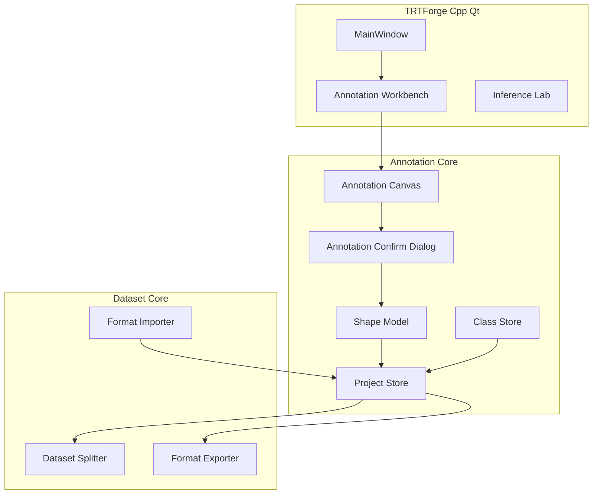

# Design: TRTForge Annotation Dataset Workbench

## Context
TRTForge 当前是 C++/Qt 桌面工具，核心能力集中在 TensorRT 引擎构建和 YOLO TensorRT 推理验证。用户希望增加类似 X-AnyLabeling 的标注 UI，但保持 TRTForge 自身工业风格，并将第一阶段重点放在数据标注、数据集划分和 COCO/VOC/YOLO 标准格式输出。

X-AnyLabeling 可作为交互与布局参考，但不直接嵌入 PyQt6。TRTForge 应使用 C++/Qt 原生实现标注 UI，避免 PyQt6 与 C++ Qt 的事件循环、插件路径和 DLL 冲突。

## Goals
- 在 TRTForge 内提供原生标注工作台。
- 支持 `detect`、`segment`、`pose`、`obb` 四类 YOLO 常用任务。
- 支持导出 COCO、VOC、YOLO 标准格式，且清晰说明各格式能力边界。
- 支持训练数据集划分和 Ultralytics 可直接使用的数据集目录。
- 先使用 Pencil 原型确认 UI，再进入代码实现。

## Non-Goals
- 不在本阶段启动训练。
- 不在本阶段优先做自动标注。
- 不把 X-AnyLabeling PyQt6 窗口嵌入 TRTForge。
- 不导入 X-AnyLabeling 自有 JSON 标注格式；第一版导入导出边界聚焦 COCO、VOC、YOLO。
- 不做 VOC 的非标准扩展。

## Architecture



## UI Layout
Pencil 原型先行，代码实现须以用户确认后的 `.pen` 为依据。

第一版布局：
- 顶部：项目、新建、打开、保存、导入图片、导入标注、导出 COCO/VOC/YOLO、数据集划分。
- 左侧：绘图工具栏，包含选择、移动、矩形、旋转矩形、多边形、线、点、COCO17 姿态、撤销/删除。
- 中间：图片标注画布，支持缩放、平移、绘制、选择、编辑。
- 右侧：项目任务、类别列表、当前图片对象列表、属性与描述。
- 底部：图片缩略图、train/val/test 归属、数据集划分状态、格式导出提示。

绘制交互：
1. 用户选择绘制工具。
2. 用户在画布完成绘制。
3. 系统弹出标注确认对话框。
4. 用户确认标签、描述、分组、数据集归属。
5. 系统写入项目模型，并同步刷新标签列表、对象列表、属性描述。

## Project Model
项目文件使用 `.tfanno` 后缀保存全局状态，推荐字段：

```json
{
  "version": 1,
  "task": "detect | segment | pose | obb",
  "classes": [
    { "id": 0, "name": "bearing", "color": "#A855F7" }
  ],
  "images": [
    {
      "id": "000128",
      "path": "images/raw/000128.jpg",
      "width": 1920,
      "height": 1080,
      "split": "train",
      "annotations": []
    }
  ]
}
```

统一标注对象推荐字段：

```json
{
  "id": "ann-1",
  "class_id": 0,
  "label": "bearing",
  "description": "轴承外圈区域",
  "group_id": 1,
  "shape_type": "rectangle | rotated_rect | polygon | line | point | keypoints",
  "points": [[10, 10], [100, 100]],
  "rotation": 0.0,
  "score": null
}
```

## Format Policy

### YOLO
YOLO 是第一优先级导出格式，必须支持：
- `detect`：每个目标导出 `class cx cy w h`。
- `segment`：每个目标导出 `class x1 y1 x2 y2 ...` 多边形坐标。
- `pose`：第一版仅支持 COCO 17 点，导出 Ultralytics YOLO pose 所需关键点。
- `obb`：导出 Ultralytics 官方 YOLO OBB 格式：`class_index x1 y1 x2 y2 x3 y3 x4 y4`。四个角点坐标均为相对原图宽高归一化到 `[0, 1]` 的坐标。内部可使用 `cx cy w h angle` 或四点结构保存，但写入 YOLO OBB 标签文件时必须输出 Ultralytics 四角点格式。

YOLO 导出必须生成：
- `images/train`
- `images/val`
- `images/test`
- `labels/train`
- `labels/val`
- `labels/test`
- `dataset.yaml`

### COCO
COCO 支持：
- `detect`
- `segment`
- `pose`

COCO 不作为第一版 OBB 标准导出目标。若用户在 OBB 项目中选择 COCO 导出，系统应提示当前 OBB 项目不支持标准 COCO 导出，除非后续明确增加 COCO rotated box 扩展。

### VOC
VOC 仅支持标准水平矩形检测：
- `detect` 项目可导出 VOC XML。
- `segment`、`pose`、`obb` 项目选择 VOC 导出时，必须提示不支持。
- 不生成带 polygon、keypoints 或 rotated box 的非标准 VOC XML。

## Reload And Re-Export
TRTForge 必须支持“导出后重新加载再编辑”的闭环：
- 用户可重新加载由 TRTForge 导出的 YOLO 数据集，修改标注后再次导出。
- 用户可重新加载由 TRTForge 导出的 COCO 标注，修改标注后再次导出。
- 用户可重新加载由 TRTForge 导出的 VOC 检测标注，修改标注后再次导出。
- 重新加载时必须恢复类别顺序、图片路径、标注对象和 train/val/test 划分信息；如果源格式不包含某些 TRTForge 扩展信息，应给出明确提示并采用可解释的默认值。

## Dataset Split
数据集划分支持两种方式：
- 自动划分：用户配置 train/val/test 比例，例如 8/1/1 或 7/2/1，并使用随机种子保证可复现。
- 手动调整：用户可在图片列表或属性面板将单张图片改为 train、val 或 test。

导出时以项目当前 split 状态为准，并复制图片到导出目录。

## Risks
- 标注对象和格式导出关系复杂，必须先稳定内部项目模型。
- VOC 能力有限，必须在 UI 和文档中明确仅支持标准检测。
- 姿态第一版固定 COCO 17 点，后续自定义关键点需要扩展项目模型。
- OBB 的角度、四点表示和 Ultralytics 格式必须统一，否则训练会出现框方向错误。
- 不应把 X-AnyLabeling PyQt6 代码直接并入 C++ Qt 主程序，以免运行时冲突。

