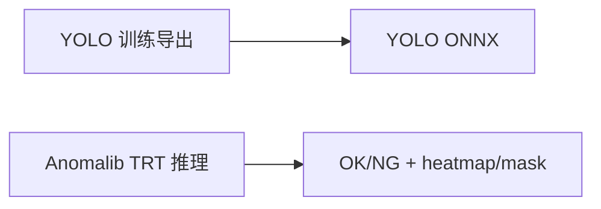
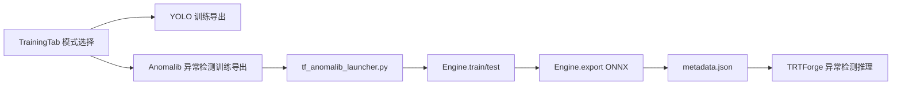
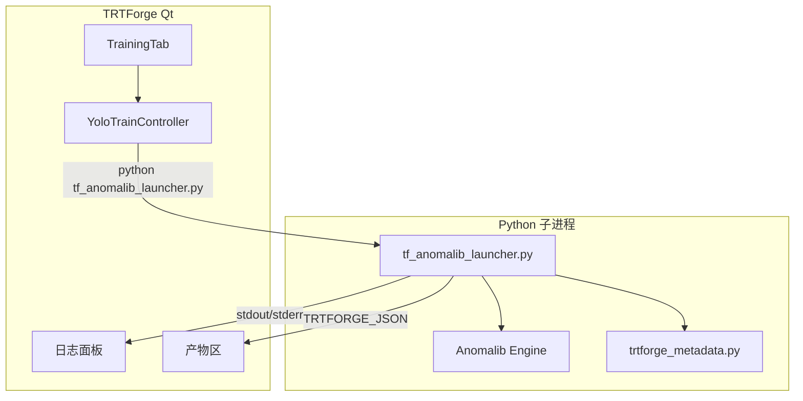

# Anomalib 训练导出设计

## Context

TRTForge 当前已有两条相关能力：



缺口是异常检测训练导出仍在 GUI 外部完成，用户需要手工准备 `model.ckpt`、`model.onnx`、`metadata.json`。本变更补齐中间链路：



## Goals

- 在同一个训练导出页中选择 `YOLO` 或 `Anomalib 异常检测`。
- 第一版 Anomalib 支持 `PatchCore`、`PaDiM`、`EfficientAd`。
- 第一版数据集格式固定为 Anomalib `Folder`，降低用户配置复杂度。
- Python 训练子进程的普通日志完整回显，结构化事件驱动 UI 状态、进度和产物展示。
- 训练完成后输出 `model.ckpt`、`model.onnx`、`metadata.json`，并显示可复制路径。
- metadata 规则与 TRTForge 异常检测推理契约一致，避免异常样本全部显示 OK 或正常样本大量误判 NG。

## Non-Goals

- 第一版不做 Anomalib 多数据集格式入口，只支持 Folder。
- 第一版不在训练页直接构建 TensorRT engine，ONNX 转 TRT 继续使用现有转换链路。
- 第一版不把 `YoloTrainController` 大规模重命名为通用控制器，避免影响已稳定的 YOLO 训练。
- 第一版不自动安装 Python 依赖，只检测并给出明确错误。
- 第一版不做分布式训练或多 GPU 训练编排。

## Architecture Decision

沿用现有 YOLO 训练平台的稳定结构：Qt 使用 `QProcess` 调用独立 Python launcher。



理由：

- 长时间训练、CUDA、Anomalib、ONNXRuntime 的错误留在子进程内，Qt 主进程不被拖崩。
- 与现有 YOLO 训练导出页复用通信模式、日志面板和产物面板。
- 后续若需要本地训练服务，可继续复用 mode、参数和事件协议。

## Python Launcher Contract

新增入口：

```bash
python tf_anomalib_launcher.py --mode check-env
python tf_anomalib_launcher.py --mode train-export --model patchcore --root D:/data/bottle --normal-dir train/good --abnormal-dir test/abnormal --normal-test-dir test/good --project D:/runs/anomalib --name exp_001
```

### Supported Modes

| mode | 作用 | 成功输出 |
| --- | --- | --- |
| `check-env` | 检查 Python、torch、CUDA、anomalib、lightning、onnx、onnxruntime、PIL、numpy | `env` 事件 |
| `train-export` | 训练、测试、ONNX 导出、metadata 生成 | `model.ckpt`、`model.onnx`、`metadata.json` |
| `compare` | 预留：对 ckpt 与 ONNX 做一致性对比 | 第一版不实现 |

### Parameters

| 参数 | 默认 | 说明 |
| --- | --- | --- |
| `--model` | `patchcore` | `patchcore`、`padim`、`efficientad` |
| `--root` | 必填 | Folder 数据集根目录 |
| `--normal-dir` | `train/good` | 正常训练目录，相对 `root` 或绝对路径 |
| `--abnormal-dir` | `test/abnormal` | 异常测试目录，相对 `root` 或绝对路径 |
| `--normal-test-dir` | `test/good` | 正常测试目录，相对 `root` 或绝对路径 |
| `--project` | 必填 | 输出根目录 |
| `--name` | `latest` | 实验名称 |
| `--input-size` | `256` | 输入尺寸 |
| `--max-epochs` | `auto` | auto 时 PatchCore=1、PaDiM=1、EfficientAd=20 |
| `--train-batch-size` | 模型默认 | EfficientAd 强制 1，其它默认 4 |
| `--eval-batch-size` | `4` | 测试/导出校验 batch |
| `--num-workers` | `0` | Windows 默认 0 更稳 |
| `--val-split-ratio` | `0.2` | Folder 划分比例 |
| `--imagenet-dir` | `anomalib-main/datasets/imagenette` | EfficientAd 需要 |
| `--calibrate-metadata` | `true` | 是否执行 metadata 校准 |
| `--calib-normal-dir` | 空 | normal 校准目录 |
| `--calib-abnormal-dir` | 空 | abnormal 校准目录 |
| `--calib-limit` | `64` | 每组最大校准图片数 |

### TRTFORGE_JSON Events

普通日志原样输出。结构化行固定前缀：

```text
TRTFORGE_JSON {"type":"env","python":"...","torch":"...","cuda_available":true,"deps":{"anomalib":"ok"}}
TRTFORGE_JSON {"type":"event","name":"train_start","model":"patchcore","max_epochs":1}
TRTFORGE_JSON {"type":"progress","stage":"train","epoch":1,"total":1,"pct":100.0}
TRTFORGE_JSON {"type":"gpu_status","name":"NVIDIA ...","memory_used_mb":4096,"memory_total_mb":8192}
TRTFORGE_JSON {"type":"anomaly_model","model":"Patchcore","input_size":[256,256],"normalization":"none"}
TRTFORGE_JSON {"type":"artifact","kind":"ckpt","path":".../model.ckpt"}
TRTFORGE_JSON {"type":"artifact","kind":"onnx","path":".../model.onnx"}
TRTFORGE_JSON {"type":"artifact","kind":"metadata","path":".../metadata.json"}
TRTFORGE_JSON {"type":"anomaly_export_summary","model":"patchcore","output_contract":"anomalib_post_processed_0_1","image_threshold":0.5,"pixel_threshold":0.5}
TRTFORGE_JSON {"type":"error","code":"MISSING_DEP","message":"缺少 anomalib"}
TRTFORGE_JSON {"type":"event","name":"finished","exit":0}
```

错误码建议：

| code | 场景 |
| --- | --- |
| `MISSING_DEP` | 缺少 Python 包 |
| `DATA_NOT_FOUND` | 数据集目录不存在 |
| `UNSUPPORTED_MODEL` | 模型名不是三种支持项 |
| `EXPORT_FAILED` | ONNX 导出失败 |
| `METADATA_FAILED` | metadata 生成或校准失败 |
| `CANCELLED` | 用户停止 |
| `UNHANDLED_EXCEPTION` | 未知异常 |

## Metadata Rules

| 模型 | ONNX 输出契约 | metadata 策略 |
| --- | --- | --- |
| PatchCore | 若包含 `pred_score`、`anomaly_map` 且已后处理到 0-1 | `output_contract=anomalib_post_processed_0_1`、`normalization=none`、阈值 0.5、范围 0-1 |
| PaDiM | 同 PatchCore | 同 PatchCore |
| EfficientAd | 使用导出 ONNX 的实际分布 | 用 normal/abnormal 校准样本生成 `image_threshold`、`pixel_threshold`、score/map min/max |

写出位置固定为：

```text
<project>/<Model>/<dataset>/<name or latest>/weights/lightning/metadata.json
```

`model.ckpt`、`model.onnx` 和 `metadata.json` 必须在同一个 `weights/lightning` 目录展示给用户。

## Qt UI Design

### Mode Switch

训练页增加“训练类型”：

| 训练类型 | 显示区域 |
| --- | --- |
| `YOLO 目标检测/分割/姿态/OBB` | 现有 YOLO 任务、dataset.yaml、模型权重、训练/验证/导出参数 |
| `Anomalib 异常检测` | Anomalib 模型、Folder 数据集目录、metadata 校准、训练并导出按钮 |

### Anomalib Controls

- 模型类型：`PatchCore`、`PaDiM`、`EfficientAd`。
- 数据集格式：固定显示 `Folder`，第一版不可切换。
- 数据集根目录：`root`。
- 正常训练目录：`normal_dir`。
- 异常测试目录：`abnormal_dir`。
- 正常测试目录：`normal_test_dir`。
- 输出目录：`project`。
- 实验名称：`name`。
- 输入尺寸：`input_size`，默认 `256`。
- 最大 epoch：`auto` 或数字。
- batch：`train_batch_size`、`eval_batch_size`。
- 资源：`num_workers`、`val_split_ratio`。
- EfficientAd 专属：`imagenet_dir`，仅在模型为 EfficientAd 时显示。
- metadata 校准：是否启用、normal 校准目录、abnormal 校准目录、每组图片上限。

### Button Policy

Anomalib 模式下保留：

- `检测环境`
- `开始训练并导出`
- `停止`

Anomalib 模式下隐藏或禁用：

- `验证模型`
- YOLO 单独 `导出 ONNX`

原因是 Anomalib 第一版把训练、测试、ONNX 导出和 metadata 写出作为一个闭环，减少用户误操作。

### Runtime Log Browser

Anomalib 模式必须在训练页保留一个面向用户的 `QTextBrowser` 日志窗口，用来实时追加 Python 子进程输出。该窗口显示 `tf_anomalib_launcher.py` 的 stdout 和 stderr，包括：

- 环境检测输出：Python、torch、CUDA、anomalib、onnxruntime 等依赖状态。
- 训练输出：模型名称、数据集路径、epoch 进度、Anomalib/Lightning 普通日志。
- 验证/测试输出：测试阶段开始、结束和关键指标摘要。
- 导出输出：`model.onnx`、`metadata.json` 写出路径。
- 错误输出：缺库、数据路径不存在、导出失败、未知异常等完整提示。

结构化 `TRTFORGE_JSON` 事件仍用于刷新进度条、产物列表和错误弹窗，但不能替代 `QTextBrowser`。用户需要能在 `QTextBrowser` 中看到 Python 实际打印内容，方便判断训练是否真的在运行。

### QSettings Strategy

保存键使用独立前缀，避免污染 YOLO：

| 键 | 内容 |
| --- | --- |
| `training/mode` | `yolo` 或 `anomalib` |
| `training/anomalib/model` | 模型类型 |
| `training/anomalib/root` | 数据集根目录 |
| `training/anomalib/normalDir` | 正常训练目录 |
| `training/anomalib/abnormalDir` | 异常测试目录 |
| `training/anomalib/normalTestDir` | 正常测试目录 |
| `training/anomalib/project` | 输出目录 |
| `training/anomalib/name` | 实验名称 |
| `training/anomalib/inputSize` | 输入尺寸 |
| `training/anomalib/maxEpochs` | auto 或数字 |
| `training/anomalib/trainBatchSize` | 训练 batch |
| `training/anomalib/evalBatchSize` | 测试 batch |
| `training/anomalib/numWorkers` | workers |
| `training/anomalib/valSplitRatio` | 验证划分比例 |
| `training/anomalib/imagenetDir` | EfficientAd imagenet 路径 |
| `training/anomalib/calibrateMetadata` | 是否校准 |
| `training/anomalib/calibNormalDir` | normal 校准目录 |
| `training/anomalib/calibAbnormalDir` | abnormal 校准目录 |
| `training/anomalib/calibLimit` | 校准上限 |

## Migration Plan

1. 完成 Pencil 原型与 OpenSpec 设计，请用户确认。
2. 确认后新增 `tf_anomalib_launcher.py`，先命令行验证 `check-env` 与 `train-export`。
3. 接入 Qt `TrainingTab` 模式切换和参数保存。
4. 复用 `YoloTrainController` 启动不同 launcher，解析新增事件。
5. 用小型 Folder 数据集分别验证 PaDiM、PatchCore、EfficientAd。
6. 用生成的 ONNX 和 metadata 进入 TRTForge 异常检测推理页做 OK/NG 验证。

## Risks and Mitigations

- Anomalib 版本差异导致 API 变化：launcher 中集中封装模型创建、Engine 参数和导出逻辑，失败时输出 `UNHANDLED_EXCEPTION` 与版本信息。
- Windows 中文路径乱码：脚本强制 UTF-8 输出，Qt 按 UTF-8 解析。
- EfficientAd metadata 阈值不准：优先使用 normal/abnormal 校准目录，并限制样本上限防止 GUI 卡住。
- 多 epoch CSVLogger 冲突：多 epoch 默认关闭易冲突 logger，普通日志仍回显。
- UI 参数过多：Anomalib 参数单独分组，EfficientAd 专属项按模型显隐。

## Open Questions

- 默认 `project` 是否继续放在 `results`，还是统一放到 `4-qt-studio/runs/anomalib`。
- `normal_dir`、`abnormal_dir`、`normal_test_dir` 第一版是否允许绝对路径与相对路径同时存在。
- EfficientAd 的 `imagenet_dir` 若不存在时，是阻止训练还是只给 warning 并让用户选择。
