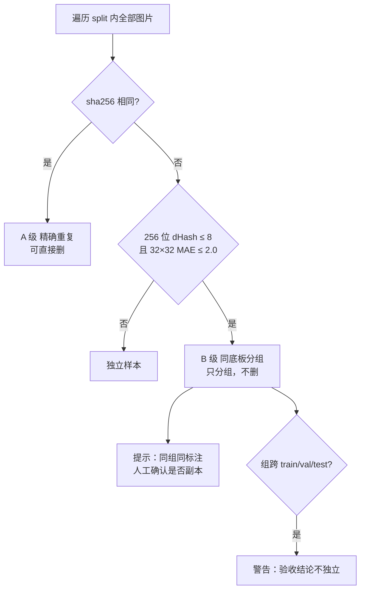

# 设计：数据集体检

## Context

`6-web` 的数据集页现在只做「扫描 → 按比例划分 → 导出」，判定依据是**图片级别**的哈希排序
（`dataset.py:fnv1a64` + `rank_order`）。批次 2.1 之后，导出产物带上了数据集指纹，能回答
「两次实验是不是同一份数据」。

但真实数据集的污染方向不是「文件被替换」，而是：

- 同一块板、同一张底片被拍/裁成多张，按图片划分时它们散落在 train / val / holdout；
- 标注文件被编辑器或脚本写坏，解析器静默跳过坏行。

两者都不报错。前者让 val 指标虚高、holdout 验收失去意义；后者让「空标注」统计失真。

### 实测证据（`splits/pcb`，692 张，6 类）

| 判据 | 结果 | 结论 |
| --- | --- | --- |
| 文件 sha256 | 0 组重复 | 没有文件级副本 |
| 64 位 dHash 汉明 ≤6 | 692 张 → 10 组，覆盖 100% | 退化成「按底板分组」，不能当「重复」用 |
| 256 位 dHash 汉明 ≤8 | 同样 10 组 | 提高位数不改变分组结构 |
| 32×32 灰度 MAE | 同前缀 ≈0.04，跨前缀 ≈9~18 | 与 dHash 结论一致，可用作复核 |
| 分组大小 | `[120,119,61,60,60,60,60,60,60,32]` | 与文件名前缀张数完全一致 |
| 同前缀跨划分 | 10/10 组跨 train/tune/holdout | holdout 42 张全部有同底板兄弟在 train |
| 标签结构问题 | 0 个 | 当前数据干净；此规则是给后续数据用的保险 |
| 类别分布 | 16.3% ~ 17.1% | 无需不均衡告警 |

全分辨率复核一对具体图片：

```
01_missing_hole_01.jpg vs 01_mouse_bite_01.jpg
  MAE = 0.04 / 255，>40 的像素占 0.035%，差异是一个局部小斑块
  标注分别是 class 0 与 class 1，各 3 个框，位置不同
```

即：**同一张底片 + 不同的缺陷斑块 + 不同的标签**。样本有价值，整图相似不代表样本重复。

## Goals / Non-Goals

- Goals
  - 让「同底板分组」成为一等公民，供泄漏警告与按组切分共用。
  - 把「重复」拆成三个可判定级别，每个级别有明确的可执行动作。
  - 把标注质检做成只读报告，覆盖当前被静默吞掉的坏行。
  - 一次解码同时产出分组与质检，避免两次读图。
- Non-Goals
  - 不做缺陷级别的感知重复判定（需要模型，成本与误判都不可控）。
  - 不自动删除或改写标注。
  - 不实现「按组重划」的一键按钮（用户选择只警告）。
  - 不做跨数据集比对（2.1 的指纹已覆盖）。

## Decisions

### 决策 1：两级判定 + 一条提示，只有 A 级允许删



- **为什么不做「C 级冗余样本」**：原计划想用「同组 + 同类 + 框 IoU>0.95」判可删。
  实测推翻了它——同底板不同缺陷的图，标注可能恰好落在同一位置（同一块板的同一处
  反复出同样缺陷是产线上的常态），而像素差又极小（`MAE≈0.04`）。判据分不出
  「副本」与「同位置的不同样本」。宁可少一个自动化动作，也不能删掉真实样本。
  真要删重复，用 A 级逐字节相同，那个判据没有误判。
- **为什么不用单一阈值**：实测 64 位 dHash ≤6 会让 692 张全量归入 10 组。若把「同组」
  当「重复」，数据集会被砍掉 98.6%。判据必须区分「同一张底片」与「同一个样本」。
- **为什么用 256 位而不是 64 位**：两者在本数据上分组结果相同，但 64 位在纹理更丰富的
  工业图（如金属划痕）上分辨率不足，容易把相邻批次合并。256 位成本相同（同样一次缩放）。
- **为什么还要 MAE 复核**：dHash 只编码梯度符号，纯色/低对比区域大量位相同。32×32 灰度
  MAE ≤ 2.0 作为第二道门，把「结构相似但内容不同」挡在组外。两个条件都满足才并组。
- **候选对生成**：n ≤ 3000 时全量两两比较；超过则用 8 段 × 32 位的 banding 过滤候选，
  避免 10k 张时 5000 万次比较。

### 决策 2：按组切分只保证「整组进同一划分」，比例尽力而为

10 个底板组、每组 32~120 张时，70/15/15 不可能精确命中。做法：

1. 组按 `fnv1a64` 排序（确定性，重复执行结果一致）；
2. 依次把整组放入当前「缺口最大」的 split，直到各组用完；
3. 返回实际张数，并在 `warnings` 里写明「按组划分后实际 N/M/K，与目标比例有偏差」。

**不做**「拆组补齐」——那等于把泄漏又放回来。宁可比例不准，也不让同一底板跨划分。

### 决策 3：质检只报告，错误级别不阻断

- `error`：会直接导致标签行被丢弃或几何无效（字段数不对、数值不可解析、类别越界、坐标越界、零面积、标注文件缺失）。
- `warn`：几何可疑（极小框 <0.01% 面积、超大框 >60%、贴边、同图重复框 IoU>0.9、某类在某划分 0 个）。
- `info`：分布性提示（空标注、类别占比 <2%、同组标注不一致）。

`error` 与 `warn` 的区别只体现在排序与着色，**都不阻断**（用户已确认）。

### 决策 4：缓存键不含路径所在盘符以外的环境信息

缓存键 = `绝对路径 | 文件大小 | mtime_ns`，值 = `{sha256, dhash256, thumb32}`。
文件被覆盖（大小或时间变）即失效，不需要手动清理。缓存文件写在 `runtime/dsqc_cache.json`，
写失败只记日志——体检本身是只读功能，不能因为缓存写不进去就报错。

### 决策 5：与 2.1 指纹的关系

- 体检**不参与**指纹计算。指纹只由实际导出的文件决定，体检是「事前建议」。
- 体检结果写入导出 manifest 的 `qc` 块（规则计数 + 分组数 + 跨划分组数），
  但不参与 `unchanged` 判定——否则每次体检结果微变都会让「内容未变」失效。
- `group_by` 会改变导出内容（同一张图去了不同 split），因此**会**改变指纹，这是正确语义。

## Risks / Trade-offs

| 风险 | 缓解 |
| --- | --- |
| 阈值把不同批次误并成一组，导致按组切分后 train 过少 | 报告实际张数与比例偏差；`group_by` 默认 `none`，需显式开启 |
| 全量两两比较在 1 万张时慢 | n>3000 走 banding 候选过滤；结果缓存 |
| 32×32 MAE 对「同底板不同缺陷」不敏感 | 这正是想要的行为：MAE 只用于并组；删除只认逐字节相同 |
| 质检规则在别的数据集上误报多 | 全部只报告；用户可按规则折叠忽略 |
| 解码大量图片占用内存 | 逐张 `draft` + 缩放后立即释放，不保留原图 |

## Migration Plan

1. 新增模块与接口，全部为增量，不改既有返回值字段语义。
2. `group_by` 默认 `none`，既有导出行为与指纹不变。
3. 旧 manifest 无 `qc` 块时，界面显示「未体检」，不报错。
4. 回滚：删除 `datasetqc.py` 与新增端点即可，数据文件不受影响。

## Open Questions

- 是否需要把「同底板分组」写进数据集指纹？暂不：指纹语义已定，改动会让历史指纹全部失效；
  分组信息放在体检报告与 manifest 的 `qc` 块里足够。
