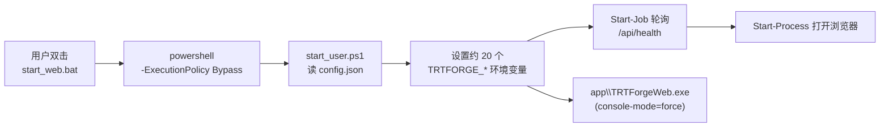
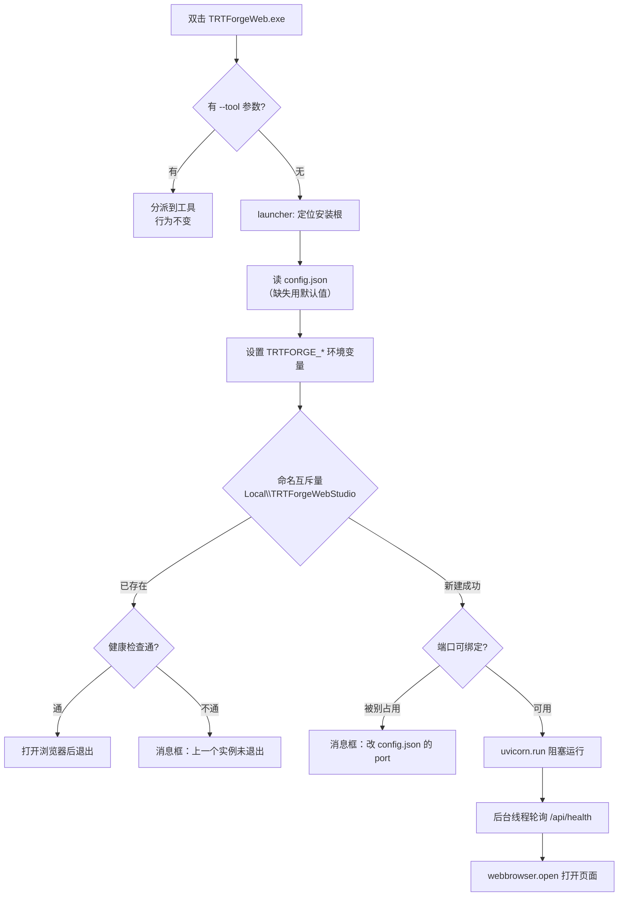

# Design: 安装包单文件启动器

## Context

现状启动链路（安装包里）：



三个约束决定了改造方式：

1. **`frozen_entry.py` 有 `--tool` 分派**（`val_engine`、`infer_worker`、`native_dialog` 等），
   无参数分支才是「起网页服务」。改启动逻辑只能动无参数分支，不能影响 `--tool`。
2. **子进程依赖 stdout 管道**。`runners.py` 用 `Popen(stdout=PIPE)` 读 launcher 输出，
   `infer_worker` 用命名管道。控制台模式改变不能影响这些句柄。
3. **现场电脑可能没有 PowerShell**（已有一份 `start_web_cmd.bat` 就是为这个）。
   新方案顺手消灭这条分叉。

## Goals / Non-Goals

- Goals：
  1. 双击一个 exe 就能用，不出现黑框；
  2. 出错时用户看到中文原因和下一步动作，而不是闪退；
  3. 环境变量只有一处实现（Python），bat 与 ps1 不再各写一份；
  4. 从命令行启动时仍能看到日志，便于排障。
- Non-Goals：
  1. 不做托盘图标、后台常驻、开机自启；
  2. 不做自动更新；
  3. 不改 `config.json` 字段（只增加可选字段，不删）。
  4. 不把 `install_train_env.bat` / `install_demo_models.bat` 也 exe 化（它们本来就是一次性联网操作，见 Open Questions）。

## Decisions

### 决策 1：控制台模式用 `attach`，不用 `disable`

| 模式 | 双击行为 | 从 cmd 启动 | 结论 |
| --- | --- | --- | --- |
| `force` | 弹黑框且常驻 | 正常 | 现状，用户观感差 |
| `disable` | 无黑框 | **也看不到日志** | 排障不可用 |
| `hide` | 无黑框 | 黑框被隐藏，日志看不到 | 排障不可用 |
| `attach` | 无黑框（没有父控制台就不创建） | 附着到调用方的控制台，日志正常 | 采用 |

`attach` 的唯一代价：无控制台时 `sys.stdout` / `sys.stderr` 是 `None`。
launcher 在最早处调用 `_ensure_stdio()`，把两者重定向到
`runtime/logs/launcher.log` 的追加句柄。

### 决策 2：单实例用命名互斥量，不靠端口探测

端口探测有竞态：两个进程同时发现端口空闲、同时 bind，第二个才失败。
用 `CreateMutexW` 的 `Local\TRTForgeWebStudio` 一次判定：

- 创建成功且 `GetLastError() != ERROR_ALREADY_EXISTS` → 我是第一个，继续；
- 已存在 → 说明有实例在跑，先探 `/api/health`：
  - 通 → 直接打开浏览器，然后退出；
  - 不通 → 提示「上一个实例还没退干净，请稍等 5 秒或结束 TRTForgeWeb.exe」并退出。

用 `Local\` 而不是 `Global\`：不同 Windows 会话（远程桌面 / 切换用户）各自可以开一个，
符合「每台机器一个人用」的实际场景。

### 决策 3：端口占用分两种情况处理

| 启动时发现端口被占 | 处理 |
| --- | --- |
| `/api/health` 返回本软件的版本号 | 认为已有实例，打开浏览器并退出 |
| 端口被别的程序占用（健康检查不通或版本不符） | 消息框提示具体端口、让用户改 `config.json` 的 `port`，并给出「也可以结束占用该端口的程序」 |

不自动改端口。自动挑一个随机端口会让「下次打开还是这个地址」的预期失效，
车间电脑贴的地址标签也会失准。

### 决策 4：安装根的定位顺序

1. 环境变量 `TRTFORGE_HOME`（`start_web.bat` 会设）；
2. exe 自身位置的上一级（`<root>\app\TRTForgeWeb.exe` → `<root>`）；
3. 当前工作目录（开发环境 `python frozen_entry.py`）。

`config.json` 必须在安装根下。找不到就用默认值（`127.0.0.1:8060`）并在日志里记一行，
不弹错误框——默认值足以让软件跑起来，缺配置文件不该阻止使用。

### 决策 5：错误提示用 MessageBoxW，不用另起进程

`ctypes.windll.user32.MessageBoxW(0, text, title, MB_ICONERROR | MB_OK)`。
理由：已经确认在 `nativedialog.py` 里用过同类调用可行；不依赖 tkinter，
不占事件循环，进程即将退出时也能弹。

文案模板固定为三段：**发生了什么 → 为什么 → 该怎么办**。例如：

```
启动失败：端口 8060 已被其它程序占用

软件需要在这个端口提供网页服务，但该端口现在被别的程序占着。

请任选一种：
1. 用记事本打开 D:\TRTForgeWeb\config.json，把 port 改成 8061 后重新双击；
2. 结束占用 8060 端口的程序，再重新双击。
```

### 决策 6：`start_web.bat` 保留但只做一件事

```bat
@echo off
cd /d "%~dp0"
set "TRTFORGE_HOME=%~dp0"
"%~dp0app\TRTForgeWeb.exe"
if errorlevel 1 pause
```

不再调用 PowerShell。`start_web_cmd.bat` 内容与之相同，为避免用户手里旧快捷方式失效，
保留文件但内容指向同一份说明；文档里只推荐 exe 与 `start_web.bat`。

## 数据流



## Risks / Trade-offs

| 风险 | 缓解 |
| --- | --- |
| `attach` 模式下个别杀毒软件仍拦 exe | 文档给出「加入信任」步骤；保留 bat 路径 |
| 无控制台时第三方库直接写 `sys.stdout` 抛异常 | `_ensure_stdio()` 在 import app 之前执行；`test_launcher.py` 覆盖 `None` 情形 |
| 用户直接把 exe 拷到别处（不在 `app\` 下） | 定位顺序第 2、3 步兜底；仍找不到前端目录时消息框说明「请从安装目录启动」 |
| 互斥量与端口判定不一致导致两个实例 | 先互斥量再端口，互斥量是主判据；端口检查只用于区分「同软件」与「别人占用」 |
| 旧的 `start_user.ps1` 有用户改过的自定义内容 | 保留该文件但不再被 bat 调用，文档说明「环境变量改动请写进 config.json」 |

## Migration Plan

1. 新增 `launcher.py`，先只在开发环境用 `python -m launcher` 验证，
   确认设置的环境变量与 ps1 完全一致（用脚本对比两份清单）；
2. `frozen_entry.py` 无参数分支改为调用 launcher；
3. 打包脚本控制台模式改 `attach`，出一个内部测试包，验证双击、cmd 启动、错误弹窗三种情况；
4. 收敛 bat 与文档，删掉 `start_web_cmd.bat` 的独立配置。

回滚：`frozen_entry.py` 的 launcher 调用用环境变量 `TRTFORGE_LEGACY_START=1` 可跳过，
直接走原来的 uvicorn 启动；bat 回退到调用旧的 ps1（文件保留）。

## Open Questions

1. `install_train_env.bat` 要不要也 exe 化？它要联网下载 Python、写 `config.json`，
   失败原因很多（网络、磁盘、权限），做成 exe 的优势是能弹中文框。
   倾向：下一批次再做，本批先把主启动路径统一。
2. 是否需要托盘图标显示「服务运行中」？倾向：不做，浏览器标签页已经足够。
