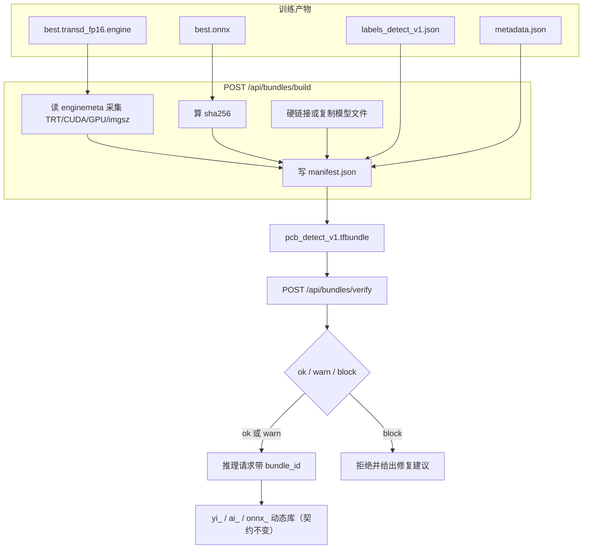

# Design: 模型包契约

## Context

现状：一个可推理模型由 4~6 个散落文件构成，配对关系靠 `models.py` 的启发式规则猜。
该文件头部的注释已经承认这些规则来自「实测的真实现象，不是猜的」，其中最关键的一条是：

> 引擎名普遍带精度后缀：`best_fp16.engine` / `best.transd_fp16.engine`，
> 而 ONNX 叫 `best.onnx` / `best.transd.onnx`——**没有任何一个引擎与 ONNX 严格同名**。

也就是说配对逻辑永远是「尽量猜」。只要用户手工改过一次文件名，或者把两个实验的产物
放在同一个目录，猜错就发生了，而且猜错的表现是解码越界/空结果，不是报错。

约束：

- 现有对外交付物是 DLL + C ABI，签名与行为**不能改**（已有客户按 `yi_*` / `ai_*` 集成）。
- 现有散装产物路径必须继续能推理，否则老用户升级后模型全不可用。
- 引擎只能在目标机器上编译，模型包里**不能**预先塞别人的 `.engine`。
- 中文路径必须可用。

## Goals / Non-Goals

- Goals：
  1. 一个模型 = 一个自描述目录，复制/改名/打包不丢信息；
  2. 加载前能判断「这个模型在这台机器上能不能跑」，结论分档且可执行；
  3. 推理页选中模型包后，标签、metadata、阈值、工作点自动到位；
  4. 未来 SDK 与网页读同一份清单，不再各写一套配对逻辑。
- Non-Goals：
  1. 不改 DLL、不改 C ABI、不改引擎二进制；
  2. 不做模型版本管理与回滚（那是数据集/实验台账的事）；
  3. 不做模型加密或授权保护（商业化范围外，见 `docs/商业化差距分析与优化建议.md` 第 8 节）；
  4. 不把训练产物目录改造成模型包目录（训练产物是过程，模型包是交付物）。

## Decisions

### 决策 1：目录形态而不是单文件压缩包

`<名字>.tfbundle/` 是一个普通目录：

```
pcb_detect_v1.tfbundle/
  manifest.json          清单（唯一入口）
  model.engine           或 model.onnx
  labels.json            类别表（YOLO / 分类）
  metadata.json          异常检测阈值（仅 anomalib）
  origin.meta.json       来源：原 ONNX 哈希、训练 run、数据集指纹、构建命令
  README.txt             给现场人看的一页说明（自动生成）
```

理由：现场要能直接用资源管理器打开看、能用记事本读、能塞进 U 盘。
`.zip` 需要解压步骤，`.json` 单文件塞不下几百 MB 的引擎。

替代方案：单文件打包（zip tar）。否决原因：解压是额外动作，而且杀毒软件对
「程序运行时解压出 dll」更敏感。

### 决策 2：manifest 只管「是什么」和「能不能跑」，不管「怎么加载」

manifest 不含推理参数（conf、nms、batch）。这些是使用侧的运行参数，
写进清单会让一个模型包只能表达一种用法。

唯一例外是 `operating_point`：它是**验证得出的建议值**，标记为 `advisory`，
读取方可以不采用。

### 决策 3：校验结论分三档，`block` 只在确定性错误上使用

| 档位 | 触发条件 | 界面行为 |
| --- | --- | --- |
| `ok` | 全部检查通过 | 正常推理 |
| `warn` | 引擎小版本不一致、GPU 架构不同、标签数与模型输出不一致但可能是分类 | 显示黄色提示，允许继续 |
| `block` | schema 不识别、模型文件哈希不符、`kind`/`task` 与所选模式冲突、包内路径越界 | 拒绝提交推理请求，给出修复建议 |

理由：宁可放过可疑，不可拦住确定能跑的场景。用户手里已有的可用模型不能被升级挡住。

### 决策 4：构建包时不复制模型文件，默认硬链接/复制二选一

模型文件动辄 100~500 MB。默认用**硬链接**（同一分区），跨分区时自动退回复制。
理由：造包要快；硬链接在同一分区不占额外空间，且删除包目录不会删掉原件
（硬链接是引用计数）。

跨分区复制时在 manifest 里记 `linked: false`，界面标注「占额外空间」。

### 决策 5：推理页新增「模型包」分组，散装文件移到「兼容（散装文件）」分组

下拉项顺序：本机模型包 → 训练产物（散装）→ 兼容（手工路径）。
选中模型包时，引擎/ONNX 路径、标签、metadata 三个输入框自动填入**包内相对路径的绝对形式**，
并锁成只读；用户想改就切回散装分组。这样既不破坏老习惯，也让默认路径变安全。

## 数据流



## 运行时兼容性判定细则

| 项 | 判定 | 档位 |
| --- | --- | --- |
| `manifest.schema` | 不是 `trtforge.bundle.v1` | `block` |
| `files[].path` | 含 `..`、绝对路径或盘符 | `block` |
| `files[].sha256` | 不匹配 | `block` |
| `role=model` | 缺失 | `block` |
| `kind` vs 请求模式 | `yolo` 包用于 `anomalib` 模式 | `block` |
| `task` vs 请求模式 | `detect` 包用于 `segment` 模式 | `block` |
| `trt_version` | 主版本不同（8.x vs 10.x） | `block` |
| `trt_version` | 小版本不同（8.5.2 vs 8.6.1） | `warn` |
| `compute_cap` | 与当前 GPU 不同 | `warn` |
| `gpu_name` | 与当前 GPU 不同 | `warn` |
| `imgsz` vs 模型输入 | 不一致 | `warn` |
| `labels.count` vs 模型输出 | 不一致 | `warn` |
| `kind=anomalib` 缺 `metadata.json` | — | `block` |

`warn` 的文案必须说明「可能会怎样」和「怎么确认」，例如：

> 这个引擎是在 NVIDIA T1000（7.5）上编译的，本机是 RTX 4060（8.9）。
> 引擎可能无法加载。请在本机用「引擎构建」页重新编译一次，约 1 分钟。

## Risks / Trade-offs

| 风险 | 缓解 |
| --- | --- |
| 硬链接在跨分区时静默变成复制，用户误以为省空间 | manifest 记 `linked`，界面显示实际占用 |
| 用户改了包内文件名，哈希校验失败 | 报错文案直接指出哪个文件、期望哈希、实际哈希 |
| 老产物没有运行时字段（本提案之前的 meta） | 字段缺失按 `unknown` 处理，只给 `warn` 不给 `block`，并提示「重新构建一次可补全」 |
| 模型包目录被用户放进训练产物根目录，扫描时被当成新模型 | 扫描器识别 `.tfbundle` 后缀，跳过其内部文件；枚举时按包去重 |
| 推理页多一个分组让界面变复杂 | 分组默认折叠「兼容（散装文件）」，老用户点一下即可 |

## Migration Plan

1. 先只做「读」：`/api/bundles` 与校验，构建入口放到引擎构建页的一个按钮；
2. 引擎构建成功后自动造包（可关），老产物不受影响；
3. 推理页加分组，默认选中最近使用的模型包，没有包时仍选散装；
4. 文档补一页《模型包说明》，写清楚目录结构与校验含义。

回滚：模型包是纯增量目录，删掉 `.tfbundle` 目录即回到当前行为；
代码侧 `/api/models` 的 `bundle` 字段为 null 时前端按老逻辑走。

## Open Questions

1. 模型包是否应该记录「验证报告」（`val_engine.py` 产出的 mAP / 漏检率）？
   倾向：记路径与摘要，不内联全部明细，避免清单变成报告。
2. OCR 模型（一对 det + rec 目录）要不要也纳入模型包？
   倾向：schema 预留 `kind: "ocr"`，本期不实现，等 OCR 二期。
