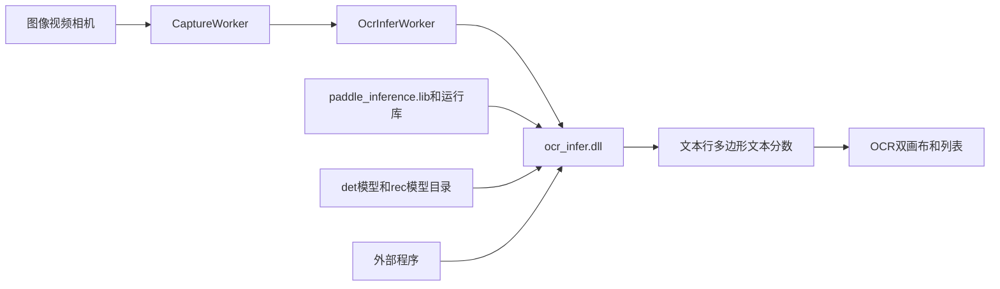

## Context
TRTForge 推理演示当前采用独立推理 DLL 方案：YOLO 使用 `yolo_infer.dll` 的 `yi_*` C API，Anomalib 使用 `anomalib_infer.dll` 的 `ai_*` C API。PaddleOCR C++ 推理位于 `ocr/PaddleOCR-main/deploy/cpp_infer`，内部是 API → Pipeline → Predictor → `PaddleInfer` 的 Paddle Inference 链路。

用户确认的关键路径：
- Paddle Inference 根目录：`4-qt-studio/bin/paddle_inference`
- Paddle Inference 链接库：`4-qt-studio/bin/paddle_inference/paddle/lib/paddle_inference.lib`
- OCR 检测模型示例目录：`4-qt-studio/bin/paddle_inference/ch_PP-OCRv4_det_infer`
- OCR 测试图片根目录：`ocr/PaddleOCR-main/docs/datasets/images`

## Goals / Non-Goals
- Goals:
  - 新增 `ocr_infer.dll`，供 TRTForge GUI、外部 C++ 和 Python ctypes 调用。
  - TRTForge 推理演示新增 OCR 任务，加载检测模型和识别模型进行 OCR 推理。
  - 返回并展示 OCR 原始数据，保证文本行多边形、文本、分数、角度一一对应。
  - 模型、图片、配置路径使用 UTF-8，尽量兼容中文路径。
  - 遇到缺库、缺模型文件、推理失败时返回错误码，不让 DLL 直接结束 TRTForge 进程。
- Non-Goals:
  - 不把 OCR 转成 TensorRT，不接入 Python `enable_hpi` 多后端。
  - 不在本次变更中做 OCR 训练或导出。
  - 不修改仓库根目录下的 `bin`、`include`、`lib`。

## Decisions
- 新增独立 `ocr/ocr_infer` 子工程。
  - 原因：OCR 输出与 YOLO boxes、Anomalib heatmap 都不同，独立 DLL 更清晰，也方便外部复用。
- 新增 `OcrInferWorker`，不复用 `InferWorker`。
  - 原因：OCR 需要模型目录配置、文本行结果、原始 JSON、双画布和列表展示。
- OCR DLL C API 采用 handle + 结果缓存模式。
  - 原因：与 `yi_*`、`ai_*` 一致，避免跨 DLL 分配/释放内存。
- 首版优先使用 PaddleOCR 的完整 pipeline。
  - 必填：检测模型目录、识别模型目录。
  - 可选：文本行方向、文档方向分类、文档展平。
  - 未配置的可选模块通过参数关闭。
- DLL 内部保存逐行结果数组。
  - 每个 `oi_text_line` 包含 `index`、`point_count`、`xs`、`ys`、`rec_score`、`textline_angle`、`text_utf8`。
  - `lines[i]` 与 `raw_json_utf8` 中的 `rec_texts[i]`、`rec_scores[i]`、`rec_polys[i]` 必须一致。
- GUI 展示使用 Qt 绘制框和序号，中文文本主要放在列表中显示。
  - 原因：避免 OpenCV FreeType 依赖阻塞首版稳定性。

## Architecture


## Pencil UI
```text
┌────────────────────────────── INFERENCE · 推理演示 ──────────────────────────────┐
│ 左侧配置区                                                                        │
│ ┌─ 01 引擎与任务 ─────────────────────────────────────────────────────────────┐ │
│ │ 任务类型 [ OCR 文本识别 OCR ▼ ]                                             │ │
│ │ 检测模型目录 [ bin\paddle_inference\ch_PP-OCRv4_det_infer ... ] [浏览]     │ │
│ │ 识别模型目录 [ bin\paddle_inference\ch_PP-OCRv4_rec_infer ... ] [浏览]     │ │
│ │ 文本行方向   [启用 □] [模型目录 ...] [浏览]                                 │ │
│ │ 文档预处理   [方向分类 □] [文档展平 □]                                      │ │
│ │ 设备 [cpu ▼]  MKLDNN [√]  CPU线程 [8]  RecBatch [6]                         │ │
│ └─────────────────────────────────────────────────────────────────────────────┘ │
│ ┌─ 02 输入源 ─────────────────────────────────────────────────────────────────┐ │
│ │ [图片] [视频] [相机]   文件路径 [...] [浏览]                                │ │
│ └─────────────────────────────────────────────────────────────────────────────┘ │
│ ┌─ 03 OCR 参数 ───────────────────────────────────────────────────────────────┐ │
│ │ det_thresh [0.30]  box_thresh [0.60]  unclip [1.50]                         │ │
│ │ rec_score_thresh [0.00]                                                     │ │
│ └─────────────────────────────────────────────────────────────────────────────┘ │
│ [开始推理] [停止]                                                               │
├─────────────────────────────────────────────────────────────────────────────────┤
│ 右侧展示区                                                                      │
│ ┌──────── 原图 + OCR框 ────────┐ ┌──────── OCR结果可视化 ───────────────┐       │
│ │ 可缩放、拖动、双击全屏       │ │ 识别框高亮/文本序号                  │       │
│ └─────────────────────────────┘ └──────────────────────────────────────┘       │
│ ┌─ 识别结果列表 ─────────────────────────────────────────────────────────────┐ │
│ │ #  文本内容                         置信度   坐标/角度                   │ │
│ │ 1  产品批号 ABC123                  0.982    (x1,y1)...                 │ │
│ │ 2  生产日期 2026-05-21              0.955    (x1,y1)...                 │ │
│ └─────────────────────────────────────────────────────────────────────────────┘ │
│ 状态栏：FPS / 预处理ms / Paddle推理ms / 后处理ms / 文本行数 / 图片尺寸          │
└─────────────────────────────────────────────────────────────────────────────────┘
```

## C API Contract
```c
typedef void* oi_handle;

typedef struct {
    const char* det_model_dir_utf8;
    const char* rec_model_dir_utf8;
    const char* textline_orientation_model_dir_utf8;
    const char* doc_orientation_model_dir_utf8;
    const char* doc_unwarping_model_dir_utf8;
    const char* device_utf8;
    const char* precision_utf8;
    int enable_mkldnn;
    int use_textline_orientation;
    int use_doc_orientation_classify;
    int use_doc_unwarping;
    int cpu_threads;
    int rec_batch_size;
    float det_thresh;
    float det_box_thresh;
    float det_unclip_ratio;
    float rec_score_thresh;
} oi_config;

typedef struct {
    int index;
    int point_count;
    const float* xs;
    const float* ys;
    float rec_score;
    int textline_angle;
    const char* text_utf8;
} oi_text_line;

typedef struct {
    int src_w;
    int src_h;
    int line_count;
    const oi_text_line* lines;
    const unsigned char* overlay_rgb;
    int overlay_w;
    int overlay_h;
    int overlay_stride;
    const char* raw_json_utf8;
} oi_result;
```

## Risks / Trade-offs
- PaddleOCR upstream 多处错误处理使用 `exit(-1)`。
  - Mitigation: OCR DLL 外层做模型文件检查；后续逐步把关键路径转换为错误码。
- 用户当前给出的检测模型目录如果缺少 `inference.pdiparams` 或 `inference.yml`，无法初始化。
  - Mitigation: GUI 和 DLL 加载时检查并提示缺失文件。
- Paddle 运行库较多，缺失 DLL 会导致加载失败。
  - Mitigation: CMake 和文档列出依赖核验步骤。
- `oi_infer_bgr` 如果首版走临时文件桥接，会影响视频/相机性能。
  - Mitigation: 首版优先保证正确性；后续再扩展内存 `cv::Mat` pipeline 入口。

## Validation Plan
- OpenSpec：`openspec validate add-paddleocr-cpp-inference --strict`
- CMake：配置 `4-qt-studio`，确认 `ocr_infer` 能参与生成。
- DLL：示例程序调用 `oi_create`、`oi_infer_file`、`oi_infer_bgr`、`oi_destroy`。
- 数据契约：检查 `lines[i]` 与 `raw_json_utf8` 中对应数组完全一致。
- GUI：图片、视频、相机输入能显示 OCR 框和结果列表。
- 路径：模型目录和测试图片路径包含中文时给出正确结果或明确错误。
