# Design: 训练页三块面板

## Context

现状（v1.13）：

- 训练页左侧是参数表单（`#trainForm`），右侧是日志 + 进度面板 + 指标表 + SVG 曲线。
- 后端训练走「FastAPI 起子进程 → `tf_yolo_launcher.py` → `model.train()`」，事件经 stdout JSON 回流。
- 后端解释器（本机 Anaconda base）**有** `cv2`/`numpy`/`yaml`/`fastapi`，**没有** `torch`。
  训练解释器是另一个环境（`TRTFORGE_PYTHON`），有 torch 但没有必要把预览压到它身上。
- 训练产物结构固定：`<project>/<name>/args.yaml` + `results.csv` + `weights/last.pt`（已实测确认）。

约束：

- 后端不能假设 torch 存在 → 任何「读 `.pt`」的思路直接排除。
- 预览必须快（用户会连点几次换种子）→ 单张 ≤ 300 ms，不落盘临时文件。
- 不改 `bin/include/lib`，不动 Ultralytics 源码。

## Goals / Non-Goals

- Goals：开训前看清数据集、看清增强长什么样、中断后能安全接着训。
- Non-Goals：预览与训练 100% 像素等价；自动调参；训练中逐批可视化。

## Decisions

### 决策 1：数据集概览由后端独立扫描，不复用 `dataset.load_project`

`dataset.load_project()` 是为「划分 + 导出」设计的，它把整个数据集读成一个对象列表（每张图都开一次图像头拿宽高），并对 `.tfanno` 有专门分支。训练页只需要「已导出 YOLO 目录的体检报告」，所以新写 `traininfo.py`：

- 解析 `dataset.yaml` 的 `path` / `train` / `val` / `test` / `nc` / `names`，`path` 为相对时以 yaml 所在目录为基准。
- 每个 split 两次 glob：图片（`.jpg/.jpeg/.png/.bmp/.webp`）与标签（`.txt`）。
- 只读「标签文件名集合」即可算出：空标签（文件存在但 0 行）、孤儿标签（有 txt 无图）、缺标签（有图无 txt）。
- 实例统计只解析标签首列类别号，不做几何换算——概览要的是「每类多少个」，不是坐标。
- 分辨率用 PIL 读文件头（`Image.open(...).size`，不解码像素），≤ 2000 张全量，超过则等距抽样并标注 `sampled`。
- 结果按 `(yaml 绝对路径, yaml mtime_ns, yaml size)` 做进程内缓存（60 秒 TTL），避免连点重复扫。

### 决策 2：增强预览在后端用 cv2 做「像素级近似」

不在训练解释器里跑 Ultralytics 的 `v8_transforms`，原因：

- 那套 pipeline 需要 `Dataset`（要 `data` 字典、缓存、标签数组），为一张预览图构造整套对象不划算；
- 训练时的增强顺序与随机状态由 dataloader 决定，本来也无法逐像素复现；
- 训练解释器里跑还得再起一个子进程、把 JPEG 回传，链路更长、更容易坏。

因此 `augpreview.py` 用 cv2/numpy 直接实现参数可见的那部分：

| 参数 | 预览行为 | 说明 |
| --- | --- | --- |
| `hsv_h/s/v` | HSV 三通道各加 `±gain×255`（h 为 OpenCV 的 0~179 环） | 与 Ultralytics 的 `np.random.uniform(-gain, gain)` 同量级 |
| `bgr` | 概率触发 R/B 通道互换 | 与 Ultralytics 同义 |
| `fliplr/flipud` | 概率翻转 | 同义 |
| `degrees` | `±degrees` 随机角 affine 旋转 | 未触发旋转时不影响 |
| `translate/scale/shear/perspective` | 一次 `warpPerspective`：平移 + 缩放 + 错切 + 透视合成一个 3×3 矩阵 | Ultralytics 也是把它们塞进同一个 `random_perspective`，输出再被裁剪掉越界内容 |
| `mosaic` | 概率从同一 split 再抽 3 张拼 2×2，随机中心点 | 拼完 resize 到 `imgsz`，与训练一致 |
| `mixup` | 概率与另一张图 `alpha` 混合 | 概率触发 |
| `copy_paste` | **不预览** | 只有分割任务有掩码，检测任务下该参数本就不生效，界面标注「仅分割任务」 |
| `close_mosaic` | **不预览** | 它是「最后 N 轮关掉 mosaic」的调度参数，不是像素变换 |

输出约定：

- 返回 `{"origin": "data:image/jpeg;base64,...", "augmented": "...", "applied": ["fliplr", "hsv"], "seed": 1234, "source": "…/xxx.jpg"}`。
- 真随机数用 `np.random.default_rng(seed)`；**相同 seed + 相同参数 + 同一张图 ⇒ 完全相同像素**，测试直接断言字节相等。
- 图先 letterbox 到 `imgsz`（灰边 114）再编码 JPEG q=85，单张 < 120 KB。

界面上明确写一句：**「这是按参数做的像素级近似，实际训练中每轮的触发顺序与强度由 Ultralytics 随机决定」**。不承诺等价，避免用户拿预览当验收依据。

### 决策 3：断点续训靠文件而非开关

Ultralytics 的 `resume=True` 会走 `get_latest_run()`，在当前工作目录下 rglob `**/weights/last.pt` 取最新。Web 场景里子进程 cwd 是 `1-python-yolo/launcher`，这等于让库自己猜——猜错就是拿别的数据集/别的模型接着训，且**不会报错**。

改法（最小侵入）：

- launcher 新增 `--resume-from <path>`：`build_train_kwargs` 里 `resume=str(path)`，且 `mode_train` 从该 ckpt 加载模型（`load_yolo(path)`）。
- `--resume`（bool）保留，仅在命令行直接调用时有效，Web 不再使用。
- 后端 `YoloTrainRequest` 增加 `resume_from: str = ""`；非空时拼 `--resume-from`，并在响应里回显「本次是续训」。
- 前端从 `GET /api/runs/checkpoints` 拿列表，点「继续训练」后：填 `project/name/data/model`，设隐藏字段 `resumeFrom`，主按钮文案改「继续训练（从第 N 轮）」，并提示 **epochs 等参数将由 ckpt 内的 `args.yaml` 接管**（这是 Ultralytics resume 的固有语义，界面必须说清楚，不能假装用户改了就生效）。

`GET /api/runs/checkpoints` 的扫描策略：

- 扫描根：默认 `1-python-yolo/launcher/runs` + 当前表单 `project` 目录（若在白名单内）；深度限制 4 层，最多返回 50 条，按 `args.yaml` mtime 倒序。
- 每条读取：`args.yaml`（task/model/data/imgsz/epochs/batch/optimizer）+ `results.csv` 行数（已完成轮数）+ 最后一行 `metrics/mAP50-95(B)`（若存在）+ `weights/last.pt` 是否存在与大小。
- `results.csv` 缺失（训练刚启动就中断）时 `epochs_done=0`，仍可列出，但标记「无可用续训点」当 `last.pt` 不存在。

## 流程图

```mermaid
flowchart TD
    subgraph 开训前
        A[用户填 dataset.yaml] --> B[点「扫描数据集」]
        B --> C[POST /api/train/dataset-overview]
        C --> D[traininfo.scan<br/>解析 yaml + 逐 split 统计]
        D --> E[返回 计数/每类实例/分辨率/警告]
        E --> F[训练页概览卡片<br/>含不平衡与空标签预警]

        G[调好 15 项增强参数] --> H[点「生成预览」/「换个种子」]
        H --> I[POST /api/train/augment-preview]
        I --> J[augpreview 取真实样本<br/>cv2 合成一次增强]
        J --> K[返回 原图/增强后 两张 JPEG]
        K --> L[页面并排显示<br/>+ 本次触发项清单]
    end

    subgraph 中断后
        M[点「扫描历史训练」] --> N[GET /api/runs/checkpoints]
        N --> O[扫 runs/**/args.yaml + results.csv<br/>不加载 .pt]
        O --> P[列表：名称/已完成轮数/最佳 mAP/last.pt]
        P --> Q[点「继续训练」]
        Q --> R[回填 project/name/data/model<br/>设置 resumeFrom]
        R --> S[POST /api/train/yolo 带 resume_from]
        S --> T[launcher --resume-from last.pt]
        T --> U[model.train resume=str path<br/>不再依赖 get_latest_run 猜]
    end
```

## Risks / Trade-offs

| 风险 | 缓解 |
| --- | --- |
| 预览与真实训练不一致，用户误以为等价 | 界面固定文案声明「近似」；`applied` 清单如实回显本次触发了什么；不实现 `copy_paste` 并说明原因 |
| 大目录扫描慢（几万张） | 分辨率抽样 + 60 秒缓存 + 只 glob 不读像素 + 前端按钮 loading 态 |
| `args.yaml` 里的 `data` 是临时目录（实测 `yolo_smoke` 就指向 `%TEMP%`） | 列表里把不存在的 `data` 标红并禁用「继续训练」，避免续训到已删除的数据集 |
| resume 会覆盖用户刚填的 epochs/lr | 按钮文案与提示写明「参数以 ckpt 内记录为准」 |
| 改动 launcher 属于跨模块（训练脚本被 Qt 版也调用） | 只**新增**参数，不改动已有参数默认值；Qt 版不传 `--resume-from` 时行为完全不变 |
| 重复实现增强逻辑，未来 Ultralytics 改默认值 | 预览只读用户参数，不内建默认值；默认值仍由 launcher 的 argparse 提供 |

## Migration Plan

- 新增接口全部是增量，老前端不受影响；老 `--resume` 开关保留。
- 回滚：删除新接口与三个面板即可，`APP_VERSION` 回退到 1.13.0，无数据迁移。

## Open Questions

1. 增强预览：cv2 近似（快、无 torch 依赖）vs 训练解释器真实 pipeline（一致但慢且要起子进程）——**建议前者**。
2. 数据集概览：手动按钮（可控）vs 选完 yaml 自动扫（省一次点击，但大目录会突然卡）——**建议手动 + 记住上次结果**。
3. 是否允许本次改 `tf_yolo_launcher.py` 增加 `--resume-from`——**建议允许**，否则续训只能继续依赖 `get_latest_run()` 猜路径。
