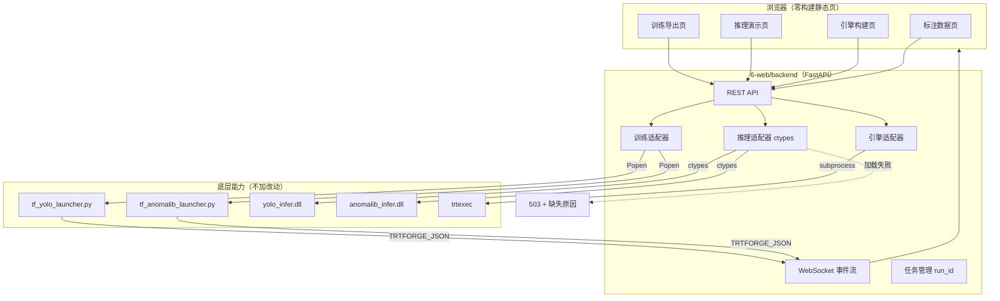
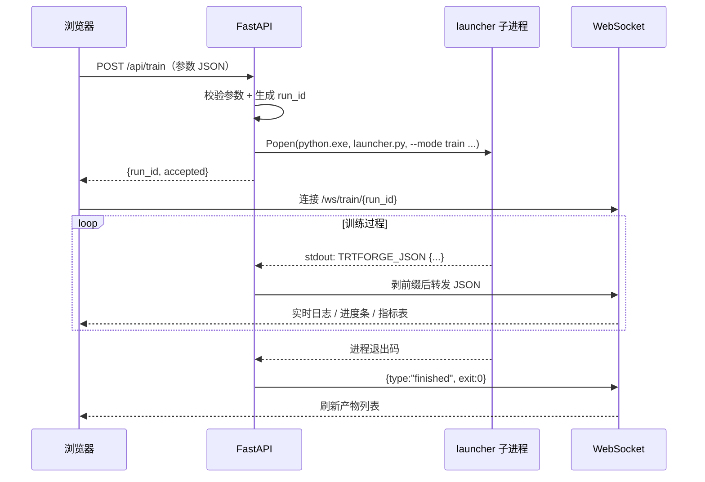
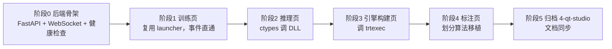
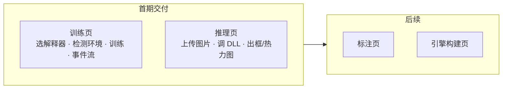

# 设计：Qt 桌面程序迁移为 Web 界面

## Context

`4-qt-studio` 是 Qt 6 桌面程序，包含标注、训练、引擎构建、推理四个页面。迁移目标是在**不重写任何算法和推理实现**的前提下，把界面层换成浏览器。

已实测的环境事实（2026-10-29）：

| 项 | 结论 |
| --- | --- |
| 三个推理库是否依赖 Qt | 否，`find_package(Qt)` 零命中，均为独立 CMake 工程 |
| `anomalib_infer.dll` | 用 `E:/thirdparty/opencv` 编译成功（152 KB） |
| `yolo_infer.dll` | 加 `NVCC_PREPEND_FLAGS` 后编译成功（148 KB） |
| Python `ctypes` 能否加载 | 能，两个 DLL 均 `LOADED` |
| 训练 launcher | `--mode check-env` 输出 `missing:[]` |
| Qt 6.8.3 | 本机不存在，且不再需要 |

## Goals / Non-Goals

**Goals**
- 浏览器里完成标注、训练、引擎构建、推理全流程。
- 训练日志实时可见（含进度、指标、GPU 占用）。
- 复用现有 launcher 与 C++ DLL，不重写推理前处理/解码。
- 前端**零构建**：不引入 npm/node，改页面不需要编译。

**Non-Goals**
- 不做多用户权限、账号体系。
- 不做任务队列/分布式训练调度。
- 不移植 Qt 的霓虹主题视觉细节，只保证功能等价。
- 不在此变更内改推理库内部实现。

## Decisions

### D1：后端用 FastAPI + WebSocket

训练是长任务且要连续输出，轮询体验差。FastAPI 原生支持 WebSocket，且和现有 Python 训练脚本同语言，`subprocess` 直接可用。

替代方案：Flask（WebSocket 需额外依赖）、Node 后端（要重写 launcher 调用）。放弃。

### D2：训练不重写，复用 launcher 子进程

`tf_yolo_launcher.py` 与 `tf_anomalib_launcher.py` 已有完整参数体系与事件协议：每行 stdout 打印 `TRTFORGE_JSON {紧凑JSON}`，事件类型含 `env / model / event / progress / metric / epoch_summary / gpu_status / artifact / plot / error`。

后端只需：拼参数 → `Popen` → 逐行读 → 剥前缀 → 按 type 转发到 WebSocket。**这是本次迁移能快速落地的根本原因。**

替代方案：后端直接 `import ultralytics` 在进程内训练。放弃——会丢进程隔离，训练崩溃拖垮服务，且要重新实现事件上报。

### D3：推理用 ctypes 调现有 DLL

已实测：`ctypes.WinDLL` 加 `os.add_dll_directory` 后能加载 `yolo_infer.dll` 与 `anomalib_infer.dll`。

关键约束：Python 3.8+ 不再用 `PATH` 解析依赖 DLL，后端启动时必须显式：

```python
os.add_dll_directory(r"E:\thirdparty\opencv\x64\vc17\bin")
os.add_dll_directory(cuda_bin)
```

为什么不做 `onnxruntime` 降级：降级意味着要在 Python 里重新实现前处理、解码、NMS、坐标还原
和异常图归一化，这等于把 DLL 里的东西再写一遍，结果还容易和 C++ 侧不一致。
首期选择「DLL 不可用就明确报 503 并说明缺什么」，让问题暴露而不是掩盖。
若后续确实需要离线兜底，再单独立项（任务 4.7）。

跨语言传结构体是本方案唯一的静默风险点，因此用 `tools/abi_probe.cpp` 让 MSVC 打印
C 侧 `sizeof` / `offsetof`，与 Python `ctypes` 逐项比对，实测 5 个结构体完全一致。

### D4：前端零构建，原生 HTML + JS

用户不需要 npm，改页面刷新即生效。用 `<script type="module">` + `fetch` + 原生 DOM 操作。

替代方案：React/Vite。放弃——会引入 node 工具链，违背"部署简单"的初衷，且当前只有四个页面。

### D5：OpenCV / CUDA 路径全部环境变量化

现有 CMakeLists 把 `OPENCV_DIR` 默认成 `D:/thirdparty/opencv`，又变成机器专属绝对路径。改为：

1. 优先读环境变量 `OPENCV_DIR`；
2. 其次读 CMake 缓存；
3. 都没有则报错并给出设置示例（不猜路径）。

CUDA 11.8 + MSVC 14.44 的 `STL1002` 问题用 `NVCC_PREPEND_FLAGS` 解决，因为它能覆盖 CMake 的 CUDA 编译器探测阶段（`CMAKE_CUDA_FLAGS` 覆盖不到，已实测）。

### D6：`4-qt-studio` 归档而非删除

移入 `5-reference/4-qt-studio`。理由：里面的参数拼装规则、数据集划分算法、事件解析逻辑是迁移的唯一参考实现，删了就没法对照。同时 `readme.md` 标注"仅供查阅，不参与构建"。

## 架构



## 训练事件流转



## 风险 / 取舍

| 风险 | 缓解 |
| --- | --- |
| `ctypes` 传 BGR 图像需手动管理内存，易泄漏 | 适配器层统一 `try/finally` 释放；图像走 numpy 连续内存，`ctypes.data_as` 直接引用 |
| DLL 加载失败导致推理页不可用 | 启动时探测并显示原因；接口返回 503 说明缺哪个 DLL 或哪个依赖目录，不静默降级（降级需重写前处理与解码，风险更大） |
| 训练进程残留（浏览器关闭但训练还在） | 后端持有 `Popen` 引用，提供 `/api/train/{run_id}/stop`；服务退出时统一 terminate |
| 大图/大模型上传撑爆内存 | 上传落临时目录，推理前限制尺寸，请求体设上限 |
| 前端零构建导致代码组织松散 | 按页面拆 `modules/*.js`，共享 `api.js` 与 `ws.js` |

## 迁移计划



回滚：`4-qt-studio` 归档前不动，任何阶段失败可直接回到 Qt 方案；新增的 `6-web` 删除即完全回滚。

## 待确认

> 已确认（2026-10-29）：
> - 训练产物目录：**沿用现有位置**，YOLO 落 `1-python-yolo/launcher/runs`，Anomalib 落 `2-python-anomaly/launcher/results`，不改 launcher 默认值。
> - 首期范围：**优先做训练页 + 推理页**，标注页与引擎构建页延后。
> - 不保留桌面端「打开本机文件夹」能力，改为在页面展示产物路径并提供下载。

## 迁移陷阱（读 Qt 源码核对得出）

评审 Qt 实现时发现三处「照抄会出错」的地方，已在本变更内处理或明确记录：

### T1：数据集划分用 `qHash`，跨进程不确定

`dataset/DatasetSplitPolicy.cpp:21-23` 用 `qHash(QString::number(i) + "_2026")` 排序后按比例切分。
Qt 的 `qHash(QString)` 受全局哈希种子随机化影响，**同一份数据在不同进程/重启后可能划分出不同结果**。

影响：迁移标注页时若直接照抄，会导致 Web 端与 Qt 端的 train/val 划分不一致，无法复现历史实验。

对策：改用自实现的固定哈希（如 FNV-1a），**保留 `_2026` 盐值**，才能与老版本逐图对齐。
此项属于标注页（阶段 4），当前未实现，已记入任务 6.1。

### T2：引擎构建的 `runtime` 与 `maxBatch` 是空设置

`EngineBuilderTab.cpp:224/:258` 提供 `--runtime`（full/lean/dispatch）与「最大 Batch」输入，
但 `BuilderWorker.cpp` 全文未引用 `opt.runtime` 与 `maxBatch`，**填了不生效**。

影响：迁移引擎构建页时若照抄 UI，会做出一个假的开关，用户会以为改了就有效果。

对策：Web 版暂时**不提供**这两项，等确认实现方式再补。此项属于引擎构建页（阶段 3），当前未实现。

### T3：argparse 参数错误不产生 `error` 事件

launcher 用 argparse，参数不合法时 argparse 直接往 stderr 打 usage 并 `exit(2)`，
**不会**发 `TRTFORGE_JSON error`。Qt 版只能把它当普通日志行，用户看不出是"参数错了"还是"训练崩了"。

对策：已在 `runners.py` 的 `_synthetic_error()` 里补齐——退出码 2 补发
`ARGUMENT_ERROR` 事件（并从日志尾部捞一条 usage 帮助定位），退出码 130 补发 `CANCELLED`。
验证见 `6-web/backend/tools/test_exit_codes.py`，4 个场景全通过。

### 事件字段核对结果

按 Qt 源码核对后修正了前端三处**字段名写错**的问题（会静默不显示）：

| 事件 | 原写法（错） | 实际结构 | 后果 |
| --- | --- | --- | --- |
| `epoch_summary` | `event.loss`、`event.lr` 当标量 | `losses`/`metrics`/`lr` 都是**字典**，另有嵌套 `gpu` | 损失与学习率永远不显示 |
| `gpu_status` | `event.utilization` | `utilization_gpu_pct` | GPU 利用率永远不显示 |
| `artifact` | `event.path \|\| event.file` | `{kind, name, path, message}` | 缺 path 时产物信息丢失 |

另外补齐了原先未处理的 `plot`、`event`、`anomaly_model`、`anomaly_export_summary` 四类事件。

## 首期实现范围（MVP）



MVP 只依赖两样已就绪的东西：launcher（已验证 `missing:[]`）与 `*_infer.dll`（已编译并验证可加载），不触碰标注算法与 trtexec。
