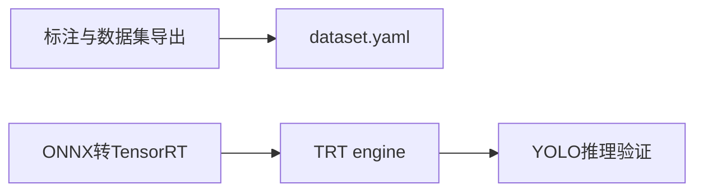
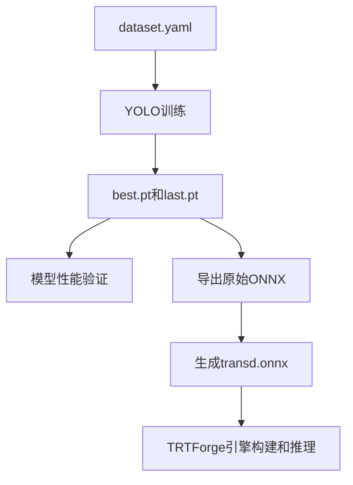
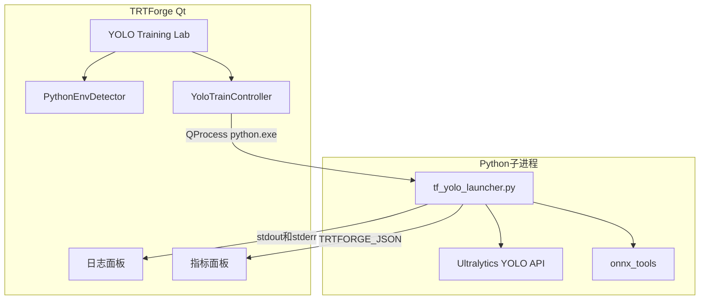

# YOLO 训练平台设计

## Context

TRTForge 当前链路是：



本变更补齐中间训练链路：



## Goals

- 使用 `1-python-yolo/ultralytics-main` 提供的 YOLO Python API 完成训练、验证、ONNX 导出。
- 第一批支持 `detect`、`segment`、`pose`、`obb` 四种任务头。
- Python 训练子进程报错时，Qt 主程序不崩溃，只弹窗和写日志。
- Python 的普通 `print`、Ultralytics 日志、stderr 都能完整回显到 Qt 日志面板。
- 训练进度、指标、产物路径用结构化协议输出，便于 Qt UI 显示进度条和指标表。
- UI 参数分层，普通用户只看到必要项，高级参数折叠。

## Non-Goals

- 第一版不做多机训练和 DDP。
- 第一版不让脚本自动安装缺失依赖，只检测并给出提示。
- 第一版不把 Python 嵌入 Qt 进程。
- 第一版不直接导出 TensorRT engine；ONNX 转 engine 继续使用现有 TRTForge 构建链路。
- 第一版不修改 `1-python-yolo/ultralytics-main` 源码。

## Architecture Decision

采用方案 A 为主体：Qt/C++ 使用 `QProcess` 调用 Python 子进程。



预留方案 C：未来把 `tf_yolo_launcher.py` 内部能力包成 HTTP/gRPC 本地服务，Qt 侧仍复用同一套 mode、task、参数和 JSON 事件模型。

## Python Launcher Contract

统一入口：

```bash
python tf_yolo_launcher.py --mode check-env
python tf_yolo_launcher.py --mode train --task detect --data dataset.yaml --model yolov8n.pt
python tf_yolo_launcher.py --mode train --task obb --data dataset.yaml --model yolov8n-obb.pt
python tf_yolo_launcher.py --mode train --task detect --data dataset.yaml --model yolov8n.yaml --pretrained yolov8n.pt
python tf_yolo_launcher.py --mode train --task detect --data dataset.yaml --model yolov8n.yaml --pretrained false
python tf_yolo_launcher.py --mode val --task segment --weights runs/.../best.pt --data dataset.yaml
python tf_yolo_launcher.py --mode export --task pose --weights runs/.../best.pt --format onnx --make-transd true
python tf_yolo_launcher.py --mode probe-model --weights runs/.../best.pt
```

### Supported Tasks

| task | 用途 | 默认模型示例 | 数据集要求 |
| --- | --- | --- | --- |
| `detect` | 水平框检测 | `yolov8n.pt` | YOLO detect |
| `segment` | 实例分割 | `yolov8n-seg.pt` | YOLO segment |
| `pose` | 姿态估计 | `yolov8n-pose.pt` | YOLO pose |
| `obb` | 旋转框检测 | `yolov8n-obb.pt` | YOLO OBB 四角点格式 |

### Supported Modes

| mode | 作用 | 成功产物 |
| --- | --- | --- |
| `check-env` | 检测 Python、torch、CUDA、ultralytics、onnx、onnxruntime | 环境状态 JSON |
| `probe-model` | 读取模型任务、类别、权重路径等基础信息 | 模型摘要 JSON |
| `train` | 调用 `YOLO(...).train(...)` | `best.pt`、`last.pt`、训练指标 |
| `val` | 调用 `YOLO(...).val(...)` | precision、recall、mAP、速度 |
| `export` | 调用 `YOLO(...).export(format="onnx")` | `.onnx`、可选 `.transd.onnx` |

### Training Initialization

训练初始化必须区分三种概念，避免用户误以为“模型结构”和“训练权重”是一回事：

| 概念 | 参数 | 示例 | 说明 |
| --- | --- | --- | --- |
| 模型入口 | `model` | `yolov8n.pt`、`yolov8n.yaml`、`runs/.../last.pt` | 传给 `YOLO(model)`，可以是预训练 `.pt`、模型结构 `.yaml` 或断点权重 |
| 预训练权重 | `pretrained` | `true`、`false`、`D:/weights/yolov8n.pt` | 传给 `train(pretrained=...)`，控制是否加载预训练权重或指定权重路径 |
| 断点恢复 | `resume` | `false`、`true` | 用于继续未完成训练，和从预训练权重微调不是同一件事 |

推荐 UI 提供三种初始化选项：

| UI 选项 | 实际参数 | 适用场景 |
| --- | --- | --- |
| 使用预训练权重微调 | `model=<task默认pt>` 或 `model=<yaml> --pretrained <pt/true>` | 最常用，样本量不大时推荐 |
| 从模型结构从零训练 | `model=<yaml> --pretrained false` | 数据量很大或需要完全自定义结构 |
| 从断点继续训练 | `model=<last.pt> --resume true` | 训练中断后继续 |

第一版默认选择“使用预训练权重微调”。如果用户选择从零训练，UI 需要用提示说明训练时间更长、需要更多数据。

## Output Protocol

普通日志原样输出。结构化消息使用固定前缀：

```text
TRTFORGE_JSON {"type":"event","name":"train_start","ts":1761234567}
TRTFORGE_JSON {"type":"progress","epoch":3,"total":100,"pct":3.0}
TRTFORGE_JSON {"type":"metric","name":"metrics/mAP50","value":0.812,"step":3}
TRTFORGE_JSON {"type":"epoch_summary","epoch":3,"metrics":{"metrics/mAP50(B)":0.812},"gpu":{"memory_used_mb":4096}}
TRTFORGE_JSON {"type":"plot","name":"results","path":"runs/.../results.png"}
TRTFORGE_JSON {"type":"artifact","kind":"labels_json","name":"labels_exp_1.json","path":"runs/.../labels_exp_1.json"}
TRTFORGE_JSON {"type":"artifact","kind":"pt","path":"runs/detect/exp/weights/best.pt"}
TRTFORGE_JSON {"type":"artifact","kind":"onnx","path":"runs/detect/exp/weights/best.onnx"}
TRTFORGE_JSON {"type":"error","code":"MISSING_DEP","message":"缺少 onnx 模块"}
TRTFORGE_JSON {"type":"event","name":"finished","exit":0}
```

Qt 侧规则：

- 行首不是 `TRTFORGE_JSON ` 的内容全部作为普通日志显示。
- 行首是 `TRTFORGE_JSON ` 的内容解析为 JSON，解析失败时降级为普通日志。
- Python 退出码非 0 时，显示错误弹窗并保留日志文件。

Python 侧规则：

- 强制 UTF-8 输出。
- 设置非缓冲输出。
- 结构化消息必须 `flush=True`。
- 捕获 `ModuleNotFoundError`、`ImportError`、`RuntimeError`、`KeyboardInterrupt` 并输出结构化错误。

### Training Monitor Events

训练监控页复用同一条 `TRTFORGE_JSON` 通道，不新增 Qt/Python 通信机制：

| 事件 | 触发时机 | 用途 |
| --- | --- | --- |
| `epoch_summary` | 每个 epoch 结束 | 追加指标表行，包含 loss、precision、recall、mAP、学习率、GPU 信息 |
| `plot` | 每个 epoch 结束或训练结束 | 刷新当前最新图表，不保留历史快照 |
| `gpu_status` | 训练中按节流间隔输出 | 显示 GPU 名称、显存占用和利用率，辅助调整 batch |
| `artifact(kind=labels_json)` | 训练结束 | 显示 TRT 推理标签 JSON 路径 |

图表刷新策略为只显示当前最新图表，优先识别 `BoxF1_curve.png`、`BoxPR_curve.png`、`BoxP_curve.png`、`BoxR_curve.png`、`confusion_matrix.png`、`confusion_matrix_normalized.png`、`labels.jpg`、`results.png`，并兼容 Ultralytics 常见旧命名 `F1_curve.png`、`PR_curve.png`、`P_curve.png`、`R_curve.png`。

训练结束时生成标签 JSON，格式对齐 `labels_coco.json`：

```json
{
  "name": "exp_1",
  "classes": ["missing_hole", "mouse_bite"]
}
```

标签 JSON 命名为 `labels_<实验名称>.json`，不覆盖 `labels_coco.json`。同名时追加时间戳，分别保存到训练目录和 `4-qt-studio/bin/configs`，供后续 TRT 推理选择。

## Parameter Exposure

### 常用训练参数

| 参数 | 默认 | UI 控件 | 说明 |
| --- | --- | --- | --- |
| `task` | `detect` | 下拉框 | `detect/segment/pose/obb` |
| `model` | 按任务推荐 | 文件选择 | `.pt`、`.yaml` 或 `last.pt` |
| `pretrained` | `true` | 开关/文件选择 | 是否加载预训练权重，可为布尔值或权重路径 |
| `data` | 空 | 文件选择 | `dataset.yaml` |
| `epochs` | `100` | 数字框 | 训练轮数 |
| `imgsz` | `640` | 数字框 | 输入尺寸 |
| `batch` | `16` | 数字框/自动 | 支持 `-1` 自动 batch |
| `device` | `0` | 下拉/文本 | `0`、`cpu`、`auto` |
| `project` | `runs/trtforge` | 目录选择 | 输出根目录 |
| `name` | 自动生成 | 文本框 | 实验名称 |

### 高级训练参数

| 分组 | 参数 |
| --- | --- |
| 训练控制 | `patience`、`time`、`resume`、`save_period`、`seed`、`deterministic`、`pretrained` |
| 资源性能 | `workers`、`cache`、`amp`、`fraction`、`compile` |
| 优化器 | `optimizer`、`lr0`、`lrf`、`momentum`、`weight_decay`、`warmup_epochs` |
| 数据策略 | `rect`、`multi_scale`、`close_mosaic`、`single_cls`、`classes` |
| 损失权重 | `box`、`cls`、`dfl`、`nbs` |

### 任务专属参数

| task | 参数 |
| --- | --- |
| `detect` | 使用通用检测参数 |
| `segment` | `overlap_mask`、`mask_ratio` |
| `pose` | `pose`、`kobj`、`rle` |
| `obb` | `angle` |

### 验证参数

| 参数 | 默认 | 说明 |
| --- | --- | --- |
| `split` | `val` | `val/test/train` |
| `conf` | `0.001` | 指标曲线用置信度阈值 |
| `iou` | `0.7` | NMS IoU |
| `max_det` | `300` | 每图最大目标数 |
| `half` | `false` | FP16 验证 |
| `plots` | `true` | 保存混淆矩阵和 PR 曲线 |
| `save_json` | `false` | 保存 JSON |
| `save_txt` | `false` | 保存 YOLO txt |

### 导出参数

| 参数 | 默认 | 说明 |
| --- | --- | --- |
| `format` | `onnx` | 第一版固定 ONNX |
| `imgsz` | 训练尺寸 | 导出输入尺寸 |
| `batch` | `1` | 导出 batch |
| `dynamic` | `false` | 动态输入尺寸 |
| `half` | `false` | FP16 ONNX |
| `opset` | 空 | 为空时由 Ultralytics 决定 |
| `simplify` | `true` | 简化 ONNX |
| `make_transd` | `true` | 生成 `.transd.onnx` |

## Error Handling

| 错误场景 | Python 行为 | Qt 行为 |
| --- | --- | --- |
| 找不到 Python | 不启动脚本 | 弹窗提示选择 Python |
| 缺少 `ultralytics` | 输出 `MISSING_DEP` | 弹窗显示安装建议 |
| 缺少 `onnx` | 导出前输出 `MISSING_DEP` | 弹窗显示安装建议 |
| CUDA 不可用 | `check-env` 标记为 warning | 允许 CPU 训练或让用户换设备 |
| 数据集不存在 | 输出 `DATA_NOT_FOUND` | 弹窗并定位数据集输入框 |
| 训练中断 | 输出 `CANCELLED` | UI 进入已停止状态 |
| 未知异常 | 输出 `UNHANDLED_EXCEPTION` | 弹窗展示最后错误和日志路径 |

## UI Design

Pencil 页面 `TRT Forge - YOLO Training Lab` 应包含：

- 顶部状态栏：环境状态、当前任务、运行状态。
- 左侧任务与数据区：任务头、模型、dataset.yaml、输出目录。
- 左侧任务与数据区必须包含训练初始化方式：预训练微调、从零训练、断点恢复。
- 中部参数区：常用训练参数、高级参数、任务专属参数。
- 右侧环境与产物区：Python 环境、依赖状态、best.pt、ONNX、transd ONNX。
- 底部日志区：stdout/stderr 原样输出，结构化事件可高亮。
- 操作按钮：检测环境、开始训练、停止、验证模型、导出 ONNX。
- 训练监控页：深色指标数表、基于 `epoch_summary` 实时更新且带坐标轴/刻度/网格线的曲线小图控件、混淆矩阵 PNG 缩略图控件、GPU 实时占用进度条和标签 JSON 生成状态。
- 最新训练图表的小图控件支持双击放大到图表区域，再次双击恢复多图；PNG 曲线图事件作为产物路径记录，混淆矩阵 PNG 用于缩略图显示。
- 每次开始训练时，必须先清空上一轮指标表、曲线图表、GPU 状态和产物列表，避免混用旧实验数据。

## Migration Plan

1. 先提交 OpenSpec 文档和 Pencil UI 原型，请用户确认。
2. 确认后实现 Python launcher，不接 C++。
3. 用小数据集命令行验证 `check-env/train/val/export`。
4. 再实现 Qt `QProcess` 控制器和 UI。
5. 最后把训练产物接入现有 ONNX 转 TRT 和推理页面。

## Risks and Mitigations

- Ultralytics 版本变化导致回调字段变化：Python launcher 中集中封装字段读取，字段缺失时降级输出普通日志。
- Windows 中文路径乱码：全链路 UTF-8，Qt 使用 `QString::fromUtf8`。
- 缺库导致崩溃：先 `check-env`，训练前再二次检测关键依赖。
- `.transd.onnx` 被用户误用 Ultralytics 加载：UI 和文档明确标注 `.transd.onnx` 仅给 TRTForge 推理链路。
- 多任务头参数过多：UI 只展示当前 task 相关专属参数，高级参数默认折叠。
