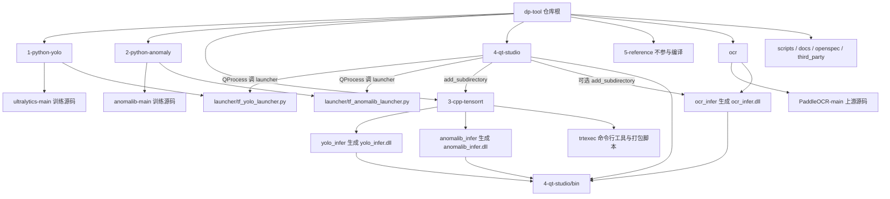
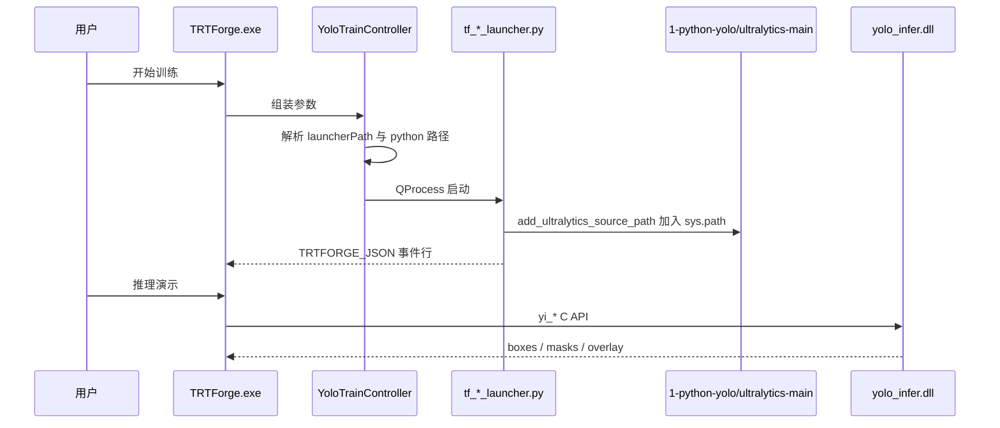

# Design: 五级目录分层与路径解析

## Context
仓库已经是一个「Python 训练 + C++ TensorRT 推理 + Qt 桌面壳」的混合工程，`TRTForge.exe` 是唯一入口：

- Qt 程序通过 `QProcess` 调 `tf_yolo_launcher.py` / `tf_anomalib_launcher.py` 训练与导出。
- Qt 程序通过 `add_subdirectory` 把 `yolo_infer`、`anomalib_infer`、`ocr_infer` 编成 DLL，或在 `TRTFORGE_BUILD_OCR_INFER=OFF` 时导入预编译 `bin/ocr_infer.dll`。
- 三个 DLL 的 C API 头文件被 Qt 侧 `include_directories` 直接引用。

改造前这些目录的相对深度不同（`ultralytics-main` 在根、`trtexec/gui/inference/*` 在两级、`PaddleOCR-main` 在根），导致每个使用方各写一套相对路径。本次设计的目标是把「层级」变成唯一的路径基准。

关键约束：
- 产物命名与目标名不得变化：`TRTForge`、`yolo_infer`、`anomalib_infer`、`ocr_infer`。
- 不修改仓库根或 `4-qt-studio` 下的 `bin`、`include`、`lib` 目录内的既有文件。
- 编译依赖本机环境：Qt 6.8.3（`D:/QT/6.8.3/msvc2022_64`）、CUDA 11.8、OpenCV（`D:/thirdparty/opencv`）。缺失时只能记录「未验证」，不得声称通过。

## Goals / Non-Goals
- Goals:
  - 根目录一级只出现按用途分类的层级目录，一眼可知是否参与编译。
  - 训练启动脚本同时支持「源码形态」（launcher 与源码树同级）与「安装形态」（launcher 被拷进 `bin/training/scripts`）。
  - CMake 只用 `TRTFORGE_REPO_ROOT` 一个变量推导同级子工程，不再出现 `../../trtexec/gui/...`。
  - 全部编译产物（`TRTForge.exe`、三个 `*_infer.dll/.lib`）只落在 `4-qt-studio/bin`。
- Non-Goals:
  - 不改 `project(TRTForge)` / `add_executable(TRTForge)`。
  - 不改 DLL 名称、C API 签名、结果结构体。
  - 不重写 `4-qt-studio` 内部 `include/app|engine|annotation|dataset|training|inference|common` 的分层（那是 `docs/DefectVision_AI_Studio_软件结构优化计划.md` 的第二阶段工作）。
  - 不把 `5-reference` 纳入 CMake 编译。

## Decisions

### D1：用数字前缀表达层级与依赖方向
`1-python-yolo` → `2-python-anomaly` → `3-cpp-tensorrt` → `4-qt-studio` 的数字即依赖方向：上层可以调下层，下层不得反向依赖上层。`5-reference` 数字最大但语义是「不参与构建的历史对照」，注释中需明确它不进入编译图。

替代方案：用 `python/`、`cpp/`、`qt/` 无数字命名。放弃原因：没有数字时「谁依赖谁」仍需看文档，且排序不稳定。

### D2：`ocr/` 保持旁挂而不进 `3-cpp-tensorrt`
OCR 走 Paddle Inference，不是 TensorRT，且 `ocr_infer` 默认不参与 `TRTForge` 解决方案（`TRTFORGE_BUILD_OCR_INFER=OFF`），它依赖 Abseil / Clipper / yaml-cpp 等第三方目标。放进 `3-cpp-tensorrt` 会让「TensorRT 层」名不副实，也让 CMake 选项语义混乱。

替代方案：`3-cpp-ocr/`。放弃原因：`PaddleOCR-main` 上游源码体量大，需要与自研 `ocr_infer` 明确区分，单独一级更清楚。

### D2b：命令行 `trtexec` 并入 `3-cpp-tensorrt/trtexec`
`trtexec` 是 TensorRT C++ API 的命令行封装，与 `yolo_infer`、`anomalib_infer` 同属 TensorRT 技术栈，放回根目录会让「一级目录=用途」的规则出现例外。并入后 `3-cpp-tensorrt` 同时容纳「推理 DLL」与「引擎构建工具」两类 TensorRT 产物。

代价：`package_devkit.ps1` 原来用 `Split-Path -Parent $scriptDir` 推导仓库根，移动后会推导成 `3-cpp-tensorrt`。改为向上逐级查找同时含 `4-qt-studio` 与 `1-python-yolo` 的目录，不依赖固定层级，后续再移动也不会失效。

### D3：路径解析改为「基准变量 + 双候选」
- CMake 侧在 `4-qt-studio/CMakeLists.txt` 顶部定义：
  ```cmake
  set(TRTFORGE_REPO_ROOT "${CMAKE_CURRENT_SOURCE_DIR}/..")
  set(TRTFORGE_BIN_DIR "${CMAKE_CURRENT_SOURCE_DIR}/bin")
  ```
  之后所有同级引用写 `${TRTFORGE_REPO_ROOT}/3-cpp-tensorrt/yolo_infer` 形式，打包脚本按 `TRTFORGE_INFER_BLOCK_BEGIN/END` 标记整块替换。
- 推理子工程内部用 `${CMAKE_CURRENT_SOURCE_DIR}/../../4-qt-studio/bin` 反推输出目录，保证单独配置子工程时产物仍归位。
- Python 侧launcher 用 `Path(__file__).resolve().parents` 逐级向上探测：
  - `tf_yolo_launcher.py` 候选：`<parent>/1-python-yolo/ultralytics-main`、`<parent>/ultralytics-main`
  - `tf_anomalib_launcher.py` 候选：`<parent>/2-python-anomaly/anomalib-main`、`<parent>/anomalib/anomalib-main`、`<parent>/anomalib-main`
  这样源码形态与 `bin/training/scripts` 安装形态都能命中。
- Qt 侧 `YoloTrainController::launcherPath()` 依次尝试 appDir 相对路径、当前工作目录的五级路径、旧 `training/scripts`，保证从构建目录、从 `bin`、从仓库根三种启动方式都可运行。

### D4：编译产物单一出口
```
3-cpp-tensorrt/*/CMakeLists.txt  ──┐
ocr/ocr_infer/CMakeLists.txt     ──┼──> 4-qt-studio/bin
4-qt-studio/CMakeLists.txt       ──┘
```
原因：Qt 程序运行时按 `applicationDirPath()` 找 DLL，单一出口可以避免「DLL 编到别处、EXE 找不到」的常见故障；devkit 打包也只需拷一个目录。

### D5：`.gitignore` 只保留新路径
旧 `trtexec/gui/build|dist|logs|bin` 条目与新 `4-qt-studio/*` 并存会造成误判（以为还会在那里生成产物）。变更后删除旧条目，只保留新层级的忽略规则。Paddle 源码与构建工作区默认落在 `<repo>/third_party/`，一并加入忽略。

### D6：脚本路径按脚本位置推导，不写死机器路径
原先 `scripts/*.bat|ps1` 与 `anomalib-main/train.py`、`generate_trtforge_metadata.ps1` 含 `D:\test1\deeplearning\...` 这类只对某一台机器成立的绝对路径，换机器即失效。统一规则：

- PowerShell：`$RepoRoot = Resolve-Path (Join-Path $PSScriptRoot ..)`，`third_party`、`InstallDir`、`BinDir` 全部由 `$RepoRoot` 派生；同名环境变量可覆盖。
- 批处理：`for %%I in ("%~dp0..") do set "REPO_ROOT=%%~fI"`，再用 `TARGET` 派生子路径。
- Python：`Path(__file__).resolve().parent / "datasets" / "bottle"`，并用 `TRTFORGE_ANOMALIB_DATASET_ROOT` 环境变量支持外部数据集。
- 需向上多级的脚本（`package_devkit.ps1`）改为特征目录探测，不写死层数。

替代方案：保留绝对路径并要求用户改文件。放弃原因：每次换机都要改多处，且错误信息不明确。

## Architecture


## 构建与运行时数据流


## Risks / Trade-offs
- 「搬迁 + 改路径」一次性完成，工作区中途不可编译。
  - Mitigation：tasks 按层级分章，每章结束即可单独验证该层；CMake 配置验证放在第 5 章（4-qt-studio）末尾。
- `git mv` 后 Git 需要重新识别重命名，diff 体积大。
  - Mitigation：按目录分批 `git add -A` 与 `git status` 核对，提交信息说明为结构性重命名。
- 旧文档中大量 `trtexec/gui/...` 描述性文字（历史说明）不应全部改写。
  - Mitigation：区分「现行路径」与「历史记录」，现行路径必须改；标注为历史对照的保留并注明旧结构。
- Paddle Inference 安装目录中的路径（`scripts/sync_paddle_inference_to_bin.ps1` 的默认参数）指向了另一台机器的绝对路径 `D:\test1\deeplearning\...`。
  - Mitigation：本次只改脚本内部的目标目录与日志文案，绝对路径默认值记录为待确认项，不擅自改成 `D:\test\deeplearning`。

## Migration Plan
1. 建 `openspec/changes/refactor-five-tier-layout/` 四件套并 `openspec validate --strict` 通过。
2. 按 1→5 顺序 `git mv` 各层目录，每层搬完核对一次 `git status`。
3. 改 CMake（`3-cpp-tensorrt/*`、`4-qt-studio`、`ocr/ocr_infer`）与 Launcher 探测候选。
4. 改 Qt 侧 `YoloTrainController`、测试脚本资产路径。
5. 改 `.gitignore`、`trtexec/package_devkit.ps1`、`scripts/*.bat|*.ps1`。
6. 改文档：`readme.md` 新旧对照表、`4-qt-studio/README.md`、`trtexec/README_DEVKIT.md`、`docs/*`。
7. 全仓 `rg` 校验旧路径零命中，`openspec validate --strict`。
8. 编译验证（本机环境允许时），结果写入任务勾选状态。

回滚方案：本次全部改动是文件移动 + 路径字符串修改，`git checkout -- .` 与 `git reset` 即可回到改造前提交 `23a6358`。

## Open Questions
- `scripts/sync_paddle_inference_to_bin.ps1` 与两个 `.bat` 中的 Paddle 工作区默认落在 `<repo>/third_party/Paddle`；若团队约定把 Paddle 源码放在仓库外，需设置 `PADDLE_THIRD_PARTY_ROOT`。
- `2-python-anomaly/anomalib-main/train.py` 的数据集默认改为 `anomalib-main/datasets/bottle`；历史数据仍在旧位置时需设置 `TRTFORGE_ANOMALIB_DATASET_ROOT` 或移动目录。
