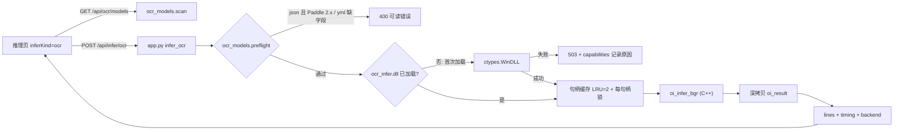

# Design: Web 推理页接入 PaddleOCR

## Context

- 既有 `ocr_infer.dll`（`dp-tool/ocr/ocr_infer`）由 PaddleOCR `deploy/cpp_infer` 源码 +
  Paddle Inference 2.6.2（GPU 包：CUDA 11.8 / cuDNN 8.6 / TensorRT 8.5）编译，
  C API 见 `ocr/ocr_infer/include/ocr_infer_c.h`：
  - `oi_create(const oi_config*)` → 句柄；det / rec 目录必填，textline / doc_ori / unwarp 可选。
  - `oi_infer_bgr(h, bgr, w, h, stride, &result, &stat)`；结果指针归句柄所有，
    只保证到下一次 `oi_infer_*` 或 `oi_destroy` 前有效。
  - 句柄内有 `std::mutex`，`oi_create` / `oi_destroy` 无锁；错误串 `thread_local`。
  - `oi_frame_stat` 返回 device / precision / run_mode / mkldnn / threads / batch 与分段耗时。
- 桌面版 `TRTForge.exe` 已在同一进程内同时加载 `yolo_infer.dll`（TRT）、
  `onnxruntime.dll`（1.16）与 `paddle_inference.dll`，共存已被验证。
- Web 后端（FastAPI）用 ctypes 调用 `yolo_infer.dll` / `anomalib_infer.dll` / `onnx_infer.dll`，
  `config.BIN_DIR`（`TRTFORGE_BIN_DIR`）为 DLL 目录，`config.DLL_DIRS` 经
  `os.add_dll_directory` 注册。
- 关键约束：cpp_infer 的 `ClasPredictor::Build` / `TextRecPredictor::Build` 在 yml 缺字段时
  调用 `exit(-1)`，异常不会回到调用方。

## Goals / Non-Goals

- Goals:
  1. OCR 推理全部在 C++ DLL 内完成，Web 只做桥接。
  2. 单图与目录批量两条链路，结果字段同构。
  3. 任何模型 / 配置问题都在进 DLL 前被拦截，Web 服务进程不因 OCR 退出。
  4. OCR 加载失败不影响其他推理类型。
  5. 桌面版零改动。
- Non-Goals:
  1. 不升级 Paddle 3.x，不支持 `inference.json` 模型（第二期）。
  2. 不支持 OCR 视频 / 摄像头。
  3. 不改 `ocr_infer.dll` 源码与二进制。

## 总体数据流

## Decisions

### D1. 推理在 C++，Python 只做薄桥接

- 新模块 `6-web/backend/ocr_infer.py`，不并入 `infer.py`：
  `onnx_infer.dll` 的导出也用 `oi_` 前缀（`oi_create_yolo` 等），分模块避免绑定混淆。
- ctypes 结构体 `OiConfig` / `OiTextLine` / `OiResult` / `OiFrameStat` 与头文件逐字段对齐，
  字段顺序、类型、`char[16]` / `char[32]` 定长数组一致。
- 输入用 `cv2.imdecode`（兼容中文路径与上传字节流）得到 BGR，调用 `oi_infer_bgr`。
- `oi_result` 返回后立即深拷贝：`xs/ys` 按 `point_count` 读取、`text_utf8` 按 UTF-8 解码、
  `raw_json_utf8` 原样转字符串；不保留任何 DLL 指针。
- 备选「Python 版 PaddleOCR」被否决：需要 paddlepaddle Python 包，违反交付形态，且推理离开 C++。

### D2. 懒加载与故障隔离

- 服务启动时不加载 `ocr_infer.dll`，只在 `/api/capabilities` 中做文件存在性检查。
- 首次 `/api/infer/ocr`（或批量 `kind=ocr`）时 `ctypes.WinDLL(BIN_DIR/"ocr_infer.dll")`；
  加载结果（成功 / 失败原因）缓存到模块级状态，后续请求直接复用。
- 加载失败返回 503，`infer_ocr=false`、`infer_ocr_detail` 写明缺哪个 DLL；
  `infer.py` 中 YOLO / Anomalib / ONNX 状态不受影响。
- 理由：`paddle_inference.dll` 约 1.7GB，启动即加载会拖慢所有用户；且故障面隔离。

### D3. 句柄缓存

- 缓存键：`(det_dir, rec_dir, textline_dir, device, enable_mkldnn, cpu_threads,
  rec_batch_size, det_thresh, det_box_thresh, det_unclip_ratio, rec_score_thresh)`，
  路径先 `resolve()` 规范化。
- 容量 LRU=2（Paddle 句柄占数百 MB 内存 / 显存）；淘汰时在该句柄锁内 `oi_destroy`。
- 每个句柄一把 `threading.Lock`，与 DLL 内 mutex 双保险；`oi_create` 用全局创建锁串行。
- `/api/infer/cache` 增加 `ocr` 段：容量、当前键（脱敏为目录名）、命中 / 创建次数。

### D4. 模型扫描与进 DLL 前预检

- 模型根目录：环境变量 `TRTFORGE_OCR_MODEL_DIR`；开发默认 `dp-tool/9-python-paddleOCR/model`；
  安装包默认 `<HOME>/models/ocr`。递归两层，含 `inference.yml|yaml` 的目录视为模型。
- 归类：`Global.model_name` 后缀 `_det` → det，`_rec` → rec，`textline_ori` → textline_ori，
  `doc_ori` → doc_ori，`UVDoc` → unwarp；无法识别记为 `unknown` 并在列表中提示。
- 格式：同目录有 `inference.json` 标 `json`，否则有 `inference.pdmodel` 标 `pdmodel`；
  注意 cpp_infer 的 `GetModelPaths` 优先 `.json`，两者并存时按 `json` 判定。
- Paddle 版本：开发环境读 `ocr/ocr_infer/third_party/paddle_inference/version.txt`，
  安装包读 `bin/paddle_inference_version.txt`，解析 `Paddle version: X.Y.Z`；
  读不到时视为未知，`json` 模型按不兼容处理（保守）。
- 预检规则（任何一条失败 → 400，不调用 `oi_create`）：

| 模型类型 | 必需文件 | yml 必需键 |
| --- | --- | --- |
| det | 模型文件 + `inference.pdiparams` + yml | `PostProcess`（thresh / box_thresh / unclip_ratio） |
| rec | 同上 | `PostProcess.character_dict`（非空列表） |
| textline_ori | 同上 | `PreProcess.ResizeImage.size`、`NormalizeImage.scale/mean/std`、`PostProcess.Topk.label_list`、`PostProcess.Topk.topk` |
| 全部 | — | `json` 格式且 Paddle 主版本 < 3 → 不兼容 |

- 提供命令行 `python -m ocr_models --check <dir>`，下载 / 生成模型后可自检。

### D5. 接口契约

- `GET /api/ocr/models` → `{ root, paddle_version, entries: [{ path, name, model_name, kind,
  format, compatible, reason }] }`。
- `POST /api/infer/ocr`（multipart，同步 `def` 路由，交线程池执行）：

| 字段 | 必填 | 默认 | 说明 |
| --- | --- | --- | --- |
| `image` | 是 | — | 图片文件 |
| `det_dir` / `rec_dir` | 是 | — | 模型目录 |
| `textline_ori_dir` | 否 | 空 | 非空即启用文本行方向 |
| `device` | 否 | `cpu` | `cpu` / `gpu:0` |
| `enable_mkldnn` | 否 | `1` | 仅 CPU 生效 |
| `cpu_threads` | 否 | `8` | 1–64 |
| `rec_batch_size` | 否 | `6` | 1–64 |
| `det_thresh` | 否 | `0.3` | 0–1 |
| `det_box_thresh` | 否 | `0.6` | 0–1 |
| `det_unclip_ratio` | 否 | `1.5` | 0.5–5 |
| `rec_score_thresh` | 否 | `0.0` | 0–1 |

- 响应：`backend: "ocr_infer.dll"`、`device`、`run_mode`、`mkldnn`、`cpu_threads`、
  `rec_batch_size`、`src_w`、`src_h`、`count`、
  `lines: [{ index, poly: [[x,y],...], text, score, angle }]`、
  `timing: { io_ms, pipeline_ms, result_ms, total_ms, roundtrip_ms }`、`raw_json`。
- 错误码：400 参数 / 模型预检失败；503 DLL 不可用；500 DLL 推理返回非 `OI_OK`
  （附 `oi_last_error`）。0 行是成功，`count=0`。

### D6. 前端

- `index.html`：`#inferKind` 增加 `ocr`；新增 `#inferOcrGroup`（检测 / 识别 / 方向下拉 +
  `data-dialog="dir"` 浏览、设备、线程、batch、MKLDNN、det_thresh / box_thresh 滑条、
  折叠「高级」放 unclip / rec_score）。
- 下拉数据来自 `/api/ocr/models`，`compatible=false` 置灰并显示「需 Paddle 3.x」或缺字段原因。
- 新增 `js/ocr.js`：
  - 原图 + SVG 多边形 + 序号（沿用 `overlay.js` 的 polygon 写法与 viewer 体系）。
  - `#boxTable` 列：序号 / 文字 / 置信度 / 角度；行与框双向高亮。
  - 「复制全部文字」、导出 JSON / CSV（UTF-8 BOM）/ TXT。
- `infer.js` 改动点：`syncKind`、`onSubmit`、`renderResult`、`currentParamKey`；
  `#inferMetrics` 显示后端、设备 / run_mode、行数、总耗时；耗时条为 io / pipeline / result。
- 推理中提示「OCR 推理中（CPU 单张约 10 秒以上）」，按钮防重复提交。

### D7. 目录批量

- `tools/infer_batch.py` 的 runner 增加 `kind=ocr` 分支，复用 `ocr_infer.py` 与同一预检。
- 产物：每张图 `<name>.ocr.json`（与单图响应同构），汇总 `ocr_summary.csv`
  （文件名、行数、全文、平均置信度、耗时，UTF-8 BOM）；事件与元数据记录 `backend`。
- 视频 / 摄像头：前端选 OCR 时禁用并提示；后端对 `kind=ocr` 的视频请求返回 400。

### D8. 老版本模型准备

- 目录 `dp-tool/9-python-paddleOCR/model/legacy_v4/`，与 3.x 模型分开，扫描按格式自动区分。
- 下载（`paddleocr.bj.bcebos.com`）：
  - 检测：`PP-OCRv4/chinese/ch_PP-OCRv4_det_infer.tar`（可选 `ch_PP-OCRv4_det_server_infer.tar`）
  - 识别：`PP-OCRv4/chinese/ch_PP-OCRv4_rec_infer.tar`（可选 `ch_PP-OCRv4_rec_server_infer.tar`）
  - 方向：`dygraph_v2.0/ch/ch_ppocr_mobile_v2.0_cls_infer.tar`
  - 字典：仓库内 `PaddleOCR-main/ppocr/utils/ppocr_keys_v1.txt`
- `tools/gen_legacy_ocr_yml.py`（UTF-8）只在缺 yml 或缺字段时生成，已有字段不覆盖：
  - det：`model_name: PP-OCRv4_mobile_det`，`DBPostProcess` thresh 0.3 / box_thresh 0.6 /
    unclip_ratio 1.5，ImageNet mean/std。
  - rec：`model_name: PP-OCRv4_mobile_rec`，`character_dict` 内嵌 `ppocr_keys_v1.txt`，
    `RecResizeImg.image_shape [3, 48, 320]`。
  - textline_ori：`model_name: PP-LCNet_x0_25_textline_ori`，`ResizeImage.size [192, 48]`，
    `NormalizeImage` scale 1/255、mean/std 0.5，`Topk.label_list [0_degree, 180_degree]`、topk 1。
- 实测（`4-qt-studio/bin/ocr_basic.exe`）：det+rec、det+rec+方向、`--device=gpu:0`，
  并用倒置 180° 的图验证方向模型；结果记录到本文件「实测记录」。
- 备选：生成 yml 仍不通过时，用 PaddleOCR 2.x `tools/export_model.py` +
  `configs/det|rec/PP-OCRv4` 重新导出。

### D9. 打包

- `package_web_user.ps1 -WithOcr`（默认关）复制：`ocr_infer.dll`、`paddle_inference.dll`、
  `common.dll`、`mkldnn.dll`、`libiomp5md.dll`、`mklml.dll`、`yaml-cpp.dll`、
  `polyclipping.dll`、`zlibwapi.dll`，并把 `version.txt` 写成 `bin/paddle_inference_version.txt`；
  全部登记进 `bin_manifest.txt`。
- `-OcrModelDir <dir>` 复制兼容模型到 `models/ocr`；`start_user.ps1` 与
  `start_web_cmd.bat` 设置 `TRTFORGE_OCR_MODEL_DIR=%ROOT%models\ocr`。

## Risks / Trade-offs

| 风险 | 影响 | 缓解 |
| --- | --- | --- |
| C++ 管线 yml 缺字段 `exit(-1)` | Web 服务整体退出 | D4 预检；测试覆盖每类缺字段 |
| 老版 tar 无 / 缺 yml | 模型不可用 | `gen_legacy_ocr_yml.py`；备选重新导出 |
| 手写方向模型 yml 预处理与训练不一致 | 方向误判 | 倒置图实测；不通过则第一期不启用方向 |
| CPU 慢（13–17 s/张） | 体验差、请求长时间占线程 | 默认 MKLDNN；界面提示 GPU 0；同步路由走线程池 |
| 1.7GB DLL 与 TRT / ORT 1.16 同进程 | 加载冲突 | 桌面版已验证共存；懒加载 + 失败隔离 |
| Paddle 句柄内存大 | 内存 / 显存吃紧 | LRU=2，淘汰即 `oi_destroy` |
| 版本文件缺失 | 兼容判断不准 | 未知版本时 `json` 一律按不兼容 |

## Migration Plan

- 纯新增，无数据迁移。未打 `-WithOcr` 的安装包中 OCR 显示「未安装 OCR 运行库」，其他功能不变。
- 回退：移除 `ocr_infer.py` 路由注册即可，桌面版不受影响。

## 第二期预案（不在本变更实施）

- 变更 `update-ocr-paddle3-runtime`：Paddle Inference 3.x（CUDA 11.8 版）单独编译一份
  `ocr_infer.dll` 到独立目录；因 cuDNN 版本与现有 `cudnn64_8.dll` 同名冲突，
  OCR 改在独立子进程 worker 中运行；启用 PP-OCRv6/v5、文档方向分类与 UVDoc。

## 实测记录

日期：2026-11-05。样例图：`docs/version2.x/ppocr/images/ch_ppocr_mobile_v2.0/00006737.jpg`（登机牌）。
模型：`legacy_v4/ch_PP-OCRv4_det_infer` + `ch_PP-OCRv4_rec_infer`。方向模型：`ch_ppocr_mobile_v2.0_cls_infer`（自备 yml）。
命令：`4-qt-studio/bin/ocr_basic.exe`，工作目录为 `bin`，PATH 前置 `mklml/lib`。

| 组合 | 设备 | 行数 | 样例文字 | total_ms | run_mode | 退出码 |
| --- | --- | ---: | --- | ---: | --- | ---: |
| 检测 + 识别 | cpu，MKLDNN，8 线程 | 75 | 登机牌、中国收藏热线 | 3765 | mkldnn | 0 |
| 检测 + 识别 | gpu:0 | 75 | 同上 | 1147 | paddle | 0 |
| 检测 + 识别 + 方向 | cpu，MKLDNN | 75 | 登机牌，angle=0 | 3916 | mkldnn | 0 |
| 同上，图片旋转 180° | cpu，MKLDNN | 77 | 登机牌、张祺伟，angle=1 | 3837 | mkldnn | 0 |

未加 `mklml.dll` 搜索路径时，`oi_create` 在约 1.8 秒失败，日志为 `mklml.dll` 错误码 126。
Python `test_ocr_infer_dll.py` 对同一张图连续两次推理，文字一致，第二次命中句柄缓存。

## Open Questions

- 无（分期、模型版本、桌面版范围已与用户确认）。
