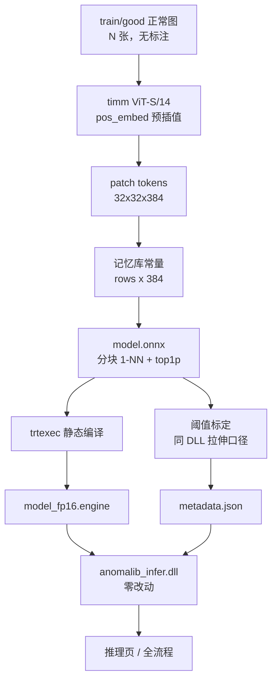

# Design: AnomalyDINO 零标注异常检测接入

## Context

现有链路是「训练 → 导出 ONNX → 编译 TRT → `anomalib_infer.dll` 推理 → 阈值标定」。
AnomalyDINO 的算法形态与 PatchCore 高度同构：

- PatchCore：CNN 特征 → 正常特征记忆库 → 最近邻距离 → 热力图
- AnomalyDINO：DINOv2 patch 特征 → 正常特征记忆库 → 最近邻余弦距离 → 热力图

差别只在「库怎么来」：PatchCore 由 anomalib 的 Lightning 流程产出，AnomalyDINO 由一次
前向产出。所以本次不动 C++、不动 DLL ABI，只在 Python 侧新增一个启动器。

约束（决定了下面所有决策）：

- `anomalib_infer.dll` 二进制不得修改（`bin/`、`include/`、`lib/` 不碰）。
- 使用人员机器可能完全离线，不能依赖 `torch.hub` 拉 GitHub、不能依赖 HuggingFace 拉权重。
- 每个产品一套 ONNX + 一次引擎编译，与 PatchCore 同构，不接受「一个引擎跑所有产品」。
- 推理端只做 `cv::resize` 拉伸到 `inputW×inputH`（`anomalib_infer_c.cpp:367`）再 `/255` +
  ImageNet 均值方差（`anomalib_infer_c.cpp:368-373`），预处理口径由 DLL 单方面决定。

## Goals / Non-Goals

- Goals
  - 只给正常图就能产出一个能判定 OK/NG、能指位置的模型，全程不需要标注。
  - 特征与上游 AnomalyDINO 一致（数值可验证），算法结论可信。
  - 产物（ONNX / metadata / engine）复用现有 DLL 与现有 Web 页面，不新增接口。
  - 完全离线可用：权重随包分发或走 modelzoo。
- Non-Goals
  - 不做 PCA 背景掩码、不做 `--layer` 多层特征融合（v2 再说）。
  - 不做 DINOv3（要求 `timm>=1.0.20`，当前 1.0.14；且实测 DINOv2 更准）。
  - 不支持多图 batch（DLL 是单图入口）。
  - 不改 `anomalib_infer.dll`、不改现有三种模型的导出代码。

## Decisions

### D1：主干用 timm + 官方权重，并把 `pos_embed` 预插值（关键决策）

上游用 `torch.hub.load('facebookresearch/dinov2', 'dinov2_vits14')`。这条路有三个问题：
运行期要访问 GitHub、要有一份 dinov2 仓库代码、hub 缓存路径不可控。

改用 timm：`timm.create_model('vit_small_patch14_dinov2.lvd142m', pretrained=False, num_classes=0, img_size=(448,448))`，
再把官方 `dinov2_vits14_pretrain.pth` 直接 `load_state_dict(strict=False)`。

**实测（本机 dpenv，timm 1.0.14 / torch 2.3.0）**：

| 做法 | 逐 token 余弦 min | 逐元素最大差 |
| --- | --- | --- |
| 直接加载（pos_embed 用 timm 的插值） | 0.9928 | 1.40 |
| 先按 `size=(32,32)` 插值再加载 | 0.9914 | 1.91 |
| 按上游 `scale_factor=((32+0.1)/37)` 插值再加载 | **1.0000** | **0.0** |

差异来源是上游 `DinoVisionTransformer.interpolate_offset = 0.1`：它用
`scale_factor=(w0+0.1)/M` 而不是 `size=(w0,h0)`，两种 bicubic 采样网格不同。
按上游公式预插值后，timm 与 `torch.hub` 输出**逐元素完全相同**。

因此导出流程固定为：

```text
sd = torch.load(official_pth)
pe = sd["pos_embed"]                       # [1, 1+37*37, 384]
M  = int(sqrt(pe.shape[1] - 1))            # 37
sx = (grid_w + 0.1) / M                    # 448/14 = 32 → 32.1/37
patch = interpolate(pe[:,1:], mode="bicubic", antialias=False, scale_factor=(sx, sx))
sd["pos_embed"] = cat([pe[:,:1], patch.reshape(1,-1,384)], dim=1)
model.load_state_dict(sd, strict=False)    # 唯一 unexpected 键是 mask_token（推理不用）
```

`mask_token` 只在 MAE 式预训练里用，推理不需要，可以直接丢弃。

### D2：记忆库固化进 ONNX 常量，而不是旁挂文件

三种可选做法：

| 做法 | 代价 |
| --- | --- |
| 库存成 `.npy`，DLL 读文件后做 kNN | 要改 DLL 与 C ABI，违反约束 |
| 库存成 ONNX 的第二个输入 | 推理端要传两个输入，`ai_infer_rgb` 签名要改 |
| **库固化成常量 buffer** | ONNX 变大（16-shot 约 25 MB），编译变慢；零代码改动 |

选第三个。代价可接受：PatchCore 的 ONNX 本来就有 300 MB。

### D3：分块算相似度，把激活值钉住

若一次算 `[1024, rows]` 相似度，16-shot 时 `rows = 16384`，中间张量 67 MB；
full-shot（225 张）时 `rows = 230400`，会直接爆显存。

改成把库切成 `chunk = 4096` 行（1024×4096×4B ≈ 16.8 MB），逐块算 `max` 再合并。
循环在导出期被展开成固定条数的子图，激活值不随 shots 线性增长。
full-shot 时只是子图条数变多，显存不变。

### D4：分数与热力图的定义照上游

- 距离：`d = 1 - max_j cosine(f_i, b_j)`（上游 `knn_metric="L2_normalized"`、`k=1`，
  faiss 的归一化 L2 / 2 与 `1 - cos` 等价）
- 分数：`mean_top1p(d)` = 全网格距离降序前 1% 的均值（上游 `detection.py:187`）。
  网格固定 32×32=1024，故 `k = int(1024*0.01) = 10` 是常量，`topk` 可导出。

### D5：静态 448×448 输入，不做动态轴

- 448 = 14 × 32，网格正好 32×32，无 padding
- 静态 shape 的好处：`build` 阶段不需要 `--minShapes/--optShapes/--maxShapes`，
  也避免 DLL 动态 `setBindingDimensions` 分支
- 分辨率做成可配（`--resolution`），但必须是 14 的倍数；默认 448

### D6：预处理口径以 DLL 为准，标定必须复刻

DLL 是 `cv::resize` 拉伸（不是等比例缩放），再 `/255` + ImageNet 归一（RGB 顺序）。
上游是「短边缩放到 448 + BICUBIC + 裁到 patch 倍数」。两者对非方形图结果不同。

因此：

- 标定脚本必须用 `interpolate`/`resize` **拉伸**到 `H×W`，与 DLL 完全一致，
  否则阈值与线上判定两张皮
- 文档必须写明这条差异，不冒充复现论文分数

### D7：v1 不做背景掩码

掩码（`compute_background_mask` 的 PCA 阈值 10 + `cv2.dilate` + 一维形态学）只在 VisA
这类背景杂乱的场景收益明显；MVTec 的 bottle 上游默认就是 `masking=False`。
把它搬进图既复杂又难验证，v1 不做，文档与 metadata 都标注 `masking: false`。

### D8：参考实现只在 staging 视图上跑

数据集 `dp-tool/2-python-anomaly/anomalib-main/datasets/bottle` 是标准 MVTec 布局，
但上游 `--dataset MVTec` 写死 15 个对象（`src/utils.py:107`）且不检查存在性，
另外多出的 `test/abnormal`（44 个文件，TRTForge 自攒的标定集）会被当成第 4 种缺陷，
`--eval_segm` 因缺 `ground_truth/abnormal` 直接抛异常（`src/post_eval.py:330`）。

做法：在 `launcher/results/_staging/bottle` 下用 **junction** 只挂 `train` / `test` /
`ground_truth`，对视图跑参考实现。原始数据集目录一个字节都不改，`test/abnormal`
只给我们的标定用。

### D9：元数据契约

```json
{
  "model_type": "AnomalyDINO",
  "output_contract": "trtforge_anomalydino_v1",
  "normalization": "imagenet",
  "input_size": [448, 448],
  "image_threshold": 0.42,
  "pixel_threshold": 0.36,
  "pred_scores": {"min": 0.05, "max": 0.71},
  "anomaly_maps": {"min": 0.02, "max": 0.68},
  "pred_scores.min": 0.05, "pred_scores.max": 0.71,
  "anomaly_maps.min": 0.02, "anomaly_maps.max": 0.68,
  "backbone": "vit_small_patch14_dinov2",
  "patch_size": 14, "grid": [32, 32], "shots": 16, "bank_rows": 16384,
  "bank_sha256": "...", "masking": false, "seed": 0
}
```

必须同时写点号平铺键与嵌套对象：DLL 两种都认（`anomalib_infer_c.cpp:598-605`），
但 `6-web` 侧的 `bundle.py` 只透传嵌套块。

### D10：输出名必须让 DLL 的启发式选对

DLL 的选择逻辑（`anomalib_infer_c.cpp:453-472`）不是纯粹的「按名字」：

1. 名字含 `score` → 记为 score
2. 名字含 `anomaly_map`，或含 `map` 且不含 `mask` → 记为 map
3. **无条件地**：元素数比当前 map 大的输出都会取代它
4. 元素数 == 1 且名字不含 `label` 的输出，在还没有 score 时补位成 score
5. 最后若 score 与 map 是同一个张量，score 置空（改用 map 最大值）

推论：**只能导出两个张量**，且 map 必须比 score 大（32×32=1024 对 1，满足）。
若将来多导出一个全分辨率 mask，第 3 条会让 mask 顶替 anomaly_map，热力图全错。
这条要写进 spec 与测试。

### D11：Web 侧只加分支

- `train.py`：`AnomalibTrainRequest` 增 `shots` / `resolution` / `rotation` / `seed`，
  新增 `build_anomalydino_command`；`/api/train/anomalib` 内按 `model` 分派 launcher
- `pipeline.py`：白名单扩成 `("patchcore","padim","efficientad","anomalydino")`，
  新增一条 `elif` 分支；旧的三个值走原路径一行不改
- 推理页：`index.html` 的 `anomModelType` 加一项，`infer.js` 的 `normalizeModelType` 加映射
  （不加的话选过 PatchCore 再选 AnomalyDINO，下拉不会重置）
- 回归门：三个旧模型的命令行字符串快照逐字符比对

## 目标链路



## Risks / Trade-offs

| 风险 | 缓解 |
| --- | --- |
| FP16 引擎下余弦距离精度不足，近邻排名翻转 | P0 必测 TRT-FP16 与 ONNX 的热力图逐像素相关 ≥ 0.99；不达标则对 `MatMul` 加 `--precisionConstraints=prefer --layerPrecisions` 保 FP32 |
| `pos_embed` 公式依赖 `grid_w`，改分辨率时忘改 | 抽成 `anomalydino_core.build_pos_embed()` 纯函数，单测覆盖 448/518/336 三种网格 |
| 库常量让 ONNX 变大、编译变慢 | 16-shot 约 25 MB，与 PatchCore 的 300 MB 相比可忽略；页面上显示预计耗时 |
| 拉伸预处理与论文口径不同导致指标偏低 | 标定与推理同口径，指标自洽；文档写明差异 |
| 用户只给 1~2 张正常图时库太小 | 强制下限（建议 ≥ 8 张）并在不足时给出明确提示，不静默降到 1 张 |
| timm 装在用户级 site-packages（本机实测即如此） | 打包检查改成「用目标解释器 import timm」，而不是只看 site-packages 目录 |

## Migration Plan

1. 新启动器是独立文件，Web 侧只加分支 → 逐批单独提交，任一提交可单独 revert
2. 旧模型产物与引擎完全不动，无需迁移
3. 若 P0 数值不达标 → 只保留 `onnx_infer.dll` 兜底路线（任意 ONNX 都能跑），
   不编译 TRT 引擎，功能仍可用但慢

## 实测结果（P0，本机 NVIDIA T1000 8GB / torch 2.3.0 / timm 1.0.14 / TRT 8.5）

| 项目 | 结论 |
| --- | --- |
| 主干与上游一致性（448×448） | 逐 token 余弦 min 0.9999998、mean 1.0；逐元素最大差 4.5e-4（float32 累加顺序差） |
| 建库耗时（16 张） | 1.40 s |
| 记忆库规模 | 16384 行 × 384 维 = 25.2 MB |
| ONNX 大小 | 113.0 MB（主干 88 MB + 库 25 MB） |
| ONNX vs PyTorch（8 张测试图） | 热力图 Pearson min 0.99999999992；最大绝对差 2.9e-6；分数最大差 8.0e-7 |
| FP16 引擎 vs ONNX（经真实 DLL） | 分数最大差 8.7e-4；热力图最大差 1e-4；8/8 张判定一致 |
| TRT FP16 引擎 GPU 计算时间 | 中位数 56.3 ms（批 1） |
| PyTorch 端到端单张 | 66.3 ms |
| 显存峰值（建库 + 导出） | 317.6 MB |
| 端到端 build-export | 21 s（16 张建库 + 导出 + 80 张标定） |
| bottle 精度（16-shot，TRT FP16） | broken_large AUROC 1.0000 / broken_small 1.0000 / contamination 0.9976；合计 F1 0.992，漏检 1.6%，误报 0% |
| 像素诊断 | 好图乱指率 0.024%，异常图定位面积 3%~9%，「指不出位置」0 张 |

### 新增风险（P0 发现）

- **必须用 opset 16 导出**。opset 17 会把 `F.layer_norm` 导成 `LayerNormalization` 单算子，
  TRT 8.5 没有原生实现，解析时报 `Plugin not found` 直接失败。opset 16 下拆成
  ReduceMean/Sub/Mul/Div/Sqrt，全支持。这条已写进启动器注释与 spec。
- **导出必须在 CPU 上做**。dummy 输入在 CPU 而权重在 CUDA 会直接 device 不匹配；
  用 `copy.deepcopy(...).to("cpu")` 一份专门用于导出，不要把在跑的主干搬走。
- **`cv2.imread` 读不了中文路径**。必须 `np.fromfile + cv2.imdecode`。

## Open Questions

- 默认 shots 取多少？（建议 16，上游 few-shot 常用值；full-shot 让用户显式选并提示耗时）
- 是否需要一个「只重建库、不重编引擎」的快捷路径？（ONNX 里库是常量，改库必然重导重编，
  做不到；若将来要支持，必须改成两输入，属于 ABI 变更）
