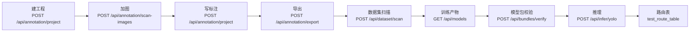

# Design: 标注页纯逻辑抽模块与全链路自检

## Context

`annotate.js` 的 31 个自然段落（按文件里的 `// ----` 注释实测）大致分三类：

| 类别 | 段落 | 是否可抽 |
| --- | --- | --- |
| 纯计算 | 草稿置信度分档、历史双栈、命中测试与几何、吸附、导入预览计划 | 可抽，且应当抽 |
| 依赖 DOM | 渲染列表与面板、类别管理、工具与选项、导航缩略图、快捷键 | 不可抽（闭包 200+ 节点） |
| 依赖后端 | 读写工程、草稿落盘、提示式预标注、模型仓库、批量预标注 | 不可抽（`fetch` + 页面状态） |

先抽第一类，收益明确、风险可控。

## Goals / Non-Goals

- Goals：
  1. 纯计算能被单测覆盖，改阈值/改几何有护栏；
  2. `annotate.js` 行数下降约 1/3，同一屏内能看到一个完整职责；
  3. 有一条能在 CI 跑的全链路自检，不再只靠人点。
- Non-Goals：
  1. 不把 DOM 代码搬出去（需要先重做状态容器，独立提案）；
  2. 不改 `index.html`、不改 CSS、不改后端接口；
  3. 不引入构建工具、不引入任何 npm 依赖；
  4. 不重写既有交互逻辑（只搬不改）。

## Decisions

### 决策 1：JS 模块只导出纯函数，不持有状态

```js
// annotate/tiers.js
export const TIER_HIGH = 0.7;
export const TIER_MID = 0.4;
export function tierOf(confidence, { high = TIER_HIGH, mid = TIER_MID } = {}) { ... }
export function tierColor(tier) { ... }
export function countByTier(drafts) { ... }
```

理由：只要有闭包状态，就还是没法单测。模块内**不允许**出现 `document`、`state`、`fetch`。

`annotate.js` 侧用法：

```js
import { tierOf, tierColor, countByTier } from "./annotate/tiers.js";
```

零构建 ES Module，浏览器原生支持，与现有 `js/api.js`、`js/viewer.js` 的引入方式一致。

### 决策 2：历史栈改成「接受快照、返回结果」而不是「操作外部数组」

现状是直接 push/pop 外部数组，抽出来后签名改为：

```js
export function pushSnapshot(stack, snapshot, limit) -> {undo: [], redo: [], dropped: n}
export function undo(undoStack, redoStack, current) -> {snapshot, undo, redo, ok}
```

`annotate.js` 保留自己的 `let undoStack = []`，只是每次赋值返回值。
这样单测可以纯函数式验证「超出深度丢最旧」「undo 后 redo 栈增长」「空栈 undo 返回 ok:false」。

### 决策 3：几何模块统一坐标系契约

沿用文件头部已写死的约定（`p_screen = p_image * scale + offset`），
把 `viewer.js` 的纯函数直接复用，不重写：

```js
import { imageToScreen, screenToImage } from "../viewer.js";
```

`annotate/geometry.js` 只做「对象命中」「吸附」「包围盒与顶点」三件事，
输入输出都用图像坐标 + 一个变换对象，避免两套坐标在模块间来回换。

### 决策 4：导入预览抽成「计划对象」

现状是「预览按钮 → 扫描 → 立刻改页面状态」，中间没有可测的产物。
改成：

```js
export function planImport(scanResult, classMapping, options) -> {
  images: [{path, boxes, skipped}],
  summary: {imageCount, boxCount, skippedCount, reasons: []},
  blocking: []
}
```

`annotate.js` 负责把 `plan` 渲染成预览表，用户点确认才写入。
好处：单测能覆盖「类别对不上时计入 skipped 而不是报错」「空计划时 blocking 非空」。

### 决策 5：全链路自检用进程内 ASGI，不启动真实服务

用 `httpx.ASGITransport(app=app)` 直接调接口，不起 uvicorn、不占端口：

```python
transport = httpx.ASGITransport(app=app.app)
async with httpx.AsyncClient(transport=transport, base_url="http://test") as c:
    ...
```

渲染图片与推理用假引擎桩（现有 `test_infer_pool.py` / `test_infer_worker.py` 已有做法），
保证 CI 不碰 GPU。链路：



任何一步失败都打印该步的响应体，便于定位。

### 决策 6：浏览器 e2e 是可选脚本，不进主 CI

`tools/e2e_browser.py` 用 Playwright，需要 `npx playwright install chromium`（约 150 MB）。
主 CI 只有 Windows + Python + Node，不想因为一次 UI 改动就下载浏览器。

因此：脚本存在、文档写明怎么跑，`.github/workflows/tests.yml` 不调用它。
发版前手工跑一次，结果贴进发布说明。

## 实测偏差（2026-11-13 落地后补记）

设计时留了余量，实际落地有 6 处与初稿不同，已按实况改掉，不留「设计说 A、代码做 B」：

| 项 | 初稿 | 实际 | 原因 |
| --- | --- | --- | --- |
| 单测数量 | 未定量 | `tiers` 33、`history` 40、`geometry` 76、`importplan` 53，合计 202 | 边界用例写全后自然长出来 |
| `constrainOrthogonal` 入参 | 只认 `[x, y]` | 同时认 `{x, y}` 与 `[x, y]` | Shift 拖拽传的是 `toImage()` 的 `{x, y}`，只认数组会算出 `NaN` |
| `tierOf` 空值 | 按数值比较 | `null` / `""` 单独返回 `unknown` | `Number(null) === 0` 会落进低置信档，误报「置信度不足」 |
| `planImport` 产出 | 待写图片与框列表 | 图片数、分档计数、单例计数、阻塞原因 | 框由 `importAnnotateZip` 落地，计划层只回答「能不能导、导多少」 |
| 浏览器 e2e | 走完建工程→加图→标注→导出→推理 | 自启服务 + 4 个检查点（无脚本报错 / 三栏渲染 / 控件齐全 / 页签切换）+ 截图 | 画布坐标断言在无头环境脆弱；业务链路由 `test_full_chain.py` 的 8 步覆盖，职责不重叠 |
| CI 收录 | 未明 | 只把 4 个 `.mjs` 单测与 `node --check` 加进 `tests.yml`，Playwright 脚本不入 CI | 公开 CI 装浏览器下载体积大、易超时，发版前人工跑 |

## Risks / Trade-offs

| 风险 | 缓解 |
| --- | --- |
| 抽模块时漏改一处引用，运行期 `undefined is not a function` | `test_annotate_wiring.py` 会检查 DOM id 与函数接线；再加一条「annotate.js 里不再出现被抽走的函数名定义」的静态检查 |
| 循环 import（`annotate.js` ↔ `annotate/geometry.js`） | geometry 只 import `viewer.js`，不 import `annotate.js`；用一条 `node --check` + import 冒烟脚本守护 |
| 单测覆盖不到真实 DOM，抽完仍然点坏 | 保留 `test_annotate_wiring.py`（81 项），它检查 id 接线与结构顺序 |
| 全链路自检变成「又一个大脚本」 | 强制每步用独立函数、失败时打印响应体、`--step` 参数可只跑某一步 |
| 假引擎桩与真实推理差异导致自检通过但真机坏 | 自检只验证「链路与契约」，真实精度由 `val_engine.py` 负责，两者职责分开写进文档 |

## Migration Plan

1. 先抽 `tiers.js`（最小、纯常量）→ 单测 → 全绿；
2. 抽 `history.js` → 单测；
3. 抽 `geometry.js`（最大，先只搬命中测试，再搬吸附与顶点）；
4. 抽 `importplan.js`；
5. 加 `test_full_chain.py`；
6. 最后统一跑 `test_annotate_wiring.py` + 全部 `.mjs` + `node --check`。

回滚：每个模块独立提交，`git revert` 单个模块即可；`annotate.js` 的 import
行删掉、把函数体放回来就能复原。

## Open Questions

1. 是否保留一份 `annotate.js.bak` 作对照？倾向：不留，git 历史足够，
   工作区多一份副本容易被误改。
2. 渲染函数是否值得拆成 `annotate/render.js`（仍是 DOM、只是换文件）？
   倾向：本批不做。单纯换文件对可测性没有收益，反而增加 import 噪声。
