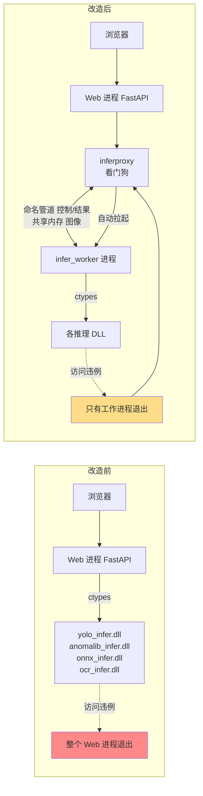
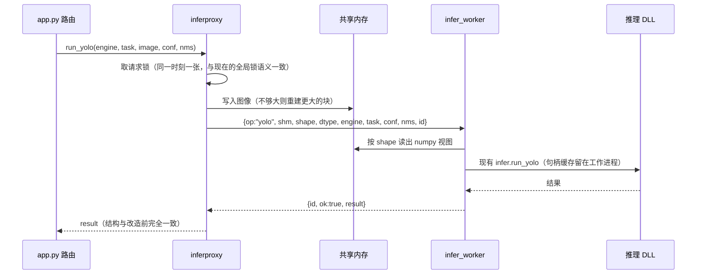
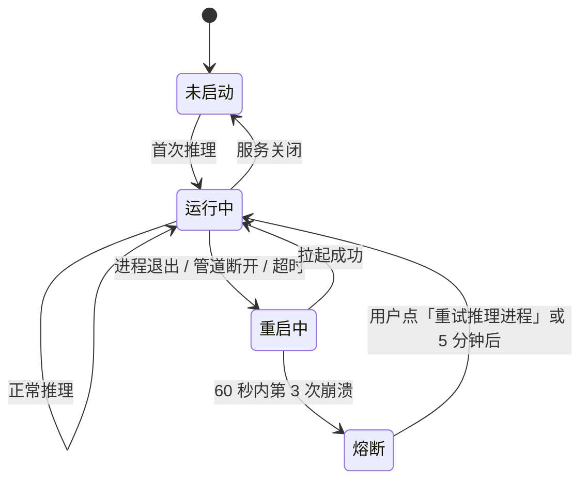

# 设计：推理动态库移到独立工作进程

## 1. 改造前后



## 2. 一次推理的时序



## 3. 关键决策

| 问题 | 选择 | 理由 |
|------|------|------|
| 进程间通道 | `multiprocessing.connection.Listener/Client`，Windows 命名管道 + 随机 `authkey` | 标准库，自带消息分帧；`authkey` 防止本机其他程序冒充工作进程 |
| 结果序列化 | 连接自带的 pickle | 结果里有热力图 PNG 字节与 numpy 数组，JSON 要额外编码；通道两端都是自己的进程，authkey 认证后才收发 |
| 图像传输 | `multiprocessing.shared_memory`，按需扩容，复用同一块 | 4K 图约 25 MB，走管道要多复制两次 |
| 进程启动方式 | `subprocess.Popen`：开发态 `python infer_worker.py`，冻结态 `TRTForgeWeb.exe --infer-worker` | 不依赖 `multiprocessing` 的 spawn 机制，Nuitka 冻结下更可控 |
| 启动时机 | 服务启动时拉起（替代原来启动时在 Web 进程里 `infer.load_libraries()`）；之后常驻 | 路由层选后端要先知道哪些 DLL 能用，`/api/capabilities` 也要立刻反映真实状态；OCR 仍在工作进程内首次使用时才加载 |
| 熔断后的行为 | 把各 DLL 状态报告为不可用 | 路由层原有「DLL 不可用 → onnxruntime 降级」逻辑自动接管；找不到 ONNX 才 503 |
| 工作进程侧图像 | 直接引用共享内存，不再复制 | 实测 4K 少一次 25MB 复制，额外开销从 7.5 ms 降到 1.7 ms；Web 侧持请求锁直到收到回复，期间不会改写 |
| 并发 | 一个工作进程、一个请求锁 | 与现有 `_yolo_lock` / `_anom_lock` 行为一致，不引入新的并发问题 |
| 退出 | Web 关闭时发 `shutdown`，3 秒未退则 `terminate` | 保证 DLL 句柄正常释放 |

## 4. 故障处理



| 情况 | 当前请求 | 后续 |
|------|----------|------|
| 工作进程崩溃 | 503，信息含模型路径、图片名、退出码（如 `0xC0000005` 访问违例） | 自动重启；崩溃记录写 `runtime/logs/infer_worker.log` |
| 超时（默认 60 s，OCR 首次加载 180 s，`TRTFORGE_INFER_TIMEOUT` 可调） | 504 | 强制结束并重启 |
| 熔断 | 503「推理进程反复崩溃，已暂停」 | `/api/capabilities` 标记 `infer_worker: "tripped"`；推理页顶部提示并提供重试按钮 |
| DLL 业务错误（参数不对、模型不兼容） | 与现在一样 400/500，原文透传 | 进程不重启 |

重启后句柄缓存清空，下一次推理会重新加载引擎，耗时与冷启动相同，接口返回里照常带耗时。

## 5. 对现有代码的改动面

| 文件 | 改动 |
|------|------|
| `infer.py`、`ocr_infer.py`、`onnx_fallback.py` | **不改**，原样在工作进程里加载 |
| 新增 `inferproxy.py` | 同名函数代理；看门狗；共享内存管理；开关 `TRTFORGE_INFER_ISOLATION=0` 时直接转调原模块 |
| 新增 `infer_worker.py` | 循环收消息 → 调原模块 → 回结果；捕获 Python 异常原样回传 |
| `app.py` | `infer.` / `ocr_infer.` 的调用点改为 `inferproxy.`（约 5 处）；`/api/infer/cache`、关闭钩子同步改 |
| `autolabel.py` | `infer.run_yolo` → `inferproxy.run_yolo` |
| `frozen_entry.py` | 识别 `--infer-worker` 参数时进入工作进程主循环 |
| `tools/*` | **不改** |

## 6. 验证计划

1. 结果一致：同一组图片分别用开关 `0` 与 `1` 推理 YOLO detect/segment、Anomalib、OCR，框坐标、分数、热力图字节完全一致。
2. 崩溃恢复：测试专用操作 `op:"crash"`（仅在 `TRTFORGE_TEST_HOOKS=1` 时可用）让工作进程调用 `os.abort()`，断言请求返回 503、下一次推理成功、Web 进程未退出。
3. 熔断：连续触发 3 次崩溃，断言第 4 次直接 503 且不再拉起进程。
4. 超时：测试操作 `op:"sleep"` 超过超时，断言 504 且进程被重启。
5. 性能：1080p、4K 各 100 次推理，记录改造前后平均耗时差，写入本节。
6. 浏览器实测：推理页单图、摄像头、OCR、标注页自动标注全部正常；打包版 `TRTForgeWeb.exe` 同样验证。

### 实测记录（2026-11-06，`tools/test_infer_worker.py --bench`，24 项全部通过）

| 项 | 结果 |
|----|------|
| 模拟崩溃（`os.abort()`） | 请求 503，信息带退出码 `0xC0000409`；约 2 秒后新进程就绪，下一次推理成功 |
| 连崩 3 次 | 熔断，DLL 状态全部为不可用；手动重启后恢复 |
| 超时（1 秒上限 + 睡 5 秒） | 504，进程被结束并重启 |
| YOLO 一致性（FP16 引擎、ONNX，各 5 张 15 框） | 排序后完全相同。注意：GPU NMS 输出顺序本身不固定，同一模式连跑两次顺序也会变，与隔离无关 |
| Anomalib 一致性（PatchCore FP16，3 张） | 分数、判定、热力图/轮廓/叠加图字节完全相同 |
| OCR 一致性（PP-OCRv4，登机牌示例） | 75 行文字与多边形完全相同；Web 进程始终未加载 OCR DLL |
| 耗时 1920×1080（100 次中位数） | 隔离 8.97 ms，直通 8.41 ms，**多 0.56 ms** |
| 耗时 3840×2160（100 次中位数） | 隔离 12.66 ms，直通 10.98 ms，**多 1.68 ms** |

## 7. 版本差异

```yaml
version_diff:
  from: 1.27.0
  to: 1.28.0
  changed:
    - 单图推理、摄像头单帧、OCR、YOLO 自动标注改在独立工作进程中调用动态库
    - 推理动态库崩溃时返回 503 并自动重启工作进程，Web 服务不再退出
  added:
    - 推理超时 504、崩溃熔断与重试
    - /api/capabilities 增加 infer_worker 状态
  unchanged:
    - 所有推理接口的请求与返回结构
    - 目录批量、视频推理、引擎验证（本来就是子进程）
    - 所有 DLL 与 C API
  new_env:
    TRTFORGE_INFER_ISOLATION: 1
    TRTFORGE_INFER_TIMEOUT: 60
```
