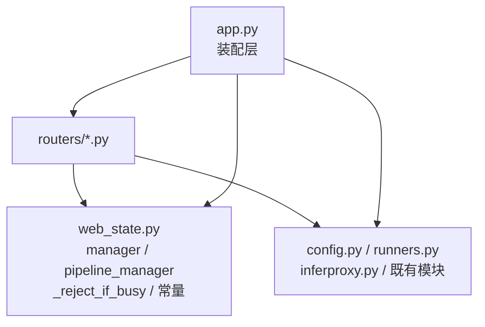

# Design: 后端路由拆分

## Context

`app.py` 内部结构（按行号实测）：

| 行段 | 内容 | 域 |
| --- | --- | --- |
| 1–110 | 模块 docstring、import、常量、`_describe_run` | 公共 |
| 111–265 | `_reject_if_busy`、`configure_warm_pool`、`lifespan` | 公共 |
| 266–416 | 异常处理器、warm、health、capabilities | system |
| 417–1150 | 训练命令拼装、预检、训练、导出、checkpoint、check-env | train |
| 1151–1510 | ONNX 探测、工作点、引擎构建 | engine |
| 1510–2340 | YOLO 与异常检测流水线、流水线查询 | pipeline |
| 2340–2433 | 数据集扫描、体检、导出、指纹 | dataset |
| 2433–2900 | 任务列表、日志、WebSocket、浏览目录、原生对话框 | runs + system |
| 2900–3340 | 推理、OCR、批量、视频、帧、结果文件 | infer |
| 3340–4500 | 标注工程、草稿、导入导出、自动标注、提示标注、模型仓库 | annotation + models |
| 4499–4532 | 静态挂载、include_router | 装配 |

关键约束：路由函数**大量引用模块级函数与全局对象**（`manager`、`pipeline_manager`、
`config.*`、`runners.*`）。直接搬函数到新模块会产生 cross-import。

## Goals / Non-Goals

- Goals：
  1. URL 与响应契约零变化；
  2. `app.py` 降到 400 行以内，成为纯装配层；
  3. 每个域的改动集中在一个文件里；
  4. 打包后行为一致。
- Non-Goals：
  1. 不重写任何业务逻辑，不顺手修 bug（bug 单独提）；
  2. 不引入新的 Web 框架或依赖注入容器；
  3. 不拆 `infer.py` / `inferproxy.py` / `runners.py` 这些已有模块的内部结构；
  4. 不改前端。

## Decisions

### 决策 1：共享状态放 `web_state.py`，路由模块只单向 import



`web_state.py` **不 import 任何 routers**，保证无循环。
`app.py` import `web_state` 与 `routers`，负责 `include_router`。

### 决策 2：前缀用 `APIRouter(prefix="/api/train")` 而不是在装饰器里重复写

好处：搬函数时装饰器只写 `@router.post("/yolo")`，
前缀写错的概率从「每条」降到「每模块一次」，而模块级前缀会被路由快照测试一次抓住。

例外：`runs.py` 同时含 `/api/runs/*` 与 `/ws/runs/{run_id}`，
WebSocket 用独立 router 实例（`ws_router`，无 prefix），在 `runs.py` 内一并导出。

### 决策 3：路由快照测试是硬门槛

`tools/route_table.py`（生成）与 `tools/route_table.json`（快照）：

```python
# 快照结构：稳定排序的 "METHOD /path" 列表，排除 /docs /openapi.json /redoc
["GET /", "GET /api/capabilities", "POST /api/train/yolo", ...]
```

测试逻辑：

1. `import app`（不启动服务）；
2. 遍历 `app.routes`，收集 `METHOD /path`，排除文档类与 `static` 挂载；
3. 与 JSON 逐条比对，输出**缺失**、**新增**、**顺序无意义但集合必须相等**。

允许显式重建快照：`python tools/test_route_table.py --update`，
但重建必须在提交里单独出现，评审能看到「路由集合真的变了」。

### 决策 4：分四步搬，每步都能单独编译与提交

| 步骤 | 内容 | 验收 |
| --- | --- | --- |
| A | 新增 `web_state.py`，`app.py` 改为从它引用；路由仍留在 app.py | 全量测试绿 + 路由快照不变 |
| B | 搬 system / engine / dataset / models 四个小域（27 条） | 同上 |
| C | 搬 train / runs / pipeline（20 条） | 同上 |
| D | 搬 infer / annotation（28 条），`app.py` 收拾成装配层 | 同上 + 打包验证 |

每一步都跑一遍 `run_all_tests.py` 与 `test_route_table.py`。
任何一步失败就停在那一步，不做「先全部搬完再一起调」。

### 决策 5：打包清单必须同步，否则只在安装包里炸

Nuitka 用 `--include-module=...` 显式列出后端模块（见
`packaging/package_web_user.ps1` 第 237 行起的 `$serverArgs`）。
新增 `routers` 包后必须补：

```powershell
"--include-package=routers",
```

比逐个列出子模块可靠（新增 router 文件不会再漏）。
这条写进 tasks.md，且验收要求「出一份测试包，双击能打开推理页」。

## Risks / Trade-offs

| 风险 | 缓解 |
| --- | --- |
| 搬函数时漏掉一个模块级辅助函数，运行期才 `NameError` | 路由快照测试抓不到 NameError；额外要求「每个 router 模块在 import 时就能构造成功」，用 `tools/test_route_table.py` 顺带覆盖（它必须 import app，等于 import 全部 router） |
| 循环 import 导致启动失败 | `web_state.py` 只依赖 `config` / `runners` / `pipeline` / `inferproxy`，不依赖 routers；用一条 import 顺序测试守护 |
| Nuitka 漏打 `routers` 包 | `--include-package=routers` + 出包后真机双击验证 |
| 顺带改逻辑导致行为变化 | 明确 Non-Goal：只搬不改；评审按「纯移动」模式看 diff |
| 40 个测试脚本里有的直接 patch `app.xxx` | 搬之前先 `rg "app\.(manager|pipeline_manager|_START_LOCK)" tools/` 列清单，逐个改成 patch `web_state`，或在 `web_state` 里保留同名转发 |

## Migration Plan

1. 先加 `web_state.py` 与路由快照测试，此时 `app.py` 只改 import 来源；
2. 按 A→B→C→D 四步搬，每步单独提交；
3. 最后清理 `app.py` 中的死 import，并核对打包清单；
4. 出一次内部测试包，验证安装形态下路由全通。

回滚：每步是独立提交，`git revert` 单个提交即可回到上一步。

## Open Questions

1. `routers/` 目录要不要按 `api/v1/` 分层？倾向：不。当前没有版本化需求，
   多一层只是多一个 prefix。
2. `schemas.py` 是否同步抽出 27 个 Pydantic 模型？倾向：本批只搬路由，
   schema 与路由同域搬（哪个域用得多就放哪个 router 文件顶部），
   避免出现一个 500 行的 `schemas.py` 只是把耦合换个位置。
