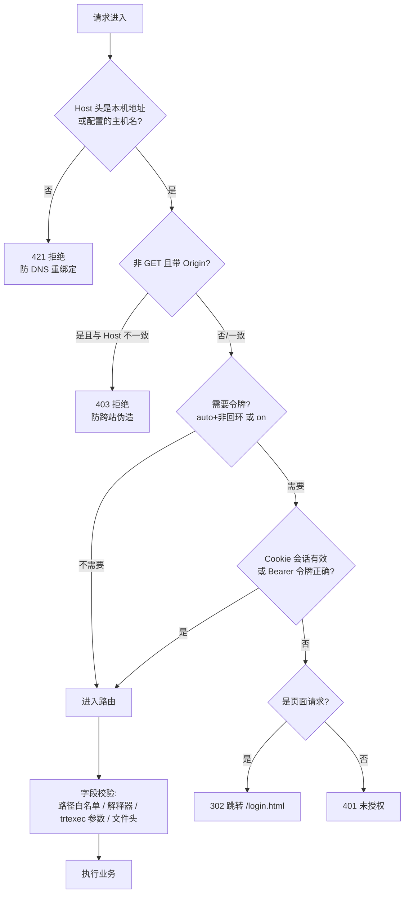
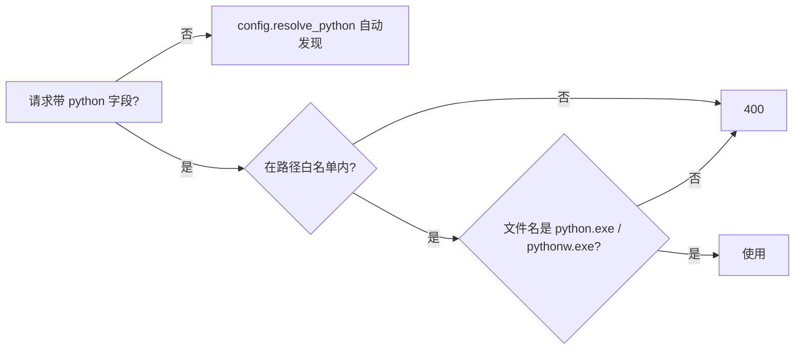

# 设计：Web Studio 安全加固

## 1. 目标与约束

| 目标 | 约束 |
|------|------|
| 开放局域网时，没有令牌的人什么都做不了 | 本机默认使用不增加任何步骤 |
| 网页不能让服务器运行任意程序、读写白名单外的文件 | 前端仍然零构建，不引第三方库 |
| 今后新增接口不会忘记做路径校验 | 不改任何 DLL、不改 Qt 程序 |

## 2. 请求处理流程



放行清单：`/login.html`、`/api/auth/login`、`/api/health`（只返回版本，不含路径）以及登录页用到的静态样式。

## 3. 令牌与会话

| 项 | 做法 | 理由 |
|----|------|------|
| 令牌来源 | `TRTFORGE_WEB_TOKEN`；否则首次启动用 `secrets.token_urlsafe(24)` 生成，写 `runtime/web_token.txt` | 现场人员能从文件里找到，不用记命令 |
| 比较 | `hmac.compare_digest` | 防计时攻击 |
| 会话 | 登录成功后生成随机会话 ID，存内存字典（有效期默认 7 天，`TRTFORGE_SESSION_HOURS` 可调）；Cookie `trtforge_session`，`HttpOnly`、`SameSite=Strict`、`Path=/` | Cookie 让 ``、下载链接、WebSocket 自动带凭据，前端不用改 URL |
| 服务重启 | 会话清空，需重新输入令牌 | 简单可靠；令牌本身不变 |
| 登录失败 | 同一 IP 连续 10 次失败锁 5 分钟 | 防暴力猜测 |
| 退出 | `POST /api/auth/logout` 删除会话 | |
| WebSocket | 握手时检查同一 Cookie，不通过则关闭码 4401 | 浏览器 WebSocket 不能自定义请求头 |

已核对前端请求入口：HTTP 请求只在 `api.js` 的 `request()` 一处调用 `fetch`；不经过它的同源访问有标注图片（`annotate.js` `bitmap.src`）、视频结果播放（`inferbatch.js` `player.src`）、批量结果下载（`inferbatch.js` 两处 `link.href`）、日志新窗口（`logs.js` `window.open`）和 WebSocket（`ws.js`），全部是同源 URL，Cookie 方案都能覆盖。前端没有 `EventSource`。

前端改动只有两处：
- `api.js`：收到 401 时跳转 `/login.html?next=当前地址`。
- `ws.js`：关闭码 4401 时同样跳转，不再无限重连。

## 4. trtexec 额外参数白名单

规则：按参数名匹配（`--name` 或 `--name=value`），名字不在白名单直接拒绝；值里出现路径分隔符的参数一律拒绝。

| 放行 | 用途 |
|------|------|
| `--memPoolSize` | 工作区/内存池大小 |
| `--builderOptimizationLevel` | 构建优化等级 |
| `--maxAuxStreams` | 辅助流数量 |
| `--tacticSources` | tactic 来源 |
| `--noTF32` | 关闭 TF32 |
| `--sparsity` | 稀疏化 |
| `--precisionConstraints`、`--layerPrecisions` | 层精度约束 |
| `--inputIOFormats`、`--outputIOFormats` | 输入输出格式 |
| `--avgTiming`、`--minTiming`、`--avgRuns`、`--iterations`、`--warmUp`、`--duration` | 测时参数 |
| `--useCudaGraph`、`--noDataTransfers`、`--skipInference` | 测时行为 |
| `--verbose`、`--profilingVerbosity` | 日志 |

| 拒绝（举例） | 原因 |
|--------------|------|
| `--plugins`、`--staticPlugins`、`--dynamicPlugins` | 加载外部 DLL |
| `--saveEngine`、`--loadEngine`、`--onnx`、`--timingCacheFile` | 读写任意文件；这些由页面字段控制 |
| `--exportTimes`、`--exportOutput`、`--exportProfile`、`--exportLayerInfo`、`--loadInputs` | 读写任意文件 |
| `--int8`、`--best`、`--calib` | 没有校准流程时产出的 INT8 引擎精度不可信；INT8 走后续 P1-7 提案 |
| `--fp16`、`--minShapes` 等 | 已有页面字段，重复给会冲突 |

最终放行清单以实现时核对 TensorRT 8.5 `trtexec --help` 为准。现有文档里 Web 端只在输入框占位提示里出现过 `--verbose`（已放行）；Qt 操作手册提到的 `--workspace=8192` 在 Web 端由「工作区」字段控制，额外参数里给出时提示改用该字段。被拒时错误信息列出允许的参数名。

## 5. 解释器校验



`TRTFORGE_PYTHON` 与 `config.json` 里写的解释器视为管理员配置，自动加入白名单，不受文件名之外的限制。

## 6. 路径白名单全覆盖

- 把所有接收路径的字段改成经过 `_ensure_allowed_path`（读）或「父目录在白名单内」（写新文件）。
- 已盘点出的未校验字段（2026-11-06 逐路由核对 `app.py`）：

| 路由 | 未校验字段 | 读/写 |
|------|-----------|-------|
| `POST /api/train/yolo` | `data`、`model`（非微调时）、`project`、`name` | 读 / 写 |
| `POST /api/train/anomalib` | `root`、`normal_dir`、`abnormal_dir`、`normal_test_dir`、`imagenet_dir`、`calib_normal_dir`、`calib_abnormal_dir`、`project`、`name` | 读 / 写 |
| `POST /api/train/{kind}/check-env`、训练/导出/串联的 `python` | `python` | 执行 |
| `GET /api/engine/probe` | `onnx` | 读 |
| `POST /api/engine/build` | `onnx`、`engine` | 读 / 写 |
| `POST /api/pipeline/yolo` | `model`、`project`、`name`、`python` | 读 / 写 |
| `POST /api/pipeline/anomalib` | `root`、`artifacts_dir`、`val_*`、`imagenet_dir`、`calib_*`、`project`、`normal_dir` 等全部路径 | 读 / 写 |
| `POST /api/infer/yolo`、`POST /api/infer/frame` | `engine`、`labels` | 读 |
| `POST /api/infer/anomalib` | `engine`、`metadata` | 读 |
| `POST /api/annotation/export` | `source`（仅用于防呆比较） | 读 |

- 已校验、不用改：数据集扫描/导出、标注全部接口、批量与视频推理、OCR 模型目录、导出 `weights`、续训、检查点、增强预览。
- `GET /api/browse` 与 `GET /api/runs/checkpoints` 的 `project` 直接调 `config.is_path_allowed`，结果等价，统一改成 `_ensure_allowed_path` 只为错误信息一致。
- `GET /api/infer/artifact` 限定在 `runtime/infer` 目录内（`inferjobs.resolve_artifact`），比白名单更严，保持不变。
- 写入类字段（`project`、`name`、`engine`）校验「父目录在白名单内」，`name` 另外禁止出现 `..` 和路径分隔符。
- **防遗漏测试** `test_path_guard.py`：遍历 FastAPI 的全部路由与请求模型，字段名命中 `path|dir|root|data|engine|onnx|model|labels|weights|source|output|project|python` 的，逐个用白名单外路径（如 `C:\Windows\win.ini`）调用，断言返回 400/403。新增接口忘记校验时测试直接失败。确需例外的字段在测试里显式登记并写明原因。

## 7. 上传文件头

只认以下文件头，与扩展名都要对得上：

| 格式 | 文件头 |
|------|--------|
| JPEG | `FF D8 FF` |
| PNG | `89 50 4E 47 0D 0A 1A 0A` |
| BMP | `42 4D` |
| TIFF | `49 49 2A 00` / `4D 4D 00 2A` |
| WebP | `RIFF....WEBP` |

摄像头单帧接口（浏览器 canvas 导出的 JPEG/PNG）同样校验。

## 8. 风险与回退

| 风险 | 应对 |
|------|------|
| 现场忘记令牌 | 令牌在 `runtime/web_token.txt`；删掉该文件重启会重新生成 |
| 合法 trtexec 参数被误拒 | 错误信息列出允许清单；白名单集中在一个常量里，补充只改一处 |
| 反向代理改写 Host | `TRTFORGE_ALLOWED_HOSTS` 追加主机名 |
| 紧急回退 | `TRTFORGE_AUTH=off` 关闭令牌（启动告警）；路径、解释器、参数校验不提供关闭开关 |

## 9. 版本差异

```yaml
version_diff:
  from: 1.28.0
  to: 1.29.0
  added:
    - 访问令牌与会话 Cookie（TRTFORGE_AUTH=auto|on|off，默认 auto）
    - 登录页 /login.html，接口 POST /api/auth/login、POST /api/auth/logout
    - Host / Origin 来源校验
    - 上传文件头校验
  changed:
    - 训练接口 python 字段：必须在白名单内且文件名为 python.exe
    - 引擎构建 extra_args：只放行白名单参数
    - 所有路径字段统一走白名单
  unchanged:
    - 本机访问（127.0.0.1）无需令牌，操作与 1.28.0 一致
    - 推理、训练、标注功能与接口路径
  new_env:
    TRTFORGE_AUTH: auto
    TRTFORGE_WEB_TOKEN: 未设置时自动生成到 runtime/web_token.txt
    TRTFORGE_SESSION_HOURS: 168
    TRTFORGE_ALLOWED_HOSTS: 额外允许的主机名，分号分隔
```
